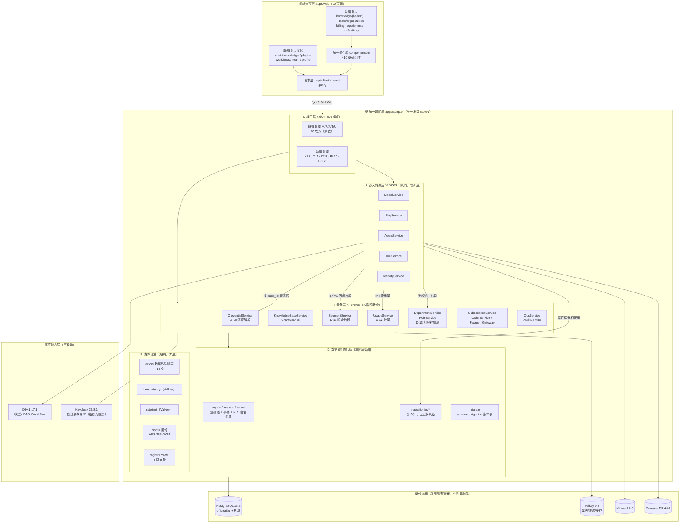
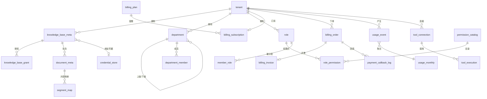
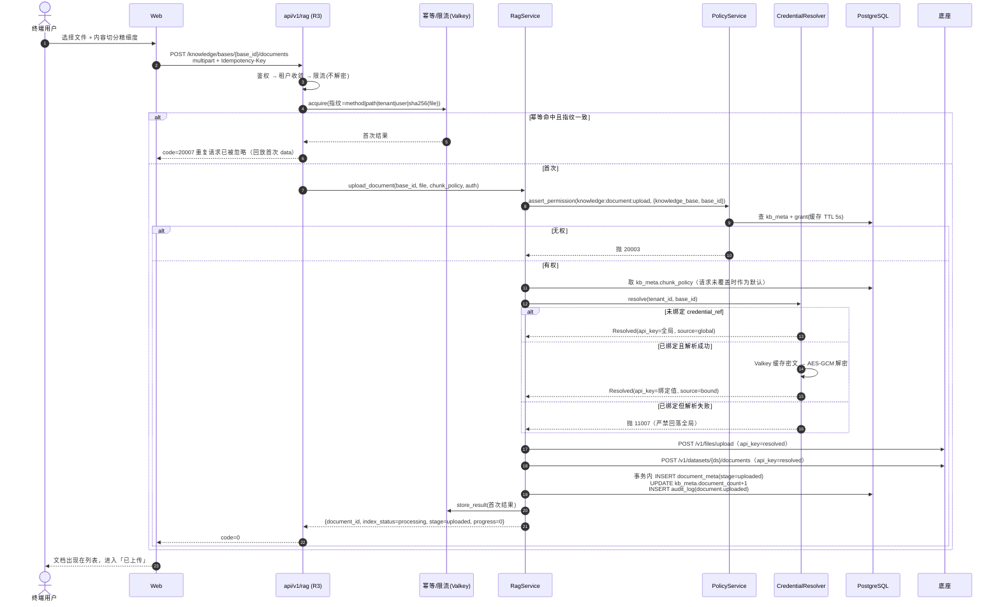
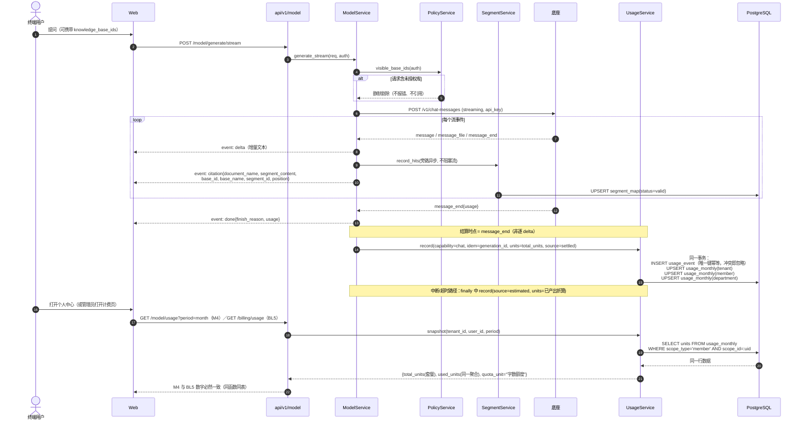
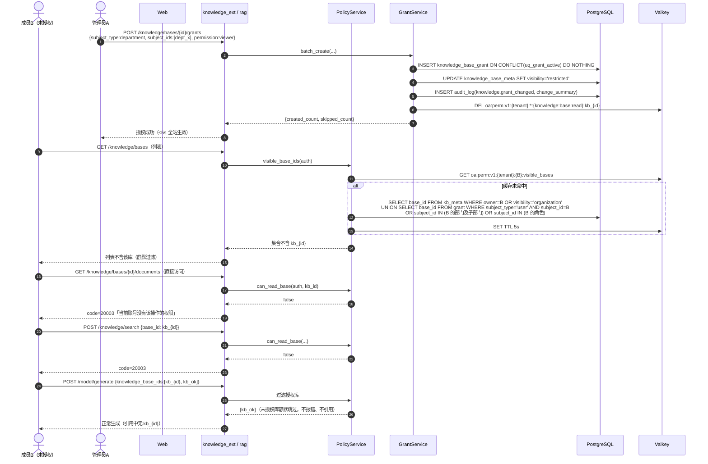
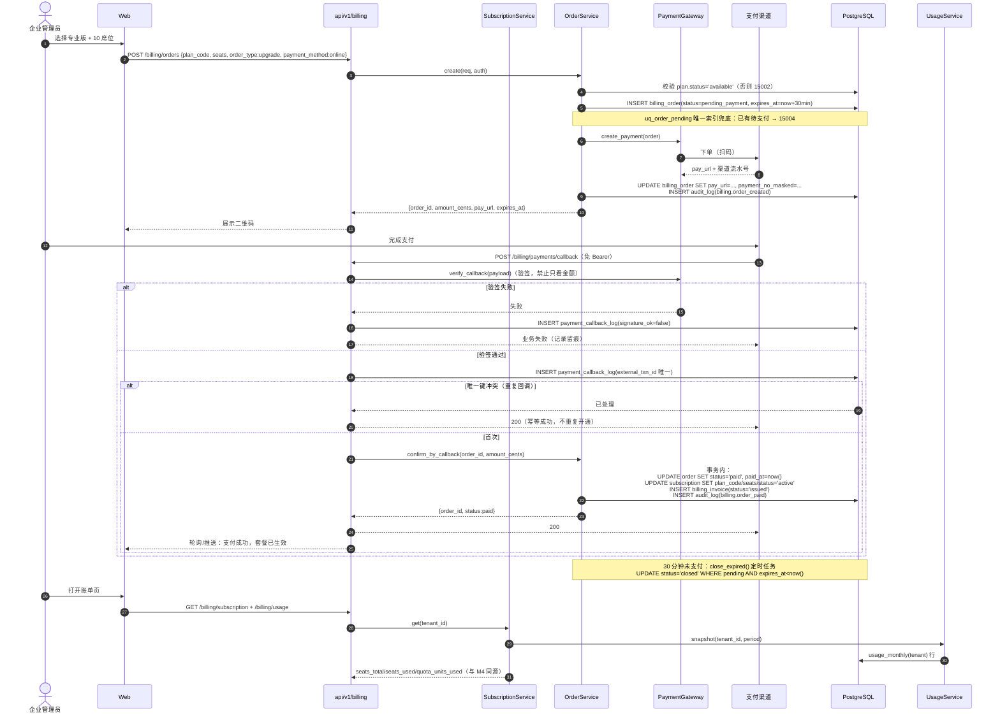
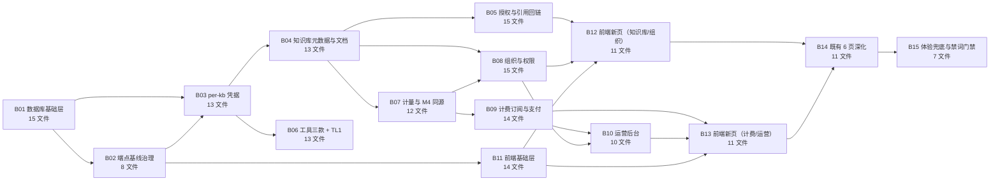

# 第二阶段（第 9-16 周）增量架构设计与批次化任务分解

| 项 | 内容 |
| --- | --- |
| 文档版本 | v2.0.0 |
| 文档性质 | 内部交付文档（供交付总监、产品经理、工程师、QA 消费） |
| 上游输入 | `docs/prd-phase2-increment.md`（增量 PRD，24 条 P0 / 9 条 P1 / 38 新增端点 / 8 处扩展）、`docs/phase2-progress-audit.md`（进度核对）、`docs/architecture-v1.0.md`（全量架构 30 端点基线） |
| 代码基线 | `main` @ `321d4f1`（适配层 9,920 行 / 30 端点 / 6 前端页面） |
| 作者 | 高见远（架构师） |
| 日期 | 2026-10-21 |
| 状态 | 待评审（评审通过即为阶段二契约基线） |
| 配套交付 | `deploy/init-schema-phase2.sql`（可直接执行的完整 DDL，本文件第 3 章为字段字典）、`docs/class-diagram-phase2.mermaid`、`docs/sequence-diagram-phase2.mermaid` |

### 修订记录

| 版本 | 日期 | 修订说明 |
| --- | --- | --- |
| v2.0.0 | 2026-10-21 | 首次发布：增量架构总览、6 个架构决策裁决（D-02/D-09/D-10/D-11/D-12/D-13）、完整业务库数据模型与 RLS 口径、38 个新端点契约、类图与时序图、错误码扩展（14 个）、前端页面与组件清单、15 个批次任务 + 5 个里程碑、依赖包清单、共享知识、PRD 冲突裁决 10 条 |

---

## 0. 结论速览（先看这一页）

### 0.1 六个架构决策的一句话结论

| 决策 | 结论（一句话） | 主要代价（明说） |
| --- | --- | --- |
| **D-02** 业务库归属 | 采用方案 A：**在 `apps/adapter` 内新增 `app/business/` + `app/db/` 两层**，同进程运行、逻辑分层、第三阶段可整体搬迁为独立服务；迁移用**手写编号 SQL + `schema_migration` 版本表 + `python -m app.db.migrate`**，不引入 Alembic | 适配层从「纯无状态」变为「有状态依赖（仅数据库）」，`architecture-v1.0.md` §1.2 的「适配层无状态」表述必须改写为「**无本地状态，状态外置 PostgreSQL/Valkey**」；扩容时数据库连接数是新瓶颈（池参数化） |
| **D-09** 端点基线扩张 | **拆两套基线**：`ADAPTER_CORE_ENDPOINTS = 30`（M/R/A/T/U 五域，**冻结不动**）+ `PHASE2_DOMAIN_ENDPOINTS = 38`（KB/TL/ID/BL/OPS 五新域）；CI 改为**分组断言 + OpenAPI 快照加性 diff**，8 处 `[扩展]` 只允许新增可选字段 | CI 门禁脚本复杂度上升（新增 `deploy/validate_openapi.py`，约 260 行），且每次加端点必须同步更新冻结基线文件，否则 CI 红 |
| **D-10** per-kb 凭据 | 知识库绑定 `credential_ref` → `credential_store` 表存 **AES-256-GCM 密文**（密钥来自 `OA_CREDENTIAL_ENCRYPTION_KEY`）；**未绑定 → 回落全局凭据（向后兼容）；已绑定但解析失败 → 抛 `11007`，绝不回落** | 新增 `cryptography` 依赖；凭据轮换需运维改配置 + 调 KB8 接口；解密失败即整库不可用（宁可故障不串库） |
| **D-11** 片段稳定标识 | `segment_key = 'seg_' + sha256(document_id\|segment_index\|content_sha256)[:16]`，落 `segment_map` 表；**判定 stale 的口径是「同一槽位内容哈希变化」**；stale 保留 90 天，返回 `HTTP 200 + status=stale`（不是错误） | 需要一次「重处理后批量置 stale」的批处理逻辑，且 M1/R7 回填映射是**旁路异步写**，允许最终一致（丢失映射时降级为「无 segment_id」） |
| **D-12** 计量同源 | 唯一真相源是 `usage_event`（幂等键 `generation_id/document_id/task_id`）+ `usage_monthly` 聚合表；**M4 与 `/billing/usage` 读同一张 `usage_monthly`**，同事务双写（tenant 行 + member 行），因此「按成员求和 = 企业总量」在结构上误差恒为 0；Valkey 只做限速计数与快照缓存 | 每次生成/文档处理多一次事务写；流式中断需折算兜底（`source=estimated`），折算口径必须写死否则对账不稳 |
| **D-13** 组织权威源 | **业务库 `department` / `department_member` / `member_role` 为唯一权威源**；Keycloak 只负责登录发令牌，组织树对 KC 是**单向投影（业务库 → KC）**，经 `integration_outbox` 异步重试；成员可多部门、`is_primary` 唯一（部分唯一索引强制） | KC 侧数据可能短暂滞后（秒级~分钟级）；KC 的 group 不作为任何判权依据，历史「KC group 即组织」的假设在第二阶段作废 |

### 0.2 关键数字

| 指标 | 数值 | 说明 |
| --- | --- | --- |
| 新增端点 | **38** | KB 8 / TL 1 / ID 11 / BL 10 / OPS 8（见第 4 章） |
| 既有端点扩展 | **8 处** | 只加可选字段，不改路径/请求/响应字段名/错误码（见 4.7） |
| 端点总数 | **68** | 30（冻结）+ 38（新增）；CI 分组断言 |
| 新增错误码 | **14** | `11007` + `14005-14008` + `15001-15009`（见第 7 章） |
| 新增数据表 | **23** | 另有 `schema_migration`（1 张，迁移版本表）与 `audit_log` 扩 6 列（既有表）；全部表清单见 3.1 |
| 新增环境变量 | **22** | 全部 `OA_` 前缀（见 11.5） |
| 新增 Python 依赖 | **1** | `cryptography`（Apache-2.0 OR BSD-3-Clause） |
| 新增 Node 依赖 | **6** | 4 个 Radix 基元 + recharts + （react-query 已在依赖中但未接入） |
| 批次总数 | **15** | 单批 ≤ 15 文件，依赖链见 9.3 |
| 里程碑 | **5** | T01-T05，与 15 批次映射见 9.4 |

---

## 1. 增量架构总览

### 1.1 现状与增量边界（代码事实）

| 现状事实（已逐行核对） | 阶段二的处理方式 |
| --- | --- |
| `apps/adapter` 30 端点全部实现，路径/字段/错误码已冻结 | **零改动**；8 处扩展只追加可选字段 |
| `RagService.list_bases()` 返回空分页（T01 桩），`visibility` 仅两档 | 改为读业务库 `knowledge_base_meta`，新增 `restricted` |
| `RagService.upload_document()` 不落库、`chunk_policy` 未按库持久化 | 落 `document_meta`；库级 `chunk_policy` 作为默认值 |
| `DifyClient` 全局单密钥（`settings.dify_default_app_key`） | 改为**按调用可覆盖 api_key**（连接池仍单例，见 2.3） |
| `ModelService.get_usage()` 为同步桩，恒返回 0 | 改 async，读 `UsageService`（同源 `usage_monthly`） |
| `IdentityService` 角色为扁平 `OrgRole`（owner/admin/member/guest） | 保留枚举不动，**判权数据源**改为业务库 `role`/`role_permission`/`member_role` |
| `tool_registry.yaml` 仅 2 款（email / github） | 追加 wecom / feishu / wechat_mp 三条 + 3 个连接器 |
| `pyproject.toml` 已有 `sqlalchemy>=2.0` + `asyncpg>=0.29` 但**从未使用** | 本阶段正式启用（无新增 ORM 依赖） |
| `deploy/init-rls.sql` 建了 `audit_log` + 3 条策略，但**未挂载到 compose** | 新脚本 `init-schema-phase2.sql` 幂等重建（含 audit_log 扩列与统一策略），compose 挂载新脚本 |
| `apps/web` 已有 `@tanstack/react-query@^5.5` 依赖但**未接入任何 Provider** | 本阶段正式接入（见 8.1） |
| `ci-adapter.yml` 硬断言 `len(business) != 30` | 改为分组断言 + 快照 diff（见 2.2） |
| `apps/web/package.json` 实为 `next@^16.4` / `react@^19.3`（架构文档 §8.2 写的是 14/18） | **以代码为准**，本文档不追溯该偏差，仅在 12 章登记 |

### 1.2 增量组件图



### 1.3 分层落位表（新增模块如何嵌进既有五层）

| 层 | 目录 | 允许做什么 | **禁止**做什么 | 本阶段变化 |
| --- | --- | --- | --- | --- |
| 接口层 | `app/api/v1/**` | 参数装配、依赖注入、响应包装、幂等与限流依赖 | 任何 SQL、任何业务判断、任何下游调用 | 新增 5 个模块文件；既有 5 文件仅追加端点/透传字段 |
| 协议转换层 | `app/services/**` | 底座/Keycloak 协议转换、字段映射、错误码翻译 | 直接写 SQL（**必须经 business/**）、套餐额度计算、组织树逻辑 | 5 个服务均改为「协议转换 + 调 business/」 |
| **业务层（新）** | `app/business/**` | 业务规则、判权编排、事务编排、审计写入、计量写入 | 出现 Dify/Keycloak 原生字段名、出现 httpx 调用 | 全新 |
| **数据访问层（新）** | `app/db/**` | SQL、会话、事务、RLS 会话变量、迁移 | 业务判断（如「能否删除」）、跨仓储编排 | 全新 |
| 支撑设施 | `app/core/**`、`app/clients/**`、`app/registry/**` | 错误码、幂等、限流、加密、配置、下游客户端 | — | 新增 `crypto.py`；`dify_client` 支持按调用覆盖 key |

**依赖方向铁律**：`api → services → business → db`，`business` 不得反向依赖 `services`；`db` 不得 import `business`；`services` 不得 import `db.repositories`。

### 1.4 请求链路中间件顺序（不可调换）

```
CORS → TraceMiddleware → AccessLogMiddleware
  → get_auth_context（验签，20002）
  → get_request_context（租户收敛：SaaS 头/token；private 强制 default）
  → enforce_ratelimit（20006，Valkey 计数，**不解密任何凭据**）
  → 路由函数
      → run_idempotent（Valkey 指纹，命中即回放/冲突）
          → Service（协议转换）
              → Business（判权 → 事务内：业务写 + 审计 + 计量）
                  → Repository（SQL，会话已 set_config('app.tenant_id')）
              → 凭据解析（仅知识库域，在幂等占位之后、下游调用之前）
              → 下游调用（Dify / 第三方工具）
  → 统一异常处理器（ApiError → {code,message,data}）
```

> **D-10 第 3 条落实**：`enforce_ratelimit` 在路由依赖层，**早于**任何凭据解析；凭据解析发生在 `run_idempotent` 的 factory 内部，因此「重复请求不会重复解密」，且「限流拒绝不会触发解密与数据库读取」。

---

## 2. 六个架构决策（ADR 摘要）

> 每条格式：背景 → 选项 → **结论** → 影响 → 回滚方式 → 落地批次。结论一律不可悬空。

### 2.1 D-02 业务库归属（最高优先级，Sprint 1 启动前必须明确）

**背景事实（矛盾点）**

- `architecture-v1.0.md` §1.2 写「adapter 无状态，状态全部外置 Redis/PostgreSQL」，但同一段又要求「**禁止**任何业务编排逻辑」；
- 而本阶段 38 个端点中，`knowledge_base_meta`、`knowledge_base_grant`、`document_meta`、`segment_map`、`tool_connection`、`usage_event`、`organization`、`billing_*`、`audit_log` **必须持久化且必须事务化**（计费对账与组织树无法用键值缓存表达）；
- 现状**没有独立业务服务**，前端只打适配层（`api-client.ts` 唯一出口），也就是说「业务能力层」当前是**空的**。

**选项对比**

| 方案 | 做法 | 优点 | 缺点（代价） | 判定 |
| --- | --- | --- | --- | --- |
| A | 适配层内新增 `app/business/` + `app/db/`，同进程、逻辑分层 | 零新增容器/CI/镜像；事务边界清晰（同进程一致性）；16 周内可交付；第三阶段可整体搬迁（目录已经是独立包） | 违反 V1.0 「无状态」字面表述（需改文档）；单进程内混布后，业务层故障影响协议转换 | ✅ **采用** |
| B | 新建独立服务 `apps/core` | 架构最干净，边界最硬 | 新容器 + 新 Dockerfile + 新 CI + 新部署单元 + 服务间鉴权 + 新契约，本阶段成本 ≥ 3 周，且会拖垮计费与前端两条关键路径 | ❌ 否决（第三阶段若扩容压力出现再拆） |
| C | 继续用 Valkey 存业务数据 | 零改动 | 无法支撑计费对账（无事务、无唯一约束、无聚合）、无法表达组织树（层级查询）、审计不可篡改无法保证 | ❌ 否决 |

**结论（生效）**

1. **业务数据落 PostgreSQL `officeai` 库**（与 Dify/Keycloak 逻辑库同实例、不同 schema 边界，复用现有 `postgres:18.6-alpine` 容器，**不新增容器**）。
2. 代码分层：`app/api/v1 → app/services → app/business → app/db`，`db` 层只允许 SQL 与会话管理。
3. **连接池**：`sqlalchemy.ext.asyncio.create_async_engine(OA_DATABASE_URL, pool_size=OA_DB_POOL_SIZE, max_overflow=OA_DB_MAX_OVERFLOW, pool_pre_ping=True, pool_recycle=1800, pool_timeout=5)`。容量口径：`副本数 × (pool_size + max_overflow) ≤ PG max_connections × 0.6`；默认 `pool_size=10 / max_overflow=10`，8 副本上限 160 连接，PG 侧 `max_connections=300` 预留充足。
4. **事务边界**：**一个 HTTP 请求 = 一个事务**，由 `business` 层显式开启（`async with uow(tenant_id) as uow:`）。跨请求不做长事务；批处理（文档 stage 轮询、计量对账）单独短事务。
5. **租户隔离双保险**：① 每个仓储方法的 SQL **必须**带 `tenant_id = :tenant_id`；② 表启用 `FORCE ROW LEVEL SECURITY`，会话变量 `app.tenant_id` 由 `db/session.py` 在**事务开始第一条语句**用 `SELECT set_config('app.tenant_id', :tid, TRUE)` 设置（`TRUE` = 事务级，**随事务结束自动复位**，杜绝连接池串租户）。未设置时策略为 NULL → 查不到任何行（fail-closed）。
6. **迁移方案**：**不引入 Alembic**。采用「编号 SQL 文件 + `schema_migration` 版本表 + `python -m app.db.migrate`」：
   - `deploy/init-schema-phase2.sql` = 全量幂等基线（首次启动由 `docker-entrypoint-initdb.d` 执行）；
   - 后续变更 `deploy/migrations/00NN_*.sql`，执行器按版本号顺序、单事务执行、记录 `version + checksum`，已执行版本 checksum 不符即启动失败（防手工改动漂移）。
   - **代价**：无自动 downgrade；回滚靠「写反向 SQL」。对单团队 16 周节奏可接受，且避免为 Alembic 引入 `alembic.ini` + `env.py` + 版本目录（约 +5 文件/批，且异步引擎配置易错）。
7. **幂等记录不落库**：仍用 Valkey（`oa:idem:*`，TTL 24h）。仅**支付回调**落库（`payment_callback_log`），因为它需要「永久可审计 + 跨进程唯一约束」。

**影响**

- `architecture-v1.0.md` §1.2 必须改：`adapter | 无（本地无状态；状态外置 PostgreSQL/Valkey）`；
- 适配层新增启动期依赖：数据库不可达 → `/readyz` 返回 `not_ready`（`30004`），`/healthz` 仍 `ok`；
- 私有化部署多一个必备环境变量 `OA_DATABASE_URL`（已存在，此前未被使用）。

**回滚方式**：`OA_BUSINESS_STORE=memory`（默认 `postgres`）作为**开发态开关**，只允许 `env in (development, test)` 时置为 `memory`；生产置 `memory` 直接启动失败（`30004`）。

**落地批次**：B01（db 层 + 迁移 + compose 挂载）、B03 起各域按批次增量。

---

### 2.2 D-09 端点基线扩张策略（会直接打破 CI 门禁，先定后做）

**背景**：`router.py: TOTAL_BUSINESS_ENDPOINTS = 30`、`ci-adapter.yml: if len(business) != 30: raise SystemExit(1)`、`docs/api/README.md §2.1` 三处绑定；PRD 新增 38 个端点。

**结论**

1. **两套基线，互不覆盖**：

| 常量 | 值 | 含义 | 变更权限 |
| --- | --- | --- | --- |
| `ADAPTER_CORE_ENDPOINTS`（原 `TOTAL_BUSINESS_ENDPOINTS` 语义不变，新增别名常量） | **30** | M1-M4 / R1-R7 / A1-A6 / T1-T7 / U1-U6 | **任何人不得修改**，只能通过 `/api/v2` 演进 |
| `PHASE2_DOMAIN_ENDPOINTS` | **38** | KB1-8 / TL1 / ID1-11 / BL1-10 / OPS1-8 | 本阶段冻结；变更走评审 |
| 合计 | **68** | CI 断言 `core == 30 and phase2 == 38` | — |

2. **路由挂载方式**：**同 `/api/v1` 前缀，不新增版本**。新增 5 个模块文件挂到**既有前缀**上：

| 模块 | 前缀 | 端点 |
| --- | --- | --- |
| `api/v1/knowledge_ext.py` | `/api/v1/knowledge` | KB1-KB8 |
| `api/v1/tools_ext.py` | `/api/v1/tools` | TL1 |
| `api/v1/identity_ext.py` | `/api/v1/identity` | ID1-ID11 |
| `api/v1/billing.py` | `/api/v1/billing` | BL1-BL10 |
| `api/v1/ops.py` | `/api/v1/ops` | OPS1-OPS8 |

   理由：`/knowledge/**`、`/identity/**`、`/tools/**` 已是既有资源域，新增子资源属于同域扩展；单独起 `/api/v2` 会让前端维护两套 baseURL，违反「单一出口」。
3. **CI 断言改造**（`deploy/validate_openapi.py`，新脚本）：

| 门禁 | 规则 | 失败即红 |
| --- | --- | --- |
| G1 核心基线 | `set(core_paths) == set(baseline-core-30.json)`（**精确集合相等**，新增/删除/改路径都红） | 是 |
| G2 新域基线 | `set(phase2_paths) == set(baseline-phase2-38.json)` | 是 |
| G3 计数 | `len(core)==30 and len(phase2)==38` | 是 |
| G4 **加性 diff**（针对 8 处 `[扩展]`） | 与 `openapi.snapshot.json` 对比：每个既有 operation 的 response schema **允许新增属性**；**禁止**删除属性、禁止改属性名、禁止改类型、禁止 `required` 变长、禁止 enum 收窄（允许新增枚举值如 `restricted`）、禁止新增必填请求字段、禁止删除既有错误码响应 | 是 |
| G5 泄漏扫描（保留既有） | 对外 OpenAPI 文本出现 `dify/milvus/litellm/chat-messages/tenant/audit` 等禁词即红 | 是 |

4. **快照与基线更新流程**（写进 PR 检查单）：改端点 → 手工跑 `python deploy/validate_openapi.py --update-snapshot` → **diff 必须只含新增行**，且必须在 PR 描述里贴 diff → 评审通过后提交。禁止直接改 `baseline-core-30.json`（该文件设 `CODEOWNERS` 保护）。

**影响**：CI 增加约 15 秒；每批新增端点必须同时提交基线文件更新（已写入各批次验收命令）。

**回滚方式**：G4 若因误报阻塞，可临时 `--skip-diff` 运行（仅允许在 `hotfix/*` 分支使用，并在 CI 日志中打印醒目告警）。

**落地批次**：B02。

---

### 2.3 D-10 per-kb 凭据机制（安全红线）

**现状**：`dify_client.get_dify_client()` 单例、单 `api_key`；`_headers()` 直接用 `self.api_key`。

**结论**

1. **存储**：`credential_store` 表，字段 `cipher_text BYTEA` + `nonce BYTEA` + `key_version SMALLINT` + `status`。
   - 算法：**AES-256-GCM**（`cryptography` 库 `AESGCM`），12 字节随机 nonce，密文含 16 字节 tag；
   - 明文**只在进程内存存活一个请求的生命周期**，不落日志、不进响应、不进 Valkey；
   - 密钥来源：`OA_CREDENTIAL_ENCRYPTION_KEY`（base64 编码的 32 字节）；轮换兼容 `OA_CREDENTIAL_ENCRYPTION_KEYS_LEGACY`（格式 `1:base64,2:base64`），解密时按行内 `key_version` 选密钥；
   - **密钥缺失且存在已绑定知识库时，启动即失败（`30004`）**；都不存在绑定时允许缺失（仅为本地开发便利），但首次解析到绑定即报错。
2. **解析链路**（`business/credential_service.py` 的 `CredentialResolver`）：

```
resolve(tenant_id, base_id):
  meta = kb_meta_repo.get(...)                       # 1 次查询，命中本地 TTL 30s 缓存
  if meta.credential_ref is None:
      return Resolved(api_key=settings.dify_default_app_key, source="global")   # 兼容现状
  # 已绑定：任何一步失败都不得回落
  try:
      row = credential_repo.get(tenant_id, credential_ref)      # Valkey 缓存「密文」非明文
      if row is None or row.status != "active": raise CredentialUnavailable
      plaintext = aes_gcm_decrypt(row.cipher_text, row.nonce, key(row.key_version))
      return Resolved(api_key=plaintext, source="bound", credential_ref=ref)
  except Exception:
      raise ApiError(ErrorCode.KB_CREDENTIAL_UNAVAILABLE)        # 11007，绝不 fallback
```

3. **缓存策略与失效**
   - 缓存对象 = **密文 + key_version**（base64），**不是明文**；TTL 300s；键 `oa:cred:v1:{tenant_id}:{credential_ref}`；
   - **不做负缓存**（凭据解析失败不缓存，避免运维修好后仍 5 分钟不可用）；
   - KB8 换绑后立即 `DEL` 对应键 + `DEL oa:kbcache:v1:{tenant_id}:{base_id}` → **下一请求即生效，无需重启**（PRD P2-KB-05 第 3 条）；
   - 库里 `credential_store` 缺失 Valkey 时**降级为直连数据库**（每请求 1 次查询），不阻断功能。
4. **严禁回落（防跨库串用）**：
   - 已绑定 → 解析失败 → `11007`（HTTP 200，文案「该知识库暂时无法访问，请联系管理员」）；
   - 代码级防线：`ResolvedCredential` 是 frozen dataclass，`source` 字段只有 `global|bound`，`bound` 分支的异常路径**不允许**再访问 `settings.dify_default_app_key`（评审检查点，单元测试 `test_credential_service.py::test_bound_failure_never_falls_back` 断言下游调用计数为 0）；
   - 日志只记 `credential_ref` 后 6 位 + `source`：`credential_resolved source=bound ref_suffix=a1b2c3 base_id=kb_...`。
5. **与幂等/限流的交互**（PRD 要求「不能在限流前解密」）：

| 环节 | 是否解密 | 说明 |
| --- | --- | --- |
| 鉴权 / 租户解析 | 否 | — |
| 限流（`enforce_ratelimit`） | 否 | 限流只依赖 `tenant_id/user_id/path` |
| 幂等占位（`check_or_set`） | 否 | 指纹不含凭据（不能把密钥纳入哈希，否则轮换后幂等键全失效） |
| 幂等 factory 内 | **是** | 解密只发生在真正要调下游的那一刻；重复请求直接回放首次结果，不解密 |
| 下游调用 | 使用 | `DifyClient.post(..., api_key=resolved.api_key)` |

6. **`DifyClient` 改造方式（最小侵入）**：给 `post/get/delete/post_stream` 增加关键字参数 `api_key: str | None = None`，`_headers(api_key=...)` 缺省回落 `self.api_key`。**不新增客户端实例**（否则每库一条连接池 → 连接数爆炸）。

**影响**：R3/R4/R5/R6/R7 + M1/M2（携带 `knowledge_base_ids` 时）全链路按库取凭据；`credential_store` 成为「一改全站」的高危表，写入接口只有 KB8 且需 `ops:console:access`。

**回滚方式**：`OA_CREDENTIAL_MODE=global`（临时）→ 所有库强制走全局凭据（**仅故障应急**，需在变更单注明，且日志 WARN 每请求一条）。

**落地批次**：B03（机制）→ B04/B05（各端点接入）。

---

### 2.4 D-11 引用回链的片段稳定标识

**背景**：R6/R5 重处理后底座 `segment id` 必变，历史引用会 404/空。

**结论**

1. **稳定键定义（唯一口径）**

```
segment_key = "seg_" + sha256(f"{document_id}|{segment_index}|{content_sha256}").hexdigest()[:16]
```

| 组成 | 取值 | 为何必须 |
| --- | --- | --- |
| `document_id` | 自研 `doc_` ID（**不是**底座 ID） | 底座重传后 ID 变，自研 ID 由 R3 首次创建即固定 |
| `segment_index` | 该文档内的片段序号（0 起） | 定位槽位；同内容不同位置不得混淆 |
| `content_sha256` | 片段正文 UTF-8 的 SHA-256（**先做 `strip()` 与空白归一**，再算） | 内容变化必须产生新键（这是 stale 判定的唯一依据） |

2. **落库机制**：`segment_map`（`tenant_id, segment_key PK, base_id, document_id, run_id, segment_index, native_segment_id, content_sha256, content_excerpt, position_*, status`）。
   - 写入时机：**旁路异步回填** —— R7 检索命中与 M1/M2 `citation` 事件到达时，`SegmentService.record_hits(...)` 以 `asyncio.create_task` 写库（`INSERT ... ON CONFLICT (tenant_id, segment_key) DO UPDATE SET native_segment_id=..., status='valid', stale_at=NULL`）；**写失败不影响主流程**（只记 WARN）。
   - `native_segment_id` 用于 R4/detail 场景向底座二次取片段（缓存未命中时）。
3. **stale 判定规则（三态机）**

| 事件 | 处理 | 结果 |
| --- | --- | --- |
| 正常检索命中 | upsert `status='valid'` | 可定位 |
| R5 重新处理开始 | 生成新 `run_id`，**旧行不动**（仍 `valid`） | 处理期间旧引用可继续查看（避免处理中大面积失效） |
| 新 run 成功完成 | `UPDATE segment_map SET status='stale', stale_at=now() WHERE document_id=? AND run_id<>? AND status='valid'`（同事务，与 `document_meta.stage='completed'` 一起提交） | 旧引用全部转 stale |
| 新 run 失败 | 不置 stale（旧行继续 `valid`） | 未成功处理不应让用户丢引用 |
| 同槽位内容哈希变化（新 run 已写同槽） | 新键插入，旧键因 `run_id` 不同在上一步已标 stale | — |
| R6 删除文档 | `status='deleted'`（软标），随文档级联删除时物理删（FK CASCADE） | 引用抽屉显示「该引用已不可查看」 |

4. **保留期**：stale 行保留 **90 天**（`OA_SEGMENT_MAP_RETENTION_DAYS=90`），每日 03:00 清理任务物理删除 `stale_at < now()-90d` 的行；`content_excerpt` 只保留前 512 字（够抽屉展示，控制表膨胀）。
5. **`status=stale` 的返回形态（PRD 明确要求 200 而非错误）**

```json
{ "code": 0, "message": "success", "data": {
    "segment_id": "seg_9f2c1a4b7d0e3f56",
    "document_id": "doc_01K...", "document_name": "员工手册.pdf",
    "base_id": "kb_01K...", "base_name": "人事制度库",
    "content": null,                       // 保留期内可返回旧内容；已清理则为 null
    "context_before": null, "context_after": null,
    "position": { "page": 12, "paragraph": 3 },
    "status": "stale"
} }
```

   前端据 `status` 展示「该引用来自旧版本内容，原文已更新」+ 文档入口；**不展示任何错误码**。
6. **R5 重处理时旧映射的处理策略汇总**：不预删、不预标；**成功后统一标 stale**；失败则保留 valid。这样「处理中」与「处理失败」两种状态下引用都不会误判为旧版本。

**影响**：多一张随文档量线性增长的表（1 万文档 × 250 片段 ≈ 250 万行，`content_excerpt` 512 字 → 约 1.2GB，可接受；分区留到第三阶段）。

**回滚方式**：`OA_SEGMENT_BACKFILL_ENABLED=false` 关闭回填（返回的 `segment_id` 字段改为返回空串，前端降级为「只展示片段内容」）。

**落地批次**：B05。

---

### 2.5 D-12 计量落库与 M4 同源

**结论**

1. **单一写入源**：`UsageService.record(UsageEvent)`，唯一入口；任何地方不得直接 upsert `usage_monthly`。
2. **幂等键**：`(tenant_id, capability, idem_key)` 唯一索引，`idem_key` = `generation_id`（对话）/ `document_id + run_id`（文档处理）/ `task_id`（自动化任务）。重放 → `ON CONFLICT DO NOTHING`（**不累加**）。
3. **流式结算时点**：`message_end`（映射为自研 `done` 事件）**而非逐 delta**。
   - 正常结束：用下游 `usage.total_units` 结算，`source='settled'`；
   - 中断/超时/客户端断开：在 SSE 生成器 `finally` 中按已产出内容折算，`source='estimated'`，公式：
     `units = prompt_units(已知则全额) + ceil(len(已产出文本) / OA_USAGE_CHARS_PER_UNIT)`，`OA_USAGE_CHARS_PER_UNIT=1`（中文字符≈1 字数额度）。折算值必须满足 `0 < units < 完整值`（PRD 验收 3 条）；
   - 未知 `prompt_units` 时按 `OA_USAGE_ESTIMATE_PROMPT_UNITS=800` 兜底（常量登记在配置，不改代码调参）。
4. **双写（同事务）**：一次结算写 1 行 `usage_event` + 3 类 `usage_monthly` upsert（`tenant` / `member` / `department`（有部门时）），全部在**同一事务**内：

```sql
INSERT INTO usage_monthly (tenant_id, period, scope_type, scope_id, capability, units)
VALUES (:tid, :period, 'member', :uid, :cap, :units)
ON CONFLICT (tenant_id, period, scope_type, scope_id, capability)
DO UPDATE SET units = usage_monthly.units + EXCLUDED.units, updated_at = now();
```

   因为「按成员求和」与「tenant 行」来自同一事件同一事务，**结构上保证误差 0**（不是靠对账「凑」出来）。
5. **M4 与 `/billing/usage` 同源**：

| 端点 | 数据来源 | 关系 |
| --- | --- | --- |
| M4 `GET /model/usage` | `billing_subscription`（额度总量）+ `usage_monthly(scope_type='member', scope_id=当前用户)` | 个人视角，字段不变 + 新增 `quota_unit` |
| BL5 `GET /billing/usage`（个人） | 同上（同一仓储方法 `usage_repo.snapshot(...)`） | **同一函数**，保证同刻快照一致 |
| BL5（管理视图 `group_by=member/department`） | `usage_monthly` 分组求和 | 求和 = tenant 行 |

6. **Valkey 的角色（显式降级）**：只保留 `oa:cnt:{tenant}:{yyyyMM}:{user}` 作为**实时限速与诊断计数**（TTL 40 天），**不作为用量真相源**；两者语义差异写入共享知识（11.4）。
7. **对账**：`apps/adapter/scripts/reconcile_usage.py`（每日 02:00 由运维 cron 或 CI 手动跑）：比对 `usage_event` 明细求和 vs `usage_daily` 聚合（不读 Valkey，口径见 `docs/qa-phase2-waivers.md` W-04），另有「成员行求和 == 租户行」结构误差必须为 0；偏差 > 1% 输出告警并在 `audit_log` 记 `billing.reconcile_mismatch`。阶段验收必须实跑一次（PRD P2-BL-03 验收 5）。

**影响**：M1/M2/R3/R5/A1 完成路径各多 1 次事务；`UsageService` 成为 M4、BL5、OPS6 三个端点的共同底座。

**回滚方式**：`OA_USAGE_WRITE_ENABLED=false` → 只读历史聚合（M4 回落到「读 `usage_monthly` 现有行」），不再写新事件。

**落地批次**：B07。

---

### 2.6 D-13 组织架构权威源

**背景**：Keycloak `group` 非严格树、成员可属多组、无「负责人」概念、无「主部门」；本阶段需要 5 层树 + 负责人 + 主部门 + 部门级数据可见范围。

**结论**

1. **业务库为唯一权威源**：`department`（物化路径 `path` + `level`）、`department_member`（多对多 + `is_primary` 部分唯一索引）、`member_role`（成员-角色，一企业一角色）。
2. **Keycloak 的职责收窄为**：登录、令牌签发、`sub` 标识。**任何判权不得读 KC group**（`identity_service.list_members` 的组织来源改为业务库）。
3. **同步方向单向**：业务库 → KC（`kind: kc_group_upsert / kc_group_delete / kc_user_group_sync`），经 `integration_outbox` 异步，指数退避重试（1s→8s→64s，最多 8 次），失败进 `status='failed'` 并告警。KC 侧仅为「便于未来 SSO 分组展示」的投影，**不允许**反向写入。
4. **数据模型（成员多部门 + 主部门唯一）**：
   - `department_member (tenant_id, department_id, user_id, is_primary, joined_at)`，PK `(tenant_id, department_id, user_id)`；
   - 主部门唯一由**部分唯一索引** `uq_dm_primary (tenant_id, user_id) WHERE is_primary` 在数据库层强制（不是靠应用判断）；
   - 调整主部门 = 同一事务内 `UPDATE ... SET is_primary=false WHERE user_id=?; UPDATE ... SET is_primary=true WHERE user_id=? AND department_id=?`。
5. **层级与移动**：`level ≤ 5` 由 CHECK 约束 + 应用层双重限制；移动部门 = 原子更新子树 `path`（`WHERE path LIKE :old_path || '%'`），禁止 `new_parent.path` 以 `old_path` 开头（防移动到自身子树）。
6. **判权缓存**：权限点判定结果缓存 TTL **5s**（`oa:perm:v1:{tenant}:{user}:{perm}:{resource}`），键在角色/授权/部门变更时精确删除 → 满足 PRD「≤5s 全站生效」。

**影响**：U3 成员列表 / U5 角色 / U1 判权三处数据源全部改为业务库；KC 从「权威」降为「投影」，`keycloak_client` 的组织相关方法标记 `deprecated`（保留但不再被业务调用）。

**回滚方式**：`OA_ORG_SOURCE=keycloak`（应急回退到旧行为），且只允许在功能开关关闭 + 数据迁移未开始前使用。

**落地批次**：B08。

---

## 3. 数据模型（PostgreSQL DDL）

> **完整可执行 DDL 见 `deploy/init-schema-phase2.sql`**（本仓库已交付，`psql -f` 可直接执行；脚本幂等，可重复跑）。本章给出**字段字典、约束与索引清单、RLS 口径**，并在 3.6 摘录 5 张最关键表的完整 DDL 以便评审时就地核对。

### 3.1 表清单与关系

| # | 表 | 归属域 | 主键 | 行量级（1 年估算） | 说明 |
| --- | --- | --- | --- | --- | --- |
| 1 | `schema_migration` | 基础设施 | `version` | < 100 | 迁移版本表（唯一由应用写入的元数据） |
| 2 | `tenant` | 组织 | `tenant_id` | 10³ | 企业主表（停用/启用、套餐冗余字段） |
| 3 | `knowledge_base_meta` | 知识库 | `(tenant_id, base_id)` | 10⁴ | 库级 `chunk_policy`/`visibility`/`credential_ref` |
| 4 | `knowledge_base_grant` | 知识库 | `(tenant_id, grant_id)` | 10⁵ | 三类 subject 的授权，撤销用 `revoked_at` |
| 5 | `document_meta` | 知识库 | `(tenant_id, document_id)` | 10⁶ | 五阶段进度 + 三态兼容字段 |
| 6 | `segment_map` | 知识库 | `(tenant_id, segment_key)` | 10⁷ | D-11 稳定片段映射 |
| 7 | `credential_store` | 知识库 | `(tenant_id, credential_ref)` | 10² | D-10 密文凭据 |
| 8 | `tool_connection` | 工具 | `(tenant_id, conn_id)` | 10⁴ | 个人/企业共用连接 |
| 9 | `tool_execution` | 工具 | `(tenant_id, execution_id)` | 10⁶ | TL1 调用记录 |
| 10 | `usage_event` | 计量 | `(tenant_id, event_id)` | 10⁷ | D-12 用量事件（幂等） |
| 11 | `usage_monthly` | 计量 | `(tenant_id, period, scope_type, scope_id, capability)` | 10⁵ | D-12 月度聚合 |
| 12 | `billing_plan` | 计费 | `(tenant_id='__platform__', plan_code)` | 3 | 套餐目录（平台行） |
| 13 | `billing_subscription` | 计费 | `(tenant_id, subscription_id)` | 10³ | 一企业一有效订阅 |
| 14 | `billing_order` | 计费 | `(tenant_id, order_id)` | 10⁴ | 一企业一待支付订单 |
| 15 | `billing_invoice` | 计费 | `(tenant_id, invoice_id)` | 10⁴ | 账单 |
| 16 | `payment_callback_log` | 计费 | `(tenant_id, callback_id)` | 10⁴ | 回调留痕 + 幂等唯一 |
| 17 | `department` | 组织 | `(tenant_id, department_id)` | 10³ | 物化路径树，level ≤ 5 |
| 18 | `department_member` | 组织 | `(tenant_id, department_id, user_id)` | 10⁵ | 多部门 + 主部门唯一 |
| 19 | `role` | 权限 | `(tenant_id, role_id)` | 10² | 内置 4 + 自定义 ≤ 50 |
| 20 | `role_permission` | 权限 | `(tenant_id, role_id, permission)` | 10³ | 角色-权限点 |
| 21 | `permission_catalog` | 权限 | `(tenant_id='__platform__', permission)` | 20 | 16 业务 + 4 运营权限点 |
| 22 | `member_role` | 权限 | `(tenant_id, org_id, user_id)` | 10⁵ | 成员角色 |
| 23 | `audit_log`（既有表扩展） | 审计 | `id` | 10⁷ | +6 列（角色/结果/IP 掩码/变更摘要/trace） |
| 24 | `ops_settings` | 运营 | `(tenant_id='__platform__', setting_key)` | 20 | 阈值/试用天数/公告 |
| 25 | `integration_outbox` | 组织 | `(tenant_id, outbox_id)` | 10⁵ | D-13 单向投影重试 |

> **阶段三/四与底座新增表（本表之外，登记在此以免与测试基线分叉）**
>
> 上表冻结的是**阶段二**的 25 张表。后续批次在同一 schema 里继续建表，
> 台账的权威清单是 `apps/adapter/tests/integration/test_schema_baseline.py::EXPECTED_TABLES`
> （schema 基线用例逐张比对，多一张少一张都红）；本节负责让**文档**不落后于它：
>
> | 批次 | 表 | 张数 |
> | --- | --- | --- |
> | 阶段三 0003/0004/0005 | `plugin_catalog` / `plugin_version` / `plugin_installation` / `plugin_grant` / `plugin_capability_policy` / `plugin_review` / `plugin_task` / `plugin_task_step` / `plugin_artifact` | 9 |
> | 阶段四 0008 | `conversation` / `message` | 2 |
> | 阶段四 0009/0010 | `user_memory` / `memory_embedding` / `user_memory_setting` / `background_job` | 4 |
> | 阶段四 0011 | `tenant_budget` | 1 |
> | **底座 0013（T02）** | `event_log`（父表，`HASH(session_id)` 分区，主键 `(tenant_id, session_id, seq)`）+ `event_log_p00` … `event_log_p15`（16 个分区，**是真实 relation**，也会出现在 `information_schema.tables` 里） | **17** |
>
> 合计 25 + 9 + 2 + 4 + 1 + 17 = **58 张**。新增迁移建表时必须同批更新
> ①本表 ②`test_schema_baseline.py::EXPECTED_TABLES` ③`test_g11_migration_idempotency.py::EXPECTED_TABLES`
> ——三处任缺一处，都会在下一次全量跑时变红（这正是它们存在的意义）。

### 3.2 关系图



### 3.3 字段字典（按域，只列关键字段；完整定义见 SQL）

**3.3.1 知识库域**

| 表.字段 | 类型 | 约束 | 说明 |
| --- | --- | --- | --- |
| `knowledge_base_meta.base_id` | TEXT | PK(`tenant_id,base_id`) | `kb_` + ULID |
| `.name` | TEXT | NOT NULL, `1..128` | 唯一（`lower(name)`，未删除范围内） |
| `.description` | TEXT | `≤1024` | 空串允许 |
| `.visibility` | TEXT | CHECK `organization/private/restricted` | **新增 `restricted`**（加性枚举） |
| `.chunk_policy` | TEXT | CHECK `default/fine` | 库级默认（PRD 要求持久化） |
| `.owner_user_id` | TEXT | NOT NULL | 所有者拥有最高权限且不可撤销 |
| `.credential_ref` | TEXT | NULL | NULL = 未绑定 → 全局凭据 |
| `.document_count` | INTEGER | `>=0` | 冗余计数（R3/R6 同事务 ±1），避免列表 count(*) |
| `.deleted_at` | TIMESTAMPTZ | NULL | 软删除；列表过滤 |
| `knowledge_base_grant.subject_type` | TEXT | CHECK `user/department/role` | — |
| `.permission` | TEXT | CHECK `viewer/editor` | `guest` 不得授 editor（应用层 + 14005/20001） |
| `.revoked_at` | TIMESTAMPTZ | NULL | 撤销标记；部分唯一索引只约束有效行 |
| `document_meta.stage` | TEXT | CHECK 5 值 | `uploaded/parsing/preparing/completed/failed` |
| `.index_status` | TEXT | CHECK 3 值 + 与 stage 联动 CHECK | 兼容字段，`completed ⟺ stage=completed` |
| `.run_id` | TEXT | NULL | 处理批次，R5 换新值 |
| `segment_map.segment_key` | TEXT | PK | `seg_` + 16 hex |
| `.content_sha256` | CHAR(64) | NOT NULL | 空白归一后哈希 |
| `.status` | TEXT | CHECK `valid/stale/deleted` | — |
| `credential_store.cipher_text/nonce/key_version` | BYTEA/BYTEA/SMALLINT | NOT NULL | AES-256-GCM |

**3.3.2 计量与计费域**

| 表.字段 | 类型 | 约束 | 说明 |
| --- | --- | --- | --- |
| `usage_event.idem_key` | TEXT | 唯一(`tenant_id,capability,idem_key`) | `generation_id`/`document_id:run_id`/`task_id` |
| `.units` | BIGINT | `>=0` | 字数额度 |
| `.period` | CHAR(7) | `YYYY-MM`（UTC） | 与套餐账期对齐 |
| `.source` | TEXT | `settled/estimated` | 折算兜底标记（对账时区分） |
| `usage_monthly.scope_type` | TEXT | `tenant/department/member` | 三行同事务写 |
| `billing_plan.price_per_seat_month_cents` | BIGINT | `>=0` | **分为单位**，展示层除以 100 |
| `billing_plan.features` | JSONB | NOT NULL | 功能开关清单（前端不硬编码额度） |
| `billing_subscription.status` | TEXT | 5 值 | 一企业一有效（部分唯一索引） |
| `.seats_total/.seats_used` | INTEGER | `>=1` / `>=0` | 席位校验返回 `15003` |
| `.pending_plan_code/.pending_change_at` | TEXT/TSTZ | NULL | 降级延后生效 |
| `billing_order.amount_cents` | BIGINT | `>=0` | `29900` → `¥299.00` |
| `.status` | TEXT | 5 值 | `pending_payment` 唯一（部分唯一索引） |
| `.expires_at` | TIMESTAMPTZ | NOT NULL | 30 分钟未支付转 `closed` |
| `payment_callback_log.external_txn_id` | TEXT | 唯一(`channel,external_txn_id`) | 回调幂等 |
| `.signature_ok` | BOOLEAN | NOT NULL | 验签结果留痕 |

**3.3.3 组织与权限域**

| 表.字段 | 类型 | 约束 | 说明 |
| --- | --- | --- | --- |
| `department.path` | TEXT | NOT NULL | 物化路径 `/dept_a/dept_b/`，子树查询 `LIKE` |
| `.level` | SMALLINT | `1..5` | 第 6 层插入被 CHECK 拦（应用层返回 `14006`） |
| `.manager_user_id` | TEXT | NULL | 部门负责人 |
| `department_member.is_primary` | BOOLEAN | 部分唯一(`tenant_id,user_id`) WHERE is_primary | 主部门唯一 |
| `role.role_key` | TEXT | 唯一(`tenant_id,org_id,role_key`) | `owner/org_admin/member/guest` + 自定义 |
| `.is_builtin` | BOOLEAN | NOT NULL | 内置角色不可删、owner 权限不可改 |
| `permission_catalog.permission` | TEXT | PK(`tenant_id,permission`) | `resource:sub:action` |
| `member_role` | — | PK(`tenant_id,org_id,user_id`) | 一企业一角色 |
| `audit_log.change_summary` | JSONB | NULL | `{"role":{"from":"member","to":"org_admin"}}` |
| `audit_log.ip_masked` | TEXT | NULL | `10.12.*.*` |

### 3.4 索引与约束汇总（评审关注点）

| 类型 | 对象 | 作用 |
| --- | --- | --- |
| 部分唯一 | `uq_kb_meta_name`（未删除范围内 name 唯一） | 防同名库；软删后可重名 |
| 部分唯一 | `uq_grant_active` | 同主体重复授权幂等（第二次 `skipped_count+1`） |
| 部分唯一 | `uq_conn_active` | 个人连接优先 / 企业共用并存 |
| 部分唯一 | `uq_subscription_active` | 一企业一有效订阅 |
| 部分唯一 | `uq_order_pending` | 一企业一待支付订单 |
| 部分唯一 | `uq_dm_primary` | 主部门唯一 |
| 唯一 | `uq_usage_event_idem` | 计量幂等（PRD 验收 2） |
| 唯一 | `uq_callback_external` | 回调幂等（PRD 验收 3） |
| 唯一 | `uq_seg_slot` | 同批次同槽唯一 |
| CHECK | `ck_doc_status_stage` / `ck_doc_failed_stage` | 三态与五阶段语义一致（PRD 兼容要求） |
| CHECK | `ck_conn_scope_owner` | 个人连接必有 owner，企业连接必有 org |
| 索引 | `idx_doc_base_time` / `idx_doc_base_stage` | 文档列表分页与阶段筛选（5000 条下稳定分页） |
| 索引 | `idx_usage_event_period_user/dept` | 计量 breakup 查询 |
| 索引 | `idx_exec_tool_time` | TL1 最近 20 次调用 |
| 索引 | `idx_audit_log_{tenant_time,actor,action}` | 操作记录 6 维筛选 |
| 索引 | `idx_outbox_due` | 投影重试扫描 |

**容量护栏**：文档列表分页必须走 `idx_doc_base_time` + `LIMIT/OFFSET`（或 keyset），**禁止** `COUNT(*)` 全表；`document_count` 用冗余字段。PRD 验收「5000 条下第 250 页响应体 < 200KB」由 `page_size ≤ 20` + 不返回 `content_excerpt` 保证。

### 3.5 RLS 与事务口径（D-02 / D-05）

| 项 | 口径 |
| --- | --- |
| 策略类型 | 全部业务表 `ENABLE + FORCE ROW LEVEL SECURITY`，统一策略 `p_tenant_isolation`（ALL 命令） |
| 判定表达式 | `tenant_id = current_setting('app.tenant_id', TRUE) OR current_setting('app.tenant_id', TRUE) = '__platform__'` |
| 未设置会话变量 | `current_setting(..., TRUE)` 返回 NULL → 策略为假 → **查不到任何行**（fail-closed） |
| 平台级目录表 | `permission_catalog` / `billing_plan` / `ops_settings` 额外允许 `tenant_id='__platform__'` 只读共享 |
| 设置时机 | 事务内**第一条** `SELECT set_config('app.tenant_id', :tid, TRUE)`（`is_local=TRUE`，事务结束自动复位） |
| 平台模式守卫 | `db/session.py` 的 `tenant_scope(allow_platform: bool=False)`；只有 `ops` 路由在通过 `ops:console:access` 校验后传 `allow_platform=True`；**其他任何调用方传 `__platform__` 直接抛 `30003`** |
| 应用层双保险 | 仓储方法签名强制 `tenant_id` 参数（`base.py` 的 `Repository._where_tenant()` 统一注入），代码评审检查「无 tenant 条件即打回」 |
| 私有化模式 | `OA_DEPLOY_MODE=private` → 会话变量固定 `default`，RLS 仍启用（单租户天然隔离） |
| 连接串 | 应用使用非超级用户 `officeai`（表所有者）；**禁止**使用 `postgres` 超级用户（超级用户 BYPASSRLS，双保险失效） |
| 残留风险 | `__platform__` 是字符串哨兵而非 DB 角色降权，若代码层守卫被绕过则 RLS 失效 → 已在 12 章列为待明确项，第三阶段评估独立 `oa_ops` BYPASSRLS 角色 + 独立连接串 |

### 3.6 关键表完整 DDL（就地核对用）

```sql
-- D-11 稳定片段映射
CREATE TABLE IF NOT EXISTS segment_map (
    tenant_id          TEXT        NOT NULL,
    segment_key        TEXT        NOT NULL,               -- seg_ + sha256(...)[:16]
    base_id            TEXT        NOT NULL,
    document_id        TEXT        NOT NULL,
    run_id             TEXT        NOT NULL,
    segment_index      INTEGER     NOT NULL CHECK (segment_index >= 0),
    native_segment_id  TEXT,
    content_sha256     CHAR(64)    NOT NULL,
    content_excerpt    TEXT        NOT NULL DEFAULT '',
    position_page      INTEGER,
    position_paragraph INTEGER,
    status             TEXT        NOT NULL DEFAULT 'valid'
                                   CHECK (status IN ('valid', 'stale', 'deleted')),
    created_at         TIMESTAMPTZ NOT NULL DEFAULT now(),
    stale_at           TIMESTAMPTZ,
    PRIMARY KEY (tenant_id, segment_key),
    CONSTRAINT fk_seg_base FOREIGN KEY (tenant_id, base_id)
        REFERENCES knowledge_base_meta (tenant_id, base_id) ON DELETE CASCADE,
    CONSTRAINT fk_seg_doc FOREIGN KEY (tenant_id, document_id)
        REFERENCES document_meta (tenant_id, document_id) ON DELETE CASCADE
);
CREATE UNIQUE INDEX IF NOT EXISTS uq_seg_slot
    ON segment_map (tenant_id, document_id, run_id, segment_index);
CREATE INDEX IF NOT EXISTS idx_seg_doc_status
    ON segment_map (tenant_id, document_id, status);

-- D-12 用量事件（幂等）
CREATE TABLE IF NOT EXISTS usage_event (
    tenant_id      TEXT        NOT NULL,
    event_id       TEXT        NOT NULL,                   -- use_ + ULID
    org_id         TEXT,
    department_id  TEXT,
    user_id        TEXT        NOT NULL,
    capability     TEXT        NOT NULL
                               CHECK (capability IN ('chat','doc_qa','doc_process','automation')),
    resource_type  TEXT        NOT NULL DEFAULT '',
    resource_id    TEXT        NOT NULL DEFAULT '',
    idem_key       TEXT        NOT NULL,
    units          BIGINT      NOT NULL CHECK (units >= 0),
    period         CHAR(7)     NOT NULL,
    source         TEXT        NOT NULL DEFAULT 'settled'
                               CHECK (source IN ('settled','estimated')),
    occurred_at    TIMESTAMPTZ NOT NULL DEFAULT now(),
    PRIMARY KEY (tenant_id, event_id)
);
CREATE UNIQUE INDEX IF NOT EXISTS uq_usage_event_idem
    ON usage_event (tenant_id, capability, idem_key);

-- D-12 月度聚合（M4 与 BL5 同源）
CREATE TABLE IF NOT EXISTS usage_monthly (
    tenant_id    TEXT        NOT NULL,
    period       CHAR(7)     NOT NULL,
    scope_type   TEXT        NOT NULL CHECK (scope_type IN ('tenant','department','member')),
    scope_id     TEXT        NOT NULL,
    capability   TEXT        NOT NULL
                             CHECK (capability IN ('chat','doc_qa','doc_process','automation')),
    units        BIGINT      NOT NULL DEFAULT 0 CHECK (units >= 0),
    updated_at   TIMESTAMPTZ NOT NULL DEFAULT now(),
    PRIMARY KEY (tenant_id, period, scope_type, scope_id, capability)
);

-- D-10 凭据（明文永不落库）
CREATE TABLE IF NOT EXISTS credential_store (
    tenant_id      TEXT        NOT NULL,
    credential_ref TEXT        NOT NULL,                   -- cred_ + ULID
    provider       TEXT        NOT NULL DEFAULT 'knowledge_base',
    cipher_text    BYTEA       NOT NULL,
    nonce          BYTEA       NOT NULL,
    key_version    SMALLINT    NOT NULL DEFAULT 1,
    status         TEXT        NOT NULL DEFAULT 'active'
                               CHECK (status IN ('active','revoked')),
    created_at     TIMESTAMPTZ NOT NULL DEFAULT now(),
    rotated_at     TIMESTAMPTZ,
    PRIMARY KEY (tenant_id, credential_ref)
);

-- D-13 组织树（物化路径 + 主部门唯一）
CREATE TABLE IF NOT EXISTS department (
    tenant_id       TEXT        NOT NULL,
    department_id   TEXT        NOT NULL,
    org_id          TEXT        NOT NULL,
    parent_id       TEXT,
    name            TEXT        NOT NULL CHECK (char_length(name) BETWEEN 1 AND 64),
    path            TEXT        NOT NULL,
    level           SMALLINT    NOT NULL CHECK (level BETWEEN 1 AND 5),
    manager_user_id TEXT,
    member_count    INTEGER     NOT NULL DEFAULT 0 CHECK (member_count >= 0),
    sort_order      SMALLINT    NOT NULL DEFAULT 0,
    deleted_at      TIMESTAMPTZ,
    created_at      TIMESTAMPTZ NOT NULL DEFAULT now(),
    updated_at      TIMESTAMPTZ NOT NULL DEFAULT now(),
    PRIMARY KEY (tenant_id, department_id),
    CONSTRAINT fk_dept_parent FOREIGN KEY (tenant_id, parent_id)
        REFERENCES department (tenant_id, department_id)
);
-- department_member 及其 uq_dm_primary 部分唯一索引见 deploy/init-schema-phase2.sql（第 10 节）
```

### 3.7 迁移机制

| 项 | 口径 |
| --- | --- |
| 基线脚本 | `deploy/init-schema-phase2.sql`（幂等全量；首次启动由 `docker-entrypoint-initdb.d/01-*` 执行） |
| 增量脚本 | `deploy/migrations/00NN_<name>.sql`，单事务、`BEGIN/COMMIT` 内置 |
| 执行器 | `python -m app.db.migrate --check`（只校验）/ `--apply`（应用）；启动时默认 `--apply`（`OA_DB_AUTO_MIGRATE=true`） |
| 版本表 | `schema_migration(version, checksum, applied_at)`；已应用版本 checksum 不符 → 启动失败（防手工漂移） |
| 回滚 | 手写反向 SQL（`deploy/migrations/rollback/00NN_*.sql`），不自动执行 |
| CI | `pytest tests/integration/test_migrate.py` 在一个临时 schema 上跑「空库 → 全量 → 再跑一次（幂等）」 |

---

## 4. 38 个新增端点契约

> 共同约定：响应一律 `{code, message, data}`；字段 **snake_case**；写接口必须 `Idempotency-Key`；ID 前缀见 11.1；`message` 一律业务语言（第 7 章给最终文案）。所有端点挂 `/api/v1` 前缀。

### 4.1 编号体系

| 域代码 | 域 | 前缀 | 编号 | 数量 |
| --- | --- | --- | --- | --- |
| KB | 知识库扩展 | `/api/v1/knowledge` | KB1-KB8 | 8 |
| TL | 工具扩展 | `/api/v1/tools` | TL1 | 1 |
| ID | 组织与权限 | `/api/v1/identity` | ID1-ID11 | 11 |
| BL | 计费 | `/api/v1/billing` | BL1-BL10 | 10 |
| OPS | 运营 | `/api/v1/ops` | OPS1-OPS8 | 8 |
| — | **合计** | — | — | **38** |

> 编号刻意不复用 `R/T/U/M/A` 单字母体系，避免与冻结的 30 端点编号混淆；`KB/TL/ID/BL/OPS` 为**新域**，与 `ADAPTER_CORE_ENDPOINTS` 完全隔离。

### 4.2 知识库域（KB1-KB8）

| # | 方法 | 路径 | 请求模型（关键字段） | 响应 `data` | 错误码 | 权限点 |
| --- | --- | --- | --- | --- | --- | --- |
| KB1 | PATCH | `/knowledge/bases/{base_id}` | `name?`(1-128) `description?`(≤1024) `chunk_policy?`(`default\|fine`) `visibility?`(`organization\|private\|restricted`)，**至少一项** | `base_id, name, description, chunk_policy, visibility, updated_at` | 11001 20003 20001 | `knowledge:base:update` + 对象级（owner / org_admin / grant=editor） |
| KB2 | DELETE | `/knowledge/bases/{base_id}` | — | `base_id, deleted=true, deleted_document_count` | 11001 20003 20005 | `knowledge:base:delete` + 仅 owner/org_admin |
| KB3 | GET | `/knowledge/bases/{base_id}/documents` | query: `page, page_size, keyword, stage, sort` | `items[{document_id, file_name, file_size, uploader_name, uploaded_at, index_status, stage, progress, estimated_remaining_seconds, segment_count, error_message}], meta` | 11001 20003 | `knowledge:base:read` |
| KB4 | GET | `/knowledge/bases/{base_id}/documents/{doc_id}/segments/{segment_id}` | query: `with_context=true` | `segment_id, document_id, document_name, base_id, base_name, content, context_before, context_after, position{page,paragraph}, status(valid\|stale)` | 11001 11004 20003 —— **stale 返回 200 + `status=stale`** | `knowledge:base:read` |
| KB5 | GET | `/knowledge/bases/{base_id}/grants` | query: `page, page_size` | `items[{grant_id, subject_type, subject_id, subject_name, permission, granted_by_name, granted_at}], meta` | 11001 20003 | `knowledge:grant:manage` |
| KB6 | POST | `/knowledge/bases/{base_id}/grants` | `subject_type`(`user\|department\|role`) `subject_ids[]`(≤50) `permission`(`viewer\|editor`) | `created_count, skipped_count` | 11001 20001 20003 | `knowledge:grant:manage` |
| KB7 | DELETE | `/knowledge/bases/{base_id}/grants/{grant_id}` | — | `grant_id, deleted=true` | 11001 20004 20003 | `knowledge:grant:manage` |
| KB8 | PUT | `/knowledge/bases/{base_id}/credential-binding` | `credential_ref`(`cred_...`) | `base_id, binding_status(bound\|fallback), updated_at` | 11001 20001 20004 20003 | `ops:console:access`（**前端不调用**，运维 token） |

**要点补充**

- KB3 的 `stage` 与 `index_status` **必须同时返回且语义一致**（DB CHECK 保证）；`estimated_remaining_seconds` 无法预估时返回 `null`。
- KB3 处理中删除文档 → R6 返回 `11006`（既有错误码，文案「文档正在处理，请稍后再删除」需用 `ApiError(message=...)` 覆盖既有默认文案——**允许**，因为 `ApiError` 设计上支持同码细分文案，不改变码值）。**这是 12 章裁决 #4**。
- KB4 `content=null` 仅在 stale 且已过保留期时出现；stale 但保留期内返回旧内容。
- KB6 `subject_ids` 中重复对象计入 `skipped_count`；`guest` 角色授 `editor` → `20001`（文案「访客只能查看，不能上传或管理文档」）。

### 4.3 工具域（TL1）

| # | 方法 | 路径 | 请求模型 | 响应 `data` | 错误码 | 权限点 |
| --- | --- | --- | --- | --- | --- | --- |
| TL1 | GET | `/tools/executions` | query: `tool_type, page, page_size` | `items[{execution_id, tool_type, tool_display_name, operation, operation_display_name, status(success\|failed), error_message, executed_at, operator_name}], meta` | 20003 | `tool:connection:manage`（只读查看；无权限时 T1-T5 亦只读） |

> T1-T7 **零改动**。新增 3 款工具只改 `tool_registry.yaml` 数据 + 新增 3 个连接器实现。

### 4.4 组织与权限域（ID1-ID11）

| # | 方法 | 路径 | 请求模型 | 响应 `data` | 错误码 | 权限点 |
| --- | --- | --- | --- | --- | --- | --- |
| ID1 | GET | `/identity/organizations/{org_id}/departments` | query: `flat=false` | `departments[{department_id, name, parent_id, path_names[], level, manager_name, member_count, children[]}]`（`flat=true` 为平铺数组） | 14002 20003 | 登录即可（只读） |
| ID2 | POST | `/identity/organizations/{org_id}/departments` | `name`(1-64) `parent_id?` | `department_id, name, parent_id, level` | 14002 14006 20001 20003 | `team:structure:manage` |
| ID3 | PATCH | `/identity/departments/{department_id}` | `name?` `parent_id?` `manager_id?` | `department_id, name, parent_id, level, manager_name, updated_at` | 14005 14006 20001 20003 | `team:structure:manage` |
| ID4 | DELETE | `/identity/departments/{department_id}` | — | `department_id, deleted=true` | 14005 14006 20003 | `team:structure:manage` |
| ID5 | GET | `/identity/permissions` | — | `groups[{group, group_name, permissions[{permission, display_name, description}]}]` | — | 登录即可 |
| ID6 | GET | `/identity/organizations/{org_id}/roles` | — | `items[{role_id, role_key, display_name, is_builtin, member_count, permissions[]}]` | 14002 20003 | `team:role:manage` |
| ID7 | DELETE | `/identity/organizations/{org_id}/roles/{role_id}` | — | `role_id, deleted=true` | 14003 20005 20003 | `team:role:manage` |
| ID8 | PATCH | `/identity/organizations/{org_id}/members/{member_id}` | `role?` `department_ids?` `primary_department_id?` `status?`(`active\|invited\|disabled`) | `member_id, role, department_ids, status, updated_at` | 14001 14005 14007 14008 20001 20003 | `team:member:update` |
| ID9 | DELETE | `/identity/organizations/{org_id}/members/{member_id}` | — | `member_id, removed=true, transferred_knowledge_base_count` | 14001 14007 14008 20003 | `team:member:update` |
| ID10 | POST | `/identity/organizations/{org_id}/members/batch` | `member_ids[]`(≤100) `action`(`update_role\|remove`) `role?` | `succeeded, failed[{member_id, reason}]` | 20001 20003 | `team:member:update` |
| ID11 | GET | `/identity/audit-logs/actions` | — | `groups[{group, group_name, actions[{action, display_name}]}]` | — | 登录即可 |

**要点补充**

- ID1 `path_names` 由物化路径 + 一次批量查询组装（**不做 N+1**）；`level` 由 DB 存值返回。
- ID2 超 5 层 → `14006`（文案「组织层级最多 5 层，请调整后重试」）；ID3 移动到自身子树 → `14006`（文案「不能把部门移动到自己的下级部门」）；ID4 有成员/子部门 → `14006`（默认文案「该部门下仍有成员或子部门，请先迁移后再删除」）——**同码三文案，由 `ApiError(message=...)` 区分**。
- ID7 角色被引用 → `20005` + 文案「该角色下还有 N 名成员，请先调整成员角色」（**裁决 #3**：不新增码，符合 PRD 原文）。
- ID8 保护规则：改 owner → `14007`；改与自己同级或更高级 → `14008`；改自己 → `14008`。
- ID9 移出成员时其创建的知识库 `owner_user_id` 转企业管理员 → `transferred_knowledge_base_count`。
- U3（既有）扩展：新增 query `department_id`、`status`；成员项新增 `department_ids/department_names/status/joined_at`（可选字段，加性）。
- U6（既有）扩展：请求新增 `actor_keyword/action_group/resource_type/result/start_at/end_at`；响应新增 `actor_role/result/ip_masked/action_display_name/change_summary`；跨度 > 90 天 → `20001` + 文案「查询时间范围最长 90 天，请缩小范围」。

### 4.5 计费域（BL1-BL10）

| # | 方法 | 路径 | 请求模型 | 响应 `data` | 错误码 | 权限点 |
| --- | --- | --- | --- | --- | --- | --- |
| BL1 | GET | `/billing/plans` | — | `plans[{plan_code, display_name, price_per_seat_month_cents, currency, min_seats, quota_units_per_seat_month, quota_unit_label, purchasable_quota, features[{feature_key, display_name, included, limit}], status, trial_days}]` | — | 登录即可 |
| BL2 | GET | `/billing/subscription` | — | `subscription_id, plan_code, plan_name, status, seats_total, seats_used, started_at, current_period_end, quota_units_total, quota_units_used, auto_renew, pending_change{plan_code, effective_at}\|null` | 15001? 否（无订阅返回 `plan_code=free` 空壳） | `billing:subscription:read` |
| BL3 | POST | `/billing/subscription` | `plan_code` `seats` `action`(`subscribe\|upgrade\|downgrade\|cancel_renew`) | `subscription_id, status, effective_at, order_id\|null` | 15001 15002 15004 15005 20003 | `billing:subscription:manage` |
| BL4 | PATCH | `/billing/subscription/seats` | `seats`(int ≥1) | `seats_total, seats_used, effective_at, order_id\|null, over_quota_warning` | 15003 20003 | `billing:subscription:manage` |
| BL5 | GET | `/billing/usage` | query: `period`(YYYY-MM) `group_by?`(`member\|department\|capability`) | `period, quota_units_total, quota_units_used, quota_units_remaining, usage_percent, over_quota_warning, breakdown[{key, display_name, units, percent}], daily_trend[{date, units}]` | 20003（管理视图） | 个人视图：`billing:subscription:read`（本人）；`group_by` 管理视图：`billing:subscription:read` + 管理员 |
| BL6 | POST | `/billing/orders` | `plan_code` `seats` `order_type`(`new\|renew\|upgrade\|seats`) `payment_method`(`online\|offline_transfer`) | `order_id, amount_cents, currency, status(pending_payment), payment_method, pay_url\|null, bank_info\|null, expires_at` | 15002 15004 20005 20001 20003 | `billing:subscription:manage` |
| BL7 | GET | `/billing/orders` | query: `status, page, page_size` | `items[{order_id, order_type, plan_code, seats, amount_cents, status, payment_method, created_at}], meta` | 20003 | `billing:subscription:read` |
| BL8 | GET | `/billing/orders/{order_id}` | — | `order_id, status, amount_cents, payment_no_masked, paid_at, invoice_status, plan_code, seats, created_at, expires_at` | 20004 20003 | `billing:subscription:read` |
| BL9 | GET | `/billing/invoices` | query: `period?` | `items[{invoice_id, period, amount_cents, status(issued\|pending), download_url}]` | 20003 | `billing:subscription:read` |
| BL10 | POST | `/billing/payments/callback` | 渠道载荷（`out_trade_no, transaction_id, amount_total, sign, ...`） | `{code, message}`（**对渠道方语义**） | 20001 15008 | **免 Bearer，必须验签** |

**要点补充**

- BL2 无订阅时返回 `plan_code='free'`、`status='active'`、`seats_total=3` 的合成视图（免费版一键开通的默认态），**不返回 404**。
- BL3 `downgrade`：响应 `effective_at=current_period_end`，`status` 保持当前；`pending_change` 有值。
- BL3 降级/减席导致用量超额：允许，返回 `code=0` + 额外字段 `warning=15006` 语义 → 实现方式：**HTTP 200 + `code=0`，`data` 内 `over_quota_warning: true`**（不用错误码，避免前端弹错）。15006 仅用于「进入常规模式」时的软提示响应（M1/M2 返回）。
- BL6 已有待支付订单 → `15004`（文案含「请先完成支付」），**不产生第二个订单**（部分唯一索引兜底）。
- BL10 幂等：`payment_callback_log` 唯一键冲突 → 直接返回成功语义（渠道要求 200），但**不重复开通**；重复核销人工路径 → `15008`。

### 4.6 运营域（OPS1-OPS8）

| # | 方法 | 路径 | 请求模型 | 响应 `data` | 错误码 | 权限点 |
| --- | --- | --- | --- | --- | --- | --- |
| OPS1 | GET | `/ops/tenants` | query: `keyword, status, page, page_size` | `items[{tenant_id, name, plan_code, seats_total, seats_used, status, created_at, quota_units_used}], meta` | 20003 | `ops:console:access` |
| OPS2 | GET | `/ops/tenants/{tenant_id}` | — | `tenant{...}, subscription{...}, usage{...}, recent_orders[]` | 20004 20003 | `ops:console:access` |
| OPS3 | PATCH | `/ops/tenants/{tenant_id}` | `status`(`active\|suspended`) | `tenant_id, status, updated_at` | 20004 20003 | `ops:tenant:manage` |
| OPS4 | GET | `/ops/orders` | query: `tenant_id, status, page, page_size` | `items[...], meta` | 20003 | `ops:console:access` |
| OPS5 | POST | `/ops/orders/{order_id}/confirm` | `paid_amount_cents` `remark` | `order_id, status(paid), subscription_status` | 15008 15009 20004 20003 | `ops:order:confirm` |
| OPS6 | GET | `/ops/metrics` | query: `range`(`7d\|30d`) | `tenant_count, active_tenant_count, active_user_count, conversation_count, document_count, quota_units_total, plan_distribution[], top_tenants[]` | 20003 20001 | `ops:console:access` |
| OPS7 | GET | `/ops/settings` | — | `settings{quota_warn_threshold, trial_days, quota_unit_label, announcement, plan_status{}}` | 20003 | `ops:console:access` |
| OPS8 | PATCH | `/ops/settings` | 同 OPS7 字段（部分） | `settings`（更新后全量） | 20001 20003 | `ops:settings:manage` |

**要点补充（最小可见原则，PRD 风险 R5）**

- OPS1/OPS2/OPS4/OPS6 **永不返回**：对话内容、文档原文、成员邮箱明文（邮箱仅返回 `masked_email`，如 `w***n@example.com`；本阶段直接不返回邮箱字段）。
- 企业用户 token（`tenant_id != '__platform__'`）调任一 `/ops/**` → `20003`（**不返回 404，避免探测**）。
- 所有 `/ops/**` 写操作写 `audit_log`，`actor_id` = 运营人、`tenant_id` = 被操作企业、`change_summary` 含备注。
- OPS5 金额不符 → `15009`（文案「订单金额与应付金额不一致，请核对后重试」）；已处理 → `15008`。

### 4.7 8 处既有端点扩展（加性，CI G4 断言）

| 端点 | 新增（只增不删） | 兼容性说明 |
| --- | --- | --- |
| R1 `POST /knowledge/bases` | 请求可选 `chunk_policy`；响应新增 `chunk_policy` | 缺省 `default`，旧客户端行为不变 |
| R2 `GET /knowledge/bases` | 条目新增 `chunk_policy`、`my_role`、`updated_at`；`visibility` 枚举新增 `restricted` | enum 加宽属加性；旧前端未识别值时展示「指定成员可见」由前端映射表兜底 |
| R3 `POST .../documents` | `chunk_policy` 表单字段语义改为「单次覆盖」（缺省仍 `default`）；响应新增 `stage` | 请求字段名与取值域不变 |
| R4 `GET .../documents/{doc_id}` | 新增 `stage`、`estimated_remaining_seconds`、`file_size`、`uploaded_at` | 全部可选/可空 |
| R7 `POST /knowledge/search` | `segments[]` 新增 `base_id`、`base_name`、`segment_id` | `position` 已存在，保持不变 |
| M1 `POST /model/generate` | `citations[]` 新增 `base_id`、`base_name`、`segment_id`、`position` | `document_name`/`segment_content`/`score` 保留不变 |
| M2 `POST /model/generate/stream` | `citation` 事件载荷同上新增 4 字段 | 事件名与既有字段不变 |
| M4 `GET /model/usage` | 新增 `quota_unit`（值「字数额度」）；数据源改 `usage_monthly` | 字段名/结构不变 |
| U3 / U6 | 见 4.4 要点 | 全部可选字段 + 新 query 参数 |

> **禁止**：修改任何既有字段名、删除字段、改字段类型、收窄枚举、变更错误码取值、变更 HTTP 状态码语义。CI G4 会机械校验。

### 4.8 权限点与端点映射矩阵（16 业务 + 4 运营）

| 权限点 | 端点 | 角色（owner/org_admin/member/guest） |
| --- | --- | --- |
| `knowledge:base:create` | R1 | ✅✅✅⛔ |
| `knowledge:base:update` | R1(改)、KB1 | ✅✅🔸⛔ |
| `knowledge:base:delete` | KB2 | ✅✅🔸⛔（对象级仅 owner/org_admin 或库 owner） |
| `knowledge:document:upload` | R3 | ✅✅✅⛔ |
| `knowledge:document:delete` | R6 | ✅✅🔸⛔ |
| `knowledge:grant:manage` | KB5 KB6 KB7 | ✅✅⛔⛔ |
| `knowledge:base:read` | R2 R7 M1 M2 KB3 KB4 | ✅✅🔸🔸（🔸= 仅被授权库） |
| `tool:connection:manage` | T2 T3 T4 TL1 | ✅✅🔸🔸 |
| `tool:execute` | T5 T6 T7 | ✅✅✅⛔ |
| `team:member:invite` | U4 | ✅✅⛔⛔ |
| `team:member:update` | ID8 ID9 ID10 | ✅✅⛔⛔ |
| `team:structure:manage` | ID2 ID3 ID4 | ✅✅⛔⛔ |
| `team:role:manage` | U5 ID6 ID7 | ✅✅⛔⛔ |
| `billing:subscription:read` | M4 BL2 BL5 BL7 BL8 BL9 | ✅✅🔸🔸（🔸= 个人用量/账单） |
| `billing:subscription:manage` | BL3 BL4 BL6 | ✅⛔⛔⛔ |
| `audit:log:read` | U6 | ✅✅⛔⛔ |
| `ops:console:access` | OPS1 OPS2 OPS4 OPS6 OPS7 + KB8 | 仅 `ops_operator` |
| `ops:order:confirm` | OPS5 | 仅 `ops_operator` |
| `ops:tenant:manage` | OPS3 | 仅 `ops_operator` |
| `ops:settings:manage` | OPS8 | 仅 `ops_operator` |

**三层校验（PRD 6.3 红线）落地顺序**：`租户层（token.tenant_id == 资源.tenant_id，否则 20003）→ 组织层（部门数据范围 / 库授权）→ 权限点层（U1 统一出口）→ 对象级（KB4/KB3/T5/BL8/KB7 必查对象归属）`。**禁止**「列表过滤了但详情接口没校验」。

---

## 5. 类图（新增 Service/Repository 与既有 Service 的关系）

```mermaid
classDiagram
    %% ---------- 既有（阶段一，仅扩展） ----------
    class ModelService {
        +generate(req) GenerateData
        +generate_stream(req) AsyncIterator
        +get_catalog() CatalogData
        +get_usage(auth, period) UsageData
    }
    class RagService {
        +create_base(req, auth) CreateBaseData
        +list_bases(query, auth) PageResult
        +upload_document(...) UploadDocumentData
        +get_index_status(...) IndexStatusData
        +reindex(...) ReindexData
        +delete_document(...) str
        +search(req, auth) SearchData
    }
    class AgentService
    class ToolService {
        +create_connection(req, auth) dict
        +execute(req, auth) ExecutionData
    }
    class IdentityService {
        +verify(req, auth) VerifyData
        +list_members(org_id, query, auth) PageResult
        +query_audit_logs(req, auth) PageResult
    }
    class DifyClient {
        +str base_url
        +str api_key
        +post(path, payload, api_key=None) DifyResponse
        +post_stream(path, payload, api_key=None) AsyncIterator
    }

    %% ---------- 新增：数据访问层 ----------
    class DbEngineFactory {
        +AsyncEngine engine
        +async_sessionmaker session_factory
        +dispose() void
    }
    class UnitOfWork {
        +str tenant_id
        +AsyncSession session
        +commit() void
        +rollback() void
    }
    class BaseRepository {
        +AsyncSession session
        +str tenant_id
        +_tenant_clause() ColumnElement
    }
    class KnowledgeBaseRepository
    class DocumentRepository
    class GrantRepository
    class SegmentRepository
    class CredentialRepository
    class ToolRepository
    class UsageRepository
    class OrgRepository
    class RoleRepository
    class AuditRepository
    class BillingRepository

    %% ---------- 新增：业务层 ----------
    class CredentialResolver {
        -dict _cache
        +resolve(tenant_id, base_id) ResolvedCredential
        +invalidate(tenant_id, credential_ref) void
    }
    class KnowledgeBaseService {
        +create(req, auth) CreateBaseData
        +list(query, auth) PageResult
        +update(base_id, req, auth) dict
        +soft_delete(base_id, auth) dict
        +resolve_visible_bases(auth) list
    }
    class DocumentService {
        +register_document(...) dict
        +list_documents(base_id, query, auth) PageResult
        +map_stage(native_status, progress) StageView
    }
    class GrantService {
        +list_grants(base_id, query, auth) PageResult
        +batch_create(base_id, req, auth) dict
        +revoke(base_id, grant_id, auth) dict
    }
    class SegmentService {
        +build_key(document_id, index, content) str
        +record_hits(tenant_id, base_id, doc_id, run_id, hits) void
        +fetch(base_id, doc_id, segment_key, with_context) dict
        +mark_stale(document_id, new_run_id) int
    }
    class PolicyService {
        +can_read_base(auth, base_id) bool
        +visible_base_ids(auth) set
        +assert_permission(auth, permission, resource) void
    }
    class UsageService {
        +record(event_ctx) void
        +snapshot(tenant_id, user_id, period) UsageSnapshot
        +breakdown(tenant_id, period, group_by) list
    }
    class DepartmentService {
        +tree(org_id, flat, auth) list
        +create(org_id, req, auth) dict
        +move(department_id, req, auth) dict
        +delete(department_id, auth) dict
    }
    class RoleService {
        +list_roles(org_id, auth) list
        +catalog() list
        +delete_role(org_id, role_id, auth) dict
    }
    class MemberService {
        +update_member(org_id, member_id, req, auth) dict
        +remove_member(org_id, member_id, auth) dict
        +batch(org_id, req, auth) dict
    }
    class KcProjectionService {
        +enqueue(kind, payload) void
        +flush_due(limit) int
    }
    class AuditService {
        +write(action, resource, result, change, auth) void
        +query(req, auth) PageResult
        +action_catalog() list
    }
    class SubscriptionService {
        +get(tenant_id) dict
        +change(req, auth) dict
        +change_seats(seats, auth) dict
    }
    class OrderService {
        +create(req, auth) dict
        +list(query, auth) PageResult
        +confirm(order_id, req, operator) dict
        +close_expired() int
    }
    class PaymentGateway {
        <<interface>>
        +create_payment(order) PayResult
        +verify_callback(payload) VerifyResult
        +parse_callback(payload) CallbackEvent
    }
    class OpsService {
        +list_tenants(query) PageResult
        +tenant_detail(tenant_id) dict
        +set_status(tenant_id, status, operator) dict
        +metrics(range) dict
        +get_settings() dict
        +patch_settings(patch, operator) dict
    }

    %% ---------- 关系 ----------
    RagService --> KnowledgeBaseService
    RagService --> DocumentService
    RagService --> GrantService
    RagService --> SegmentService
    RagService --> PolicyService
    RagService --> CredentialResolver
    RagService --> DifyClient
    ModelService --> UsageService
    ModelService --> SegmentService
    ModelService --> PolicyService
    ModelService --> DifyClient
    AgentService --> UsageService
    ToolService --> ToolRepository
    ToolService --> AuditService
    IdentityService --> PolicyService
    IdentityService --> MemberService
    IdentityService --> AuditService
    IdentityService --> RoleService

    KnowledgeBaseService --> KnowledgeBaseRepository
    KnowledgeBaseService --> GrantRepository
    KnowledgeBaseService --> AuditService
    DocumentService --> DocumentRepository
    DocumentService --> UsageService
    GrantService --> GrantRepository
    GrantService --> OrgRepository
    GrantService --> AuditService
    SegmentService --> SegmentRepository
    UsageService --> UsageRepository
    DepartmentService --> OrgRepository
    DepartmentService --> KcProjectionService
    DepartmentService --> AuditService
    RoleService --> RoleRepository
    MemberService --> RoleRepository
    MemberService --> OrgRepository
    MemberService --> KnowledgeBaseRepository
    SubscriptionService --> BillingRepository
    SubscriptionService --> UsageService
    OrderService --> BillingRepository
    OrderService --> SubscriptionService
    OrderService --> PaymentGateway
    OrderService --> AuditService
    OpsService --> BillingRepository
    OpsService --> UsageService
    OpsService --> AuditService

    CredentialResolver --> CredentialRepository
    CredentialResolver --> KnowledgeBaseRepository

    KnowledgeBaseRepository --|> BaseRepository
    DocumentRepository --|> BaseRepository
    GrantRepository --|> BaseRepository
    SegmentRepository --|> BaseRepository
    CredentialRepository --|> BaseRepository
    ToolRepository --|> BaseRepository
    UsageRepository --|> BaseRepository
    OrgRepository --|> BaseRepository
    RoleRepository --|> BaseRepository
    AuditRepository --|> BaseRepository
    BillingRepository --|> BaseRepository

    BaseRepository --> UnitOfWork
    UnitOfWork --> DbEngineFactory
```



**依赖方向自检（评审用）**：`services` 只指向 `business` 与其自身客户端；`business` 只指向 `db` 与 `core`；**没有任何 `business → services` 或 `db → business` 边**。`PaymentGateway` 是接口（`Protocol`），微信支付实现 `WechatPayGateway` 为唯一实现，第三方 SDK 依赖隔离在该类内。

---

## 6. 时序图（4 张关键链路）

### 6.1 R3 上传文档（含 per-kb 凭据解析，D-10）



### 6.2 M1/M2 生成 + 用量事件落库 + M4 同源读（D-12 / D-11）



### 6.3 知识库授权校验（restricted 可见性，三处同一套判定）



### 6.4 计费订阅变更 + 订单支付回调幂等（D-12 / 部分唯一索引）



---

## 7. 错误码扩展表（按域重编号后的最终表）

> 现有错误码**取值与文案一律不得修改**（架构文档 §3.0.3 + `errors.py` 注册表）。新增码必须先落本文档 + 架构文档 + `business-errors.ts`，再进代码。

### 7.1 新增错误码（14 个）

| code | HTTP | message（用户可见，最终文案） | 内部含义 | 域 | 使用端点 |
| --- | --- | --- | --- | --- | --- |
| **11007** | 200 | 该知识库暂时无法访问，请联系管理员 | 绑定凭据解析失败（缺失/失效/解密失败）；**禁止回落全局** | RAG | R3 R4 R5 R6 R7 |
| **14005** | 404 | 该部门不存在或已被删除 | 部门不存在 | 权限 | ID3 ID4 ID8 |
| **14006** | 400 | 该部门下仍有成员或子部门，请先迁移后再删除 | 部门删除/层级冲突（默认文案） | 权限 | ID2 ID3 ID4 |
| **14007** | 400 | 不能移除企业所有者，请先转移所有权 | 所有者保护 | 权限 | ID8 ID9 ID10 |
| **14008** | 403 | 你没有权限修改该成员 | 同级或更高级成员保护 / 操作自己 | 权限 | ID8 ID9 ID10 |
| **15001** | 403 | 当前套餐不支持该功能，升级后即可使用 | 套餐能力未开通 | 计费 | BL3 BL6 |
| **15002** | 400 | 该套餐已下架，请选择其他套餐 | 套餐不可购 | 计费 | BL3 BL6 |
| **15003** | 400 | 成员席位已用满，请先增加席位 | 席位不足（邀请/加成员/减席越界） | 计费 | BL4 U4（复用调用） |
| **15004** | 409 | 当前账户有未完成订单，请先完成支付 | 重复下单 | 计费 | BL3 BL6 |
| **15005** | 200 | 降级将在当前周期结束后生效 | 变更生效时点（**非阻断提示码**） | 计费 | BL3 |
| **15006** | 200 | 本月额度已用完，当前为常规模式，升级套餐可恢复完整能力 | 额度用尽（软限制，不停服） | 计费 | M1 M2 R3 A1 |
| **15007** | 200 | 支付未完成，请重新支付 | 支付失败/超时 | 计费 | BL6 BL8 |
| **15008** | 409 | 该订单已处理，请勿重复操作 | 重复核销/重复回调的业务侧冲突 | 计费 | BL10 OPS5 |
| **15009** | 400 | 订单金额与应付金额不一致，请核对后重试 | 核销金额校验失败 | 计费 | OPS5 |

**同码多文案（`ApiError(message=...)` 覆盖，`code` 不变）**

| code | 场景 | 覆盖文案 |
| --- | --- | --- |
| 14006 | 建第 6 层 | 组织层级最多 5 层，请调整后重试 |
| 14006 | 移动到自身子树 | 不能把部门移动到自己的下级部门 |
| 14006 | 删除有成员部门 | 该部门下仍有成员或子部门，请先迁移后再删除 |
| 11006 | 处理中删除文档（既有码） | 文档正在处理，请稍后再删除 |
| 20005 | 角色被引用不可删（既有码） | 该角色下还有 3 名成员，请先调整成员角色 |
| 20001 | 授权 guest=editor | 访客只能查看，不能上传或管理文档 |
| 20001 | 操作记录跨度 > 90 天 | 查询时间范围最长 90 天，请缩小范围 |
| 20001 | 批量 > 100 人 | 一次最多处理 100 位成员，请分批操作 |
| 20001 | 企业微信单次 > 200 人 | 一次最多发送给 200 人，请分批发送 |

### 7.2 与产品经理建议的差异（重编号说明）

| PM 建议 | 我的裁决 | 理由 |
| --- | --- | --- |
| `16001`「当前账号没有该操作的权限」 | **不采纳**，运营端复用 `20003` | `16001` 落在既有分段 **空隙**（10001-14999 与 20000-20999 之间），登记表无归属；且语义与 `20003` 完全一致，重复码会让前端兜底表出现两套文案 |
| `15005` HTTP 400 | 改为 **HTTP 200**，且只在「无法立即生效」时使用 | 「降级将在下周期生效」是**正常业务结果**不是错误；若返回 400，前端必须弹错误态，与 PRD「提示生效日期」冲突 |
| `15006` 用于额度用尽 | 保留，但**仅**用于 M1/M2/R3/A1 的软限制提示；BL3/BL6 用 `data.over_quota_warning` 布尔字段 | 套餐变更成功不应返回非 0 code，否则前端 `unwrap()` 会抛业务异常 |
| 凭据失效用 `11005` | 新增 `11007` | `11005` 文案「检索服务暂时不可用，请重试」已冻结，改文案即违约；同码多文案会让「错误码 → 文案」兜底表失效（该表以 code 为键） |
| 缺 `15009` | 新增 | 运营核销必须校验金额，否则可被误核销为任意金额 |

---

## 8. 前端页面与组件清单

### 8.1 全局技术结论（含 react-query 裁决）

| 议题 | 结论 | 理由 |
| --- | --- | --- |
| **是否引入 react-query** | **是，正式接入**（依赖已在 `package.json`，此前未挂 Provider） | 本阶段新增 5 页面 + 6 页深化，涉及分页列表、轮询（文档进度）、条件失效（授权变更后列表刷新）三类高频模式；手写 `useEffect + fetch` 已在 `team/page.tsx` 出现 loading/error 重复样板，继续手写会放大 3 倍代码量并引入竞态。**成本**：在 `(main)/layout.tsx` 外层挂 `QueryClientProvider`，约定 `staleTime=15s / retry=1 / refetchOnWindowFocus=false` |
| 状态分工 | **react-query 管服务端状态**（列表、详情、分页、轮询、变更后失效）；**zustand 管客户端 UI 状态**（当前会话、抽屉开合、筛选草稿） | 避免把服务端缓存塞进 zustand（`use-conversation-store` 保持现状） |
| 请求出口 | 仍然**只有** `lib/api-client.ts`；新增 `billingApi / opsApi / knowledgeExtApi / identityExtApi / toolsExtApi` 五组方法 | 红线：禁止组件内 `fetch` |
| 错误展示 | 统一 `toBusinessMessage(err)` → `ErrorState`；`business-errors.ts` 补 14 个新码兜底 | 新增码未补 → 显示「操作未完成，请稍后再试」，不暴露 code |
| 数据形态 | 金额：后端 `amount_cents` → 前端 `formatCents()`（`29900` → `¥299.00`）；额度：`formatUnits()`（`1234567` → `123.5 万字`，<1 万显示精确值） | PRD 5.2/5.4 展示口径 |
| UI 库补充 | 新增 10 个基础组件（见 8.4），全部走 `tailwind.config.ts` 设计令牌，主色 `#2563EB` | 100% 统一组件库硬约束 |

### 8.2 新增页面（5 个）

| # | 路由 | 页面 | 主要区块 | 依赖端点 | 状态管理 |
| --- | --- | --- | --- | --- | --- |
| P-01 | `/knowledge/[baseId]` | **知识库详情** | 页头（名称/可见范围徽标/我的权限徽标/设置/删除）+ 三标签（文档·成员授权·基本信息，`?tab=` 可分享）+ 拖拽上传区 + 文档表格（8 列）+ 分页 + 右侧信息栏 | R2 R3 R5 R6 KB1 KB2 KB3 KB4 KB5 KB6 KB7 | `useQuery(['kb', id])`、`['kb', id, 'documents', filters]`、`['kb', id, 'grants']`；上传后 `invalidateQueries(['kb', id, 'documents'])` + 进度轮询 `refetchInterval: 3000`（全部 completed 后停止） |
| P-02 | `/team/organization` | **组织架构** | 左部门树（搜索/懒加载/右键菜单：新建·重命名·移动·设负责人·删除）+ 右侧部门详情（负责人/成员数/成员表格）+ 顶部工具条（新建部门、角色权限） | ID1 ID2 ID3 ID4 U3 ID8 ID6 ID5 ID7 | `['org', orgId, 'tree']`（`staleTime=30s`）；拖拽移动 = `useMutation` → 成功后 `invalidateQueries`；第 6 层新建按钮本地禁用 + 文案 |
| P-03 | `/billing` | **套餐与账单** | 当前套餐卡 + 额度进度条 + 套餐对比表（3 列）+ 用量趋势图（30 天）+ 按功能分布 + 底部标签（订单·账单） | BL1 BL2 BL3 BL4 BL5 BL6 BL7 BL8 BL9 | `['billing','plans']` `['billing','subscription']` `['billing','usage',period]` `['billing','orders',page]`；升级抽屉内 `useMutation` → 成功后失效 subscription/orders |
| P-04 | `/ops/tenants`（+`/ops/tenants/[id]`） | **运营-企业列表与详情** | 独立布局侧边栏（企业管理/订单管理/数据统计/系统配置）+ 企业表格（可下钻）+ 详情（成员数/订阅/用量趋势/近期订单）+ 停用启用（二次确认 + 原因） | OPS1 OPS2 OPS3 | `['ops','tenants',filters]`；`staleTime=10s` |
| P-05 | `/ops/orders` + `/ops/metrics` + `/ops/settings` | **运营-订单/统计/配置** | 订单表格（按企业/状态/时间筛选）+ 核销弹窗（金额+备注+二次确认）+ 指标卡 ×4 + 图 ×2 + Top20 表 + 配置表单 | OPS4 OPS5 OPS6 OPS7 OPS8 | `['ops','orders']` `['ops','metrics',range]` `['ops','settings']`；核销成功失效 orders + metrics；配置保存后 `setQueryData` 直更 |

> 运营后台独立布局：`app/(main)/ops/layout.tsx` 不展示业务侧边栏；企业用户进入 → `20003` → 展示「当前账号没有该操作的权限」并给返回入口。

### 8.3 既有 6 页深化

| 页面 | 必须完成的增量 | 依赖端点 |
| --- | --- | --- |
| `/chat` | ① 引用条可点击 → 右侧抽屉（宽 480，片段全文+前后文+位置+「在文档中定位」）；② 对话内知识库选择器（只显示有权限的）；③ **补齐 ErrorState**（当前唯一无错误态的页面）+ 重试；④ 额度 ≥80% 顶部提示条；⑤ 流式中断可「重新发送」 | M1 M2 M4 KB4 R7 R2 |
| `/knowledge` | 卡片增加 内容切分精细度徽标 / 可见范围徽标 / 文档数徽标；空态区分「还没有知识库」与「筛选无结果」；新建库弹窗支持选精细度；更多菜单（编辑/成员授权/删除，删除含文档数二次确认） | R1 R2 KB1 KB2 |
| `/plugins` | 新增「办公工具」页签（5 卡片：图标/名称/能力数/状态/最近调用时间）；卡片操作（连接/重连/断开二次确认/能力清单抽屉/最近 20 次调用）；连接失败给下一步建议 | T1 T2 T3 T4 TL1 |
| `/workflows` | 任务列表展示中文任务名与进度；失败任务「重试」（A5 取消 + A1 重建）；失败详情给业务语言原因；空态文案改造 | A1 A2 A3 A4 A5 A6 |
| `/team` | 改三标签「成员 / 组织架构（跳转）/ 操作记录」；成员表格加 部门/状态 列与筛选；角色下拉即时保存；移出二次确认含数据处置说明；席位不足时邀请按钮旁「增加席位」链接 | U3 U4 U6 ID8 ID9 ID10 ID11 |
| `/profile` | 新增「套餐与用量」区块（字数额度进度 + 跳 `/billing`）；无 `billing:subscription:read` 时只显示个人用量；用量加载失败文案「用量信息暂时不可用，请稍后重试」 | U2 M4 BL5 BL2 |

### 8.4 组件库需补的基础组件（10 个 + 2 个业务组件）

| # | 组件 | 关键能力 | 来源 |
| --- | --- | --- | --- |
| 1 | `Table` | 列定义、排序、行高 48px、loading 骨架、空态插槽、固定表头 | 自建（基于原生 table + 令牌） |
| 2 | `Tabs` | URL 同步（`?tab=`）、键盘导航 | `@radix-ui/react-tabs` |
| 3 | `Select` | 单选/多选、搜索、禁用项带原因 | `@radix-ui/react-select` |
| 4 | `DateRangePicker` | 近 7/30/90 天快捷项、最大跨度校验（90 天） | `@radix-ui/react-popover` + `date-fns` |
| 5 | `Progress` | 三色阈值（<80% 主色 / 80-99% 警示 / ≥100% 危险） | 自建（`aria-valuenow`） |
| 6 | `Drawer` | 右侧滑出、480px、ESC 关闭、焦点陷阱 | `@radix-ui/react-dialog`（变体） |
| 7 | `Skeleton` | 三种形态（列表/表格/卡片） | 自建 |
| 8 | `ConfirmDialog` | 危险操作红按钮、需输入确认文本可选 | 复用现有 `Dialog` |
| 9 | `Pagination` | 页码跳转、page_size 选择、总数展示 | 自建 |
| 10 | `Tooltip` | 权限不足时的 hover 原因文案 | `@radix-ui/react-tooltip` |
| 11 | `StatusBadge`（业务） | 映射 stage/subscription/connection 状态到中文 + 颜色 | 自建（复用 `Badge`） |
| 12 | `CitationDrawer`（业务） | 引用抽屉，含 stale 降级文案 | 自建（基于 `Drawer`） |

### 8.5 前端文件与新增文件清单（批次归属见第 9 章）

```
apps/web/src/
├── app/
│   ├── (main)/
│   │   ├── layout.tsx                    [改] 挂 QueryClientProvider + 离线提示条
│   │   ├── chat/page.tsx                 [改] 引用抽屉 + ErrorState + 额度条
│   │   ├── knowledge/page.tsx            [改] 徽标 + 弹窗精细度 + 空态区分
│   │   ├── knowledge/[baseId]/page.tsx   [新] P-01
│   │   ├── plugins/page.tsx              [改] 办公工具页签
│   │   ├── workflows/page.tsx            [改] 中文任务名 + 重试
│   │   ├── team/page.tsx                 [改] 三标签
│   │   ├── team/organization/page.tsx    [新] P-02
│   │   ├── billing/page.tsx              [新] P-03
│   │   ├── profile/page.tsx              [改] 套餐与用量区块
│   │   └── ops/{layout,tenants,orders,metrics,settings}/page.tsx  [新] P-04/P-05
│   └── global-error.tsx                  [新]
├── components/
│   ├── ui/{table,tabs,select,date-range-picker,progress,drawer,skeleton,confirm-dialog,pagination,tooltip}.tsx [新 10]
│   ├── knowledge/{document-table,grant-panel,base-settings-dialog}.tsx [新]
│   ├── org/{department-tree,role-permission-dialog}.tsx [新]
│   ├── billing/{plan-compare,usage-charts,order-drawer}.tsx [新]
│   ├── chat/citation-drawer.tsx          [新]
│   └── common/status-badge.tsx           [新]
├── hooks/{use-api.ts,use-retryable-request.ts} [新]
└── lib/{api-client.ts,types.ts,business-errors.ts,error-guard.ts,format.ts} [改/新]
```

---

## 9. 批次化任务分解

> **拆分原则**：可独立提交、可独立测试、单批 ≤ 15 个文件；批次依赖见 9.3；每批给出「可执行验收命令」与「完成后可验证什么」。所有路径相对仓库根 `C:/Users/15864/Desktop/麦子/`。

### 9.1 批次总表（15 批）

| 批次 | 名称 | 文件数 | 依赖 | 里程碑 |
| --- | --- | --- | --- | --- |
| B01 | 数据库基础层（db/ + 迁移 + 部署挂载） | 15 | — | T01 |
| B02 | 端点基线治理（两套基线 + CI 门禁改造） | 8 | B01 | T01 |
| B03 | per-kb 凭据机制（D-10） | 13 | B01 B02 | T02 |
| B04 | 知识库元数据与文档清单（KB1-KB3 + R1-R4 扩展） | 13 | B03 | T02 |
| B05 | 知识库授权与引用回链（KB4-KB7 + D-11 + R7/M1/M2 扩展） | 15 | B04 | T02 |
| B06 | 工具三款接入 + 调用记录（TL1） | 13 | B03 | T02 |
| B07 | 计量落库与 M4 同源（D-12 + BL5） | 13 | B04 | T03 |
| B08 | 组织架构与权限点（ID1-ID11 + D-13 + U3/U6 扩展） | 15 | B04 B07 | T03 |
| B09 | 计费订阅与订单支付（BL1-BL4, BL6-BL10） | 14 | B07 | T04 |
| B10 | 运营后台接口（OPS1-OPS8） | 10 | B08 B09 | T04 |
| B11 | 前端基础层（10 组件 + 请求层 + react-query 接入） | 14 | B02 | T04 |
| B12 | 前端新增页（知识库详情 + 组织架构） | 11 | B05 B08 B11 | T04 |
| B13 | 前端新增页（套餐账单 + 运营后台） | 11 | B09 B10 B11 | T04 |
| B14 | 既有 6 页深化 | 11 | B12 B13 | T05 |
| B15 | 体验兜底与禁词门禁 | 7 | B14 | T05 |
| **合计** | — | **183** | — | — |

### 9.2 逐批明细（文件路径 + 验收命令 + 可验证项）

#### B01 数据库基础层（15 文件）

**涉及文件**
1. `apps/adapter/app/db/__init__.py`
2. `apps/adapter/app/db/engine.py`（async engine 工厂 + 池参数 + `dispose`）
3. `apps/adapter/app/db/session.py`（`UnitOfWork` / `tenant_scope` / `set_config` 事务级）
4. `apps/adapter/app/db/migrate.py`（`--check` / `--apply`，checksum 校验）
5. `apps/adapter/app/db/tenant.py`（`PLATFORM_TENANT` 常量 + `allow_platform` 守卫）
6. `apps/adapter/app/db/repositories/__init__.py`
7. `apps/adapter/app/db/repositories/base.py`（`BaseRepository`，强制 tenant 条件）
8. `apps/adapter/app/core/config.py` `[改]`（`db_pool_size` / `db_max_overflow` / `db_auto_migrate` / `business_store`）
9. `apps/adapter/app/main.py` `[改]`（lifespan：迁移 + 引擎初始化；`readyz` 纳入数据库检查）
10. `deploy/init-schema-phase2.sql`（**已交付**，本批纳入基线）
11. `deploy/docker-compose.yml` `[改]`（postgres 增加 `./init-schema-phase2.sql:/docker-entrypoint-initdb.d/01-:ro`）
12. `deploy/docker-compose.saas.yml` `[改]`（同上）
13. `deploy/.env.example` `[改]`（`OA_DB_POOL_SIZE` / `OA_DB_MAX_OVERFLOW` / `OA_DB_AUTO_MIGRATE` / `OA_BUSINESS_STORE`）
14. `apps/adapter/tests/unit/test_db_session.py`
15. `apps/adapter/tests/integration/test_migrate.py`

**验收命令**
```bash
cd apps/adapter && ruff check app/db && ruff format --check app/db && mypy app/db
cd apps/adapter && pytest tests/unit/test_db_session.py tests/integration/test_migrate.py -q
docker exec oa-postgres psql -U officeai -d officeai -f /docker-entrypoint-initdb.d/01-init-schema-phase2.sql
docker exec oa-postgres psql -U officeai -d officeai -c "select count(*) from information_schema.tables where table_schema='public'"
```

**完成后可验证**：① 空库跑两遍同一脚本不报错（幂等）；② `psql` 查到 25 张表 + 3 条套餐 + 20 条权限点；③ `pytest` 断言「未设置 `app.tenant_id` 时 `SELECT` 返回 0 行」（fail-closed）；④ `/readyz` 在数据库断开时返回 `not_ready`。

#### B02 端点基线治理（8 文件）

**涉及文件**
1. `deploy/validate_openapi.py`（G1-G5 五门禁 + `--update-snapshot`）
2. `docs/api/baseline-core-30.json`（冻结，CODEOWNERS 保护）
3. `docs/api/baseline-phase2-38.json`
4. `docs/api/openapi.snapshot.json`
5. `apps/adapter/app/api/v1/router.py` `[改]`（`ADAPTER_CORE_ENDPOINTS=30` / `PHASE2_DOMAIN_ENDPOINTS=38`）
6. `.github/workflows/ci-adapter.yml` `[改]`（替换 `len(business)!=30` 为调用 `validate_openapi.py`）
7. `apps/adapter/tests/integration/test_endpoint_baseline.py`
8. `docs/architecture-v1.0.md` `[改]`（§3 前言总数声明改为「30 冻结 + 38 新域 = 68」；§3.0.3 登记 14 个新码）

**验收命令**
```bash
cd apps/adapter && python - <<'PY'
from app.main import create_app
s = create_app().openapi()
paths = [(m.upper(), p) for p, ms in s['paths'].items() if p.startswith('/api/v1') for m in ms]
print(len(paths))
PY
python deploy/validate_openapi.py            # 现阶段应为 core=30 phase2=0（新域未实现）→
                                             # （当时需 --allow-missing-phase2 放宽；该参数已随
                                             #  38/38 交付于 2026-10-29 审计清理中整体移除）
cd apps/adapter && pytest tests/integration/test_endpoint_baseline.py -q
```

**完成后可验证**：① 当前 30 端点全部通过 G1；② 故意删一个端点，脚本返回非 0 并打印缺失路径；③ 故意把 R2 响应字段 `visibility` 类型改掉，G4 报「type changed」；④ CI 绿。

#### B03 per-kb 凭据机制（13 文件）

**涉及文件**
1. `apps/adapter/app/core/crypto.py`（AESGCM 封装 + 密钥版本解析）
2. `apps/adapter/app/business/__init__.py`
3. `apps/adapter/app/business/credential_service.py`（`CredentialResolver`）
4. `apps/adapter/app/db/repositories/credential_repo.py`
5. `apps/adapter/app/clients/dify_client.py` `[改]`（`api_key` 参数贯穿 `post/get/delete/post_stream/_headers`）
6. `apps/adapter/app/core/errors.py` `[改]`（`KB_CREDENTIAL_UNAVAILABLE = 11007` + 注册表条目）
7. `apps/adapter/app/services/rag_service.py` `[改]`（R3-R7 每处下游调用前 `resolve`）
8. `apps/adapter/app/api/v1/knowledge_ext.py`（新建，本批只含 KB8）
9. `apps/adapter/app/api/v1/router.py` `[改]`（挂载 `knowledge_ext.router`）
10. `apps/adapter/tests/unit/test_crypto.py`
11. `apps/adapter/tests/unit/test_credential_service.py`（含 `test_bound_failure_never_falls_back`）
12. `apps/adapter/tests/integration/test_credential_binding.py`
13. `deploy/.env.example` `[改]`（`OA_CREDENTIAL_ENCRYPTION_KEY` / `OA_CREDENTIAL_ENCRYPTION_KEYS_LEGACY` / `OA_CREDENTIAL_MODE` / `OA_CREDENTIAL_CACHE_TTL_SECONDS`）

**验收命令**
```bash
cd apps/adapter && pytest tests/unit/test_crypto.py tests/unit/test_credential_service.py -q
cd apps/adapter && pytest tests/integration/test_credential_binding.py -q
curl -X PUT localhost:8000/api/v1/knowledge/bases/kb_x/credential-binding \
  -H "Authorization: Bearer $OPS_TOKEN" -H "Idempotency-Key: $(uuidgen)" \
  -H 'Content-Type: application/json' -d '{"credential_ref":"cred_01K..."}'
```

**完成后可验证**：① 未绑定库走全局凭据（现状行为不变）；② 绑定库解析失败返回 `11007` 且**下游调用计数为 0**（不回落）；③ 换绑后下一请求即生效（无需重启）；④ 响应与日志中无明文密钥（`grep -i "api_key\|credential_value"` 0 命中）。

#### B04 知识库元数据与文档清单（13 文件）

**涉及文件**
1. `apps/adapter/app/schemas/rag.py` `[改]`（`Visibility` 加 `RESTRICTED`；`CreateBaseRequest` 加 `chunk_policy`；`KnowledgeBaseItem` 加 `chunk_policy/my_role/updated_at`；`UploadDocumentData` 加 `stage`；`IndexStatusData` 加 `stage/estimated_remaining_seconds/file_size/uploaded_at`）
2. `apps/adapter/app/schemas/knowledge_ext.py`（KB1-KB3 请求/响应模型）
3. `apps/adapter/app/db/repositories/knowledge_base_repo.py`
4. `apps/adapter/app/db/repositories/document_repo.py`
5. `apps/adapter/app/business/knowledge_base_service.py`
6. `apps/adapter/app/business/document_service.py`（含 `map_stage`）
7. `apps/adapter/app/business/audit_service.py`
8. `apps/adapter/app/services/rag_service.py` `[改]`（R1/R2/R3/R4 落库 + 库级 `chunk_policy` 默认 + `stage` 映射）
9. `apps/adapter/app/api/v1/knowledge_ext.py` `[改]`（追加 KB1 KB2 KB3）
10. `apps/adapter/app/api/v1/rag.py` `[改]`（仅透传新字段，路径零改动）
11. `apps/adapter/tests/unit/test_knowledge_base_service.py`
12. `apps/adapter/tests/unit/test_document_service.py`
13. `apps/adapter/tests/integration/test_kb_meta_endpoints.py`

**验收命令**
```bash
cd apps/adapter && pytest tests/unit/test_knowledge_base_service.py tests/unit/test_document_service.py -q
cd apps/adapter && pytest tests/integration/test_kb_meta_endpoints.py tests/integration/test_endpoints.py -q   # 既有 30 端点回归必须全绿
curl -X POST localhost:8000/api/v1/knowledge/bases -H "Authorization: Bearer $T" \
  -H "Idempotency-Key: $(uuidgen)" -H 'Content-Type: application/json' \
  -d '{"name":"制度库","chunk_policy":"fine"}'          # 期望 data.chunk_policy == "fine"
curl "localhost:8000/api/v1/knowledge/bases/kb_x/documents?stage=failed&page=1&page_size=20" -H "Authorization: Bearer $T"
```

**完成后可验证**：① 库级 `chunk_policy` 持久化，上传不带该字段时按库级处理；② `PATCH` 空名称返回 `20001`；③ 删除后列表不可见、`GET .../documents` 返回 `11001`、审计有记录；④ 5000 条文档下第 250 页响应体 < 200KB；⑤ 既有 30 端点回归 100% 通过。

#### B05 知识库授权与引用回链（15 文件）

**涉及文件**
1. `apps/adapter/app/db/repositories/grant_repo.py`
2. `apps/adapter/app/db/repositories/segment_repo.py`
3. `apps/adapter/app/business/grant_service.py`
4. `apps/adapter/app/business/segment_service.py`（`build_key` / `record_hits` / `fetch` / `mark_stale`）
5. `apps/adapter/app/business/policy_service.py`（列表/检索/问答**同一套** visible 判定 + 5s 缓存）
6. `apps/adapter/app/schemas/knowledge_ext.py` `[改]`（KB4-KB7 模型）
7. `apps/adapter/app/schemas/segment.py`
8. `apps/adapter/app/schemas/rag.py` `[改]`（`SearchSegment` 加 `base_id/base_name/segment_id`）
9. `apps/adapter/app/schemas/model.py` `[改]`（`Citation` 加 4 个可选字段）
10. `apps/adapter/app/api/v1/knowledge_ext.py` `[改]`（追加 KB4-KB7）
11. `apps/adapter/app/services/rag_service.py` `[改]`（R7 命中回填 + 对象级校验 + 新字段）
12. `apps/adapter/app/services/model_service.py` `[改]`（M1/M2 citation 新字段 + 未授权库静默跳过 + `record_hits`）
13. `apps/adapter/tests/unit/test_grant_service.py`
14. `apps/adapter/tests/unit/test_segment_service.py`
15. `apps/adapter/tests/integration/test_grant_and_backlink.py`

**验收命令**
```bash
cd apps/adapter && pytest tests/unit/test_grant_service.py tests/unit/test_segment_service.py -q
cd apps/adapter && pytest tests/integration/test_grant_and_backlink.py -q
# stale 形态（先建映射，再 R5 重处理，再查旧引用）
curl "localhost:8000/api/v1/knowledge/bases/kb_x/documents/doc_y/segments/seg_9f2c1a4b7d0e3f56" -H "Authorization: Bearer $T"
#  期望：HTTP 200 + code=0 + data.status=="stale"
```

**完成后可验证**：① `restricted` 库仅授权成员可见，未授权成员列表不含、直连返回 `20003`、R7 返回 `20003`、对话中该库被静默跳过；② 授权给部门后成员移出部门 ≤5s 失效；③ 同对象重复授权 `skipped_count=1`；④ 重处理后旧引用返回 `200+stale`，无控制台报错、无错误码外露；⑤ 既有 30 端点回归全绿。

#### B06 工具三款 + 调用记录（13 文件）

**涉及文件**
1. `apps/adapter/app/tools/wecom_connector.py`（4 能力）
2. `apps/adapter/app/tools/feishu_connector.py`（4 能力，含 `warnings` 部分失败语义）
3. `apps/adapter/app/tools/wechat_mp_connector.py`（4 能力，两步确认 + `draft_id` 幂等）
4. `apps/adapter/app/registry/tool_registry.yaml` `[改]`（追加 3 条）
5. `apps/adapter/app/tools/base.py` `[改]`（`SUPPORTED_OPERATIONS` 声明规范 + 部分成功结果结构）
6. `apps/adapter/app/services/tool_service.py` `[改]`（连接落 `tool_connection`；执行落 `tool_execution`；错误码映射 13002/13003/13004/13005/13006）
7. `apps/adapter/app/db/repositories/tool_repo.py`
8. `apps/adapter/app/schemas/tool_ext.py`（TL1 模型）
9. `apps/adapter/app/api/v1/tools_ext.py`（TL1）
10. `apps/adapter/app/api/v1/router.py` `[改]`（挂载 `tools_ext`）
11. `apps/adapter/tests/unit/test_wecom_connector.py`
12. `apps/adapter/tests/unit/test_feishu_connector.py`
13. `apps/adapter/tests/integration/test_tool_executions.py`

**验收命令**
```bash
cd apps/adapter && pytest tests/unit/test_wecom_connector.py tests/unit/test_feishu_connector.py -q
cd apps/adapter && pytest tests/integration/test_tool_executions.py -q
python -c "from app.registry.loader import get_tool_registry as g; print(len(g().tools))"   # 期望 5
curl localhost:8000/api/v1/tools/registry -H "Authorization: Bearer $T" | grep -o '"tool_type":"[a-z_]*"' | sort -u
```
**完成后可验证**：① T1 返回 5 款、`operations` 全为中文业务语言；② T1-T7 的 OpenAPI schema diff 与阶段一**完全一致**（除数组内容），CI G4 通过；③ TL1 返回最近 20 条且失败项无堆栈、无错误码；④ 未连接调用 T5 返回 `13002`。

#### B07 计量落库与 M4 同源（13 文件）

**涉及文件**
1. `apps/adapter/app/db/repositories/usage/`（实现期拆为 protocol/memory/postgres 三文件）
2. `apps/adapter/app/business/usage_service.py`
3. `apps/adapter/app/schemas/billing.py`（BL5 模型；后续批次复用）
4. `apps/adapter/app/api/v1/billing.py`（新建，本批只含 BL5）
5. `apps/adapter/app/api/v1/router.py` `[改]`（挂载 `billing`）
6. `apps/adapter/app/services/model_service.py` `[改]`（M4 改 async 读 `UsageService`；M1/M2 结算 + 中断折算）
7. `apps/adapter/app/schemas/model.py` `[改]`（`UsageData` 加 `quota_unit`）
8. `apps/adapter/app/services/rag_service.py` `[改]`（文档处理完成写 `doc_process` 事件）
9. `apps/adapter/app/services/agent_service.py` `[改]`（任务完成写 `automation` 事件）
10. `apps/adapter/app/core/config.py` `[改]`（`usage_chars_per_unit` / `usage_estimate_prompt_units` / `usage_write_enabled`）
11. `apps/adapter/scripts/reconcile_usage.py`
12. `apps/adapter/tests/unit/test_usage_service.py`
13. `apps/adapter/tests/integration/test_usage_endpoints.py`

**验收命令**
```bash
cd apps/adapter && pytest tests/unit/test_usage_service.py tests/integration/test_usage_endpoints.py -q
python apps/adapter/scripts/reconcile_usage.py --period 2026-11 --threshold 0.01
curl "localhost:8000/api/v1/model/usage?period=month" -H "Authorization: Bearer $T" | jq '.data.quota'
curl "localhost:8000/api/v1/billing/usage?period=2026-11" -H "Authorization: Bearer $T" | jq '.data'
```
**完成后可验证**：① 同一 `generation_id` 重放不产生第二条 `usage_event`；② 同刻 M4 `used_units` 与 BL5 `quota_units_used` 完全相等；③ 按成员 breakdown 求和 = 企业总量（误差 0）；④ 流式中途断开 `units` 在 `(0, 完整值)` 区间；⑤ 对账偏差 ≤1%。

#### B08 组织架构与权限点（15 文件）

**涉及文件**
1. `apps/adapter/app/schemas/identity_ext.py`
2. `apps/adapter/app/db/repositories/org/`（实现期拆为 directory/memory/postgres 三文件）
3. `apps/adapter/app/db/repositories/role/`（切片 2A：原 `role_repo.py` 三拆为
   `records.py` / `protocol.py` / `memory.py` / `postgres.py`；`role_repo.py` 保留为纯 re-export 兼容层）
4. `apps/adapter/app/db/repositories/audit_repo.py`
5. `apps/adapter/app/business/department_service.py`
6. `apps/adapter/app/business/role_service.py`
7. `apps/adapter/app/business/member_service.py`
8. `apps/adapter/app/business/kc_projection.py`（D-13 单向投影 + outbox worker）
9. `apps/adapter/app/api/v1/identity_ext.py`（ID1-ID11）
10. `apps/adapter/app/api/v1/router.py` `[改]`（挂载 `identity_ext`）
11. `apps/adapter/app/services/identity_service.py` `[改]`（U3 筛选与字段、U6 筛选与字段、判权改走 `PolicyService`）
12. `apps/adapter/app/schemas/identity.py` `[改]`（`MemberItem` / `AuditLogItem` 新增可选字段 + 新 query）
13. `apps/adapter/app/core/errors.py` `[改]`（14005-14008）
14. `apps/adapter/tests/unit/test_department_service.py`
15. `apps/adapter/tests/integration/test_org_endpoints.py`

**验收命令**
```bash
cd apps/adapter && pytest tests/unit/test_department_service.py tests/integration/test_org_endpoints.py -q
curl -X POST localhost:8000/api/v1/identity/organizations/org_x/departments \
  -H "Authorization: Bearer $ADMIN" -H "Idempotency-Key: $(uuidgen)" \
  -H 'Content-Type: application/json' -d '{"name":"研发部","parent_id":"dept_root"}'
curl "localhost:8000/api/v1/identity/organizations/org_x/departments?flat=true" -H "Authorization: Bearer $T"
```
**完成后可验证**：① 建 5 层成功、第 6 层 `14006`；② 移动到自身子树 `14006`；③ 删除有成员部门 `14006`；④ 移除 owner `14007`、改同级成员 `14008`；⑤ 角色被引用删除 `20005`；⑥ 改角色后 ≤5s 判权生效；⑦ 所有变更写 `audit_log` 含前后值。

#### B09 计费订阅与订单支付（14 文件）

**涉及文件**
1. `apps/adapter/app/schemas/billing.py` `[改]`（BL1-BL4、BL6-BL10 模型）
2. `apps/adapter/app/db/repositories/billing/`（实现期拆为 protocol/memory/postgres 三文件）
3. `apps/adapter/app/business/plan_service.py`
4. `apps/adapter/app/business/subscription_service.py`
5. `apps/adapter/app/business/order_service.py`
6. `apps/adapter/app/business/payment_gateway.py`（`PaymentGateway` Protocol + `WechatPayGateway` + `FakeGateway`（测试））
7. `apps/adapter/app/api/v1/billing.py` `[改]`（追加 BL1-BL4、BL6-BL10）
8. `apps/adapter/app/core/errors.py` `[改]`（15001-15009）
9. `apps/adapter/app/core/config.py` `[改]`（支付渠道配置）
10. `deploy/.env.example` `[改]`（`OA_PAY_CHANNEL` / `OA_PAY_MCH_ID` / `OA_PAY_API_V3_KEY` / `OA_PAY_CERT_SERIAL` / `OA_PAY_PRIVATE_KEY_PATH` / `OA_PAY_NOTIFY_URL` / `OA_ORDER_EXPIRE_MINUTES`）
11. `apps/adapter/app/middleware/error_handler.py` `[改]`（BL10 免鉴权白名单 —— 仅该路径）
12. `apps/adapter/tests/unit/test_subscription_service.py`
13. `apps/adapter/tests/unit/test_order_service.py`
14. `apps/adapter/tests/integration/test_billing_and_callback.py`

**验收命令**
```bash
cd apps/adapter && pytest tests/unit/test_subscription_service.py tests/unit/test_order_service.py -q
cd apps/adapter && pytest tests/integration/test_billing_and_callback.py -q
curl -X POST localhost:8000/api/v1/billing/orders -H "Authorization: Bearer $ADMIN" \
  -H "Idempotency-Key: $(uuidgen)" -H 'Content-Type: application/json' \
  -d '{"plan_code":"professional","seats":10,"order_type":"upgrade","payment_method":"online"}'
# 回调幂等：同一 payload 连发 3 次，订阅只生效一次
for i in 1 2 3; do curl -s -X POST localhost:8000/api/v1/billing/payments/callback -d @callback.json -H 'Content-Type: application/json'; done
```
**完成后可验证**：① 免费版开通 `status=active, seats_total=3`；② 升级生成 `order_id` 且功能开关立即变化；③ 降级 `effective_at`=周期末；④ 席位用满 `15003`；⑤ 重复回调 3 次只生效一次、不重复开票；⑥ 待支付订单存在时再下单 `15004` 且不产生第二单；⑦ 30 分钟超时自动 `closed`。

#### B10 运营后台接口（10 文件）

**涉及文件**
1. `apps/adapter/app/schemas/ops.py`
2. `apps/adapter/app/db/repositories/ops_repo.py`
3. `apps/adapter/app/business/ops_service.py`（企业/订单/统计/配置）
4. `apps/adapter/app/api/v1/ops.py`（OPS1-OPS8）
5. `apps/adapter/app/api/v1/router.py` `[改]`（挂载 `ops`）
6. `apps/adapter/app/core/security.py` `[改]`（`require_ops_access` + 平台模式守卫）
7. `apps/adapter/app/db/session.py` `[改]`（`allow_platform` 参数落地）
8. `apps/adapter/tests/unit/test_ops_service.py`
9. `apps/adapter/tests/integration/test_ops_endpoints.py`
10. `apps/adapter/tests/integration/test_ops_isolation.py`（企业 token 全拒 + 不可见客户内容）

**验收命令**
```bash
cd apps/adapter && pytest tests/integration/test_ops_endpoints.py tests/integration/test_ops_isolation.py -q
curl -s -o /dev/null -w '%{http_code}\n' localhost:8000/api/v1/ops/tenants -H "Authorization: Bearer $TENANT_USER"   # 期望 403
curl "localhost:8000/api/v1/ops/metrics?range=30d" -H "Authorization: Bearer $OPS"
```
**完成后可验证**：① 企业 token 调任一 `/ops/**` 全 403（`20003`）；② 核销后订单 `paid`、订阅生效、审计含运营人与备注；③ 统计 `range=30d` 与 BL5 企业维度求和误差 0；④ 响应中无对话内容/文档原文/成员邮箱明文。

#### B11 前端基础层（14 文件）

**涉及文件**
1-9. `apps/web/src/components/ui/{table,tabs,select,date-range-picker,progress,drawer,skeleton,confirm-dialog,pagination}.tsx`（9 个；`tooltip` 放 B12）
10. `apps/web/src/lib/api-client.ts` `[改]`（新增 `knowledgeExtApi / toolsExtApi / identityExtApi / billingApi / opsApi`）
11. `apps/web/src/lib/types.ts` `[改]`（新增 38 端点相关类型）
12. `apps/web/src/lib/business-errors.ts` `[改]`（14 个新码兜底 + 同码多文案不写死）
13. `apps/web/src/lib/query-client.tsx`（新，`QueryClientProvider` + 默认策略）
14. `apps/web/src/app/(main)/layout.tsx` `[改]`（挂 Provider）

**验收命令**
```bash
cd apps/web && npm run typecheck && npm run lint
cd apps/web && npm run build
```
**完成后可验证**：① `tsc --noEmit` 零错误、eslint 零 warning；② 任一页面用 `Table` 组件渲染 100 行不抖动；③ `business-errors.ts` 覆盖全部错误码（脚本断言：`errors.py` 的码集合 ⊆ `BUSINESS_ERROR_MESSAGES` 的键集合）。

#### B12 前端新增页（知识库详情 + 组织架构，11 文件）

**涉及文件**
1. `apps/web/src/app/(main)/knowledge/[baseId]/page.tsx`
2. `apps/web/src/components/knowledge/document-table.tsx`
3. `apps/web/src/components/knowledge/grant-panel.tsx`
4. `apps/web/src/components/knowledge/base-settings-dialog.tsx`
5. `apps/web/src/components/common/status-badge.tsx`
6. `apps/web/src/app/(main)/team/organization/page.tsx`
7. `apps/web/src/components/org/department-tree.tsx`
8. `apps/web/src/components/org/role-permission-dialog.tsx`
9. `apps/web/src/hooks/use-api.ts`
10. `apps/web/src/lib/format.ts`（金额/额度/时间格式化）
11. `apps/web/src/components/ui/tooltip.tsx`（若 B11 未含）

**验收命令**
```bash
cd apps/web && npm run typecheck && npm run build
# 浏览器手测清单（QA）：
#  /knowledge/kb_x?tab=grants 可直接打开（URL 可分享）
#  上传 3 个文档 → 进度自动推进到「可使用」
#  删除库 → 跳回列表 + toast「知识库已删除」
#  组织架构拖拽移动后刷新仍生效；第 6 层新建按钮禁用且提示
```
**完成后可验证**：① 三标签 URL 可分享；② 无权限时写入按钮置灰 + hover 原因；③ 部门树 5 层渲染 ≤300ms；④ 空态/加载态/错误态三态齐备（DOM 断言）。

#### B13 前端新增页（套餐账单 + 运营后台，11 文件）

**涉及文件**
1. `apps/web/src/app/(main)/billing/page.tsx`
2. `apps/web/src/components/billing/plan-compare.tsx`
3. `apps/web/src/components/billing/usage-charts.tsx`
4. `apps/web/src/components/billing/order-drawer.tsx`
5. `apps/web/src/app/(main)/ops/layout.tsx`
6. `apps/web/src/app/(main)/ops/tenants/page.tsx`
7. `apps/web/src/app/(main)/ops/tenants/[tenantId]/page.tsx`
8. `apps/web/src/app/(main)/ops/orders/page.tsx`
9. `apps/web/src/app/(main)/ops/metrics/page.tsx`
10. `apps/web/src/app/(main)/ops/settings/page.tsx`
11. `apps/web/src/components/ops/confirm-order-dialog.tsx`

**验收命令**
```bash
cd apps/web && npm run typecheck && npm run build
# 手测：企业账号访问 /ops → 提示「当前账号没有该操作的权限」
# 手测：核销弹窗 → 二次确认 → 列表状态即时更新
```
**完成后可验证**：① 额度进度条颜色随阈值变化；② 升级 3 步内完成；③ 统计图无数据展示空态而非空白；④ 配置保存 toast「已保存」。

#### B14 既有 6 页深化（11 文件）

**涉及文件**
1. `apps/web/src/app/(main)/chat/page.tsx` `[改]`
2. `apps/web/src/components/chat/citation-drawer.tsx`（新）
3. `apps/web/src/hooks/use-chat-stream.ts` `[改]`（citation 新字段 + 中断重发）
4. `apps/web/src/app/(main)/knowledge/page.tsx` `[改]`
5. `apps/web/src/app/(main)/plugins/page.tsx` `[改]`
6. `apps/web/src/app/(main)/workflows/page.tsx` `[改]`
7. `apps/web/src/app/(main)/team/page.tsx` `[改]`
8. `apps/web/src/app/(main)/profile/page.tsx` `[改]`
9. `apps/web/src/components/layout/sidebar.tsx`（新/改：导航与页面标题一致）
10. `apps/web/src/components/ui/feedback.tsx` `[改]`（三态统一 + 重试按钮）
11. `apps/web/src/lib/format.ts` `[改]`（复用）

**验收命令**
```bash
cd apps/web && npm run typecheck && npm run lint && npm run build
grep -rn "暂不支持\|敬请期待" apps/web/src || echo "OK: 0 命中"
```
**完成后可验证**：① 6 页 0 处「暂不支持/敬请期待」；② `/chat` 引用条点击出抽屉、stale 显示降级文案；③ 每页空态为业务语言且「无数据」≠「筛选无结果」；④ 侧边栏与页面标题一致。

#### B15 体验兜底与禁词门禁（7 文件）

**涉及文件**
1. `apps/web/src/components/ui/feedback.tsx` `[改]`（`LoadingState`/`EmptyState`/`ErrorState` 三形态 + 连续 3 次失败聚合文案）
2. `apps/web/src/hooks/use-retryable-request.ts`（新：点击重试不刷新整页）
3. `apps/web/src/lib/error-guard.ts`（新：全局未捕获 / 5xx / 流式中断 → toast 去重 3s）
4. `apps/web/src/app/global-error.tsx`（新）
5. `apps/web/src/app/(main)/layout.tsx` `[改]`（离线提示条「网络连接已断开，请检查网络后重试」）
6. `apps/web/scripts/check-banned-terms.mjs`（新：扫 `src/**` 字符串字面量 + `business-errors.ts` 全部 message + 错误码正则 `\b[1-3]\d{4}\b`）
7. `.github/workflows/ci-web.yml` `[改]`（接入禁词门禁 + 错误码正则扫描）

**验收命令**
```bash
cd apps/web && node scripts/check-banned-terms.mjs        # 期望 exit 0
cd apps/web && node scripts/check-banned-terms.mjs --self-test   # 负样本必须命中
```
**完成后可验证**：① 10 个页面断网/注入 500/注入 20003 均展示 `ErrorState` 且可重试；② UI 文案中错误码正则 0 命中、技术词 0 命中；③ 连续 3 次失败提示「多次尝试未成功，请稍后再试或联系管理员」；④ 同一错误 3s 内只提示一次。

### 9.3 批次依赖图



**可并行点（压缩排期的关键）**：

| 并行组 | 批次 | 说明 |
| --- | --- | --- |
| 组 1 | B03 与 （B02 完成后即可） | B03 只依赖 B01/B02 |
| 组 2 | B05 / B06 / B07 三批可并行 | 分别依赖 B04（B06 只需 B03），互相无文件交集 |
| 组 3 | B08 / B09 可并行 | 分别依赖 B07（B09 不需要组织域） |
| 组 4 | B11 可与 B06-B10 全程并行 | 后端未就绪时前端可用 mock（`NEXT_PUBLIC_MOCK=1` 仅开发态） |

### 9.4 与 5 个里程碑任务的映射（供交付总监按阶段节点考核）

| 里程碑 | 覆盖批次 | 交付物 | 阶段验收对应 |
| --- | --- | --- | --- |
| **T01** 业务库与契约基线 | B01 B02 | 可执行业务库、两套端点基线、CI 新门禁 | 阶段门前置（无对应 PRD 目标，但为全部 P0 的前置） |
| **T02** 知识库商用级 + 工具全通 | B03 B04 B05 B06 | G2-1（知识库 5 项能力）、G2-2（5 款工具） | PRD 目标 G2-1 / G2-2 |
| **T03** 计量与组织权限 | B07 B08 | 计量同源、4 角色 × 20 权限点、5 层组织树 | G2-3 + G2-4 的计量部分 |
| **T04** 计费闭环 + 前端全量 | B09 B10 B11 B12 B13 | 套餐/订阅/订单/账单/运营后台 + 9 个页面 | G2-4 / G2-5 页面部分 |
| **T05** 深化与体验兜底 | B14 B15 | 6 页深化 + 三态兜底 + 禁词门禁绿 | G2-5 全量 + 阶段门一票否决项 |

---

## 10. 依赖包清单

### 10.1 Python（`apps/adapter`）—— 新增 1 个

| 包 | 版本约束 | 协议 | 清单归属 | 用途与必要性 |
| --- | --- | --- | --- | --- |
| **cryptography** | `>=42,<46` | **Apache-2.0 OR BSD-3-Clause**（双许可，取白名单侧） | 🟢 白名单 | AES-256-GCM 凭据加解密（D-10）。**不可替代**：`python-jose[cryptography]` 已传递引入 `cryptography`，但**传递依赖不得作为声明依赖使用**（CI 门禁规则），必须显式声明并锁定下界 |
| sqlalchemy `>=2.0,<3.0` | 已声明 | MIT | 🟢 | 本阶段正式启用（D-02） |
| asyncpg `>=0.29` | 已声明 | Apache-2.0 | 🟢 | PostgreSQL 异步驱动 |
| 不新增 `alembic` | — | （MIT，未采纳） | — | D-02 结论：手写 SQL 迁移，避免 +5 文件与新配置面 |
| 不新增 `pydantic-extra-types` / `email-validator` | — | — | — | 邮箱仅做正则校验，无需额外依赖 |
| 不新增 `wechatpay`/`alipay-sdk` | — | — | — | 支付走**自建 `PaymentGateway` 接口 + httpx 直连**，避免引入第三方 SDK 的协议与维护风险；签名/验签用 `cryptography` + `hashlib` 自实现（微信支付 APIv3 用 RSA-SHA256，`cryptography` 已覆盖） |

### 10.2 Node（`apps/web`）—— 新增 6 个

| 包 | 版本约束 | 协议 | 归属 | 用途 |
| --- | --- | --- | --- | --- |
| `@radix-ui/react-tabs` | `^1.1` | MIT | 🟢 | Tabs（P-01/P-03/P-04 必需） |
| `@radix-ui/react-select` | `^2.1` | MIT | 🟢 | Select（筛选/角色/套餐选择） |
| `@radix-ui/react-tooltip` | `^1.1` | MIT | 🟢 | 权限置灰原因、字段说明 |
| `@radix-ui/react-popover` | `^1.1` | MIT | 🟢 | DateRangePicker 的锚点容器 |
| `@radix-ui/react-checkbox` | `^1.1` | MIT | 🟢 | 批量选成员、权限点勾选 |
| `recharts` | `^2.12` | MIT | 🟢 | 用量趋势图 / 运营统计图（纯 SVG，无 canvas 依赖，SSR 友好） |
| `@tanstack/react-query` `^5.5` | 已声明 | MIT | 🟢 | 本阶段正式接入（8.1） |

### 10.3 协议白/灰/黑名单执行口径

| 名单 | 协议 | 处置 |
| --- | --- | --- |
| 🟢 白名单 | MIT / Apache-2.0 / BSD-2/3-Clause / ISC / PostgreSQL License / PSF / SIL OFL 1.1（字体） | 直接允许 |
| 🟡 灰名单 | **LGPL-2.1 / LGPL-3.0** | **只允许独立进程调用（不静态链接、不改源码）**；本阶段新增依赖中**无 LGPL**，故本阶段无灰名单项 |
| 🔴 黑名单 | GPL-2.0/3.0、AGPL-3.0、SSPL、RSALv2、BUSL、Commons Clause | **禁止**；CI `dependency-scan.yml` + `deploy/validate_deps.py` 拦截 |
| 特别说明 | `recharts` 内部依赖 `d3-*`（均为 ISC/BSD-3） | 传递依赖已核，无传染性协议 |
| 特别说明 | `cryptography` 为 `Apache-2.0 OR BSD-3-Clause` | 双许可，按 Apache-2.0 使用；其内部含 Rust 静态编译产物（Rust 部分为 Apache-2.0/MIT），不构成传染 |

**依赖清单同步门禁**：本节新增项必须**先落本节与 `architecture-v1.0.md` §8，再进 `pyproject.toml`/`package.json`**，否则 `deploy/validate_deps.py` 报「依赖已存在于代码但未在文档登记」并阻断合并。

---

## 11. 共享知识（跨文件约定）

### 11.1 命名与 ID

| 对象 | 规范 | 本阶段新增前缀 |
| --- | --- | --- |
| API 路径 | `/api/v1/{domain}/{resource}`，小写连字符；子资源用复数 | 新域：`/billing`、`/ops` |
| 资源 ID | `{prefix}_` + 26 位 ULID（`new_resource_id()`） | `dept_` `role_` `grnt_` `sub_` `ord_` `inv_` `perm_` `seg_` `exec_` `cred_` `use_`（用量事件）`cbk_`（回调）`obx_`（出箱）`tnt_`（企业） |
| JSON 字段 | snake_case，**前后端一致**，不做驼峰映射 | — |
| 枚举值 | 小写下划线；**只允许加宽，禁止收窄** | `visibility` + `restricted`；`stage` 5 值 |
| 环境变量 | 大写 + `OA_` 前缀 | 见 11.5 |
| 表名/列名 | 小写下划线；主键列一律 `{资源}_id` | — |
| 前端组件 | PascalCase；hook `useXxx`；文件 kebab-case | — |

### 11.2 错误处理

1. **一律抛 `ApiError(code, message=None, internal_detail=...)`**，禁止直接 `return` 错误结构（`error_response()` 仅用于非异常路径）。
2. `message` 必须是**业务语言**（禁词见 PRD 第 7 章）；`internal_detail` **只进日志**，禁止拼接下游原文。
3. 前端**只展示 `message`**；`code` 仅用于日志与埋点，**严禁**出现在 DOM（B15 门禁扫描 `\b[1-3]\d{4}\b`）。
4. 新增码必须三处同步：① 本文档第 7 章 ② `architecture-v1.0.md §3.0.3` ③ `apps/web/src/lib/business-errors.ts`（CI 断言三处码集合一致）。
5. **同码多文案**只允许用 `ApiError(message=...)` 覆盖，且必须在第 7.1 节的「同码多文案」表中登记（防文案漂移）。

### 11.3 事务与幂等

| 场景 | 约定 |
| --- | --- |
| 事务边界 | 一个 HTTP 请求一个事务，由 `business` 层 `async with uow as ...` 开启；**禁止**在 `db` 层自动提交 |
| 事务内包含 | 业务写 + `audit_log` 写 + `usage_event`/`usage_monthly` 写（凡涉及则必须同事务） |
| 只读请求 | 不开写事务；使用 `session.begin()` 只读会话（`READ ONLY`） |
| 跨域协作 | 计费域不得直接写 `usage_monthly`（只读），必须经 `UsageService` |
| 幂等键 | 写接口一律 `Idempotency-Key`（UUID v4）；指纹口径见架构文档 §3.0.5（**含请求体摘要**，不得省略） |
| 幂等实现 | Valkey（`oa:idem:*`，TTL 24h）；支付回调走 `payment_callback_log` 唯一键（永久） |
| 唯一约束即幂等 | 授权重复、用量重复、回调重复**优先用 DB 唯一索引兜底**，不依赖应用层查-插（防并发） |
| 长任务 | 文档处理进度、计量对账、outbox 重试均为**短事务 + 轮询**，禁止跨请求长事务 |

### 11.4 日志与可观测

| 项 | 约定 |
| --- | --- |
| 格式 | structlog JSON；必填 `timestamp/level/trace_id/tenant_id/user_id/event` |
| 事件命名 | `snake_case`，`{域}_{对象}_{动作}`：`knowledge_base_updated`、`grant_created`、`usage_recorded`、`payment_callback_received`、`credential_resolved` |
| **禁止记录** | 用户令牌、凭据明文/密文、文档正文全文、对话内容、成员邮箱明文、支付私钥 |
| 允许记录 | `credential_ref` 后 6 位、`order_id`、`base_id`、`document_id`、`units`、耗时 |
| 计量诊断计数 | Valkey `oa:cnt:{tenant}:{yyyyMM}:{user}` **仅用于限速与对账诊断**，TTL 40 天，**不是用量真相源** |
| 审计 vs 日志 | `audit_log` 是**业务事实**（可供客户查询）；日志是**技术诊断**（不给客户看）。两者**都要写**，但字段不同 |

### 11.5 环境变量（新增 22 个，全部 `OA_` 前缀）

```dotenv
# ---------------------------------------------------------------------------
# 阶段二新增：业务库（D-02）
# ---------------------------------------------------------------------------
# 连接池：副本数 × (POOL_SIZE + MAX_OVERFLOW) ≤ PG max_connections × 0.6
OA_DB_POOL_SIZE=10
OA_DB_MAX_OVERFLOW=10
OA_DB_POOL_TIMEOUT_SECONDS=5
OA_DB_AUTO_MIGRATE=true
# 业务数据存储：postgres（默认，生产唯一允许值）| memory（仅 development/test）
OA_BUSINESS_STORE=postgres

# ---------------------------------------------------------------------------
# 阶段二新增：per-kb 凭据加密（D-10）
# ---------------------------------------------------------------------------
# 32 字节密钥的 base64；生成方式：python -c "import os,base64;print(base64.b64encode(os.urandom(32)).decode())"
# ⚠️ 存在已绑定凭据的知识库时缺失即启动失败（30004）
OA_CREDENTIAL_ENCRYPTION_KEY=
# 轮换兼容：旧密钥，格式 "1:base64key,2:base64key"
OA_CREDENTIAL_ENCRYPTION_KEYS_LEGACY=
# global = 应急强制全走全局凭据（仅故障时使用，会打 WARN）
OA_CREDENTIAL_MODE=bound
OA_CREDENTIAL_CACHE_TTL_SECONDS=300

# ---------------------------------------------------------------------------
# 阶段二新增：片段映射（D-11）
# ---------------------------------------------------------------------------
OA_SEGMENT_BACKFILL_ENABLED=true
OA_SEGMENT_MAP_RETENTION_DAYS=90

# ---------------------------------------------------------------------------
# 阶段二新增：计量（D-12）
# ---------------------------------------------------------------------------
OA_USAGE_WRITE_ENABLED=true
# 中断折算：每多少字符折算 1 字数额度；以及 prompt 未知时的兜底值
OA_USAGE_CHARS_PER_UNIT=1
OA_USAGE_ESTIMATE_PROMPT_UNITS=800

# ---------------------------------------------------------------------------
# 阶段二新增：组织投影（D-13）
# ---------------------------------------------------------------------------
# 业务库 → Keycloak 单向投影开关；关闭后仅业务库生效（KC 不更新）
OA_KC_PROJECTION_ENABLED=true

# ---------------------------------------------------------------------------
# 阶段二新增：支付（BL6/BL10）
# ---------------------------------------------------------------------------
OA_PAY_CHANNEL=wechat_pay
OA_PAY_MCH_ID=
OA_PAY_API_V3_KEY=
OA_PAY_CERT_SERIAL=
OA_PAY_PRIVATE_KEY_PATH=/run/secrets/wechat_apiclient_key.pem
OA_PAY_NOTIFY_URL=https://<域名>/api/v1/billing/payments/callback
OA_ORDER_EXPIRE_MINUTES=30
```

### 11.6 前端请求封装约定

```ts
// 唯一出口：lib/api-client.ts（新增 5 组方法，禁止组件内 fetch）
export const billingApi = {
  plans(), subscription(), changeSubscription(body), changeSeats(seats),
  usage(params), createOrder(body), orders(params), order(id), invoices(params),
};
export const opsApi = { tenants(), tenant(id), setTenantStatus(id, body),
                        orders(params), confirmOrder(id, body), metrics(range),
                        settings(), patchSettings(body) };
export const knowledgeExtApi = { updateBase(id, body), deleteBase(id), documents(id, params),
                                 segment(baseId, docId, segId, withContext), grants(id, params),
                                 addGrants(id, body), removeGrant(id, grantId) };
export const identityExtApi  = { departments(orgId, flat), createDepartment(orgId, body),
                                 patchDepartment(id, body), deleteDepartment(id),
                                 permissions(), roles(orgId), deleteRole(orgId, roleId),
                                 patchMember(orgId, id, body), removeMember(orgId, id),
                                 batchMembers(orgId, body), auditActions() };
export const toolsExtApi     = { executions(params) };
```

| 约定 | 规则 |
| --- | --- |
| queryKey | 数组，域在前：`['billing','usage',period]`；失效用前缀：`invalidateQueries({queryKey:['billing']})` |
| 写操作 | 一律 `useMutation`；成功后 `invalidateQueries` 相关前缀 + `toast.success` |
| 幂等键 | 由 `api-client` 为每个写请求自动生成 UUID v4（`buildHeaders` 已有），**组件不得手传** |
| 错误 | `catch (e) { setError(toBusinessMessage(e)) }`；`ErrorState onRetry` 重新触发原 query 的 `refetch()` |
| 轮询 | 文档进度 `refetchInterval: (data) => allCompleted(data) ? false : 3000` |
| 金额/额度 | 只在渲染层 `formatCents()/formatUnits()`；**不要**在 hooks 里转换 |

### 11.7 权限点常量（前后端共用同一份字面量）

| 前端常量（`lib/permissions.ts`） | 值 | 用途 |
| --- | --- | --- |
| `PERM.KB_CREATE` | `knowledge:base:create` | 新建按钮显隐 |
| `PERM.KB_UPDATE` | `knowledge:base:update` | 设置入口 |
| `PERM.KB_DELETE` | `knowledge:base:delete` | 删除入口 |
| `PERM.KB_DOC_UPLOAD` | `knowledge:document:upload` | 上传区 |
| `PERM.KB_DOC_DELETE` | `knowledge:document:delete` | 文档删除 |
| `PERM.KB_GRANT` | `knowledge:grant:manage` | 授权页签 |
| `PERM.KB_READ` | `knowledge:base:read` | 选择器过滤 |
| `PERM.TOOL_MANAGE` | `tool:connection:manage` | 工具卡片操作 |
| `PERM.TOOL_EXEC` | `tool:execute` | 调用入口 |
| `PERM.TEAM_INVITE` | `team:member:invite` | 邀请按钮 |
| `PERM.TEAM_UPDATE` | `team:member:update` | 成员操作 |
| `PERM.TEAM_STRUCT` | `team:structure:manage` | 组织树右键菜单 |
| `PERM.TEAM_ROLE` | `team:role:manage` | 角色权限弹窗 |
| `PERM.BILL_READ` | `billing:subscription:read` | 账单入口 |
| `PERM.BILL_MANAGE` | `billing:subscription:manage` | 升级按钮 |
| `PERM.AUDIT_READ` | `audit:log:read` | 操作记录入口 |
| `PERM.OPS_ACCESS` | `ops:console:access` | 运营后台入口 |

> **红线**：权限点**标识字符串**只在代码与 `business-errors` 层出现，**不得渲染到 DOM**（PRD 验收：DOM 扫描无 `knowledge:` 形式字符串）。

---

## 12. 待明确事项与 PRD 冲突裁决

### 12.1 待明确事项（5 条，均给默认决策，不阻塞开发）

| # | 事项 | 默认决策（不变更即按此执行） | 影响批次 | 决策方 |
| --- | --- | --- | --- | --- |
| U-01 | 微信支付商户号、APIv3 密钥、证书在测试环境的提供时间 | 先实现 `FakeGateway`（本地/CI 用，确定性签名），真实渠道联调放 B09 末 2 天；`OA_PAY_CHANNEL=fake` 为测试默认 | B09 | 主理人 + 运维 |
| U-02 | `__platform__` 平台模式是否需要独立 DB 角色（BYPASSRLS） | 本阶段用「字符串哨兵 + 代码守卫」（3.5 已述）；第三阶段评估独立 `oa_ops` 角色 + 独立连接串 | B01 B10 | 架构师 |
| U-03 | 知识库「活跃会话引用中仍允许删除」的提示文案是否需后端返回 | 后端不返回，前端静态提示「已有对话引用该库，历史回答中的引用将无法定位」 | B12 | 产品经理 |
| U-04 | 操作记录留存 180 天的清理任务归属 | 本阶段**不实现自动清理**（表量可承受），仅在建表注释登记策略；第三阶段随 SIEM 需求做 | B08 | 主理人 |
| U-05 | 文档处理进度的 `estimated_remaining_seconds` 估算算法 | 用「已处理片段数 / 总片段数 + 最近 60s 吞吐」线性外推；样本不足 3 个采样点返回 `null`（前端只显示「处理中」） | B04 | 架构师 |

### 12.2 PRD 与既有架构的冲突裁决（10 条，逐条给结论）

| # | 冲突点 | PRD 表述 | 既有架构/代码事实 | **裁决** |
| --- | --- | --- | --- | --- |
| 1 | 端点基线数量 | 「新增 38 端点」但未说如何与 30 基线共存（R1 风险） | `router.py` 常量 30 + CI 硬断言 | **两套基线**（D-09）：`ADAPTER_CORE_ENDPOINTS=30` 冻结 + `PHASE2_DOMAIN_ENDPOINTS=38`；CI 分组断言 + 加性 diff。**不采纳**「把总数改成 68 后单条断言」（会让「谁改了契约」不可追溯） |
| 2 | 凭据失效的错误码 | P2-KB-05 要求展示 `11005` 且「无新增错误码」 | `11005` 文案「检索服务暂时不可用，请重试」已冻结，与「知识库服务暂时不可用，请稍后重试」不一致 | **新增 `11007`**。理由：`code` 是内部标识，新增码属加性变更；**改 `11005` 文案才是真正的契约违约**（前端兜底表以 code 为键，同码双文案会互相覆盖） |
| 3 | 角色被引用不可删的错误码 | 「返回 `20005`」 | `20005` 文案「操作冲突，请刷新后重试」 | **采纳 PRD**：用 `20005` + `ApiError(message="该角色下还有 N 名成员，请先调整成员角色")`。不新增码（PRD 明确要求，且语义贴合「状态冲突」） |
| 4 | 处理中删除文档的错误码 | 「返回 `11006` 并提示『文档正在处理，请稍后再删除』」 | `11006` 文案「文档正在处理，无法重复操作」 | **采纳 PRD 文案**：`ApiError(DOCUMENT_STATE_CONFLICT, message="文档正在处理，请稍后再删除")`。**码值不变**，仅同码细分文案（`ApiError` 原生支持） |
| 5 | `15005` 的 HTTP 语义 | 附录 A.3 标 `15005 | 400` | 「降级将在周期末生效」是正常业务结果 | **改 HTTP 200**（见 7.2）：若返回 400，前端 `unwrap()` 会抛业务异常 → 用户看到错误态，与 PRD 5.2「提示生效日期」直接矛盾 |
| 6 | `16001` 错误码 | 附录 A.3 建议 `16001` 用于运营鉴权失败 | `16001` 落在既有分段空隙（10001-14999 / 20000-20999 / 30000-30999），注册表无归属 | **不采纳**，复用 `20003`（语义完全一致，避免重复码） |
| 7 | 「适配层无状态」 | PRD 默认适配层持有全部业务能力 | 架构文档 §1.2 明确「adapter 无状态 + 禁止业务编排」 | **改写架构文档表述**（D-02）：`adapter | 无本地状态；状态外置 PostgreSQL/Valkey；业务逻辑下沉 app/business/`。**代码分层不合并**（协议转换与业务规则仍是两个包） |
| 8 | Keycloak 为组织权威源 | PRD 未指定（只说「组织架构」） | 架构文档 §3.5 称「用户/组织/角色权威数据在 Keycloak」；但 KC group 无法表达 5 层树/负责人/主部门 | **裁决 D-13**：业务库为权威源，KC 仅登录 + 单向投影。§3.5.1 表述必须改，`keycloak_client` 组织方法标 `deprecated` |
| 9 | 前端框架版本 | 架构文档 §8.2 写 Next 14 / React 18 | `apps/web/package.json` 实为 `next@^16.4` / `react@^19.3` | **以代码为准**，更新 §8.2 版本行（`next ^16.4` / `react ^19.3` / `eslint ^10.13`）；本阶段不降级（降级会引入不必要的回归风险） |
| 10 | 文档「内容片段数」展示位置 | P2-KB-02 要求列表不显示、详情展开区显示 | 现状 R4 返回 `segment_count` 且前端已有展示 | **遵循 PRD**：KB3 列表**不返回** `segment_count`（改为在展开区调 R4 获取）。`IndexStatusData.segment_count` 字段保留（加性不动），仅列表响应不含该键 |

> 第 10 条特别说明：KB3 的响应模型**不含** `segment_count`，这不违反「加性」原则（KB3 是**新端点**，无兼容包袱）。

### 12.3 三个最容易踩的坑（同步给工程师，详见汇报消息）

1. **`set_config(..., TRUE)` 的 `is_local` 必须是 `TRUE`**：若写成 `FALSE`（会话级），连接池复用会把 A 租户的会话变量带给 B 租户 → RLS 双保险失效（**最严重**，且只在并发下偶发）。
2. **凭据解析失败路径绝不能回落到全局**：`except` 分支里手滑写 `settings.dify_default_app_key` 即造成跨库串用（安全事故级）。必须由 `test_bound_failure_never_falls_back` 断言「下游调用次数 == 0」。
3. **幂等指纹不能省略请求体摘要**：架构文档 §3.0.5 已因 BUG-05 强制要求；本阶段新增 38 个写端点若漏传 `body_digest`（尤其 KB6 批量授权、ID10 批量成员），会出现「同 key 不同请求体被静默回放」——用户看到成功但数据没变。

---

## 附录：本文档与上游文档的追溯关系

| 本文档章节 | 上游来源 |
| --- | --- |
| 第 1 章 增量架构 | PRD 第 0 章（端点归属）、架构文档 §1.1/§1.2 |
| 第 2 章 六个决策 | 主理人任务书 D-02/D-09/D-10/D-11/D-12/D-13 + PRD 第 8 章风险 R1-R5 |
| 第 3 章 数据模型 | PRD 第 5/6 章（计费口径、权限模型）+ 架构文档 §1.3（RLS 双保险）、§10.3 D-05 |
| 第 4 章 端点契约 | PRD 附录 A.1（38 端点）+ A.2（8 处扩展）+ 第 6.2 权限矩阵 |
| 第 5/6 章 类图与时序 | 架构文档 §3.6 类图、第 5 章时序（扩展） |
| 第 7 章 错误码 | PRD 附录 A.3（13 个建议）+ 架构文档 §3.0.3（既有 38 个） |
| 第 8 章 前端 | PRD 第 3.1.5/3.1.6 条（P2-UI-01~05、P2-UX-01）+ 第 4 章逐页要求 |
| 第 9 章 批次 | 主理人任务书「批次顺序」+ 审计报告 §五（两 Sprint 拆分） |
| 第 10 章 依赖 | 架构文档 §8.1/§8.1.1（漏洞基线）+ 总方案 5.3（协议黑白名单） |
| 第 11 章 共享知识 | 架构文档第 9 章（命名/日志/环境变量/CI 门禁） |
| 第 12 章 裁决 | PRD 附录 A.3 + 架构文档 §1.2/§3.5.1/§8.2 与代码事实的逐条比对 |

*（本文档结束。配套 DDL：`deploy/init-schema-phase2.sql`；配套图表：`docs/class-diagram-phase2.mermaid`、`docs/sequence-diagram-phase2.mermaid`）*
