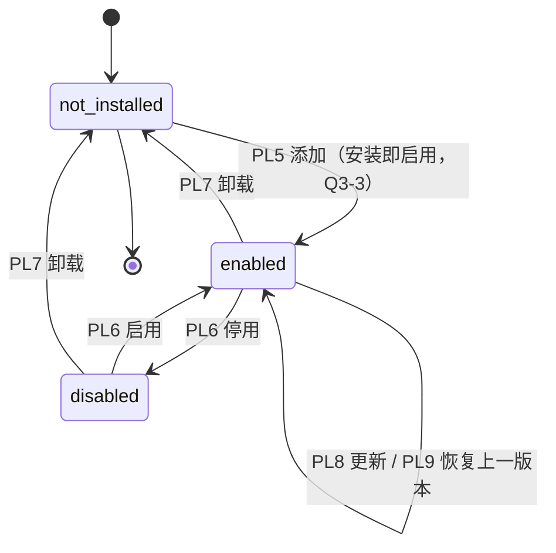
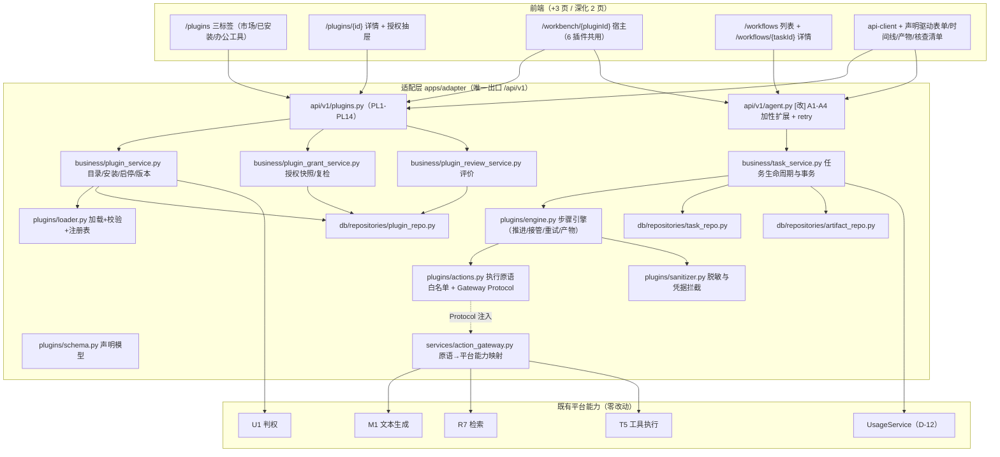
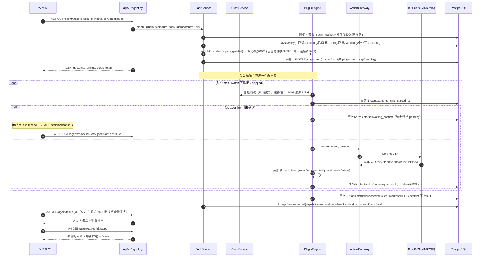
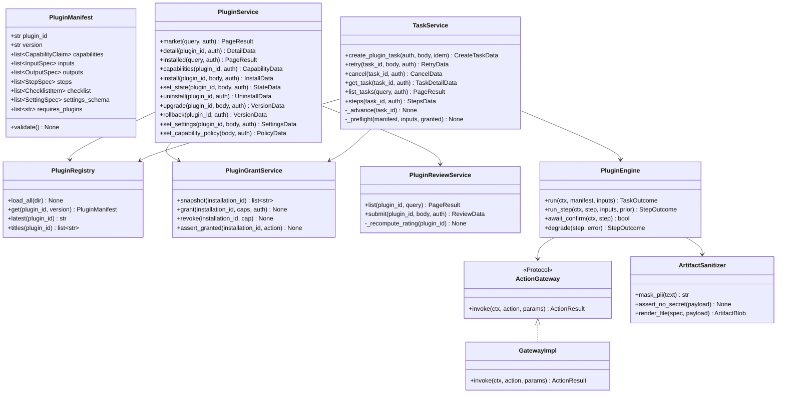
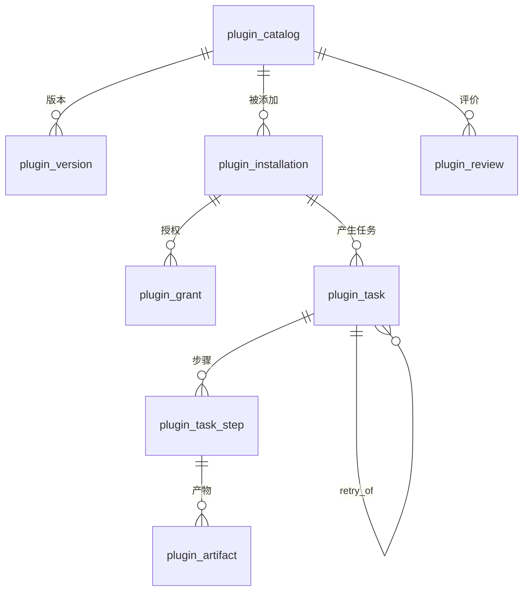

# 第三阶段（第 17-20 周）增量架构设计与批次化任务分解

| 项 | 内容 |
| --- | --- |
| 文档版本 | v3.2.0（阶段三架构定稿·封版） |
| 文档性质 | 内部交付文档（供交付总监、产品经理、工程师、QA 消费） |
| 上游输入 | `docs/prd-phase3-increment.md` **v1.1**（25 条 P0 / 6 条 P1 / 4 条 P2 / 13 新增端点 + 4 处扩展 / 16 条错误码需求 / 勘误 3 条）；`docs/prd-phase3-traceability.md`（25 用例 108 断言 / 15 项结果物核查 / 金额三规则）；`docs/architecture-v1.0.md`（30 端点冻结基线 + 红线）；`docs/architecture-phase2.md`（38 端点基线 + 业务库范式）；`docs/phase2-acceptance-report.md` §6 |
| 代码基线 | `develop` @ `db7aea7`（core=30 / phase2=38、1119 测试、总覆盖率 89.99%） |
| 作者 | 高见远（架构师） |
| 日期 | 2026-10-23 |
| 状态 | 待评审（评审通过即为阶段三契约基线） |
| 配套交付 | 本文件内嵌组件图（§3.1）、时序图（§3.3）、类图（§3.4）；DDL 落点 `deploy/init-schema-phase3.sql` |

### 修订记录

| 版本 | 日期 | 修订说明 |
| --- | --- | --- |
| v3.0.0 | 2026-10-22 | 首次发布：能力双层模型（授权能力 / 执行原语）、复用 A 域的插件运行时、9 张新表、14 个新端点 + 4 处加性扩展（合计 82）、13 个新错误码、三插件 6 步装配、14 批次（B16-B29）、5 道新门禁、9 条架构决策（D-14~D-22）+ PRD 冲突裁决 6 条 |
| **v3.1.0** | **2026-10-23** | **吸收 PRD v1.1 勘误 3 条**：① PL4 逐能力返回 `org_switch_enabled`（前端禁硬编码，字段名统一为 `capability_key`）；② 市场页改为「列表照常 + `installable=false`」，`15001` 的拦截点从 PL1/PL2/PL4 后移到 PL5/PL6；③ Offer 金额校验升级为 R1/R2/R3 三规则并明确默认值必须为空。端点数量与基线（14 / 82）不变 |
| **v3.2.0** | **2026-10-23** | **终裁封版**：① 恢复 **PL14**（`PUT /plugins/{id}/grants`，审计可区分 install / grant_change；team-lead 裁定 upsert 方案因审计退化撤销）；② 新增 **WF2**（`PUT /agent/tasks/{task_id}/artifacts/{artifact_id}`，任务域，闭合三条产物编辑类 P0，并入 B19）；③ **端点 16、合计 84**，基线 `baseline-phase3-16.json`；④ **PL5 回归纯安装**（已安装再调 → `200 + already_installed=true`，授权不变）；⑤ 写接口（含 PUT）统一必需 `Idempotency-Key`；⑥ WF2 的「编辑后重算 sha256 + 重跑脱敏」列为 B19 一票否决项；⑦ §11.2 完备性核对结论：26 条可操作表述 → 25 对上 + 1 补 WF2 + 0 需降级 + 3 类有意只读 |

---

## 0. 结论速览（先看这一页）

| 维度 | 结论 | 主要代价（明说） |
| --- | --- | --- |
| **插件模型** | 插件 = **JSON 声明 + 平台能力引用**，无代码包。声明 6 段；**能力是 6 项用户可见授权项**（个人 3 + 企业 3），与"执行原语"彻底分层 | 能力枚举封闭，新增能力须改平台（V1.0 想要的边界） |
| **运行时** | **复用 A 域任务契约**（A1 建任务带 `plugin_id`、A3/A4 读步骤与产物、A5 取消、A6 推送 + 新 WF1 重试），执行引擎在平台侧声明式推进，任务/步骤/产物**本地持久化** | 要把 A1-A4 的"底座代理"改为"本地任务 + 底座能力调用"双模式共存，A 域 4 处扩展必须严格加性 |
| **端点基线** | 新增**第三套基线** `PHASE3_DOMAIN_ENDPOINTS = 16`，合计 **84**；`phase2=38` 一个字节不改；另 **4 处 A 域加性扩展** | 与阶段二一样有 `[扩展]`，G4 加性 diff 必须逐项覆盖 |
| **数据表** | 新增 **9 张**（catalog / version / installation / grant / review / capability_policy / task / task_step / artifact），全部 `tenant_id` + FORCE RLS | 2 张共享目录表需并入第二阶段 `shared_tables` 分组 |
| **错误码** | 插件域 **16002-16099**（**跳过已废弃的 16001**）、任务域 **17001-17099**，本阶段 **13 个** | G-13 三处同步 |
| **前端** | `/workbench/{pluginId}` **一个宿主渲染 6 个插件**，0 处 `if (pluginId === ...)` | 工作台形态被声明能力约束，个性化空间小（AC-04 的要求） |
| **能力开关** | 企业级能力（④⑤⑥）的总开关状态**由 PL4 逐能力返回** `org_switch_enabled`，前端**禁止硬编码/按套餐推导**（PRD v1.1 勘误 #2，QA 有反硬编码断言） | 授权抽屉必须调 PL4 才能渲染开关态，不能离线兜底 |
| **批次** | **14 批（B16-B29）**，关键路径 8 批，最大并行度 3 | 前端 3 个新页依赖同一条请求层批次 |

---

## 1. 设计目标与范围

### 1.1 目标

1. **插件可添加、可运行、可卸载**（plan 第 17-18 周）：声明 → 市场 → 逐项授权 → 安装即启用 → 执行 → 版本更新/恢复上一版本 → 卸载（历史任务保留）。
2. **3 个标杆插件端到端可用**（AC-02）：每个 6 步、有"离开界面也成立"的结果物（仓库提交 / 稿件与排期表 / 公文文件）与核查清单。
3. **执行可视化**（FLOW-04）：步骤级时间线、每步产物、失败三动作（重试本步 / 从头重试 / 联系管理员）、人工接管点。
4. **与阶段二全打通**：插件授权复用既有 20 权限点（**不新增角色权限点**）；任务计量走 D-12（`capability=automation`）；关键动作进 `audit_log`；套餐 `features.plugin_market` 只控制**可安装性**（`installable`）与安装/启用拦截，**不控制可见性**（PRD v1.1 勘误 #1：免费版市场照常展示）。

### 1.2 V1.0 明确不做（对齐 PRD 第 7 章 B-1~B-8，不新增、不放宽）

| # | 不做项 | 落实方式 |
| --- | --- | --- |
| B-1 | 第三方插件开放（P1-01） | 市场只展示官方插件；**不设"开发者中心"入口**（避免暗示即将开放） |
| B-2 | 任意第三方代码执行 / 沙箱 | 插件无 `entry_point`/`module`/`image`/`command` 字段（§4.5 字段级不存在）；第三方开放前必须先立沙箱 ADR |
| B-3 | 插件直连底座 / 数据库 | 能力映射表封闭（§3.2）；插件拿不到任何连接串与凭据 |
| B-4 | 插件自定义 UI | 插件目录 0 个 `.css/.scss/.jsx/.tsx`；界面=声明式区块，G-27 机械拦截 |
| B-5 | 插件自带依赖 | `pyproject.toml`/`package.json` 相对阶段二**零新增**（G-28 断言） |
| B-6 | 自定义角色 CRUD（L-1） | 插件授权粒度与角色正交（PRD R4），顺延 V1.x |
| B-7 | 邀请待接受 / `15003` 文案细分（L-2/L-3） | 顺延（P2-P3-02） |
| B-8 | 小红书 / 抖音真实发布 | 产出稿件 + 排期表 + 发布指引，状态「待人工发布」，**不做假回执** |

**架构侧补充的不做项**：定时/周期触发（`plugin_task.trigger_type` 仅保留 `manual`/`retry` 枚举值，`schedule` 留 V1.x）；任务 SSE 新增事件集（复用 A6 既有 4 个事件名，仅扩展载荷）；产物在线编辑（P0-P3-14 只读约束）。

---

## 2. 插件模型

### 2.1 声明规范（6 段，`extra="forbid"`，位置 `apps/adapter/app/plugins/manifests/<plugin_id>.json`）

**第一层：基本信息 + 授权能力（用户可见）**

| 字段 | 类型 | 必填 | 约束 | 说明 |
| --- | --- | --- | --- | --- |
| `plugin_id` | string | ✅ | `^plg_[a-z][a-z0-9_]{2,40}$` | **契约的一部分**（PRD A.1 用 `plg_` 前缀，与 ULID 规范并存：这是稳定标识不是资源 ID） |
| `name` / `summary` / `description` | string | ✅ | 2-32 / ≤60 / ≥120 字 | 用户可见，禁词门禁覆盖（≥120 字是 PRD P0-P3-07 明确要求） |
| `category` | enum | ✅ | `dev`\|`content`\|`hr`\|`data`\|`collab`\|`other`（PRD P0-P3-06 六分类） | 市场筛选 |
| `icon_key` / `vendor` | string | ✅ | `icon_key` 取平台图标名；`vendor` 固定 `official` | 无外部资源引用 |
| `version` / `min_platform_version` | semver | ✅ | `^\d+\.\d+\.\d+$` | 版本管理基础 |
| `changelog` | string | ❌ | ≤300 字 | 详情页版本历史 |
| `requires_plugins[]` | string[] | ❌ | 元素为已存在的 `plugin_id` | 前置插件（PRD E-8）；缺失 → `16009` |
| `capabilities[]` | object[] | ✅ | **必须 ⊆ 6 项能力枚举**（§2.2），`{key, required}` | 授权条数与声明条数 **1:1**（P0-P3-03 验收②） |
| `settings_schema[]` | object[] | ❌ | `{key, label, type, options?}`，`type ∈ text/select` | 插件配置（默认仓库/分支/渠道），存 `plugin_installation.settings` |

**第二层：界面与执行（内部结构，用户只见标题文案）**

| 字段 | 类型 | 必填 | 约束 | 说明 |
| --- | --- | --- | --- | --- |
| `inputs[]` | object[] | ✅ | `{key, label, type, required, max_length?, options?}`；`type ∈ text/textarea/select/multi_select/email/file` | 驱动宿主表单（P0-P3-24） |
| `outputs[]` | object[] | ✅ | `{key, label, type}`；`type ∈ text/link/file/table` | 驱动结果区渲染 |
| `ui_extension` | object | ✅ | `{layout: "task_workspace", nav_label, icon_key, order}` | `layout` 仅 1 个值（新增布局=能力扩张，是故意的） |
| `steps[]` | object[] | ✅ | **1-8 步**（PRD Q3-7 上限 8）；`seq` 连续从 1 开始；`{seq, title, action, produces[], needs[], on_failure, confirm?, when?}` | 见 §2.3；`title` 用户可见 |
| `checklist[]` | object[] | ✅ | `{key, name, source_step}`，2-5 项 | 结果物核查清单（P0-P3-14，项数固定：DEV 4 / CNT 3 / HR 4） |

**硬约束**：① 文案字段（`name/summary/description/inputs[].label/outputs[].label/steps[].title/checklist[].name/settings_schema[].label/changelog`）全部过禁词表 + 占位词表（PRD §8 第 19-30 行，含 `编排`/`节点`/`manifest`/`回滚`/`依赖`/`sha`/`PR` 等），命中即**拒绝加载**；② 无凭据字段（`token/api_key/secret/credential/endpoint`）；③ 无代码字段（`entry/module/handler/script/image/command/deps`）；④ 能力、动作、工具三类引用必须命中白名单（§2.2 / §3.2），CI G-26/G-28 + 启动期双校验。

### 2.2 能力模型：两层彻底分离（**本阶段最关键的设计决策 D-15**）

| 层 | 是什么 | 谁看 | 取值 | 落库 |
| --- | --- | --- | --- | --- |
| **授权能力 `capabilities[].key`** | 用户要"同意"的数据/写入边界，PRD 封闭 6 项 | **用户**（授权抽屉逐项展示：名称 / 为什么需要 / 不同意的后果） | `personal.knowledge.read` ①读取你本人的知识库内容；`personal.tool.use` ②使用你已连接的办公工具；`personal.file.read` ③读取你本人上传的文件；`org.directory.read` ④读取企业通讯录与组织架构；`org.repo.write` ⑤写入代码仓库；`org.external.publish` ⑥向外部平台发布内容 | `plugin_grant`（成员 × 插件 × 能力） |
| **执行原语 `steps[].action`** | 平台内部如何完成该步（**永不暴露给用户，不进授权页**） | 平台 | `understand`（文本生成）、`compose`（按平台生成稿件/代码）、`retrieve`（检索知识库）、`tool`（调用办公工具，须带 `tool_type`+`operation`）、`render_file`（导出文件）、`summarize`（汇总核查清单） | 声明快照 `plugin_version.manifest` |

**为什么必须分两层**：若把执行原语当授权项，用户会看到「撰写内容 / 生成代码」这类**能力描述而非数据边界**，既无法回答"它要读我什么"，也会把技术词汇带上界面（违反 AC-06）。若把授权能力当执行原语，则 `personal.tool.use` 无法表达"调 GitHub 还是企微"。

**映射表（G-30 的权威依据，QA 按此逐条查）**

| 执行原语 `action` | 必需能力（任一满足） | 说明 |
| --- | --- | --- |
| `understand` | — | 平台内置推理，不读外部数据，无需授权 |
| `compose` | — | 同上；只处理任务输入 |
| `retrieve`（知识库） | `personal.knowledge.read` | 可见库由 `policy_service` 收敛 |
| `retrieve`（上传文件） | `personal.file.read` | 声明须同时有 `inputs[].type=file` |
| `tool`（`github` 写） | `personal.tool.use` + `org.repo.write` | 两个都要：连接权 + 写仓库权 |
| `tool`（`wechat_mp` / `email` 对外发送） | `personal.tool.use` + `org.external.publish` | 同上 |
| `tool`（读取通讯录：`wecom.list_members`、部门选择器） | `personal.tool.use` + `org.directory.read` | 同上 |
| `tool`（其他只读操作） | `personal.tool.use` | — |
| `render_file` | — | 见下条约束：**与文件读取能力无耦合** |
| `summarize` | — | 纯本地聚合 |

**`render_file` 的两条附加约束（PM 要求，写进 §11 冲突 12）**：① 必须声明 `render_format`（`docx`/`md`/`csv`），未声明即加载失败；② **不得与 `personal.file.read` 耦合**——导出文件是"写产物"，不需要"读用户文件"的授权，否则会出现"没授文件读取却导出了文件"的越权外观。反过来说，声明了 `personal.file.read` 也不能凭空产出文件，必须有 `render_file` 或 `retrieve` 步骤支撑（G-30 双向校验）。

**双向校验（G-30）**：声明要了 `org.repo.write` 却没有 `github` 写步骤 → 报"声明了未使用的能力"（防多要权限）；用了 `retrieve` 却没要对应读取能力 → 报"使用了未声明的能力"。

### 2.3 步骤定义与人工接管

| 字段 | 说明 |
| --- | --- |
| `seq` | 1..8 连续（P0-P3-01 验收：序号 1,3,4 不加载） |
| `title` | 用户可见步骤名（如「生成技术方案」），禁词门禁覆盖 |
| `action` | 执行原语（§2.2），`tool` 必须带 `tool_type`+`operation`（须在 `tool_registry.yaml`） |
| `tool_alternatives[]` | 可选：`tool_type` 的等价替代（按 `inputs` 里的渠道/平台选择）。如内容运营「发布」步：主 `wechat_mp.publish_article`，替代 `email.send_message`；人事「邀约」步：`email.send_message` / `feishu.create_calendar_event` / `wecom.send_message` 三选一。**替代项同样受 G-28 校验** |
| `produces[]` | 该步产物 key（⊆ `outputs[].key`），已完成步骤 `artifacts.length ≥ 1`（P0-P3-12 验收②） |
| `render_format` | `action=render_file` 时**必填**：`docx` / `md` / `csv`（PM 要求：产出类型必须声明，且与 `personal.file.read` 无耦合） |
| `needs[]` | 依赖的前序产物 key（用于参数装配与"路径 ⊆ 清单"这类断言） |
| `confirm` | `{reason, summary_fields[]}`：声明**人工接管点**（PRD 3 处：方案确认、提交前确认、发布前确认、Offer 金额） |
| `when` | `{input, in[]}`：条件跳过（HR 场景互斥） |
| `on_failure` | `abort` / `continue` / `skip_and_mark`（跳过并标"待人工补测"）/ `retry(1)` |

**人工接管的实现口径**：`confirm` 步骤执行前把任务置 `waiting_confirm`（A3 状态枚举**加性新增**一个值），`A4` 该步 `status=pending` 且 `failure=null`；用户确认 → 内部推进（不新建端点，确认走 **A1 的 `confirmed` 语义**？不 —— 走 `WF1 retry` 会新建任务，与"继续同一任务"语义冲突）。**裁决**：确认动作复用 **A1** 无法表达，故由 **WF1 `POST /agent/tasks/{task_id}/retry`** 承担"继续/重做"，请求体加 `decision: "continue" | "redo"`（仅 `waiting_confirm` 态可用，缺省 `continue`）。这样不新增第 15 个端点，且语义落在"重试/继续"同一入口（D-19）。

### 2.4 生命周期状态机



DB 层 `plugin_installation.status` 取值 `enabled|disabled|uninstalled`，**另保留 `installed` 一个瞬时值**（同一事务内直接改为 `enabled`；保留它是为了未来"安装待管理员审批"，且与 PRD P0-P3-02 的状态机表述等价）。`not_installed` = 无 `status<>'uninstalled'` 的行。

| 当前态 | 动作 | 合法性 | 前置校验 | 失败码 |
| --- | --- | --- | --- | --- |
| `not_installed` | PL5 添加 | ✅ | 套餐 `plugin_market=true`（Q3-1）→ 声明能力逐项 `granted`（必需项缺一即拒绝）→ 企业级能力总开关（④⑤⑥）→ 前置插件已启用 | 15001 / 16005 / 16006 / 16009 |
| `not_installed` | PL6/PL7/PL8/PL9/PL10 | ❌ | — | 16003（"该插件还没有添加"） |
| `enabled` | PL6 停用 | ✅ | 无（**在跑任务继续完成**，P0-P3-02 ⑤） | — |
| `disabled` | PL6 启用 | ✅ | 必需能力授权仍在 + 总开关仍开 | 16005 / 16006 |
| `enabled` / `disabled` | PL7 卸载 | ✅ | 允许有在跑任务（提示 N 个任务继续完成），响应回 `running_task_count` | — |
| `enabled` | PL8 更新 | ✅ | 目标版本存在 + `min_platform_version` 满足 | 16012 / 16007 |
| `enabled` | PL9 恢复上一版本 | ✅ | `previous_version` 存在（只保留最近 2 个版本） | 16008 |
| `disabled` | 执行任务（A1） | ❌ | — | 16004 |

**版本语义（D-18）**：`plugin_version` **不可变**（只插不改，仅 `status: active→deprecated`）；`plugin_installation` 存 `version` + `previous_version` 两个指针，**只保留最近 2 个版本**（PRD P0-P3-04：只能回退 1 次）。`plugin_task.plugin_version` 存创建时快照，**历史任务按创建时步骤定义渲染**（PRD R2 风险对策）。

### 2.5 授权模型（复用既有权限点，**不新增角色权限点** — PRD R4）

| 层 | 规则 | 落地 |
| --- | --- | --- |
| 插件可见 / 可用 | 市场**所有人可见**（勘误 #1），可用性 =「已添加 + 已启用 + 已授权」；不满足时入口置灰并给原因 | `plugin_service.availability()` 单函数收敛；列表项 `installable` + 每能力 `org_switch_enabled` |
| 添加权 | **成员可自行添加**（Q3-2 默认）：不挂 `plugin:install:manage` 类新权限点 | `policy_service` 只校验「登录 + 套餐（拦截点在 PL5/PL6）」 |
| 企业级能力 | ④⑤⑥ 需管理员在团队设置开启总开关；**开关态由 PL4 逐能力返回 `org_switch_enabled`**（前端禁硬编码，勘误 #2）；未开启 → `16006` + 前端「复制申请说明」 | `plugin_capability_policy`；写接口 PL13，权限点**复用 `team:role:manage`**（"配置角色权限"语义最近）；读侧在 PL2/PL4 |
| 调用权 | 任务以**发起人身份**调用适配层（禁止以插件身份越权）；插件只拿到本次输入 + 授权能力返回的数据 | `RunContext` 只携带 `auth` + `granted`；`tool` 原语走 `ToolService.execute(auth)` |
| 撤销即时性 | 撤销授权 / 关闭企业开关 / 停用 / 卸载 → **下一次调用立即生效**（缓存 TTL ≤ 5s，沿用阶段二 §6.3） | `plugin_grant_service.snapshot()` + `capability_policy` 读缓存 + 每步入口复检 |
| 存量权限点复用 | `tool:execute`（调办公工具）、`knowledge:base:read`（检索）、`team:role:manage`（企业能力开关）；`20003` 统一兜底 | 与阶段二 20 权限点矩阵**完全兼容**，CI 断言权限点总数仍为 20 |

### 2.6 三个标杆插件声明（关键段）

**A. `plg_dev_workbench`（前端研发工作台，需要能力 ②③⑤）**

```json
{
  "plugin_id": "plg_dev_workbench", "name": "前端研发工作台", "version": "1.0.0",
  "vendor": "official", "category": "dev", "min_platform_version": "1.0.0",
  "icon_key": "code",
  "summary": "从一句需求到仓库里的一次提交",
  "description": "填写需求、选好仓库，工作台会先拆解需求要点、给出技术方案并等你确认；确认后生成代码与用例文件，提交前再确认一次，最后给出包含提交记录与合并请求的核查清单。全过程每一步都能看到产出。",
  "capabilities": [
    {"key": "personal.tool.use", "required": true},
    {"key": "org.repo.write", "required": true},
    {"key": "personal.file.read", "required": true}],
  "settings_schema": [
    {"key": "default_repo", "label": "默认代码仓库", "type": "text"},
    {"key": "default_branch", "label": "默认分支", "type": "text"}],
  "inputs": [
    {"key": "title", "label": "需求标题", "type": "text", "required": true, "max_length": 80},
    {"key": "requirement", "label": "需求描述", "type": "textarea", "required": true, "max_length": 4000},
    {"key": "repo", "label": "目标仓库", "type": "select", "required": true},
    {"key": "branch_policy", "label": "分支策略", "type": "select", "required": true, "options": ["新建分支", "指定分支"]},
    {"key": "stack", "label": "技术栈偏好", "type": "text", "required": false, "max_length": 64},
    {"key": "attachments", "label": "参考文档", "type": "file", "required": false}],
  "outputs": [
    {"key": "key_points", "label": "需求要点", "type": "table"},
    {"key": "plan", "label": "技术方案", "type": "text"},
    {"key": "code_files", "label": "代码文件", "type": "file"},
    {"key": "test_files", "label": "用例文件", "type": "file"},
    {"key": "commit", "label": "提交记录", "type": "link"},
    {"key": "pull_request", "label": "合并请求", "type": "link"}],
  "steps": [
    {"seq": 1, "title": "理解需求", "action": "understand", "produces": ["key_points"], "on_failure": "abort"},
    {"seq": 2, "title": "生成技术方案", "action": "compose", "produces": ["plan"], "needs": ["key_points"], "confirm": {"reason": "方案确认后再生成代码，避免返工", "summary_fields": ["key_points", "plan"]}, "on_failure": "retry"},
    {"seq": 3, "title": "生成代码文件", "action": "compose", "produces": ["code_files"], "needs": ["plan"], "on_failure": "retry"},
    {"seq": 4, "title": "生成单元测试", "action": "compose", "produces": ["test_files"], "needs": ["code_files"], "on_failure": "skip_and_mark"},
    {"seq": 5, "title": "提交到指定仓库", "action": "tool", "tool_type": "github", "operation": "create_pull_request", "produces": ["commit", "pull_request"], "needs": ["code_files", "test_files"], "confirm": {"reason": "提交会写入仓库，请确认仓库与分支", "summary_fields": ["repo", "branch_policy"]}, "on_failure": "abort"},
    {"seq": 6, "title": "结果核查", "action": "summarize", "produces": [], "on_failure": "continue"}],
  "checklist": [
    {"key": "key_points", "name": "需求要点", "source_step": 1},
    {"key": "code_files", "name": "代码文件", "source_step": 3},
    {"key": "test_files", "name": "用例文件", "source_step": 4},
    {"key": "commit", "name": "提交记录与合并请求", "source_step": 5}],
  "ui_extension": {"layout": "task_workspace", "nav_label": "前端研发", "icon_key": "code", "order": 1}
}
```

**B. `plg_content_ops`（内容运营工作台，需要能力 ①②③⑥）**

```json
{
  "plugin_id": "plg_content_ops", "name": "内容运营工作台", "version": "1.0.0",
  "vendor": "official", "category": "content", "min_platform_version": "1.0.0", "icon_key": "pen",
  "summary": "一个主题，多平台稿件与发布排期表",
  "description": "输入主题并选择平台，工作台先检索企业素材（没有可靠素材会如实标注，不编造），再按平台策划选题、生成稿件与配图建议，排出发布计划并等你确认后发布；未接入的平台给出可下载稿件与发布指引。",
  "capabilities": [
    {"key": "personal.knowledge.read", "required": true},
    {"key": "personal.tool.use", "required": true},
    {"key": "personal.file.read", "required": true},
    {"key": "org.external.publish", "required": true}],
  "inputs": [
    {"key": "topic", "label": "运营主题", "type": "text", "required": true, "max_length": 200},
    {"key": "channels", "label": "目标平台", "type": "multi_select", "required": true, "options": ["微信公众号", "邮件", "小红书", "抖音"]},
    {"key": "audience", "label": "目标受众", "type": "text", "required": false, "max_length": 100},
    {"key": "window", "label": "时间窗", "type": "text", "required": true, "max_length": 64},
    {"key": "source", "label": "素材来源", "type": "select", "required": true, "options": ["知识库", "上传文件"]}],
  "outputs": [
    {"key": "materials", "label": "素材要点", "type": "table"},
    {"key": "angles", "label": "选题与标题候选", "type": "table"},
    {"key": "articles", "label": "平台稿件", "type": "text"},
    {"key": "image_hints", "label": "配图建议", "type": "text"},
    {"key": "schedule", "label": "发布排期表", "type": "file"},
    {"key": "receipt", "label": "发布回执", "type": "text"}],
  "steps": [
    {"seq": 1, "title": "检索素材", "action": "retrieve", "produces": ["materials"], "on_failure": "continue"},
    {"seq": 2, "title": "选题策划", "action": "compose", "produces": ["angles"], "needs": ["materials"], "on_failure": "abort"},
    {"seq": 3, "title": "生成稿件", "action": "compose", "produces": ["articles"], "needs": ["angles"], "on_failure": "retry"},
    {"seq": 4, "title": "配图建议", "action": "compose", "produces": ["image_hints"], "needs": ["articles"], "on_failure": "continue"},
    {"seq": 5, "title": "安排发布排期", "action": "render_file", "produces": ["schedule"], "needs": ["articles"], "on_failure": "abort"},
    {"seq": 6, "title": "发布", "action": "tool", "tool_type": "wechat_mp", "operation": "publish_article", "tool_alternatives": [{"tool_type": "email", "operation": "send_message"}], "produces": ["receipt"], "needs": ["schedule"], "confirm": {"reason": "发布会对外可见，请确认平台与时间", "summary_fields": ["channels", "window"]}, "on_failure": "continue"}],
  "checklist": [
    {"key": "articles", "name": "三平台稿件", "source_step": 3},
    {"key": "schedule", "name": "排期表", "source_step": 5},
    {"key": "receipt", "name": "发布回执", "source_step": 6}],
  "ui_extension": {"layout": "task_workspace", "nav_label": "内容运营", "icon_key": "pen", "order": 2}
}
```

**C. `plg_hr_admin`（行政人事工作台，需要能力 ①②③④⑥）**

```json
{
  "plugin_id": "plg_hr_admin", "name": "行政人事工作台", "version": "1.0.0",
  "vendor": "official", "category": "hr", "min_platform_version": "1.0.0", "icon_key": "users",
  "summary": "从招聘到公文的日常事务助手",
  "description": "写招聘说明、按简历给出可辩驳的初评、为进入面试的候选人准备提纲并发出邀约，也能起草 Offer 与各类公文。所有金额一律留空由你填写，对外发送前都会先请你确认。",
  "capabilities": [
    {"key": "personal.knowledge.read", "required": true},
    {"key": "personal.tool.use", "required": true},
    {"key": "personal.file.read", "required": true},
    {"key": "org.directory.read", "required": true},
    {"key": "org.external.publish", "required": true}],
  "inputs": [
    {"key": "position", "label": "岗位名称", "type": "text", "required": true, "max_length": 64},
    {"key": "department", "label": "所属部门", "type": "select", "required": true},
    {"key": "duties", "label": "职责要点", "type": "textarea", "required": true, "max_length": 2000},
    {"key": "hard_requirements", "label": "硬性要求", "type": "textarea", "required": false, "max_length": 1000},
    {"key": "resumes", "label": "简历文件", "type": "file", "required": false},
    {"key": "doc_type", "label": "公文类型", "type": "select", "required": false, "options": ["通知", "会议纪要", "请示", "周报"]},
    {"key": "doc_points", "label": "公文要素", "type": "textarea", "required": false, "max_length": 2000}],
  "outputs": [
    {"key": "jd", "label": "招聘说明", "type": "text"},
    {"key": "screening", "label": "筛选评分表", "type": "file"},
    {"key": "outlines", "label": "面试提纲", "type": "text"},
    {"key": "invitation", "label": "邀约回执", "type": "text"},
    {"key": "offer", "label": "Offer 草稿", "type": "text"},
    {"key": "document", "label": "公文文件", "type": "file"}],
  "steps": [
    {"seq": 1, "title": "生成招聘说明", "action": "compose", "produces": ["jd"], "on_failure": "abort"},
    {"seq": 2, "title": "简历筛选初评", "action": "understand", "produces": ["screening"], "needs": ["jd"], "on_failure": "continue"},
    {"seq": 3, "title": "生成面试提纲", "action": "compose", "produces": ["outlines"], "needs": ["screening"], "on_failure": "continue"},
    {"seq": 4, "title": "安排面试邀约", "action": "tool", "tool_type": "email", "operation": "send_message", "tool_alternatives": [{"tool_type": "feishu", "operation": "create_calendar_event"}, {"tool_type": "wecom", "operation": "send_message"}], "produces": ["invitation"], "needs": ["outlines"], "confirm": {"reason": "邀约邮件会发给候选人，请确认时间与收件人", "summary_fields": ["position", "department"]}, "on_failure": "continue"},
    {"seq": 5, "title": "生成 Offer 文案", "action": "compose", "produces": ["offer"], "needs": ["screening"], "on_failure": "continue"},
    {"seq": 6, "title": "撰写行政公文", "action": "render_file", "produces": ["document"], "when": {"input": "doc_type", "in": ["通知", "会议纪要", "请示", "周报"]}, "on_failure": "abort"}],
  "checklist": [
    {"key": "jd", "name": "招聘说明", "source_step": 1},
    {"key": "screening", "name": "筛选评分表", "source_step": 2},
    {"key": "outlines", "name": "面试提纲", "source_step": 3},
    {"key": "document", "name": "公文或 Offer", "source_step": 6}],
  "ui_extension": {"layout": "task_workspace", "nav_label": "行政人事", "icon_key": "users", "order": 3}
}
```

> 市场 V1.0 共 **6 个内置插件**（3 标杆 + 3 轻量：`plg_weekly_report` 周报生成、`plg_meeting_minutes` 会议纪要、`plg_mail_draft` 邮件起草）。轻量插件**只写声明不写代码**——得益于声明式装配（D-14），新增一个插件 = 1 个 JSON + 1 条种子，成本约 1 人时。这是本架构对"插件化"最重要的红利证明。
>
> 两条约束（PM 补充）：① 3 个轻量插件**同样纳入 P0-P3-25** 的禁词/占位/资产纯净扫描（G-26 + G-27 覆盖 6 份声明，不是只覆盖 3 标杆）；② **`plg_mail_draft`（邮件起草）与 `plg_hr_admin` 的公文定位必须划清**——前者 = 邮件主题 + 正文 + 称呼落款（对外沟通件，收件人是具体的人）；后者 = 通知/纪要/请示/周报的**正式文体与发文要素**（内部行文，有标题、主送、正文、落款单位、日期）。两者文案里不得互相声称"也能写公文/也能发邮件"。

---

## 3. 运行时设计

### 3.1 组件与分层落位



**分层铁律（新增）**

| 层 | 允许 | 禁止 |
| --- | --- | --- |
| `app/plugins/**` | 声明模型、加载校验、原语白名单、步骤引擎、脱敏 | `import app.services.*` / `app.clients.*` / `httpx` / 写 SQL / 持有外部凭据 |
| `business/plugin_*`、`business/task_service` | 事务编排、判权、审计、计量、授权快照 | 拼 SQL、调下游 HTTP |
| `services/action_gateway.py` | 原语 → 既有 M1/R7/T5 的映射与错误码翻译 | 任何业务判断（"能不能用"由 service 决定） |
| `db/repositories/{plugin,task,artifact}_repo.py` | SQL + 会话 | 业务判断 |

> 引擎只依赖 `ActionGateway` **Protocol**（`plugins/actions.py`），实现类在 `services/action_gateway.py`，由 `api/v1/plugin_deps.py` 注入 → 依赖方向恒为 `api → plugins → business → db`（D-16）。

### 3.2 执行原语白名单（6 项，封闭）与平台映射

| 原语 | 平台落点 | 需要的授权能力 | 计量 | 可重试 |
| --- | --- | --- | --- | --- |
| `understand` | `POST /model/generate`（理解/抽取结构化要点） | — | `automation` | ✅（`10004`/`30001`/`30002`） |
| `compose` | `POST /model/generate`（按 `produces` 决定输出形态；内部档位映射，**对外无档位名**） | — | `automation` | ✅ |
| `retrieve` | `POST /knowledge/search`（`top_n ≤ 10`；可见库由 `policy_service` 收敛） | `personal.knowledge.read` 或 `personal.file.read` | `automation` | ✅（`11005`） |
| `tool` | `POST /tools/execute`（T5 全流程：连接校验 → 执行 → `tool_execution` 落库） | `personal.tool.use` +（写仓库→`org.repo.write`；发布→`org.external.publish`；读通讯录→`org.directory.read`） | `automation` | ❌（写外部动作不重试，`confirm` 后更不重试） |
| `render_file` | 本地渲染（`csv` 排期表 / `docx` 公文 / `zip` 代码包）+ 对象存储 | — | 不计量 | ❌（纯本地） |
| `summarize` | 本地聚合核查清单（无下游调用） | — | 不计量 | — |

**三重校验**：① CI G-28 静态（`action` 枚举 + `tool_type/operation` 必须存在于 `tool_registry.yaml` + 能力-原语映射一致）；② 加载器启动期（失败 `30004`）；③ 运行期 `ActionGateway.resolve()` 再查（防运行期篡改）。

### 3.3 执行流程（复用 A 域契约）



**三条硬约定**

1. **一请求一事务，一步一事务**：A1 只在事务 1 内建任务与步骤骨架；推进在后台任务内每步独立短事务（沿用阶段二 11.3「长任务短事务」）。进程崩溃 → `running` 且超 `timeout_seconds` 的任务在下次读取时判 `failed`（`17004` 语义），并有审计。
2. **不跨请求长事务**；取消用 `cancel_requested=true` 标记（A5 置位），引擎在下一步入口停止，已执行步骤保留；**不**用 `asyncio.Task.cancel()`。
3. **单副本假设**：后台推进用进程内 `asyncio.create_task`；多副本前改 Valkey 队列（与阶段二 U-4 同批，登记 U-06）。并发上限：同租户同插件 **≤3 个 running**，第 4 个进 `queued` 并返回 **200 + `queue_position`**（不用 429/20006，见 §5.3）。

### 3.4 类图



### 3.5 超时、重试、降级、产物

| 项 | 口径 |
| --- | --- |
| 步骤超时 | `steps[].timeout_seconds`（缺省 120，上限 600）；`understand/compose` 240；`tool` 60 |
| 任务超时 | 声明级 900 秒（PRD P0-P3-02 默认 900）；超时任务置「未完成（超时）」，**已产生步骤产物保留可看** |
| 重试 | 仅 `on_failure: retry` 且失败码 `retryable`（`10004/11005/13004/30001/30002`）；最多 1 次，退避 800ms；`confirm` 后的 `tool` 步骤**永不自动重试** |
| 降级 | `abort`：任务 `failed`，后续 `skipped`；`continue`：该步 `failed` 但任务继续，最终任务 `succeeded` + `warnings[]`（"哪一步没做成、影响什么"）；`skip_and_mark`：该步 `skipped` 并在核查清单标「待人工确认」 |
| 人工接管 | `confirm` 步骤未确认 → 任务 `waiting_confirm`，**15 分钟不自动继续**（PRD P0-P3-13 验收③）；确认走 WF1 `decision=continue`（**同任务续跑**），重做走 `decision=redo`（同任务续跑，只重跑该步及下游） |
| 重试本步 / 从头重试 | WF1 `decision=retry_step`（带 `from_step`）/ `retry_all` → **新建任务**，`retry_of=原 task_id`，原任务状态永不改变；前序成功步骤的产物**复制不重跑**（PRD 验收①） |
| 并发上限 | 同租户同插件 ≤3 个 `running`；第 4 个进入 **`queued`** 并返回 **200 + `status=queued` + `queue_position=N`**（提示「前面还有 N 个任务在跑，稍后自动开始」），**不返回 429/20006**（PRD E-12；4xx 会触发前端整屏报错） |
| 产物 | 每步 0..n 个 `plugin_artifact`；`text ≤ 32KB` 内联（已脱敏），`file` 写对象存储（`storage_key`），下载走 `A4` 下发的 `download_url`（平台代理，**不暴露存储地址**）；`table` 存 CSV + 前 5 行 `preview_text`；留存 **180 天**（Q3-5），过期后 `download_url=null` 且前端提示「产物已过期，可重新发起任务」 |
| 脱敏 | `mask_pii()`：邮箱/手机/身份证掩码；`assert_no_secret()` 对 `token|secret|password|api_key|bearer|credential` 键名直接拒绝（抛 `30003` + 告警） |

### 3.6 凭据代管（安全红线）

1. **声明零凭据字段**：`extra="forbid"` + 加载期 `assert_no_secret()`；`endpoint/base_url` 亦禁止。
2. **运行期零令牌**：`RunContext` 只有 `auth`（发起人身份）+ `installation_id` + `granted` + `trace_id`。
3. **工具凭据由 T5 内部解析**：`tool` 原语经 `ToolService.execute(auth)` 取 `tool_connection`（阶段二 AES-GCM）解密使用；插件只拿结果。
4. **产物不落凭据**：`tool` 返回体落库前过 `assert_no_secret()`；`tool_execution` 明细不复制进产物。
5. **日志**：只记 `task_id/step_id/action/duration_ms/error_code`，不记 `params`/`output` 原文。

---

## 4. 数据库设计

### 4.1 表清单

| # | 表 | 主键 | 行量级/年 | 说明 |
| --- | --- | --- | --- | --- |
| 1 | `plugin_catalog` | `(tenant_id='__platform__', plugin_id)` | 10¹ | 市场目录（共享行） |
| 2 | `plugin_version` | `(tenant_id, plugin_id, version)` | 10¹ | 声明快照（**不可变**，保留最近 2 版） |
| 3 | `plugin_installation` | `(tenant_id, plugin_id)` | 10³ | 安装态 + `settings JSONB` + 版本双指针 |
| 4 | `plugin_grant` | `(tenant_id, plugin_id, user_id, capability)` | 10⁵ | 成员 × 插件 × 能力（PRD 6 章粒度） |
| 5 | `plugin_capability_policy` | `(tenant_id, capability)` | 6×10² | 企业级能力总开关（④⑤⑥） |
| 6 | `plugin_review` | `(tenant_id, review_id)` | 10⁴ | 评价（`rev_`；一人一插件一条，重复提交=覆盖） |
| 7 | `plugin_task` | `(tenant_id, task_id)` | 10⁶ | 任务（`task_`，与 A 域 `task_id` 同前缀） |
| 8 | `plugin_task_step` | `(tenant_id, step_id)` | 7×10⁶ | 步骤（`step_`，与 A4 `step_id` 同前缀） |
| 9 | `plugin_artifact` | `(tenant_id, artifact_id)` | 10⁶ | 产物（`art_`） |



### 4.2 关键 DDL（完整脚本见 `deploy/init-schema-phase3.sql`）

```sql
-- 安装态（一企业一插件一行；版本双指针支持"恢复上一版本"）
CREATE TABLE IF NOT EXISTS plugin_installation (
    tenant_id        TEXT        NOT NULL,
    plugin_id        TEXT        NOT NULL CHECK (plugin_id ~ '^plg_[a-z][a-z0-9_]{2,40}$'),
    version          TEXT        NOT NULL CHECK (version ~ '^\d+\.\d+\.\d+$'),
    previous_version TEXT,
    status           TEXT        NOT NULL DEFAULT 'installed'
                                 CHECK (status IN ('installed','enabled','disabled','uninstalled')),
    settings         JSONB       NOT NULL DEFAULT '{}'::jsonb,   -- 仅 settings_schema 声明的键
    capability_version INTEGER   NOT NULL DEFAULT 1 CHECK (capability_version >= 1),
    installed_by     TEXT        NOT NULL,
    installed_at     TIMESTAMPTZ NOT NULL DEFAULT now(),
    enabled_at       TIMESTAMPTZ,
    disabled_at      TIMESTAMPTZ,
    uninstalled_at   TIMESTAMPTZ,
    last_used_at     TIMESTAMPTZ,                                 -- 已安装页"最近使用时间"
    PRIMARY KEY (tenant_id, plugin_id)
);
CREATE INDEX IF NOT EXISTS idx_installation_status ON plugin_installation (tenant_id, status);

-- 任务（对外即 A 域 task_id；本地持久化，底座不再是唯一真相源）
CREATE TABLE IF NOT EXISTS plugin_task (
    tenant_id        TEXT        NOT NULL,
    task_id          TEXT        NOT NULL,               -- task_ + ULID
    plugin_id        TEXT        NOT NULL,
    plugin_version   TEXT        NOT NULL,               -- 快照：渲染历史步骤用
    conversation_id  TEXT        NOT NULL DEFAULT '',
    initiator_id     TEXT        NOT NULL,
    trigger_type     TEXT        NOT NULL DEFAULT 'manual'
                                 CHECK (trigger_type IN ('manual','retry')),
    status           TEXT        NOT NULL DEFAULT 'pending'
                                 CHECK (status IN ('queued','pending','running','waiting_confirm',
                                                   'completed','failed','cancelled')),
    progress         SMALLINT    NOT NULL DEFAULT 0 CHECK (progress BETWEEN 0 AND 100),
    current_step_seq SMALLINT    NOT NULL DEFAULT 0,
    queue_position   SMALLINT    CHECK (queue_position IS NULL OR queue_position >= 1),
    inputs           JSONB       NOT NULL DEFAULT '{}'::jsonb,  -- 仅业务输入，禁凭据
    result_summary   TEXT        NOT NULL DEFAULT '',
    checklist        JSONB       NOT NULL DEFAULT '[]'::jsonb,  -- A3 result.checklist[]
    warnings         JSONB       NOT NULL DEFAULT '[]'::jsonb,
    error_message    TEXT,                                      -- 业务语言，禁堆栈
    retry_of         TEXT,                                      -- 重试来源 task_id
    from_step        SMALLINT,                                  -- 重试起点 seq
    confirm_step_seq SMALLINT,                                  -- 当前待确认步骤
    cancel_requested BOOLEAN     NOT NULL DEFAULT FALSE,
    usage_units      BIGINT      NOT NULL DEFAULT 0 CHECK (usage_units >= 0),
    idem_key         TEXT        NOT NULL,
    started_at       TIMESTAMPTZ NOT NULL DEFAULT now(),
    finished_at      TIMESTAMPTZ,
    expires_at       TIMESTAMPTZ NOT NULL DEFAULT now() + INTERVAL '180 days',  -- Q3-5
    PRIMARY KEY (tenant_id, task_id),
    CONSTRAINT fk_task_of FOREIGN KEY (tenant_id, retry_of)
        REFERENCES plugin_task (tenant_id, task_id)
);
CREATE UNIQUE INDEX IF NOT EXISTS uq_task_idem ON plugin_task (tenant_id, plugin_id, idem_key);
CREATE INDEX IF NOT EXISTS idx_task_plugin_time ON plugin_task (tenant_id, plugin_id, started_at DESC);
CREATE INDEX IF NOT EXISTS idx_task_status_time ON plugin_task (tenant_id, status, started_at DESC);
CREATE INDEX IF NOT EXISTS idx_task_initiator ON plugin_task (tenant_id, initiator_id, started_at DESC);
```

| 表 | 列（类型/约束摘要） |
| --- | --- |
| `plugin_catalog` | `tenant_id DEFAULT '__platform__'`、`plugin_id`、`name(2-32)`、`vendor(official)`、`category(dev\|content\|hr\|data\|collab\|other)`、`summary(≤60)`、`description(≥120 且 ≤800)`、`icon_key`、`latest_version`、`rating_avg NUMERIC(2,1) 0..5`、`rating_count`、`install_count`、`status(available\|hidden\|offline)`、`sort_order`、`created_at`、`updated_at`；PK`(tenant_id,plugin_id)` |
| `plugin_version` | `manifest JSONB`、`manifest_sha256 CHAR(64)`、`min_platform_version`、`capabilities TEXT[]`、`actions TEXT[]`、`step_titles TEXT[]`、`status(active\|deprecated\|revoked)`、`published_at`；PK`(tenant_id,plugin_id,version)`。**不可变** |
| `plugin_grant` | `user_id`、`capability`（6 项枚举）、`granted_at`、`revoked_at`；PK`(tenant_id,plugin_id,user_id,capability)`、索引`idx_grant_lookup(tenant_id,plugin_id,user_id) WHERE revoked_at IS NULL` |
| `plugin_capability_policy` | `capability`、`enabled BOOLEAN`、`updated_by`、`updated_at`；PK`(tenant_id,capability)`；**只对 org.* 三项生效**（personal.* 恒 enabled，CHECK 约束） |
| `plugin_review` | `review_id`（`rev_`）、`plugin_id`、`user_id`、`rating SMALLINT 1..5`、`content(≤200)`、`anonymous BOOL`、`created_at`、`updated_at`；PK`(tenant_id,review_id)`、唯一`uq_review_user(tenant_id,plugin_id,user_id)`（重复提交=覆盖更新） |
| `plugin_task_step` | `step_id`（`step_`）、`task_id` FK CASCADE、`seq 1..8`、`title`（声明快照）、`action`、`status(pending\|running\|completed\|failed\|skipped)`、`attempt 0..1`、`retryable BOOL`、`output_summary`、`reason_text`（业务语言）、`operator_action`（建议动作）、`tool_execution_id`、`duration_ms`、`started_at`、`finished_at`；PK`(tenant_id,step_id)`、唯一`uq_step_seq(tenant_id,task_id,seq)` |
| `plugin_artifact` | `artifact_id`（`art_`）、`task_id` FK CASCADE、`step_id`、`output_key`、`type(text\|link\|file\|table)`、`name(1-128)`、`inline_text`（≤32KB 脱敏）、`preview_text`（表格前 5 行）、`external_url http(s)`、`storage_key`、`size_bytes`、`content_sha256`、`expires_at(180d)`、`created_at`；PK`(tenant_id,artifact_id)`、索引`idx_art_task(tenant_id,task_id,step_id)` |

### 4.3 索引与约束（评审关注点）

| 类型 | 对象 | 作用 |
| --- | --- | --- |
| 唯一 | `uq_review_user` | 一人一插件一条评价（重复提交=覆盖，PRD P0-P3-09 验收①） |
| 唯一 | `uq_task_idem` | 任务幂等（同 `Idempotency-Key` 重放返回首次 `task_id`，`code=20007`） |
| 唯一 | `uq_step_seq` | 一步一序号，防重复推进双写 |
| FK 自引用 | `fk_task_of` | `retry_of` 链可追溯（PRD P0-P3-13） |
| 索引 | `idx_task_plugin_time` / `idx_task_status_time` / `idx_task_initiator` | 支持 P0-P3-14 的四维筛选（插件/状态/发起人/时间） |
| 索引 | `idx_grant_lookup`（部分索引） | 每步入口复检授权，必须走索引（10⁵ 行下 < 5ms） |
| 索引 | `idx_art_task` | 详情页一次取全步骤产物，避免 N+1 |
| CHECK | `plugin_id` 正则 / `version` semver / `category` / `status` 枚举 | 契约形态 DB 兜底 |
| 容量护栏 | 任务列表必须带至少一个筛选 + `LIMIT`；列表**不返回** `inputs`/`checklist`/产物正文 | 10⁶ 行下第 250 页响应 < 200KB |

### 4.4 RLS 与事务口径

| 项 | 口径 |
| --- | --- |
| 严格隔离表 | `plugin_installation` / `plugin_grant` / `plugin_capability_policy` / `plugin_review` / `plugin_task` / `plugin_task_step` / `plugin_artifact` → 复用阶段二 `p_tenant_isolation` |
| 共享目录表 | `plugin_catalog` / `plugin_version` → 并入阶段二共享分组 `ARRAY['permission_catalog','billing_plan','ops_settings','plugin_catalog','plugin_version']`（`init-schema-phase3.sql` 重声明该 DO 块） |
| 平台模式 | 仅 `/api/v1/ops/**` 可 `allow_platform=True`；`plugins` 与 `agent` 路由**禁止**平台模式（传 `__platform__` 抛 `30003`） |
| 事务 | A1 = 事务 1（任务 + 步骤骨架）；**每个 step = 独立短事务**（步骤状态 + 产物 + 进度）；任务收尾 + 计量 + 审计同事务 |
| 计量 | `UsageService.record(capability='automation', idem_key=task_id)`，`usage_event` 唯一索引兜底 |
| 审计 | 与对应业务写同事务（安装/授权/启停/版本/策略/任务收尾） |
| 私有化 | 会话变量固定 `default`，RLS 仍启用 |
| 清理任务 | `expires_at` 到期：删对象存储文件 + `plugin_artifact.storage_key=NULL`；**任务记录保留**（可回溯，链接失效给文案） |

### 4.5 字段级「不存在」清单（隐私红线，评审逐条核对）

| 表 | **不存在**的字段 | 原因 |
| --- | --- | --- |
| `plugin_catalog` | `entry_point` / `module_path` / `image` / `command` / `source_url` / `download_url` | V1.0 无代码执行、无第三方来源；存在即意味着可执行载荷（B-2） |
| `plugin_version` | `entry_point` / `code_sha256` / `signature` / `bundle_url` / `dependencies` | 声明即全部；`manifest_sha256` 只防篡改（B-5 不自带依赖） |
| `plugin_installation` | `license_key` / `activation_code` / `credential_ref` | 无授权码；凭据一律归 `tool_connection`/`credential_store` |
| `plugin_grant` | `scope_string` / `token` / `secret` | 授权是能力枚举，不携带秘密 |
| `plugin_review` | `user_email` / `user_phone` / `department_path` | 只存 `user_id`；展示名由 U 域解析，匿名时前端渲染「某位同事」 |
| `plugin_task` | `rendered_prompt` / `system_prompt` / `raw_request` / `raw_response` / `steps_source`（编排源码） | 提示词与"编排"属技术细节（附录 A-1/A-2、PRD 8 章第 23 行） |
| `plugin_task_step` | `raw_request` / `raw_response` / `stack_trace` / `tool_payload` / `node_type` / `model_name` | 失败只留业务语言 `reason_text` + `operator_action`；堆栈只进进程日志 |
| `plugin_artifact` | `credential` / `access_token` / `api_key` | `assert_no_secret()` 写入前拦截 |
| 全表 | 对话原文、文档全文、其他成员数据 | PRD 6 章「数据边界」：插件只能拿本次输入 + 授权能力返回的数据 |

### 4.6 迁移

| 项 | 口径 |
| --- | --- |
| 全量基线 | `deploy/init-schema-phase3.sql`（幂等；compose 挂 `docker-entrypoint-initdb.d/22-init-schema-phase3.sql`，**必须在 phase2 之后**） |
| 增量 | `deploy/migrations/0003_phase3_plugin_tasks.sql`（已建库升级路径，`BEGIN/COMMIT` 内置） |
| 回滚 | `deploy/migrations/rollback/0003_*.sql`（手写，不自动执行） |
| 种子 | 6 条 `plugin_catalog` + 6 条 `plugin_version`（声明全文 + sha256）+ 3 条 `plugin_capability_policy`（org.* 默认关闭，Q3-2） |
| CI | `pytest tests/integration/test_migrate_phase3.py`：空库 → phase2 → phase3 → 再跑 phase3（幂等）；断言 9 张表 + 6 catalog + 6 version + 3 policy |

---

## 5. API 契约

### 5.1 基线口径

| 常量 | 值 | 含义 | 变更权限 |
| --- | --- | --- | --- |
| `ADAPTER_CORE_ENDPOINTS` | 30 | 冻结 | 不可修改 |
| `PHASE2_DOMAIN_ENDPOINTS` | 38 | **本阶段一个字节不改** | 不可修改 |
| `PHASE3_DOMAIN_ENDPOINTS` | **16** | PL1-PL14（14）+ WF1/WF2（2） | 本阶段冻结 |
| 合计 | **84** | CI 断言 `core==30 and phase2==38 and phase3==16` | — |
| `[扩展]` | **4 处** | A1/A2/A3/A4，只加可选字段与枚举加宽（G4 加性 diff） | 每处须单独断言 |

- 挂载：`api/v1/plugins.py`（`/plugins`）+ 既有 `api/v1/agent.py` 追加 WF1/WF2；`docs/api/baseline-phase3-16.json` 新增；`baseline-core-30.json` / `baseline-phase2-38.json` 不动（CI 加 hash 断言）。
- **与 PM 附录 A（v1.2 的 15 条）的差异（3 处）**：
  1. **+PL13** `PUT /plugins/capability-policy`：E-5「能力被企业策略关闭」与 Q3-2「管理员开启总开关」需要写接口，否则 `16006` 不可达。**已双批。**
  2. **+PL14** `PUT /plugins/{plugin_id}/grants`：P0-P3-03 ④ 要求「已安装 → 管理权限」可增减授权，而附录 A 只有 PL4 读授权、**没有写接口**。**已双批（PRD v1.2 勘误第 8 条）。**
  3. **+WF2** `PUT /agent/tasks/{task_id}/artifacts/{artifact_id}`：三条 P0 依赖产物编辑/重导出（P0-P3-19 ③、P0-P3-21 ①、P0-P3-23 ④⑤），A3/A4 均只读。**team-lead 终裁新增，放任务域（不叫 PL15，因为它是任务产物接口）。**
- **这三处是同一个盲区的三次暴露**（PL13 / PL14 / WF2 都是「读得到改不了」），已把「表述 → 端点」全量核对固化为检查项 **§11.2**，每个阶段开工都跑一遍——同一个盲区不该有第四次。

### 5.2 插件域（PL1-PL14，前缀 `/api/v1/plugins`）

> **写接口幂等口径（阶段二 §3 通用规则，不因方法而豁免）**：**PL5-PL10、PL12、PL13、PL14 与 WF1 全部必须携带 `Idempotency-Key`**（UUID v4，24h）。**不要**因为"PUT 天然幂等"而免：阶段二 38 个冻结端点里 PUT（订阅变更/席位调整/角色权限/7 个组织写接口）**一律要键**，插件域若免检，同一份契约就出现两套规则，QA 得为写接口开特例、拦截器得按路由分档（新增 PUT 忘登记就没人知道该不该带键）。缺键一律 `20001`。

| # | 方法 | 路径 | 请求 | 响应 `data` | 错误码 | 幂等键 |
| --- | --- | --- | --- | --- | --- | --- |
| PL1 | GET | `/plugins/market` | `category?, keyword?, sort?(recommended\|newest\|rating), page, page_size=12` | `items[{plugin_id,name,summary,category,icon_key,rating_avg,rating_count,latest_version,installed_status(none\|enabled\|disabled),has_update,installable}]`、`meta`、`categories[{key,name,count}]` | 20001 | — |
| PL2 | GET | `/plugins/market/{plugin_id}` | — | `…, description, capabilities[{capability_key,display_name,reason,denial_effect,category(personal\|org),required}], step_titles[], outputs[], settings_schema[], changelog[], versions[{version,published_at}], installed_status, installed_version, has_update, installable` | 16002 | — |
| PL3 | GET | `/plugins/installed` | `status?` | `items[{plugin_id,name,category,version,latest_version,has_update,status,last_used_at,running_task_count}], meta` | 20003 | — |
| PL4 | GET | `/plugins/{plugin_id}/capabilities` | — | `items[{capability_key,display_name,reason,denial_effect,category(personal\|org),required,org_switch_enabled}], granted_capabilities[], capability_version, installable` | 16002 | — |
| PL5 | POST | `/plugins/{plugin_id}/install` | `grants{}`（capability_key→bool）、`settings{}`（可选） | `plugin_id, status(enabled), version, granted_capabilities[], denied_capabilities[], already_installed` | 15001 16002 16005 16006 16009 20001 | **必需** |
| PL6 | PATCH | `/plugins/{plugin_id}/state` | `status(enabled\|disabled)` | `plugin_id, status, running_task_count` | 15001 16002 16003 16005 16006 | **必需** |
| PL7 | DELETE | `/plugins/{plugin_id}` | — | `plugin_id, uninstalled=true, running_task_count, kept_task_count` | 16002 16003 | **必需** |
| PL8 | POST | `/plugins/{plugin_id}/upgrade` | `target_version` | `plugin_id, version, previous_version, has_update=false` | 16002 16003 16007 16012 | **必需** |
| PL9 | POST | `/plugins/{plugin_id}/rollback` | — | `plugin_id, version, previous_version` | 16002 16003 16008 | **必需** |
| PL10 | PUT | `/plugins/{plugin_id}/settings` | `settings{}`（键须 ⊆ `settings_schema`） | `plugin_id, settings{}, updated_at` | 16002 16003 20001 | **必需** |
| PL11 | GET | `/plugins/{plugin_id}/reviews` | `page, page_size=10` | `items[{review_id,rating,content,author_name,department_name,created_at}], meta, rating_avg, rating_count` | 16002 | — |
| PL12 | POST | `/plugins/{plugin_id}/reviews` | `rating(1-5), content(≤200), anonymous` | `review_id, rating, created_at, rating_avg, rating_count` | 16002 16003 16011 20001 | **必需** |
| PL13 | PUT | `/plugins/capability-policy` | `policies[{capability_key, org_switch_enabled}]`（仅 `org.*`） | `policies[{capability_key, display_name, org_switch_enabled, updated_by_name, updated_at}]`（**全量 6 项**） | 20001 20003 | **必需** |
| PL14 | PUT | `/plugins/{plugin_id}/grants` | `grants[{capability_key, granted}]`（仅本人；`required` 项不可撤） | `granted_capabilities[], denied_capabilities[], required_capabilities[]` | 16002 16003 16005 16006 20001 | **必需** |

**要点补充（含 PRD v1.1 勘误回写）**

- **套餐拦截点后移（勘误 #1）**：PL1/PL2/PL4 **不受** `features.plugin_market` 影响，一律正常返回，列表项给 `installable=false`；`15001` 只在 **PL5 安装**与 **PL6 启用**返回，前端给「查看套餐」入口。**禁止**整页降级为升级提示页（QA 会断言免费版市场仍有 6 张卡片）。
- **PL13 三条配套约束（team-lead 定）**：① **单一读源**：读只走 PL4、写只走 PL13，PL1/PL2 不塞开关（否则列表响应随"插件数 × 能力数"膨胀）；② **写后回读**：响应必须回**全量 6 项**（不是只回改的那一项），前端整体刷新，禁止局部拼状态（否则前端与服务端漂移）；③ **幂等**：必须带 `Idempotency-Key`，同键重放返回首次结果、不产生第二次写入。
- **PL14 = 「管理权限」入口（D-21，主理人批准新增，闭合 P0-P3-03 ④）**：`PUT /plugins/{plugin_id}/grants`，请求 `grants[{capability_key, granted}]`，响应 **`granted_capabilities[]` + `denied_capabilities[]` + `required_capabilities[]`**。三条硬约束：① **`required: true` 不可撤**（撤了插件直接不可用，用户会当成故障）→ 参数类错误 `20001`，`operator_action` 引导「停用」或「卸载」；② **只能改本人**对该插件的能力集合，管理员改他人授权**不在 V1.0**（避免绕过企业策略）；③ 不新增权限点（**登录即可**，不挂 `team:role:manage`）。
  - **`required_capabilities[]` 的用途（必须写进前端）**：前端据此把「不可撤」的能力项**直接置灰并给原因**；**禁止**前端自己按声明或 `required` 猜（编辑态前端拿不到声明全文，只能靠这个数组）。
  - **PL5 回归纯粹的安装语义**：重复安装（不同幂等键）→ `200 + already_installed=true` + 现状（**不返回错误码**，也不更新授权）；授权变更一律走 PL14。这样"装"与"改授权"职责分离，审计动作也清楚（`plugin.install` vs `plugin.capability_grant`）。
  - PL14 撤销后下一次任务在**需要该能力的那一步**失败（`16005`，缓存 ≤5s），已完成步骤不回滚。
- **企业能力开关由端点返回（勘误 #2 + PM 裁决）**：`org_switch_enabled` **只从 PL4 出**。团队设置页读法固定为：`PL1` 取插件列表 → `PL4` 取 6 项能力（含开关态）→ `PL13` 写入 → **用 `PL4` 回读验证**（单一读源，不会两处不一致）。前端**禁止**硬编码 `true` 或按套餐推导。QA 反硬编码用例：把该字段置 `false` 后，前端必须表现为「需管理员在团队设置中开启」+「复制申请说明」。
- PL5 `grants` 必须覆盖声明的**全部** `required: true` 能力且为 `true`，缺项 → `16005`（`data.missing_capabilities[]`）；多传未声明能力 → `20001`。安装成功即 `status=enabled`（Q3-3）。
- PL5/PL6 `org.*` 能力在 `plugin_capability_policy` 为 `false` 时 → `16006`（前端显示「需要管理员开启「写入代码仓库」能力」+ 复制申请说明，纯前端）。校验顺序：`15001（套餐）→ 16005（本人未授权）→ 16006（企业未开放）`，因为三条出路的 CTA 不同，顺序决定用户看到哪一条。
- PL6 停用**不打断在跑任务**（响应 `running_task_count` 供前端提示）；`disabled` 下 A1 建任务 → `16004`。
- PL7 卸载不删历史任务与产物（PRD P0-P3-08 ④），`kept_task_count` 供确认弹窗。
- PL8/PL9 只保留最近 2 个版本；PL9 无 `previous_version` → `16008`；`enabled` 状态下**允许**直接切换（PRD 未要求先停用，且历史任务按快照渲染，无步骤错位风险）。
- PL10 `settings` 键必须 ⊆ `settings_schema`，否则 `20001`（防注入未声明配置）。
- PL12 未安装即评价 → `16011`；同一成员重复提交 = **覆盖更新**（不产生第 2 条，`uq_review_user` 兜底）；`rating_avg` 由服务端重算（可见评价均值，误差 ≤0.1）。
- PL13 只影响 `org.*` 三项；传 `personal.*` → `20001`（个人能力恒开，不可被企业关闭）。
- **产物编辑不在插件域**：它是任务产物接口 **WF2**（`PUT /agent/tasks/{task_id}/artifacts/{artifact_id}`），放 §5.3 任务域，契约见那里。命名不叫 PL15 的理由：域归属是任务，不是插件。

### 5.3 任务域

| # | 方法 | 路径 | 请求（加性字段） | 响应（加性字段） | 错误码 |
| --- | --- | --- | --- | --- | --- |
| **A1** `[扩展]` | POST | `/agent/tasks` | `plugin_id?`（有值时 `inputs` 按声明校验） | `retry_of?`、`steps_total?` | 16002 16003 16004 16005 16006 16009 15001 15006 20001 13002 20003 |
| **A2** `[扩展]` | GET | `/agent/tasks` | `plugin_id?`、`status?`、`initiator_id?`、`created_from?`、`created_to?` | `items[].plugin_id`、`items[].warning_count` | 20001 20003 |
| **A3** `[扩展]` | GET | `/agent/tasks/{task_id}` | — | `status` 枚举新增 `queued`、`waiting_confirm`；`queue_position?`；`result.checklist[]`、`result.warnings[]`、`confirm{step_seq, reason, summary}` | 12001 20003 |
| **A4** `[扩展]` | GET | `/agent/tasks/{task_id}/steps` | — | `steps[].artifacts[]`、`steps[].failure{reason_text,retryable,operator_action}` | 12001 20003 |
| **WF1** | POST | `/agent/tasks/{task_id}/retry` | `decision(retry_step\|retry_all\|continue\|redo)`、`from_step?`（`retry_step` 必填） | `task_id, resumed, retry_of, status, from_step?` | 12001 16004 17001 17003 20003 |
| **WF2** | PUT | `/agent/tasks/{task_id}/artifacts/{artifact_id}` | `content`、`render_format?`（`docx`\|`md`\|`csv`） | `artifact_id, version`（每次保存 +1）、`download_url`、`version_history[]` | 12001 20004 20001 20003 |

**WF1 语义（任务级写端点之一，`decision` 四值）**

| 原任务状态 | `decision` | 行为 | `resumed` / `retry_of` |
| --- | --- | --- | --- |
| `waiting_confirm` | `continue`（缺省） | **同任务续跑**：清空 `confirm_step_seq`，`status → running`，从被暂停的步骤继续 | `resumed=true` / `retry_of=null` |
| `waiting_confirm` | `redo` | **同任务续跑**：该步及其下游产物标记为 superseded 后重跑，方案版本 +1 | `resumed=true` / `retry_of=null` |
| `failed` / `cancelled` | `retry_step`（`from_step` 必填） | **新建任务**，从 `from_step` 起执行，前序产物复制不重跑，原任务状态**永不改变** | `resumed=false` / `retry_of=原 task_id` |
| `failed` / `cancelled` | `retry_all` | **新建任务**，从第 1 步执行，原任务状态永不改变 | `resumed=false` / `retry_of=原 task_id` |
| `completed` / `running` / `queued` / `pending` | 任意 | 拒绝 | — / `17001` |

> **为什么 `continue`/`redo` 必须同任务续跑（PM 硬要求，D-19）**：`waiting_confirm` 是**同一任务被暂停**，不是失败。若新建任务，核查清单与产物会分裂成两份，AC-02 的"结果物核查"就无法指向唯一任务，`retry_of` 链里也会混进"从未失败的任务"。因此响应用 `resumed` 明确区分两种语义，且 `resumed=true` 时 `retry_of` 必须为 `null`（QA TC-P3-13 ② 按此验）。
> 并发排队同理用状态而非错误码：同租户同插件第 4 个任务返回 **HTTP 200 + `code=0` + `status=queued` + `queue_position=N`**，前端展示"前面还有 N 个任务"，**不返回 `20006`**（4xx 会被 `unwrap()` 渲染成报错页，违反 FLOW-04）。

**WF2 语义（产物编辑 + 重新导出，D-25）**

| 项 | 口径 |
| --- | --- |
| 用途 | 闭合三条 P0：P0-P3-19 ③ 稿件可编辑（版本 +1、可切回上一版）、P0-P3-21 ① JD 可编辑、P0-P3-23 ④⑤ 改金额后**重新导出** |
| 可变类型 | **仅 `type ∈ {draft, doc, table}`**；**`link`（提交记录/合并请求）与 `file`（代码文件）一律只读** → `20001`。允许改提交记录会直接毁掉 AC-02 的结果物核查客观性 |
| 版本 | `version` 单调 +1，**只增不删**；响应带 `version_history[]`（旧版本可回看、可下载）；**不设回退端点**——回退 = 再编辑一次（少一个端点，也少一条「回退是否改任务状态」的歧义） |
| 脱敏（**B19 一票否决项**） | 每次保存都**重算 `content_sha256` 并重跑 `sanitize`**——「用户改过」绝不能成为跳过脱敏的理由，否则用户可手工把手机号/密钥贴进产物绕过 `ArtifactSanitizer` |
| 重新导出 | `render_format` 缺省沿用该产物原格式；`docx` 走平台 `render_file`（D-20）。**保存即重新渲染并刷新 `download_url`**——不允许出现「已保存但下载还是旧文件」（PM 硬要求；QA 会解压 `download_url` 的产物比对正文） |
| 副作用边界 | **不改任务状态、不触发重跑、不动 `checklist` 的已核查标记**；`task.status` 与 `steps[].status` 保持原值（编辑是「事后修订产物」，不是「再执行」） |
| 权限 | 任务发起人本人（不挂角色权限点）；**允许编辑已完成任务的产物**——这是 V1.0 唯一例外。与 P0-P3-14（PRD v1.2 已把口径改为「**整体结果不可被流程改写，唯一例外是这三类产物，`link`/`file` 只读**」，条目号 ③）完全对齐：只对 `draft/doc/table` 开口子，`link/file` 严格只读 |
| 幂等 | **必需 `Idempotency-Key`**；同键重放返回首次 `version`，不产生第二个版本 |

### 5.4 新增错误码（13 条，按注册制先登记后写码）

**分区理由**：`16002-16099` 给**插件域**（配置态：目录/安装/授权/版本/评价），`17001-17099` 给**任务域**（执行态：重试语义）。两者失败处置主体不同（管理员改配置 vs 用户重试/改输入），分段让前端兜底映射可分流。**`16001` 是阶段二提议后废弃的值，按"注销值不复用"原则跳过**（PRD A.3 约束②）。

| code | HTTP | message（前端唯一可见） | 常量 | 内部含义 |
| --- | --- | --- | --- | --- |
| 16002 | 404 | 该插件已下架，去市场看看其他插件 | `PLUGIN_NOT_FOUND` | 目录无行 / `hidden`·`offline` |
| 16003 | 400 | 该插件还没有添加，请先在插件市场添加 | `PLUGIN_NOT_INSTALLED` | 无安装行 / 已卸载 |
| 16004 | 400 | 该插件已停用，请联系管理员启用 | `PLUGIN_DISABLED` | `status=disabled` 下建任务 |
| 16005 | 403 | 缺少所需能力，请重新授权后再试 | `CAPABILITY_NOT_GRANTED` | 必需能力未授 / 运行中被撤销；`data.missing_capabilities[]` 给 key，前端映射能力名 |
| 16006 | 403 | 该能力尚未对企业开放，请联系管理员开启 | `CAPABILITY_POLICY_BLOCKED` | `plugin_capability_policy=false` |
| 16007 | 400 | 该插件需要更新版本的产品后才能使用，请联系管理员 | `PLUGIN_VERSION_INCOMPATIBLE` | `min_platform_version` 不满足 |
| 16008 | 400 | 只能恢复到上一个版本，如需更早版本请联系管理员 | `PLUGIN_ROLLBACK_UNAVAILABLE` | 无 `previous_version` |
| 16009 | 400 | 该插件需要先添加「XX」才能使用 | `PLUGIN_DEPENDENCY_MISSING` | `requires_plugins` 未满足；`data.missing_plugins[]` 给名称 |
| 16010 | 409 | 插件状态已变化，请刷新后重试 | `PLUGIN_STATE_CONFLICT` | 并发安装/启停冲突（唯一键或版本指针竞争） |
| 16011 | 403 | 使用过这个插件才能评价 | `PLUGIN_REVIEW_NOT_ALLOWED` | 未安装/未使用即评价 |
| 16012 | 404 | 该插件版本不存在 | `PLUGIN_VERSION_NOT_FOUND` | `target_version` 无效 |
| 17001 | 400 | 该任务无法重试，请查看任务状态 | `TASK_NOT_RETRYABLE` | WF1 在非 `failed/cancelled/waiting_confirm` 态被调用 |
| 17002 | 200 | 任务执行未能完成，可重试 | `TASK_STEP_FAILED` | 仅供内部汇总与审计文案；**A3 不返回该码**（步骤失败走状态 + `steps[].failure`，PRD E-9） |

**不新增码（复用既有）**：工具未连接 `13002`、授权过期 `13003`、套餐 `15001`、额度软限制 `15006`、无权限 `20003`、参数 `20001`（PRD E-14~E-16）。
**PRD E-12（并发上限）明确不用码**：第 4 个任务返回 `200 + status=queued`，**不返回 `20006`**（4xx 会被前端渲染成报错页）。`20006` 仍只用于真正的限流。
**同码多文案（须在此登记）**：`16005` 用于"缺少「使用你已连接的办公工具」能力"与"授权已被撤销"；`17001` 用于"任务正在执行中"与"已完成的任务无需重试"。

### 5.4.1 PRD 16 项错误码需求 → 码值对照（PM 要求，QA 按此逐条建用例）

| PRD 需求 | 码值 | 触发条件 | 用户文案 |
| --- | --- | --- | --- |
| E-1 插件不存在/已下架 | **16002** | 目录无行 / `hidden`·`offline` | 该插件已下架，去市场看看其他插件 |
| E-2 插件未添加 | **16003** | 未安装却调 PL6/PL7/PL8/PL9/PL10/PL12 | 该插件还没有添加，请先在插件市场添加 |
| E-3 插件已停用 | **16004** | `status=disabled` 下建任务（A1） | 该插件已停用，请联系管理员启用 |
| E-4 必需能力未授权 | **16005** | 安装缺 `required` 项 / 运行中被撤销 | 缺少所需能力，请重新授权后再试（`data.missing_capabilities[]` 给 key，前端映射能力名） |
| E-5 能力被企业策略关闭 | **16006** | `plugin_capability_policy=false`（PL5/PL6 校验） | 该能力尚未对企业开放，请联系管理员开启 |
| E-6 版本不兼容 | **16007** | `min_platform_version` 不满足（PL8） | 该插件需要更新版本的产品后才能使用，请联系管理员 |
| E-7 只能恢复一个版本 | **16008** | 无 `previous_version`（PL9） | 只能恢复到上一个版本，如需更早版本请联系管理员 |
| E-8 前置插件缺失 | **16009** | `requires_plugins` 未启用（PL5） | 该插件需要先添加「XX」才能使用（`data.missing_plugins[]` 给名称） |
| E-9 步骤执行失败 | **无码值** | `steps[].failure{reason_text, retryable}` + 任务状态 | 该步骤没有完成，可以重试（就地展示，不弹错） |
| E-10 需人工接管 | **无码值** | 任务状态 `waiting_confirm` + `confirm{step_seq, reason, summary}` | 需要你确认后继续 |
| E-11 任务不可重试 | **17001** | WF1 在 `completed`/`running`/`queued`/`pending` 被调用 | 该任务无法重试，请查看任务状态 |
| E-12 并发超上限 | **无码值** | 同租户同插件第 4 个任务 | 前面还有 N 个任务在跑，稍后自动开始（`200 + status=queued + queue_position`） |
| E-13 未使用即评价 | **16011** | PL12 未安装/未使用 | 使用过这个插件才能评价 |
| E-14 工具未连接 / 授权过期 | **复用 13002 / 13003**（一字不改） | T5 抛出的同一语义 | 沿用阶段一文案 |
| E-15 套餐不含插件能力 | **复用 15001**（一字不改） | PL5/PL6 | 当前套餐不支持该功能，升级后即可使用 |
| E-16 无插件相关权限 | **复用 20003**（一字不改） | 任意判权失败 | 当前账号没有该操作的权限 |

**三条硬约束（QA 会追问，已写死）**：① **E-9/E-10/E-12 显式"无码值"**，走 `steps[].failure` 与任务状态，**A3/A4 永不返回对应码**；② **`17002` 是内部审计码**：A3/A4 响应体、前端 `business-errors.ts`、任何 `message` 中 0 命中（门禁 G-13 扩展 `--forbid-internal 17002`，对应 QA 的 G3-11）；③ **复用项写清"复用哪个码 + 一字不改"**，禁止为"语义更准"另造新码（阶段二 `16001` 就是这么废掉的）。

### 5.5 权限点与端点矩阵（**总数仍为 20，零新增**）

| 端点 | 判权 |
| --- | --- |
| PL1 PL2 PL3 PL4 PL11 | 登录即可（成员可见 `enabled` 安装；`disabled/installed` 仅 `team:role:manage` 持有者可见） |
| PL5 PL6 PL7 PL8 PL9 PL10 PL12 PL14 | 登录即可（Q3-2：成员可自行添加/配置/授权/评价自己的安装；PL14 只改本人） |
| PL13 | `team:role:manage`（owner / org_admin） |
| A1 A2 A3 A4 A5 A6 | 沿用阶段一判权 + 对象级（非发起人且无 `audit:log:read` → `20003` + "你没有权限查看该任务"） |
| WF1 | 任务发起人本人；或持有 `team:member:update` 的管理者（代他人重试）。**不新增任何权限点** |

> **阶段二矩阵零改动**：20 个权限点、4 个内置角色、`role_permission` 种子表全部不动（CI 断言 `permission_catalog` 行数仍为 20）。插件级授权单独存 `plugin_grant`（成员 × 插件 × 能力），与角色正交（PRD R4 硬要求）。

---

## 6. 前端页面与组件

### 6.1 页面（3 新增 + 2 深化，全部三态齐备）

| 路由 | 类型 | 数据源 | 三态文案与关键交互 |
| --- | --- | --- | --- |
| `/plugins` | 深化（三标签：市场 / 已安装 / 办公工具） | PL1 + PL3（+ T1/TL1 沿用） | 加载 / 空「没有匹配的插件，换个关键字试试」「还没有添加插件，去市场看看能帮你做什么」/ 错误「插件列表加载失败，请重试」+ 重试。**免费版不降级整页**：卡片照常展示，`installable=false` 时「安装」按钮置灰 + hover「当前套餐不含插件能力，查看套餐」 |
| `/plugins/{pluginId}` | 新增 | PL2 + PL11 + PL4 | 加载 / 空「还没有人评价，用过后可以来说说」/ 错误「插件信息加载失败，请重试」；已下架「该插件已下架」+ 返回市场；`installable=false` 同样只灰化安装按钮 |
| `/workbench/{pluginId}` | 新增（**6 插件共用**） | PL2/PL4（声明）+ A1 + A3 + A4 | 加载（表单骨架 + 右栏骨架）/ 空「还没有执行记录，填好上面内容就能开始」/ 错误「工作台加载失败，请重试」；未添加「该插件还没有添加」+ 去市场 |
| `/workflows` | 深化（筛选四维 + 8 列表格） | A2 | 加载 / 空「还没有自动化任务，添加岗位工作台后即可使用」/ 错误 + 重试 |
| `/workflows/{taskId}` | 新增 | A3 + A4 + A6 | 加载 / 空「该步骤没有产出内容」/ 错误「任务详情加载失败，请重试」；无权限「你没有权限查看该任务」 |

> **授权抽屉必须实时读 PL4**：能力项的 `org_switch_enabled` 只能来自 PL4（勘误 #2），组件不得读套餐、不得默认 `true`。B26 的反硬编码用例会把它改成 `false` 验证前端联动。

### 6.2 组件（2 个基础 + 9 个业务；`components/{plugin,workbench,workflow}/*`）

| 组件 | 路径 | 用到的既有组件 |
| --- | --- | --- |
| `PluginCard` | `components/plugin/plugin-card.tsx` | `ui/card` `ui/badge` `ui/button` |
| `CategoryBar` / `SortSelect` | `components/plugin/category-bar.tsx` | `ui/tabs` `ui/select` |
| `GrantDrawer`（授权抽屉 520px，`mode=install\|edit`） | `components/plugin/grant-drawer.tsx` | `ui/drawer` `ui/checkbox`(新增) `ui/button` `ui/tooltip`。`install` 模式 → PL5，`edit` 模式 → **PL14**（「已安装 → 管理权限」），两者共用同一渲染，禁止各写一套 |
| `CapabilityList`（名称/为什么/不同意的后果） | `components/plugin/capability-list.tsx` | `ui/badge` `ui/tooltip` |
| `ReviewList` / `ReviewForm` | `components/plugin/review-*.tsx` | `ui/table` `ui/input` `ui/textarea`(新增) `ui/button` |
| `VersionHistory` | `components/plugin/version-history.tsx` | `ui/table` `ui/confirm-dialog` |
| `DeclarationForm`（按 `inputs[].type` 渲染 6 控件） | `components/workbench/declaration-form.tsx` | `ui/input` `ui/textarea` `ui/select` `ui/checkbox` `ui/button` |
| `StepTimeline`（垂直，失败步骤默认展开高亮） | `components/workflow/step-timeline.tsx` | `ui/progress` `ui/badge` `ui/tooltip` |
| `ArtifactCard`（文件/链接/表格/稿件 4 类渲染；**WF2 编辑态**：`draft/doc/table` 出「编辑」入口 + 版本历史，`link/file` 不出入口） | `components/workflow/artifact-card.tsx` | `ui/card` `ui/button` `ui/table` `ui/textarea` `ui/select`（格式切换） |
| `ChecklistPanel`（已核查 / 待人工确认） | `components/workflow/checklist-panel.tsx` | `ui/table` `ui/badge` |
| `FailureActions`（重试本步 / 从头重试 / 复制诊断说明） | `components/workflow/failure-actions.tsx` | `ui/button` `ui/toast` |
| `Textarea` / `Checkbox` | `components/ui/{textarea,checkbox}.tsx` | —（与 `input.tsx` 同设计令牌） |

**边界（G-27 判据）**：业务组件只能 import `@/components/ui/*`、`@/lib/*`、`@/hooks/*`、`react`、`lucide-react`；**禁止**第三方 UI 库、`@radix-ui/*`（除 `ui/checkbox.tsx` 内部）、跨业务域组件（`@/components/{chat,knowledge,billing,ops,org}/*`）。`/workbench/{pluginId}` **禁止** `if (pluginId === ...)` 分支（PRD P0-P3-24 判据①，静态扫描）。

### 6.3 `api-client` 新增（唯一出口）

```ts
export const pluginApi = {
  market(params), detail(id), installed(params), capabilities(id),
  install(id, body), setState(id, body), uninstall(id),
  upgrade(id, body), rollback(id), setSettings(id, body),
  reviews(id, params), submitReview(id, body), setCapabilityPolicy(body),
};
```

查询键：`['plugin','market',params]` / `['plugin',id]` / `['plugin','installed']` / `['task','list',params]` / `['task',taskId]` / `['task',taskId,'steps']`；任务详情用 A6 为主通道，断线后按 A3+A4 全量补齐（`refetchOnReconnect`）。

---

## 7. 三个标杆插件的装配规格

> 每步给：`seq / 标题 / 原语 / 调用的端点 / 参数来源 / 产物 / 失败与接管`。参数只能来自 `inputs` 或前序产物（`produces → needs`），**禁止硬编码业务值**。

### 7.1 `plg_dev_workbench`（能力 ②③⑤；checklist 4 项）

| seq | 标题 | 原语 | 端点与传参 | 产物 | 失败与接管 |
| --- | --- | --- | --- | --- | --- |
| 1 | 理解需求 | `understand` | M1：`title` + `requirement` + `stack` → 要求输出 ≥3 条要点（JSON 数组） | `key_points`(table) | `abort`；要点 <3 条 → `reason_text`「需求描述过于笼统，请补充使用场景、角色与期望结果」+ `operator_action`「补充后重试本步」 |
| 2 | 生成技术方案 | `compose` | M1：`key_points` + 仓库只读结构（`tool:github.get_repo_tree`，可选） → 方案 + 影响文件清单 | `plan`(text) | `retry` 1 次；**接管点 1**：`confirm` 展示 `key_points`+`plan`，`continue` 推进 / `redo` 只重跑本步且方案版本 +1 |
| 3 | 生成代码文件 | `compose` | M1：`plan` → 代码文件（**路径 ⊆ 清单**，G-校验） | `code_files`(file zip) | `retry` 1 次；空产出/路径越界 → `failed`（`operator_action`「重新生成」）；连续 2 次失败提示联系管理员 |
| 4 | 生成单元测试 | `compose` | M1：`code_files` → ≥1 个测试文件（命名含被测文件主干） | `test_files`(file) | `skip_and_mark`（跳过并标「待人工补测」，不阻断） |
| 5 | 提交到指定仓库 | `tool` | T5 `github.create_pull_request`：`owner/repo`（来自 `repo`）、`head=plugin/<task_id>`、`base`（来自 `branch_policy`/settings） | `commit`(link) + `pull_request`(link) | `abort`；**接管点 2**：`confirm` 展示仓库/分支/文件数；`13003` → 「代码仓库的授权已过期」+「重新连接」；分支冲突 → 「目标分支已有新的改动，建议新建分支提交」+「改用新分支重试」 |
| 6 | 结果核查 | `summarize` | 本地：聚合 4 项 → `checklist` | — | `continue`；缺项则该项「待人工确认」，**不允许标已核查** |

**达标判据**：仓库存在该提交且 ≥1 文件内容与预览逐字一致；合并请求可打开且指向同一提交；核查清单 4 项均非「待人工确认」；刷新/换设备/次日复查一致。

### 7.2 `plg_content_ops`（能力 ①②③⑥；checklist 3 项）

| seq | 标题 | 原语 | 端点与传参 | 产物 | 失败与接管 |
| --- | --- | --- | --- | --- | --- |
| 1 | 检索素材 | `retrieve` | R7：`topic` + `audience`，`top_n=8`，库由 `source` 收敛 | `materials`(table，每条带来源) | `continue`；无结果 → 标「未找到可靠素材」并继续（**不编造**） |
| 2 | 选题策划 | `compose` | M1：素材 + `channels`（≤4）+ `audience` → 每平台 1 角度 + ≥3 标题 + 目标字数 | `angles`(table) | `abort`；平台 >4 → WF 前由 `inputs` 校验拦截（`20001`） |
| 3 | 生成稿件 | `compose` | M1：`angles` → 每平台 1 篇（标题/正文/标签，字数 ±20%） | `articles`(text) | `retry` 1 次；仍偏差 >20% → 标「待人工调整」，**不失败** |
| 4 | 配图建议 | `compose` | M1：`articles` → 每篇 ≥1 条（描述 + 尺寸） | `image_hints`(text) | `continue`；无建议标「建议手动配图」 |
| 5 | 安排发布排期 | `render_file` | 本地：`articles` + `window` → CSV（平台/标题/计划时间/状态） | `schedule`(file CSV) | `abort`；时间早于当前 / 同平台同刻重复 → `reason_text`「第 N 行计划时间已过去」+ 改时间重试 |
| 6 | 发布 | `tool` | T5 `wechat_mp.publish_article`，按 `channels` 走 `tool_alternatives`（邮件 → `email.send_message`）；未接入平台（小红书/抖音）→ 产物 + 指引 | `receipt`(text) | `continue`；**接管点**：发布前确认平台与时间；失败 → 「草稿已保留，发布未成功」+「重新发布」（稿件版本号不变） |

**达标判据**：3 平台 → 3 篇稿件 + 排期表 3 行 4 列；已接入平台有回执，未接入标「待人工发布」且有可下载稿件；排期表可导出 CSV 且与页面一致；24 小时后版本与回执可追溯。

### 7.3 `plg_hr_admin`（能力 ①②③④⑥；checklist 4 项）

| seq | 标题 | 原语 | 端点与传参 | 产物 | 失败与接管 |
| --- | --- | --- | --- | --- | --- |
| 1 | 生成招聘说明 | `compose` | M1：`position` + `department`（来自 ④通讯录）+ `duties` → JD（职责/要求/加分项） | `jd`(text) | `abort`；`duties` <2 条 → 提示补充 |
| 2 | 简历筛选初评 | `understand` | M1 + `resumes`（≤20 份，pdf/docx）→ 每份：匹配分/亮点≥2/风险≥1/结论/理由≥30 字 | `screening`(file CSV) | `continue`；单份加密/损坏 → 该行「无法读取」其余正常；**「风险」为空该行判失败** |
| 3 | 生成面试提纲 | `compose` | M1：结论=建议面试者 → 每人 ≥5 问 + 考察点 + 追问 | `outlines`(text) | `continue`；候选人为 0 → 跳过并说明「本次没有进入面试的候选人」 |
| 4 | 安排面试邀约 | `tool` | T5 `email.send_message`（或 `feishu.create_calendar_event`/`wecom.send_message`，按渠道） | `invitation`(text) | `continue`；**接管点**：确认时间与收件人；`13002` → 渠道置灰 + 连接入口；失败 → 复制邀约文本手动发送 |
| 5 | 生成 Offer 文案 | `compose` | M1：`position`+`department`+报到日期+试用期+福利；**薪资/试用期薪资/股权三字段模板默认空串**（模板内不得有 `8,000` 之类占位示例） | `offer`(text) | `continue`；**三规则校验（R1/R2/R3，勘误 #3）**：R1 带单位金额、R2 `薪\|工资\|待遇\|奖金\|股权\|总包` ±20 字窗口内裸数字、R3 金额位置仅允许 `""` 或 `"按公司标准执行"` 且禁用 `面议/待定/可谈/可议/根据经验/视情况/依能力/面谈/另议/按市场水平`；任一命中 → 该步 `failed` + `retryable=false`，`operator_action` 固定为「**清空或改为『按公司标准执行』后重新导出**」——**不得**指向「重新发起任务」（合规问题不能靠重跑碰运气，也不该让用户为模型的错付一整单成本；Offer 是可编辑草稿，就地改即可） |
| 6 | 撰写行政公文 | `render_file` | M1（`doc_type` 4 类）+ 本地导出 docx | `document`(file docx) | `abort`；要素缺失 → 列出缺项；导出失败 → 保留正文可复制 |

**达标判据**：1 份 JD + 3 份简历 → 3 份提纲 + 1 份 Offer 无断点；每行「风险」非空、结论在枚举内；Offer 三个金额字段为空串且 R1/R2/R3 **全部 0 命中**；4 类公文各 1 篇可导出可打开；全部产物在核查清单可点开。

> ⚠️ **R3 的作用域陷阱（必须写进实现与用例）**：R3 禁用词含「待定」，而 `screening` 产物的结论枚举**合法包含**「待定」。因此 R3 **只能**扫 `output_key=offer` 这一个产物（及其三个金额字段值），**不得**扫任务全部产物；否则每份「待定」简历都会误报 P0。§10 G-30 同体例：作用域写死在代码里，不靠调用方传参。

---

## 8. 安全与合规

### 8.1 权限与数据最小化

1. **设备最小授权**：声明几项授几项；PL5 缺必需项即拒绝；PL13 不能关个人能力。
2. **双层校验**：`plugin_grant`（是否授过）+ `plugin_capability_policy`（企业是否开放）+ 发起人既有权限点（能否调工具/读库）；任一层失败给对应码（`16005`/`16006`/`13002`/`20003`）。
3. **数据边界**：`retrieve` 只能检索当前用户可见库（`policy_service`）；`tool` 只能用当前用户的连接或企业共用连接，**不能指定他人 `conn_id`**；对话原文/文档全文不进插件上下文（PRD 6 章）。
4. **撤销即时**：每步入口复检（5s 缓存），撤销后最多 1 步内生效。
5. **产物脱敏**：`mask_pii` + `assert_no_secret`；`file` 走平台代理下载。
6. **不落技术细节**：§4.5 字段级不存在清单；失败文案 = 业务语言 `reason_text` + 建议动作 `operator_action`，无堆栈无错误码。

### 8.2 审计动作（新增 8 个，`ID11` 自动收录）

| action | 显示名 | 触发点 | `change_summary` 示例 |
| --- | --- | --- | --- |
| `plugin.install` | 添加插件 | PL5 | `{"plugin_id":"plg_dev_workbench","version":"1.0.0","capabilities":["personal.tool.use","org.repo.write"]}` |
| `plugin.state_change` | 启用或停用插件 | PL6 | `{"status":{"from":"enabled","to":"disabled"}}` |
| `plugin.uninstall` | 移除插件 | PL7 | `{"kept_task_count":12}` |
| `plugin.version_change` | 更新或恢复插件版本 | PL8 PL9 | `{"version":{"from":"1.1.0","to":"1.0.0"},"action":"rollback"}` |
| `plugin.capability_grant` | 变更插件能力授权 | PL5 PL12 之外的授权变更 | `{"granted":["org.external.publish"],"revoked":[]}` |
| `plugin.capability_policy` | 变更企业能力开关 | PL13 | `{"capability":"org.repo.write","enabled":true}` |
| `task.start` | 发起自动化任务 | A1 | `{"plugin_id":"plg_hr_admin","task_id":"task_..."}` |
| `task.finish` | 自动化任务结束 | 任务收尾 | `{"status":"completed","warnings":1,"usage_units":1234}` |

> 审计**不记** `inputs` 原文、产物正文、对话内容（PRD 6 章 + 阶段二 R5 红线）。

### 8.3 协议与依赖合规

| 项 | 结论 |
| --- | --- |
| 新增 Python 依赖 | **1 个：`python-docx`（MIT，版本锁死）**，见 D-20。Offer/公文必须交付**真 docx**（可解压出 `word/document.xml`），不能退到 `md`+`csv`。**只认 `python-docx`**，禁止 `docxtpl`/`python-docx-template`（拖 Jinja2）。落地：① 走总方案 §5.3 组件引入流程并留审核记录；② **三处登记**（`pyproject.toml` + `validate_deps.py` 的 `DOCUMENTED_PACKAGES` 20→21 + `architecture-v1.0.md §8.1` 表格一行）+ SBOM/开源声明/About 页；③ **插件不得声明或 import `docx`**，docx 一律由平台 `render_file` 生成（G-28 静态拦截）；④ 验收 `validate_deps.py` 打印「运行时依赖 **16** 条」 |
| 新增 Node 依赖 | **0**（`@radix-ui/react-checkbox` 已在阶段二 B11 引入） |
| 插件自身依赖 | **禁止**：插件是声明；G-28 断言插件文件不引用任何包，且除上述 1 个 docx 依赖外 `pyproject.toml`/`package.json` 相对阶段二零新增（B-5 管的是"运行期下载/安装依赖"，平台经 §5.3 引入的已审核依赖不在此限） |
| 协议黑名单 | 无新增，`validate_deps.py` 口径不变；docx 依赖须落在白名单（MIT/Apache-2.0/BSD） |
| 技术黑盒 | 声明文案 + OpenAPI + 前端文案三处扫描（G-26 第三段 / G5 / G14+G16） |

---

## 9. 批次分解（B16 → B29，14 批）

> 单批 ≤ 15 文件、可独立提交、可独立验收。路径相对 `C:/Users/15864/Desktop/麦子/`。关键路径：**B16→B17→B19→B20→B24→B26→B28→B29**。

### 9.1 批次总表

| 批次 | 名称 | 文件数 | 依赖 | 可并行 |
| --- | --- | --- | --- | --- |
| B16 | 插件声明模型、加载器、6 份声明与 G-26 | 15 | — | — |
| B17 | 插件域数据模型与市场/安装（PL1-PL5, PL13） | 14 | B16 | — |
| B18 | 生命周期、设置、授权变更（PL6-PL12 + PL14）与评价 | 15 | B17 | ⇄ B19 |
| B19 | 任务引擎、A 域扩展与 WF2 产物编辑（A1-A4 + WF1/WF2 + 9 表） | 16 | B17 | ⇄ B18 |
| B20 | 三插件 6 步装配与降级矩阵（含 docx 依赖三处登记） | 15 | B18 B19 | — |
| B21 | 端点基线与门禁扩展（phase3=16 + 4 处扩展） | 8 | B18 B19 | ⇄ B22 |
| B22 | 前端请求层与 2 个基础组件 | 9 | B21 | ⇄ B21 |
| B23 | 市场/详情/授权抽屉/评价 | 12 | B18 B22 | ⇄ B24 ⇄ B25 |
| B24 | 工作台宿主（6 插件共用） | 10 | B20 B22 | ⇄ B23 ⇄ B25 |
| B25 | 任务列表与详情（时间线/产物/核查清单/失败动作） | 11 | B22 | ⇄ B23 ⇄ B24 |
| B26 | 端到端装配、演示数据与 e2e | 9 | B20 B23 B24 B25 | — |
| B27 | G-27/G-28/G-30 门禁与「可红」证明 | 7 | B23 B25 | — |
| B28 | 覆盖率、门禁扩写与全量回归 | 10 | B26 B27 | — |
| B29 | 验收材料与文档同步 | 6 | B28 | — |
| **合计** | — | **157** | — | 最大并行度 3 |

### 9.2 逐批明细

#### B16 声明模型、加载器、6 份声明与 G-26（15 文件·依赖 —）

1. `apps/adapter/app/plugins/__init__.py`
2. `apps/adapter/app/plugins/schema.py`（`PluginManifest`/`CapabilityClaim`/`InputSpec`/`OutputSpec`/`StepSpec`/`ChecklistItem`/`SettingSpec`/`UiExtension`，`extra="forbid"`）
3. `apps/adapter/app/plugins/actions.py`（`ACTION_WHITELIST` 6 项 + `CAPABILITY_ACTION_MAP` + `ActionGateway` Protocol）
4. `apps/adapter/app/plugins/loader.py`（`PluginRegistry`：读 `manifests/*.json`、sha256、6 段校验、步骤序号连续性、重复注册拒绝、失败原因留档）
5. `apps/adapter/app/plugins/manifests/plg_dev_workbench.json`
6. `apps/adapter/app/plugins/manifests/plg_content_ops.json`
7. `apps/adapter/app/plugins/manifests/plg_hr_admin.json`
8. `apps/adapter/app/plugins/manifests/plg_weekly_report.json`（轻量）
9. `apps/adapter/app/plugins/manifests/plg_meeting_minutes.json`（轻量）
10. `apps/adapter/app/plugins/manifests/plg_mail_draft.json`（轻量）
11. `apps/adapter/app/core/errors.py` `[改]`（16002-16012 + 17001-17002，13 条枚举与注册表）
12. `deploy/validate_plugins.py`（**G-26**：6 段 schema + 能力白名单 + 文案禁词/占位词 + `--self-test`）
13. `.github/workflows/ci-adapter.yml` `[改]`（接 G-26）
14. `apps/adapter/tests/unit/test_plugin_loader.py`（负样本：缺步骤段 / 版本 `abc` / 序号 1,3,4 / 名称含「RAG」/ 多字段 / `token` 键）
15. `docs/architecture-v1.0.md` `[改]`（§3.0.3 登记 13 个新码）

**验收**：`python deploy/validate_plugins.py` 退出码 0；`--self-test` 退出码 **1**（6 条负样本全命中）；把 `plg_dev_workbench.json` 序号改 `1,3,4` → 非 0 并打印行号；同一 `plugin_id` 注册两次 → 拒绝且原条目字段不变。

#### B17 数据模型与市场/安装（14 文件·依赖 B16）

> **本批两条容易被做反的判据**：① **免费版市场仍返回插件**（`installable=false`），PL1/PL2/PL4 **不返回 `15001`**，`15001` 只在 PL5/PL6；② **PL5 只做安装**：重复安装返回 `200 + already_installed=true` + 现状（不报错、**不改授权**），授权变更一律走 PL14（B18）。

1. `deploy/init-schema-phase3.sql`（9 表 + 共享策略分组重声明 + 6 catalog + 6 version + 3 policy 种子）
2. `deploy/migrations/0003_phase3_plugin_tasks.sql`
3. `deploy/docker-compose.yml` `[改]`（挂 `22-init-schema-phase3.sql`）
4. `deploy/docker-compose.saas.yml` `[改]`（同上）
5. `apps/adapter/app/db/repositories/plugin_repo.py`
6. `apps/adapter/app/business/plugin_service.py`（目录/详情/已安装/能力清单/安装/总开关）
7. `apps/adapter/app/business/plugin_grant_service.py`
8. `apps/adapter/app/schemas/plugin.py`（PL1-PL5, PL13 模型）
9. `apps/adapter/app/api/v1/plugins.py`（新建，本批 PL1-PL5 + PL13）
10. `apps/adapter/app/api/v1/router.py` `[改]`（挂 `plugins.router` + `PHASE3_DOMAIN_ENDPOINTS = 16`）
11. `apps/adapter/app/api/v1/plugin_deps.py`（registry/service 装配 + `ActionGateway` 注入点）
12. `apps/adapter/tests/integration/test_plugin_market.py`
13. `apps/adapter/tests/integration/test_migrate_phase3.py`
14. `apps/adapter/tests/unit/test_plugin_install.py`（必需能力缺失 / 企业开关关闭 / 前置插件缺失）

**验收**：空库跑 phase3 脚本两遍无错；`select count(*) from plugin_catalog` = 6；`GET /plugins/market` 分页第 1、2 页 `plugin_id` 无交集；**免费版 PL1 仍返回 6 条且 `installable=false`（不返回 `15001`，勘误 #1）**，PL5 安装 → `15001`；PL4 每个能力项含 `org_switch_enabled` 布尔值；未设 `app.tenant_id` 查 `plugin_task` 返回 0 行；`permission_catalog` 行数仍为 **20**。

#### B18 生命周期、设置、授权变更与评价（15 文件·依赖 B17）

1. `apps/adapter/app/business/plugin_service.py` `[改]`（启停/卸载/升级/回退/设置）
2. `apps/adapter/app/business/plugin_review_service.py`
3. `apps/adapter/app/business/plugin_grant_service.py` `[改]`（**PL14 授权变更**：`required` 项拒撤 → `20001`、只改本人、响应 `required_capabilities[]`）
4. `apps/adapter/app/schemas/plugin.py` `[改]`（PL6-PL12 + **PL14** 模型）
5. `apps/adapter/app/api/v1/plugins.py` `[改]`（追加 PL6-PL12 + **PL14**；PL5 增 `already_installed` 分支）
6. `apps/adapter/app/business/audit_service.py` `[改]`（6 个 `plugin.*` action + 显示名，含 `plugin.capability_grant`）
7. `apps/adapter/app/db/repositories/plugin_repo.py` `[改]`（review/policy/grant 读写）
8. `apps/adapter/tests/unit/test_plugin_lifecycle.py`（状态机逐条，含"停用不打断在跑任务"）
9. `apps/adapter/tests/unit/test_plugin_version.py`（只保留 2 版 + 回退 1 次 + 16008）
10. `apps/adapter/tests/unit/test_plugin_grants.py`（**PL14**：撤销即时生效 / `required` 拒撤且 `required_capabilities[]` 正确 / 企业开关 16006 / 同键重放只生效一次 / 只改本人）
11. `apps/adapter/tests/unit/test_plugin_review.py`（覆盖更新 + 未安装 16011 + 匿名「某位同事」）
12. `apps/adapter/tests/integration/test_plugin_state.py`
13. `apps/adapter/tests/integration/test_plugin_reviews.py`
14. `apps/adapter/tests/integration/test_plugin_errors.py`（16002-16012 全覆盖）
15. `apps/web/src/lib/business-errors.ts` `[改]`（13 个新码兜底映射，G-13 前置；**不得出现 17002 映射**）

**验收**：安装后 `status=enabled`；停用后 A1 → `16004`；连点两次升级 → 仅 1 条新版本记录；回退两次 → 第二次 `16008`；同成员提交两次评价 → 仅 1 条且为第二次内容；**PL14 撤销 `personal.tool.use` 后，下一次任务在需工具那步 `16005` 失败、重新授权后 `retry_step` 成功**；PL14 撤 `required` 项 → `20001` 且 `required_capabilities[]` 含该项；已安装时重复 PL5 → `200 + already_installed=true`（不报错、不改授权）；`git grep "17002" apps/web/src` 0 命中；G-13 `--strict` 三处码集合一致。

#### B19 任务引擎、A 域扩展与产物编辑 WF2（16 文件·依赖 B17）

1. `apps/adapter/app/plugins/engine.py`（推进/接管/重试/降级/进度）
2. `apps/adapter/app/plugins/sanitizer.py`（`mask_pii` / `assert_no_secret` / `render_file`：csv/md/zip）
3. `apps/adapter/app/services/action_gateway.py`（6 原语 → M1/R7/T5 + 错误码翻译）
4. `apps/adapter/app/business/task_service.py`（`create_plugin_task` / `retry` / `cancel` / `_advance` / `_preflight`）
5. `apps/adapter/app/db/repositories/task_repo.py`
6. `apps/adapter/app/db/repositories/artifact_repo.py`（**含 WF2 的版本化写入**：`version` 单调 +1、`version_history` 读取、`content_sha256` 重算）
7. `apps/adapter/app/schemas/agent.py` `[改]`（`TaskStatus` 加 `waiting_confirm`；`ArtifactType` 加 `table`；`CreateTaskRequest.plugin_id`；`TaskResult.checklist/warnings`；`StepItem.artifacts/failure`）
8. `apps/adapter/app/api/v1/agent.py` `[改]`（A1-A4 加性扩展 + WF1 retry + **WF2 产物编辑**）
9. `apps/adapter/app/services/agent_service.py` `[改]`（有 `plugin_id` 走本地任务，无则保持底座代理 — 双模式）
10. `apps/adapter/app/business/audit_service.py` `[改]`（`task.start` / `task.finish`）
11. `apps/adapter/app/business/usage_service.py` `[改]`（`automation` 按 `task_id` 结算入口）
12. `apps/adapter/app/core/config.py` `[改]`（`plugin_task_timeout_seconds` / `plugin_task_concurrency` / `plugin_artifact_retention_days`）
13. `apps/adapter/tests/unit/test_engine_steps.py`（retry/continue/skip_and_mark/abort/waiting_confirm/**queued 排队**/进度单调）
14. `apps/adapter/tests/unit/test_sanitizer.py`（邮箱/手机/`api_key` 负样本）
15. `apps/adapter/tests/integration/test_task_flow.py`（幂等 3 次 1 个任务；**`continue`/`redo` 同任务续跑且 `resumed=true`、`retry_of=null`**；`retry_step` 前序不重跑；**第 4 个任务 `200 + status=queued + queue_position`**）
16. `apps/adapter/tests/integration/test_artifact_edit.py`（**WF2**：`draft/doc/table` 可改 / `link`·`file` 只读 → `20001` / `version` 单调 +1 且旧版可回看 / **改后 `content_sha256` 变化且脱敏重跑（手工贴手机号 → 落库被掩码）** / 不改任务状态 / 同键重放不产生第二个版本）

**验收**：同 `Idempotency-Key` 连发 3 次 → 1 个任务 + 后两次 `code=20007`；`waiting_confirm` 15 分钟不自动继续；**`continue` 后 `task_id` 不变、`resumed=true`、`retry_of=null`，核查清单仍挂同一任务**（AC-02 核心断言）；`retry_step from_step=3` → 新任务 `retry_of` 正确、`resumed=false`、步骤 1-2 未重跑（耗时断言）；**并发第 4 个 → HTTP 200 + `status=queued` + `queue_position=1`，且不返回 429/20006**；产物含邮箱 → 落库已掩码；无 `plugin_id` 的 A1 行为与阶段一**完全一致**（既有 30 端点回归全绿）。

#### B20 三插件 6 步装配与降级矩阵（含 docx 依赖引入）（15 文件·依赖 B18 B19）

1. `apps/adapter/app/plugins/manifests/plg_dev_workbench.json` `[改]`（落 §7.1 六步与 `needs`/`confirm`/`checklist`）
2. `apps/adapter/app/plugins/manifests/plg_content_ops.json` `[改]`
3. `apps/adapter/app/plugins/manifests/plg_hr_admin.json` `[改]`
4. `apps/adapter/app/plugins/engine.py` `[改]`（`needs` 参数装配 + "路径 ⊆ 清单"断言 + Offer 金额三规则 + 排期时间校验）
5. `apps/adapter/app/plugins/renderer.py`（`render_file` 渲染器：docx / md / csv / zip；`render_format` 由声明给定，**不接受调用方覆盖**）
6. `apps/adapter/app/plugins/actions.py` `[改]`（`render_file` 的 `render_format` 必填校验 + 与 `personal.file.read` 解耦校验）
7. `apps/adapter/pyproject.toml` `[改]`（新增 **`python-docx`（MIT，版本锁死）**，见 D-20；走 §5.3 组件引入流程）
8. `deploy/validate_deps.py` `[改]`（`DOCUMENTED_PACKAGES` 加 `"python-docx"`，20 → 21；**不改** `ARCHITECTURE_DOC` 指向）
9. `docs/architecture-v1.0.md` `[改]`（**§8.1 表格加 `python-docx` 一行** + 协议；SBOM/开源声明/About 页三处登记）
10. `deploy/init-schema-phase3.sql` `[改]`（6 份 `plugin_version.manifest` + sha256）
11. `apps/adapter/tests/unit/test_manifest_dev.py`
12. `apps/adapter/tests/unit/test_manifest_content.py`
13. `apps/adapter/tests/unit/test_manifest_hr.py`
14. `apps/adapter/tests/integration/test_three_plugins_e2e.py`（桩能力，断言 checklist 项数 4/3/4 与名称逐字）
15. `apps/adapter/tests/integration/test_degradation_matrix.py`（6 种降级 × 3 插件抽样）+ `test_guardrails.py`（路径越界 / Offer 三规则 / 排期时间 / 简历 >20 份）

**验收**：三插件 e2e 全绿且 `checklist` 项数 = 4/3/4；降级矩阵覆盖 retry 成功、retry 耗尽、continue、skip_and_mark、skipped(when)、abort；`git grep "if (pluginId" apps/web/src` 0 命中（为 B24 预留断言）；**docx 产物可解压出 `word/document.xml`**（P0-P3-23 ③）且 `grep -c "docx" app/plugins/manifests/*.json` 0 命中（声明式：插件不感知格式实现）；**Offer 三规则**：模板默认值为空串、注入 `8000 元`/裸数字 `8000`（「月薪」窗口内）/「薪资面议」→ 该步 `failed`、构造 3 份「结论=待定」简历 → **不误报**（R3 作用域仅 `output_key=offer`）。

#### B21 端点基线与门禁扩展（8 文件·依赖 B18 B19）

1. `docs/api/baseline-phase3-16.json`（15 条）
2. `docs/api/openapi.snapshot.json` `[改]`（只增 15 path + 4 处加性字段）
3. `deploy/validate_openapi.py` `[改]`（第三套基线 + `--allow-missing-phase3` + 4 处扩展的加性断言）
4. `docs/api/README.md` `[改]`（§2.1 加 phase3 段；总数 84；错误码分段加 16002/17001）
5. `apps/adapter/tests/integration/test_endpoint_baseline.py` `[改]`（`core==30 and phase2==38 and phase3==16`）
6. `.github/workflows/ci-adapter.yml` `[改]`（去 `--allow-missing-phase3`）
7. `docs/architecture-v1.0.md` `[改]`（§3 前言总数声明 30+38+16=84；§3.0.3 错误码）
8. `docs/architecture-phase3.md` `[改]`（§5 与实现对齐的勘误）

**验收**：`python deploy/validate_openapi.py` 绿且打印 `core=30 phase2=38 phase3=16`；删一条 PL → 非 0；把 A4 `steps[].artifacts` 改成必填 → G4 报"required 变长"；`git diff docs/api/baseline-phase2-38.json` 为空。

#### B22 前端请求层与 2 个基础组件（9 文件·依赖 B21）

1. `apps/web/src/lib/api-client.ts` `[改]`（`pluginApi` 13 方法 + A1/A2/A3/A4/WF1 类型扩展）
2. `apps/web/src/lib/types.ts` `[改]`（`PluginMarketItem`/`InstalledItem`/`CapabilityItem`/`ReviewItem`/`TaskChecklistItem`）
3. `apps/web/src/hooks/use-api.ts` `[改]`（`plugin.*` / `task.*` 键 + `useTaskStream`（A6）+ 断线补齐）
4. `apps/web/src/lib/business-errors.ts` `[改]`（与 B18 协同，最终 13 码齐备）
5. `apps/web/src/components/ui/textarea.tsx`（基础，同 `input.tsx` 令牌）
6. `apps/web/src/components/ui/checkbox.tsx`（基础，包 `@radix-ui/react-checkbox`）
7. `apps/web/src/lib/format.ts` `[改]`（`formatTaskStatus`/`formatActionLabel`/`formatDuration`）
8. `apps/web/src/lib/capability-labels.ts`（能力 key → 业务名称映射，**key 不进 DOM**）
9. `apps/web/tests/api-client.plugin.spec.ts`（对齐既有测试目录）

**验收**：`tsc --noEmit` 0 error；`eslint` 0 error；G-13 前端码集合为后端超集；`capability` key 在 DOM 0 命中（G-16）。

#### B23 市场 / 详情 / 授权抽屉 / 评价（12 文件·依赖 B18 B22）

1. `apps/web/src/app/(main)/plugins/page.tsx` `[改]`（三标签：市场 / 已安装 / 办公工具）
2. `apps/web/src/app/(main)/plugins/[pluginId]/page.tsx`（新增详情）
3. `apps/web/src/components/plugin/plugin-card.tsx`
4. `apps/web/src/components/plugin/category-bar.tsx`（分类横筛 + 排序下拉）
5. `apps/web/src/components/plugin/grant-drawer.tsx`（520px，逐项能力 + 后果；`mode=install`→PL5 / `mode=edit`→PL14，同一组件复用）
6. `apps/web/src/components/plugin/capability-list.tsx`
7. `apps/web/src/components/plugin/review-list.tsx`
8. `apps/web/src/components/plugin/review-form.tsx`
9. `apps/web/src/components/plugin/version-history.tsx`
10. `apps/web/src/components/plugin/installed-table.tsx`（已安装 7 列 + 更新/回退/管理权限/卸载）
11. `apps/web/scripts/check-page-states.mjs` `[改]`（+1 页）
12. `apps/web/src/components/layout/sidebar.tsx` `[改]`（「插件与工作台」分组：市场/已安装/各工作台入口，仅 `enabled`）

**验收**：G-18 覆盖 11 页（10+1）；未勾必需能力时「同意并安装」置灰且显示原因；能力条数 = 声明条数（1:1）；无评价空态文案存在；`gain`/`scope`/`permission` 等词 0 命中（G-14）；**`org_switch_enabled` 只来自 PL4**（`git grep -c "org_switch_enabled" src/components/plugin` ≥1 且 `git grep -c "plugin_market" src/components/plugin` =0——后者证明没有从套餐推导开关态）；免费版市场仍渲染 6 张卡片（不整页降级）。

#### B24 工作台宿主（10 文件·依赖 B20 B22）

1. `apps/web/src/app/(main)/workbench/[pluginId]/page.tsx`（新增，唯一宿主）
2. `apps/web/src/components/workbench/declaration-form.tsx`（6 控件按声明渲染）
3. `apps/web/src/components/workbench/help-panel.tsx`（右侧 320px：说明/可用能力/最近 3 次任务）
4. `apps/web/src/components/workbench/confirm-bar.tsx`（`waiting_confirm` 顶部固定条 + 确认继续/补充要求重做）
5. `apps/web/src/components/workbench/submit-bar.tsx`（提交后「执行中，可离开此页」+ 进度）
6. `apps/web/src/hooks/use-declaration-form.ts`（校验规则全量来自声明）
7. `apps/web/src/app/(main)/workbench/[pluginId]/loading.tsx`
8. `apps/web/scripts/check-page-states.mjs` `[改]`（+1 页）
9. `apps/web/scripts/check-workbench-host.mjs`（**G-27 之一**：宿主文件数与 `if (pluginId ===` 扫描 + `--self-test`）
10. `apps/web/src/app/(main)/plugins/[pluginId]/page.tsx` `[改]`（主按钮 → 工作台）

**验收**：1 个宿主组件渲染 6 插件、0 处 `if (pluginId ===` 分支（脚本断言）；改声明 JSON 后表单随之变化且无需改代码（手工验证 1 次）；未添加访问 → 空态「该插件还没有添加」+ 去市场；`waiting_confirm` 出现顶部确认条。

#### B25 任务列表与详情（11 文件·依赖 B22）

1. `apps/web/src/app/(main)/workflows/page.tsx` `[改]`（四维筛选 + 8 列表格）
2. `apps/web/src/app/(main)/workflows/[taskId]/page.tsx`（新增详情）
3. `apps/web/src/components/workflow/step-timeline.tsx`
4. `apps/web/src/components/workflow/artifact-card.tsx`（4 类渲染 + **WF2 编辑态与版本历史**；`link/file` 不渲染编辑入口）
5. `apps/web/src/components/workflow/checklist-panel.tsx`
6. `apps/web/src/components/workflow/failure-actions.tsx`（3 动作 + 复制诊断说明）
7. `apps/web/src/components/workflow/task-header.tsx`（状态 + 进度 + 耗时 + 发起人）
8. `apps/web/src/app/(main)/workflows/[taskId]/loading.tsx`
9. `apps/web/scripts/check-page-states.mjs` `[改]`（+1 页，共 13）
10. `apps/web/src/hooks/use-api.ts` `[改]`（A6 事件增量 + 重连全量补齐）
11. `apps/web/src/components/workflow/run-status-badge.tsx`

**验收**：执行中 5 秒内至少刷新一次（手工 1 次）；断网 30 秒恢复后步骤数与 A4 一致；6 步完成 3 步进度显示 50%；DOM 0 处 `node/step_id/prompt/workflow`；已完成任务产物卡片无编辑入口；「复制诊断说明」文本 `\b[1-3]\d{4}\b` 0 命中且无堆栈特征。

#### B26 端到端装配、演示数据与 e2e（9 文件·依赖 B20 B23 B24 B25）

1. `deploy/init-schema-phase3.sql` `[改]`（演示初值：评分/安装量；3 条 policy 默认关闭）
2. `apps/adapter/tests/e2e/conftest.py`（6 插件声明 + 桩能力 + 登录态夹具）
3. `apps/adapter/tests/e2e/test_market_install_flow.py`（市场 → 授权抽屉 → 安装 → 入口出现；**含勘误 #1 用例**：免费版市场仍返回 6 条 + `installable=false`，点安装才 `15001`；**含勘误 #2 用例**：`org_switch_enabled=false` 时安装 → `16006`）
4. `apps/adapter/tests/e2e/test_dev_workbench_flow.py`
5. `apps/adapter/tests/e2e/test_content_ops_flow.py`
6. `apps/adapter/tests/e2e/test_hr_admin_flow.py`
7. `apps/adapter/tests/e2e/test_failure_and_retry_flow.py`（失败 → 3 动作 → 重试本步 → 前序不重跑）
8. `scripts/demo_phase3.sh`（一条命令跑通三插件，输出 `task_id` 与核查清单）
9. `docs/phase3-demo-script.md`（演示脚本与话术）

**验收**：`bash scripts/demo_phase3.sh` 退出码 0 且打印 3 个 `task_id` + 核查清单项数；6 个 e2e 全绿；卸载后 `/workbench/{id}` → 空态且历史任务仍可打开；**能力开关闭环**：`PUT /plugins/capability-policy {org.repo.write:false}` → `GET /plugins/{id}/capabilities` 的该项 `org_switch_enabled=false` → `POST .../install` 返回 `16006`；改回 `true` 后安装成功（**证明该状态真从库里读，不是常量**——QA 的 TC-P3-03⑥ 前端联动用例接在下一步）。

#### B27 G-27/G-28/G-30 门禁与「可红」证明（7 文件·依赖 B23 B25）

1. `apps/web/scripts/check-plugin-assets.mjs`（**G-27**：插件目录 0 个 `.css/.scss/.jsx/.tsx`；业务组件 import 白名单；宿主无 `if (pluginId ===`；`--self-test`）
2. `deploy/validate_plugin_actions.py`（**G-28**：`action` 枚举 + `tool_type/operation` ∈ `tool_registry.yaml` + **插件目录 `docx` import 即红** + 依赖白名单（仅 `python-docx` 可新增）+ `--self-test`）
3. `deploy/validate_capability_usage.py`（**G-30**：声明能力 ↔ 步骤原语双向一致——"要了没用"与"用了没要"都报错）
4. `.github/workflows/ci-web.yml` `[改]`（接 G-27 + G-26 声明文案段）
5. `.github/workflows/ci-adapter.yml` `[改]`（接 G-28 + G-30）
6. `docs/phase3-gate-evidence.md`（5 道新门禁实跑证据 + 负样本演示）
7. `apps/web/scripts/check-banned-terms.mjs` `[改]`（`--manifest` 模式覆盖 6 份声明）

**验收**：插件目录放 1 个 `x.css` → G-27 非 0；`--self-test` 退出码 **1**；把 `plg_hr_admin` 的 `org.directory.read` 删掉但步骤仍用通讯录 → G-30 非 0；反向（声明 `org.repo.write` 但无 github 步骤）→ G-30 非 0；5 道门禁证据文档含命令与输出。

#### B28 覆盖率、门禁扩写与全量回归（10 文件·依赖 B26 B27）

1. `apps/adapter/tests/unit/test_plugin_service.py`（补分支至 ≥90%）
2. `apps/adapter/tests/unit/test_engine_steps.py` `[改]`（补 `when`/`skip_and_mark`/超时/**`queued` 排队**分支）
3. `apps/adapter/tests/unit/test_task_service.py`（预检 8 分支 + **4 个 `decision` 的重试矩阵**）
4. `apps/adapter/tests/integration/test_task_errors.py`（17001-17002 + 复用码全覆盖；**断言 A3/A4 响应体不含 17002**）
5. `apps/adapter/tests/integration/test_rls_phase3.py`（9 张表 fail-closed 逐表断言）
6. `apps/adapter/scripts/check_error_catalog.py` `[改]`（G-13 扩展：`--forbid-internal 17002`）
7. `deploy/validate_schema_retention.py`（G-31：`expires_at` 列存在 + 默认 180 天）
8. `apps/adapter/pytest.ini` `[改]`（`--cov` 追加 `app/plugins`）
9. `docs/phase3-progress-audit.md`（批次进度 + 门禁实跑）
10. `docs/qa-phase3-test-plan.md`（P0-P3-01~25 用例映射，QA 消费入口）

**验收**：总覆盖率 ≥ 89%（不低于阶段二），`app/plugins` + `app/business` ≥ 88%；全量 `pytest --run-pg` 0 failed；9 表 RLS 各 1 条 fail-closed 断言全绿；25 条 P0 每条至少 1 个用例且可追溯到用例 ID；`check_error_catalog.py --strict --forbid-internal 17002` 绿且自检可红；`validate_schema_retention.py` 绿（改默认值即红）。

#### B29 验收材料与文档同步（6 文件·依赖 B28）

1. `docs/phase3-acceptance-report.md`（交付总监签署版）
2. `docs/architecture-phase3.md` `[改]`（实现偏差勘误 + §9 批次状态回填）
3. `docs/prd-phase3-increment.md` `[改]`（实现对照表：25 条 P0 → 批次/端点/用例；**仅追加本节，不改 PRD 正文**）
4. `docs/plugin-dev-guide.md`（**P0-P3-05 交付物**：声明字段表 / 6 能力枚举与申请口径 / 输入输出规范 / 界面描述规范 / 允许调用的接口清单 / 样例插件 walkthrough / V1.0 三条边界）
5. `docs/architecture-v1.0.md` `[改]`（§9.6 CI 门禁追加 G-26~G-30）
6. `README.md` `[改]`（目录树补 `app/plugins/`、`/workbench` 路由、84 端点）

**验收**：P0 对照表 25 条全部有落点；`plugin-dev-guide.md` 6 节齐全且"允许调用的接口"与实际端点逐条对应（QA 按文档可跑通样例）；`git grep -c "phase2=38" docs/` 仍为既有值。

---

## 10. 门禁扩展（G-13 扩展 + G-26 ~ G-31）

> **与 team-lead 裁决对齐**：错误码相关的断言**不新建脚本**，一律扩既有 `scripts/check_error_catalog.py`（G-13）；G-30 与 G-13 **不是同一件事**（G-30 = 能力使用一致性），两者互不替代。

| 门禁 | 判据 | 命令 | 归属批 |
| --- | --- | --- | --- |
| **G-13 扩展（错误码三处一致 + 17002 禁区）** | ① 既有：注册表 / 文档 / `business-errors.ts` 三处码集合一致（`--strict`）；② **新增：`17002` 不得出现在 `business-errors.ts` 的任何映射文案、不得出现在任何 `message`、不得出现在 A3/A4 响应体**（正则扫前端源码 + 后端 `message` 常量 + OpenAPI 示例） | `python apps/adapter/scripts/check_error_catalog.py --strict --forbid-internal 17002` | B18 / B28 |
| **G-26 声明校验** | ① 6 份声明通过 6 段 schema（`extra="forbid"`）；② `capabilities[]` ⊆ 6 能力枚举；③ 步骤 `seq` 连续 1..8 且 ≤8；④ `render_file` 必带 `render_format`；⑤ 文案字段过禁词+占位词表（PRD §8 第 19-30 行）；⑥ 重复 `plugin_id` 拒绝；⑦ `manifest_sha256` 与 DB 快照一致 | `python deploy/validate_plugins.py` + `node apps/web/scripts/check-banned-terms.mjs --manifest` | B16 / B27 |
| **G-27 界面一致性** | ① 插件目录（含 3 个轻量插件）0 个 `.css/.scss/.jsx/.tsx`；② `components/{plugin,workbench,workflow}/**` import 白名单（`@/components/ui/*`、`@/lib/*`、`@/hooks/*`、`react`、`lucide-react`）；③ `/workbench` 只有 1 个宿主文件且无 `if (pluginId ===`；④ 不 import `@radix-ui/*`。**扫描口径（按 PRD v1.2 收窄）：只扫可见文本节点；`href`、`data-*`、`id`、`class` 等属性值与路由串一律跳过**——否则 `/workflows`、`plugin-grant` 这类必然出现的字符串会让门禁必红 | `node apps/web/scripts/check-plugin-assets.mjs` + `check-workbench-host.mjs` | B24 / B27 |
| **G-28 原语与依赖白名单** | ① `steps[].action` ⊆ 6 原语；② `tool_type` ∈ `tool_registry.yaml` 且 `operation` ∈ 该工具 `operations`；③ **插件目录出现 `docx`（及 `docxtpl`/`python-docx-template`）import 即红**——插件只能调 `render_file`，实现见 D-20；④ `pyproject.toml`/`package.json` 除已登记的 `python-docx` 外零新增（白名单比对，且 `DOCUMENTED_PACKAGES` 必须同步为 21 项） | `python deploy/validate_plugin_actions.py` | B27 |
| **G-29 phase3 端点基线** | ① `set(phase3_paths) == baseline-phase3-16.json` 精确相等；② `core==30 and phase2==38 and phase3==16`；③ `baseline-phase2-38.json` hash 不变；④ 4 处 `[扩展]` 只允许新增可选字段/枚举加宽（G4 逐项断言） | `python deploy/validate_openapi.py` | B21 |
| **G-30 能力使用一致性** | 按 §2.2 映射表逐条查，双向：声明能力 ↔ 使用位置（"要了没用"与"用了没要"都红）；附加 `render_file` 与 `personal.file.read` **无耦合**校验 | `python deploy/validate_capability_usage.py` | B27 |
| **G-31 产物保留期（静态断言，降级）** | 只断言：`plugin_artifact.expires_at` 列存在、`DEFAULT now() + INTERVAL '180 days'`、`plugin_task.expires_at` 同期限。**不做运行期清理测试**（避免为注入时钟付过高成本），真实清理任务放阶段四 | `python deploy/validate_schema_retention.py` | B28 |

**「如何证明门禁不是永远绿」**（阶段二 §7.4 教训的强制延续）

| 门禁 | 负样本（必须被抓到） | 自检约定 |
| --- | --- | --- |
| G-13 扩展 | 在 `business-errors.ts` 加一条 `17002: "..."`；在 A3 的 `description` 里写 `17002` | `--forbid-internal 17002` 命中即非 0；不加 `--self-test` 也天然可红（正则是正向匹配） |
| G-26 | ① 声明多 `"entry_point":"main.py"`；② `capabilities[0].key="model.invoke"`；③ `summary` 写「RAG 助手」；④ `seq` = `1,3,4`；⑤ 同 id 注册两次；⑥ `render_file` 缺 `render_format` | `--self-test` 跑 6 条内联负样本，**全命中退出码 1**（与 G-15/G-17 同约定） |
| G-27 | 插件目录放 `a.css`；`plugin-card.tsx` 加 `import {Table} from '@/components/knowledge/table'`；宿主加 `if (pluginId === 'x')` | 同上 |
| G-28 | `operation:"delete_repo"`（registry 无）；`tool_type:"jira"`（未登记）；`package.json` 加 1 个**未登记**依赖 | 同上 |
| G-29 | `sed -i` 删 1 条 PL 路径 → 必须非 0；删 `phase2` 基线 1 条 → 必须非 0 | CI 内联两步：临时改 → 期望非 0 → `git checkout` 还原 |
| G-30 | 删 `org.repo.write` 但保留 github 步骤；加 `org.directory.read` 但不读通讯录；`render_file` 步骤同时声明 `personal.file.read` 且无 `inputs[].type=file` | 同上 |
| G-31 | 把默认值改成 `30 days` → 必须非 0 | 同上 |

> 反例护栏：任何门禁**不允许**"找不到文件就退出 0"；文件缺失一律退出码 2（阶段二 G-24 空跑事故的直接对策）。

---

## 11. 决策记录（D-14 ~ D-25，共 12 条）

### D-14 插件 = 声明式装配，无代码执行（对齐 PRD B-2）
- **结论**：插件只含 JSON 声明；无 `entry_point/module/image/command/deps` 字段（§4.5）。能力上限即平台能力上限。
- **代价**：插件不能实现平台未开放的交互；第三方开放需重做（沙箱 + 签名 + 审核），届时 `vendor`/`plugin_version.status='revoked'` 已有预留位。
- **回滚**：不适用（该决策是"少做"，放开即等于踩红线）。

### D-15 能力双层分离：授权能力（6 项，用户可见）≠ 执行原语（6 项，平台可见）
- **背景**：PRD P0-P3-03 把能力定义为"用户要同意的数据/写入边界"并封闭 6 项；若直接拿执行原语当授权项，用户看到的是"生成代码"而非"要读你什么"，AC-06（无技术暴露）与 G3-2（授权边界可判定）同时失守。
- **结论**：两层分离 + 双向映射（§2.2）；G-30 机械校验"要了必须用、用了必须被授"。
- **代价**：多一层映射表与一道门禁；声明作者需理解两层区别（`docs/plugin-dev-guide.md` 必须写清）。
- **回滚**：若未来能力枚举扩张，只需扩 `CAPABILITY_ACTION_MAP`，不改端点与表结构。

### D-16 原语门面以 Protocol 注入，插件层不 import services
- **结论**：`plugins/actions.py` 定义 `ActionGateway` Protocol，实现 `services/action_gateway.py`，`api/v1/plugin_deps.py` 注入。
- **代价**：+1 Protocol + 1 实现 + 1 装配文件；测试需桩注入（已写入 B19 验收）。

### D-17 一个宿主渲染全部插件（对齐 PRD P0-P3-24）
- **结论**：`/workbench/{pluginId}` 单文件，`inputs[]`→表单、`steps[]`→时间线、`checklist[]`→核查清单；`ui_extension.layout` 仅 1 个值（新增布局=能力扩张）。
- **代价**：所有工作台"长得一样"，差异化靠 `icon_key/nav_label` 与声明文案；G-27 静态拦截 `if (pluginId ===`。

### D-18 版本不可变 + 版本双指针 + 任务侧快照
- **结论**：`plugin_version` 只插不改；`plugin_installation` 存 `version`/`previous_version`（只留 2 版，PRD 只允许回退 1 次）；`plugin_task.plugin_version` 快照，**历史任务按创建时步骤渲染**（PRD R2 风险对策）。
- **代价**：任何声明文案改动都要发新版本（`1.0.1`）；目录 `latest_version` 需同步（种子幂等）。

### D-19 任务级写端点只有 WF1（4 个 `decision` = "确认继续/重做/重试本步/从头重试"）
- **结论**：`POST /agent/tasks/{id}/retry` 用 `decision` 四值表达：`continue`/`redo` → **同任务续跑**（`resumed=true`、`retry_of=null`）；`retry_step`/`retry_all` → **新建任务**（`resumed=false`、`retry_of=原 task_id`）。
- **理由**：① 四个动作在"从某序位重新推进"上同构；② `waiting_confirm` 是同一任务被**暂停**而非失败，新建任务会让核查清单与产物分裂成两份，AC-02 的"结果物核查"就无法指向唯一任务；③ 前端只有 3 个按钮语义，不会出现"4 个端点 3 个按钮"的映射错位。
- **代价**：WF1 的分支逻辑较重（状态 × `decision` 矩阵 5 行），必须有表驱动测试（B19/B28 验收已包含）。

### D-20 平台级文件渲染原语 + 1 个 MIT 依赖（docx）——**不是 B-5 松口**
- **结论**：公文/Offer 的 docx 由**平台原语 `render_file(format="docx")`** 生成，依赖**只认 `python-docx`（MIT）**；禁止 `docxtpl` / `python-docx-template`（拖 Jinja2，版本面更大，§5.3 会拒）。
- **与 B-5 的边界（写死，防后来者误解）**：B-5 禁止的是**插件在运行期下载或安装依赖**（供应链风险），这条**一分不让**；平台按总方案 §5.3 组件引入流程加入的**已审核依赖**属既有合规通道，不算松口。因此：**插件不得声明、不得 import `docx`**，只能调 `render_file`。
- **落地三处登记（缺一 `validate_deps.py` 必红）**：① `apps/adapter/pyproject.toml` 加 `python-docx`（版本锁死，不用浮动）；② `deploy/validate_deps.py:46` 的 `DOCUMENTED_PACKAGES` 加 `"python-docx"`（20 → **21**）；③ **`docs/architecture-v1.0.md` §8.1 表格**加一行（脚本的 `ARCHITECTURE_DOC` 指向 v1.0 文档，**注册只写进 phase3 文档不会被识别**）。验收判据：脚本打印 `[INFO] 运行时依赖 16 条`（15 → 16，不含 pytest/ruff/mypy）。
- **不改门禁脚本指向**：`ARCHITECTURE_DOC` 保持指向 `architecture-v1.0.md`，走"登记写进 v1.0 §8.1"这条路——改指向等于在阶段三改阶段二已验收的门禁脚本，风险大于收益（若要改，须先在本文档立裁决，不许默默改）。
- **代价**：多 1 个依赖与其协议/安全评审记录；SBOM、开源声明、About 页三处要登记（AC-11）。

### D-21 新增 PL14 授权变更端点（插件域第 14 个）
- **背景**：P0-P3-03 ④ 要求「已安装 → 管理权限」可增减授权，附录 A 只有 PL4 读授权、无写接口。这是与 PL13 同型的「读得到改不了」。
- **结论**：新增 `PUT /plugins/{plugin_id}/grants`（PL14）→ **phase3 = 15、合计 83**。响应 `granted_capabilities[]` + `denied_capabilities[]` + **`required_capabilities[]`**。
- **三条约束**：① `required: true` 不可撤（`20001`，引导停用/卸载）；② 只改**本人**对该插件的授权，管理员改他人不在 V1.0；③ 不新增权限点（登录即可，不挂 `team:role:manage`）。
- **`required_capabilities[]` 是给前端用的**：编辑态拿不到声明全文，只能靠这个数组把"不可撤"项置灰并给原因——**禁止前端自己按声明或 `required` 猜**。
- **代价**：+1 端点与 1 条基线；换来 P0-P3-03 ④ 可验收、审计动作能与 `plugin.install` 分离。**曾考虑用 PL5 upsert 省掉这个端点，已否决**：让"装"与"改授权"共用一个写入口，会让 `16003`（未添加）与"重复安装"两种语义纠缠，且审计动作无法区分。

### D-22 任务与步骤本地持久化，A 域双模式共存
- **背景**：阶段一 A1-A6 是底座代理（无本地状态）；插件任务必须本地可查（产物、核查清单、`retry_of`、180 天留存）。
- **结论**：`plugin_id` 有值 → 本地任务（`plugin_task`）；无值 → 保持底座代理，**行为零变化**（B19 验收强制既有 30 端点回归全绿；QA 已把它列为一票否决项）。
- **代价**：`AgentService` 出现双模式分支（约 40 行），需在类注释明确边界。

### D-23 端点基线第三套（phase3=16）+ 4 处加性扩展，不回改 phase2
- **结论**：新增 `PHASE3_DOMAIN_ENDPOINTS=14` 与 `baseline-phase3-16.json`；`phase2` 文件 hash 断言不变；4 处 A 域扩展走 G4 加性 diff（与阶段二 8 处同体例）。
- **代价**：`validate_openapi.py` 从两套变三套（约 +70 行）；每次加端点同步第 3 个文件。

### D-24 错误码：插件域从 16002 起（16001 注销不复用）
- **结论**：`16002-16012` 插件域（11 条）+ `17001-17002` 任务域（2 条）= 13 条；`16001` 按"注销值不复用"跳过（PRD A.3 约束②）；E-9/E-10 走状态不走码（PRD 硬要求①）。
- **代价**：码表出现一个"空位"（16001），需在 `errors.py` 与 `architecture-v1.0.md §3.0.3` 显式注释"已注销，禁止复用"，否则未来有人会填回去。

### D-25 产物编辑放任务域（WF2），不叫 PL15
- **背景**：三条 P0 要求"产物可编辑、改后重导出"（P0-P3-19 ③ 稿件 / P0-P3-21 ① JD / P0-P3-23 ④⑤ Offer 金额），而 A3/A4 都只读——这是 PL13/PL14 之后的**第三个**同型缺口。
- **结论**：新增 `PUT /agent/tasks/{task_id}/artifacts/{artifact_id}`，编号 **WF2**（**任务域**），phase3 = **16**、合计 **84**，批次并入 **B19**（不新开批次号：`A4 artifacts` 与 `plugin_artifact` 表本来就在该批）。
- **为什么叫 WF2 而不是 PL15**：它是**任务产物**接口，不属于插件域；按域归属命名，端点数才说得清（插件域 14 + 任务域 2）。
- **三条硬约束**：① 仅 `type ∈ {draft, doc, table}` 可改，`link`（提交记录/PR）与 `file`（代码文件）**只读**——否则"提交记录可编辑"会毁掉 AC-02 的结果物核查；② `version` 只增不删、旧版可回看；③ **每次保存重算 `content_sha256` 并重跑脱敏**（"用户改过"不是跳过 sanitize 的理由；此条是 B19 一票否决项，我补充的）。
- **副作用边界**：不改任务状态、不触发重跑、不动 `checklist` 已核查标记——编辑是"事后修订产物"，不是"再执行"。
- **与 P0-P3-14 的张力已消解（PRD v1.2 勘误）**：原文「已完成任务产物一律只读」已改为「**整体结果不可被流程改写，唯一例外是这类产物（`draft/doc/table`），`link`/`file` 只读**」。所以 WF2 不是"违反只读约束"，而是"约束本身按类型分级"；`link`（提交记录/PR）必须只读，因为它是 AC-02 结果物核查的证据链。

### 与 PRD 的冲突裁决（**15 条，全部已批**：v1.0 六条 + v1.1 勘误三条 + v1.2 裁决六条）

| # | PRD 表述 | 架构裁决 | 理由 |
| --- | --- | --- | --- |
| 1 | 附录 A 原列 13 个新增端点 | **16 个**（+PL13 能力开关、+PL14 授权变更、+WF2 产物编辑） | E-5/Q3-2 的「企业策略关闭」必须可写才可验收；P0-P3-03 ④「管理权限增减」缺写接口——两者同型，都是「读得到改不了」。主理人 + team-lead 双批，PRD v1.2 勘误第 8 条 |
| 2 | E-9/E-10 不新增码 | **采纳**，并进一步：`17002` 仅用于内部汇总/审计，**A3 永不返回该码**，步骤失败只走 `steps[].failure` | 否则前端 `unwrap()` 会把任务内步骤失败当请求失败，整屏报错，违反 FLOW-04 |
| 3 | E-4/E-5 必须两个码 | **采纳**：`16005`（未授权，出路是重新授权）vs `16006`（企业未开放，出路是找管理员） | 出路不同，前端 CTA 不同 |
| 4 | 能力 6 项封闭 | **采纳**，但需与"执行原语"分离（D-15） | 否则授权页会展示执行语义，AC-06 失守 |
| 5 | 插件不新增角色权限点（R4） | **采纳**：权限点总数仍 20；PL13 复用 `team:role:manage`；添加/配置/评价对成员开放 | 阶段二矩阵与门禁零回归 |
| 6 | "15 分钟不自动继续"（P0-P3-13 ③） | **采纳**：`waiting_confirm` 无超时自动推进；仅在任务级 900 秒超时后置 `failed`（`operator_action` 指向"重新发起"） | 两者语义冲突时，以"人工接管点不自动跳过"为准（安全优先） |
| 7 | v1.1 勘误 #1（免费版市场照常展示） | **采纳并落到契约**：PL1/PL2/PL4 不再返回 `15001`，改由列表项 `installable=false` 表达；`15001` 仅在 PL5/PL6 返回 | 可见性与可安装性分离后，"整页升级提示"这条 UI 分支被删掉，市场页只有一种骨架 |
| 8 | v1.1 勘误 #2（开关态必须由端点返回） | **采纳**：PL4 逐能力返回 `org_switch_enabled`；**同时反证 PL13 必要**——状态既要被读到，也要被管理员改到 | 只读端点会让"企业策略关闭"变成只读死状态，Q3-2 的"管理员开启"在界面无法完成 |
| 9 | v1.1 勘误 #3（金额三规则） | **采纳**，并补一条 PRD 未写的**作用域约束**：R3 禁用词含「待定」，与 `screening` 结论枚举冲突，故 R3 只扫 `output_key=offer` | 不补这条，任何「结论=待定」的简历都会让 Offer 步骤误判失败（P0 级误报） |
| 10 | 判据收窄 2 条（P0-P3-03 ⑤、P0-P3-11 ③） | **采纳（PM 认）**：改为「**用户可见文本 + DOM** 0 命中」；后端字段名（`plugin_grant`/`permissions`）与代码标识不计；`href`/`data-*`/`id`/`class` 与路由串不计 | 按原文"全仓库/DOM 全属性 0 命中"必然必红（表名、路由都存在）——G-27/G-14 已按新口径实现 |
| 11 | docx（P0-P3-23 ③） | **采纳 PM 裁决**：要真 docx，平台按 §5.3 引入 1 个 MIT 依赖；**B-5 不受影响**（B-5 管"插件运行期装依赖"，平台经审批引入不算），插件仍不得声明该依赖 | 退到 `md`+`csv` 会让"公文/Offer 导出"在行政人事场景等于没做；docx 由 `render_file` 生成，保住声明式装配 |
| 12 | `render_file` 产出类型（PM 补充） | **采纳**：`render_format` 必填（docx/md/csv），且**与 `personal.file.read` 无耦合**——导出是"写产物"，不需要"读用户文件"的授权 | 否则会出现"没授文件读取却导出了文件"的越权外观；G-30 增加该维度校验 |
| 13 | WF1 的 `continue`/`redo`（PM 硬要求） | **采纳**：两者**同任务续跑**（`resumed=true`、`retry_of=null`），只有 `retry_step`/`retry_all` 新建任务 | 暂停不是失败；新建任务会让核查清单/产物分裂成两份，AC-02 无法指向唯一任务，`retry_of` 链也会混进"从未失败的任务" |
| 14 | 端点表缺「管理权限增减」写接口 | **补 PL14**（主理人 + team-lead 双批，PRD v1.2 勘误第 8 条）→ 15 端点 | 与 PL13 同型：需求写了"可增减"、端点只有读；不补该 P0 只能靠卸载重装 |
| 15 | 端点表缺「产物编辑 + 重新导出」写接口 | **已批并落地为 WF2**（任务域，非 PL15）→ phase3 = **16**、合计 **84** | 三条 P0 依赖（P0-P3-19 ③ / P0-P3-21 ① / P0-P3-23 ④⑤）；team-lead 终裁：命名归任务域，批次并入 B19 |

### 11.2 写端点完备性核对（每次阶段开工必跑）

**方法**：把 PRD 里所有「可 / 支持 / 允许 / 增减 / 切换 / 恢复 / 编辑 / 重新」的表述逐条摘出，对到 `方法 + 路径`，对不上的分两类。这是 PL13 / PL14 / WF2 三次同型缺口的固化对策——**同一个盲区不应有第四次**。

> **固化规则（判定口径，一句话）**：**PRD 里写了「可增减 / 可切换 / 可恢复 / 可编辑 / 可管理」，端点表里就必须有一个写端点；只有读端点等于该需求做不出来。** 对不上的只有两条出路：① 补写端点（走 §11 冲突 → 报批 → 产品改 PRD → 同步 QA/工程）；② 把 PRD 表述改成「不可变更」，不许留成两可。

**本轮结果（PRD v1.2，25 条 P0，共摘出 26 条可操作表述）**

| 类别 | 条数 | 明细 |
| --- | --- | --- |
| ✅ 对得上（无需动作） | **25** | 安装 `PL5` / 启停 `PL6` / 卸载 `PL7` / 升级 `PL8` / 恢复上一版本 `PL9` / 插件设置 `PL10` / 提交评价 `PL12` / 企业能力开关 `PL13` / 授权增减 `PL14` / 重试本步·从头重试·确认继续·补充要求重做 `WF1` / 创建任务 `A1` / 取消任务 `A5` / 市场浏览·分类·搜索·排序 `PL1` / 插件详情 `PL2` / 已安装管理 `PL3` / 能力清单 `PL4` / 评价列表 `PL11` / 知识库与工具既有能力（R/T/U 域，零改动） |
| ⚠️ **需补端点 → 已补** | **1** | **产物编辑 + 重新导出 → WF2**（`PUT /agent/tasks/{task_id}/artifacts/{artifact_id}`，team-lead 终裁放任务域，不叫 PL15） |
| ⚠️ 表述应改为「不可变更」 | **0** | 本轮无需降级表述的项 |
| ➖ 有意只读、**不算缺口**（防误判） | **3 类** | ① P0-P3-14 ②「已完成任务不可编辑产物」——为 AC-02 客观性所设，WF2 已按「只对 `draft/doc/table` 开口子、`link/file` 严格只读」对齐；② B-1/B-2 不提供开发者提交/代码执行入口；③ P0-P3-19 ④「无配图建议不阻断」属提示，不属状态变更 |

**WF2 定稿（已批准，计入 16）**：契约与硬约束见 §5.3「WF2 语义」；**批次归属 B19**（`A4 artifacts` 与 `plugin_artifact` 表本来就在该批，不新开批次号）；**「编辑后必须重算 `content_sha256` 并重跑脱敏」是 B19 的一票否决项**。

### 待明确事项（不阻塞，按默认执行）

| # | 事项 | 默认决策 | 决策方 |
| --- | --- | --- | --- |
| U-03 | docx 生成依赖选型 | **已定（PM 裁决）**：要真 docx（可解压出 `word/document.xml`），允许平台按总方案 §5.3 引入 **1 个 MIT 依赖**（插件仍零依赖、不得声明该库）；实施时若既有依赖已能产 docx 则复用、不新增。落地要求见 §8.3 | 产品经理（已批）+ 架构师 |
| U-04 | 并发超限是排队还是拒绝 | **排队**（`pending` + "前面还有 N 个任务"），不拒绝（PRD E-12 偏好"稍后自动开始"） | 产品经理 |
| U-05 | 产物留存期具体值 | 180 天（Q3-5），`plugin_artifact.expires_at` + 清理任务 | 主理人 + 运维 |
| U-06 | 多副本下的任务推进与并发计数 | V1.0 单副本；多副本前改 Valkey 队列 + 分布式计数，与阶段二 U-4 同批处理 | 架构师 |
| U-07 | 运营侧插件上下架（P1-P3-01） | V1.0 用**种子配置**（`plugin_catalog.status`）替代运营端点，不新增 OPS9 | 产品经理 |

### 三个最容易踩的坑（同步给工程师）

1. **`workflow_run` 这个字符串进 OpenAPI 会让 G5 红**：G5 禁词表含 `workflow_run`。表名我们已避开（用 `plugin_task`），但**不要**在任何 `summary`/`description`/字段名里写 `workflow_run`；对外一律 `runs`/`task_id`。
2. **A1 双模式必须"无 `plugin_id` 时完全等价于阶段一"**：`plugin_id` 为空走底座代理，任何本地任务逻辑都不得侵入；B19 的验收强制既有 30 端点回归全绿，这是最容易漏的回归面。
3. **步骤推进不留半截状态**：`plugin_task_step.status=running` 必须与 `started_at` 同事务；`finished_at` 与结果同事务。进程被 kill 后靠"`running` 且超过 `timeout_seconds`"判失败，**不要**在启动时批量把 `running` 改 `failed`（多副本会误杀）。

---

## 附录：本文档与上游文档的追溯关系

- §1 ← PRD §3.1 P0-P3-01~25、§7 V1.0 边界 B-1~B-8；plan 第 17-20 周
- §2 ← PRD P0-P3-01（6 段声明）、P0-P3-03（能力 6 项与授权页三要素）、§5（三插件 6 步）、§8（术语表 19-30）、E-8（前置插件）
- §3 ← PRD P0-P3-02（生命周期/超时/并发）、P0-P3-11~14（可视化/产物/重试/核查）、R2（步骤漂移）、附录 A.2（4 处扩展）
- §4 ← `architecture-phase2.md` §3（表/RLS/迁移体例）、§4.5（字段级不存在）、Q3-5（留存 180 天）、PRD 6 章（数据边界）
- §5 ← `architecture-v1.0.md` §3.0（统一约定）、`architecture-phase2.md` §2.2 D-09（基线扩张策略）、PRD 附录 A.1/A.3
- §6 ← PRD §4.2 逐页要求、P0-P3-24（宿主单文件）、P0-P3-25（合规门禁）
- §7 ← PRD §5.1/5.2/5.3（6 步 + 达标判据）
- §9 ← plan 第三阶段排期；批次编号承接阶段二 B15
- §10 ← `architecture-v1.0.md` §9.6、`docs/phase2-gate-evidence.md`（门禁必须能红）
- §11 ← PRD §9（R1-R5 风险）、§10（Q3-1~Q3-7）
