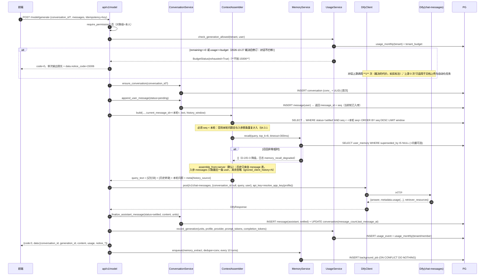
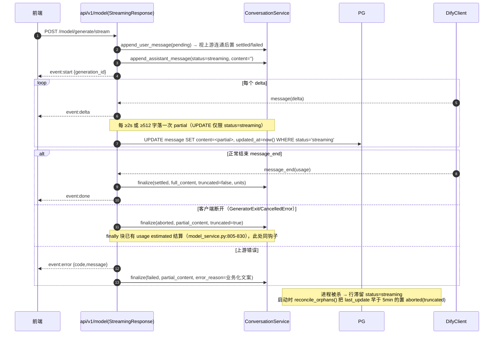
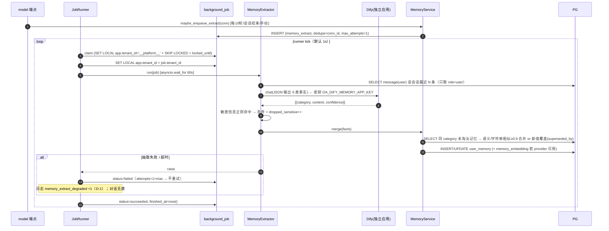
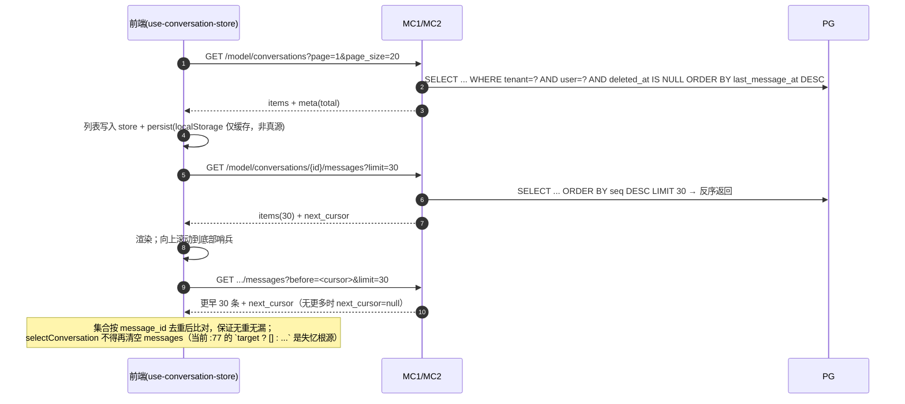
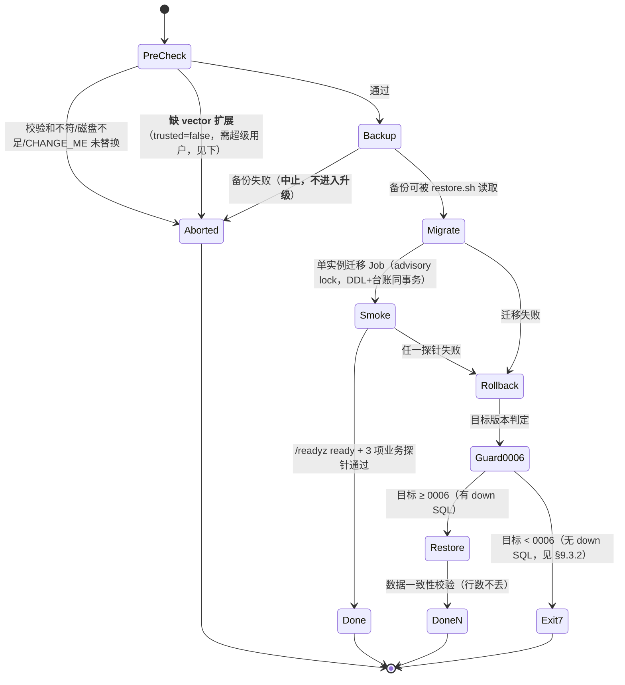

# 阶段四系统设计与任务分解（商用打磨与交付准备）

| 项 | 内容 |
| --- | --- |
| 文档 | `docs/architecture-phase4.md` |
| 版本 | v1.0（2026-10-24） |
| 作者 | 高见远（架构师） |
| 代码基线 | `main @ 2bdfa19` + **工作区 325 行未提交整改**（12 改 / 4 新增，见 §1.3） |
| 上游输入 | `docs/prd-phase4-increment.md`（v1.0，PM 并行修订 v1.1，冲突以创始人拍板口径为准）、`docs/repo-gap-assessment-2026-10-22.md`、`docs/architecture-phase3.md`、`docs/architecture-v1.0.md` §3、`docs/phase3-acceptance-report.md`、`docs/tech-path-review-2026-10-23.md` |
| 下游消费 | 工程师（批次执行）、QA（测试计划）、交付总监（交付物核对） |
| 一句话结论 | **"不做网关"前提下的四个内核改造（会话落库、自研上下文组装、跨会话记忆、成本硬止损）+ 一个交付形态重排（9 容器轻量版）**；其中三项经本轮代码/实机复核后**与 PRD 描述不同**，差异见 §0。 |

---

## 0. 与 PRD 的 7 处事实纠偏（**先读这一节，避免按错的前提施工**）

本节全部结论来自本轮**代码通读 + 运行中栈实测**（证据见附录 F）。凡与 PRD 不一致处，本文件为准，PM 需在 v1.1 勘误。

| # | PRD 表述 | 代码/实测事实 | 对本设计的影响 |
| --- | --- | --- | --- |
| **F-1** | §4.6 硬要求"上下文必须自研组装，不能只传 `conversation_id` 让底座自己回忆"；§9 Q-5 待架构确认 | **现状已经是自研组装**：`model_service.py:556-581` 把 `request.messages` 拼成单条 `query`（"以下是此前的对话记录：…"），并**硬编码 `conversation_id: None`**（`:578`，注释说明透传 `conv_xxx` 会被 Dify 直接 400，T02 实联调修复 INT-04a） | P4-07 **不需要**改下游调用协议（不必换 `/v1/completion-messages`）。真正的缺口是"历史来源是**客户端**而非自研库"，加上无记忆注入。改造点收敛为 §4.1 的一个新服务 + 一处取数替换 |
| **F-2** | 附录 A 称 M1/M2 的 `conversation_id` "请求带则用之，不带则生成" | `GenerateRequest.conversation_id` 是 **必填**（`schemas/model.py:100-102`，`min_length=1`），`messages` 也是必填非空（`:104`） | P4-07 的兼容变更 = **必填放宽为可选**（对既有调用方向后兼容，不是新增字段）。需同步 `docs/api/openapi.snapshot.json` |
| **F-3** | P4-11 ① "M1 请求去掉 `user_id` → `20001`" | `user_id` **不是请求字段**，来自令牌 `sub`（`api/v1/model.py:60/98`；`AuthContext.resolve` 缺 `sub` 直接 20002）。`_settle_generation` 的 `if not user_id: return False` 分支（`model_service.py:498-500`）**HTTP 不可达** | 该判据**改为**：① 计量落库断言（每次生成必有一条 `usage_event`，`user_id` 非空）；② 硬止损在**上游调用之前**判定。不要为一条不可达分支写用例 |
| **F-4** | P4-12 ② "`plugin_task_timeout_seconds` 零读取" | 属实（仅 `config.py:211` 定义）。但 PRD 建议的"`_advance_record` 外层加 `wait_for`"**粒度错误**：`_advance_record` 是**整任务**循环（最多 8 步 × 600s），包在它外面等于"整任务超时" | 正确注入点是**每一步**：`task_service.py:453` 的 `outcome = await self._engine.run_step(step_ctx, plan, record.inputs)` 外面加 `asyncio.wait_for(..., timeout=self._settings.plugin_task_timeout_seconds)` |
| **F-5** | P4-15 ① / D4 "轻量版 4 容器" | 4 容器**不可能满足登录**：适配层只校验令牌、不签发（`security.py` 模块 docstring 明确"不做登录与签发"），而令牌由 Keycloak 签发（`docker-compose.yml:409`）。**实测 Keycloak 是单机第一内存消费者**（数值与双口径见 `docs/lite-container-baseline.md` §2.3、§2.5） | 轻量版如实披露为 **9 常驻容器**（清单 §9.1，数字与依据见 `docs/lite-container-baseline.md` §4.1）。对外口径写"9 个容器 + 可选 1 个管理台"，不写"4 容器" |
| **F-6** | §5.3 ① "镜像 `RepoDigest` 与 `images.lock` 逐条比对" | `images.lock` **没有 `digest` 字段**（字段只有 `name/tag/license/role/source/note/distribution`） | P4-16 必须先给 `images.lock` **增 `digest:` 字段并回填**，否则该判据无法执行。已列入 T4-05 |
| **F-7** | P4-14 ① "`ls deploy/migrations/*down*` 命中 3 个文件"；§3 提到 `schema_migrations` 表 | 回滚目录约定是 **`deploy/migrations/rollback/00NN_*.sql`**（`migrate.py:12` 明文规定），不是文件名含 `down`；版本表实名 **`schema_migration`（单数）**（`migrate.py:9`，实库 `\dt` 已确认） | 验收命令改为 `ls deploy/migrations/rollback/*.sql`；文档与测试一律用 `schema_migration` |

> **另有两处 PRD 未列、但会直接卡住验收的事实**：
> - **F-8**：`Settings` 只声明了 2 个底座应用密钥（`dify_default_app_key` / `dify_agent_app_key`，`config.py:80/83`），而 `profile_routes.yaml` 引用了 `OA_DIFY_CODE_APP_KEY` / `LONG_CONTEXT` / `REASONING` / `FALLBACK` 四个**未声明**变量（靠 `loader.py:106-113` 直接读 `os.environ` 兜住）。P4-10 必须补齐 Settings 字段，否则契约测试无从断言"4 档 4 个 key"。
> - **F-9**：`deploy/init-app-role.sql:69` 对 `audit_log` 执行 **`REVOKE UPDATE, DELETE`**。"审计保留 180 天自动清理"**不可能由应用角色完成**，必须给 DBA 维护 SQL（§10.4）。PRD §3.2 P4-05 未提这一条，不处理会在验收时被判"清理任务没清审计表"。

---

## 1. 版本、基线与追溯矩阵

### 1.1 基线

| 项 | 值 | 来源 |
| --- | --- | --- |
| 提交基线 | `main @ 2bdfa19` | `git log --oneline -5` |
| 未提交整改 | 12 文件改 / +325 行；新增 4 文件（`test_artifact_token.py`、`test_auth_startup.py`、`validate_deploy.py`、`.seed.sql`） | `git status --porcelain` / `git diff --stat` |
| 测试基线 | 1573 passed / 0 failed / 0 skipped（含 PG，`d363909`，635.97s） | `phase3-acceptance-report.md:22/37` |
| 覆盖率基线 | 合并 90.78% / `business+db` 90.26% / 分支 80.89% | 同上 `:132-134` |
| 端点基线 | core 30 / phase2 38 / phase3 16（**恒严格**） | `deploy/validate_openapi.py:8-10`、`router.py:64/69` |
| 数据表 | 34 张（实库 `\dt` 34 rows） | `docker exec oa-postgres psql -c "\dt"` |

### 1.2 覆盖率门槛（创始人纠偏，不得下调）

| 维度 | 门槛 | 说明 |
| --- | --- | --- |
| 合并 | **≥ 90%** | 高于阶段三实测 90.78%？→ 取 `max(90, 阶段三实测)`，即 **≥90.78%**（门槛取整方向不得降低） |
| `business+db` | **≥ 90%** | 同上，实际 **≥90.26%** |
| 分支 | **≥ 80%** | 实际 **≥80.89%** |
| 新增代码 diff 覆盖 | **≥ 90%** | 新增文件与新增行（`--cov-context` 不便时用 `diff-cover` 对 `0006+` 涉及的模块） |

### 1.3 P4 → 架构章节追溯矩阵

| PRD | 需求 | 本文件章节 | 关键落点 |
| --- | --- | --- | --- |
| P4-01 | 生产鉴权防呆 + 密钥卫生 | §2.4 / §10.5 | 在途整改已含 `validate_auth_startup`（`security.py` diff）+ compose 写 `OA_AUTH_MODE`；本阶段只需入库 + 密钥清单文档 |
| P4-02 | CI 真绿一次 | §11 T4-01 | 依赖 `P4-11（=P3-B22-01，expected_xfail.py 中唯一仍 open 的 B30 条目）` 关闭；`P3-B22-02/04` 已于 `fcbe0d8` 前转为 `fixed` |
| P4-03 | SBOM + difypkg 扫描 | §9.5 | 新增 `deploy/sbom/` + `deploy/validate_offline_pkgs.py` |
| P4-04 | fail-closed | §2.5 | 白名单 **2 条**（§2.5.2） |
| P4-05 | 保留 + 清理 + 导出/删除 | §10.4 / §4.6 / §7.5 | 后台任务引擎（§2.3）+ `TD1/TD2` |
| P4-06 | 合规三件套 | §9.5 | 文档与能力**逐条对应**表（§9.5.2） |
| P4-07 | 会话与消息落库 | §3.1 / §4.1 / §5.1 | 迁移 `0008`；`ContextAssembler` |
| P4-08 | 历史回拉 + 前端持久化 | §4.2 / §5.4 | `MC1-MC4`；`use-conversation-store` 改造 |
| P4-09 | 记忆四表 + 抽取 + 召回 + 管理页 | §3.2 / §4.3 / §5.2-5.3 | 迁移 `0009`；`MM1-MM4` |
| P4-10 | 四档位路由接线 | §6 | `api_key=` 透传（`dify_client.py:281-303` 已支持） |
| P4-11 | 成本护栏 | §7 | `usage_event` 迁移 `0007` + 硬止损前置 |
| P4-12 | 月度预算 + 单步超时 | §7.4 / §2.6 | 迁移 `0011`；`wait_for` 注入点 `task_service.py:453` |
| P4-13 | `/metrics` + exporter + 告警 | §8 | `prometheus_client` + `alert.rules.yml` |
| P4-14 | 迁移四坑 | §10 | `0006-0011` + `rollback/` + advisory lock |
| P4-15 | 轻量版编排 | §9.1 | **9 常驻容器**（唯一真源 `docs/lite-container-baseline.md` §4.1） |
| P4-16 | 离线包 + 升级回滚 | §9.2-9.4 | `install.sh` / `upgrade.sh` / `rollback.sh` |
| P4-17 | 性能基线 | §9.6 | 口径表 + 禁虚标 |
| P4-18 | 5 类攻击自查 | §2.5.3 / §11 | `-m security` |
| P4-19 | 交付文档三件套 | §9.5 | 路径可 `ls` 校验 |
| P4-20 | 金标 20 条 | §9.7 | PM 出题，QA+交付评分 |
| P4-24/-29/-30 | S9 残留 / `content_type` / 杂项 | §3.4 / 迁移 `0006` | `0006` 是本阶段**最小且最先**的迁移 |

---

## 2. 总体方案与选型

### 2.1 为什么不做网关（一句话）

D1 拍板 + 技术事实：`model_service.py` 已完成"单条 `query` + `conversation_id=null`"的无状态形态，**换底座的成本已降到 `clients/dify_client.py` 的 3 条路径常量**；此时重写 OpenAI 兼容网关，收益（精确 token 计量）可由 `usage_event` 增 4 列 + Dify 已回传的 `metadata.usage` 拿到（实测 `prompt_tokens=47/completion_tokens=16`），**成本 1-2 周而收益已被覆盖**，故进不做清单，V1.1 独立决策。

### 2.2 新增的四个运行期组件

| 组件 | 职责 | 为什么必须新写 |
| --- | --- | --- |
| `ContextAssembler`（business） | 从 `message` 表取最近 N 轮 + 从 `user_memory` 取 top-k，拼成单条 `query` | 现有拼接逻辑在 `model_service._build_downstream_payload` 内、数据来源是客户端；需要"数据源换成自研库 + 加入记忆块 + 可被单测注入" |
| `BackgroundJobRunner`（workers） | PG 队列 + 进程内调度：记忆抽取、记忆合并、租户导出、保留期清理 | 全仓无 celery/arq（`pyproject.toml` 依赖清单已核对），且阶段四**同时**有三个异步需求，必须有一个统一载体（§2.3） |
| `MetricsRegistry`（core） | 标准 `/metrics` 文本输出 + 低基数标签约定 | 现状 `grep prometheus_client` 零命中、`/metrics` 实测 404（S5 缺陷证据）；**阶段四由 T4-05.1 引入 `prometheus_client`（Apache-2.0）**，见 §8.2 |
| `MemoryExtractor`（services） | 结构化抽取 6 类事实 + 敏感信息丢弃 + 去重合并 | 复用底座 LLM 但走**独立应用密钥**（`OA_DIFY_MEMORY_APP_KEY`），避免与对话档位抢配额与串味 |

### 2.3 选型：事实抽取的执行载体（PRD §三.5 的三种方案评估）

| 方案 | 优点 | 否决/采纳理由 |
| --- | --- | --- |
| ① 复用插件任务引擎 | 已有 step/artifact/retry/审计 | **否决**。插件引擎的入口是 `manifest` 声明式步骤（`plugins/schema.py`，`extra=forbid`），抽取任务没有 manifest、没有产物、没有 grant 语义；为一个内部 LLM 调用伪造一个插件，会污染 `plugin_catalog` / 能力策略 / 前端插件列表，且"记忆生成"会出现在用户的插件市场里 |
| ② FastAPI 进程内 asyncio + **持久化队列** | 单副本零新增组件；PG `FOR UPDATE SKIP LOCKED` 是标准作业队列；**与业务数据同事务**（记忆写入与 job 状态一次提交，无双写） | **采纳** |
| ③ Valkey 队列 + 独立 worker | 多副本天然扩展 | **否决**（V1.0）。轻量版 Valkey 无持久化承诺（`valkey/valkey:9.2-alpine` 默认 RDB 有窗口），队列丢一条 = 一条记忆永久不生成且无人知道；且多一个常驻进程与容器（与 §9.1 内存预算直接冲突）。②在**多副本下依旧正确**（SKIP LOCKED + `locked_until` 租约），标准版不需要换实现 |

**结论**：方案 ②，表 `background_job`（迁移 `0010`），载体代码 `app/workers/job_runner.py` + `app/workers/tasks/*.py`。三种 `kind`：`memory_extract`、`tenant_export`、`retention_cleanup`。

**关键约束**（不进实现会出错）：
1. **跨租户认领**：`background_job` 是 strict RLS 表，runner 认领时需 `SET LOCAL app.tenant_id='__platform__'`（沿用 `p_tenant_isolation` 的平台模式，与 `/ops/**` 同一机制），拿到任务后**立即** `SET LOCAL app.tenant_id = job.tenant_id` 再干活。认领 SQL 必须**同一事务**内完成，否则租约与状态会撕裂。
2. **租约而非锁**：`locked_by='<host>:<pid>:<uuid>'`、`locked_until=now()+2*interval`，进程崩溃后由下一次认领回收（`status='running' AND locked_until < now()`）。不用 Valkey 锁，避免第二套失效语义。
3. **按 kind 的重试策略**：`memory_extract` → `max_attempts=1`（PRD §4.6 D-1"丢弃，不重试"）；`retention_cleanup` → 3 次。**`tenant_export` 没有处理器**（2026-10-29：TD1 改同步生成，见 T4-05.3 与 `tasks/__init__.py`）；该 `kind` 仅保留在迁移 `0010` 的 `CHECK` 枚举里——枚举是冻结契约，删一个取值等于改契约，而队列里不会出现该类任务。
4. **runner 可关**：`OA_BACKGROUND_JOBS_ENABLED`（默认 `true`）。测试与 CI 默认关，避免后台线程污染断言；`-m memory` 用例显式开 `OA_BACKGROUND_JOBS_ENABLED=true` 并**同步驱动**一次 `runner.tick()`（不依赖 sleep）。

### 2.4 鉴权链（不变，但要把防呆固化）

```
浏览器 → 反代 → adapter ──(验签)──► JWT(Keycloak 签发)  ──► tenant_id / roles
                    └──(不签发)──  Keycloak 只做身份源
```
在途整改已实现启动防呆（`security.py` 新增 `validate_auth_startup`，`main.py:119` 接线）：`env ∈ {staging, production}` 且 `auth_mode=stub` → `30004` 拒绝启动；`jwt_secret` 为空同样拒绝。本阶段只做**入库 + 密钥轮换清单**（不重复开发）。

> 实测存证：**当前运行中的 `oa-adapter` 容器 `OA_ENV=production` + `OA_AUTH_MODE=stub`**（`docker exec oa-adapter printenv`），即整改前镜像。重建镜像后该组合必须启动失败——这是 P4-01 最硬的验收证据。

### 2.5 M14 fail-closed 改造与白名单（Q-6 交付物）

#### 2.5.1 事实：延迟判权只有一个出口

`security.py:262-266`：
```python
# 无角色声明：由业务能力层做最终判权（对象级 fail-closed，架构文档 3.5.1）
if not roles:
    logger.debug("permission_check_deferred", permission=permission, user_id=auth.user_id)
    return
```
穷举全仓 `require_permission(...)` 调用点（`grep -rn "require_permission" apps/adapter/app/api/v1/`），**只有 9 处 / 5 个权限点**：

| 权限点 | 调用点 | 读/写 | 调用后的对象级判定 |
| --- | --- | --- | --- |
| `knowledge:base:update` | `knowledge_ext.py:164/307` | 写 | `service.update(base_id, ..., auth)` |
| `knowledge:base:delete` | `knowledge_ext.py:212` | 写 | 同上（删除前 `is_visible`） |
| `knowledge:base:read` | `knowledge_ext.py:267/369` | 读 | `list_documents` / 片段列表按 `is_visible` 过滤 |
| `knowledge:grant:manage` | `knowledge_ext.py:411/448/497` | 写 | 授权表写入，管理员专属 |
| `tool:connection:manage` | `tools_ext.py:60`（TL1 调用记录） | 读 | `list_executions(query, auth)` 只返回本人 |

其余域（`model` / `tool` / `identity` / `identity_ext` / `ops` / `billing` / `plugins` / `agent` / `rag` / `artifact_files`）**不经过** `require_permission`：`ops` 走 `require_ops_access`（`ops.py` 8 处，已 fail-closed），`identity_ext` 走服务层 `has_admin_role`，其余走对象级。`M4/BL5 无角色已 fail-closed`（已有用例 `test_usage_endpoints.py:160-165` 断言 20003）。

#### 2.5.2 白名单（**2 条**，≤5，每条带理由）

| # | 权限点 | 为什么必须委派 | 收窄条件（缺一不可） |
| --- | --- | --- | --- |
| W-1 | `knowledge:base:read` | 只读；`MEMBER`/`GUEST` 均持有，令牌缺 roles 属身份侧异常但**不应连"看自己被授权的库"都拒**；真隔离由 `is_visible()` 承担 | **仅限 GET**；写路径同一权限点不存在（create/update/delete 分属别的点） |
| W-2 | `tool:connection:manage` | TL1 只读调用记录；`MEMBER`/`GUEST` 均持有，返回集已按 `initiator_id` 收敛到本人 | 收窄条件是**权限点 + 方法级（仅 GET）**，**不是路由白名单**。该权限点当前在全仓**唯一使用点 = TL1**（`tools_ext.py:60`）；**将来若有其他端点复用它，必须回来补路由级约束**——不要以为白名单已经管住了路由。连接/断开走 `tool.py` 服务层，不受此点保护 |

白名单实现形态：`app/core/permission_whitelist.py` 常量 `DEFERRED_PERMISSIONS: Final[frozenset[str]] = frozenset({"knowledge:base:read", "tool:connection:manage"})`，**按 `(permission, method)` 双键判定**，`security.py` 改为：
```python
if not roles:
    if (permission, method) in DEFERRED_PERMISSIONS:
        logger.info("permission_check_deferred_whitelisted", ...)  # 审计留痕
        return
    raise ApiError(ErrorCode.FORBIDDEN, internal_detail="no roles claim")
```
CI 断言：`len(DEFERRED_PERMISSIONS) <= 5` 且集合内容 `== ` 快照文件 `docs/security/permission-whitelist.lock`（扩张即红）。

#### 2.5.3 用例（P4-18 的 security 子集）

| 用例 | 断言 |
| --- | --- |
| 无 roles 令牌 → `PUT /knowledge/bases/{id}` | 403 + `audit_log` 1 条 + 目标表 `count` 不变 |
| 无 roles 令牌 → `GET /knowledge/bases/{id}/documents` | 200（白名单 W-1）+ 日志 `permission_check_deferred_whitelisted` |
| 无 roles 令牌 → `POST /plugins/{id}/install` | 403（本来就走对象级，本条防回退） |
| 他人**任务/产物**（同租户不同用户） | **403** + 不返回任何 `data` |
| 他人**会话**（同租户不同用户） | **404** + `code=18001` + 文案「该对话已不存在」+ `data` 为空 |
| 他人**记忆** | **404** + `code=18002` + 文案「这条信息已不存在」+ `data` 为空 |
| 白名单扩张 | `len>5` 或集合漂移 → `test_whitelist_lock.py` 红 |

> **为什么任务/产物用 403、会话/记忆用 404**：403 与 404 的差异本身就是一个**存在性预言机**——攻击者用这两者的区别可以把 `task_xxx` / `conv_xxx` / `mem_xxx` 空间枚举一遍，从而知道某个 ID 是否存在。任务与产物是**协作对象**（同租户内本就多人可见，判权失败必须明确告知），而会话与记忆是**个人数据**（除本人外不应有人知道其存在），所以后者一律回 404，且**与「真的不存在」同码同文案**。两者都**不得返回 `data`**。

### 2.6 任务单步超时（F-4 修正）

```python
# task_service.py:453 处（现为 outcome = await self._engine.run_step(...)）
try:
    outcome = await asyncio.wait_for(
        self._engine.run_step(step_ctx, plan, record.inputs),
        timeout=float(self._settings.plugin_task_timeout_seconds),
    )
except TimeoutError:
    outcome = StepOutcome(status=STEP_FAILED, reason="超时未完成", retryable=True)
```
- 产物保留：`_save_artifacts` 之前已落库的产物不受影响（`artifacts` 列表在循环外累积）。
- 可重试本步：`outcome.retryable=True` → 现有 `TASK_NOT_RETRYABLE`(17001) 分支放行。
- 分布式锁：同一 `task_id` 推进加 `pg_advisory_xact_lock(hashtext(tenant_id||':'||task_id))`（**用 PG 不用 Valkey**，与 §2.3 同一理由；`pg_advisory_xact_lock` 随事务释放，不会泄漏）。验收判据"两个进程同时推进只 +1 步"由 `test_task_advance_lock.py` 双连接实测。

---

## 3. 数据模型

### 3.1 `conversation`（会话，迁移 `0008`）

```sql
CREATE TABLE IF NOT EXISTS conversation (
    tenant_id            TEXT        NOT NULL,
    conversation_id      TEXT        NOT NULL,           -- conv_ + ULID
    user_id              TEXT        NOT NULL,           -- 归属个人（不租户共享）
    title                TEXT        NOT NULL DEFAULT '',
    archived             BOOLEAN     NOT NULL DEFAULT FALSE,
    dify_conversation_id TEXT,                           -- 可空、可重建；仅通道凭证
    message_count        INTEGER     NOT NULL DEFAULT 0,
    last_message_at      TIMESTAMPTZ,
    created_at           TIMESTAMPTZ NOT NULL DEFAULT now(),
    updated_at           TIMESTAMPTZ NOT NULL DEFAULT now(),
    deleted_at           TIMESTAMPTZ,                    -- 软删，可恢复 30 天
    PRIMARY KEY (tenant_id, conversation_id)
);
CREATE INDEX IF NOT EXISTS idx_conversation_list
    ON conversation (tenant_id, user_id, last_message_at DESC NULLS LAST)
    WHERE deleted_at IS NULL;
CREATE INDEX IF NOT EXISTS idx_conversation_recover
    ON conversation (tenant_id, deleted_at) WHERE deleted_at IS NOT NULL;
```

### 3.2 `message`（消息，append-only）

```sql
CREATE TABLE IF NOT EXISTS message (
    tenant_id        TEXT        NOT NULL,
    message_id       TEXT        NOT NULL,               -- msg_ + ULID
    conversation_id  TEXT        NOT NULL,
    user_id          TEXT        NOT NULL DEFAULT '',    -- 本轮发起人（assistant 行同值）
    role             TEXT        NOT NULL CHECK (role IN ('user','assistant','system')),
    content          TEXT        NOT NULL DEFAULT '',    -- 原文；脱敏在读取层做
    status           TEXT        NOT NULL DEFAULT 'pending'
                     CHECK (status IN ('pending','streaming','settled','aborted','failed')),
    error_reason     TEXT        NOT NULL DEFAULT '',    -- 业务化文案，不含码/堆栈
    truncated        BOOLEAN     NOT NULL DEFAULT FALSE,
    profile          TEXT        NOT NULL DEFAULT '',
    generation_id    TEXT        NOT NULL DEFAULT '',
    prompt_units     INTEGER     NOT NULL DEFAULT 0,
    completion_units INTEGER     NOT NULL DEFAULT 0,
    seq              BIGINT      GENERATED ALWAYS AS IDENTITY,   -- 游标/排序
    created_at       TIMESTAMPTZ NOT NULL DEFAULT now(),
    updated_at       TIMESTAMPTZ NOT NULL DEFAULT now(),
    PRIMARY KEY (tenant_id, message_id)
);
CREATE INDEX IF NOT EXISTS idx_message_page ON message (tenant_id, conversation_id, seq DESC);
CREATE INDEX IF NOT EXISTS idx_message_orphan ON message (status) WHERE status IN ('pending','streaming');
```

**append-only 的执行手段**（PRD 说"只插入不更新正文"，但流式必须能写内容）：

```sql
CREATE OR REPLACE FUNCTION message_guard_content() RETURNS trigger AS $$
BEGIN
    IF NEW.content IS DISTINCT FROM OLD.content AND OLD.status <> 'streaming' THEN
        RAISE EXCEPTION 'message content is immutable after finalize (status=%)', OLD.status;
    END IF;
    IF OLD.status IN ('settled','aborted','failed') AND NEW.status = 'streaming' THEN
        RAISE EXCEPTION 'message status cannot regress to streaming';
    END IF;
    RETURN NEW;
END $$ LANGUAGE plpgsql;

DROP TRIGGER IF EXISTS trg_message_guard ON message;
CREATE TRIGGER trg_message_guard BEFORE UPDATE ON message
    FOR EACH ROW EXECUTE FUNCTION message_guard_content();
```
> 这样"正文只写一次"是**数据库强制的**，不靠代码自觉；`status` 仍可流转（`pending→streaming→settled/aborted/failed`）。

### 3.3 `user_memory` / `memory_embedding` / `user_memory_setting`（迁移 `0009`）

```sql
CREATE EXTENSION IF NOT EXISTS vector;   -- 需 pgvector 镜像（§9.1）

CREATE TABLE IF NOT EXISTS user_memory (
    tenant_id              TEXT        NOT NULL,
    memory_id              TEXT        NOT NULL,          -- mem_ + ULID
    user_id                TEXT        NOT NULL,
    category               TEXT        NOT NULL
                           CHECK (category IN ('identity','org','preference',
                                               'convention','constraint','project')),
    content                TEXT        NOT NULL,
    confidence             TEXT        NOT NULL DEFAULT 'high'
                           CHECK (confidence IN ('high','low')),
    source_conversation_id TEXT        NOT NULL DEFAULT '',
    source_message_id      TEXT        NOT NULL DEFAULT '',
    superseded_by          TEXT,                          -- 指向新值 memory_id；非空即不参与召回
    normalized_hash        TEXT        NOT NULL DEFAULT '',-- 同义去重键（sha256 of 归一键）
    hit_count              INTEGER     NOT NULL DEFAULT 1,
    created_at             TIMESTAMPTZ NOT NULL DEFAULT now(),
    updated_at             TIMESTAMPTZ NOT NULL DEFAULT now(),
    PRIMARY KEY (tenant_id, memory_id)
);
CREATE INDEX IF NOT EXISTS idx_memory_recall
    ON user_memory (tenant_id, user_id, category, updated_at DESC)
    WHERE superseded_by IS NULL;
CREATE UNIQUE INDEX IF NOT EXISTS uq_memory_hash
    ON user_memory (tenant_id, user_id, category, normalized_hash)
    WHERE superseded_by IS NULL AND normalized_hash <> '';

CREATE TABLE IF NOT EXISTS memory_embedding (
    tenant_id  TEXT        NOT NULL,
    memory_id  TEXT        NOT NULL,
    model      TEXT        NOT NULL DEFAULT '',            -- 内部字段：换模型后需重算
    dim        INTEGER     NOT NULL,
    embedding  vector(1024) NOT NULL,                      -- 维度见 §3.3.1
    updated_at TIMESTAMPTZ NOT NULL DEFAULT now(),
    PRIMARY KEY (tenant_id, memory_id)
);
CREATE INDEX IF NOT EXISTS idx_memory_embedding_hnsw
    ON memory_embedding USING hnsw (embedding vector_cosine_ops);

-- 第 5 张表：PRD 未列，但"全局开关 + 分类开关"必须有落点（写进 PRD 勘误）
CREATE TABLE IF NOT EXISTS user_memory_setting (
    tenant_id         TEXT        NOT NULL,
    user_id           TEXT        NOT NULL,
    enabled           BOOLEAN     NOT NULL DEFAULT TRUE,
    category_switches JSONB       NOT NULL DEFAULT '{}'::jsonb,
    updated_at        TIMESTAMPTZ NOT NULL DEFAULT now(),
    PRIMARY KEY (tenant_id, user_id)
);
```

#### 3.3.1 向量维度与"无 embedding 提供方"的处理（PRD 未覆盖的真问题）

- Dify 1.17 的 Service API **不提供** raw embedding 接口（`/v1/datasets` 只做检索与管理），DeepSeek 系模型无 embeddings 端点。因此设 `EmbeddingPort`：
  - `OpenAICompatibleEmbedding`（`OA_MEMORY_EMBEDDING_BASE_URL/_API_KEY/_MODEL/_DIM`，默认 `dim=1024`）——客户自带或标准版配；
  - `NullEmbedding`（未配置）→ 走 **D-3 降级**：召回退化为"类别 + 时间 + 置信度"，去重退化为 `difflib.SequenceMatcher` 比值 ≥0.9（可离线单测，无网络）。
- 维度固定 1024 的理由：`vector(N)` 是索引前提；换模型需重建该表，写进运维手册（`ALTER TABLE ... ALTER COLUMN embedding TYPE vector(<new>)` 前须 `DROP INDEX`）。
- **两档统一 pgvector**（Q-2 拍板）：标准版知识库 RAG 仍走 Milvus（N-2 不替换），只有**记忆**走 pgvector；Dify 的 `VECTOR_STORE` 在轻量版取 `pgvector`、标准版保持 `milvus`——**代码零分叉，只有编排与 `.env` 差异**。

### 3.4 `background_job`（迁移 `0010`）与 `tenant_budget`（迁移 `0011`）

```sql
CREATE TABLE IF NOT EXISTS background_job (
    tenant_id    TEXT        NOT NULL,
    job_id       TEXT        NOT NULL,                    -- job_ + ULID
    kind         TEXT        NOT NULL
                 CHECK (kind IN ('memory_extract','tenant_export','retention_cleanup')),
    dedupe_key   TEXT        NOT NULL DEFAULT '',          -- 同 kind 去重（如 conv_id）
    payload      JSONB       NOT NULL DEFAULT '{}'::jsonb,
    status       TEXT        NOT NULL DEFAULT 'queued'
                 CHECK (status IN ('queued','running','succeeded','failed','cancelled')),
    attempts     SMALLINT    NOT NULL DEFAULT 0,
    max_attempts SMALLINT    NOT NULL DEFAULT 3,
    run_after    TIMESTAMPTZ NOT NULL DEFAULT now(),
    locked_by    TEXT        NOT NULL DEFAULT '',
    locked_until TIMESTAMPTZ,
    last_error   TEXT        NOT NULL DEFAULT '',
    created_at   TIMESTAMPTZ NOT NULL DEFAULT now(),
    updated_at   TIMESTAMPTZ NOT NULL DEFAULT now(),
    finished_at  TIMESTAMPTZ,
    PRIMARY KEY (tenant_id, job_id)
);
CREATE UNIQUE INDEX IF NOT EXISTS uq_job_dedupe
    ON background_job (tenant_id, kind, dedupe_key)
    WHERE dedupe_key <> '' AND status IN ('queued','running');
CREATE INDEX IF NOT EXISTS idx_job_due
    ON background_job (run_after) WHERE status IN ('queued','running');

CREATE TABLE IF NOT EXISTS tenant_budget (
    tenant_id            TEXT        NOT NULL,
    monthly_budget_units BIGINT      NOT NULL DEFAULT 0 CHECK (monthly_budget_units >= 0), -- 0=不限
    warn_ratio           NUMERIC(3,2) NOT NULL DEFAULT 0.80 CHECK (warn_ratio > 0 AND warn_ratio <= 1),
    enabled              BOOLEAN     NOT NULL DEFAULT TRUE,
    updated_at           TIMESTAMPTZ NOT NULL DEFAULT now(),
    PRIMARY KEY (tenant_id)
);
```

> PRD 写"`tenant_quota` 增月度额度"——**该表不存在**（实库 34 表无此名，额度来自 `billing_subscription`，经 `usage_repo.quota()` 读取）。为不碰已冻结的计费域（D3），新建 `tenant_budget` 小表，计费表**零改动**。

### 3.5 RLS / 授权 / 保留期字段（与 `p_tenant_isolation` 完全一致）

6 张新表全部进 **strict** 组，写法照抄 `init-schema-phase2.sql:643-652`（`ENABLE` + `FORCE` + `p_tenant_isolation`），并在迁移内联（因为基线脚本已执行过，DO 块不会重跑）：

```sql
DO $$
DECLARE t TEXT;
        strict_tables TEXT[] := ARRAY['conversation','message','user_memory',
                                      'memory_embedding','user_memory_setting',
                                      'background_job','tenant_budget'];
BEGIN
  FOREACH t IN ARRAY strict_tables LOOP
    EXECUTE format('ALTER TABLE %I ENABLE ROW LEVEL SECURITY', t);
    EXECUTE format('ALTER TABLE %I FORCE ROW LEVEL SECURITY', t);
    EXECUTE format('DROP POLICY IF EXISTS p_tenant_isolation ON %I', t);
    EXECUTE format(
      'CREATE POLICY p_tenant_isolation ON %I '
      'USING (tenant_id = current_setting(''app.tenant_id'', TRUE) '
      '    OR current_setting(''app.tenant_id'', TRUE) = ''__platform__'') '
      'WITH CHECK (tenant_id = current_setting(''app.tenant_id'', TRUE) '
      '    OR current_setting(''app.tenant_id'', TRUE) = ''__platform__'')', t);
  END LOOP;
END $$;
```

| 项 | 口径 |
| --- | --- |
| 应用角色 | `officeai_app`（`NOSUPERUSER NOBYPASSRLS`，`init-app-role.sql:36-41`）；新表由迁移以 `officeai` 身份创建 → `ALTER DEFAULT PRIVILEGES`（`:60-62`）已覆盖，**无需额外 GRANT** |
| 个人 vs 租户 | 会话与记忆是**个人数据**：RLS 只保证租户边界，`user_id` 边界由**仓储层强制**（所有查询必带 `user_id = $n`，`user_id` 来自 `AuthContext`，不接受请求参数） |
| 管理员可见 | 只给**统计**（人数、条数、删除量），不给正文（PRD §4.8）；实现为 `ops` 域聚合查询，不带 `content` 字段 |
| 保留期字段 | `conversation.deleted_at`（软删 30 天）、`created_at`（365 天硬删）；`user_memory` 无 TTL 字段（永久，用户删）；`usage_event.occurred_at`（13 个月）；`audit_log.created_at`（180 天，**DBA 执行**，见 F-9）；`plugin_task/artifact`（180 天，沿用 `plugin_artifact_retention_days`） |
| 全部可配 | `Settings` 新增：`retention_audit_days=180`、`retention_usage_months=13`、`retention_task_days=180`、`retention_conversation_days=365`、`conversation_soft_delete_recover_days=30`、`memory_max_per_user=200`、`memory_extract_every_turns=10` |

**租户删除与保留（TD2 的三条实现事实，与 `tenant_data_service.py` 一致）**

| # | 事实 | 口径与理由 |
| --- | --- | --- |
| D-1 | **`tenant` 表没有 `deleted_at` 列** | 实测建表脚本（`init-schema-phase2.sql:52-63`）：只有 `status TEXT CHECK (status IN ('active','suspended'))` 与 `suspended_reason`。删除 = `status='suspended'` + 写 `suspended_reason`（"先停用"），**不是**软删时间戳。V1.1 再加 `deleted_at`（见 §13 A-11 技术债） |
| D-2 | **删完 `plugin_task` / `plugin_artifact` 各留 1 行** | 这 1 行就是**删除证明的宿主**（导出包挂在任务产物上，复用 `/files/artifacts/{token}` 下载）。证明本身是"已删除"的唯一载体，连它删掉客户就再也拿不到证据。该行**业务字段须清空**（只留行数与时间戳），否则等于"删了又留了数据" |
| D-3 | **知识库四表不在在线删除范围** | `document_meta` / `knowledge_base_meta` / `knowledge_base_grant` / `segment_map` 列在 `RETAINED_TABLES` 常量里，响应与证明文件回显 `retained_tables` + `retained_note`。理由：正文与索引在 Dify 侧（对象存储/向量库），**跨系统删除风险高于收益**；退租要全量清空时由 DBA 执行 `sql/full-purge.sql`（离线包 `sql/` 内） |
| D-4 | **导出包与删除证明的 TTL 必须分开**（实测 `tenant_data_service.py:1175-1207`） | **导出包**＝凭证：`expires_in_days=None` → `expires_at = now + 下载令牌 TTL`（默认 900s / 15 分钟），产物留存与凭证同寿命，过期即失效最安全；**删除证明**＝证据：`expires_in_days=plugin_artifact_retention_days`（默认 **180 天**），因为客户可能几个月后才来核查退租。两者**共用同一个 artifact 下载通道**（`/files/artifacts/{token}`，令牌 TTL 都是 15 分钟），差别只在**产物行的 `expires_at`** |

> **为什么证明不能沿用凭证 TTL**：`retention_cleanup` 按 `expires_at < now()` 清理产物行。若证明也取 15 分钟，则**客户 15 分钟后下载自己的删除证明会 404**，且下一轮清理把它当过期产物物理删除——合规承诺（可自证已删除）当场失效，而且失效恰好发生在「客户来核查」的那一刻，最不可挽回。
>
> 审计表同理：应用角色无 `DELETE` 权限（`init-app-role.sql:69`），删除与保留都需 DBA 执行，
> 响应里单列 `audit_pending_dba: N`，日志必须出现 `audit_log=skipped(no privilege)`（§10.4 硬判据）。

### 3.6 既有表的两处**加性**变更

| 迁移 | 表 | 变更 | 兼容性 |
| --- | --- | --- | --- |
| `0006` | `plugin_artifact` | `ALTER TABLE plugin_artifact ADD COLUMN IF NOT EXISTS content_type TEXT NOT NULL DEFAULT ''`（P3-B22-04，**P0**） | 加列带默认值 → N-1 可读 |
| `0007` | `usage_event` | `ADD COLUMN profile TEXT NOT NULL DEFAULT ''`、`provider TEXT NOT NULL DEFAULT ''`、`prompt_tokens BIGINT NOT NULL DEFAULT 0`、`completion_tokens BIGINT NOT NULL DEFAULT 0`（P4-11 / M11） | 同上；旧行默认值语义 = "未知"，看板单列 `source='estimated' OR profile=''` |

### 3.7 与既有 34 表的关系

```
tenant(1) ─┬─ conversation(N) ── message(N)          ← 新（个人会话）
           ├─ user_memory(N) ── memory_embedding(1:1) ← 新（个人记忆，跨会话）
           ├─ user_memory_setting(1)                  ← 新（开关）
           ├─ background_job(N)                       ← 新（异步载体）
           ├─ tenant_budget(1)                        ← 新（月度预算）
           ├─ usage_event(N)  [+4 列]
           ├─ plugin_artifact(N) [+content_type]
           └─ 其余 26 张既有表（零改动）
```

> 刻意**不建外键**：`message.conversation_id`、`user_memory.source_conversation_id` 均不加 FK。理由与阶段二一致（RLS + 软删 + 分表迁移会与 FK 冲突），引用完整性由应用层与清理任务保证。

---

## 4. 接口设计

### 4.1 契约基线约束（先看这三条，否则会做错）

1. 统一信封 `{code,message,data}`，`code=0` 成功；前端**只展示 `message`**（`errors.py` 的 `ErrorSpec.message` 是唯一文案源）。
2. 写接口必带 `Idempotency-Key`（`run_idempotent`）。
3. 端点**只减不增**：新增 10 个必须登记 `docs/api/baseline-phase4-10.json`，并扩展 `validate_openapi.py`：`core_actual = operations - phase2 - phase3 - phase4`，`G3: len(phase4) == 10`（否则新端点会被算进 core → G1 精确相等立红）。

### 4.2 新增 10 个端点

> 权限一律 Bearer；`conv_`/`mem_` 前缀；所有"本人"端点**不接受** `user_id` 参数（取令牌 `sub`）。

| # | 方法 路径 | 请求（关键字段） | 响应 `data` | 权限 | 幂等 |
| --- | --- | --- | --- | --- | --- |
| MC1 | `GET /api/v1/model/conversations` | `page=1,page_size=20(≤100),archived=false,include_deleted=false` | `items[{conversation_id,title,last_message_at,message_count,archived}], meta{page,page_size,total}` | 本人 | 否 |
| MC2 | `GET /api/v1/model/conversations/{id}/messages` | `before`(游标,可空), `limit=30(≤100)` | `items[{message_id,role,content,status,created_at,truncated}], next_cursor` | 本人 | 否 |
| MC3 | `DELETE /api/v1/model/conversations/{id}` | — | `conversation_id, deleted_at, recoverable_until` | 本人 | 是 |
| MC4 | `PATCH /api/v1/model/conversations/{id}` | `title?`(≤120) / `archived?` | `conversation_id, title, archived, updated_at` | 本人 | 是 |
| MM1 | `GET /api/v1/model/memories` | `category?`, `page`, `page_size` | `items[{memory_id,category,content,confidence,source_conversation_id,updated_at,superseded_by}], meta, enabled` | 本人 | 否 |
| MM2 | `DELETE /api/v1/model/memories/{memory_id}` | — | `memory_id, deleted=true` | 本人 | 是 |
| MM3 | `DELETE /api/v1/model/memories` | `category?`（缺省=全部） | `deleted_count` | 本人 | 是 |
| MM4 | `PUT /api/v1/model/memories/settings` | `enabled`, `category_switches{}` | `enabled, category_switches, updated_at` | 本人 | 是 |
| TD1 | `POST /api/v1/ops/tenant-data/export` | `scope[]{audit,usage,chat,memory,artifact}` | `export_id, status="ready", download_url, expires_at, rows{各表行数+total}` | `team:role:manage`（owner/org_admin） | 是 |

> **TD1 实现口径（同步，不是异步）**：最终实现是**同步生成**，`status` 恒为 `ready` 并直接给出 `download_url / expires_at / rows`；**上限 20 万行**，超限返回 `20001` + 文案「数据量较大，请联系管理员分批导出」。下载**复用 `/files/artifacts/{token}`**（短期令牌），**不新增端点**。
>
> 为什么不按原设计做 `preparing` + `estimated_rows` 异步：**端点预算里没有「查进度」的位置**（10 个新端点已排满，再加就要动 baseline 与门禁）；异步而无法轮询，等于「排了队但取不到」，对客户是更差的体验。同步 + 明确上限，是「要么立刻给你、要么明确告诉你太大」的确定性行为。
| TD2 | `DELETE /api/v1/ops/tenant-data` | `confirm_text`（企业名称逐字）, `scope[]` | `deletion_id, deleted_tables[], scheduled_at` | owner 专用 + 二次确认 | 是 |

**错误码分配**（复用优先；新增码落在**未占用区段 18xxx**）

| 语义 | 码 | HTTP | message（唯一文案） | 说明 |
| --- | --- | --- | --- | --- |
| 会话不存在/已删除 | **18001** | 404 | 该对话已不存在 | 与 `12001`（任务不存在）区分 |
| 记忆不存在 | **18002** | 404 | 这条信息已不存在 | — |
| 删除确认文本不匹配 | **18003** | 400 | 请输入完整的企业名称以确认 | 需独立文案，不能复用 20001 的通用文案 |
| 额度/预算已用尽 | **15006**（复用） | **402**（由 200 改） | 本月可用量已用完，请联系管理员调整 | E-3/E-4 **同码**；见 §7.3 的兼容处理。**2026-10-27 裁决后现状**：本码仅以 `data.notice_code` 出现在成功响应里，**全仓无任何 `raise` 调用点**（`grep -rn "15006" apps/adapter/app/` 可验）；注册值仍保留为 402——错误码表是**对外契约**，删值会让前端 `code=15006` 的处理逻辑失去依据 |
| 无权限访问他人**任务/产物** | 20003（复用） | **403** | 你没有权限查看该内容 | 沿用既有契约 |
| 访问他人**会话/记忆** | **18001 / 18002**（与「不存在」同码） | **404** | 该对话已不存在 / 这条信息已不存在 | **防枚举**：返回 403 会泄漏「这个 ID 存在」，个人数据可枚举比文案不统一严重得多 |
| 记忆已关闭 | **不新增** | 200 | 静默不写 | 状态表达，不打错误码 |
| 导出进行中 | **不新增** | 200 | 正在准备导出，完成后会通知你 | 用 `background_job` 状态表达 |

> **码段冲突核对**：既有 `10001-10005 / 11001-11007 / 12001-12004 / 13001-13006 / 14001-14008 / 15001-15009 / 16002-16012 / 17001-17002 / 20001-20008 / 30001-30004`。`18001-18003` 未被占用（`errors.py` 全文核对）。**不要**用 `10005 MODEL_QUOTA_EXHAUSTED` 做硬止损——它表示"上游回传额度不足"（`model_service.py:669` 的映射分支），与自研侧硬止损是两件事。

### 4.3 2 处向后兼容变更

| 变更 | 现状 | 目标 | 兼容性论证 |
| --- | --- | --- | --- |
| B-1 `GenerateRequest.conversation_id` | 必填（`min_length=1`） | **可选**（缺省服务端生成 `conv_` + ULID 并在 `data.conversation_id` 返回） | 必填→可选对既有调用方**不破坏**（老调用照传）；响应**新增**字段。需更新 `openapi.snapshot.json`（G4 允许"新增属性"） |
| B-2 `GenerationContext.assemble_from` | 不存在 | 新增可选枚举 `server`(默认)/`client` | 新增可选字段，`required` 不变（G4 放行）。**语义见 §4.3.1 的双份历史收口表**——两种模式互斥取数，任何情况下都不会叠加两份历史 |
| B-3 M3 目录 `status` | 取 yaml 静态值 | 取**运行期可用性**（该档 `resolve_app_key` 为空 → `unavailable`） | 字段名/类型不变，取值域不变（`available/unavailable` 已存在） |

**B-2 的三种取数模式（双份历史收口，创始人 2026-10-24 拍板；详表与硬要求见 §4.3.1）**

- **`server`（默认）**：只读 `message` 表；`request.messages` **只取最后一条**且必须 `role=user`，其余**全部忽略**，debug 日志记 `ignored_client_history=N`。
- **`client`（灰度/逃生门）**：只用 `request.messages` 拼 transcript，**不读** `message` 表（避免双份）。
- **`conversation_id` 缺省**：历史为空，只取最后一条 user 消息，服务端生成 `conv_` 并返回；`server` 模式下若 `message` 表为空但客户端传了多条，**仍只用最后一条**，响应 meta 带 `history_source=server_empty`。

#### 4.3.1 双份历史收口（`assemble_from` 语义，创始人 2026-10-24 拍板）

**风险背景**：P4-07 把历史源改为 `message` 表之后，若客户端仍按老契约上传全量 `messages`，
两套历史会**叠加**——现象极隐蔽：回答变啰嗦、用量翻倍，但**不报错**。故两种模式必须**互斥取数**。

| 模式 | 历史来源 | 对 `request.messages` 的处理 | `data.history_source` |
| --- | --- | --- | --- |
| `server`（**默认**） | **只读** `message` 表（`conversation_id` + `history_window`，仅 `status='settled'`） | **只取最后一条**且必须 `role=user` 作为当前轮；**其余入参消息全部忽略**，debug 日志记 `ignored_client_history=N` | `server` |
| `client`（灰度/逃生门） | **只用** `request.messages` 拼 transcript（现状行为） | 全量使用；**不读** `message` 表历史（避免双份） | `client` |
| `conversation_id` 缺省（新会话） | 历史为空 | 只取最后一条 `user`；服务端生成 `conv_` 并在响应返回 | `server_empty` |

**四条硬要求**

1. `server` 模式下**最后一条不是 `user`** → `20001`（参数错误）。**不做"猜意图"**（比如把最后一条 assistant 当上下文重试）。
2. `server` 模式下 `message` 表历史为空但客户端传了多条 → **仍只用最后一条**，并置 `history_source=server_empty`（现场排障用；`data` 字段，文案不外露给终端用户）。
3. `ignored_client_history` 只在 `server` 模式且 `len(messages) > 1` 时非 0；它是**双份历史回归的唯一可观测信号**，监控项 `model_client_history_ignored_total`。
4. **本轮消息必须从历史里排除，且排除方式只允许 `seq < current.seq`。**
   P4-07 的口径是"先落库再调模型"，所以本轮这条 `user` 消息**已经在 `message` 表里**；
   若组装直接"读库最近 N 条"，同一个问题会被装两次（库里那条 + 入参最后一条）——症状与"客户端传历史"一模一样
   （不报错、回答跑偏、成本翻倍），但**这条更隐蔽：客户端什么都没做错**。
   - 实现：`ContextAssembler.build(..., current_message_id=...)` — 先落库拿到 `message_id`/`seq`，**再**组装；
     历史查询恒带 `AND seq < $current_seq`（同一 `tenant_id` + `conversation_id`）。
   - 当前轮正文**只从入参取一次**，不再从库读；`history_window` 只约束"当前轮之前"的轮次。
   - **流式路径自动满足**：助手空壳（`status=streaming`）的 `seq` 必然大于当前 user 行，被 `seq <` 天然排除，不需要额外特判。
   - 监控项 `model_context_current_duplicated_total`：组装后若 `query` 中当前轮原文出现次数 > 1，计数 +1。**它是自证指标，不是运维指标**：`>0` 即代表实现有 bug（不是容量/负载问题），**不参与容错、不设告警阈值、不进任何 runbook**；只进 `/metrics` 与验收断言（T4-02.3 ⑥）。

> **为什么不能用 `created_at < now()`，也不能"取最近 N 条再自己减一"**
> ① `now()` 在**同一事务/同一秒**内插入的多行无法区分先后，本轮与上一轮会同时"小于 now()"；
> ② 数据库时间、应用时间、容器时钟三者可能有偏差，`now()` 是不可靠排序键；
> ③ "取 N 条再减一"在**并发两轮**时会互相吞掉对方（两个请求各自看到对方的行），谁减谁不确定；
> ④ `seq` 是 `GENERATED ALWAYS AS IDENTITY`，插入即定序、全局单调，`seq <` 是一个**严格全序**，
>    同时挡住"同秒插入"与"并发两轮"两种情况。代价是组装前必须先落库——这正是 P4-07 已定的顺序。

> 为什么默认 `server` 而不是"入参优先"：`server` 是**单一真源**——前端内存态、多标签页、换设备、断线重连
> 四种路径下历史都一致；"入参优先一段时间"会让同一会话在不同入口产生不同上下文，是比"多写一次迁移"更贵的债。
> `client` 只作为**一档灰度开关**保留，下阶段删除（届时删 `assemble_from` 枚举值属 enum 收窄，需按 G4 走显式审批）。

> `client` 模式的**落日条件见 PRD §4.6.1**（唯一归属地：连续 30 天 / `client` 占比 <0.1% /
> `ignored` 周增量 0 / deprecation 通知 ≥30 天）。本文只裁定技术语义，不重复落日判据——两处各写一份必然漂移。

### 4.4 请求/响应示例（MC2 游标语义）

```http
GET /api/v1/model/conversations/conv_01K4.../messages?limit=30
→ {"code":0,"message":"success","data":{
     "items":[{"message_id":"msg_01K4...","role":"user","content":"帮我梳理上线计划",
               "status":"settled","created_at":"2026-10-24T06:12:03Z","truncated":false}, ...],
     "next_cursor":"eyJzZXEiOjE3fQ"}}
```
- 游标 = `base64url({"seq": <最旧一条的 seq>})`，`opaque` 不透出 `seq`；`before=<cursor>` 取 `seq < cursor` 的**更早**消息（`ORDER BY seq DESC LIMIT n`，返回时反序）。
- **不用 offset**（删行会重复/漏行）。分页正确性用例：造 100 条，逐页拉到空，集合比对无重无漏。

### 4.5 内部 API（非 HTTP）

| 组件 | 签名 | 说明 |
| --- | --- | --- |
| `ContextAssembler.build` | `async (tenant_id, user_id, conversation_id, *, current_message_id, current_user_text, history_window, profile) -> AssembledContext` | **`current_message_id` 必传**（先落库再组装；历史查询恒带 `seq < current_msg.seq`，见 §4.3.1 #4）。返回 `{query_text, injected_memory_count, transcript_turns, history_source}` |
| `ConversationService.append_user_message` | `async (...) -> MessageRecord` | 先落库，返回 `message_id`/`seq` |
| `ConversationService.finalize_assistant_message` | `async (message_id, content, status, units) -> None` | 幂等（同 `message_id` 重复调用只更新一次） |
| `MemoryService.extract_and_merge` | `async (tenant_id, user_id, conversation_id) -> ExtractResult` | 内部事务：抽取 → 敏感丢弃 → 去重 → 写入 → 向量（可选） |
| `MemoryService.recall` | `async (tenant_id, user_id, query, top_k=8, timeout=0.3) -> list[MemoryRecord]` | 超时/异常 → `[]`（D-2/D-3），**绝不抛** |
| `JobRunner.tick` | `async () -> int` | 认领并执行一轮；返回处理条数（测试同步驱动用） |

---

## 5. 时序图

### 5.1 M1/M2：落库 → 组装 → 召回 → 调底座 → 回写



- **`server` 模式下，上游 `query` 中的历史前缀只来自自研库，与客户端入参无关。** 客户端传的 5 条历史最多贡献"最后一条 user 消息"这一条，其余 4 条不进入 `query`（`ignored_client_history=4`）——这是"双份历史"回归的唯一可观测断言点。

### 5.2 流式中断（客户端断开 / 上游超时 / 进程被杀）



**断连不丢用户消息的三道保证**：① 用户消息在调用上游**之前**已 COMMIT；② 助手消息先以 `streaming` 空壳 INSERT，任何后续崩溃都留痕；③ 启动 reconciler 把孤儿行收口（`status='streaming' AND updated_at < now()-interval '5 min'` → `aborted`）。

### 5.3 事实抽取（后台任务，不阻塞对话）



### 5.4 历史回拉分页（刷新/换设备恢复）


- 刷新时序：`persist` 只做首屏闪现（stale-while-revalidate），**列表与消息以接口返回覆盖本地缓存**（否则换设备会看到旧数据）。
- 三态：骨架屏 / 空态「还没有对话，在下面输入你的第一个问题吧」/ 错误态「会话加载失败，请重试」+ 重试按钮。

---

## 6. 档位路由

### 6.1 现状（F-8）

| 事实 | 位置 |
| --- | --- |
| `generate()` / `generate_stream()` **未调用** `resolve_app_key`，用构造注入的单一 client | `model_service.py:427/733`（只 `resolve_route` 做可用性校验）、`:451/782`（`self._dify.post(...)` 不带 `api_key`） |
| `resolve_app_key` 存在但无调用点 | `loader.py:97`、`model_service.py:403`（同名包装） |
| `DifyClient.post/post_stream` **已支持** `api_key=` 与 `for_app_key()` | `dify_client.py:281-303`、`:340-350`、`:89-119` |
| 4 档所需环境变量**未在 Settings 声明** | `config.py:80/83` 只有 2 个；`loader.py:106-113` 直接读 `os.environ` |

### 6.2 接线点（3 处改动，最小面）

1. `model_service.resolve_route(profile)` 后取 `key = self.resolve_app_key(request.profile)`（已有方法）。
2. 调用改为 `api_key=key`：
   - 非流式 `self._dify.post(_DIFY_CHAT_PATH, payload, api_key=key)`
   - 流式 `self._dify.post_stream(_DIFY_CHAT_PATH, payload, api_key=key)`
3. 降级链：`resolve_chain(profile) -> list[str]`（`default_app_env` + `fallback_app_env` 依次取非空值）；仅当上游返回 `401/403/5xx`（`ApiError` 且 `code ∈ {30001, 30002, 10004}` 或 HTTP 401/403）时切换下一个，**切换一次即打点** `model_upstream_calls_total{profile,outcome="degraded"}`，不向上暴露。

### 6.3 Settings 补齐（4 个字段 + 可用性）

```python
dify_code_app_key: str = ""
dify_long_context_app_key: str = ""
dify_reasoning_app_key: str = ""
dify_fallback_app_key: str = ""
dify_memory_app_key: str = ""      # 抽取专用（§2.2）
memory_embedding_provider: Literal["openai_compatible", "none"] = "none"
memory_embedding_base_url: str = ""
memory_embedding_api_key: str = ""     # SecretStr
memory_embedding_model: str = ""
memory_embedding_dim: int = 1024
```
`/readyz` 的 `profile_routes` 检查升级为两条：`已登记 4 个能力档位` + `可用档位 general/code/long_context/reasoning`（`general` 不可用 → `not_ready`，因为整个产品不可用）。

### 6.4 契约测试断言方式（`test_profile_routing_contract.py`）

```python
def test_four_profiles_resolve_distinct_keys(monkeypatch):
    for env, val in {"OA_DIFY_DEFAULT_APP_KEY":"k-general","OA_DIFY_CODE_APP_KEY":"k-code",
                     "OA_DIFY_LONG_CONTEXT_APP_KEY":"k-long","OA_DIFY_REASONING_APP_KEY":"k-reason"}.items():
        monkeypatch.setenv(env, val)
    svc = ModelService()
    keys = {p: svc.resolve_app_key(ModelProfile(p)) for p in ["general","code","long_context","reasoning"]}
    assert len(set(keys.values())) == 4

async def test_generate_passes_resolved_key(monkeypatch):
    spy = SpyClient()                      # 记录 api_key 入参
    svc = ModelService(dify=spy)
    await svc.generate(req(profile="code"), "usr_1", auth)
    assert spy.last_kwargs["api_key"] == "k-code"

async def test_degrade_chain_on_401(...)   # 主键 401 → 用 fallback 成功 + 日志 degraded=true
def test_empty_key_marks_profile_unavailable(...)  # 置空 code key → M3 目录 status=unavailable
```

---

## 7. 成本护栏

### 7.1 强制归属（F-3 修正后的正确判据）

- 用户身份**只能**来自令牌 `sub`（`AuthContext`），端点不接受 `user_id` 参数 —— 已成立，不再改。
- 新增断言：**每次生成必有一条 `usage_event`**，且 `user_id <> ''`、`profile <> ''`。`_settle_generation` 的 `if not user_id: return False`（`model_service.py:498-500`）保留但只作为**防御**，不作为判据。

### 7.2 硬止损（唯一判定点）

```python
# UsageService.check_generation_allowed(tenant_id, user_id) -> BudgetStatus（**只判定、不抛**）
# 2026-10-27 裁决后修订：不再 raise ApiError(15006)；处置由调用面决定（见下方分流表）
snap = await self.snapshot(tenant_id=tenant_id, user_id=user_id)   # 与 M4/BL5 同源
exhausted = snap.total_units > 0 and snap.remaining_units <= 0
budget = await self._budget.get(tenant_id)                          # tenant_budget
if budget and budget.enabled and budget.monthly_budget_units > 0:
    used = await self._store.tenant_used(tenant_id, current_period())
    exhausted = exhausted or used >= budget.monthly_budget_units
return BudgetStatus(exhausted=exhausted, ...)
```

**处置分流（本表是 §7.2 的唯一结论，引用它而不是各自复述）**

| 调用面 | 超额后 | 上游调用 | 实现落点 |
| --- | --- | --- | --- |
| R3 文档上传 | 收下 + `stage=quota_held`（内容不落库） | **0 次** | `is_capability_exhausted()` + 挂起 |
| A1 自动化任务 | 照建 + `status=queued` / `hold_reason=quota` | **0 次** | 同上，一步都不执行 |
| M1/M2 对话 | 继续可用 + 单次输出限长，`code=0` + `notice_code=15006` | **1 次（刻意，裁决的代价）** | `apply_answer_cap()` |

- **位置**：判定是 `generate` / `generate_stream` 的**第一行业务逻辑**（在 `resolve_route` 之后、`_authorized_base_ids` 之前）。
  对 R3/A1 这条位置等价于"0 次上游调用"；对对话，它决定的是**是否限长**，而不是要不要返回错误——两者别混。
- **注意**：`snapshot()` 会读 DB。P95 目标 ≤300ms；实测该查询是 2 张表的索引扫描，且可加 30s 进程内缓存（`cachetools` 不引入，用简单 `dict` + 时间戳，按 `(tenant,user)` 键，失效于 `record_generation`）。
- **流式的特殊性**：SSE 一旦开始写就无法再改响应头/状态码 → 判定与限长必须都在 `StreamingResponse` 之前（现有 `precheck` 已遵此原则，`model_service.py:700-710`）。

### 7.3 历史：402 业务性 4xx 的处理（**2026-10-27 裁决后不再产生**）

> **现在读这一节要知道的前提**：本节的原始前提是"额度用尽会返回 HTTP 402"。
> 2026-10-27 用户裁决后，**没有任何路径再返回 402**（对话改成"可用 + 限长 + `notice_code`"，
> 文档/任务改成"挂起不烧钱"，见 §7.2 的分流表）。因此本节**降级为历史记录 + 防御性代码说明**：
> `apps/web/src/lib/api-client.ts:330-336` 里"把 402 当业务响应解析"的那段**仍然保留**，
> 理由是防御而非需求——上游/网关/未来某条策略真的回了 402，前端也该展示后端 `message`
> 而不是"网络异常"。**新代码不应依赖这条路径**，也不要据此认为额度拦截还在。

| 变化 | 前 | 后 |
| --- | --- | --- |
| `ErrorSpec.http_status`（**字段实名**；`status` 是只读别名，非契约字段） | 200 | **402** |
| `ErrorSpec.message` | 本月额度已用完，当前为常规模式，升级套餐可恢复完整能力 | **本月可用量已用完，请联系管理员调整** |
| 非阻断提示路径 | `data.notice_code=15006` | 保留（`notice_*` 走 `data`，不经 `ErrorSpec`） |

**前端连带改动（验收项，两条缺一不可）**

1. **文案改为「本月可用量已用完，请联系管理员调整」**。现状 `apps/web/src/lib/business-errors.ts:77` 写的是
   「本月额度已用完，当前为常规模式，**升级套餐可恢复完整能力**」——计费域已冻结（D3）、**根本没有升级通路**，
   这句话是**假承诺**，必须删。判定：`grep -c "升级套餐可恢复完整能力" apps/web/src/lib/business-errors.ts` = 0。
2. **`api-client` 必须把 HTTP 402 当业务响应解析**，不能落进网络错误分支。
   理由：402 是本项目**唯一**的"业务性 4xx 拦截"状态（此前业务错误一律 200 + `code`）；
   若客户端按 `status >= 400` 直接抛网络错误，用户会看到"网络异常"而不是"额度用完了"，
   且 `message` 永远到不了界面。判定：mock 402 响应 → 断言走到 `business-errors` 映射、展示后端 `message`、
   `error-guard` 不记网络错误。

M4/BL5 的只读路径继续用 `notice_*`（`data` 字段），不改成报错。

### 7.4 计量维度（迁移 `0007`）

- 写入：`_settle_generation` 增参 `profile`、`provider`（本项目固定 `"dify"`，但字段留口）、`prompt_tokens`、`completion_tokens`（取 `metadata.usage`，实测有值：`47/16`）。
- 估算路径：`source='estimated'` **必须**同时把 `prompt_tokens/completion_tokens` 置 0 并保留 `units`；看板以 `source` 单列，禁止用 estimated 计算毛利。
- 聚合：`usage_monthly` **不改**（已是 tenant/member/capability 三维）；"按档位"聚合改为一周一次的 `background_job`（`kind=retention_cleanup` 之外新增 `usage_rollup`？**不加 kind**，直接在 BL5 查询时 `GROUP BY profile` 走 `usage_event`，因为月度行数在中小企业量级可控：单租户 ≤ 20 人 × 30 天 × ~50 次 = 3 万行，索引扫描足够）。

### 7.5 租户月度预算

- 表 `tenant_budget`（§3.4），80% 通知：`background_job` 在 `record_generation` 后检查一次（**不用定时任务**，避免延迟），命中即写 `audit_log` + 站内通知表（复用既有通知能力；无通知表则以 `audit_log` + 前端横幅表达，PRD 要求"通知管理员"→ 用 `/metrics` 的 `tenant_budget_used_ratio` + 站内横幅双通道）。
- 边界：`monthly_budget_units=0` 表示不限；预算与个人额度**同时生效，取先到者**；预算触顶**不**影响 M4/BL5 只读。

---

## 8. 可观测

### 8.1 `/metrics` 指标清单（命名 + 标签 + 基数风险）

| 指标 | 类型 | 标签 | 基数 | 来源 |
| --- | --- | --- | --- | --- |
| `http_requests_total` | Counter | `method`,`route`,`status` | `route` = **路由模板**（如 `/api/v1/model/conversations/{conversation_id}`），≤ ~60 个；`status` ≤6 | 中间件 |
| `http_request_duration_seconds` | Histogram | `route` | 同上 | 中间件 |
| `business_errors_total` | Counter | `code` | 码表 ≤ 60 | `ApiError` 处理器 |
| `model_upstream_calls_total` | Counter | `profile`,`outcome`(ok/error/degraded) | 4×3=12 | `ModelService` |
| `model_upstream_duration_seconds` | Histogram | `profile` | 4 | 同上 |
| `model_first_token_seconds` | Histogram | `profile` | 4；**PERF-2 的唯一测量手段** | 流式 `first delta` |
| `task_queue_depth` | Gauge | 无 | 1 | 定时（10s）统计 `plugin_task` 状态 |
| `task_step_duration_seconds` | Histogram | `plugin_id` | 已安装插件 ≤ ~20（白名单截断） | 引擎 |
| `usage_units_total` | Counter | `capability` | 4 | `record_generation` |
| `background_jobs_total` | Counter | `kind`,`status` | 3×5=15 | runner |
| `background_job_duration_seconds` | Histogram | `kind` | 3 | runner |
| `memory_recall_duration_seconds` | Histogram | 无 | 1 | `MemoryService.recall` |
| `memory_extract_total` | Counter | `result`(ok/degraded/dropped_sensitive) | 3 | extractor |
| `quota_exhausted_events_total` | Counter | `scope`(personal/budget) | 2 | 硬止损 |
| `tenant_budget_used_ratio` | Gauge | 无 | 1；**仅 `OA_DEPLOY_MODE=private` 注册**（单租户，基数恒定）；SaaS 不注册，避免 `tenant_id` 打爆 | 30s 刷新 |

> **禁止**：`tenant_id` / `user_id` / `conversation_id` / `message_id` 作标签（PRD §3.2 P4-13 ④）。CI 断言：`app/core/metrics.py` 中标签名集合 ⊆ 白名单常量。

### 8.2 exporter 与抓取

```yaml
# deploy/prometheus.yml（4 job，与 P4-13 判据一致）
scrape_configs:
  - job_name: adapter      { metrics_path: /metrics, static_configs: [{targets: ['adapter:8000']}] }
  - job_name: postgres     { static_configs: [{targets: ['postgres-exporter:9187']}] }
  - job_name: valkey       { static_configs: [{targets: ['valkey-exporter:9121']}] }
  - job_name: prometheus   { static_configs: [{targets: ['localhost:9090']}] }
```
- `postgres-exporter`：`prometheuscommunity/postgres-exporter`（Apache-2.0），`DATA_SOURCE_NAME` 用 **`officeai_app`**（只读指标，不需要超级用户）。
- `valkey-exporter`：`oliver006/redis_exporter`（MIT），`REDIS_ADDR=redis://valkey:6379`。
- **适配层指标实现 = `prometheus_client`（Apache-2.0）**，已登记进 `docs/architecture-v1.0.md` §8.1 依赖清单（`deploy/validate_deps.py` 的门禁解析源），并由 T4-05.1 加进 `apps/adapter/pyproject.toml`；**不手写直方图 / 不手写 exposition 文本**（手写分位数桶必然与 Prometheus 语义漂移，`_bucket`/`_sum`/`_count` 的命名与累积语义也极易写错）。阶段四前「`grep prometheus_client` 零命中」是**缺陷证据（S5）**，不是「不需要」。
- **待验证（登记前必做）**：两者与 §9.1 的 `nginx` 的**精确 tag 尚未核验**（本轮无外网拉取）。执行 `docker manifest inspect <image>:<tag>` 通过后，再写进 `images.lock`（含 `license` 与 `digest`）。**不允许先写编排再补登记**——`validate_images.py` 会红。

### 8.3 `/healthz` / `/readyz` / `/metrics` 边界

| 端点 | 语义 | 是否查 DB | 鉴权 | 谁用 |
| --- | --- | --- | --- | --- |
| `/healthz` | 进程活着 | 否 | 无 | 容器 liveness |
| `/readyz` | 依赖可用（5 项检查：config / profile_routes / tool_registry / db / db_privilege） | 是 | 无 | 容器 readiness、`validate_lite_up.sh` |
| `/metrics` | 指标文本 | **否**（定时采集，抓取路径零 DB 访问） | 无（仅内网，端口不对外映射到宿主机公网） | Prometheus |

> **`/metrics` 不在 `/api/v1` 下，不计入端点基线**：`validate_openapi.py` 统计的是 OpenAPI 业务端点，`phase4` 仍为 10、`core` 仍为 30，**不需要为它登记 `baseline-phase4-10.json`**。`/healthz`、`/readyz` 同理。
>
> 硬规则：`/metrics` 抓取路径**不得**执行数据库查询——Prometheus 每 15s 抓一次，若每次查 DB 会变成自伤（这条写进代码注释与 review checklist）。

### 8.4 告警规则（`deploy/alert.rules.yml`，5 条）

| 告警 | 表达式 | `for` | 严重度 |
| --- | --- | --- | --- |
| `ApiErrorRateHigh` | `sum(rate(http_requests_total{status=~"5.."}[2m])) / clamp_min(sum(rate(http_requests_total[2m])), 0.001) > 0.05` | 2m | critical |
| `ApiLatencyP95High` | `histogram_quantile(0.95, sum by (le) (rate(http_request_duration_seconds_bucket{route!~".*stream.*"}[5m]))) > 3` | 5m | warning |
| `TaskQueueBacklog` | `task_queue_depth > 50` | 5m | warning |
| `TenantBudgetNearLimit` | `tenant_budget_used_ratio > 0.8` | 10m | warning |
| `TargetDown` | `up == 0` | 2m | critical |

> 判据"注入 10 次 5xx 后 2 分钟内 firing"：`ApiErrorRateHigh` 的窗口 2m + `for 2m` 实际要 ~4 分钟 → **把判据窗口改为"4 分钟内 firing"，或把注入量提到 30 次**。写进 QA 计划时以此为准（PRD 的"2 分钟"与 `for 2m` 自相矛盾，此处以表达式正确性优先）。

---

## 9. 交付形态

### 9.1 轻量版编排（`deploy/docker-compose.lite.yml`）

> **本节的容器内存 / cgroup 上界 / 起栈时间，本文件一个数字都不写**——唯一真源是
> `docs/lite-container-baseline.md`（P4-35 实测报告）§2.2 / §2.3 / §3.1。
> 本节只保留"**有哪些容器、为什么必需、依赖谁**"这类设计信息；容量规划、8G 结论、采样口径一律查报告。
> 理由：同一指标只允许一个真源——两份文件各存一份，迟早漂移（阶段三就栽在"覆盖率 90.78% 没写含不含 PG"）。

**容器数结论（实测，F-5）**：常驻 **9 个** + 可选 1 个。依据 = 轻量栈探针（独立项目 `oalite`）`docker stats --no-stream` 实采（2026-10-24，本机 15.53 GiB）：

| # | 服务 | 镜像（digest 见报告 §1.1） | 必需性 | 理由 |
| --- | --- | --- | --- | --- |
| 1 | `proxy` | `nginx:1.29-alpine`（BSD-2） | 必需 | 统一入口/TLS；**SSE 必须 `proxy_buffering off`**；`/metrics` 与 `/api` 分流 |
| 2 | `adapter` | `officeai/adapter` | 必需 | 业务主体 |
| 3 | `web` | `officeai/web` | 必需 | 自研前端（Next.js 有服务端进程） |
| 4 | `postgres` | **`pgvector/pgvector:pg18`**（PG 18.6 + pgvector 0.8.x） | 必需 | 业务库 + **`vector` 扩展**。现状 `postgres:18.6-alpine` 实测**无** `vector`（只有 `pg_trgm`）→ 光改 `VECTOR_STORE` 会在建表时报错 |
| 5 | `valkey` | `valkey/valkey:9.2-alpine` | 必需 | 幂等/限流/缓存 + Dify celery broker |
| 6 | `keycloak` | `quay.io/keycloak/keycloak:26.8.1`（**必须**带 `JAVA_OPTS_APPEND="-Xms64m -Xmx384m"`） | **必需** | 令牌签发方（适配层只验签不签发）。不设 JVM 上限的后果见报告 §2.5 |
| 7 | `dify-api` | `langgenius/dify-api:1.17.1` | 必需 | 4 档应用（Service API） |
| 8 | `dify-worker` | 同镜像 `MODE=worker` | 必需 | 知识库索引异步任务（缺它文档永在"处理中"） |
| 9 | `plugin_daemon` | `langgenius/dify-plugin-daemon:0.6.10-local` | 必需 | 模型 provider 管理（缺它 provider 列表 500） |
| 10 | `dify-web` | `langgenius/dify-web:1.17.1` | **可选（profile `admin`）** | 仅"首次配模型 provider / 导入 4 个应用"时需要；实测 29 小时运行栈无 dify-web 而 M1 正常（报告 F-11） |

> **引用规则（本文件不复述数值，只规定"该查报告哪一节"）**
> 1. **容量规划**：查报告 §2.3「空载稳态」合计（已含 JVM 上限），并留 20% 抖动余量；
> 2. **反例论证**（为什么 `JAVA_OPTS_APPEND` 是硬要求）：查报告 §2.5——该节给出未设上限的实测值与整机结论，
>    差值为两位数百分比，**8G 结论在未设上限时作废**；
> 3. **已作废的数字**：早先本表误引的「1102.9 MiB」是标准栈中已连续运行 29 小时的 Keycloak 实例
>    （无 JVM 上限、非冷启动、不同实例），**既不是规划值也不是反例，不得再引用**；正确取值见报告 §2.2/§2.3/§2.5。
>
> 权威来源：`docs/lite-container-baseline.md` §2.2/§2.3/§2.5（含采样方法与次数）。

**可删项与理由（逐项，下表的 MiB 为「标准栈实测值」——这些容器只在标准栈里存在，故只能用它量减法幅度）**

| 服务 | 处置 | 理由 | 省下内存 |
| --- | --- | --- | --- |
| `milvus` + `milvus-etcd` + `milvus-object-store` (etcd) | **删** | 轻量版 `VECTOR_STORE=pgvector`（知识库与记忆共用 PG）；Dify 1.17 官方镜像已内置 `dify-vdb-pgvector` 后端（实测 entry points 含 `pgvector`） | 279+44+148 = **471 MiB** |
| `etcd`（顶层） | **删** | 仅 Milvus 需要 | 13 MiB |
| `object-store`(SeaweedFS) | **删** | Dify 1.17 支持 `STORAGE_TYPE=local`（**容器内** `/app/api/extensions/ext_storage.py` 实测有 `case StorageType.LOCAL → OpenDALStorage(scheme="fs", root=STORAGE_LOCAL_PATH)`）；底座文件与产物走挂载卷 | **158 MiB** |
| `dify-sandbox` | **删** | 4 个档位应用不含代码执行节点；`CODE_EXECUTION_ENDPOINT` 仅在"代码节点"被调用时才访问（运行期无调用即无影响） | **126 MiB** |
| `dify-worker-beat` | **删** | 仅定时调度（Dify 自身的周期清理）；聊天与索引不需要。代价：Dify 侧历史清理不自动跑 → 见运维手册"季度手工清理" | **376 MiB** |
| `ssrf_proxy` | **删**（默认） | 出站白名单由模型 provider 直连（内网/客户自建），无外部 URL 拉取场景。**风险**：若客户用了需要抓取 URL 的知识库同步工具，需 `--profile with-ssrf` 起回 | **163 MiB** |
| `prometheus` | **可选**（profile `observe`） | 轻量版默认不装监控栈；P4-13 的 4 job 全 UP 在标准版验收 | 79 MiB |
| `dify-web` | 可选（profile `admin`） | 见上 | 0（未运行） |

**删掉的合计 ≈ 1.6 GiB** → 9 容器 ≈ 2.2 GiB 空载，**预留 2.5× 峰值 ≈ 5.5 GiB**，单机 8G 成立（判据仍以 `validate_lite_up.sh` 的实测墙钟与 `docker stats` 总内存 < 6GB 为准）。

**Dify 关键环境变量（轻量版）**

```yaml
VECTOR_STORE: pgvector
PGVECTOR_HOST: postgres
PGVECTOR_PORT: "5432"
PGVECTOR_USER: ${OA_POSTGRES_USER:-officeai}
PGVECTOR_PASSWORD: ${OA_POSTGRES_PASSWORD:?}
PGVECTOR_DATABASE: ${OA_DIFY_DB:-dify}     # 与业务库同实例、独立库，避免与 RLS 策略混库
PGVECTOR_MIN_CONNECTION: "2"
PGVECTOR_MAX_CONNECTION: "10"
STORAGE_TYPE: local
STORAGE_LOCAL_PATH: /app/api/storage
```
> `PGVECTOR_*` 七个变量名**逐字取自**运行镜像 `dify_vdb_pgvector/pgvector.py:39-53,295-302`，不是文档推测。

**起服务与健康检查**

- 启动顺序：`postgres`(healthy) → `valkey`(healthy) → `keycloak`(started) → `dify-api`(healthcheck `GET /health` 可省，用 TCP 5001 探活) → `dify-worker`/`plugin_daemon` → `adapter`(healthy `/readyz`) → `web` → `proxy`。
- `healthcheck` 覆盖：postgres（`pg_isready`）、valkey（`valkey-cli ping`）、keycloak（`/health/ready`，`--health-enabled=true` 需加参数）、dify-api（`python -c urlopen /health`）、adapter（现有 `/readyz` 探针）、proxy（`nginx -t` 无法周期跑 → 用 `wget -q -O- http://127.0.0.1/healthz`）。**有状态服务 100% 有 healthcheck**。
- 资源限制（`deploy.resources.limits`）4 个关键容器：`postgres` 1G、`keycloak` 768M、`dify-api` 1G、`adapter` 768M；其余不设（留弹性）。

**已知限制（部署前必须知道；QA 并行验收必须排队）**

- **单机只能跑一套轻量版**：`deploy/docker-compose.lite.yml` 的服务全部写死 `container_name: oal-*`
  （`oal-postgres` / `oal-dify-api` / `oal-adapter` …）。用 `-p <project>` 换项目名**仍会撞名**——
  compose 的 `container_name` 优先于项目前缀。
- 后果：① 同一台机器不能并行跑「旧版本 + 新版本」做升级对比；② QA **并行验收必须排队**，
  否则第二套起不来（`Bind for 0.0.0.0:xxx failed` 或 `container name already in use`）。
- 需要并行时的临时手段：改端口 + 去掉 `container_name` 另存一份编排——**不进交付物**。

### 9.2 离线包目录结构

```
officeai-offline-<version>/
├── install.sh / upgrade.sh / rollback.sh / backup.sh / restore.sh
├── checksums.txt                 # 全部文件 sha256
├── manifest.json                 # 组件/版本/digest/license（与 SBOM 一致）
├── images/
│   ├── officeai-adapter-<ver>.tar
│   ├── officeai-web-<ver>.tar
│   ├── pgvector-pg18.tar
│   ├── valkey-9.2-alpine.tar
│   ├── keycloak-26.8.1.tar
│   ├── dify-api-1.17.1.tar
│   ├── dify-plugin-daemon-0.6.10-local.tar
│   └── nginx-1.29-alpine.tar
├── compose/  docker-compose.lite.yml, docker-compose.yml, nginx/, prometheus/, alert.rules.yml
├── db/       init-databases.sql, init-schema-phase2.sql, init-schema-phase3.sql,
│             init-app-role.sql, migrations/(0002..0011 + rollback/)
├── dify/     apps/*.difypkg（4 个档位 + 记忆抽取应用）, plugins/deepseek-0.0.25.difypkg
├── compliance/ privacy-policy.md, dpa-template.md, security-whitepaper.md, sbom.cdx.json, NOTICE
├── docs/     deployment-guide.md, user-guide.md, key-rotation-checklist.md, perf-disclosure.md, known-limits.md
└── sql/      enable-vector-extension.sql（**存量升级唯一必需**，见 §9.3.1）,
              tenant-export-manual.sql, retention-audit.sql（DBA 执行，见 F-9）
```

### 9.3 升级/回滚状态机（含失败自动回滚）


#### 9.3.1 升级预检：`vector` 扩展（**V1.0 唯一需要客户 DBA 动手的地方**）

**为什么必须单列**：`vector` 扩展 **`trusted = false`** —— 实测（`pgvector/pgvector:pg18`）：

```
$ SELECT name, version, trusted, superuser FROM pg_available_extension_versions WHERE name='vector';
 vector | 0.8.7 | trusted=false | superuser=true

$ psql -U appowner -d d1 -c "CREATE EXTENSION IF NOT EXISTS vector;"     -- appowner 是库属主、NOSUPERUSER
 ERROR:  permission denied to create extension "vector"
 HINT:   Must be superuser to create this extension.
```

即：**应用角色即使是库属主也建不了**；`init-schema-phase4.sql:153` 的 `CREATE EXTENSION IF NOT EXISTS vector;`
只有在 **initdb 以超级用户（`POSTGRES_USER`）执行**时才生效。**存量客户升级不走 initdb**（库已存在），
所以这一条是**唯一无法自动完成的步骤**。

**`upgrade.sh` 必须在 `migrate --apply` 之前执行预检**（顺序不可颠倒：`0009` 迁移要用 `vector` 类型，
缺扩展时会在 DDL 阶段报 `type "vector" does not exist`，那时已经跑了一半迁移，回滚代价高）：

```bash
# 预检 SQL（用应用角色即可读，不需要超级用户）
psql "$OA_DATABASE_URL" -tAc \
  "SELECT 1 FROM pg_extension WHERE extname='vector' AND extversion >= '0.8'" | grep -q 1 \
  || { echo "缺少向量扩展，升级中止"; cat sql/enable-vector-extension.sql; exit 4; }
```

**中止时打印的可照做文案（逐字，不要改写成技术黑话）**：

```
检测到数据库尚未启用「记忆检索」所需的扩展，升级已中止（数据库未做任何改动）。

请让您的数据库管理员执行下面这一条语句（需要数据库超级用户权限，约 1 分钟）：

    psql -U <超级用户> -d <业务库> -c "CREATE EXTENSION IF NOT EXISTS vector;"

执行完成后重新运行 upgrade.sh 即可。此步骤只需做一次。
```

> **镜像换了 ≠ 扩展装了**：换成 `pgvector/pgvector:pg18` 只代表"扩展的安装文件在镜像里"，
> 每个**数据库**仍需单独 `CREATE EXTENSION`。新装（`install.sh`）由 initdb 超级用户自动完成；
> 存量库的升级必须 DBA 手动执行一次。这条写在 **DBA runbook 顶部第一段**，不得埋在附录。

#### 9.3.2 回滚范围：只对 `0006+` 成立（`0002–0005` 没有 down SQL）

`deploy/migrations/rollback/` 实测只有 **6 个** down 文件：

```
0006_plugin_artifact_content_type.down.sql   0009_user_memory.down.sql
0007_usage_event_dimensions.down.sql         0010_background_job.down.sql
0008_conversation_message.down.sql           0011_tenant_budget.down.sql
```

**`0002–0005` 没有 down SQL，且不补**。原因：那 4 条是阶段二/三的基线 DDL（建表 + RLS + 产物列），
补写反向 SQL 等于给已在客户库里的 34 张表准备一套「删除脚本」，一旦被误跑就是灾难性数据丢失；
而它换来的能力（退到阶段二/三）在 V1.0 交付里没有任何客户会用到——风险与收益不成比例。
阶段四的升级场景是「从阶段三升到阶段四」，回滚目标天然落在 `0006+`。

| 目标版本 | `rollback.sh` 行为 |
| --- | --- |
| `>= 0006` | 调 `migrate.py --rollback <version…>`（倒序执行对应 down + 删台账行，**不自动级联**） |
| `< 0006`（含 `0002–0005`、空版本） | **`exit 7`** + 打印「该版本无自动回滚脚本，请 DBA 按 runbook 手工处理」+ 指向 `docs/deployment-guide.md` 的「降级到阶段三及更早」章节 |

- **N-1 兼容三约束**（PRD §5.4）落地校验：① 迁移只加（`0006-0011` 全部 `ADD COLUMN`/`CREATE TABLE`/`CREATE INDEX`，无 `DROP`/`ALTER TYPE`）；② 新列全部 `NOT NULL DEFAULT`；③ 应用层对"列是否存在"用守卫：读取 `0007` 的 4 列前先 `SELECT to_regclass/attnum` 或用 `try/except UndefinedColumn`（一次性 helper `db/schema_guard.py`）。

### 9.4 三个脚本的硬要求

| 脚本 | 硬要求 |
| --- | --- |
| `install.sh` | ⓿ `vector` 扩展由 initdb 以**超级用户**执行 `init-schema-phase4.sql:153` 自动建（新装无此手工步骤）；① 前置检查（docker/compose 版本、8G 内存、端口、`CHANGE_ME_*` 归零）**任一不满足提前退出**；② 缺任一分包 → 立刻报"缺 X"，**不装到一半**；③ 加载镜像 → 建库（3 库：officeai/keycloak/dify）→ initdb → `migrate.py --apply` → 起服务 → 轮询 `/readyz`（≤180s）→ 打印**一次性随机管理员口令** → 写 `install.log` |
| `upgrade.sh` | **预检（`vector` 扩展，§9.3.1，缺失即退出 4 且不碰数据库）** → 备份 → 迁移 → 冒烟 → 失败自动 `rollback.sh`；全程写 `upgrade.log`，末尾打印 `DONE/ROLLED_BACK` 供脚本断言。**预检必须排在迁移之前**——`0009` 用到 `vector` 类型，缺扩展会在 DDL 中途报 `type "vector" does not exist` |
| `rollback.sh` | **薄封装，不是 DDL 执行器**：① 维护闸门（见下）；② 目标版本判定（`<0006` → `exit 7`，§9.3.2）；③ 调 `python -m app.db.migrate --rollback <version…>` —— down 的**执行、倒序、删台账、回滚前强制备份全在 `migrate.py` 内**（`rollback_requires_backup()` 判据、`_backup_before_rollback()` 用 `pg_dump --no-owner -Fc`，缺 `pg_dump` 直接拒绝回滚）；④ 切镜像 + 行数核对。文件名约定 `NNNN_<name>.down.sql`（**不是** `NNNN_*.sql`） |
| `restore.sh` | 从 `backup.sh` 的 dump 恢复整库；**同维护闸门**（先 `docker compose stop proxy web`，恢复后 `start`）；恢复前先做一次当前库的 dump（防止恢复错文件后无退路）；恢复后跑 `/readyz` + 行数核对 |

**维护闸门（`OA_MAINTENANCE` 的真实语义，别误解成应用级开关）**

`OA_MAINTENANCE=1` 在**全仓没有任何消费点**（`grep -rn OA_MAINTENANCE` 只命中本文档），
它**拦不住任何流量**——把它当「应用会返回 503」是错的。真实做法是**在编排层停入口**：

```bash
[ "${OA_MAINTENANCE:-}" = "1" ] || { echo "回滚/恢复属维护操作，请显式设置 OA_MAINTENANCE=1"; exit 3; }
docker compose stop proxy web        # 停流量的唯一有效手段
...                                  # 回滚 / 恢复
docker compose start proxy web
```

- 顺序：**先停 `proxy`（入口）再停 `web`**；恢复时反过来（先 `web` 后 `proxy`）。
- `OA_MAINTENANCE=1` 的唯一作用是**意图声明 + 误操作防护**（防止半夜手滑直接跑回滚），**不是功能开关**。
- 为什么不复用应用 `/readyz`：编排层停入口不依赖应用健康状态，应用已经挂了也照样能停流量。

### 9.5 合规与文档

| 交付物 | 生成方式 | 校验 |
| --- | --- | --- |
| CycloneDX SBOM（4 层） | `deploy/sbom/generate.py`：① `pip-licenses --format=json` → `bom-ref: pypi:`；② `npm ls --all --json` → `npm:`；③ `images.lock` 的 `name:tag` + **新增 `digest`** → `docker:`；④ `validate_offline_pkgs.py --sbom` 解包 `.difypkg` → `difypkg:` | `jq '.components|length' > 0`，4 个 `bom-ref` 前缀各 ≥1 |
| `.difypkg` 扫描 | `deploy/validate_offline_pkgs.py`：解 zip → 找 `requirements.txt`/`pyproject.toml` → 与离线 license 库 + CVE 快照比对 | `--self-test` 正样本 0 退出、负样本（塞 1 个 GPL）非 0 |
| 三件套 | 手工撰写，**逐条对应表**（每句事实性陈述 → 配置项/代码行） | 抽查 10 条；记忆能力与 MM1-MM4 一一对应 |
| About 页 | 读 `sbom.cdx.json` 的 `metadata.component.dependencies` | 条目数相等（`validate_packaging.py` 增加断言） |

### 9.6 性能基线口径（`docs/perf-disclosure.md`）

| 指标 | 口径（必须逐字照此披露） |
| --- | --- |
| 首屏 LCP ≤2s | Chrome 最新版 + 本地网络（无 CDN）+ **冷缓存**，5 次中位数 |
| 首字 P95 ≤1s | 两组：① mock 上游（标注"不含上游模型延迟"）② 真实模型（写明模型名与网络） |
| 并发 | 100/200/500 阶梯各 5 分钟，记录 RPS/P95/错误率/内存峰值；**含 PG、`OA_BATCH` 已设置**；**轻量版只披露实测值** |
| 会话恢复 ≤300ms | 30 条消息 `GET .../messages?limit=30` P95（含 PG） |
| 记忆召回 ≤300ms | 200 条记忆 + 向量检索 P95；超时按 D-2 降级 |
| 起服务 ≤180s | 8G 空机 `bash validate_lite_up.sh` 墙钟 |

**测量实现**：`scripts/bench/`（新增；`httpx` + `asyncio` 自研，不引 locust 以避免新依赖与 license 面）。

### 9.7 金标任务集（P4-20）

- 目录 `qa/goldset/`：`T01..T20.yaml`（`input` / `expected_artifact` / `pass_criteria`）+ `scoring.md`（5 维权重：完整性 25% / 准确性 30% / 可直接使用 25% / 无技术暴露 10% / 可核查 10%，合格线 3.5/5，权重和 = 100%）。
- 复跑：`python qa/goldset/run.py --case T07 --out results/`（走真实 M1/M2 与插件任务），记录总表 `results/<date>/summary.csv` 可复算。

---

## 10. 迁移与兼容

### 10.1 迁移编号（**6 条**，最小可回滚粒度）

| 编号 | 文件 | 内容 | 依赖批次 |
| --- | --- | --- | --- |
| `0006` | `0006_plugin_artifact_content_type.sql` | `plugin_artifact.content_type`（P3-B22-04，**P0**，B30 到期项） | T4-01（最先） |
| `0007` | `0007_usage_event_dimensions.sql` | `usage_event` +4 列（P4-11） | T4-01 |
| `0008` | `0008_conversation_message.sql` | `conversation`/`message` + 触发器 + RLS | T4-02 |
| `0009` | `0009_user_memory.sql` | `vector` 扩展 + `user_memory`/`memory_embedding`/`user_memory_setting` + RLS | T4-03 |
| `0010` | `0010_background_job.sql` | `background_job` + RLS | T4-03 |
| `0011` | `0011_tenant_budget.sql` | `tenant_budget` + RLS | T4-04 |

> 为什么不再合并：`0006`/`0007` 是**独立小改动**且 `0006` 卡着 `OA_BATCH=B30` 的 CI 转绿，必须能单独先上；`0008-0011` 各自对应一个能力，回滚粒度决定"出问题能否只退记忆不退会话"。

### 10.2 down SQL 与回滚机制

- 目录 `deploy/migrations/rollback/`，命名 `0006_plugin_artifact_content_type.down.sql`…`0011_tenant_budget.down.sql`。
- **`0008`/`0009` 的 down 只删表不删数据副本**：`down` 前脚本强制 `pg_dump -t conversation -t message ...` 到 `rollback/<ts>/`，否则拒绝执行（`R-4`：down 把数据改坏比不能回滚更糟）。
- `migrate.py` 增 `--rollback <version…>`：倒序执行 `rollback/NNNN_<name>.down.sql`，并在 `schema_migration` 删对应行；**不自动级联**（必须显式给到版本）。回滚前强制整库备份（`pg_dump --no-owner -Fc`），缺 `pg_dump` 直接拒绝。
- `validate_migrations.py --run-pg` 增三轮用例：`up → down → up` 后行数与关键列值一致（P4-14 ①）。
- **连带约束（产物 TTL 必须在写入时定对）**：`plugin_artifact.expires_at` 在**写入那一刻**确定，`retention_cleanup` 只按它判过期、升级与回滚**都不会重算**。所以导出包（凭证，15 分钟）与删除证明（证据，`plugin_artifact_retention_days`=180 天）的 TTL 必须在**创建产物时**就分开（§3.5 D-4）；写错了没法用升级/回滚补救——只能等客户发现下载 404，而那时合规承诺已经失效。
- 校验方式：`select purpose, extract(epoch from (expires_at - created_at))/86400 as days from plugin_artifact;` → `proof_of_deletion` 的 `days` 必须 >1；导出包（`purpose` 为导出）必须 <1。

### 10.3 `pg_advisory_lock` 与"DDL+台账同事务"（改法明确）

现状：`execute_script(sql)` 直接执行（脚本自带 `BEGIN/COMMIT`），`record()` 是**另一个**语句 → 两者不在同一事务（`migrate.py:345-370`）。

改法（不破坏 0002-0005）：
```python
MIGRATION_LOCK_KEY = 7326017  # 任意固定常量；跨进程/跨版本必须一致

async def apply_one(self, m: Migration) -> None:
    sql = m.path.read_text()
    tx_managed = "BEGIN" not in sql.upper()       # 新脚本（0006+）不写 BEGIN/COMMIT
    async with self._conn.transaction():
        await self._conn.execute(f"SELECT pg_advisory_xact_lock({MIGRATION_LOCK_KEY})")
        if tx_managed:
            await self._conn.execute(sql)
            await self.record(m.version, m.checksum)   # 同一事务
        else:                                          # 旧脚本：保持两步，但仍在锁内
            await self._conn.execute(sql)
    if not tx_managed:
        await self.record(m.version, m.checksum)
```
- `pg_advisory_xact_lock`（事务级）优于 `pg_advisory_lock`（会话级）：随事务释放，不会因异常路径泄漏。
- 双副本验收：`test_migration_lock.py` 用两个连接同时 `--apply`，断言"只有一方执行 DDL、台账无重复行、另一方等待后 success"。

### 10.4 `OA_DB_AUTO_MIGRATE` 与哨兵种子

- `.env.example:187` 改 `false`；compose 里 adapter **不设** `OA_DB_AUTO_MIGRATE`（保持代码默认 `False`，`config.py:124`）。
- 生产迁移改独立单实例 Job：`docker compose run --rm migrate`（`deploy/docker-compose.lite.yml` 增一次性服务 `migrate`，`profiles: [migrate]`）。
- `init-schema-phase3.sql` 末尾补 `0003` 哨兵行（PRD P4-14 ④）；同理 initdb 后由 `migrate.py --apply` 自动补齐 `0006-0011` 台账。
- **审计保留期必须交给 DBA**（F-9）：`sql/retention-audit.sql`
  ```sql
  -- 以库属主（officeai）执行：DELETE FROM audit_log WHERE created_at < now() - interval '180 days';
  ```
  应用侧 `retention_cleanup` 只清它**有权限**清的表，并**必须**在日志里逐字输出 `audit_log=skipped(no privilege)`。该行是**验收硬判据**（缺行判红）：它是"应用侧知道自己没权限"的唯一证据，比"清理任务跑完了"更能证明没漏清。

### 10.5 N-1 兼容的三条硬约束落地校验（P4-16 ③ 的前置）

| 约束 | 校验方式 |
| --- | --- |
| ① 只加性变更 | `grep -Ei "^\s*(DROP|ALTER .* TYPE|RENAME)" deploy/migrations/000[6-9]*.sql deploy/migrations/001*.sql` → 0 命中（`0006` 的 `DROP TRIGGER IF EXISTS` 属允许项，白名单排除） |
| ② 新列有默认或可空 | 静态扫描：`ADD COLUMN` 后必须出现 `DEFAULT` 或 `NULL`；CI 脚本 `deploy/validate_migrations.py --check-additive` |
| ③ 应用层不依赖"列一定存在" | `db/schema_guard.py` 的 `column_exists(table, col)` + 读取 `0007` 四列处使用；`grep` 禁止裸 `usage_event.profile` 直读（除 guard 后） |

---

## 11. 任务列表（按依赖排序，5 个批次 / 31 个子任务）

> 规模：**S** ≤0.5 天、**M** 1-1.5 天、**L** 2-3 天。
> 每个子任务都给了可执行验收命令；**验收命令失败即不算完成**。
> 工程师按 T4-01 → T4-05 顺序做；同批次内子任务可并行。
>
> **路径口径（避免"命令对、路径错"）**：本表「涉及文件」列一律是**仓库根相对路径**（如 `apps/adapter/tests/unit/x.py`）；
> 而「验收命令」列的 `pytest tests/...` / `ruff` / `mypy` 默认**在 `apps/adapter/` 目录下执行**（该目录是独立 Python 工程，
> 有自己的 `pyproject.toml`）。从仓库根执行时，把命令里的 `tests/` 换成 `apps/adapter/tests/`。前端命令（`npm run scan:*`、`npx tsc`）在 `apps/web/` 下执行。

### T4-01 基座与在途整改收敛（W1 前 3 天，基础设施）

| ID | 目标 | 涉及文件（相对路径） | 依赖 | 验收命令 | 规模 |
| --- | --- | --- | --- | --- | --- |
| **T4-01.1** | **收敛在途整改**：跑全量测试 → 提交 → 记 SHA | 现有 12 改 + 4 新增（`core/security.py`、`core/artifact_token.py`、`api/v1/artifact_files.py`、`core/config.py`、`main.py`、两份 compose、`images.lock`、2 个 CI workflow、3 个测试文件、`deploy/validate_deploy.py`） | — | ① `OA_TEST_DATABASE_URL=<现有测试库应用角色 DSN> OA_BATCH=B21 pytest tests --run-pg -q` → `0 failed`；② `git commit` 后 `git rev-parse --short HEAD` 记录进 `docs/phase4-batch-log.md` | M |
| **T4-01.2** | 错误码与配置基座：新增 `18001/18002/18003`；`15006` 改 402 + 新文案（**该 402 只是注册表值：2026-10-27 裁决后 V1.0 无任何阻断调用点，见 §4.2 与 §7.3**）；`Settings` 增 4 个底座密钥 + 6 个保留期/记忆配置 + 5 个 embedding 配置 | `app/core/errors.py`、`app/core/config.py`、`apps/adapter/tests/unit/test_error_registry.py`、`deploy/.env.example` | T4-01.1 | `python -c "from app.core.errors import ERROR_REGISTRY as R, ErrorCode as E; assert R[E.QUOTA_EXHAUSTED].http_status==402; assert int(E.CONVERSATION_NOT_FOUND)==18001"`（此断言验的是**错误码注册表的值**，不是业务路径；V1.0 无阻断调用点，见 §4.2 现状注）；`pytest tests/unit/test_error_registry.py -q`。**注意**：字段实名是 `ErrorSpec.http_status`（`errors.py:182`），`status` 仅为只读别名（`errors.py:196-198`，为兼容旧断言而留）——**新代码一律用 `http_status`，别名不得写进契约** | S |
| **T4-01.3** | 端点基线扩容：新增 `baseline-phase4-10.json`（先占位 10 条），扩展 `validate_openapi.py` 的 `G3: len(phase4)==10` 与 `core_actual` 扣除 | `docs/api/baseline-phase4-10.json`、`docs/api/openapi.snapshot.json`、`deploy/validate_openapi.py`、`apps/adapter/app/api/v1/router.py` | T4-01.2 | `python deploy/validate_openapi.py` → 输出 `core=30 phase2=38 phase3=16 phase4=10` 且退出 0 | S |
| **T4-01.4** | 迁移机制修复：`advisory_xact_lock` + DDL/台账同事务 + `--rollback` + `.env.example` 改 `false` + `0003` 哨兵 | `app/db/migrate.py`、`deploy/migrations/rollback/`（**目录已存在，无需新建**；已在建的 down：`0006` / `0007` / `0008`，T4-01.4 只需接上 `--rollback` 执行与 `--run-pg` 三轮用例）、`deploy/init-schema-phase3.sql`、`deploy/.env.example`、`apps/adapter/tests/integration/test_migration_lock.py` | T4-01.1 | `python deploy/validate_migrations.py --run-pg` 三轮 EXIT 0；`pytest tests/integration/test_migration_lock.py --run-pg -q` | M |
| **T4-01.5** | 迁移 `0006` + `0007` + 两份 down：`content_type` / `usage_event` 四列 | `deploy/migrations/0006_*.sql`、`0007_*.sql`、`rollback/0006_*.down.sql`、`rollback/0007_*.down.sql`、`app/db/repositories/artifact_repo.py`（写 `content_type` 三处）、`app/db/repositories/usage/__init__.py` | T4-01.4 | `pytest tests/integration/test_artifact_content_pg.py --run-pg -q`；`grep -c content_type deploy/migrations/0006_*.sql` ≥1；`OA_BATCH=B30 pytest tests -q` 中 `P3-B22-04` 不再因缺列报红 | M |

> **T4-01.1 若是测试失败怎么办（回退方案）**：不 `git commit`，`git stash` 保留工作区 → 逐文件定位（`git diff <file>` 逐个还原到 HEAD 跑单测）→ 若 3 小时内无法收敛，**只提交测试可过的子集**（按文件分组：S9 产物令牌一组、S1 鉴权防呆一组、CI/门禁一组），失败组留在 stash 并登记 `docs/phase4-batch-log.md` 的"待收敛"清单。**禁止** `--no-verify` 绕过 hooks。

### T4-02 会话与上下文内核（W1 末 - W2 中）

| ID | 目标 | 涉及文件 | 依赖 | 验收命令 | 规模 |
| --- | --- | --- | --- | --- | --- |
| **T4-02.1** | 迁移 `0008`：`conversation`/`message` + 内容不可变触发器 + RLS + down | `deploy/migrations/0008_conversation_message.sql`、`rollback/0008_*.down.sql`、`apps/adapter/tests/integration/test_conversation_rls_pg.py` | T4-01.5 | `pytest tests/integration/test_conversation_rls_pg.py --run-pg -q`（未设 `app.tenant_id` → 0 行；跨租户 → 0 行） | M |
| **T4-02.2** | 仓储与 schema：`ConversationRepo`/`MessageRepo`（游标分页、软删、计数）+ Pydantic schema | `app/db/repositories/conversation/__init__.py`、`app/schemas/conversation.py`、`apps/adapter/tests/unit/test_conversation_repo.py` | T4-02.1 | `pytest tests/unit/test_conversation_repo.py -q`；100 条消息分页集合比对无重无漏 | M |
| **T4-02.3** | `ContextAssembler` + M1/M2 接线：用户消息先落库、助手消息按状态机写入、`assemble_from` 双模互斥（§4.3.1） | `app/business/context_assembler.py`、`app/services/model_service.py`、`app/api/v1/model.py`、`app/schemas/model.py`（`conversation_id` 可选）、`apps/adapter/tests/unit/test_context_assembler.py`、`apps/adapter/tests/integration/test_message_persistence.py` | T4-02.2 | `pytest tests/integration/test_message_persistence.py -q`：① 一轮对话后 `count(*)==2`；② mock 上游抛错 → user 行存在 + assistant `failed` + `error_reason` 无码；③ 不带 `conversation_id` → 响应含 `conv_` 且 `history_source=server_empty`；④ `assemble_from=server` + 客户端传 5 条历史 → mock 断言上游 `query` 中**只有 1 条历史前缀**且 `ignored_client_history=4`；⑤ `assemble_from=server` + 最后一条是 assistant → `20001`；⑥ **本轮不重复**：库中已有 3 轮 + 本轮（已落库）→ mock 断言上游 `query` 中**本轮这句话出现次数 == 1**，且历史查询结果**不含**该 `current_message_id` 行；⑦ **并发两轮**：两个不同 `current_message_id` 并发组装 → 各自 `query` 的历史互不包含对方；⑧ **落库失败 fail-closed**：mock 仓储抛错 → **优先返回 `30003`**（业务化文案，**不暴露堆栈、异常类名、库名**），**上游调用 0 次**，且**不写 `usage_event`**；仅当 `30003` 语义不适用时才退 `500`，两种情况的响应体文案同源 `ErrorSpec`、均不得出现技术细节（`seq <` 使「先落库」成为不可回退前提：没有 `seq` 就无法组装，「降级继续」等于用空上下文回答并可能错记计量） | L |
| **T4-02.4** | 流式落库状态机 + 孤儿收口 | `app/services/model_service.py`（`finally` 钩子）、`app/business/conversation_service.py`、`app/main.py`（startup reconciler）、`apps/adapter/tests/integration/test_message_persistence.py`（**流式用例并入此文件**：`test_stream_completes_and_persists_settled` / `test_stream_interruption_marks_aborted_with_partial_content`） | T4-02.3 | `pytest tests/integration/test_message_persistence.py -q -k stream`：断开 → `status=aborted` + `truncated=true` + 部分内容非空；伪造孤儿行 → 启动后 `aborted` | M |
| **T4-02.5** | `MC1-MC4` 四端点 | `app/api/v1/conversation.py`、`app/api/v1/router.py`、`apps/adapter/tests/integration/test_conversation_endpoints.py` | T4-02.2 | `pytest tests/integration/test_conversation_endpoints.py -q`；`python deploy/validate_openapi.py` 退出 0 | M |
| **T4-02.6** | 前端持久化与回拉：store 改接口加载 + `persist` + 游标分页 + 三态；`selectConversation` 不再清空消息 | `apps/web/src/hooks/use-conversation-store.ts`、`apps/web/src/lib/api-client.ts`、`apps/web/src/lib/types.ts`、`apps/web/src/components/chat/*`、`apps/web/src/components/chat/conversation-sidebar.tsx`（前端会话列表真实组件） | T4-02.5 | `grep -c persist apps/web/src/hooks/use-conversation-store.ts` ≥1；`npx tsc --noEmit` 0 错；手工：发 5 轮 → 刷新 → 10 条逐字一致；换浏览器一致 | L |

### T4-03 记忆内核（W2 中 - W3 初）

| ID | 目标 | 涉及文件 | 依赖 | 验收命令 | 规模 |
| --- | --- | --- | --- | --- | --- |
| **T4-03.1** | 迁移 `0009` + `0010`：`vector` 扩展、三张记忆表、`background_job`、RLS、down | `deploy/migrations/0009_user_memory.sql`、`0010_background_job.sql`、`rollback/0009_*.down.sql`、`rollback/0010_*.down.sql` | T4-02.1 | `pytest tests/integration/test_memory_schema_pg.py --run-pg -q`（`CREATE EXTENSION vector` 成功、6 表 RLS 生效） | M |
| **T4-03.2** | 后台任务引擎：`JobRunner`（平台模式认领 + 租约 + SKIP LOCKED + 按 kind 重试）+ lifespan 接线 + `OA_BACKGROUND_JOBS_ENABLED` | `app/workers/job_runner.py`、`app/db/repositories/job_repo.py`、`app/main.py`、`app/core/config.py`、`apps/adapter/tests/unit/test_job_runner.py` | T4-03.1 | `pytest tests/unit/test_job_runner.py -q`：同 kind 去重、租约回收、`max_attempts` 生效、`tick()` 可同步驱动 | L |
| **T4-03.3** | 抽取器与合并：6 类 schema、敏感丢弃、`difflib` 去重、`superseded_by` 链、上限 200 淘汰、全部降级路径 | `app/services/memory_extractor.py`、`app/business/memory_service.py`、`app/db/repositories/memory/__init__.py`、`apps/adapter/tests/unit/test_memory_extract.py`、`apps/adapter/tests/e2e/test_memory_recall.py` | T4-03.2 | `pytest -m memory -q`：① 跨会话召回 ≥2 项；② 敏感信息 `dropped_sensitive>0` 且不落库；③ 抽取抛错 → 对话 `code=0` + 日志 1 条降级；④ 删除后不再召回 | L |
| **T4-03.4** | 召回注入 `ContextAssembler`：top-k=8 + 300ms 超时 + 关开关不注入 | `app/business/context_assembler.py`、`app/business/memory_service.py`、`apps/adapter/tests/unit/test_memory_recall_degrade.py` | T4-03.3 | `pytest tests/unit/test_memory_recall_degrade.py -q`：延迟 500ms → `injected_memory_count=0` 且回答成功；关开关 → 上下文长度下降（mock 断言） | M |
| **T4-03.5** | `MM1-MM4` 四端点 + 开关表读写 + 审计（只记动作与条数） | `app/api/v1/memory.py`、`app/api/v1/router.py`、`app/business/memory_service.py`、`apps/adapter/tests/integration/test_memory_endpoints.py` | T4-03.3 | `pytest tests/integration/test_memory_endpoints.py -q`；删除单条后 `memory_embedding` 同 `memory_id` 行数 = 0 | M |
| **T4-03.6** | 「我的记忆」页：列表/筛选/删除单条/按类删/全删/开关 + 三态 + 6 套空态文案 | `apps/web/src/app/(main)/profile/memories/page.tsx`、`apps/web/src/components/memory/*`、`apps/web/src/lib/api-client.ts`、`apps/web/src/lib/types.ts` | T4-03.5 | `npx tsc --noEmit`；禁词扫描 0 命中（`向量/embedding/召回/top-k/score`）；手工：删一条 → 新会话不再出现 | L |
| **T4-03.7** | 前端禁词门禁扩容（记忆域术语入表） | `docs/prd-phase2-increment.md` §7 术语对照表（**词表唯一源**）、`apps/web/scripts/check-banned-terms.mjs` 的 `BANNED_TERMS`/`TERM_GROUPS` 常量、`apps/web/package.json` 的 `scan:*` 入口 | T4-03.6 | **两步、顺序不可颠倒**：① 先在 `docs/prd-phase2-increment.md` §7 增记忆域行（向量 / embedding / 召回 / top-k / score / 记忆图谱 / 抽取器），再 `npm run scan:words -- --update-words`（脚本 `PRD_PATH` 指向 phase2 PRD，见 `check-banned-terms.mjs:41`）；② `npm run scan:banned` 0 命中 + `npm run scan:self-test` 通过 + `npm run scan:words` 退出 0（漂移即红）。**禁止直接改常量**（`--check-words` 会判漂移退出 3）、**不新建脚本、不新建 JSON 词表** | S |

### T4-04 档位路由与成本护栏（W2 末 - W3 中）

| ID | 目标 | 涉及文件 | 依赖 | 验收命令 | 规模 |
| --- | --- | --- | --- | --- | --- |
| **T4-04.1** | 档位接线：`api_key=resolve_app_key()` + 降级链 + M3 运行期 `status` + `/readyz` 可用档位 | `app/services/model_service.py`、`app/core/config.py`、`app/registry/loader.py`、`app/api/v1/model.py`、`apps/adapter/tests/unit/test_profile_routing_contract.py` | T4-01.2 | `pytest tests/unit/test_profile_routing_contract.py -q`：4 档 4 个不同 key；`generate` 入参被断言；401 降级成功 | M |
| **T4-04.2** | 硬止损 + 计量维度落库：`check_generation_allowed` 前置、`usage_event` 四列写入、estimated 标记；**新增 `app/db/schema_guard.py`**（§10.5 ③ 的列存在性守卫，0007 四列的唯一读取口径）。**超额处置按 2026-10-27 用户裁决「三路分流」**（见判据列，勿再按单一"全部拒绝"理解） | `app/business/usage_service.py`、`app/db/repositories/usage/__init__.py`、`app/services/model_service.py`、**`app/db/schema_guard.py`（新建）**、`apps/adapter/tests/integration/test_quota_hardstop.py`、`apps/adapter/tests/integration/test_quota_notice.py` | T4-04.1、T4-01.5 | `pytest tests/integration/test_quota_hardstop.py tests/integration/test_quota_notice.py -q`：**三路对照（2026-10-27 裁决后修订；出处 `docs/prd-phase2-increment.md` §5.3「修订留痕」与 `apps/adapter/app/business/usage_service.py:711-716` "本方法不抛 15006"）**：① **R3 文档上传 = 硬止损**：记录照落 + `stage=quota_held`，向上游传字节 **0** 次；② **A1 自动化任务 = 硬止损**：任务照建 + `status=queued` / `hold_reason=quota`，**一步都不执行**（上游 0 次）；③ **M1/M2 对话 ≠ 硬止损**：≥100% 仍可用，仅单次输出限长，响应 `code=0` + `data.notice_code=15006`，**上游调用恒为 1（这是裁决的代价，如实断言 1，不得再按 0 断言、也不得要求 `code=15006`）**；另：3 次不同档位 → `profile` 3 个值 + token 非空 | M |
| **T4-04.3** | 租户月度预算（`0011`）+ 80% 提示 + 100% 硬拒 | `deploy/migrations/0011_tenant_budget.sql`、`rollback/0011_*.down.sql`、`app/db/repositories/budget_repo.py`、`app/business/usage_service.py`、`apps/adapter/tests/integration/test_tenant_budget.py` | T4-04.2 | `pytest tests/integration/test_tenant_budget.py -q`：80 → 1 条提示；100 → 下次调用被拒 | M |
| **T4-04.4** | 任务单步超时 + `pg_advisory_xact_lock` 防重复推进 | `app/business/task_service.py`（`:453` 处）、`apps/adapter/tests/integration/test_task_timeout_lock.py` | T4-01.2 | 配 5s + sleep 10s 步骤 → 状态超时且 `elapsed<8s`，产物可取；两进程同时推进 → 步骤序号只 +1 | M |
| **T4-04.5** | fail-closed + 白名单 2 条 + 锁文件断言 | `app/core/security.py`、`app/core/permission_whitelist.py`、`docs/security/permission-whitelist.lock`、`apps/adapter/tests/unit/test_permission_whitelist.py` | T4-01.2 | `grep -rn "permission_check_deferred" apps/adapter/app` 仅白名单分支 1 处；`pytest -m security -q` 0 failed | M |
| **T4-04.6** | 5 类攻击用例（`-m security`） | `apps/adapter/tests/security/test_authn_bypass.py`、`test_cross_tenant.py`、`test_object_privilege.py`、`test_quota_abuse.py`、`test_info_leak.py` | T4-04.2/04.5、T4-02.1 | `pytest -m security -q` 0 failed；故意放开一处 → 仅对应用例红 | L |

> **2026-10-27 裁决后修订（T4-04 判据，勿再按旧口径验收）**
>
> 本表 T4-04.2 原判据「额度 0 → `code=15006` 且 mock 上游调用 **0** 次」**已作废**：它把"对话"也当成阻断对象，
> 与用户 2026-10-27 的裁决冲突。现行口径是**三路分流**，两个文件同时钉住它：
>
> | 路径 | 超额后行为 | 上游调用次数 | 判据落点 |
> | --- | --- | --- | --- |
> | R3 文档上传 | 收下记录 + `stage=quota_held`（内容不落库） | **0** | `tests/integration/test_quota_hardstop.py` 用例 ① |
> | A1 自动化任务 | 照建 + `status=queued` / `hold_reason=quota` | **0** | 同上用例 ② |
> | M1/M2 对话 | 继续可用 + 单次输出限长，`code=0` + `notice_code=15006` | **1（刻意）** | `tests/integration/test_quota_notice.py` |
>
> 「对话仍会发起 1 次上游调用」是这次裁决**明知并接受**的代价（单次限长 ≈ 极低额度占比，但**次数无上限**）；
> 若要彻底阻断对话，需另立「超额限次」策略，PRD 目前没有该定义。**验收时不得以"上游必须 0 次"卡对话用例**——
> 那是把已撤销的旧口径重新引回，且会让已通过的实现被判红。

### T4-05 可观测、数据权利与交付形态（W3 - W4）

| ID | 目标 | 涉及文件 | 依赖 | 验收命令 | 规模 |
| --- | --- | --- | --- | --- | --- |
| **T4-05.1** | `/metrics` + 指标埋点 + 标签白名单断言 | `app/core/metrics.py`、`app/main.py`、`app/core/security.py`（中间件挂载）、`apps/adapter/tests/unit/test_metrics_labels.py` | T4-01.2 | `curl -s localhost:8000/metrics \| head` 含 `# HELP http_requests_total`；`pytest tests/unit/test_metrics_labels.py -q` | M |
| **T4-05.2** | exporter + 4 job 抓取 + 5 条告警规则 | `deploy/docker-compose.yml`、`deploy/prometheus.yml`、`deploy/alert.rules.yml`、`deploy/images.lock` | T4-05.1 | `docker compose config -q`；Prometheus `/targets` 4 job `UP`；`/rules` 5 条 `ok` | M |
| **T4-05.3** | 数据保留 + 清理任务 + 租户导出/删除 + DBA 审计 SQL；**TD1 同步导出（`status=ready` + `rows`，上限 20 万行）+ TD2 停用式删除（`status=suspended`）**。**2026-10-29：TD1 改为同步生成（`tenant_data_service.py`），任务处理器按 `tasks/__init__.py` 既有裁决「`tenant_export` 刻意没有处理器」不建**（原 `app/workers/tasks/tenant_export.py` 属过时设计，已从本行移除） | `app/workers/tasks/retention_cleanup.py`、`app/business/tenant_data_service.py`、`app/api/v1/tenant_data.py`、`app/api/v1/router.py`、`sql/retention-audit.sql`、`apps/adapter/tests/integration/test_retention_export_delete.py` | T4-03.2 | `pytest tests/integration/test_retention_export_delete.py -q`；保留期 1 天 → 目标表 `count=0` + 日志有行数；导出包 `manifest.json` 行数一致；**TD1**：造 20 万零 1 行 → `20001` + 「数据量较大，请联系管理员分批导出」；正常量 → `status="ready"` 且 `rows.total` 与包内一致、`download_url` 可直接下载（复用 `/files/artifacts/{token}`）；**TD2**：删除后逐表 0，但 `plugin_task`/`plugin_artifact` **各留 1 行**且其业务字段为空；响应含 `retained_tables`（四张知识库表）与 `audit_pending_dba`；`tenant.status=suspended` 且 `suspended_reason` 非空；**TTL 分开**：查 `plugin_artifact` 的 `expires_at - created_at`，`purpose=proof_of_deletion` **>1 天**、导出包 **<1 天**（现状实现 15 分钟）；并验证证明在 `retention_cleanup` 跑过一轮后**仍可下载** | L |
| **T4-05.4** | 轻量版编排（9 容器）+ nginx + 资源限制 + healthcheck + `validate_lite_up.sh` | `deploy/docker-compose.lite.yml`、`deploy/nginx/nginx.conf`、`deploy/nginx/lite.conf`、`deploy/validate_lite_up.sh`、`deploy/.env.lite.example` | T4-05.2、T4-03.1 | `bash deploy/validate_lite_up.sh` → `ready in <180s` + `status=ok`；`docker stats` 总内存 < 6GB；`grep -c healthcheck deploy/docker-compose.lite.yml` ≥ 有状态服务数 | L |
| **T4-05.5** | 离线包 + 升级/回滚脚本 + `images.lock` 增 `digest`；**升级预检含 `vector` 扩展**（§9.3.1） | `deploy/install.sh`、`upgrade.sh`、`rollback.sh`、`backup.sh`、`restore.sh`、**`sql/enable-vector-extension.sql`（新建）**、`deploy/images.lock`、`deploy/validate_packaging.py` | T4-05.4、T4-01.4 | 断网全新环境 `bash install.sh` 一次成功；`sha256sum -c checksums.txt` 全通过；`upgrade→rollback→upgrade` 三轮数据一致；**`vector` 预检**：① 全新装库（initdb 超级用户建过扩展）→ `upgrade.sh` 预检通过、不进中止分支；② 手工 `DROP EXTENSION vector` 后跑 `upgrade.sh` → **退出码 4、未执行任何迁移**、打印 §9.3.1 的逐字文案、`sql/enable-vector-extension.sql` 内容随之输出；**回滚范围**：`bash rollback.sh 0005` → **`exit 7`** + 打印「该版本无自动回滚脚本，请 DBA 按 runbook 手工处理」且**未执行任何 down SQL**；`bash rollback.sh 0008` → 调 `migrate.py --rollback 0008` 成功、`schema_migration` 少一行、`plugin_artifact` 的 `content_type` 列仍在（0008 与 0006 不互相关联，只退 0008）；**薄封装**：`grep -cE "psql|DROP TABLE" deploy/rollback.sh` = 0（脚本内不得出现 DDL，全部走 CLI）；**维护闸门**：不设 `OA_MAINTENANCE=1` → `exit 3`；设了之后 `docker ps` 中 `oal-proxy`/`oal-web` 已停止，结束后恢复 | L |
| **T4-05.6** | SBOM + `.difypkg` 扫描 + 合规三件套 + About 页；**DBA runbook 顶部单列 `vector` 扩展步骤**（§9.3.1） | `deploy/sbom/generate.py`、`deploy/validate_offline_pkgs.py`、`.github/workflows/sbom.yml`、`docs/compliance/privacy-policy.md`、`dpa-template.md`、`security-whitepaper.md`、`apps/web/src/app/(main)/about/page.tsx` | T4-05.5 | `jq '.components\|length' sbom.cdx.json` >0 且 4 前缀各 ≥1；`python deploy/validate_offline_pkgs.py --self-test` 正样本 0 / 负样本非 0；CI `license-scan` success | L |
| **T4-05.7** | 性能基线 + 金标集执行 + 交付文档；**部署手册单列「postgres 需安装 vector 扩展（超级用户执行）」** | `scripts/bench/*.py`、`docs/perf-disclosure.md`、`qa/goldset/*`、`docs/deployment-guide.md`、`docs/user-guide.md`、`docs/key-rotation-checklist.md` | T4-05.4 | 文档反引号路径全部 `ls` 到（脚本断言）；`docs/perf-disclosure.md` 每个数字可回溯到 `results/`；**`grep -c "CREATE EXTENSION IF NOT EXISTS vector" docs/deployment-guide.md` ≥1** 且该段落在**「升级已有环境」章节之内**（不是附录）；runbook 中出现「镜像换了不等于扩展装了」这句原话 | L |

### 11.1 与四周排期的映射

| 周 | 批次 | 周门禁 |
| --- | --- | --- |
| W1 | T4-01 全部 + T4-02.1/.2 | `production+stub` 启动非 0；`message` 有真实行且跨租户 0 行；`validate_migrations.py --run-pg` 三轮 EXIT 0；测试数字已回填最新口径 |
| W2 | T4-02.3~.6 + T4-03.1/.2 | 刷新后逐字恢复；跨会话记住并删后失效；4 档 4 key 契约绿；**额度 0 时三路分流成立**：文档/任务上游 0 次且挂起，对话可用但限长（2026-10-27 裁决后修订，原「额度 0 → 上游 0 次」已作废） |
| W3 | T4-03.3~.7 + T4-04 全部 + T4-05.1/.2 | CI run URL 可开且 `tenant_isolation` 15 passed；SBOM 四层可解析；轻量版 3 分钟起；4 job UP；5 类攻击全绿 |
| W4 | T4-05.3~.7 | 断网一键部署成功；升级→回滚→再升级三轮一致；合规抽查 10 条无矛盾；金标 20 条可复算 |

---

## 12. 共享知识（跨文件强约定）

```
1. 响应信封：{code,message,data}；code=0 成功；前端只展示 message（唯一文案源 errors.py 的 ErrorSpec）。
2. 写接口必带 Idempotency-Key；重放返回 20007 且回放首次 data。
3. ID：conv_ / msg_ / mem_ / job_ / exp_（导出） / del_（删除）+ ULID；一律大写字母数字。
4. 时间：全部 ISO 8601 UTC（`Z` 结尾）；DB 用 TIMESTAMPTZ；`period` 用 `YYYY-MM`（UTC）。
5. 错误码区段（新增只能落 18xxx 或未占用区段）：10xxx 模型 / 11xxx 知识库 / 12xxx 任务 / 13xxx 工具 /
   14xxx 身份 / 15xxx 计费与额度 / 16xxx 插件 / 17xxx 任务步骤（内部）/ 18xxx 会话与记忆（新）/
   20xxx 通用 / 30xxx 系统。
6. 硬止损只有一处：UsageService.check_generation_allowed；任何其他位置不得重复判额度。
7. 额度判定与 M4/BL5 同源（snapshot().over_quota_warning），不得另写一套公式。
8. 记忆召回必须 try/except + 300ms 超时，返回 [] 而非抛异常（D-2/D-3 的统一实现）。
9. 数据落库顺序：用户消息先 COMMIT，再调上游；助手消息先 INSERT(streaming) 再 UPDATE。
10. message 正文不可变由 DB 触发器保证（trg_message_guard），代码不得依赖"我只更新一次"的自觉。
11. 后台任务只用 background_job（PG）+ JobRunner；禁止引入 celery/arq/Valkey 队列。
12. 跨租户批量操作（runner 认领、ops 聚合）必须 SET LOCAL app.tenant_id='__platform__'，且用完立即切回。
13. /metrics 抓取路径零 DB 访问；标签只用白名单常量（禁止 tenant_id/user_id/conv_id）。
14. 面向用户文案禁词：模型名、向量、embedding、召回、相似度、score、top-k、token、RAG、Agent、
    抽取、降级、fallback、profile、dump、purge（新增记忆域词表 = `docs/prd-phase2-increment.md` §7 增行后 `npm run scan:words -- --update-words` 重生成，落在 `apps/web/scripts/check-banned-terms.mjs` 的 `TERM_GROUPS` 常量里；**没有独立 JSON 词表**）。
15. 技术黑盒化：底座/基础设施术语只允许出现在 clients/ 与 services/ 的"形态防火墙内侧"。
16. 测试标记：-m security（SEC-1~9）、-m memory（记忆四条降级 + 抽取合并）、-m slow（性能/压测）、
    其余不标记。CI 默认跑 -m "not slow"。
17. 覆盖率数字引用四件套：SHA + 命令 + 是否含 PG + OA_BATCH + 耗时，缺一不可。
18. 迁移：新脚本**不写** BEGIN/COMMIT（由 migrate.py 包裹）；只做加性变更；新列必须 NOT NULL DEFAULT 或可空。
19. 新增镜像必须先登记 deploy/images.lock（含 license + digest + 必要时 distribution），再改编排。
20. 新增依赖协议白名单：MIT / Apache-2.0 / BSD；GPL/AGPL/SSPL 禁入核心库；LGPL 仅独立进程。
```

---

## 13. 待明确事项（标 `[待架构确认]`，均给默认方案，不阻塞开发）

| # | 事项 | 默认方案（不回复即执行） | 影响 |
| --- | --- | --- | --- |
| A-1 | `[待架构确认]` 记忆向量提供方 | **默认 `none`**（走 D-3 降级：类别 + 时间 + 置信度；去重用 `difflib`）。标准版或客户自带 OpenAI 兼容 embeddings 时再开 | 记忆召回语义能力；无法/不改代码即降级 |
| A-2 | `[待架构确认]` `message_embedding` 维度 | **固定 1024**，换模型需重建列（写进运维手册） | 换 embedding 模型的操作成本 |
| A-3 | `[待架构确认]` 轻量版是否默认带 `dify-web` | **不带**（profile `admin`，首次配置模型时手动起）。若客户无 IT 部门且需要自己配模型 provider，则交付工程师上门时用 `--profile admin` | 容器数与交付 SOP |
| A-4 | `[待架构确认]` 审计表 180 天清理的执行主体 | **DBA 手工/定时执行 `sql/retention-audit.sql`**（应用角色无 DELETE 权限，`init-app-role.sql:69`）。若客户不接受手工，则新增 `officeai_maint` 角色（需 ADR） | 合规"存储期限"能否自动满足 |
| A-5 | `[待架构确认]` M1/M2 默认 `assemble_from` | **`server`**（自研库为真源）。保留 `client` 一档做灰度对比，下阶段移除 | 与既有前端行为的差异面 |
| A-6 | `[待架构确认]` 会话标题自动生成 | **不生成**（默认首条用户消息前 20 字作为 title，零成本）；LLM 生成标题需额外上游调用，进 V1.1 | 成本与首屏延迟 |
| A-7 | `[待架构确认]` `dify_conversation_id` 是否要回填 | **不回填**（恒 `NULL`）。理由：`conversation_id=null` 让 Dify 每次新建会话，回填反而会让底座侧上下文重新生效，与"自研组装"冲突。字段保留以便 V1.1 换策略 | Dify 侧会话表会增长（见 A-8） |
| A-8 | `[待架构确认]` Dify 侧会话堆积清理 | 季度手工 SQL（`DELETE FROM conversations WHERE created_at < ...`）+ 运维手册说明；不进自动化（跨系统删除风险高于收益） | Dify DB 体积 |
| A-9 | **技术债（本轮不修）** `apps/web/scripts/check-banned-terms.mjs` 从 **`docs/prd-phase2-increment.md` §7** 取词（`PRD_PATH`，脚本第 41 行），阶段四新增术语只能写进那份历史 PRD 的术语表 | 现在**不动**（交付前改取词源＝重生成整张词表，风险大于收益）。V1.1 改为从**主 PRD 或独立术语表文件**取词，并把 phase2/3 词条一次性迁过去 | 阶段四施工须知：加记忆域词必须改 **phase2 PRD §7** 再 `--update-words`；写进 phase4 PRD 会静默无效（`scan:words` 仍绿＝假绿） |
| A-10 | **技术债** `ruff` 未钉版本（`pyproject.toml` 写 `>=0.5`） | V1.1 钉到 `==<当前版本>`；阶段四不动 | 新版 ruff（如 0.17.1）会重排整个文件，交付前升级会让 diff 变成噪音、掩盖真实改动 |
| A-11 | **技术债** `tenant` 表缺 `deleted_at` | V1.1 加列（`0001x` 迁移，可空 TIMESTAMPTZ）+ 删除流程改用软删时间戳；阶段四沿用 `status='suspended'` + `suspended_reason` | 现阶段无法回答「何时删的」，只能回答「已停用」；合规问「删除时间」时需要额外说明 |

---

## 附录 F：本轮"现状"结论的证据清单（可复现）

| # | 结论 | 证据 |
| --- | --- | --- |
| F-1 | 已是无状态自研组装；`conversation_id` 硬编码 null | `apps/adapter/app/services/model_service.py:556-581`（拼 `query`）、`:578`（`"conversation_id": None` + INT-04a 注释） |
| F-2 | `conversation_id` 必填、`messages` 必填 | `apps/adapter/app/schemas/model.py:100-104` |
| F-3 | `user_id` 来自令牌 | `apps/adapter/app/api/v1/model.py:60/98`；`core/security.py:78-88` |
| F-4 | 单步超时注入点 | `app/business/task_service.py:453`（`await self._engine.run_step(...)`）；`core/config.py:211` |
| F-5 | 容器内存与起栈时间 | **不在本文件列数值**：唯一真源 `docs/lite-container-baseline.md` §2.2/§2.3/§3.1。复现命令 `cd scripts/bench/lite-probe && python probe.py cold`（采样口径见报告 §2.1） |
| F-6 | `images.lock` 无 `digest` 字段 | `grep -n "digest:" deploy/images.lock` → 0 命中；字段集见文件头 `version: 2` + 各条目 |
| F-7 | 回滚目录约定 / 版本表实名 | `app/db/migrate.py:12`（`deploy/migrations/rollback/00NN_*.sql`）、`:9`（`schema_migration`）；实库 `SELECT version FROM schema_migration` 5 行 |
| F-8 | 4 个档位密钥未在 Settings 声明 | `core/config.py:80/83`（仅 2 个）；`registry/profile_routes.yaml` 引用 4 个 `OA_DIFY_*_APP_KEY`；`registry/loader.py:106-113` 读 `os.environ` |
| F-9 | `audit_log` 应用角色无 DELETE | `deploy/init-app-role.sql:69` `REVOKE UPDATE, DELETE ON audit_log FROM officeai_app;` |
| F-10 | `pgvector` 官方镜像存在（PG 18.6 + pgvector 0.8.x，多架构） | Docker Hub `pgvector/pgvector:pg18`（manifest `sha256:1d50c689…`，`PG_VERSION=18.6-1.pgdg12+2`）；本机 `postgres:18.6-alpine` 实测 `pg_available_extensions` **无 `vector`** |
| F-11 | Dify 1.17 内置 `pgvector` 向量后端（无需装插件） | `docker exec oa-dify-api python -c "entry_points().select(group='dify.vector_backends')"` → 含 `pgvector`；`dify-vdb-pgvector 0.0.1` + python `pgvector 0.5.0` 已安装 |
| F-12 | pgvector 环境变量逐字为 7 个 | `dify_vdb_pgvector/pgvector.py:39-53,295-302`（HOST/PORT/USER/PASSWORD/DATABASE/MIN_CONNECTION/MAX_CONNECTION，+`PGVECTOR_PG_BIGM`） |
| F-13 | 可省 SeaweedFS：`STORAGE_TYPE=local` 存在 | `docker exec oa-dify-api sed -n '1,40p' /app/api/extensions/ext_storage.py` → `case StorageType.LOCAL: OpenDALStorage(scheme="fs", root=STORAGE_LOCAL_PATH)` |
| F-14 | 当前栈无 `dify-web` 仍可对话（实测 200 + 真实回答） | `docker ps` 无 `oa-dify-web`；`POST /api/v1/model/generate` → `{"code":0,...,"usage":{"prompt_units":47,"completion_units":16}}` |
| F-15 | `/metrics` 当前 404；`/readyz` 5 项检查 | `curl -o /dev/null -w "%{http_code}" :8000/metrics` → 404；`/readyz` → `config/profile_routes/tool_registry/db/db_privilege` 全 true |
| F-16 | 运行中容器 `OA_ENV=production` + `OA_AUTH_MODE=stub` | `docker exec oa-adapter printenv OA_AUTH_MODE OA_ENV` → `stub` / `production` |
| F-17 | 延迟判权仅 9 处调用、5 个权限点 | `grep -rn "require_permission" apps/adapter/app/api/v1/`（`knowledge_ext.py` 8 处 + `tools_ext.py` 1 处） |
| F-18 | 端点门禁：core 精确相等、phase2/phase3 计数 | `deploy/validate_openapi.py:8-10,553-560`（`core_actual = operations - phase2 - phase3`） |
| F-19 | `OA_BATCH=B30` 会红的三条 | `apps/adapter/tests/expected_xfail.py:123`（P3-B22-01）、`:141`（-02）、`:177`（-04），均 `status:"open"` + `due_batch:"B30"` |
| F-20 | `15006` 当前 200 / 软提示文案 | `core/errors.py:351-356`；`business/usage_service.py:154` 注释"软提示，不停服" |
| F-21 | 34 张表，无 conversation/message/user_memory/tenant_quota | `docker exec oa-postgres psql -c "\dt"` → 34 行，逐名核对 |
| F-22 | `usage_event` 现无 profile/token 列 | `deploy/init-schema-phase2.sql` 的 `CREATE TABLE usage_event`（列：tenant_id/event_id/org_id/department_id/user_id/capability/resource_type/resource_id/idem_key/units/period/source/occurred_at） |
| F-23 | 前端 `selectConversation` 清空消息、无 persist | `apps/web/src/hooks/use-conversation-store.ts:74-80`、全文无 `persist` |
| F-24 | `DifyClient` 已支持 `api_key=` 与 `for_app_key()` | `app/clients/dify_client.py:89-119,281-303,340-350` |

---

*作者：高见远（架构师）· 2026-10-24 · 基线 `main @ 2bdfa19` + 工作区整改 · 待评审：齐活林（交付总监）、严过关（QA）、许清楚（PM，需按 §0 出 v1.1 勘误）*
