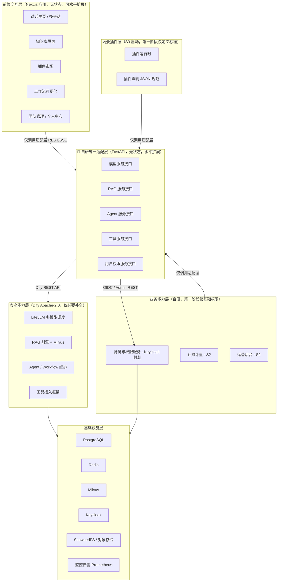
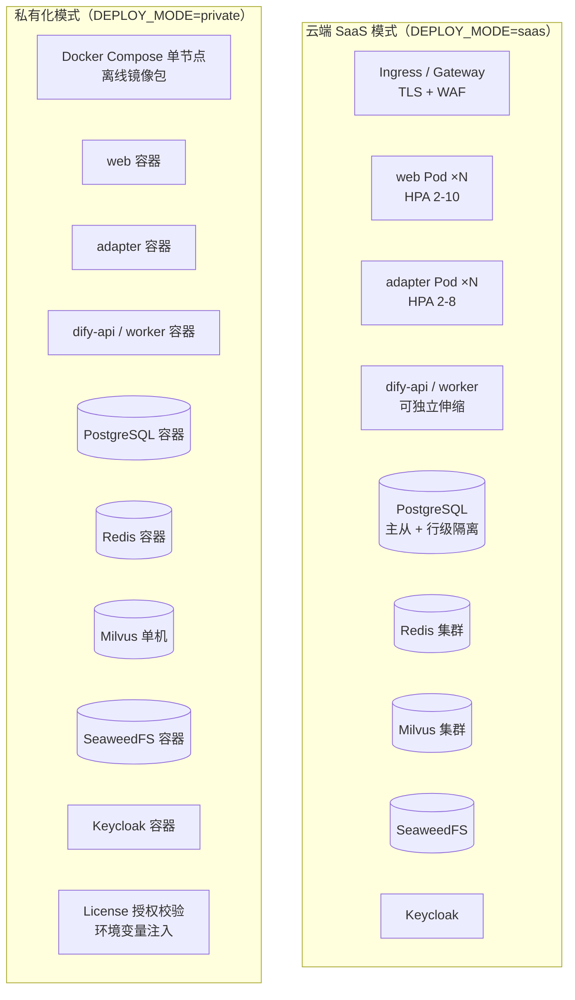
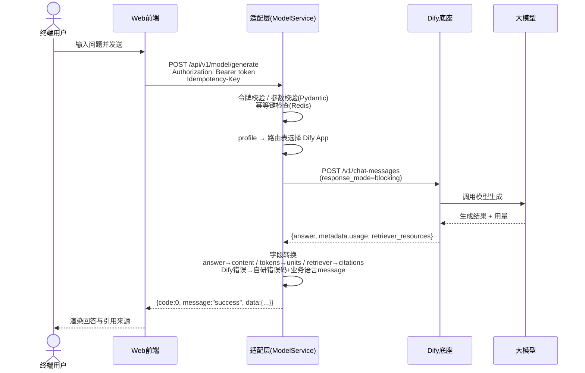
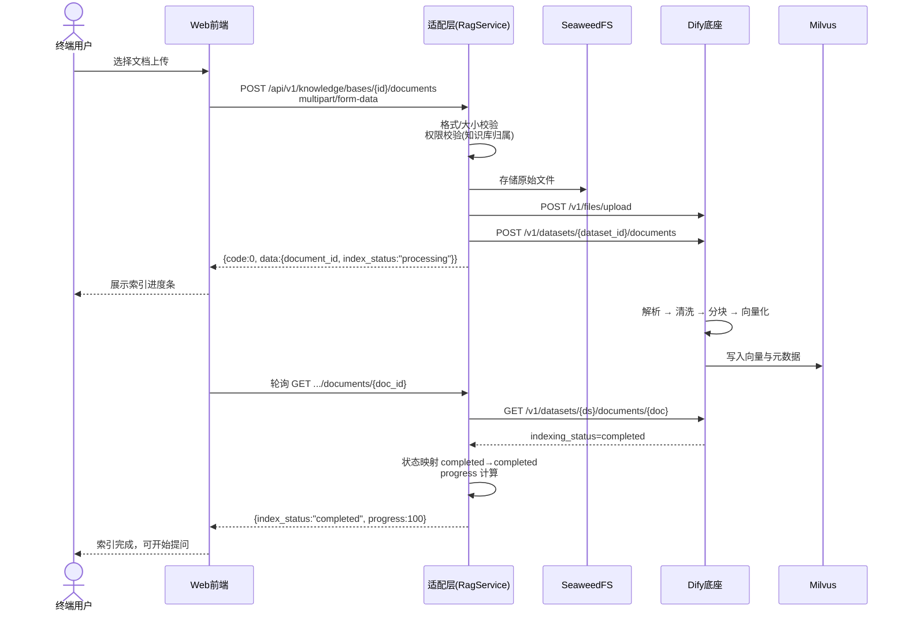
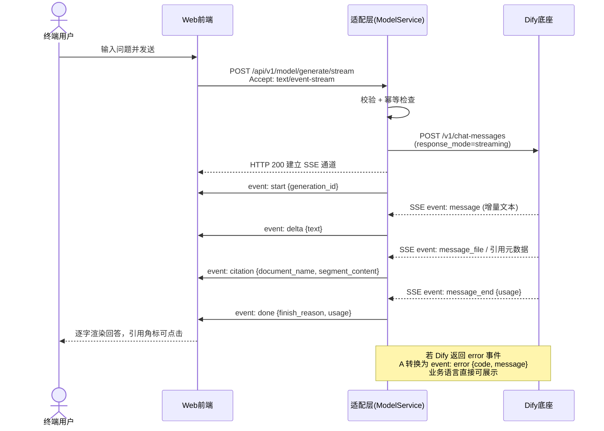
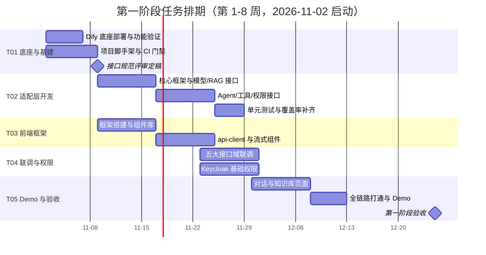
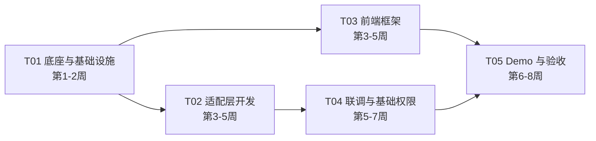

# Moy（麦子）系统架构设计文档 V1.0.5（第一阶段：底座与适配层攻坚）

> 文档性质：L2 实现层文档（架构设计与接口规范，供交付总监、工程师、QA 消费）
> 需求来源：L0《Moy（麦子）项目总纲》（`docs/moy-project-charter-v1.0.md`，定位与原则）→ L1 `plan-v1.0.md`（V1.0 范围）
> 　　　　　→ `prd-v1.0.md`（V1.0 需求规格）→ 本文件；冲突以上游为准（ADR-0005 D-09）
> 命名说明：本文档涉及的历史文件名/模块名/错误码沿用 V1.0 交付口径；产品定位以总纲为准（"企业级"指交付对象的技术与合规要求）
> 作者：高见远（Gao）· 架构师
> 日期：2026-10-21
> 版本：V1.0.1
> 评审人：齐活林（交付总监）、许清楚（产品经理）、寇豆码（工程师）、严过关（QA）
> 覆盖阶段：第一阶段（第 1-8 周，底座与适配层攻坚）；第二至四阶段架构扩展点在各章以「后续阶段」标注

### 修订记录

| 版本 | 日期 | 修订人 | 修订说明 |
| --- | --- | --- | --- |
| V1.0.8 | 2026-10-23 | 许清楚（产品经理，代架构师登记） | 按 ADR-0005（D-09/D-13）对齐总纲：标题与文档层级声明改为 L0/L1/L2 体系，需求来源补总纲；**不改动任何接口路径、字段名、错误码取值、门禁判据** |
| V1.0.7 | 2026-10-23 | 齐活林（阶段三收口） | 第三阶段文档同步（B29 第 5 项，**不改动任何接口路径、字段名、错误码取值**）：§9.6 CI 门禁追加 G-26 ~ G-31 六道阶段三门禁（插件声明 schema / 插件界面唯一宿主 / 能力原语白名单 / phase3 端点基线 / 前端契约快照 / Schema 保留策略）与 G-13 扩展（内部码禁区）。判据与命令以 `docs/architecture-phase3.md` §10 为唯一真源，本文档仅登记存在性与入口，避免两处演化出不同判据。 |
| V1.0.6 | 2026-10-21 | 齐活林（实联调） | 第一阶段实跑联调修订（T02 真实协议转换层，**不改动任何接口路径、字段名、错误码取值**）：① 登记三项底座载荷口径修正 —— M1/M2/A1 调用必须携带终端用户标识 `user`（Dify ≥ 0.6 强制，缺失即 400）、工作流运行详情端点为 `/v1/workflows/run/{id}`（单数，非 `/runs/`）、blocking 模式须映射 `data.status` 终态 ② §9.5 环境变量表 `OA_MINIO_*` → `OA_OBJECT_STORE_*`（P2-4）③ §10.3 D-06/D-08 转「已拍板生效」（docs/decisions/0004）④ 登记第一阶段验收结论（docs/phase1-acceptance-report.md） |
| V1.0 | 2026-10-21 | 高见远 | 首次发布：五层架构落地设计、技术选型、适配层五大标准接口规范 v1.0、时序图、monorepo 结构、第一阶段任务、依赖清单、共享约定、待明确事项 |
| V1.0.1 | 2026-10-21 | 高见远 | Sprint 0 QA 反馈修订：① 第 3 章补「端点总数 30 + 2 探针」显式声明（消除 29/30 歧义）② 8.2 补登记 postcss / autoprefixer / tailwindcss-animate 三个构建期依赖 ③ 新增 3.0.5「幂等指纹与冲突判定口径」，明确指纹含请求体 SHA-256、同键异体判 20005 冲突且禁止回放（BUG-05 规范根因堵死）④ 3.0.3 的 20005 内部含义补注幂等键请求体不一致。**本次修订不改动任何接口路径、字段名、错误码取值。** |
| V1.0.2 | 2026-10-21 | 高见远 | Sprint 0 QA 复核 P0 修订：① 8.2 与 §2.1 更正 MinIO 锁定标签为 `RELEASE.2021-04-22T15-44-28Z`（原 `RELEASE.2021-04-22T23-11-00Z` 为拼接合成、上游不存在）② 8.2 补「镜像标签引用强制规范」（先核验后引用）与「Valkey 客户端命令约定」（用 `valkey-cli`，禁用 `redis-cli`）③ 9.6 CI 门禁补依赖清单包名+版本双校验、`deploy/images.lock` 精确匹配+存在性校验、健康检查命令静态校验 ④ §10.3 D-06 状态更新。**本次修订不改动任何接口路径、字段名、错误码取值。** |
| V1.0.5 | 2026-10-21 | 高见远 | 对象存储选型根本变更：② §2.1 选型表与 §8.2 改为 **SeaweedFS 3.80**（MinIO 上游 Docker Hub 仓库已整体下架，制品不可获取，「锁定 AGPL 前版本线」前提失效）③ §8.2 镜像标签规范升级为**双通道核验**（git tag 校验版本号 + Registry 校验可拉取性，「git tag 存在 ≠ 镜像可拉取」）④ §10.3 D-06 状态更新。**本次修订不改动任何接口路径、字段名、错误码取值。** |
| V1.0.4 | 2026-10-21 | 高见远 | 依赖门禁工具化：9.6 补 `deploy/validate_deps.py` 四合一门禁（清单一致性 / 最低安全版本 / 加固约束静态检查 / 漏洞扫描）、「传递依赖必须显式声明」与「ACCEPTED_RISKS 豁免白名单」口径；6.1 目录树登记两个门禁脚本。**本次修订不改动任何接口路径、字段名、错误码取值。** |
| V1.0.3 | 2026-10-21 | 高见远 | Sprint 0 BLK-04 依赖漏洞实跑修订：① 8.1 fastapi 约束 `^0.115` → `^0.156`、新增 starlette `^1.3` 条目（修复 14 项漏洞，含直接命中 R3 上传接口的大文件 DoS）② 新增 8.1.1「依赖漏洞基线与处置结论」：17 个漏洞的逐条调用面适用性评估、4 条强制加固约束 ③ 9.6 补依赖漏洞扫描门禁（要求逐条适用性评估而非二值结论）④ 8.2 补「官方镜像命名空间约定」。**本次修订不改动任何接口路径、字段名、错误码取值。** |

---

## 目录

1. 总体架构落地设计
2. 技术选型与理由
3. 🔴 自研统一适配层五大标准接口规范 v1.0（最高优先级）
4. 接口设计对待确认问题的兼容策略（Q1/Q2 解耦）
5. 核心时序图
6. 项目代码结构（Monorepo）
7. 第一阶段任务列表（第 1-8 周）
8. 依赖包清单（Python + Node）
9. 共享知识（跨文件约定）
10. 待明确事项

---

# 1. 总体架构落地设计

## 1.1 五层架构落地视图

总方案第二章的五层解耦架构在本阶段的落地划分如下。每层明确「模块划分、服务边界、部署形态」三要素。



## 1.2 服务边界（第一阶段）

| 服务 | 归属层 | 职责边界（做什么/不做什么） | 有状态性 |
| --- | --- | --- | --- |
| web（Next.js） | 前端交互层 | 渲染 UI、维护会话列表等本地交互状态、调用适配层；**不**直连 Dify/Keycloak 以外的任何底座 | 无 |
| adapter（FastAPI） | 自研统一适配层 | 协议转换、参数校验、鉴权转发、错误统一封装、超时/重试/幂等控制；**禁止**任何业务编排逻辑 | 无（状态全部外置 Redis/PostgreSQL） |
| dify-api / dify-worker | 底座能力层 | 多模型调度、RAG 索引与检索、Agent/Workflow 执行 | 有（依赖 PG/Redis/Milvus） |
| keycloak | 业务能力层/基础设施 | 用户、组织、角色、令牌签发与校验 | 有 |
| postgres / redis / milvus / minio | 基础设施层 | 数据持久化、缓存、向量检索、文件存储 | 有 |

**适配层边界红线（强制）**：适配层代码中禁止出现：会话归属判断、权限策略、套餐额度计算、提示词拼装、结果后处理与格式化（超出协议转换必要范围）等业务逻辑。以上能力一律放业务能力层或插件层。

## 1.3 部署拓扑（双模式，同一套代码配置切换）



| 维度 | SaaS 多租户 | 私有化单节点 |
| --- | --- | --- |
| 编排 | K8s + HPA 弹性扩缩容 | Docker Compose 一键部署 |
| 代码 | **同一套代码** | **同一套代码** |
| 区分方式 | `DEPLOY_MODE=saas` 环境变量 | `DEPLOY_MODE=private` + License |
| 租户隔离 | PostgreSQL 行级安全策略（RLS）+ 应用层 tenant_id 双保险 | 单租户天然隔离 |
| 外网依赖 | 允许调用闭源模型 API | 全部剥离，纯本地模型 + 本地服务 |
| 容量基线 | 核心服务可用率 ≥ 99.5% | 中小团队/部门级（并发假设见 Q3） |

## 1.4 架构红线：适配层唯一原则（专项强调）

> **本节为一票否决级架构约束，违反即打回重构。**

1. 上层（前端交互层、场景插件层、业务能力层）**只能**调用自研统一适配层的标准接口（`/api/v1/...`），**严禁**以任何形式（HTTP/SDK/源码引用）直连 Dify 原生 API、Milvus、LiteLLM 或 Dify 内部数据库。
2. 底座层 API 文档仅适配层开发可见（总方案 3.1 输出标准），不进入前端、插件、业务层任何代码库与文档。
3. Dify 原生 API 的 URL、请求参数、响应结构、event 名称、错误码等一切形态特征，**禁止**向上层泄露。适配层是唯一的「形态防火墙」。
4. 代码级防线：monorepo 中仅 `apps/adapter` 允许出现 Dify 客户端依赖与 Dify URL 配置；`apps/web`、插件 SDK 的依赖与代码中禁止出现 dify/milvus/litellm 等字样（CI 增加 import 扫描门禁，见 9.5）。
5. 违反后果：若上层直连底座，底座替换（总方案 7.1 风险预案）时将导致大面积重构，与「替换底座仅改适配层，上层零改动」的核心设计目标直接冲突。

---

# 2. 技术选型与理由

## 2.1 选型总表

| 层 | 组件 | 选型 | 开源协议 | 选择理由 |
| --- | --- | --- | --- | --- |
| 底座 | AI 平台底座 | Dify（锁定版本，最小补丁策略） | Apache-2.0 | 总方案指定；RAG/Agent/多模型调度开箱即用；社区活跃；协议宽松可商用 |
| 底座 | 模型路由 | LiteLLM（随 Dify 内置） | MIT | 统一 100+ 模型 API 协议，新增模型仅配置不改代码 |
| 底座 | 向量库 | Milvus 2.x | Apache-2.0 | Dify 官方支持；支持单机/集群双形态，匹配私有化单节点需求 |
| 底座 | 文档解析 | Unstructured（随 Dify 可选） | Apache-2.0 | PDF/Word/Excel 解析事实标准 |
| 适配层 | 运行时 | Python 3.11+ | PSF（BSD 式） | 与 Dify 生态同栈，团队技能复用最大化；异步生态成熟 |
| 适配层 | Web 框架 | FastAPI | MIT | 原生异步、Pydantic 强校验、自动 OpenAPI、SSE 支持完善 |
| 适配层 | HTTP 客户端 | HTTPX | BSD-3-Clause | 异步 + 连接池 + 超时/重试精细控制，适配 Dify 调用 |
| 适配层 | 参数校验 | Pydantic v2 | MIT | 与 FastAPI 一体，接口入参强校验 |
| 前端 | 框架 | Next.js 14（App Router） | MIT | SSR/SSG、路由与性能优化开箱即用；React 生态 |
| 前端 | 语言 | TypeScript | Apache-2.0 | 全端类型安全，接口契约即类型 |
| 前端 | 样式 | Tailwind CSS | MIT | 原子化 CSS，设计令牌落地快 |
| 前端 | 组件库 | shadcn/ui + Radix UI | MIT / MIT | 组件源码级可控、无供应商锁定；满足「100% 统一组件库」硬约束 |
| 身份 | IAM | Keycloak | Apache-2.0 | 总方案指定；OIDC/OAuth2/SAML 全协议；组织/角色/细粒度权限 |
| 数据 | 关系库 | PostgreSQL 16 | PostgreSQL License（类 BSD/MIT） | RLS 多租户隔离、JSON 支持、生态成熟 |
| 缓存 / 幂等 | Valkey 7.2 | **BSD-3-Clause** | Redis 协议兼容的社区分支，永久宽松许可；**已决策替代 Redis 7**（RSALv2/SSPL 触黑名单），适配层业务代码零改动，仅换镜像与连接地址。详见 ADR-0002 |
| 存储 | 对象存储 | **SeaweedFS 3.80** | **Apache-2.0**（白名单） | S3 兼容，可单机可集群，私有化友好。**替代 MinIO**（其上游 Docker Hub 仓库已整体下架，制品不可获取），协议直接落入白名单、无需版本线锁定；独立容器运行（见 8.2 说明与 ADR-0002 §2.2） |
| 运维 | 监控 | Prometheus | Apache-2.0 | 云原生事实标准。**Grafana 已于 V1.0 移除**（AGPL-3.0 且 AGPL 前版本线在 Docker Hub 已不存在，看板不属 V1.0 验收项，见 `docs/decisions/0004` 第二章） |

## 2.2 关键决策论证

**决策 1：适配层采用 Python 3.11+ / FastAPI**
- 与 Dify（Python）同栈，复用其模型协议理解与调试工具链，联调成本最低；
- FastAPI 原生 async + Pydantic，与「协议转换 + 强校验」的适配层定位天然匹配；
- SSE 流式转发有一等公民支持（`StreamingResponse`），满足第 5 章流式链路需求；
- 团队无强理由（如存量 Node 团队）不更换技术栈——若后续团队技能结构变化，适配层为独立服务，可整体替换而不影响上层。

**决策 2：底座「最小补全」策略**
- 只对 Dify 做：必要功能补全（如私有化外网依赖剥离）、Bug 修复、安全加固；
- 不做编排引擎魔改、不做数据库表结构直连——所有定制诉求优先通过适配层消化，其次才评估底座补丁，补丁以独立 patch 集管理，控制上游升级成本（总方案架构核心说明 2）。

**决策 3：模型能力档位化（对上层屏蔽真实模型）**
- 适配层模型服务不暴露真实模型名，仅暴露 `model_profile` 能力枚举（`general` / `code` / `long_context` / `reasoning`）；
- 真实模型名与路由矩阵仅存在于适配层配置与底座，落实附录 A-1「模型名称对终端用户不可见」，同时使 Q2（模型接入优先级）不影响接口契约（详见第 4 章）。

---

# 3. 🔴 自研统一适配层五大标准接口规范 v1.0（最高优先级）

> 本章为第一阶段第 1-2 周关键交付物「接口规范文档」的正式内容，评审定稿后即为契约基线，后续变更走版本化（URL 前缀 `/api/v1`，不兼容变更升 `/api/v2`）。
> **所有命名、参数、错误码均为自研定义，与 Dify 原生接口无任何形式一致性。**
>
> **端点总数声明（阶段二更新，2026-10-21）**：本规范采用**两套基线，互不覆盖**（阶段二架构文档 §2.2 D-09）——
> - **核心基线：30 个业务端点（冻结）** —— 模型服务 M1-M4（4）、RAG 服务 R1-R7（7）、Agent 服务 A1-A6（6）、工具服务 T1-T7（7）、用户权限服务 U1-U6（6）。**任何人不得修改**，不兼容变更只能通过 `/api/v2` 演进；
> - **阶段二新域基线：38 个业务端点（target，按 B03-B10 逐批落地）** —— KB1-KB8（8）、TL1（1）、ID1-ID11（11）、BL1-BL10（10）、OPS1-OPS8（8）；同样挂在 `/api/v1` 前缀下，不新增版本；
> - **合计 68 个业务端点**（30 冻结 + 38 新域）。另有 `/healthz`、`/readyz` **2 个免鉴权探针**（不计入业务端点）。
>
> 该口径与 `docs/api/baseline-core-30.json`、`docs/api/baseline-phase2-38.json`、CI 门禁 `deploy/validate_openapi.py`（G1-G5）一致，构成不可歧义的契约基线；端点变更**必须**同步更新基线文件并在 PR 中贴出 `openapi.snapshot.json` 的 diff。

## 3.0 通用约定

### 3.0.1 统一响应格式

所有接口（含流式接口的控制帧）统一返回：

```json
{
  "code": 0,
  "message": "success",
  "data": {}
}
```

| 字段 | 类型 | 说明 |
| --- | --- | --- |
| code | int | 0=成功；10000-14999=业务错误；20000-20999=通用业务错误；30000-30999=系统错误（见 3.0.3） |
| message | string | **面向用户可读的业务语言提示**，前端直接展示；成功时为 "success" |
| data | object \| null | 业务数据，失败时为 null |

HTTP 状态码仅用于传输层语义（200 成功 / 400 请求格式错误 / 401 未认证 / 403 无权限 / 404 资源不存在 / 429 限流 / 5xx 服务端错误），业务语义一律以 body.code 为准。

### 3.0.2 鉴权方式

- 所有接口（除健康检查 `/healthz`、`/readyz`）必须携带 `Authorization: Bearer <access_token>`；
- Token 由 Keycloak 签发（OIDC），适配层负责解析校验（签名、过期、租户声明），**适配层不做登录、不签发令牌**（登录流程属业务能力层，第一阶段由 Keycloak 托管页承担）；
- 请求头必填 `X-Tenant-Id`（SaaS 模式）或由 token `tenant_id` 声明推导（私有化模式默认租户 `default`）；
- 服务间调用（适配层 → Dify）使用 Dify 的 dataset/app API Key，存放于适配层配置中心，不暴露给上层。

### 3.0.3 统一错误码表（自研定义，业务/系统分段）

**通用业务错误 20000-20999**

| code | HTTP | message（示例，前端直接展示） | 内部含义 |
| --- | --- | --- | --- |
| 20001 | 400 | 请求内容不完整，请检查后重试 | 参数校验失败 |
| 20002 | 401 | 登录状态已失效，请重新登录 | 令牌缺失/过期/签名失败 |
| 20003 | 403 | 当前账号没有该操作的权限 | 权限点校验失败 |
| 20004 | 404 | 你访问的内容不存在或已被删除 | 资源不存在 |
| 20005 | 409 | 操作冲突，请刷新后重试 | 状态冲突/幂等冲突（含幂等键请求体不一致） |
| 20006 | 429 | 当前使用人数较多，请稍后再试 | 触发限流 |
| 20007 | 400 | 重复的请求已被忽略 | 幂等键命中 |
| 20008 | 413 | 文件超出大小限制（上限 50MB） | 请求体超限 |

**模型服务域 10001-10099**

| code | HTTP | message（示例） | 内部含义 |
| --- | --- | --- | --- |
| 10001 | 200 | AI 暂时没有给出回答，请重试 | 生成失败 |
| 10002 | 200 | 当前对话内容过长，请新建会话或精简内容 | 上下文超模型窗口 |
| 10003 | 200 | 当前套餐不包含该能力，升级后即可使用 | 内容安全拦截 |
| 10004 | 200 | 智能助手繁忙，请稍后再试 | 所选能力档位无可用模型 |
| 10005 | 200 | 当前套餐可用次数不足 | 额度不足（计费，S2） |

**RAG 服务域 11001-11099**

| code | HTTP | message（示例） | 内部含义 |
| --- | --- | --- | --- |
| 11001 | 404 | 知识库不存在或已被删除 | 知识库不存在 |
| 11002 | 400 | 该文档格式无法处理，请另存为 PDF、Word 或 TXT 后重试 | 文档格式不支持 |
| 11003 | 400 | 文档内容过多，请拆分后上传 | 文档解析/大小超限 |
| 11004 | 200 | 文档还在处理中，请稍候查看 | 索引未完成 |
| 11005 | 200 | 检索服务暂时不可用，请重试 | 检索失败 |
| 11006 | 200 | 文档正在处理，无法重复操作 | 索引状态冲突 |
| 11007 | 200 | 该知识库暂时无法访问，请联系管理员 | 知识库已绑定凭据但解析失败（缺失/失效/解密失败）；**严禁回落全局凭据**（阶段二 D-10） |

**Agent 服务域 12001-12099（12002/12005 已注销、禁止复用）**

| code | HTTP | message（示例） | 内部含义 |
| --- | --- | --- | --- |
| 12001 | 404 | 任务不存在或已过期 | 任务不存在 |
| 12003 | 200 | 任务已取消 | 终态冲突 |
| 12004 | 200 | 任务执行超时，请重试 | 单步/整体超时（预留：任务超时走状态机，见 architecture-phase3.md §3.5，本码暂不对外返回） |

**Agent 域注销记录（B27，禁止复用该两个值）**

| code | 原语义 | 注销理由 |
| --- | --- | --- |
| 12002 | 任务执行未能完成 | 任务失败**全走状态机**（`task_service.py` 的 `_finish()` 落 `status=failed` + `error_message` + `_summary_text`，前端就地展示、不弹错）；且与内部码 `17002` 语义重复。两个候选接线点都是回归：A1 创建时抛会丢掉已生成的 `task_id`，A3 查询时抛会摧毁状态轮询契约。 |
| 12005 | 该步骤需要的工具尚未连接 | 冗余码：「工具未连接」= `13002`（执行期，`tool_service._resolve_connection()` 抛、`engine.py` 已消费）；「未授权」= `16005`（授予期，`task_service` 的 `required - granted` 校验）。无第三语义可留。 |

**工具服务域 13001-13099**

| code | HTTP | message（示例） | 内部含义 |
| --- | --- | --- | --- |
| 13001 | 400 | 该工具尚未连接，请先在设置中完成连接 | 工具类型未注册 |
| 13002 | 200 | 该工具尚未连接，请先在设置中完成授权 | 连接不存在/未授权 |
| 13003 | 200 | 工具授权已过期，请重新连接 | 授权过期 |
| 13004 | 200 | 工具暂时没有响应，请稍后再试 | 下游调用失败 |
| 13005 | 400 | 该工具不支持此操作 | 操作不在工具能力清单 |
| 13006 | 200 | 第三方工具返回了异常结果 | 下游业务错误 |

**用户权限服务域 14001-14099**

| code | HTTP | message（示例） | 内部含义 |
| --- | --- | --- | --- |
| 14001 | 404 | 用户不存在 | 用户不存在 |
| 14002 | 404 | 团队不存在 | 组织不存在 |
| 14003 | 404 | 角色不存在 | 角色不存在 |
| 14004 | 400 | 权限点未定义 | 权限点未注册 |
| 14005 | 404 | 该部门不存在或已被删除 | 部门不存在（阶段二 D-13） |
| 14006 | 400 | 该部门下仍有成员或子部门，请先迁移后再删除 | 部门删除/层级冲突（默认文案；建第 6 层、移动到自身子树走同码多文案） |
| 14007 | 400 | 不能移除企业所有者，请先转移所有权 | 所有者保护 |
| 14008 | 403 | 你没有权限修改该成员 | 同级或更高级成员保护 / 操作自己 |

**计费服务域 15001-15099（阶段二新增）**

| code | HTTP | message（示例） | 内部含义 |
| --- | --- | --- | --- |
| 15001 | 403 | 当前套餐不支持该功能，升级后即可使用 | 套餐能力未开通 |
| 15002 | 400 | 该套餐已下架，请选择其他套餐 | 套餐不可购 |
| 15003 | 400 | 成员席位已用满，请先增加席位 | 席位不足（邀请/加成员/减席越界） |
| 15004 | 409 | 当前账户有未完成订单，请先完成支付 | 重复下单 |
| 15005 | 200 | 降级将在当前周期结束后生效 | 变更生效时点（**非阻断提示码**，仅「无法立即生效」时使用） |
| 15006 | 200 | 本月额度已用完，当前为常规模式，升级套餐可恢复完整能力 | 额度用尽（软限制，不停服） |
| 15007 | 200 | 支付未完成，请重新支付 | 支付失败/超时 |
| 15008 | 409 | 该订单已处理，请勿重复操作 | 重复核销/重复回调的业务侧冲突 |
| 15009 | 400 | 订单金额与应付金额不一致，请核对后重试 | 核销金额校验失败 |

**插件域 16002-16099（阶段三新增；16001 已注销、禁止复用）**

| code | HTTP | message（示例） | 内部含义 |
| --- | --- | --- | --- |
| 16002 | 404 | 该插件已下架，去市场看看其他插件 | 目录无行 / 已隐藏或下架 |
| 16003 | 400 | 该插件还没有添加，请先在插件市场添加 | 无安装行 / 已卸载 |
| 16004 | 400 | 该插件已停用，请联系管理员启用 | 停用状态下发起任务 |
| 16005 | 403 | 缺少所需能力，请重新授权后再试 | 必需能力未授权 / 运行中被撤销 |
| 16006 | 403 | 该能力尚未对企业开放，请联系管理员开启 | 企业级能力总开关未开启 |
| 16007 | 400 | 该插件需要更新版本的产品后才能使用，请联系管理员 | 最低平台版本不满足 |
| 16008 | 400 | 只能恢复到上一个版本，如需更早版本请联系管理员 | 无上一版本可回退 |
| 16009 | 400 | 该插件需要先添加配套插件才能使用 | 前置插件未满足（名称走 `data.missing_plugins[]`） |
| 16010 | 409 | 插件状态已变化，请刷新后重试 | 并发安装 / 启停 / 版本指针冲突 |
| 16011 | 403 | 使用过这个插件才能评价 | 未安装或未使用即评价 |
| 16012 | 404 | 该插件版本不存在 | 目标版本无效 |

**任务域 17001-17099（阶段三新增）**

| code | HTTP | message（示例） | 内部含义 |
| --- | --- | --- | --- |
| 17001 | 400 | 该任务无法重试，请查看任务状态 | 不可重试状态下调用重试接口 |
| 17002 | 200 | 任务执行未能完成，可重试 | 仅供内部汇总与审计文案；任务详情**不返回**该码（步骤失败走状态） |

**系统错误 30001-30099（前端仍仅展示 message，技术细节只进日志）**

| code | HTTP | message（示例） | 内部含义 |
| --- | --- | --- | --- |
| 30001 | 503 | 服务暂时不可用，请稍后再试 | 下游（Dify/Keycloak 等）不可用 |
| 30002 | 504 | 服务响应超时，请重试 | 下游超时 |
| 30003 | 500 | 系统繁忙，请稍后再试 | 适配层内部异常 |
| 30004 | 500 | 服务配置异常，请联系管理员 | 配置缺失/错误 |

> 附录 A-5 落实：以上 message 即终端用户唯一可见的错误文本；code 仅用于内部日志与监控，严禁出现在 UI。

### 3.0.4 超时、重试、幂等总策略

| 策略 | 规则 |
| --- | --- |
| 超时 | 适配层调用 Dify：连接 3s / 读取 60s（非流式）、流式首包 15s；调用 Keycloak：5s；调用第三方工具：按工具注册表 `timeout_ms` 声明（默认 10s） |
| 重试 | 仅对幂等 GET 与下游 5xx/连接错误重试：最多 2 次，指数退避 200ms→800ms，抖动 ±20%；写操作与流式**不重试**（避免重复生成） |
| 幂等 | 所有写接口（创建会话消息、上传文档、创建任务、工具执行）必须携带 `Idempotency-Key` 头（UUID v4，客户端生成，24h 内有效）；适配层以 Redis 去重，命中返回首次结果并置 `code=20007` 提示已忽略（首包响应仍为业务成功语义时返回原结果）。**幂等指纹与冲突判定口径见 3.0.5** |
| 降级 | 下游不可用时返回对应业务错误码（如 10001/30001），禁止透传下游原始错误文本 |

### 3.0.5 幂等指纹与冲突判定口径（实现强制口径）

幂等去重的**唯一正确实现口径**如下，任何实现偏离本口径即视为契约违规：

**第一步：幂等指纹（必须包含请求体摘要）**

```
fingerprint = SHA256(
    method + "\n" +
    path   + "\n" +
    tenant_id + "\n" +
    user_id + "\n" +
    canonical_body_sha256
)
```

| 组成项 | 取值要求 |
| --- | --- |
| `method` | HTTP 方法大写，如 `POST` |
| `path` | 规范化后的请求路径（去除查询串，路径参数按其原始文本参与，不做重写） |
| `tenant_id` | 解析后的租户 ID（私有化模式恒为 `default`） |
| `user_id` | 解析后的用户 ID |
| `canonical_body_sha256` | **请求体规范化 JSON 的 SHA-256 十六进制摘要**（键按字典序排序、无多余空白、UTF-8 编码） |

> ⚠️ **指纹缺 `canonical_body_sha256` 即为实现缺陷**。若指纹仅由 `method:path:tenant:user` 构成，会导致「同一 `Idempotency-Key` + 同 method/path/tenant/user + 不同请求体」被误判为重复请求并**静默回放首次结果**，造成用户看到「成功」但数据未变更的静默数据丢失（已在 Sprint 0 QA 中实测复现，对应 BUG-05）。请求体为空时，摘要取空体规范化的固定值，不得跳过该项。

**第二步：命中判定（两分支，必须区分）**

设请求携带 `Idempotency-Key = K`，Redis 中已存在键 `K` 的首次记录（含首次指纹与首次结果）：

| 情形 | 判定 | 响应 | 说明 |
| --- | --- | --- | --- |
| **K 命中且指纹一致**（同方法同路径同租户同用户同请求体） | 重复请求 | 返回首次结果，`code=20007`「重复的请求已被忽略」（HTTP 400） | 语义等价于安全重放，**允许回放** |
| **K 命中但指纹不一致**（请求体不同，或方法/路径/租户/用户任一不同） | **键复用冲突** | `code=20005`「操作冲突，请刷新后重试」/ HTTP 409 | **严禁回放首次结果**；不得返回首次结果的部分字段，不得按 20007 处理，不得静默忽略 |

**第三步：实现要求**

1. 指纹计算必须发生在**请求体解析完成之后**（可解析体）与**参数校验之后**（校验失败不占用幂等键）；
2. 文件类上传接口的请求体摘要取「文件名 + 文件大小 + 文件内容 SHA-256」，不得直接读入全文入内存计算；
3. 冲突分支（20005）**不得**将首次结果写入或返回，仅返回冲突错误；
4. 幂等键 TTL 24h，键本身为客户端生成的 UUID v4，服务端不做格式之外的语义约束。

**第四步：回归测试要求（纳入 CI 门禁）**

必须包含以下三条幂等用例并全部通过，否则 CI 失败：

| 用例 | 期望 |
| --- | --- |
| 同 key + 同 path + 同 body 连发两次 | 第二次返回 `20007`，且不产生第二次副作用 |
| 同 key + 同 path + **不同 body** | 返回 `20005` / HTTP 409，**不返回首次结果** |
| 同 key + **不同 path** | 返回 `20005` / HTTP 409 |

---

## 3.1 模型服务接口域（Model Service）

**设计原则**：对上层只暴露「能力档位」`model_profile`，不暴露真实模型名（附录 A-1）；上下文（历史消息）由上层传入，适配层负责裁剪保护与格式转换。

### 3.1.1 端点清单

| # | 端点 | 方法 | 用途 |
| --- | --- | --- | --- |
| M1 | `/api/v1/model/generate` | POST | 单轮/多轮非流式生成 |
| M2 | `/api/v1/model/generate/stream` | POST | 流式生成（SSE，见 3.1.5） |
| M3 | `/api/v1/model/catalog` | GET | 查询可用能力档位目录 |
| M4 | `/api/v1/model/usage` | GET | 用量统计（业务化口径，见 Q7） |

### 3.1.2 M1 非流式生成

请求：

```json
{
  "conversation_id": "conv_01HF8YQZ3K7M9X2P4R6T8V0W",
  "profile": "general",
  "messages": [
    { "role": "user", "content": "帮我把这段话改写得更专业：……" }
  ],
  "context": {
    "history_window": 20,
    "memory_hints": ["常用称呼：王总"]
  },
  "knowledge_base_ids": ["kb_01HF8YQZ3K7M9X2P4R6T8V0W"],
  "options": {
    "temperature": 0.7,
    "max_tokens": 4096
  }
}
```

| 字段 | 类型 | 必填 | 说明 |
| --- | --- | --- | --- |
| conversation_id | string | 是 | 会话 ID（上层维护，用于上下文关联与日志追踪） |
| profile | enum | 是 | 能力档位：`general` 通用 / `code` 代码 / `long_context` 长上下文 / `reasoning` 深度推理 |
| messages | array | 是 | 当前轮消息（user/assistant/system），content 为纯文本或附件引用 |
| context.history_window | int | 否 | 携带的历史轮数，默认 20 |
| context.memory_hints | array | 否 | 上层记忆注入（P0-02，边界见 Q6） |
| knowledge_base_ids | array | 否 | 关联知识库，触发 RAG 增强 |
| options.temperature / max_tokens | number/int | 否 | 缺省按档位默认策略 |

响应 `data`：

```json
{
  "generation_id": "gen_01HF8YR2M4N6P8Q0R2S4T6V8",
  "content": "以下是改写后的专业版本：……",
  "finish_reason": "stop",
  "usage": {
    "prompt_units": 1280,
    "completion_units": 356,
    "total_units": 1636
  },
  "citations": [
    {
      "document_id": "doc_01HF8YQZ3K7M9X2P4R6T8V0W",
      "document_name": "员工手册.pdf",
      "segment_content": "年假申请需提前三个工作日在系统提交……",
      "score": 0.92
    }
  ]
}
```

> `usage` 字段名业务化（units 而非 token），落实附录 A-7；`citations` 用于前端引用展示（FLOW-02）。

### 3.1.3 M3 能力档位目录

请求：`GET /api/v1/model/catalog`

响应 `data`：

```json
{
  "profiles": [
    {
      "profile": "general",
      "display_name": "通用助手",
      "description": "日常问答、文档写作、信息整理",
      "max_context_turns": 20,
      "status": "available"
    },
    {
      "profile": "code",
      "display_name": "编程助手",
      "description": "代码编写、解释与调试",
      "max_context_turns": 10,
      "status": "available"
    },
    {
      "profile": "long_context",
      "display_name": "长文档助手",
      "description": "超长文档阅读与摘要",
      "max_context_turns": 5,
      "status": "available"
    }
  ]
}
```

> Q2 落实：新增模型仅在适配层配置中扩充档位→模型路由映射，目录内容随配置动态变化，接口契约不变。

### 3.1.4 M4 用量统计

请求：`GET /api/v1/model/usage?period=month`

响应 `data`：

```json
{
  "period": "2026-11",
  "conversation_count": 128,
  "document_qa_count": 34,
  "quota": {
    "plan_name": "专业版",
    "total_units": 5000000,
    "used_units": 1234567,
    "remaining_units": 3765433
  }
}
```

> 仅业务化口径（次数/额度），token 精确值不向普通用户展示（附录 A-7，口径待 Q7）。

### 3.1.5 M2 流式生成（SSE）

- 端点：`POST /api/v1/model/generate/stream`，请求体同 M1；
- 响应 `Content-Type: text/event-stream`；
- 自研事件类型（**不复用 Dify event 名称**，落实 A-4/A-6）：

| 事件 | data 载荷 | 说明 |
| --- | --- | --- |
| `start` | `{ "generation_id": "gen_..." }` | 生成开始 |
| `delta` | `{ "text": "增量文本" }` | 文本增量 |
| `citation` | `{ "document_name": "……", "segment_content": "……" }` | 命中引用（随答案位置穿插下发） |
| `done` | `{ "finish_reason": "stop", "usage": {...} }` | 正常结束 |
| `error` | `{ "code": 10001, "message": "AI 暂时没有给出回答，请重试" }` | 业务错误，前端据 message 展示 |

### 3.1.6 与 Dify 原生 API 的映射转换说明

| 适配层接口 | Dify 原生调用 | 转换内容 |
| --- | --- | --- |
| M1 非流式生成 | `POST {DIFY}/v1/chat-messages`（`response_mode: blocking`，`inputs: {}`） | ① `messages` 历史数组 → Dify 会话重建或 `query`+外部上下文注入；② `profile` → 适配层路由表选定 Dify App（不同档位可绑定不同 Dify 应用）；③ Dify `answer`/`metadata.usage` → `content`/`usage`（token→units 字段重命名）；④ Dify `retriever_resources` → `citations` |
| M2 流式生成 | `POST {DIFY}/v1/chat-messages`（`response_mode: streaming`，SSE） | Dify `message`/`agent_message` 事件 → 自研 `delta`；`message_end` → `done`；`message_file` → 忽略或转 `citation`；Dify `error` 事件 → 自研 `error`（重写 code/message） |
| M3 目录 | 无对应 | 纯适配层配置驱动，不调用 Dify |
| M4 用量 | Dify 无原生统计接口（可按 app 维度聚合日志） | 适配层聚合 Redis 计数器（按租户/会话），不依赖 Dify |

**关键点**：Dify 的 `query`、`inputs`、`response_mode`、`answer`、`metadata.usage.total_tokens`、`retriever_resources` 等原生字段名**禁止**出现在适配层对外响应中；对外一律为 `content`、`usage.*_units`、`citations`。

---

## 3.2 RAG 服务接口域（RAG Service）

**设计原则**：仅暴露「知识库-文档」业务模型；分块、向量化、召回参数（附录 A-3）全部封装在适配层配置与底座内。

### 3.2.1 端点清单

| # | 端点 | 方法 | 用途 |
| --- | --- | --- | --- |
| R1 | `/api/v1/knowledge/bases` | POST | 创建知识库 |
| R2 | `/api/v1/knowledge/bases` | GET | 知识库列表（分页） |
| R3 | `/api/v1/knowledge/bases/{base_id}/documents` | POST | 上传文档（multipart，异步索引） |
| R4 | `/api/v1/knowledge/bases/{base_id}/documents/{doc_id}` | GET | 查询文档索引进度 |
| R5 | `/api/v1/knowledge/bases/{base_id}/documents/{doc_id}/reindex` | POST | 重建索引 |
| R6 | `/api/v1/knowledge/bases/{base_id}/documents/{doc_id}` | DELETE | 删除文档 |
| R7 | `/api/v1/knowledge/search` | POST | 独立检索（带引用，对话内增强由 M1 触发） |

### 3.2.2 R1 创建知识库

请求：

```json
{
  "name": "人事制度库",
  "description": "公司人事制度与流程文档",
  "visibility": "organization"
}
```

响应 `data`：`{ "base_id": "kb_01HF8YQZ3K7M9X2P4R6T8V0W", "name": "人事制度库", "created_at": "2026-11-02T09:00:00Z" }`

### 3.2.3 R3 上传文档

请求：`multipart/form-data`，字段 `file`（≤50MB，支持 pdf/docx/xlsx/md/txt）、`chunk_policy`（可选，`default`/`fine`，缺省 `default`）。

响应 `data`：

```json
{
  "document_id": "doc_01HF8YQZ3K7M9X2P4R6T8V0W",
  "file_name": "员工手册.pdf",
  "index_status": "processing",
  "progress": 0
}
```

### 3.2.4 R4 索引进度查询

响应 `data`：

```json
{
  "document_id": "doc_01HF8YQZ3K7M9X2P4R6T8V0W",
  "index_status": "completed",
  "progress": 100,
  "segment_count": 246,
  "error_message": null
}
```

`index_status` 枚举：`processing` 处理中 / `completed` 可用 / `failed` 失败（`error_message` 为业务语言）。

### 3.2.5 R7 检索

请求：

```json
{
  "base_id": "kb_01HF8YQZ3K7M9X2P4R6T8V0W",
  "query": "年假怎么申请",
  "top_k": 5,
  "score_threshold": 0.5
}
```

响应 `data`：

```json
{
  "segments": [
    {
      "document_id": "doc_01HF8YQZ3K7M9X2P4R6T8V0W",
      "document_name": "员工手册.pdf",
      "segment_content": "年假申请需提前三个工作日在系统提交……",
      "score": 0.92,
      "position": { "page": 12, "paragraph": 3 }
    }
  ]
}
```

### 3.2.6 与 Dify 原生 API 的映射转换说明

| 适配层接口 | Dify 原生调用 | 转换内容 |
| --- | --- | --- |
| R1 创建知识库 | `POST {DIFY}/v1/datasets` | `name/description` 透传；`visibility` 由适配层落业务库（Dify 无此概念），Dify `id` → `base_id` |
| R3 上传文档 | ① `POST {DIFY}/v1/files/upload`；② `POST {DIFY}/v1/datasets/{dataset_id}/documents`（data_source=file） | Dify `file_id`/`batch` → `document_id`；索引进度由 Dify `indexing_status`（waiting/parsing/cleaning/splitting/indexing/completed/error）**映射**为自研三态 `processing/completed/failed`（原状态名不暴露，落实 A-3） |
| R4 进度查询 | `GET {DIFY}/v1/datasets/{dataset_id}/documents/{document_id}` | Dify `completed_segments/total_segments` → `progress` 百分比 |
| R5 重建索引 | Dify 无原生重建 API（或删除后重传，按 Dify 版本能力） | 适配层编排「查原文档→重新触发索引」，失败返回 11006 |
| R6 删除文档 | `DELETE {DIFY}/v1/datasets/{dataset_id}/documents/{document_id}` | 透传 |
| R7 检索 | `POST {DIFY}/v1/datasets/{dataset_id}/retrieve` | Dify `records[].segment.content/score/document_name` → `segments[]`；Dify 的 `score_threshold/top_k` 经适配层默认策略校准后下发 |

---

## 3.3 Agent 服务接口域（Agent Service）

**设计原则**：仅暴露「任务-步骤」业务模型；Agent 编排细节、工具调用内部协议（附录 A-6）封装在底座；V1.0 任务执行采用「创建 + 轮询 + SSE 推送」双通道，Webhook 回调预留（见 10 章 D-04）。

### 3.3.1 端点清单

| # | 端点 | 方法 | 用途 |
| --- | --- | --- | --- |
| A1 | `/api/v1/agent/tasks` | POST | 创建任务（异步执行） |
| A2 | `/api/v1/agent/tasks` | GET | 任务列表（按会话/租户过滤） |
| A3 | `/api/v1/agent/tasks/{task_id}` | GET | 查询任务状态与结果 |
| A4 | `/api/v1/agent/tasks/{task_id}/steps` | GET | 查询步骤详情（工作流可视化） |
| A5 | `/api/v1/agent/tasks/{task_id}/cancel` | POST | 取消任务 |
| A6 | `/api/v1/agent/tasks/{task_id}/events` | GET | SSE 订阅任务进度推送 |

### 3.3.2 A1 创建任务

请求：

```json
{
  "conversation_id": "conv_01HF8YQZ3K7M9X2P4R6T8V0W",
  "goal": "把这份需求拆解为技术方案并生成代码文件",
  "profile": "general",
  "tool_grants": ["tool_github", "tool_knowledge"],
  "inputs": {
    "requirement_text": "……"
  },
  "options": { "max_steps": 12, "timeout_seconds": 600 }
}
```

响应 `data`：

```json
{
  "task_id": "task_01HF8YQZ3K7M9X2P4R6T8V0W",
  "status": "running",
  "created_at": "2026-11-02T09:00:00Z",
  "estimated_seconds": 120
}
```

### 3.3.3 A3 任务状态查询

响应 `data`：

```json
{
  "task_id": "task_01HF8YQZ3K7M9X2P4R6T8V0W",
  "status": "completed",
  "progress": 100,
  "current_step": null,
  "result": {
    "summary": "已生成技术方案与 3 个代码文件，并提交到仓库",
    "artifacts": [
      { "type": "file", "name": "LoginForm.tsx", "download_url": "……" },
      { "type": "link", "name": "Pull Request #42", "url": "https://github.com/..." }
    ]
  },
  "usage": { "total_units": 24310 },
  "updated_at": "2026-11-02T09:03:12Z"
}
```

`status` 枚举：`pending` / `running` / `completed` / `failed` / `cancelled`。

### 3.3.4 A4 步骤详情

响应 `data`：

```json
{
  "task_id": "task_01HF8YQZ3K7M9X2P4R6T8V0W",
  "steps": [
    {
      "step_id": "step_1",
      "sequence": 1,
      "title": "理解需求",
      "status": "completed",
      "started_at": "2026-11-02T09:00:01Z",
      "finished_at": "2026-11-02T09:00:12Z",
      "output_summary": "已提取 5 个功能点"
    },
    {
      "step_id": "step_2",
      "sequence": 2,
      "title": "生成技术方案",
      "status": "running",
      "started_at": "2026-11-02T09:00:13Z",
      "finished_at": null,
      "output_summary": null
    }
  ]
}
```

> `title`/`output_summary` 为业务语言步骤描述，由工作流模板配置注入；底座节点类型名不暴露。

### 3.3.5 与 Dify 原生 API 的映射转换说明

| 适配层接口 | Dify 原生调用 | 转换内容 |
| --- | --- | --- |
| A1 创建任务 | `POST {DIFY}/v1/workflows/{workflow_id}/runs`（`response_mode: streaming` 以获取节点事件）或 blocking + 轮询 | `goal/inputs` → Dify `inputs`；`profile/tool_grants` → 适配层选择 workflow 模板与工具配置；Dify `workflow_run_id` → `task_id` |
| A3 状态查询 | `GET {DIFY}/v1/workflows/{workflow_id}/runs/{run_id}` | Dify `status`（running/succeeded/failed/stopped）→ `running/completed/failed/cancelled`；Dify `outputs` → `result`（按模板 schema 提取 artifacts） |
| A4 步骤详情 | 流式运行期间收集 Dify `node_started/node_finished` 事件并落 Redis | Dify 节点 ID/类型 → 自研 `step_id/sequence/title`（映射表存适配层配置）；`node_finished.outputs` → `output_summary` |
| A5 取消任务 | `POST {DIFY}/v1/workflows/{workflow_id}/runs/{run_id}/stop`（或停止流式连接） | 透传 |
| A6 事件推送 | 复用上述流式连接或 Redis Pub/Sub | 适配层自建 SSE 帧格式（`step_started/step_finished/task_completed`） |

---

## 3.4 工具服务接口域（Tool Service）

**设计原则**：**工具类型注册表模式**（详见第 4 章）——新增工具只向注册表登记（工具类型、能力清单、授权方式、端点模板），接口契约零改动。

### 3.4.1 端点清单

| # | 端点 | 方法 | 用途 |
| --- | --- | --- | --- |
| T1 | `/api/v1/tools/registry` | GET | 查询工具类型注册表（可用工具与能力清单） |
| T2 | `/api/v1/tools/connections` | POST | 发起工具授权连接（OAuth/令牌） |
| T3 | `/api/v1/tools/connections` | GET | 已连接工具列表 |
| T4 | `/api/v1/tools/connections/{conn_id}` | DELETE | 断开工具连接 |
| T5 | `/api/v1/tools/execute` | POST | 执行工具操作 |
| T6 | `/api/v1/tools/sync-jobs` | POST | 创建数据同步任务（如邮件收件箱同步） |
| T7 | `/api/v1/tools/sync-jobs/{job_id}` | GET | 查询同步任务进度 |

### 3.4.2 T1 工具类型注册表

请求：`GET /api/v1/tools/registry`

响应 `data`：

```json
{
  "tools": [
    {
      "tool_type": "email",
      "display_name": "邮箱",
      "category": "communication",
      "auth_type": "oauth2",
      "status": "available",
      "operations": [
        { "operation": "send_message", "display_name": "发送邮件", "params_schema": { "type": "object" } },
        { "operation": "list_messages", "display_name": "查看邮件", "params_schema": { "type": "object" } }
      ],
      "timeout_ms": 10000
    },
    {
      "tool_type": "github",
      "display_name": "代码仓库",
      "category": "development",
      "auth_type": "oauth2",
      "status": "available",
      "operations": [
        { "operation": "create_pull_request", "display_name": "创建合并请求", "params_schema": { "type": "object" } }
      ],
      "timeout_ms": 15000
    }
  ]
}
```

> Q1 落实：注册表内容由配置驱动，首批 5 款选型（无论最终决策为何）只改变注册表数据，**不改变** T1-T7 任何契约。

### 3.4.3 T2 建立工具连接

请求：

```json
{
  "tool_type": "email",
  "auth_code": "oauth_authorization_code",
  "redirect_uri": "https://app.example.com/settings/tools/callback"
}
```

响应 `data`：`{ "connection_id": "conn_01HF8YQZ3K7M9X2P4R6T8V0W", "tool_type": "email", "status": "connected", "expires_at": "2027-02-01T00:00:00Z" }`

### 3.4.4 T5 执行工具操作

请求：

```json
{
  "tool_type": "email",
  "operation": "send_message",
  "params": {
    "to": ["candidate@example.com"],
    "subject": "面试邀约",
    "body": "……"
  }
}
```

响应 `data`：

```json
{
  "execution_id": "exec_01HF8YQZ3K7M9X2P4R6T8V0W",
  "tool_type": "email",
  "operation": "send_message",
  "status": "success",
  "result": { "message_id": "ext_msg_123", "sent_at": "2026-11-02T09:05:00Z" },
  "error": null
}
```

`status` 枚举：`success` / `failed`（`error` 为业务语言）。

### 3.4.5 与 Dify 原生 API 的映射转换说明

| 适配层接口 | Dify 原生调用 | 转换内容 |
| --- | --- | --- |
| T1 注册表 | `GET {DIFY}/console/api/tools`（内置工具清单）+ 适配层自有扩展注册表 | 仅将 Dify 内置工具作为**候选来源**之一；对外展示形态（display_name/operations）完全自研；Dify 未覆盖的办公工具（如企业微信/飞书/邮箱）由适配层扩展连接器实现，仍走 T1-T7 统一出口 |
| T2 连接 | Dify 无面向终端用户的 OAuth 连接管理 | 由适配层自建连接管理（凭据加密存业务库），Dify 侧以 API Key/凭据注入方式使用 |
| T5 执行 | Dify 工具调用发生在 workflow 节点内部，无独立对外执行 API | 独立执行场景由适配层编排为 Dify workflow 调用或直连工具连接器；工具返回的原始错误 → 13006 |

> 说明：Dify 原生工具框架面向「Agent 编排内调用」，不满足「终端用户自助授权 + 独立调用 + 数据同步」三需求，故工具服务域以适配层扩展为主、Dify 内置工具复用为辅——这正是适配层「补全底座不擅长能力」（总方案 3.1-4）的体现。

---

## 3.5 用户权限服务接口域（Identity & Access Service）

**设计原则**：适配层仅做**令牌校验与请求转发**，用户/组织/角色的权威数据在 Keycloak 与其扩展存储；权限策略判断在业务能力层，适配层提供统一校验出口（FLOW-05：业务代码不得自行判权）。

### 3.5.1 端点清单

| # | 端点 | 方法 | 用途 |
| --- | --- | --- | --- |
| U1 | `/api/v1/identity/verify` | POST | 令牌与权限点校验（内部高频调用） |
| U2 | `/api/v1/identity/profile` | GET | 当前登录用户信息 |
| U3 | `/api/v1/identity/organizations/{org_id}/members` | GET | 组织成员列表 |
| U4 | `/api/v1/identity/organizations/{org_id}/invitations` | POST | 邀请成员 |
| U5 | `/api/v1/identity/organizations/{org_id}/roles` | POST | 创建/分配角色 |
| U6 | `/api/v1/identity/audit-logs` | POST | 审计日志查询 |

### 3.5.2 U1 权限校验

请求：

```json
{
  "permission": "knowledge:document:upload",
  "resource": { "type": "knowledge_base", "id": "kb_01HF8YQZ3K7M9X2P4R6T8V0W" }
}
```

响应 `data`：

```json
{
  "allowed": true,
  "user_id": "usr_01HF8YQZ3K7M9X2P4R6T8V0W",
  "tenant_id": "tnt_01HF8YQZ3K7M9X2P4R6T8V0W",
  "roles": ["org_admin"]
}
```

### 3.5.3 U2 当前用户

响应 `data`：

```json
{
  "user_id": "usr_01HF8YQZ3K7M9X2P4R6T8V0W",
  "display_name": "王倩",
  "email": "wangqian@example.com",
  "tenant": { "tenant_id": "tnt_01HF8YQZ3K7M9X2P4R6T8V0W", "name": "桐鸣科技", "plan": "professional" },
  "organizations": [
    { "org_id": "org_01HF8YQZ3K7M9X2P4R6T8V0W", "name": "研发部", "role": "member" }
  ]
}
```

### 3.5.4 与 Dify / Keycloak 的映射转换说明

| 适配层接口 | 下游调用 | 转换内容 |
| --- | --- | --- |
| U1 校验 | Keycloak token introspection（`POST /realms/{realm}/protocol/openid-connect/token/introspect`）+ 权限点映射表 | Keycloak realm/client roles → 自研权限点（`resource:action` 命名）；KC `active/exp` → `allowed` |
| U2 资料 | Keycloak Admin REST `GET /admin/realms/{realm}/users/{id}` | KC `firstName/email/attributes` → 自研字段；租户与套餐信息取自业务库（适配层只做组装转发） |
| U3 成员列表 | Keycloak Admin REST groups/users | KC group 成员 → 组织成员 |
| U4 邀请成员 | 适配层扩展（Keycloak 无原生邀请流） | 生成邀请令牌 → Keycloak 建用户 → 业务库落审计 |
| U5 角色管理 | Keycloak Admin REST roles/composites | 透传 + 权限点注册表校验（14004） |
| U6 审计查询 | 业务库审计表（适配层不持有审计逻辑，仅查询出口） | 字段透传，脱敏由业务层写入时完成 |

> 说明：Dify 无用户权限域对应能力，本域以 Keycloak 为权威源，适配层做协议统一。

---

## 3.6 适配层内部类图

```mermaid
classDiagram
    class ApiResponse {
        +int code
        +string message
        +dict data
        +ok(data) ApiResponse$
        +fail(code, message) ApiResponse$
    }
    class IdempotencyManager {
        +RedisClient redis
        +check_or_set(key, ttl) bool
        +get_result(key) dict
        +store_result(key, result) void
    }
    class AuthContext {
        +string user_id
        +string tenant_id
        +list roles
        +resolve(token) AuthContext$
    }
    class DifyClient {
        +str base_url
        +str api_key
        +post(path, payload, timeout) dict
        +post_stream(path, payload) AsyncIterator
        +get(path, params) dict
        +delete(path) dict
    }
    class KeycloakClient {
        +str base_url
        +str realm
        +introspect(token) dict
        +get_user(user_id) dict
        +list_group_members(org_id) list
    }
    class ModelService {
        +DifyClient dify
        +generate(req) dict
        +generate_stream(req) AsyncIterator
        +get_catalog() dict
        +get_usage(ctx) dict
    }
    class RagService {
        +DifyClient dify
        +create_base(req) dict
        +upload_document(base_id, file, policy) dict
        +get_index_status(base_id, doc_id) dict
        +reindex(base_id, doc_id) dict
        +search(req) dict
    }
    class AgentService {
        +DifyClient dify
        +RedisClient redis
        +create_task(req) dict
        +get_task(task_id) dict
        +list_steps(task_id) dict
        +cancel_task(task_id) dict
    }
    class ToolService {
        +dict tool_registry
        +list_registry() dict
        +create_connection(req) dict
        +execute(req) dict
    }
    class IdentityService {
        +KeycloakClient kc
        +verify(token, permission, resource) dict
        +get_profile(ctx) dict
        +query_audit_logs(req) dict
    }
    class ErrorMapper {
        +to_business_error(dify_status, dify_body) tuple$
    }
    ModelService --> DifyClient
    RagService --> DifyClient
    AgentService --> DifyClient
    IdentityService --> KeycloakClient
    ModelService ..> ApiResponse
    RagService ..> ApiResponse
    AgentService ..> ApiResponse
    ToolService ..> ApiResponse
    IdentityService ..> ApiResponse
    ModelService ..> IdempotencyManager
    AgentService ..> IdempotencyManager
    ToolService ..> IdempotencyManager
    ModelService ..> AuthContext
    AgentService ..> AuthContext
    ToolService ..> AuthContext
    IdentityService ..> AuthContext
    ModelService ..> ErrorMapper
    RagService ..> ErrorMapper
    AgentService ..> ErrorMapper
```



---

# 4. 接口设计对待确认问题的兼容策略（Q1/Q2 解耦）

## 4.1 Q1（首批 5 款办公工具选型）→ 工具类型注册表模式

- **注册表数据驱动**：每个工具类型登记 `tool_type / display_name / category / auth_type / operations[] / timeout_ms / connector_impl`；
- **新增工具流程**：实现连接器（connector）→ 注册表登记 → 上线，T1-T7 端点、请求响应结构、错误码**零改动**；
- **前端自描述**：T1 返回注册表全量，插件市场/设置页按注册表动态渲染工具卡片与授权引导，不硬编码工具列表；
- **对 Q1 三个子问题的兼容**：(a) 无论从插件依赖反推还是独立通用清单，均表现为注册表条目；(b) 替换/增补工具仅改注册表；(c) 内容运营发布范围仅影响 `email`/`wechat_official` 等具体工具的 `operations` 清单。

## 4.2 Q2（模型矩阵接入优先级）→ 模型类型枚举 + 能力描述

- **枚举稳定**：`profile`（general/code/long_context/reasoning）为契约枚举，新增真实模型不新增枚举；
- **路由后置**：适配层配置「档位 → 模型/应用」路由表与降级链（如 general 主路由豆包、降级通义千问；本地模型用于 private 模式）；
- **容量与成本后置**：模型成本、token 预算（Q2-b）由适配层聚合计量层消费，不影响对话接口；
- **默认模型后置**：按场景固定默认档位（对话 general、代码场景 code），用户侧不展示模型信息（附录 A-1）；
- **Q2 结论未定时的默认假设**：S1 按 PRD 建议（豆包 + Qwen2.5 + DeepSeek-Coder）配置路由，决策变化仅改路由表配置。

## 4.3 其余待决项与架构的关系

| PRD 待决项 | 架构兼容策略 |
| --- | --- |
| Q3 私有化环境假设 | 部署层配置化（容量参数、GPU 开关、离线包分发），不影响接口契约 |
| Q4 插件依赖与优先级 | 插件层设计（S3），第一阶段仅冻结插件 JSON 规范与运行时接口草案 |
| Q5 计费定价 | 计量字段（units/counts）已在 3.1.4 设计，定价策略属业务配置 |
| Q6 记忆边界 | `context.memory_hints` 字段预留，记忆存储与策略属业务层 |
| Q7 用量展示口径 | 3.1.4 已按「业务化用量」设计，口径确认后仅调整展示层 |

---

# 5. 核心时序图

## 5.1 非流式对话请求全链路



## 5.2 RAG 文档上传与索引构建链路



## 5.3 流式对话（SSE）链路



---

# 6. 项目代码结构（Monorepo）

## 6.1 目录树

```
officeai/                              # Monorepo 根目录
├── apps/
│   ├── adapter/                       # 🔴 自研统一适配层（唯一允许接触 Dify 的应用）
│   │   ├── app/
│   │   │   ├── __init__.py
│   │   │   ├── main.py                # FastAPI 入口：中间件、异常处理器、路由挂载
│   │   │   ├── core/
│   │   │   │   ├── config.py          # 环境变量与配置模型（Pydantic Settings）
│   │   │   │   ├── security.py        # 令牌解析、租户上下文
│   │   │   │   ├── errors.py          # 错误码枚举与 ApiResponse 工厂
│   │   │   │   ├── idempotency.py     # Redis 幂等键管理
│   │   │   │   ├── ratelimit.py       # 限流
│   │   │   │   └── logging.py         # 结构化日志（JSON + trace_id）
│   │   │   ├── middleware/
│   │   │   │   ├── trace.py           # trace_id 注入与透传
│   │   │   │   └── error_handler.py   # 统一异常→ApiResponse 兜底
│   │   │   ├── api/
│   │   │   │   └── v1/
│   │   │   │       ├── router.py      # 路由汇总
│   │   │   │       ├── model.py       # 模型服务端点 M1-M4
│   │   │   │       ├── rag.py         # RAG 服务端点 R1-R7
│   │   │   │       ├── agent.py       # Agent 服务端点 A1-A6
│   │   │   │       ├── tool.py        # 工具服务端点 T1-T7
│   │   │   │       └── identity.py    # 用户权限端点 U1-U6
│   │   │   ├── schemas/
│   │   │   │   ├── common.py          # ApiResponse、分页
│   │   │   │   ├── model.py
│   │   │   │   ├── rag.py
│   │   │   │   ├── agent.py
│   │   │   │   ├── tool.py
│   │   │   │   └── identity.py
│   │   │   ├── services/              # 协议转换服务（唯一允许写 Dify/Keycloak 调用）
│   │   │   │   ├── model_service.py
│   │   │   │   ├── rag_service.py
│   │   │   │   ├── agent_service.py
│   │   │   │   ├── tool_service.py
│   │   │   │   └── identity_service.py
│   │   │   ├── clients/
│   │   │   │   ├── dify_client.py     # Dify HTTP 客户端（重试/超时/SSE 解析）
│   │   │   │   └── keycloak_client.py # Keycloak 客户端
│   │   │   ├── registry/
│   │   │   │   ├── profile_routes.yaml  # 能力档位→Dify App 路由表
│   │   │   │   └── tool_registry.yaml   # 工具类型注册表（Q1 数据驱动）
│   │   │   └── tools/                 # 工具连接器实现（Q1 新增工具只加这里）
│   │   │       ├── base.py
│   │   │       ├── email_connector.py
│   │   │       └── github_connector.py
│   │   ├── tests/
│   │   │   ├── unit/
│   │   │   └── integration/           # 契约测试（对 Dify mock 服务）
│   │   ├── Dockerfile
│   │   ├── pyproject.toml
│   │   └── README.md
│   └── web/                           # 前端（Next.js）
│       ├── src/
│       │   ├── app/                   # App Router 页面
│       │   │   ├── (auth)/            # 登录/回调
│       │   │   ├── (main)/
│       │   │   │   ├── chat/          # 对话主页
│       │   │   │   ├── knowledge/     # 知识库
│       │   │   │   ├── plugins/       # 插件市场（S3）
│       │   │   │   ├── workflows/     # 工作流可视化（S3）
│       │   │   │   ├── team/          # 团队管理
│       │   │   │   └── profile/       # 个人中心
│       │   │   └── layout.tsx
│       │   ├── components/
│       │   │   ├── ui/                # 统一组件库（shadcn/ui 封装，全产品唯一来源）
│       │   │   ├── chat/              # 对话相关组件
│       │   │   └── knowledge/         # 知识库相关组件
│       │   ├── lib/
│       │   │   ├── api-client.ts      # 适配层 API 客户端（唯一出口）
│       │   │   ├── types.ts            # 接口类型定义（与接口规范同步）
│       │   │   └── business-errors.ts # code→业务语言映射兜底
│       │   ├── hooks/                 # use-chat-stream / use-upload 等
│       │   └── styles/globals.css
│       ├── public/
│       ├── Dockerfile
│       └── package.json
├── deploy/
│   ├── docker-compose.yml             # 私有化一键部署
│   ├── docker-compose.saas.yml        # SaaS 本地联调
│   ├── images.lock                    # 基础设施镜像唯一事实来源（Sprint 1，ADR-0002）
│   ├── validate_images.py            # 镜像清单门禁（一致性/精确版本/上游存在性）
│   ├── validate_deps.py              # 依赖门禁（清单一致性/最低安全版本/加固约束/漏洞）
│   ├── k8s/                           # SaaS 集群 manifests（S4）
│   └── offline/                       # 离线镜像打包脚本（S4）
├── docs/
│   ├── plan-v1.0.md
│   ├── prd-v1.0.md
│   ├── architecture-v1.0.md           # 本文档
│   ├── api/                           # 接口规范（OpenAPI，从适配层生成）
│   └── adr/                           # 架构决策记录
├── .github/
│   └── workflows/
│       ├── ci-adapter.yml             # lint + test + 覆盖率门禁
│       ├── ci-web.yml
│       └── dependency-scan.yml        # SCA 协议扫描（月度+PR）
├── .editorconfig
├── .gitignore
├── package.json                       # monorepo 根（workspace 声明）
└── README.md
```

## 6.2 关键文件职责说明

| 文件 | 职责 | 约束 |
| --- | --- | --- |
| `apps/adapter/app/services/*` | 协议转换的唯一实现位置 | 仅协议转换/校验/错误封装，禁业务逻辑 |
| `apps/adapter/app/clients/dify_client.py` | 全仓库唯一 Dify 调用出口 | 集中管理超时/重试/连接池 |
| `apps/adapter/app/registry/*.yaml` | 档位路由表、工具注册表 | 数据驱动，改配置不改代码 |
| `apps/web/src/lib/api-client.ts` | 前端唯一适配层调用出口 | 禁止出现任何底座域名/路径 |
| `apps/web/src/components/ui/*` | 全产品统一组件库 | 插件前端组件只允许从这里引用 |
| `deploy/docker-compose.yml` | 双模式部署入口 | `DEPLOY_MODE` 环境变量切换 |

---

# 7. 第一阶段任务列表（第 1-8 周）

## 7.1 任务总表（5 项，按依赖排序）

| 任务 ID | 任务名称 | 周次 | 执行角色 | 交付物 | 依赖 |
| --- | --- | --- | --- | --- | --- |
| T01 | 底座部署验证 + 项目基础设施 + 接口规范定稿 | 第 1-2 周 | 工程师（寇豆码）+ 架构师（高见远）+ 主理人（齐活林）组织评审 | ① 可运行 Dify 底座环境（含首批 3 模型路由假设）② monorepo 脚手架、CI/lint/SCA 门禁 ③ 接口规范 v1.0 评审定稿 | — |
| T02 | 适配层核心框架 + 五大标准接口开发 | 第 3-5 周 | 工程师（寇豆码） | 适配层服务（五大接口域全部端点）、单元测试（核心接口覆盖率 ≥ 80%）、OpenAPI 文档 | T01 |
| T03 | 前端基础框架 + 统一组件库 | 第 3-5 周 | 工程师（寇豆码） | Next.js 框架、shadcn/ui 封装组件库、api-client、SSE 流式渲染组件、设计令牌 | T01 |
| T04 | 适配层与底座全量联调 + 基础权限体系 | 第 5-7 周 | 工程师 + QA（严过关） | 联调测试报告（五大接口域对 Dify/Keycloak）、Keycloak 基础权限（用户/组织/角色/校验出口）、契约测试 | T02 |
| T05 | 前端对话与知识库页面 + 全链路 Demo + 第一阶段验收 | 第 6-8 周 | 工程师 + QA + 主理人 | 可演示 Demo（完整对话 + 文档问答 + 引用溯源）、全链路测试报告、第一阶段验收报告 | T03、T04 |

## 7.2 排期甘特图



## 7.3 任务依赖图



## 7.4 阶段验收对照（总方案第一阶段验收标准）

| 总方案验收项 | 对应任务 | 验证方式 |
| --- | --- | --- |
| 底座核心功能跑通 | T01 | 底座验证清单签字 |
| 接口规范全员评审通过 | T01 | 评审会议纪要（本文档第 3 章为评审对象） |
| 所有原子能力均可通过适配层标准接口调用 | T02 + T04 | 联调测试报告：五大接口域用例 100% 通过 |
| 前端到适配层到底座全链路跑通，可完成完整对话与文档问答 | T05 | Demo 演示 + QA 全链路测试报告 |

---

# 8. 依赖包清单

## 8.1 Python（适配层 `apps/adapter`）

| 包 | 版本约束 | 协议 | 用途 |
| --- | --- | --- | --- |
| fastapi | **^0.156**（Sprint 1 升级，见 8.1.1） | MIT | Web 框架 |
| starlette | **^1.3**（随 fastapi 传递依赖，**须 ≥1.3.1**） | BSD-3-Clause | ASGI 工具层（fastapi 传递依赖） |
| uvicorn[standard] | ^0.30 | BSD-3-Clause | ASGI 服务器 |
| pydantic | ^2.7 | MIT | 参数校验与配置 |
| pydantic-settings | ^2.3 | MIT | 环境变量配置管理 |
| httpx | ^0.27 | BSD-3-Clause | Dify/Keycloak 异步调用 |
| redis | ^5.0 | MIT | 幂等键/限流/缓存（Python 客户端，通过 RESP 协议对接 Valkey） |
| sqlalchemy | ^2.0 | MIT | 业务库 ORM（审计等轻量场景） |
| asyncpg | ^0.29 | Apache-2.0 | PostgreSQL 异步驱动 |
| python-jose[cryptography] | ^3.3 | MIT | JWT 解析（**须显式限定 algorithms**，见 8.1.1） |
| tenacity | ^8.2 | Apache-2.0 | 重试策略 |
| structlog | ^24.1 | MIT + Apache-2.0 双许可 | 结构化日志 |
| slowapi | ^0.1.9 | MIT | 限流（基于 limits，MIT） |
| python-multipart | ^0.0.9 | Apache-2.0 | multipart 文件上传 |
| pyyaml | ^6.0 | MIT | 注册表/路由表 YAML 解析 |
| python-docx | ^1.1 | MIT | 公文/Offer docx 导出（D-20，平台 render_file 专用） |
| prometheus-client | ^0.20（**阶段四 T4-05.1 引入**） | Apache-2.0 | `/metrics` exposition（Prometheus 官方客户端库；**不手写直方图与文本格式**） |
| pytest / pytest-asyncio / pytest-cov | ^8.0 / ^0.23 / ^4.1 | MIT | 测试框架 |
| ruff / mypy | ^0.5 / ^1.10 | MIT | Lint 与类型检查 |

> 全量 MIT/Apache-2.0/BSD-3-Clause，无 GPL/AGPL/SSPL，满足总方案 5.3 白名单。
>
### 8.1.1 依赖漏洞基线与处置结论（Sprint 0 BLK-04 实跑）

**扫描方式**：独立 venv 安装 `pip-audit`，对 `pyproject.toml` 的 `[project].dependencies`
（14 条运行时依赖）逐条审计 —— 独立于项目环境，确保结果不被本地已安装包影响。

**初扫结果：3 个包 17 个已知漏洞**（`starlette 0.46.2` 14 项、`python-jose 3.5.0` 1 项、`ecdsa 0.19.2` 2 项）。

| 包 | 漏洞 ID | 影响 | 处置 |
| --- | --- | --- | --- |
| `starlette 0.46.2` | PYSEC-2026-1941 / 1942 / 161 / 2281 / 2280 / 249 / 248（14 项） | **PYSEC-2026-1941 直接命中 R3 文档上传接口**：解析大文件 multipart 时阻塞事件循环，导致**无法接受新连接**（DoS）。我们的上传上限是 50MB，正处风险区间 | ✅ **必须修复**：fastapi 升级至 `^0.156` + starlette 至 `≥1.3.1`（已验证可解析：`fastapi 0.156.4` 允许 `starlette>=0.46.0`）→ **14 项全部消除**（实测复审 0 项） |
| `python-jose 3.5.0` | PYSEC-2026-4298 | 未显式限定算法时，可接受 DER 编码公钥伪造 HS256 令牌（CVE-2024-33663 不完整修复） | ⚠️ **无上游修复版本**（3.5.0 已最新）。**但我们的用法不受影响**：`app/core/security.py:157` 已显式传 `algorithms=[conf.jwt_algorithm]`，且默认 `HS256` 对称算法，漏洞前提（"algorithms are not explicitly restricted"）不成立 → **接受风险 + 加固约束**：见下方强制项 |
| `ecdsa 0.19.2` | PYSEC-2026-1325 | P-256 曲线 Minerva 时序攻击，可泄露 nonce 导致私钥泄露（影响 `SigningKey.sign_digest` / 密钥生成 / ECDH；**验签不受影响**） | ⚠️ **上游明确不修复**（side-channel 视为项目范围外）。**我们的用法不受影响**：适配层仅用 ecdsa **验签**，未使用签名/密钥生成/ECDH → **接受风险** |
| `pip 26.1.2` | PYSEC-2026-3721 | 双重编码包 URL 可写入任意路径 | ✅ 构建期工具，非运行时依赖；**升级 pip ≥26.2 即可**，不纳入产品依赖清单 |

**强制加固约束（写入适配层开发规范）**：

1. **`jwt.decode()` 必须显式传 `algorithms=[...]`**，**禁止**省略或使用变量外的不受限列表 ——
   这是 `python-jose` 漏洞的唯一防线，代码评审必须核查（`app/core/security.py:157` 当前合规）；
2. **禁止**在适配层中引入 `ecdsa` 的签名 / 密钥生成 / ECDH API（仅允许验签）——
   若 Keycloak 未来改用非对称算法（RS256/ES256），须**改用 cryptography 库直接验签**并重新评估；
3. **starlette 不得低于 1.3.1** —— 由 `fastapi>=0.156` 传递依赖保证，CI 依赖清单门禁须核验实际解析版本；
4. **升级 fastapi 后必须回归**：SSE 流式（3.1.5）、multipart 上传（R3）、异常处理（3.0.3 错误码）三处
   是 starlette 变更影响面，**且 starlette 1.x 相对 0.46 有行为差异**，属高风险升级。

> **本节的实践意义**：初扫发现的 17 个漏洞中，真正命中业务攻击面的是 **1 个**
> （starlette 大文件 DoS → 我们的 R3 上传接口）。**其余 16 个是"报了但不适用"**——
> 判断依据不是版本号，而是**我们的实际调用方式**。这正是总方案 5.4「输入输出做安全过滤」在依赖层的落地：
> 依赖漏洞必须结合调用面评估，不能只看扫描报告。

> **基础设施组件说明**：`redis` 为 Python 客户端库（MIT），服务端为 **Valkey 7.2（BSD-3-Clause）**，二者通过标准 RESP 协议通信，非代码链接；镜像与协议决策见 ADR-0002。

## 8.2 Node（前端 `apps/web`）

| 包 | 版本约束 | 协议 | 用途 |
| --- | --- | --- | --- |
| next | ^14.2 | MIT | 应用框架 |
| react / react-dom | ^18.2 | MIT | UI 运行时 |
| typescript | ^5.4 | Apache-2.0 | 类型系统 |
| tailwindcss | ^3.4 | MIT | 样式 |
| @radix-ui/* | ^1.x（按需） | MIT | 无样式组件基元 |
| class-variance-authority / clsx / tailwind-merge | ^0.7 / ^2.1 / ^2.5 | MIT / MIT / MIT | 样式变体与类名合并 |
| lucide-react | ^0.4xx | ISC | 图标 |
| zustand | ^4.5 | MIT | 客户端状态 |
| @tanstack/react-query | ^5.5 | MIT | 服务端状态与缓存 |
| react-hook-form + @hookform/resolvers | ^7.5 / ^3.9 | MIT | 表单 |
| zod | ^3.23 | MIT | 前端参数校验 |
| sonner | ^1.5 | MIT | 全局提示 |
| date-fns | ^3.6 | MIT | 日期处理 |
| eslint / prettier | ^8.57 / ^3.3 | MIT | Lint 与格式化 |
| postcss | ^8.4.38 | MIT | CSS 处理（构建期） |
| autoprefixer | ^10.4.19 | MIT | CSS 浏览器前缀补全（构建期） |
| tailwindcss-animate | ^1.0.7 | MIT | Tailwind 动画插件（构建期） |

> 全量 MIT/Apache-2.0/ISC，无传染性协议。
>
> **构建期依赖说明**：`postcss` / `autoprefixer` / `tailwindcss-animate` 三项**仅在构建阶段参与 CSS 编译与前缀补全，不进入运行时产物**（不随 `next build` 输出到客户端 bundle，也不随容器镜像进入运行时依赖），故与运行时依赖分列标注。三者均为 MIT 协议，无 GPL/AGPL/SSPL 风险。
> **对象存储说明（基础设施，非代码依赖）**：采用 **SeaweedFS 3.80**（`chrislusf/seaweedfs:3.80`，Apache-2.0 白名单协议），以**独立容器**方式运行。**替代 MinIO 的原因**：MinIO 主线自 2021 年转 AGPL-3.0，且官方已停止分发容器镜像、Docker Hub 仓库整体下架（QA BLK-03 实测：任何 tag 均 404），「锁定 AGPL 前版本线」的技术前提已不成立。选型证据（三重：registry 可用性 200 / 拉取量 3386 万 / 上游 LICENSE 首行 Apache-2.0）见 ADR-0002 §2.2。
> ⚠️ **镜像标签引用强制规范（三次同型缺陷的共同教训）**：任何镜像标签写入文档或编排文件前，**必须双通道核验** —— ① `git ls-remote` 确认版本号真实存在（防「日期×时间戳交叉拼接」的合成标签）；② **Registry API 确认镜像可拉取**（防仓库下架 / 仓库名不存在）。**git tag 存在 ≠ 镜像可拉取** —— MinIO 案例已证明二者解耦。CI 门禁须做**精确标签匹配 + 双通道存在性校验**（不使用前缀正则），唯一事实来源为 `deploy/images.lock`，并以 `--self-test` 固化历史负样本（ADR-0002 第 2.2.2 / 2.4 节）。
> **Valkey 客户端命令约定**：Valkey 官方镜像的客户端二进制名为 `valkey-cli`，**镜像内不存在 `redis-cli`**。compose 中 Valkey 服务的健康检查命令一律使用 `valkey-cli`，禁止照抄 Redis 文档改写（ADR-0002 第 2.5 节）。
> **官方镜像命名空间约定**：Docker 官方镜像（`postgres` 等）在 Hub 上实际托管于 `library/` 命名空间（引用时可省略前缀）。门禁脚本须做命名空间归一化，否则会把官方镜像误判为「标签不存在」（ADR-0002 第 2.2.1 节）。

---

# 9. 共享知识（跨文件约定）

## 9.1 命名规范

| 对象 | 规范 | 示例 |
| --- | --- | --- |
| API 路径 | `/api/v1/{domain}/{resource}`，小写连字符 | `/api/v1/knowledge/bases` |
| 资源 ID | 前缀 `类型缩写_` + ULID | `conv_01HF8YQZ...`、`kb_01HF8...`、`task_01HF8...` |
| JSON 字段 | snake_case | `generation_id`、`index_status` |
| 枚举值 | 小写下划线 | `long_context`、`processing` |
| 前端变量/组件 | camelCase / PascalCase | `useChatStream`、`ChatWindow` |
| 环境变量 | 大写 + `OA_` 前缀 | `OA_DIFY_BASE_URL` |

## 9.2 统一响应与错误码

- 所有接口返回 `{code, message, data}`（见 3.0.1）；
- 错误码分段：0 成功 / 10001-14999 领域业务错误 / 20001-20999 通用业务错误 / 30001-30999 系统错误（见 3.0.3）；
- 前端**只展示 message**，严禁展示 code、堆栈、下游原始错误；
- 新增错误码必须先在本文档登记，后进代码（错误码注册制）。

## 9.3 日志规范

- 结构化 JSON 日志（structlog），必填字段：`timestamp / level / trace_id / tenant_id / user_id / event`；
- `trace_id` 由接入层生成，全链路透传（适配层 → Dify 请求头 `X-Trace-Id`）；
- 日志分级：ERROR=需告警的系统/下游错误；WARN=重试/降级；INFO=关键业务节点；DEBUG=开发调试（生产关闭）；
- **日志中禁止记录**：用户令牌、工具授权凭据、文档正文全文。

## 9.4 Git Flow 分支策略

- `main`：生产分支，仅接受 `release/*` 与 `hotfix/*` 合并，打 tag 发布；
- `develop`：集成分支，功能完成后合入；
- `feature/*`：功能分支（如 `feature/adapter-rag-api`），开发完成提 MR，Code Review 通过后合 develop；
- `release/*`：版本冻结，仅 bugfix；`hotfix/*`：生产热修；
- 提交信息：`type(scope): 说明`（feat/fix/refactor/test/docs/chore）。

> **现状说明（审计 OA-AUDIT-001 / P1-4，2026-10-22）**
> 截至当前，仓库**实际只有 `main` 一个分支**（`git branch -a` 无 `develop`），
> 全部交付提交均直落 `main`。因此各处文档登记的代码基线已统一改为
> `` `main` @ <sha> ``（涉及的基线 `321d4f1` / `db7aea7` / `3b82df2` /
> `4923e1f` / `d363909` / `046c432` 经 `git merge-base --is-ancestor` 核验，
> **均在 `main` 历史内**，可正常追溯）。
>
> 两条路选一条即可，但**不要长期维持"文档写 develop、实际只有 main"**：
> ① 采用主干开发，把本节 Git Flow 修订为 `main` + `feature/*`；
> ② 恢复 `develop` 作为集成分支，并让后续交付按本节执行。

## 9.5 环境变量规范

| 变量 | 示例 | 说明 |
| --- | --- | --- |
| `OA_ENV` | `development` / `production` | 运行环境 |
| `OA_DEPLOY_MODE` | `saas` / `private` | 部署模式（双模式切换开关） |
| `OA_DIFY_BASE_URL` | `http://dify-api:5001` | 底座地址（仅适配层可见） |
| `OA_DIFY_DEFAULT_APP_KEY` | `app-xxx` | 底座应用密钥 |
| `OA_KEYCLOAK_URL` / `OA_KEYCLOAK_REALM` | ... | IAM 配置 |
| `OA_DATABASE_URL` / `OA_REDIS_URL` / `OA_MILVUS_URI` / `OA_OBJECT_STORE_*` | ... | 基础设施连接（对象存储配置项 2026-10-21 由 `OA_MINIO_*` 改名，QA 附录 A P2-4） |
| `OA_LOG_LEVEL` | `INFO` | 日志级别 |

## 9.6 CI 门禁（强制）

- Lint（ruff / eslint）+ 类型检查（mypy / tsc）不过禁合并；
- 适配层核心接口测试覆盖率 < 80% 禁合并；
- **底座直连扫描**：`apps/web` 与未来插件 SDK 代码中出现 `dify/milvus/litellm/5001` 等字样即失败（1.4 红线的代码级防线）；
- SCA 协议扫描：PR 触发 + 每月全量，发现黑名单协议即失败；
- **依赖清单同步门禁**：代码依赖的**包名 + 版本约束**必须同时出现在本文档第 8 章清单内，缺一即失败；
- **镜像清单门禁（`deploy/images.lock`，Sprint 1）**：
  - compose 中每个 `image:` 引用必须能在 `deploy/images.lock` 中找到 `name:tag` **精确匹配**项，**禁止前缀正则**（前缀正则会对拼错的合成标签同样判 PASS，给错误配置签发合规通行证）；
  - `images.lock` 中每个 tag 须通过**上游存在性校验**（Registry API 或 `git ls-remote`）；私有化断网流水线走**离线模式**（已核验条目放行）；
  - Valkey 服务健康检查命令含 `redis-cli` 即失败（镜像内只有 `valkey-cli`）；
  - 详见 ADR-0002 第 2.4 / 2.5 节。
- **依赖漏洞扫描门禁（pip-audit + npm audit）**：
  - 工具：`deploy/validate_deps.py`（**依赖清单一致性 + 最低安全版本 + 加固约束 + 漏洞扫描**四合一），
    CI 入口见 `.github/workflows/ci-adapter.yml`；镜像侧对应工具为 `deploy/validate_images.py`；
  - Python 侧对 `pyproject.toml` 的运行时依赖执行 `pip-audit`，**在独立 venv 中执行**（避免本地已安装包干扰结果）；
  - Node 侧执行 `npm audit --audit-level=high`；
  - **发现漏洞必须逐条做「调用面适用性评估」并记录结论**（如 8.1.1：17 个漏洞中仅 1 个真正命中业务攻击面），
    **不接受「扫描通过」或「扫描有漏洞」的二值结论**；
  - **命中业务攻击面的漏洞零容忍**（如 starlette 大文件 DoS 命中 R3 上传接口）→ 必须在 Sprint 内修复；
  - **无上游修复版本的漏洞**（如 `python-jose` PYSEC-2026-4298、`ecdsa` PYSEC-2026-1325）→
    须以**代码加固约束**补偿（见 8.1.1 强制项 1、2），并记录接受风险的理由与复核触发条件；
    门禁脚本中以 `ACCEPTED_RISKS` 白名单显式登记，扫描时输出 `[ACCEPTED]` 提示但**不阻断合并**，
    升级相关依赖时须重新评估；
  - **传递依赖必须显式声明**：命中攻击面的高危包（如 `starlette`）**不得仅作传递依赖**——
    传递依赖的版本随上游漂移，声明层不可见。门禁同时校验**声明层下限**与**实际解析版本**两层；
  - **依赖清单同步门禁**：`pyproject.toml` 的每个依赖必须已在本文档第 8.1 节登记（包名 + 版本约束双校验），
    新增依赖须「先补文档、再进代码」，防止文档与实现漂移。
- **阶段三新增门禁（G-26 ~ G-31，随插件体系落地，详见 `docs/architecture-phase3.md` §10）**：

  | 门禁 | 判据 | 命令 | 归属批 |
  | --- | --- | --- | --- |
  | **G-26 插件声明 schema** | 6 段声明通过 `extra="forbid"` 校验；`--self-test` 用负样本证明"能拦" | `python apps/adapter/scripts/validate_plugins.py --self-test` | B16 |
  | **G-27 插件界面唯一宿主** | 插件目录 0 个自带 `.css`/`.jsx`；宿主页无 `pluginId ===`/`switch`/查表/集合分支 | `node apps/web/scripts/check-workbench-host.mjs` | B24 / B27 |
  | **G-28 能力/原语白名单** | 静态枚举校验 + 运行时守卫；`plg_hr_admin` 多余能力已收敛 | `python apps/adapter/scripts/validate_plugins.py` | B18 / B27 |
  | **G-29 phase3 端点基线** | `core=30 / phase2=38/38 / phase3=16/16`，严格模式；删一项须先改基线 | `python deploy/validate_openapi.py` | B21 |
  | **G-30 前端契约快照** | 32 接口 / 169 字段 / 5 枚举与 `docs/api/baseline-phase3-16.json` 零差异 | `node apps/web/scripts/check-plugin-contract.mjs` | B27 |
  | **G-31 Schema 保留策略** | `plugin_task.expires_at` 列存在、默认 180 天、类型 timestamptz；改默认值即红 | `python deploy/validate_schema_retention.py` | B28 |
  | **G-13 扩展（错误码三处一致 + 内部码禁区）** | 注册表 / 架构文档 / `business-errors.ts` 三处码集合一致；`17002` 不得进前端兜底表、`message`、A3/A4 响应体 | `python apps/adapter/scripts/check_error_catalog.py --strict --forbid-internal 17002` | B18 / B28 |

  > **门禁编号归属说明**：G-26 ~ G-31 的判据与命令以 `docs/architecture-phase3.md` §10 为唯一真源；
  > 本文档只登记"存在哪些门禁、命令是什么"，避免两处各自演化出不同判据。

---

# 10. 待明确事项

## 10.1 PRD Q1-Q7 中影响架构的项（转主理人向用户确认）

| # | 问题 | 对架构的影响 | 当前默认假设 |
| --- | --- | --- | --- |
| Q1 | 首批 5 款工具选型 | 工具注册表初始数据、连接器开发排期 | 注册表模式已解耦契约；按 PRD 建议（GitHub/企业微信/飞书/邮箱/公众号）启动 |
| Q2 | 模型接入优先级、私有化闭源 API 许可、场景默认模型 | 档位路由表初始配置 | 按 PRD 建议（S1 接入豆包/Qwen2.5/DeepSeek-Coder） |
| Q3 | 私有化环境规模/GPU/合规基线 | 部署容量参数、离线包内容 | 中小团队级，CPU 可行、GPU 可选 |
| Q4 | 三插件依赖与优先级 | S3 排期（第一阶段不阻塞） | 工作流可视化先行 |
| Q5 | 定价与超额策略 | 计量字段已就绪，策略属配置 | 三维计量先行 |
| Q6 | 记忆边界（跨会话/可查看删除/保留期） | `memory_hints` 字段预留 | 单会话长上下文 + 轻量偏好 |
| Q7 | 用量展示口径 | 3.1.4 已按业务化口径设计 | 普通用户看次数/额度 |

## 10.2 架构师新发现的待决项

| # | 待决项 | 说明与建议 | 建议决策方 |
| --- | --- | --- | --- |
| D-01 | SSE 事件集是否作为对外契约冻结 | 已按 3.1.5 自研事件集设计；需确认前端渲染组件对 `citation` 穿插位置的要求（随答案流穿插 vs 结束后聚合） | 产品经理 + 工程师 |
| D-02 | 适配层是否持有业务库（审计/连接凭据/幂等记录） | 当前设计适配层仅用 Redis（幂等/限流）与 Keycloak，业务库（工具连接凭据、审计）建议归业务能力层；第一阶段为跑通 Demo，适配层可能临时持有连接凭据表，需明确临时边界与迁移时点 | 主理人 + 架构师 |
| D-03 | 会话与消息的存储归属 | 会话列表/历史消息由上层维护还是适配层代理 Dify 会话？建议上层自持（业务库），适配层只做无状态生成，避免适配层有状态化 | 架构师 + 工程师 |
| D-04 | Agent 长任务的回调机制 | V1.0 建议「轮询 + SSE 推送」双通道，Webhook 回调留 V1.x；需确认是否接受 | 产品经理 |
| D-05 | 多租户隔离实现细节 | PostgreSQL RLS + 应用层 tenant_id 双保险已定；需确认 SaaS 是否接受共享 Milvus 实例按 partition/collection 前缀隔离 | 架构师 + 主理人 |
| D-06 | Redis 7 许可证与对象存储合规方案 | Redis 7 为 RSALv2/SSPL 双许可、MinIO 主线为 AGPL-3.0 且上游仓库已整体下架；**已拍板生效**：缓存改用 Valkey（BSD-3）、对象存储改用 SeaweedFS 3.80（Apache-2.0），二者均直接落入白名单；另裁定 Grafana V1.0 移除、Dify 三条规避约束（`docs/decisions/0004`） | ✅ 已批准 |
| D-07 | 适配层健康检查与就绪探针契约 | `/healthz`、`/readyz` 语义（ready 依赖 Redis/Dify 连通性）需与运维对齐 | 工程师 + 主理人 |
| D-08 | 前端设计令牌（品牌色/字体/圆角）基线 | **已拍板**：主色 #2563EB、V1.0 不做深色、私有化镜像内置开源中文字体（`docs/decisions/0003` 回执 + `docs/decisions/0004` 第六章） | ✅ 已批准 |

### 10.3 待决项状态跟踪（V1.0.1 更新）

| # | 状态 | 承载文档 | 下一动作 | 时限 |
| --- | --- | --- | --- | --- |
| D-01 | 待确认 | — | 产品经理确认 SSE 事件集冻结 | T03 内 |
| D-02 | 待确认 | `docs/api/README.md` 第五节 | Sprint 1 明确业务库归属边界 | Sprint 1 启动前 |
| D-03 | 已定（上层自持） | ADR-0001 推论 | 落地即可 | — |
| D-04 | 待确认 | — | 产品经理确认 V1.0 采用轮询 + SSE | T05 前 |
| D-05 | 待确认 | — | 架构师 + 主理人确认 Milvus 隔离方式 | Sprint 1 |
| **D-06** | ✅ **已拍板生效（2026-10-21）** | `docs/adr/0002-infrastructure-license-compliance.md` + `docs/decisions/0004` | 创始人授权主理人批准：Valkey 7.2（BSD-3）+ SeaweedFS 3.80（Apache-2.0）；Docker daemon 实测 `docker pull` 通过（签字前置条件满足）。另裁定：Grafana V1.0 移除（AGPL-3.0 且 AGPL 前版本线已不可获取）；Dify 修改版 Apache-2.0 的三条规避约束（SaaS 不用多租户 / 不修改代码 / 不展示品牌） | — |
| D-07 | 待确认 | `docs/api/README.md` 第五节 | 与运维对齐探针语义 | T01 内 |
| **D-08** | ✅ **已拍板（2026-10-21）** | `docs/adr/0003-design-token-baseline.md` + `docs/decisions/0003-...-decision-sheet.md` 回执 | 创始人授权主理人代拍：Q1 选 A（#2563EB）、Q2 同意不做深色（配套两条硬约束）、Q3 同意私有化镜像内置开源中文字体（SIL OFL 1.1，走引入审核）；第 1 章 30 余项按推荐执行 | — |

---

## 附录：本文档与上游文档的追溯关系

- 第 1 章 ← 总方案第二章五层架构、3.6 部署模式；
- 第 2 章 ← 总方案 3.1-3.5 技术底座、5.3 合规规范；
- 第 3 章 ← 总方案 3.2 五大接口规范（P0-17）、PRD 附录 A 红线 A1-A10；
- 第 4 章 ← PRD 第九章 Q1/Q2；
- 第 5 章 ← PRD FLOW-01/02、总方案 3.5 流式要求；
- 第 6 章 ← 总方案 5.1 代码规范；
- 第 7 章 ← 总方案第四章第一阶段排期；
- 第 8 章 ← 总方案 5.3 协议黑白名单；
- 第 9 章 ← 总方案第五章强制开发规范；
- 第 10 章 ← PRD Q1-Q7 + 架构师新增 D-01~D-08。

（本文档结束）
