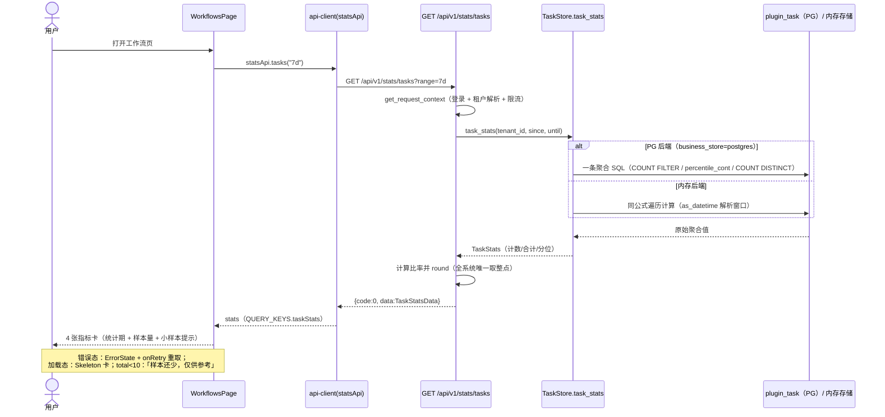
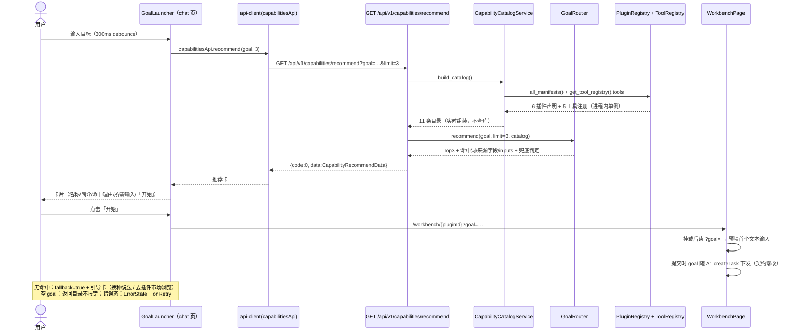
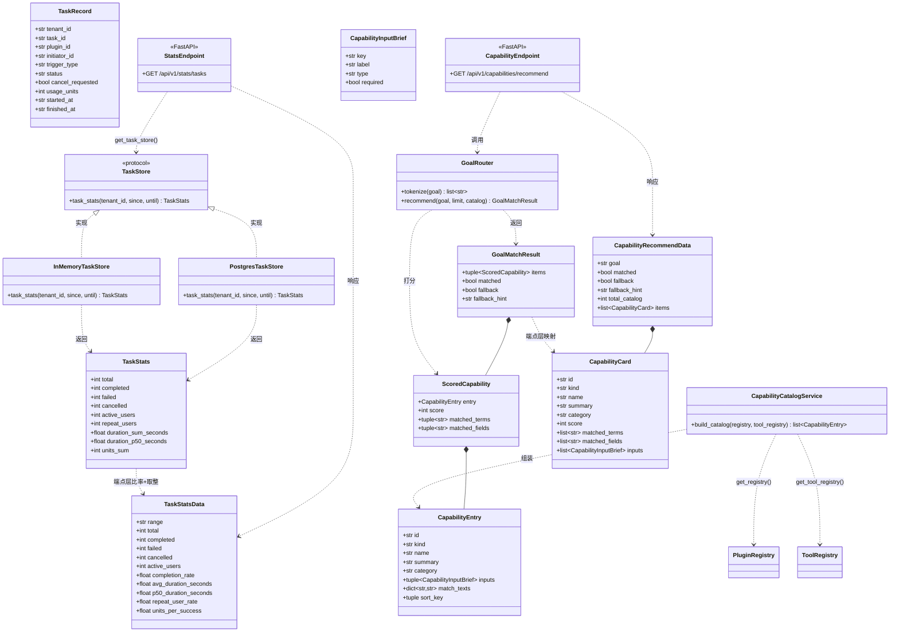

# W1 增量架构设计：任务统计切片 + 统一任务入口 MVP

| 项 | 内容 |
| --- | --- |
| 文档编号 | MOY-ARCH-W1-2026-10-23 ｜ 版本 v1.0 ｜ 编制人 高见远（Gao）· 架构师 ｜ 日期 2026-10-23 |
| 上游 | `docs/prd-w1-metrics-entry.md`（需求与验收口径）；`docs/alignment-2026-10-23-tech-options.md` §2.4.3/§2.6（**实现方案与文件清单以此为准**）；`docs/decisions/0005-charter-first-alignment.md` D-15/D-17/D-27；`docs/metrics-definition-v1.0.md` §1.5 |
| 范围 | 切片 A `GET /api/v1/stats/tasks`（M1/M3/M4/M5，零迁移零新表）；切片 B `GET /api/v1/capabilities/recommend`（规则推荐 Top3）+ 前端目标式发起 |
| 状态 | 待评审 ｜ 只写设计文档，不含业务代码 |
| 代码事实基线 | 本设计引用的全部文件/行号/字段名已于 2026-10-23 对工作区实测核对（见 §10 证据索引） |

---

## 0. 结论速览

| # | 结论 | 依据 |
| --- | --- | --- |
| 1 | 两切片合计 **2 个新端点**，全部为只读 GET；零迁移、零新表、零新第三方依赖（前后端都不加包） | tech-options §2.4.3/§2.6；PRD 共同排除表 |
| 2 | 切片 A 的聚合方法 `TaskStore.task_stats(tenant_id, since, until)` 必须**三处同步**（协议 + 内存 + PG），这是本仓双后端铁律；取整与比率计算只在端点层做一次，保证双后端结果逐字一致 | `task_repo.py` 体例；AC-A7 |
| 3 | **「6 个插件声明」的唯一权威来源 = `app/plugins/manifests/plg_*.json`**（启动时经 `PluginRegistry` 六重校验加载进进程内单例）；工具注册表唯一权威 = `app/registry/tool_registry.yaml`。推荐目录**实时组装**，不建能力表、不造服务层常量副本 | `plugins/loader.py`；`registry/loader.py`；PRD §2.2「不新建能力表」 |
| 4 | **新端点必须登记基线**：`validate_openapi.py` 的 G1 要求核心端点集合与冻结基线精确相等，未登记的新端点立即判红。本设计**增补** `docs/api/baseline-w1-2.json` + 门禁脚本加性改造（照 `baseline-phase4-10.json` 先例）——这是对 tech-options 文件清单的唯一增补，需主理人知悉 | `deploy/validate_openapi.py` G1/G2；§2.4 难点 5 |
| 5 | **M3 口径收窄**：PRD 公式要求「扣除 `waiting_confirm` 停留」，但当前 schema 中该停留**无任何落点**（任务级状态无时间戳、步骤级无 waiting 状态、审计无该动作），零迁移条件下不可算。本设计按 tech-options §2.4.3 的 SQL 交付「任务总时长」（`finished_at − started_at`，含人工等待），需产品确认收窄并修订指标文档 v1.1（§9-Q1，不阻塞任务） | `init-schema-phase3.sql` 步骤 CHECK；`task_service._pause_for_confirm` |
| 6 | PRD 两处笔误/名实差异已在设计中按**代码事实**修正并退回产品：①恢复条件字段应为 `integration_status`（非 `implementation_mode`）；②`task:read` 权限点在代码中不存在（16 个业务权限点无此项），任务域端点实际只依赖登录上下文 + 租户隔离 | `schemas/tool.py` `IntegrationStatus`；`policy_service.BUSINESS_PERMISSIONS`；§9-Q2/Q3 |

---

# Part A：系统设计

## 1. 实现方案

### 1.1 总体判断

两个切片都是**只读统计/推荐端点 + 既有页面增强**，不触碰任何写路径契约：

- 切片 A：一条聚合 SQL（PG）/ 一次内存遍历（memory）算出 4 项指标 + 6 个辅助字段；复用 `task:read` 的**实际等效机制**（登录 + 租户隔离，见 §9-Q2），不扩权限矩阵；零迁移（`plugin_task` 现有列全部够用）。
- 切片 B：目录实时组装（`PluginRegistry` + `ToolRegistry`）+ 纯函数规则打分（中文 2-gram + 关键词表，不引 jieba、不引模型）；复用 `POST /api/v1/agent/tasks` 现有 `goal` 字段，**契约零改**；前端「开始」跳 `/workbench/{pluginId}?goal=…`，工作台预填并随任务提交。

### 1.2 技术难点与选型

| # | 难点 | 选型与理由 |
| --- | --- | --- |
| 1 | **分子分母必须可复算、双后端必须一致**（AC-A2/A7） | 聚合逻辑按同一公式写两遍（内存 Python / PG SQL）；**比率与取整只在端点层做一次**（`round`），仓储只回原始聚合值（计数、时长合计、分位、用量合计）。内存侧分位用线性插值，与 PG `percentile_cont(0.5)` 同口径 |
| 2 | **M3「扣除人工等待」与零迁移冲突** | 见 §0-5 与 §9-Q1：按 tech-options SQL 交付总时长；扣除等待需新增列（独立迁移），本切片不做 |
| 3 | **推荐料源不能造第三份真相** | 目录组装服务只读两个既有权威：`get_registry().all_manifests()`（6 插件声明，含 `name/summary/description/category/inputs[].label`）与 `get_tool_registry().tools`（5 工具，含 `display_name/category/operations[].display_name`）。**不查库、不建表、不复制常量**。关键词表是**匹配辅助**（只影响打分，不影响展示文案），配防漂移测试 |
| 4 | **中文分词不引 jieba**（依赖门禁） | goal 切分 = CJK 连续段 2-gram 滑窗 + ASCII 小写词；领域词覆盖靠关键词表（每能力 5-12 个词），可枚举、可单测 |
| 5 | **新端点触发端点基线门禁** | 新建 `docs/api/baseline-w1-2.json` 登记 2 条；`deploy/validate_openapi.py` 加性改造（加载 W1 基线、从 core 扣除、计数门禁），照 phase4 先例；`test_endpoint_baseline.py` 同步。**这是本设计对 tech-options 文件清单的唯一增补** |
| 6 | **前端三门禁**（禁词/占位词/三态） | 文案先过词表再写：标题带「工作流任务」限定词、小样本用「样本还少，仅供参考」、禁「暂不支持/开发中/即将上线/敬请期待」；chat/workflows 页三态由页面或一层本地子组件提供 `ErrorState + onRetry` |

### 1.3 架构模式

沿用本仓既有分层，**不引入新模式**：

```
FastAPI 端点（薄层：参数装配 + 比率取整 + 响应封装）
   ├─ 切片 A：TaskStore.task_stats()（协议 → 内存 / PG 双实现）
   └─ 切片 B：CapabilityCatalogService.build_catalog()（实时组装）
              └─ GoalRouter.recommend()（纯函数打分，无 IO）
前端：页面（三态）→ 本地子组件（指标卡 / 目标发起器）→ hooks/use-api（QUERY_KEYS）→ api-client（唯一出口）
```

### 1.4 切片 A 详细设计

#### 1.4.1 端点

```
GET /api/v1/stats/tasks?range=7d|30d     # range 默认 7d
```

- 挂载：`app/api/v1/router.py` 的 `include_all_routers()` 内，与其它业务域一致：
  `api_router.include_router(stats.router, prefix=prefix, dependencies=business_dependencies)`
  （`business_dependencies = [Depends(enforce_ratelimit)]`，限流在鉴权后生效，与 94 个既有端点同口径）。
- 鉴权：`Depends(get_request_context)`（登录 + 租户解析 + 跨租户成员校验，AR-017 修复后全端点统一）。**不新增权限点**（见 §9-Q2）。
- 窗口：`until = now(UTC)`，`since = until − 7d/30d`，任务按 `started_at ∈ [since, until)` 归属（与 A2 `created_from/to` 同口径）；期末未终态任务计入 `total` 与完成率分母（按未完成）。

#### 1.4.2 Schema（`app/schemas/stats.py`，新建）

```python
class TaskStatsData(BaseModel):
    """工作流任务统计数据（M1/M3/M4/M5 + 辅助字段）。"""

    range: str = "7d"                      # 统计期回显（与请求一致）
    total: int = 0                         # 窗口内发起任务数
    completed: int = 0                     # status='completed'
    failed: int = 0                        # status='failed'
    cancelled: int = 0                     # status='cancelled' 且 cancel_requested=true（用户主动取消）
    active_users: int = 0                  # 发起 ≥1 次的去重用户数（剔 trigger_type='retry'）
    completion_rate: float = 0.0           # M1：completed/(total−cancelled)×100，两位小数
    avg_duration_seconds: float = 0.0      # M3：completed 任务平均总时长（秒，一位小数）
    p50_duration_seconds: float = 0.0      # M3：同口径 P50（线性插值，一位小数）
    repeat_user_rate: float = 0.0          # M4：同插件 ≥2 次用户/≥1 次用户×100，两位小数
    units_per_success: float = 0.0         # M5：completed 任务 usage_units 均值，两位小数
```

#### 1.4.3 仓储方法（`app/db/repositories/task/`，修改——三处同步）

新增内部数据类（模块级，不进响应契约）：

```python
@dataclass(slots=True)
class TaskStats:
    """任务域窗口聚合原始值（比率与取整在端点层统一计算）。"""

    total: int = 0
    completed: int = 0
    failed: int = 0
    cancelled: int = 0            # 用户主动取消（cancel_requested=true）
    active_users: int = 0         # 剔 retry 的去重发起用户数
    repeat_users: int = 0         # 同一插件发起 ≥2 次的去重用户数（剔 retry）
    duration_sum_seconds: float = 0.0   # completed 任务 (finished_at−started_at) 合计
    duration_p50_seconds: float = 0.0   # 同口径 P50（percentile_cont 线性插值）
    units_sum: int = 0            # completed 任务 usage_units 合计
```

`TaskStore` 协议（在 `:245-246` 协议类内追加，docstring 写死口径）：

```python
async def task_stats(self, tenant_id: str, since: str, until: str) -> TaskStats:
    """窗口内任务聚合（M1/M3/M4/M5 的唯一计算入口，内存/PG 同公式）。

    Args:
        tenant_id: 企业 ID。
        since: 窗口起点（ISO 8601，含）。
        until: 窗口终点（ISO 8601，不含）。

    Returns:
        TaskStats: 原始聚合值；空窗口全 0。
    """
    ...
```

**PG 实现要点**（`PostgresTaskStore`，一条聚合 SQL，`tenant_scope(read_only=True)`）：

```sql
WITH scoped AS (
    SELECT task_id, initiator_id, plugin_id, status, cancel_requested,
           trigger_type, usage_units, started_at, finished_at
      FROM plugin_task
     WHERE tenant_id = :tenant_id
       AND started_at >= :since AND started_at < :until
),
user_plugin AS (
    SELECT initiator_id, plugin_id, count(*) AS cnt
      FROM scoped
     WHERE trigger_type <> 'retry'
     GROUP BY initiator_id, plugin_id
)
SELECT
    (SELECT count(*) FROM scoped) AS total,
    (SELECT count(*) FROM scoped WHERE status = 'completed') AS completed,
    (SELECT count(*) FROM scoped WHERE status = 'failed') AS failed,
    (SELECT count(*) FROM scoped WHERE status = 'cancelled' AND cancel_requested) AS cancelled,
    (SELECT count(DISTINCT initiator_id) FROM scoped WHERE trigger_type <> 'retry') AS active_users,
    (SELECT count(DISTINCT initiator_id) FROM user_plugin WHERE cnt >= 2) AS repeat_users,
    (SELECT COALESCE(sum(EXTRACT(EPOCH FROM (finished_at - started_at))), 0)
       FROM scoped WHERE status = 'completed' AND finished_at IS NOT NULL) AS duration_sum,
    (SELECT COALESCE(percentile_cont(0.5) WITHIN GROUP (
                ORDER BY EXTRACT(EPOCH FROM (finished_at - started_at)))
                FILTER (WHERE status = 'completed' AND finished_at IS NOT NULL), 0)
       FROM scoped) AS duration_p50,
    (SELECT COALESCE(sum(usage_units), 0) FROM scoped WHERE status = 'completed') AS units_sum
```

- 表名走模块常量 `TASK_TABLE`（f-string，体例同既有方法），值一律命名参数绑定；时间参数经 `as_datetime()` 转 `datetime`（asyncpg 不收 ISO 字符串，B21c 实测教训）。
- `percentile_cont` 返回 numeric，取回后 `float(...)`；空窗口 `COALESCE(..., 0)`。
- **索引依据**：主过滤 `tenant_id + started_at` 范围，`idx_task_status_time (tenant_id, status, started_at DESC)` 提供 tenant_id 前缀定位，单租户十万级窗口聚合无压力（tech-options §2.4.3 风险 3）；`user_plugin` 按 `(initiator_id, plugin_id)` 分组可借 `idx_task_initiator (tenant_id, initiator_id, started_at DESC)` 前缀。**零新索引**。

**内存实现要点**（`InMemoryTaskStore`，同公式）：

- 窗口比较用 `as_datetime()` 解析后比较（**不依赖 ISO 字符串格式**，避免测试造数格式不一致导致静默错算）；`started_at` 为空串的记录不进窗口。
- `repeat_users`：`(initiator_id, plugin_id)` 分组计数 ≥2 的用户去重数（剔 `trigger_type == 'retry'`）。
- `duration_p50_seconds`：模块级私有 `_percentile(sorted_values, 0.5)`，线性插值（与 `percentile_cont` 同口径），空表回 0。
- 与 PG 的差异只允许存在于「取数路径」，**不允许存在于公式**——这是 AC-A7 的验收对象。

#### 1.4.4 端点层（`app/api/v1/stats.py`，新建）

```python
router = APIRouter(prefix="/stats", tags=["统计"])

@router.get("/tasks", response_model=ApiResponse[TaskStatsData], summary="工作流任务统计")
async def get_task_stats(
    request: Request,
    context: RequestContext = Depends(get_request_context),
    range: Literal["7d", "30d"] = Query("7d", description="统计窗口：7d 近 7 天 / 30d 近 30 天"),
) -> ApiResponse[TaskStatsData]:
```

- `range` 非法值 → FastAPI `RequestValidationError` → `validation_error_handler` → **20001（HTTP 400）**（`middleware/error_handler.py:112-131`，既有机制，无需自定义校验）。
- 窗口计算 + 比率 + `round` 在端点层模块级私有函数 `_build_stats_data(range, stats)` 中完成——**全系统唯一取整点**：
  - `completion_rate = round(completed / (total − cancelled) × 100, 2)`，分母 0 → `0.0`；
  - `avg_duration_seconds = round(duration_sum_seconds / completed, 1)`，`completed=0` → `0.0`；
  - `repeat_user_rate = round(repeat_users / active_users × 100, 2)`，分母 0 → `0.0`；
  - `units_per_success = round(units_sum / completed, 2)`，`completed=0` → `0.0`。
- 日志：`logger.info("task_stats_served", tenant_id=..., range=..., total=...)`（structlog 自动带 trace_id/user_id/event，体例同 `plugin_service`）。
- 空租户：仓储返回全 0 `TaskStats` → 响应全 0，**无 NaN/null**（AC-A3/R4）。

#### 1.4.5 前端（工作流页 4 卡）

- `apps/web/src/lib/types.ts`：新增 `TaskStatsRange = '7d' | '30d'` 与 `TaskStatsData`（与后端逐字对应）。
- `apps/web/src/lib/api-client.ts`：新增 `statsApi.tasks(range: TaskStatsRange): Promise<TaskStatsData>`（`request('GET', '/stats/tasks', { query: { range } })`）。
- `apps/web/src/hooks/use-api.ts`：`QUERY_KEYS.taskStats(range): ApiQueryKey => ['stats', 'tasks', range]`。
- `apps/web/src/lib/format.ts`：新增 `formatDurationSeconds(seconds: number): string`——`<60` 显示「N 秒」，否则「N 分 M 秒」；非有限值回占位符（业务语言，不出现技术字段名）。
- `apps/web/src/components/workflow/task-metric-cards.tsx`（新建）：4 张卡 + 三态 + 小样本 + 统计期标注。
- `apps/web/src/app/(main)/workflows/page.tsx`（修改）：表格上方挂载 `<TaskMetricCards />`。

**卡片规格**（标题禁简写，R1/R3）：

| 卡片标题（逐字） | 主数值 | 副文案（业务语言） |
| --- | --- | --- |
| 工作流任务完成率 | `formatPercent(completion_rate)` | `已完成 {completed} / {total − cancelled}` |
| 工作流任务平均完成时长 | `formatDurationSeconds(avg_duration_seconds)` | `中位 {formatDurationSeconds(p50_duration_seconds)}` |
| 工作流任务重复使用率 | `formatPercent(repeat_user_rate)` | `{active_users} 位用户中有重复使用` |
| 工作流任务单位成功用量 | `units_per_success`（纯数字，禁出现 units/token 字样） | `按 {completed} 个已完成任务平均` |

- **小样本**（R2/AC-A4）：`total < 10` 时卡片区顶部一行提示「**样本还少，仅供参考**（当前样本 {total} 个任务）」；`total === 0` 同样显示（样本量 0），数值照常显示 0（R4）。
- **统计期标注**（AC-A6）：卡片区副标题「统计期：近 7 天 / 近 30 天」（由 `range` 推导）。
- **三态**（AC-A8）：加载 → 4 张 `Skeleton` 卡；错误 → `ErrorState`（`toBusinessMessage` + `onRetry` 重取）；数据 → 卡片。口径隔离（AC-A5/R1）：本页只展示工作流域，不并列 `/model/usage`，两域数字不进同一百分比——由标题限定词 + 页面不混排保证。

### 1.5 切片 B 详细设计

#### 1.5.1 端点

```
GET /api/v1/capabilities/recommend?goal=…&limit=3    # limit 默认 3，范围 1..10
```

- 挂载：同 §1.4.1（`business_dependencies` + `get_request_context`）。
- 参数边界（AC-B5）：`goal` 超 4000 字 → 20001（`Query(max_length=4000)`，与 A1 `goal` 上限一致）；`limit` 越界 → 20001（`Query(3, ge=1, le=10)`）；`goal` 为空（或纯空白）→ **返回目录，不报错**（AC-B4）。

#### 1.5.2 目录组装（`app/services/capability_catalog.py`，新建）

```python
@dataclass(frozen=True, slots=True)
class CapabilityInputBrief:
    """所需输入提示（D-17「所需输入提示」的料源）。"""
    key: str
    label: str
    type: str
    required: bool

@dataclass(frozen=True, slots=True)
class CapabilityEntry:
    """一条能力目录项（插件或工具；实时组装，不落库）。"""
    id: str                                   # 插件：plugin_id；工具：f"tool:{tool_type}"
    kind: str                                 # "plugin" | "tool"
    name: str                                 # 插件 name / 工具 display_name
    summary: str                              # 插件 summary；工具 = 操作展示名 "、" 拼接（派生，非编造）
    category: str                             # 声明原值（collab/content/dev/hr/communication/...）
    inputs: tuple[CapabilityInputBrief, ...]  # 插件 inputs[]；工具为 ()
    match_texts: dict[str, str]               # 打分料源：name/summary/category/inputs.label/operations
    sort_key: tuple[int, str]                 # 目录稳定序：插件 (ui_extension.order, id)，工具 (999, id)

def build_catalog(
    registry: PluginRegistry | None = None,
    tool_registry: ToolRegistry | None = None,
) -> list[CapabilityEntry]:
```

- **权威来源（关键决策）**：插件声明唯一权威 = `app/plugins/manifests/plg_*.json`，进程内经 `app/plugins/loader.get_registry()` 加载（六重校验，启动期失败即 30004，`readyz` 已依赖它，recommend 复用同一单例**零新失败模式**）。工具唯一权威 = `app/registry/tool_registry.yaml`（`get_tool_registry()`）。`PluginService.market()` 的 DB 读数是注册表同步下去的版本记录（`ensure_versions(version_records_from_registry(...))`），**不是独立真相源**；目录服务 therefore 不查库、不建表、不复制常量（PRD §2.2「目录实时组装，避免第三份真相」）。
- 目录稳定序：插件按声明 `ui_extension.order` 再按 `plugin_id`；工具按注册表声明序。`total_catalog = 11`（6 插件 + 5 工具）。
- 工具的 `match_texts["operations"]` = `operations[].display_name` 拼接（PRD §2.2 料源）；工具无「所需输入」概念，`inputs = ()`（不把 `params_schema` 的技术结构透给终端用户）。
- 目录**不带** `integration_status`：推荐卡是否标注「演示」徽标留待 V1.1 真实化批次统一（§9-Q4），MVP 不引入耦合。

#### 1.5.3 规则打分（`app/services/goal_router.py`，新建）

```python
FIELD_WEIGHTS: Final[dict[str, int]] = {"name": 3, "summary": 2, "category": 1, "inputs.label": 1, "operations": 1}

@dataclass(frozen=True, slots=True)
class ScoredCapability:
    entry: CapabilityEntry
    score: int
    matched_terms: tuple[str, ...]     # 命中词（去重，按权重降序→goal 中出现位置升序）
    matched_fields: tuple[str, ...]    # 命中字段（契约字段名，按权重降序）

@dataclass(frozen=True, slots=True)
class GoalMatchResult:
    items: tuple[ScoredCapability, ...]
    matched: bool                      # 是否有 ≥1 条得分 > 0
    fallback: bool                     # 无命中 → 目录兜底
    fallback_hint: str                 # 兜底引导文案（禁占位词）

def tokenize(goal: str) -> list[str]:            # CJK 2-gram 滑窗 + ASCII 小写词；可单测
def recommend(goal: str, *, limit: int = 3, catalog: Sequence[CapabilityEntry] | None = None) -> GoalMatchResult:
```

- **切分**：CJK 连续段逐 2 字滑窗（「整理本周周报」→ 整理/理本/本周/周报/周报…按出现去重）；ASCII 段按非字母数字切分并小写。不引 jieba（依赖门禁）。
- **关键词表** `_KEYWORD_TERMS: Final[dict[str, tuple[str, ...]]]`（按 entry id 索引，每能力 5-12 个领域词，如 `plg_weekly_report: ("周报", "汇报", "本周", "工作总结")`、`plg_mail_draft: ("邮件", "写信", "起草", "回复")`、`plg_meeting_minutes: ("会议", "纪要", "待办")`、`plg_dev_workbench: ("代码", "仓库", "提交", "研发", "需求", "分支")`、`plg_content_ops: ("内容", "运营", "稿件", "发布", "排期", "公众号", "文章")`、`plg_hr_admin: ("招聘", "人事", "行政", "公文", "岗位", "入职")`、`tool:email: ("邮件", "发送", "邮箱")`、`tool:wecom: ("企业微信", "消息", "群聊", "通讯录")`、`tool:feishu: ("飞书", "日程", "文档")`、`tool:github: ("代码仓库", "议题", "合并请求")`、`tool:wechat_mp: ("公众号", "文章", "发布", "素材")`）。关键词表是**匹配辅助**：只进打分、不进展示文案；配防漂移测试（关键词 id 必须存在于目录）。
- **打分**：词命中字段 = 词是字段文本的子串（中文子串；ASCII 词小写包含匹配）。每个「词 × 字段」计一次权重分；同词命中多字段可叠加（如「周报」命中 name+summary = 3+2=5）。`score = Σ`。
- **入选与排序**：`score ≥ 1` 入选；按 `(score 降序, kind[plugin 优先], id 升序)` 取前 `limit`——确定性，可枚举可测。
- **理由回填**（AC-B2）：`matched_terms` + `matched_fields`（契约字段名 `name/summary/category/inputs.label/operations`），前端映射为「名称/简介/分类/输入项/能力清单」展示，用户看得到「为什么给我这个」。**禁空理由**：入选卡必有命中词与字段。
- **兜底**（AC-B3）：无任何能力得分 ≥1 → `matched=false, fallback=true`，`items` = 目录前 `limit` 条（`score=0`、`matched_terms/fields=[]`），`fallback_hint = "没有找到完全匹配的能力，可以换种说法，或去插件市场浏览全部能力"`（给明确引导、无占位词、**不返回空列表**）。
- **空 goal**：`matched=false, fallback=false`，`items` = 目录前 `limit` 条，`fallback_hint=""`（AC-B4）。

#### 1.5.4 Schema（`app/schemas/capability.py`，新建）

```python
class CapabilityInputBrief(BaseModel):
    key: str = ""
    label: str = ""
    type: str = ""
    required: bool = False

class CapabilityCard(BaseModel):
    id: str = ""
    kind: Literal["plugin", "tool"] = "plugin"
    name: str = ""
    summary: str = ""
    category: str = ""
    score: int = 0
    matched_terms: list[str] = Field(default_factory=list)
    matched_fields: list[str] = Field(default_factory=list)
    inputs: list[CapabilityInputBrief] = Field(default_factory=list)

class CapabilityRecommendData(BaseModel):
    goal: str = ""
    matched: bool = False
    fallback: bool = False
    fallback_hint: str = ""
    total_catalog: int = 0
    items: list[CapabilityCard] = Field(default_factory=list)
```

#### 1.5.5 端点层（`app/api/v1/capability.py`，新建）

```python
router = APIRouter(prefix="/capabilities", tags=["能力推荐"])

@router.get("/recommend", response_model=ApiResponse[CapabilityRecommendData], summary="目标式能力推荐")
async def recommend_capabilities(
    context: RequestContext = Depends(get_request_context),
    goal: str = Query("", max_length=4000, description="用户目标（业务语言）"),
    limit: int = Query(3, ge=1, le=10, description="返回条数"),
) -> ApiResponse[CapabilityRecommendData]:
```

- 纯内存计算（目录 + 打分），无 DB 往返；每次请求实时组装目录（11 条，微秒级）。
- 日志：`logger.info("capability_recommend_served", tenant_id=..., matched=..., returned=len(items))`。

#### 1.5.6 前端（对话页目标式发起 + 工作台预填）

**`GoalLauncher`（`apps/web/src/components/chat/goal-launcher.tsx`，新建）**，挂在 `chat/page.tsx` 顶部（额度提醒条之下、会话区之上）：

- 输入框（placeholder「说说你想完成的事，例如：把本周的记录整理成周报」）+ 3 个示例 chip（「整理本周周报」「起草一封邮件」「整理会议纪要」，点击即填入并推荐）。
- 推荐触发：`goal` 去空白后非空即查询，300ms debounce；Enter 立即触发。
- **三态**：空输入 → 引导文案 + 示例 chips；加载 → `Skeleton` 卡；错误 → `ErrorState` + `onRetry`。
- **卡片**：名称、简介、命中理由行「匹配到：周报、本周（来自名称、简介）」、所需输入「需要准备：汇报周期（必填）、本周重点（选填）」、主动作：
  - `kind=plugin` → 「开始」`router.push(`/workbench/${id}?goal=${encodeURIComponent(goal)}`)`（AC-B6 跳转契约）；
  - `kind=tool` → 「去插件市场了解」`<Link href="/plugins">`（工具不是可发起任务的工作台，落地到市场是诚实动作，§9-Q4）。
- **兜底渲染**（AC-B3）：`fallback=true` 时渲染引导卡——标题「没有找到完全匹配的能力」+ hint 文案 +「去插件市场浏览」按钮（`/plugins`）+「换种说法」提示；**不得空列表、不得占位词**。

**工作台预填（`apps/web/src/app/(main)/workbench/[pluginId]/page.tsx`，修改）**：

- 读 `?goal=`：沿用本仓既有体例——挂载后 `useEffect` + `window.location.search` 解析（**不用 `useSearchParams`**，避免静态渲染期 Suspense 要求，先例见 `plugins/[pluginId]/page.tsx:52-57`）。
- 预填首个文本输入：`plugin.inputs.find(type ∈ {text, textarea, email})?.key`，将该 key 的初值设为 `goal`。
- 随任务提交：`agentApi.createTask({ conversation_id: `conv_${pluginId}`, goal: goalParam || `${plugin?.name ?? '岗位任务'} · 手动发起`, plugin_id: pluginId, inputs })`——**A1 契约零改**（`goal` 字段既有，≤4000；`plugin_id` 非空时 `goal` 可为空的既有校验逻辑 `schemas/agent.py:105-111` 不触碰）。
- `apps/web/src/hooks/use-declaration-form.ts`（修改）：`useDeclarationForm(inputs, initial?)` 新增可选第二参；`inputs` 由空变非空时把 `initial` 合入一次（`useRef` 去重），不覆盖用户已填内容。

---

## 2. 文件清单

> 新建/修改均相对仓库根。「测试文件」含在清单内。门禁产物（快照）由任务完成判据驱动重新生成。

### 2.1 切片 A（任务统计）

| # | 路径 | 新建/修改 | 职责 |
| --- | --- | --- | --- |
| A1 | `apps/adapter/app/schemas/stats.py` | 新建 | `TaskStatsData` 响应契约（M1/M3/M4/M5 + 6 辅助字段 + range 回显） |
| A2 | `apps/adapter/app/db/repositories/task/` | 修改 | `TaskStats` 数据类 + `TaskStore.task_stats` 协议 + 内存/PG 双实现（三处同步）+ `_percentile` 私有助手 + `__all__` 导出 |
| A3 | `apps/adapter/app/api/v1/stats.py` | 新建 | `GET /stats/tasks`：参数装配、窗口计算、唯一取整点、日志 |
| A4 | `apps/adapter/app/api/v1/router.py` | 修改 | `include_all_routers()` 内追加 `stats.router` 挂载（一行） |
| A5 | `apps/adapter/tests/integration/test_stats_tasks.py` | 新建 | 造数复算（用户主动取消/`waiting_confirm` 跨期/`retry_of` 各 1 条）、空租户全 0、`range` 非法 20001；PG 用例（`pytest.mark.pg`，`--run-pg`）断言双后端一致 |
| A6 | `apps/web/src/lib/types.ts` | 修改 | `TaskStatsRange` / `TaskStatsData` 类型 |
| A7 | `apps/web/src/lib/api-client.ts` | 修改 | `statsApi.tasks(range)` |
| A8 | `apps/web/src/hooks/use-api.ts` | 修改 | `QUERY_KEYS.taskStats(range)` |
| A9 | `apps/web/src/lib/format.ts` | 修改 | `formatDurationSeconds`（业务语言时长） |
| A10 | `apps/web/src/components/workflow/task-metric-cards.tsx` | 新建 | 4 指标卡 + 小样本提示 + 统计期标注 + 三态 |
| A11 | `apps/web/src/app/(main)/workflows/page.tsx` | 修改 | 表格上方挂载指标卡 |

### 2.2 切片 B（统一任务入口）

| # | 路径 | 新建/修改 | 职责 |
| --- | --- | --- | --- |
| B1 | `apps/adapter/app/services/capability_catalog.py` | 新建 | 目录实时组装（`PluginRegistry` + `ToolRegistry` → `CapabilityEntry`），零新真相源 |
| B2 | `apps/adapter/app/services/goal_router.py` | 新建 | 2-gram + 关键词表打分、Top3、理由回填、兜底（纯函数） |
| B3 | `apps/adapter/app/schemas/capability.py` | 新建 | `CapabilityInputBrief` / `CapabilityCard` / `CapabilityRecommendData` |
| B4 | `apps/adapter/app/api/v1/capability.py` | 新建 | `GET /capabilities/recommend`：参数装配与响应封装 |
| B5 | `apps/adapter/app/api/v1/router.py` | 修改 | 追加 `capability.router` 挂载（一行，与 A4 同文件不同行） |
| B6 | `apps/adapter/tests/unit/test_goal_router.py` | 新建 | 打分规则单测：切分、权重、排序确定性、关键词表防漂移（id 必须存在于目录） |
| B7 | `apps/adapter/tests/integration/test_capability_recommend.py` | 新建 | 12 条端点用例（AC-B1~B5/B7：命中正确性、易混词、空目标、超长、limit 越界、无匹配兜底、理由回填、所需输入） |
| B8 | `apps/web/src/lib/types.ts` | 修改 | `CapabilityCard` / `CapabilityRecommendData` / `CapabilityInputBrief` 类型（与 A6 同文件） |
| B9 | `apps/web/src/lib/api-client.ts` | 修改 | `capabilitiesApi.recommend(goal, limit)` |
| B10 | `apps/web/src/hooks/use-api.ts` | 修改 | `QUERY_KEYS.capabilityRecommend(goal)` |
| B11 | `apps/web/src/components/chat/goal-launcher.tsx` | 新建 | 目标输入 + 推荐卡 + 三态 + 兜底引导 |
| B12 | `apps/web/src/app/(main)/chat/page.tsx` | 修改 | 顶部挂载 `GoalLauncher` |
| B13 | `apps/web/src/app/(main)/workbench/[pluginId]/page.tsx` | 修改 | 读 `?goal=` 预填首个文本输入，随任务提交 |
| B14 | `apps/web/src/hooks/use-declaration-form.ts` | 修改 | `useDeclarationForm(inputs, initial?)` 预填支持 |

### 2.3 门禁基础设施（对 tech-options 文件清单的唯一增补）

| # | 路径 | 新建/修改 | 职责 |
| --- | --- | --- | --- |
| G1 | `docs/api/baseline-w1-2.json` | 新建 | 登记 `W1-A1 GET /api/v1/stats/tasks` 与 `W1-B1 GET /api/v1/capabilities/recommend`（`frozen_target: 2`，note 写清批次与路径逐字对齐要求） |
| G2 | `deploy/validate_openapi.py` | 修改 | **加性**改造：加载 W1 基线、从 `core_actual` 扣除、新增 `gate_w1_baseline`（未登记=红；已登记未实现默认 `[PENDING]` 不红，`--strict` 判红——复用既有 flag，不新增 CLI 面）、`gate_counts` 增 W1 计数 |
| G3 | `apps/adapter/tests/integration/test_endpoint_baseline.py` | 修改 | 三处 `core_actual` 计算扣除 W1 基线；新增「W1 基线恰好 2 条」与「实现后 w1 == 2」断言 |
| G4 | `docs/api/openapi.snapshot.json` | 重新生成 | `--update-snapshot`（端点落地后执行；新 paths 属加性，G4 放行，但必须入快照否则未来 diff 失真） |
| G5 | `docs/api/openapi.json` | 重新生成 | 门禁脚本默认写出物，与快照同源 |

---

## 3. 数据与接口

### 3.1 `GET /api/v1/stats/tasks`

请求：

```
GET /api/v1/stats/tasks?range=7d
Authorization: Bearer <token>
```

响应（200，空租户同理，全 0）：

```json
{
  "code": 0,
  "message": "success",
  "data": {
    "range": "7d",
    "total": 42,
    "completed": 30,
    "failed": 6,
    "cancelled": 2,
    "active_users": 5,
    "completion_rate": 71.43,
    "avg_duration_seconds": 183.4,
    "p50_duration_seconds": 151.0,
    "repeat_user_rate": 40.0,
    "units_per_success": 12.5
  }
}
```

字段口径（**分子分母可复算**，AC-A2）：

| 字段 | 类型 | 分子 | 分母 / 说明 |
| --- | --- | --- | --- |
| `range` | str | — | 统计期回显 |
| `total` | int | — | `started_at ∈ [since, until)` 的任务数（含期末未终态） |
| `completed` | int | — | `status='completed'` |
| `failed` | int | — | `status='failed'` |
| `cancelled` | int | — | `status='cancelled'` 且 `cancel_requested=true`（**用户主动取消**；系统取消留在完成率分母） |
| `active_users` | int | — | 发起 ≥1 次的去重用户数（剔 `trigger_type='retry'`） |
| `completion_rate` | float | `completed` | `total − cancelled`（终态剔除用户主动取消；期末 `running/queued/waiting_confirm/pending` 按未完成计入）；分母 0 → `0.0` |
| `avg_duration_seconds` | float | Σ(`finished_at − started_at`) | `completed` 数；0 → `0.0`。**口径注记：含人工确认等待（见 §9-Q1）** |
| `p50_duration_seconds` | float | 同上分位（线性插值） | 同上 |
| `repeat_user_rate` | float | 同一 `plugin_id` 发起 ≥2 次的去重用户数（剔 retry） | `active_users`；分母 0 → `0.0` |
| `units_per_success` | float | Σ `usage_units`（仅 `completed`） | `completed` 数；0 → `0.0` |

错误码与边界：

| 场景 | 行为 |
| --- | --- |
| `range` 非法（如 `90d`） | **20001**（HTTP 400，「请求内容不完整，请检查后重试」），不得 500 |
| 未登录 / 令牌无效 | 401（既有机制） |
| 限流 | 429 / 20006（`business_dependencies`，既有机制） |
| 空租户 / 空窗口 | 全指标 `0`，无 `NaN`/`null`（R4/AC-A3） |
| `total < 10` | 接口照常返回；前端显示「样本还少，仅供参考」+ 样本量（R2/AC-A4） |
| 分页 / 幂等 | **不涉及**（只读聚合端点，无分页、无 `Idempotency-Key`） |

### 3.2 `GET /api/v1/capabilities/recommend`

请求：

```
GET /api/v1/capabilities/recommend?goal=%E6%95%B4%E7%90%86%E6%9C%AC%E5%91%A8%E5%91%A8%E6%8A%A5&limit=3
```

响应（有命中）：

```json
{
  "code": 0,
  "message": "success",
  "data": {
    "goal": "整理本周周报发给主管",
    "matched": true,
    "fallback": false,
    "fallback_hint": "",
    "total_catalog": 11,
    "items": [
      {
        "id": "plg_weekly_report",
        "kind": "plugin",
        "name": "周报生成",
        "summary": "把这一周的记录整理成一份周报",
        "category": "collab",
        "score": 9,
        "matched_terms": ["周报", "本周"],
        "matched_fields": ["name", "summary"],
        "inputs": [
          { "key": "period", "label": "汇报周期", "type": "text", "required": true },
          { "key": "focus", "label": "本周重点", "type": "text", "required": false },
          { "key": "receiver", "label": "收件人", "type": "email", "required": true }
        ]
      }
    ]
  }
}
```

响应（无命中兜底，AC-B3）：`matched=false, fallback=true, fallback_hint="没有找到完全匹配的能力，可以换种说法，或去插件市场浏览全部能力"`，`items` = 目录前 `limit` 条（`score=0`，命中信息为空数组）。

响应（空 goal，AC-B4）：`matched=false, fallback=false`，`items` = 目录前 `limit` 条，`fallback_hint=""`。

错误码与边界：

| 场景 | 行为 |
| --- | --- |
| `goal` 超 4000 字 | **20001**（与 A1 `goal` 上限一致） |
| `limit < 1` 或 `> 10` | **20001** |
| 无命中 | 200 + 目录兜底 + 引导文案（禁空列表、禁占位词） |
| 工具卡片 | `kind="tool"`，`id="tool:{tool_type}"`，`inputs=[]`（无所需输入概念），`summary` 为操作展示名拼接 |
| 分页 / 幂等 | 不涉及（只读） |

### 3.3 跳转契约（AC-B6，纯前端，无新增/修改后端字段）

```
推荐卡「开始」→ /workbench/{pluginId}?goal={encodeURIComponent(goal)}
工作台：读 ?goal= → 预填首个文本输入 → createTask 时 goal 随 A1 既有 goal 字段下发
```

---

## 4. 调用流程

### 4.1 时序一：工作流任务统计（切片 A）



### 4.2 时序二：目标式发起与推荐（切片 B）



### 4.3 类图（数据结构与接口）



---

## 5. Part A 小结：不确定点与假设

见 §9「待明确事项」（集中列出，**不阻塞任务列表**）。关键假设：

1. `range` 默认 `7d`（PRD 未定默认值，取信息量更高的小窗口）。
2. `limit` 上限取 10（PRD 只定默认 3）。
3. 百分比字段统一为 0~100 浮点（与前端 `formatPercent` 约定一致），非 0~1。
4. 无命中兜底采用「目录兜底 + 引导」而非空 `items`（对 AC-B3「不得空列表」的解读，需产品确认）。

---

# Part B：任务分解

## 6. 所需依赖包

**零新增**（前后端都不加包，过 `validate_deps.py` 无新条目）：

```
# 后端（既有，无需安装任何新包）
fastapi / pydantic：端点与 schema（既有栈）
asyncpg：PG 聚合（既有，经 tenant_scope）
structlog：JSON 日志（既有，自动注入 trace_id/tenant_id/user_id/event）

# 前端（既有）
next / react / @tanstack/react-query / lucide-react：页面与状态（既有栈）
```

不引 jieba（中文分词）、不引任何模型 SDK/向量库（PRD §2.3 边界 1）。

## 7. 任务列表（有序，含依赖与可并行项）

### T01 · 契约与门禁基础设施（两切片共享）

- **Source Files**：
  - `apps/adapter/app/schemas/stats.py`（新建）
  - `apps/adapter/app/schemas/capability.py`（新建）
  - `apps/web/src/lib/types.ts`（修改：`TaskStatsData` / `TaskStatsRange` / `CapabilityCard` / `CapabilityRecommendData` / `CapabilityInputBrief`）
  - `apps/web/src/lib/api-client.ts`（修改：`statsApi.tasks` / `capabilitiesApi.recommend`）
  - `apps/web/src/hooks/use-api.ts`（修改：`QUERY_KEYS.taskStats` / `QUERY_KEYS.capabilityRecommend`）
  - `docs/api/baseline-w1-2.json`（新建）
  - `deploy/validate_openapi.py`（修改：W1 基线加载/扣除/计数，加性）
  - `apps/adapter/tests/integration/test_endpoint_baseline.py`（修改：扣除 W1 基线 + 断言）
- **Dependencies**：无（首任务，项目基础设施）。
- **Priority**：P0。
- **完成判据**（可直接当验收）：
  1. `TaskStatsData` / `CapabilityRecommendData` 字段与本设计 §3 逐字一致（snake_case，数值字段有 0 默认值）；
  2. `baseline-w1-2.json` 恰好 2 条，路径与后续实现逐字对齐（`GET /api/v1/stats/tasks`、`GET /api/v1/capabilities/recommend`）；
  3. `python deploy/validate_openapi.py` 退出 0（W1 两条呈 `[PENDING]` 不判红，core 仍 30 / phase2 38 / phase3 16 / phase4 10 不变）；
  4. `cd apps/adapter && OA_BATCH=B21 ./.venv/Scripts/python.exe -m pytest tests/integration/test_endpoint_baseline.py -q` 全绿；
  5. `cd apps/web && npx tsc --noEmit` 通过（新类型无 any 泄漏）。

### T02 · 切片 A 后端：任务统计聚合与端点

- **Source Files**：
  - `apps/adapter/app/db/repositories/task/`（修改：`TaskStats` + 协议 + 内存 + PG 三处同步）
  - `apps/adapter/app/api/v1/stats.py`（新建）
  - `apps/adapter/app/api/v1/router.py`（修改：追加 stats 挂载一行）
  - `apps/adapter/tests/integration/test_stats_tasks.py`（新建）
- **Dependencies**：T01。
- **Priority**：P0。
- **完成判据**：
  1. `TaskStore.task_stats` 在协议、`InMemoryTaskStore`、`PostgresTaskStore` **三处齐备**且签名一致（漏一处即双后端漂移，评审必查）；
  2. PG 为**一条**聚合 SQL，时间参数经 `as_datetime()`；内存侧公式与 PG 逐条对应（含 `cancel_requested` 拆分、剔 retry、`percentile_cont` 线性插值同口径）；
  3. `test_stats_tasks.py`：造数含「用户主动取消、`waiting_confirm` 跨期、`retry_of` 各 1 条」，接口值与 §3.1 公式手工复算一致（AC-A2）；空租户全 0 无 NaN/null（AC-A3）；`range=90d` → code=20001 且 HTTP 400（AC-A1）；
  4. PG 用例（`pytest.mark.pg`）`--run-pg` 实跑：与内存实现结果一致（AC-A7）；
  5. 端点落地后执行 `python deploy/validate_openapi.py --update-snapshot` 重生成 `docs/api/openapi.snapshot.json` 与 `openapi.json`，并再跑一次门禁退出 0（G4 加性放行新 paths）；
  6. `cd apps/adapter && OA_BATCH=B21 ./.venv/Scripts/python.exe -m pytest tests -q` 全绿（PG 批口径）。

### T03 · 切片 B 后端：能力目录与规则推荐

- **Source Files**：
  - `apps/adapter/app/services/capability_catalog.py`（新建）
  - `apps/adapter/app/services/goal_router.py`（新建）
  - `apps/adapter/app/api/v1/capability.py`（新建）
  - `apps/adapter/app/api/v1/router.py`（修改：追加 capability 挂载一行）
  - `apps/adapter/tests/unit/test_goal_router.py`（新建）
  - `apps/adapter/tests/integration/test_capability_recommend.py`（新建）
- **Dependencies**：T01。
- **Priority**：P0。
- **可并行**：与 T02 并行（`router.py` 均为 `include_all_routers()` 内追加一行 + import，合并无语义冲突）。
- **完成判据**：
  1. 目录只读 `get_registry().all_manifests()` + `get_tool_registry().tools`——**无 DB 查询、无新表、无常量副本**（评审 grep 断言：新服务文件内无 `tenant_scope`/SQL/第二份名称表）；
  2. `test_goal_router.py`：切分、权重（name×3/summary×2/category×1/inputs.label×1/operations×1）、排序确定性（同分 → plugin 优先 → id 升序）、关键词表 id 全部存在于目录（防漂移）；
  3. `test_capability_recommend.py` 12 条全覆盖 AC-B1~B5/B7：六类目标各命中正确插件、易混词不串（「写周报」不串到邮件起草）、空 goal 返回目录不报错、goal 超 4000 → 20001、limit=0/11 → 20001、无命中 → fallback=true 且 items 非空且 hint 无占位词、每卡 matched_terms/matched_fields 非空、周报卡 inputs 含「汇报周期/收件人」；
  4. 端点落地后重生成快照并跑 `python deploy/validate_openapi.py` 退出 0；
  5. `OA_BATCH=B21` 全量 pytest 全绿。

### T04 · 切片 A 前端：工作流页指标卡

- **Source Files**：
  - `apps/web/src/lib/format.ts`（修改：`formatDurationSeconds`）
  - `apps/web/src/components/workflow/task-metric-cards.tsx`（新建）
  - `apps/web/src/app/(main)/workflows/page.tsx`（修改：挂载指标卡）
- **Dependencies**：T01（契约）；联调依赖 T02。
- **Priority**：P1。
- **可并行**：与 T03/T05 并行。
- **完成判据**：
  1. 4 张卡标题逐字为「工作流任务完成率 / 工作流任务平均完成时长 / 工作流任务重复使用率 / 工作流任务单位成功用量」（R1/R3，禁简写）；
  2. 三态齐全（AC-A8）：加载 Skeleton、错误 `ErrorState` 带 `onRetry`、空数据照常渲染 0 值卡；
  3. `total < 10`（含 0）显示「样本还少，仅供参考」+「当前样本 N 个任务」（R2/AC-A4）；
  4. 卡片标注「统计期：近 7 天 / 近 30 天」（AC-A6）；
  5. 界面无 `units/token` 等技术字段名（R4），时长走 `formatDurationSeconds`；
  6. `cd apps/web && npx tsc --noEmit && npm run scan:banned && npm run scan:placeholders && npm run scan:pages` 全过。

### T05 · 切片 B 前端：目标式发起与工作台预填

- **Source Files**：
  - `apps/web/src/components/chat/goal-launcher.tsx`（新建）
  - `apps/web/src/app/(main)/chat/page.tsx`（修改：挂载 `GoalLauncher`）
  - `apps/web/src/app/(main)/workbench/[pluginId]/page.tsx`（修改：读 `?goal=` 预填并随任务提交）
  - `apps/web/src/hooks/use-declaration-form.ts`（修改：`initial` 预填支持）
- **Dependencies**：T01（契约）；联调依赖 T03。
- **Priority**：P1。
- **可并行**：与 T02/T03/T04 并行。
- **完成判据**：
  1. 对话页顶部输入 + 推荐卡：每张卡展示命中理由（「匹配到：周报、本周（来自名称、简介）」）与所需输入（「需要准备：汇报周期（必填）…」）（AC-B2/B7）；
  2. 「开始」跳 `/workbench/{pluginId}?goal=…`；工作台读 `?goal=` 预填**首个文本输入**，提交时 `goal` 随 A1 下发；`POST /api/v1/agent/tasks` 契约零改（diff 断言：`schemas/agent.py` 无改动）（AC-B6）；
  3. 无匹配渲染引导卡（换种说法 + 去插件市场浏览），无空列表、无占位词（AC-B3）；空 goal 不请求、不报错（AC-B4 前端侧）；
  4. 三态齐全（AC-B8）：chat 页 `ErrorState` 可重试；`GoalLauncher` 自身加载/错误态齐备；
  5. `npx tsc --noEmit && npm run scan:banned && npm run scan:placeholders && npm run scan:pages` 全过。

## 8. 共享知识（跨文件约定）

1. **指标命名**：所有对外指标名必须带「工作流任务」限定词（R1/R3），禁简写「任务完成率」；与 `/model/usage`（对话/文档域）不是同一套，两域数字不可进同一百分比（§1.5 数据域隔离）。
2. **禁词表**（前端，`check-banned-terms.mjs`）：凭据/oauth/租户/密钥/模型/token/units/prompt/agent/智能体/编排/索引/向量/rag/召回/相似度/阈值/回调地址/redirect/audit log/权限位/rbac/seat/sku/计费周期……及全部模型品牌名；文案先过词表再写。
3. **占位词表**（`check-no-placeholders.mjs`）：暂不支持/暂未支持/尚未支持/敬请期待/稍后开放/即将上线/即将开放/正在开发/开发中/后续版本提供——**给出了出路的文案不算占位**（如「该格式无法上传，请换用 PDF」）；小样本文案固定用「**样本还少，仅供参考**」。
4. **双后端同步铁律**：`TaskStore` 任何新方法必须三处同步（协议 + `InMemoryTaskStore` + `PostgresTaskStore`）；PG 侧时间参数必须 `as_datetime()`；PG 新路径必须有 `pytest.mark.pg` 用例且 `--run-pg` 真跑（内存绿 ≠ PG 绿，B21c 五个 P0 的前车之鉴）。
5. **统一响应**：`{code, message, data}`，`code=0` 成功；参数非法走既有 `RequestValidationError → 20001` 机制，**不自定义错误码**（新增码要同步 docs/api、前端 business-errors、validate_openapi 三处，收益为零）。
6. **日志**：structlog JSON 必带 `trace_id/tenant_id/user_id/event`（框架自动注入；显式传 `tenant_id` 等同 `plugin_service` 体例）；本批新事件名：`task_stats_served`、`capability_recommend_served`。
7. **端点登记纪律**：任何新 `/api/v1` 端点必须先登记基线文件（本批 = `baseline-w1-2.json`）再实现；`validate_openapi.py` 的 G1 对未登记端点**立即判红**，没有放宽开关；schema 变更后必须 `--update-snapshot` 重生成快照与 `openapi.json`。
8. **唯一真相源**：插件声明 = `app/plugins/manifests/*.json`（`PluginRegistry`）；工具注册 = `app/registry/tool_registry.yaml`；推荐目录实时组装，**禁建能力表/服务层常量副本**；关键词表仅是匹配辅助，必须配防漂移测试。
9. **切片 B 契约红线**：不改 `POST /api/v1/agent/tasks`（`goal` ≤4000 既有字段复用）；不引模型/语义检索；`goal` 参数上限与 A1 一致（4000）。
10. **命名与格式**：JSON 字段 snake_case；时间 ISO 8601 UTC（`Z`）；百分比 0~100 浮点（完成率/重复率两位小数，时长一位小数，单位成功用量两位小数）；只读端点无分页、无幂等键。
11. **测试基线跑法**：`cd apps/adapter && OA_BATCH=B21 ./.venv/Scripts/python.exe -m pytest tests -q`（PG）；不带 `OA_BATCH=B21` 会有 1 条批门禁用例失败，与代码无关；PG 用例需 `--run-pg`。
12. **URL 参数读取体例**：客户端读地址栏参数用挂载后 `useEffect + window.location.search`（不用 `useSearchParams`，避免静态渲染 Suspense 要求）。

## 9. 待明确事项（需产品/创始人确认，**不阻塞任务列表**）

| # | 事项 | 影响与建议口径 |
| --- | --- | --- |
| Q1 | **M3「扣除 `waiting_confirm` 停留」零迁移不可算**：PRD §1.2 公式含「− `waiting_confirm` 停留」，但该停留当前**无落点**——任务级状态无起止时间戳（`_pause_for_confirm` 只改 status）、步骤级无 waiting 状态（DDL CHECK 仅 pending/running/completed/failed/skipped）、审计无确认动作。本设计按 tech-options §2.4.3 的 SQL 交付「任务总时长」（含人工等待） | 需产品确认口径收窄：MVP 出「任务总时长」，卡片不宣称「已扣除等待」；「扣除等待」需新增列（如 `waiting_confirm_at`/`resumed_at`）→ 独立迁移立项，并在 `metrics-definition-v1.0.md` v1.1 修订 M3。**若产品坚持本切片扣除，则「零迁移」红线破裂，范围与排期需重议** |
| Q2 | **`task:read` 权限点名实差异**：PRD 说「复用 `task:read`」，但代码 16 个业务权限点（`policy_service.BUSINESS_PERMISSIONS`）中**无 `task:read`**；A2/A3/A4 实际只依赖 `get_request_context`（登录 + 租户隔离） | 本设计按代码事实：stats 端点同样只依赖 `get_request_context`，**不扩权限矩阵**（与 PRD 意图一致）。请产品知悉命名差异，后续文档避免引用不存在的权限点 |
| Q3 | **PRD 字段名笔误（请产品后续修正）**：PRD §5-Q1 恢复条件写 `implementation_mode === 'live'`；代码实际字段为 **`integration_status`**（`app/schemas/tool.py` 的 `IntegrationStatus`，值 `demo/live`，来自连接器类自述常量），前端 `plugins/page.tsx` 已按 `integration_status` 分支，`tests/integration/test_tool_registry_mode.py` 已断言 | 本设计全文使用正确字段名；请产品修订 PRD（及引用该条件的 ADR-0005 §7.2 表格行） |
| Q4 | 工具推荐卡的落地动作（「去插件市场了解」→ `/plugins`）是否符合预期；工具卡是否需与插件市场一致标注「演示」徽标 | 建议 MVP 不带徽标（避免目录服务耦合连接器常量），V1.1 随连接器真实化批次统一 |
| Q5 | `limit` 上限取 10（PRD 只定默认 3）；`range` 默认 `7d` | 需产品确认 |
| Q6 | 无命中兜底的解读：返回「目录前 N 条 + `fallback=true` + 引导文案」而非空 `items`（对 AC-B3「不得空列表」的字面满足） | 需产品确认此解读 |
| Q7 | AC-B3 的「去插件市场浏览」落点：插件市场页 `(main)/plugins`（含办公工具标签页） | 无新决策，显式化 |

## 10. 证据索引（便于复核）

```
# 切片 A
apps/adapter/app/db/repositories/task/（实现期已拆为 protocol.py / memory.py / postgres.py；设计稿行号 :245-312 / :314-585 / :606-1039 已失效，定位请按符号名 `TaskStore` / `get_task_store`）
apps/adapter/app/api/v1/router.py（include_all_routers :282-340；business_dependencies :300）
apps/adapter/app/schemas/agent.py（goal :80；空 goal 校验 :105-111）
apps/adapter/app/core/errors.py（PARAM_INVALID=20001 :33；422→20001 映射 :617）
apps/adapter/app/middleware/error_handler.py（validation_error_handler :112-131）
deploy/init-schema-phase3.sql（plugin_task DDL :170-199；idx_task_status_time :207；idx_task_initiator :209；步骤 CHECK :220-224）
apps/adapter/app/business/task_service.py（_pause_for_confirm :575-596——等待无时间戳落点）
apps/adapter/app/business/policy_service.py（BUSINESS_PERMISSIONS :78-97——无 task:read）

# 切片 B
apps/adapter/app/plugins/manifests/plg_*.json（6 份声明：name/summary/description/category/inputs[].label）
apps/adapter/app/plugins/loader.py（PluginRegistry :144-531；get_registry :583-606）
apps/adapter/app/plugins/schema.py（PluginManifest/PluginInput :171-255）
apps/adapter/app/business/plugin_service.py（market 读注册表 :169/:207/:212）
apps/adapter/app/registry/loader.py（ToolSpecModel :163-200；get_tool_registry :381-395）
apps/adapter/app/registry/tool_registry.yaml（5 款工具：display_name/category/operations[].display_name）
apps/adapter/app/schemas/tool.py（IntegrationStatus demo/live :46-59；ToolItem.integration_status :121-124）

# 门禁
deploy/validate_openapi.py（G1 :216-243；core_actual 扣除口径 :659-661；G4 :529-585；--update-snapshot :720）
apps/adapter/tests/integration/test_endpoint_baseline.py（core_actual 计算 :104-114；collect_failures 调用 :136-157/:324-345）
docs/api/baseline-phase4-10.json（新批次登记先例）

# 前端
apps/web/src/app/(main)/workflows/page.tsx（表格与三态体例）
apps/web/src/app/(main)/chat/page.tsx（ErrorState 体例）
apps/web/src/app/(main)/workbench/[pluginId]/page.tsx（createTask goal 拼接 :145-152）
apps/web/src/app/(main)/plugins/[pluginId]/page.tsx（URL 参数读取体例 :52-57）
apps/web/src/hooks/use-declaration-form.ts（初始值 :46-55；useState 一次性 :105-107）
apps/web/src/components/ui/feedback.tsx（LoadingState/EmptyState/ErrorState）
apps/web/scripts/check-banned-terms.mjs（词表 :49-110）；check-no-placeholders.mjs（:44-55）；check-page-states.mjs（PAGES 清单）
```

---

**设计结论**：两个切片均可按本设计零迁移、零新依赖落地；唯一超出 tech-options 文件清单的是 §2.3 门禁基础设施（新端点登记 + 门禁脚本加性改造），这是 `validate_openapi.py` G1「未登记端点立即红」的机械要求，照 phase4 先例执行。M3 口径收窄（Q1）与两处 PRD 名实差异（Q2/Q3）请产品侧确认/修正，不阻塞 T01-T05 开工。
