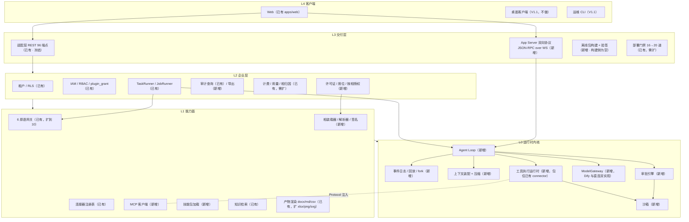
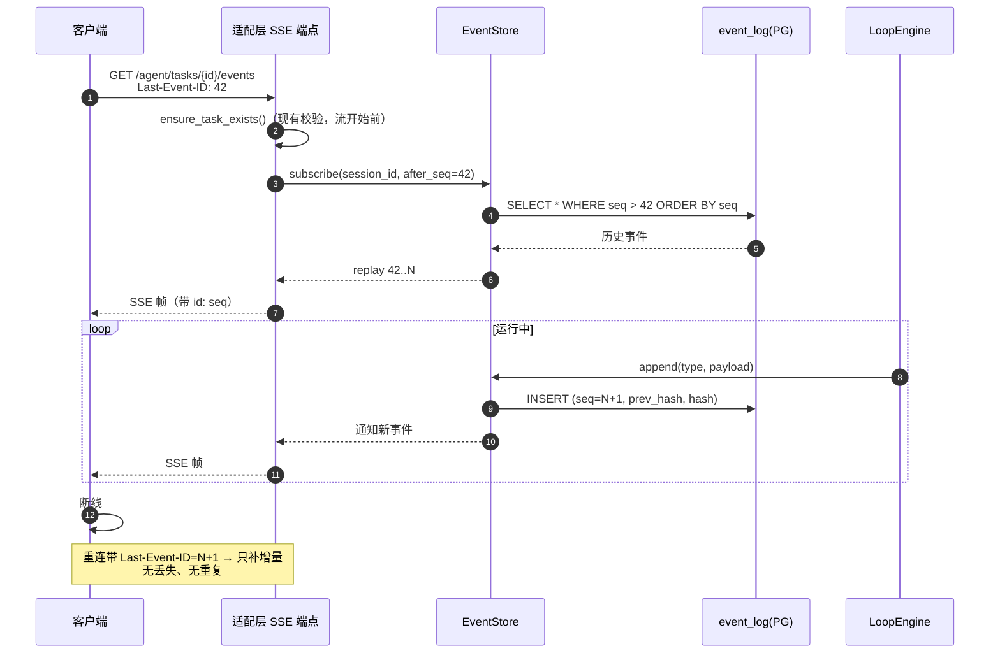
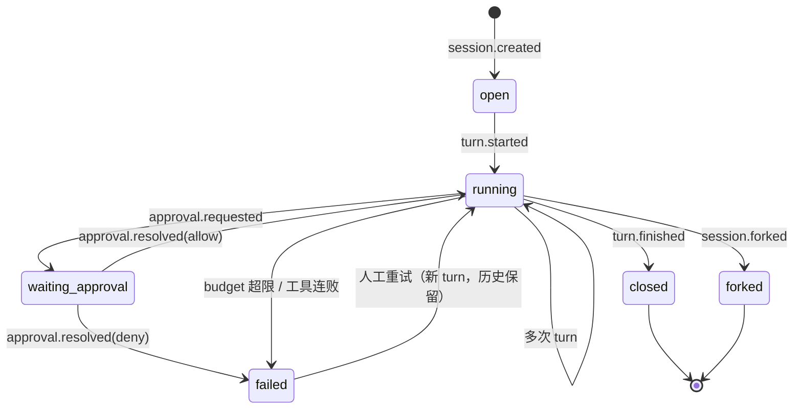
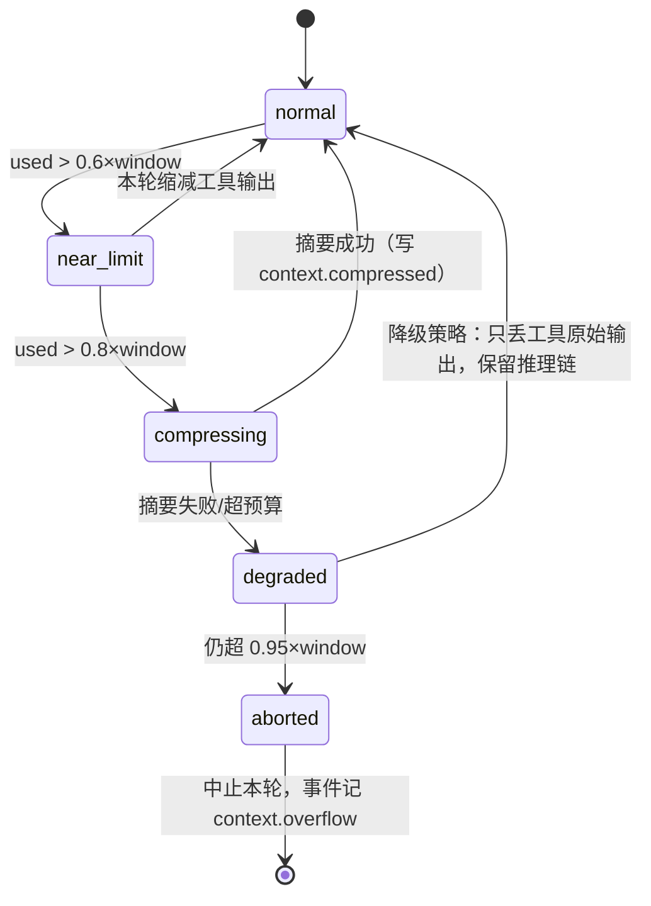
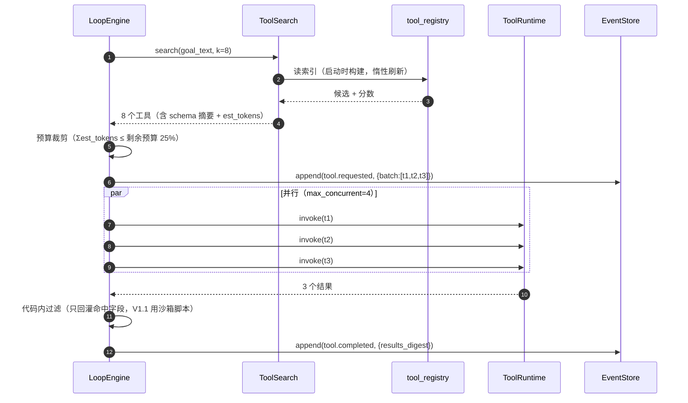
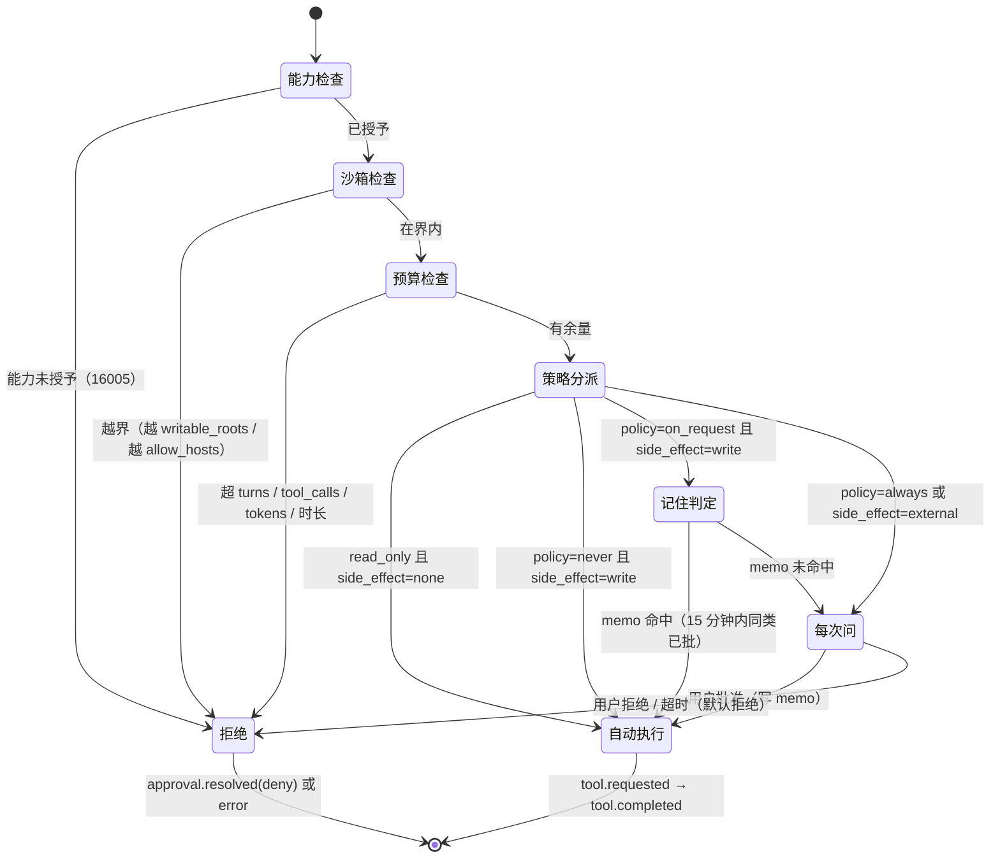
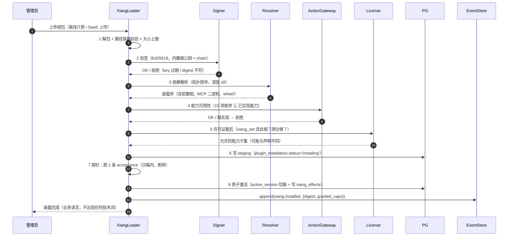

# 底座（Harness）架构设计 · 2026-11-04

> **文档定位**：麦子底座（Harness）的第一份完整设计，含内核裁决、能力面对标、相（capability bundle）元模型、四个关键机制、代码映射与任务分解。
> **口径**：`事实` = 仓库可查（带 `路径:行号`）；`估算` = 按「1 名熟悉代码的全职工程师 1 天，含单测与自测，不含需求评审/UI 设计」计；`假设` = 给验证方式。
> **竞品资料口径**：所有 dsh（DeepSeek Harness）与 Codex 的描述均为 **2026-11-03 公开资料整理，非一手实测**，引用时保留此声明，**不得作为契约使用**。
> 基线 SHA：`a4f6213`。

---

## 1. 结论先行

### 1.1 裁决：**C 混合**——自研内核与企业层（Python），协议与格式对齐 dsh / Codex，dsh 只做开发者侧工具

底座 = 一个**能力面完整的空壳**：装得上任何"相"，且装上去之后**跑得稳、管得住、查得到、卖得掉**。四件事里，"装得上"是 harness 的通用问题，"管得住/查得到/卖得掉"是麦子的商业问题。裁决就是围绕这条分界线做的。

**三条理由**

1. **dsh 缺的不是能力，是"企业层"，而这层我们没有替代预算。** dsh 是单用户开发者工具：没有 tenant、没有 IAM、没有审计导出、没有按相按席位的许可证。B 方案（嵌入）把这些当"以后再包一层"，实际是把内核锁在一个**不能改**的黑盒里，企业层只能外挂——而外挂层永远拿不到"内核当前在干什么"（loop 内部状态、压缩点、工具调用意图），审计就只能记到"任务开始/结束"这一层，达不到"谁在何时让 AI 做了什么"（商业逻辑第 5 条）。反过来，A 方案（纯自研）要补 loop/事件日志/沙箱/MCP/压缩，估算 165–185 人日；C 方案把"对齐"降级成**格式与协议的对齐**，同样的能力面 141 人日（区间 126–163，逐项核对见 §8.1.1），差额 24–44 全在"不用自己想相的 schema、不用自己想事件日志的字段、不用自己设计三档沙箱的正交拆分"，以及省掉的返工。差额不大，所以 C 不是因为"更便宜"才被选，而是因为它**同时**便宜且可验证——有一份可对照的参考实现，schema 写错能在对齐测试里被发现，而不是等客户现场。

2. **对齐的收益在格式，不在实现。** dsh 真正的贡献是把几件事变成了事实标准：append-only 事件日志 + 可 fork 的轨迹、声明式插件包、三档沙箱 × 审批策略的正交拆分、接工具（MCP）与接界面（会话协议）两套协议。这些东西的价值 90% 在 **schema 长什么样**，10% 在谁写的代码。抄 schema 是几十份 JSON 的事；抄内核是把一个 README 明示"将有破坏兼容性变更"的预览版塞进交付物。

3. **现有资产恰好是企业层最难的部分。** 96 端点（`deploy/validate_openapi.py --strict` EXIT 0）、40/41 表 RLS、`tenant_scope()`、`plugin_grant`、`TaskRunner` 单写路径、6 原语封闭护栏（`app/plugins/actions.py:28-36`）、16 道部署门禁——这些是任何 harness 里最贵、最难补的部分，而我们已经有。自研要补的只是 L0 的 loop 与 L1 的 MCP/技能，**不是从零**。

**三条代价（必须承认）**

1. **loop 的正确性要自己背。** 压缩策略、工具调用重试、多轮中止、token 预算——没有上游帮你修。这是 C 相对 B 唯一实质性的技术劣势，用 §5.2 的状态机和预算硬上限对冲。
2. **不能直接互装 dsh 生态的相。** 只能做到"格式可映射"：dsh 插件包 → 我们的装配单需要一个转换器，且对方改 schema 我们要跟。代价落在 `app/xiang/convert.py`（新增，估算 8 人日）与一条长期兼容测试。
3. **前 4 周演示不出"开放式任务"。** 4 周切片能演示"确定性的相跑通 + 全程可回放 + 篡改包被拒"，演示不了"AI 自己决定用哪个工具、走几步"。销售现场会被问"这跟 Claude Code 有什么不一样"——答案只能是"私有化 + 可审计 + 按相交付"，不是"更聪明"。这个窗口期约 8–10 周。

### 1.2 八维对比（裁决依据）

| 维度 | A 自研内核（Python 长在 adapter 上） | B 嵌入 dsh 作运行时（MIT） | **C 混合（推荐）** |
| --- | --- | --- | --- |
| 交付形态兼容 | SaaS / 私有化 / 气隙 全支持 | SaaS 与桌面可行；**气隙不可行**（安装期需 npm，桌面端带更新检查） | 全支持（单 Python 栈，无 Node 运行时） |
| 气隙可行 | 可行（wheel 预打包，已有 9 容器轻量栈） | **不可行**：与商业逻辑第 2 条直接冲突 | 可行（对齐只发生在 schema 层，不引入运行时依赖） |
| 多租户与权限 | 原生（`tenant_scope()` + RLS 已有） | **无**，需外挂一层；且 dsh 插件继承宿主权限，与最小权限原则相悖 | 原生；相的能力在装载期被裁剪到租户/席位/许可证的交集 |
| 许可合规 | 全自有，白名单自控 | MIT 本身合规，但 dsh 的传递依赖需逐个过 MIT/Apache/BSD 白名单，**未核实**（风险高） | 自有代码 + 仅借鉴 schema 字段（格式无版权），白名单可控 |
| 工作量（人日，估算） | 165–185（= C + 设计与返工 24–44） | 60–80（起步快） | **141（区间 126–163）** |
| 上游破坏风险 | 无 | **高**（README 明示破坏兼容），且破坏点在交付物里 | **低**：冻结对齐版本号，只跟 schema 不跟实现 |
| 相的表达力 | 取决于自己从零设计，容易设计窄（现有 6 原语就是窄的例子） | 强（原生插件 + 创造模式） | 中高：自研 schema 借 dsh 字段，`kind` 字段覆盖 skill/agent/mcp/bundle |
| 长期维护成本 | 中（1 人常驻） | 高（Node+Python 双栈 + 跟上游 + 安全加固） | 中低（对齐版本一年一更） |

> **一句话**：B 用"现在快"换"以后不能改"，A 用"以后自由"换"现在很慢"，C 用"一年一次的兼容维护"换"现在能交付且以后能改"。
>
> **工作量口径对账（三列必须能对上 §8.1）**：C 的 141 是逐项核对过的点估（见 §8.1.1，其中四项直接沿用 `docs/gap-matrix-2026-11-03.md` §3.1 的 B3/B4/B5 口径）；A = C + 设计与返工 24–44（自研相 schema、自研事件日志字段、自己设计三档沙箱的正交拆分，且无参考实现可对照），取 165–185；B 的 60–80 只是"能跑起来"的成本，**不含**把多租户/审计导出/气隙补回来的成本——那部分不可估，因为要做的是改造一个不受我们控制的内核。所以这张表里 B 的数字**不可与 A/C 直接比较**，它是"半成品价"。

---

## 2. 对标矩阵（12 项）

**目标列口径**：`V1.0` = 4 周切片之后、进入商业交付前必须有；`V1.1` = 有第一个付费客户之后再补；`不做` = 明确不做并写进对外口径。

| # | 能力 | dsh（公开资料，非一手实测） | Codex（公开资料，非一手实测） | Moy 现状（实测，SHA `a4f6213`） | 目标 |
| --- | --- | --- | --- | --- | --- |
| 1 | agent loop | 内核即 loop，模式可切换（标准/代码/极简/创造） | 「一个 loop + 一个 App Server」 | **无开放式 loop**；只有 `PluginEngine` 的声明式 8 步确定性推进（`app/plugins/engine.py:155`） | **V1.0**：新增 `LoopEngine`，与 `PluginEngine` 并列 |
| 2 | 工具系统 | 工具注册表本身是插件 | 工具 schema 按需加载 | **有**：`ToolConnector` + `ConnectorRegistry` + `registry/tool_registry.yaml`，5 个连接器全是 demo 桩 | V1.0：注册表加 `load_policy`/`tags`/`est_tokens`；连接器真实化按客户走 |
| 3 | MCP | 原生支持 | 原生支持 | **无**（全仓 `mcp` 0 命中，实测） | **V1.0**：客户端 + 管理员白名单 + 传输仅 stdio/localhost |
| 4 | 技能层 | 插件即技能 | `AGENTS.md` 每会话加载 | **无**（只有 6 份插件 manifest，`app/plugins/manifests/`） | **V1.0**：`skills[]`（instruction/template/script 三类，script 只能在沙箱内跑） |
| 5 | 上下文压缩 | 超窗口 80% 自动摘要，不跨会话 | 自动压缩 | **无** | **V1.0**：阈值 + 三段保留 + 压缩事件化 |
| 6 | tool search | 未公开 | 有（不把全量 schema 塞 prompt） | **无**（`tool_registry.yaml` 全量注入式设计） | V1.0：BM25 索引 + top-k 注入 |
| 7 | 子代理 | 有（子 agent 调度入事件日志） | 有（各自独立上下文，`max_concurrent`） | **无** | **V1.1**（V1.0 只预留 `subagent.spawn` 事件类型，不实现） |
| 8 | 沙箱三档 | 有沙箱 | read-only / workspace-write / danger-full-access，OS 层实现 | **无**（`sandbox`/`subprocess` 命中 6 处，均非隔离执行） | **V1.0**：read_only / workspace_write 两档，按平台分别实现（Linux bubblewrap；Windows WSL2+bubblewrap 或 AppContainer；做不到就只给 read_only，见 §5.4.1）；第三档 **不做** |
| 9 | 审批与审查者 | 有确认点 | `approval_policy` × `approvals_reviewer`（user / auto_review） | **半有**：能力授权四层语义散在 `plugin_grant_service.py` 与前端抽屉；无「审查者代批」 | **V1.0**：二维模型 + 四层呈现；`auto_review` **V1.1** |
| 10 | 事件日志与回放 | append-only，支持轨迹/继续/分叉/搜索/回放 | durable session | **无持久化**：`agent_service.py:173` `self._steps` 进程内 dict，`:688` `stream_events` 直接回放内存 | **V1.0**：append-only + hash 链 + 回放 + fork |
| 11 | 会话持久化 | 有（本地文件） | 有 | **有**：会话/消息已入库（`db/repositories/conversation/`），但**不含执行轨迹** | V1.0：会话与轨迹分离存储，`session_id` 打通 |
| 12 | 模型适配 | 数十家，模型无关 | 多家 | **半有**：4 档 profile 路由 + 7 个 Dify 应用 Key（`app/core/config.py:135-160`），**实际由 Dify 代持模型**，不满足 BYOK | **V1.0**：新增直连适配器（OpenAI 兼容协议），BYOK；Dify 保留为可选后端 |

**两条从矩阵里读出来的判断**

- **第 12 项是隐藏的硬缺口。** 商业逻辑第 3 条要求 BYOK，但现有链路是「adapter → Dify 应用 → 模型」，Key 在平台侧。要满足 BYOK，模型调用必须有一条**不经过 Dify** 的直连路径。这与"适配层唯一原则"不冲突——原则约束的是**上层业务**不得直连 Dify，不是"必须经过 Dify"。设计上：`ModelGateway` 提出为 L0 的接口，两个实现（`DifyModelBackend` / `DirectModelBackend`），由租户配置选择；上层只见 `ModelGateway`。
- **第 10 项是 4 周切片的核心。** 事件日志是唯一一个"不做则后面全部要返工"的机制：压缩要落事件、审批要落事件、fork 要落事件、审计导出要读事件、相归因计费要读事件。它必须第一个做。

---

## 3. 底座分层图



> 图注：实线 = 编译期依赖；虚线 = 运行期注入点（L0 只依赖 Protocol，实现由 L3 注入，与现有 `ActionGateway` 的注入体例一致，见 `apps/adapter/app/plugins/actions.py:3-12`）。标注「新增」的盒子在 `a4f6213` 上均为 **0 行代码**，是本次设计要长出来的部分；标注「已有」的盒子不推倒、只加接缝。

**分层两条铁律（不得违反）**

1. **依赖方向恒为 L4 → L3 → L2 → L1 → L0**，反向只允许经事件总线（L0 发事件，L2 订阅计费/审计），不得直接调用。现有 `plugins/**` 不许 import `app.services.*`（`app/plugins/actions.py:3-12` 已把这条写成代码约束），新内核层沿用同一体例：`app/kernel/**` 不得 import `app.api.*` 与 `app.business.*`。
2. **适配层唯一原则不变**：任何新增层都不得让上层业务直连 Dify 原生 API。MCP 也遵守——MCP server 是**工具提供方**，不是底座；它的调用必须经 `ToolRuntime` 进事件日志。

---

## 4. 「相」的元模型

### 4.1 设计要点

相 = **装配单**，不是代码。按委托方口径：「可以是一个 skill，也可以是一组 skills；可以是一个 agent，也可以是一组 agent；可以是一个 MCP；可以是任何东西」。这句定义直接落成 schema 的 `kind` 字段——`kind` 决定装载器如何解释其余字段，而不是决定"相是什么"。

四条与商业逻辑绑定的硬约束（每条都在 schema 里有对应字段，不是靠评审自觉）：

| 商业约束 | 在 schema 里的落点 |
| --- | --- |
| 气隙不联网 | `permissions.network.egress` 默认 `none`；`dependencies.runtime.packages` 必须指向**随包携带**的 wheel，不接受索引 URL |
| 最小权限 | `capabilities[]` 必填且封闭枚举；`permissions.sandbox_mode` 只能是 `read_only` / `workspace_write` |
| 按席位 + 按相授权 | `license_units`（该相消耗几席位）+ `xiang_id` 进许可证的 `xiang_set` |
| 数据主权 | `knowledge[].binding_ref` 只允许指向租户内知识库；`provenance.source` 必须可离线核验 |

### 4.2 JSON Schema 草案（字段级）

```json
{
  "$schema": "https://json-schema.org/draft/2020-12/schema",
  "$id": "https://moy.internal/schema/xiang-2.0.json",
  "title": "相装配单",
  "type": "object",
  "additionalProperties": false,
  "required": [
    "xiang_id", "xiang_version", "schema_version", "kind", "name", "summary",
    "capabilities", "permissions", "artifacts", "acceptance", "model",
    "system_prompt", "dependencies", "provenance", "signature"
  ],
  "properties": {
    "xiang_id":       { "type": "string", "pattern": "^xng_[a-z][a-z0-9_]{2,40}$" },
    "xiang_version":  { "type": "string", "pattern": "^\\d+\\.\\d+\\.\\d+$" },
    "schema_version": { "const": "2.0.0" },
    "kind": {
      "enum": ["skill", "skill_set", "agent", "agent_set", "mcp", "bundle"],
      "description": "skill=单个技能；skill_set=一组技能；agent=单个代理；agent_set=一组代理；mcp=连接即用；bundle=混合"
    },
    "name":        { "type": "string", "minLength": 2, "maxLength": 24 },
    "summary":     { "type": "string", "minLength": 4, "maxLength": 60 },
    "description": { "type": "string", "minLength": 120, "maxLength": 800 },
    "category":    { "enum": ["sales", "marketing", "design", "content", "hr", "data", "dev", "collab", "other"] },
    "ui": {
      "type": "object", "additionalProperties": false,
      "required": ["layout", "nav_label", "icon_key"],
      "properties": {
        "layout":    { "enum": ["task_workspace", "chat_workspace", "board"] },
        "nav_label": { "type": "string", "minLength": 2, "maxLength": 16 },
        "icon_key":  { "type": "string", "maxLength": 32 },
        "order":     { "type": "integer", "minimum": 1, "maximum": 99 }
      }
    },
    "license_units": { "type": "integer", "minimum": 1, "maximum": 10000,
      "description": "占几席位；许可证 xiang_set 里按此计" },

    "capabilities": {
      "type": "array", "minItems": 1, "maxItems": 12,
      "items": {
        "type": "object", "additionalProperties": false,
        "required": ["key", "required", "reason"],
        "properties": {
          "key":      { "type": "string", "description": "⊆ 15 项封闭枚举（见 §4.3）" },
          "required": { "type": "boolean" },
          "reason":   { "type": "string", "minLength": 8, "maxLength": 40,
                        "description": "用户可见：为什么需要这项" }
        }
      }
    },

    "tools": {
      "type": "array", "maxItems": 24,
      "items": {
        "type": "object", "additionalProperties": false,
        "required": ["source", "ref", "operations"],
        "properties": {
          "source":     { "enum": ["connector", "mcp", "builtin"] },
          "ref":        { "type": "string", "maxLength": 64 },
          "operations": { "type": "array", "minItems": 1, "maxItems": 40,
                          "items": { "type": "string" } },
          "approval":   { "enum": ["inherit", "always", "never"], "default": "inherit" },
          "est_tokens": { "type": "integer", "minimum": 0,
                          "description": "tool search 打分用" }
        }
      }
    },

    "mcp_servers": {
      "type": "array", "maxItems": 8,
      "items": {
        "type": "object", "additionalProperties": false,
        "required": ["server_id", "transport", "launch_ref", "pinned_digest"],
        "properties": {
          "server_id":     { "type": "string", "pattern": "^mcps_[a-z0-9_]{2,40}$" },
          "transport":     { "enum": ["stdio", "http_loopback"] },
          "launch_ref":    { "type": "string", "description": "指向随包二进制的键，非 URL" },
          "pinned_digest": { "type": "string", "pattern": "^sha256:[a-f0-9]{64}$" },
          "tools_allow":   { "type": "array", "items": { "type": "string" } },
          "network":       { "enum": ["none", "allowlist"], "default": "none" },
          "allow_hosts":   { "type": "array", "items": { "type": "string" }, "maxItems": 16 }
        }
      }
    },

    "skills": {
      "type": "array", "maxItems": 40,
      "items": {
        "type": "object", "additionalProperties": false,
        "required": ["skill_id", "version", "kind", "digest"],
        "properties": {
          "skill_id": { "type": "string", "pattern": "^skl_[a-z0-9_]{2,40}$" },
          "version":  { "type": "string", "pattern": "^\\d+\\.\\d+\\.\\d+$" },
          "kind":     { "enum": ["instruction", "template", "script"] },
          "entry":    { "type": "string", "maxLength": 128 },
          "digest":   { "type": "string", "pattern": "^sha256:[a-f0-9]{64}$" },
          "requires_sandbox": { "type": "boolean", "default": false }
        }
      }
    },

    "knowledge": {
      "type": "array", "maxItems": 8,
      "items": {
        "type": "object", "additionalProperties": false,
        "required": ["binding_ref", "mode"],
        "properties": {
          "binding_ref": { "type": "string", "description": "租户内知识库引用键，非 URL" },
          "mode":        { "enum": ["read", "read_write"] },
          "scope":       { "enum": ["own", "department", "tenant"], "default": "own" }
        }
      }
    },

    "permissions": {
      "type": "object", "additionalProperties": false,
      "required": ["sandbox_mode", "approval_policy"],
      "properties": {
        "sandbox_mode": {
          "enum": ["read_only", "workspace_write"],
          "description": "danger-full-access 不提供（商业逻辑第 2 条）"
        },
        "approval_policy": { "enum": ["never", "on_request", "always"] },
        "approvals_reviewer": { "enum": ["user"], "default": "user",
          "description": "auto_review 为 V1.1，schema 预留但 V1.0 装载器拒绝" },
        "writable_roots": { "type": "array", "items": { "type": "string" }, "maxItems": 8,
          "description": "仅 workspace_write 下有效；必须是租户工作区内的相对路径" },
        "network": {
          "type": "object", "additionalProperties": false,
          "required": ["egress"],
          "properties": {
            "egress":      { "enum": ["none", "allowlist"], "default": "none" },
            "allow_hosts": { "type": "array", "items": { "type": "string" }, "maxItems": 16 }
          }
        },
        "budget": {
          "type": "object", "additionalProperties": false,
          "properties": {
            "max_turns":            { "type": "integer", "minimum": 1, "maximum": 60 },
            "max_tool_calls":       { "type": "integer", "minimum": 1, "maximum": 500 },
            "max_tokens_per_turn":  { "type": "integer", "minimum": 1000 },
            "max_runtime_seconds":  { "type": "integer", "minimum": 30, "maximum": 3600 }
          }
        }
      }
    },

    "artifacts": {
      "type": "array", "minItems": 1, "maxItems": 16,
      "items": {
        "type": "object", "additionalProperties": false,
        "required": ["key", "label", "type"],
        "properties": {
          "key":        { "type": "string", "maxLength": 64 },
          "label":      { "type": "string", "maxLength": 32 },
          "type":       { "enum": ["text", "link", "file", "table", "image"] },
          "format":     { "enum": ["docx", "xlsx", "pptx", "md", "csv", "pdf", "png", "svg"] },
          "schema_ref": { "type": "string", "description": "结构化产物的列/字段约束键" },
          "max_bytes":  { "type": "integer", "minimum": 1024 }
        }
      }
    },

    "acceptance": {
      "type": "array", "minItems": 1, "maxItems": 8,
      "description": "装载期探针：装完必须至少跑通 1 条，全败则装载失败",
      "items": {
        "type": "object", "additionalProperties": false,
        "required": ["case_id", "input", "expect"],
        "properties": {
          "case_id": { "type": "string", "maxLength": 32 },
          "input":   { "type": "object" },
          "expect": {
            "type": "object", "additionalProperties": false,
            "required": ["artifact_keys"],
            "properties": {
              "artifact_keys": { "type": "array", "items": { "type": "string" } },
              "predicates":    { "type": "array", "items": { "type": "string" },
                                 "description": "如 artifact.xlsx.sheet_count==3" },
              "max_runtime_seconds": { "type": "integer" }
            }
          },
          "timeout_seconds": { "type": "integer", "minimum": 10, "maximum": 300 }
        }
      }
    },

    "model": {
      "type": "object", "additionalProperties": false,
      "required": ["tier"],
      "properties": {
        "tier":              { "enum": ["fast", "standard", "reasoning", "long_context"] },
        "min_context_window":{ "type": "integer", "minimum": 8192 },
        "requires":          { "type": "array", "items": { "enum": ["tool_calling", "vision", "json_mode"] } },
        "temperature":       { "type": "number", "minimum": 0, "maximum": 2 },
        "fallback_tier":     { "enum": ["fast", "standard", "reasoning", "long_context"] },
        "byok_required":     { "type": "boolean", "default": true }
      }
    },

    "system_prompt": {
      "type": "object", "additionalProperties": false,
      "required": ["ref", "digest"],
      "properties": {
        "ref":       { "type": "string", "maxLength": 128, "description": "包内相对路径" },
        "digest":    { "type": "string", "pattern": "^sha256:[a-f0-9]{64}$" },
        "max_chars": { "type": "integer", "maximum": 8000 },
        "locale":    { "enum": ["zh-CN", "en-US"], "default": "zh-CN" }
      }
    },

    "dependencies": {
      "type": "object", "additionalProperties": false,
      "required": ["platform"],
      "properties": {
        "platform": { "type": "object", "additionalProperties": false,
                      "required": ["min_version"],
                      "properties": { "min_version": { "type": "string", "pattern": "^\\d+\\.\\d+\\.\\d+$" } } },
        "xiang":    { "type": "array", "maxItems": 16,
                      "items": { "type": "object", "additionalProperties": false,
                                 "required": ["xiang_id", "range"],
                                 "properties": { "xiang_id": { "type": "string" },
                                                 "range": { "type": "string" } } } },
        "runtime":  { "type": "object", "additionalProperties": false,
                      "properties": {
                        "python":   { "type": "string", "description": "如 >=3.11,<3.13" },
                        "packages": { "type": "array", "maxItems": 64,
                                      "items": { "type": "object", "additionalProperties": false,
                                                 "required": ["name", "version", "wheel_digest"],
                                                 "properties": { "name": { "type": "string" },
                                                                 "version": { "type": "string" },
                                                                 "wheel_digest": { "type": "string" } } } }
                      } }
      }
    },

    "lock": {
      "type": "object", "additionalProperties": false,
      "required": ["resolved", "digest"],
      "description": "版本锁：装载时按此解析，不接受浮动版本",
      "properties": {
        "resolved": { "type": "array", "items": { "type": "object" } },
        "digest":   { "type": "string", "pattern": "^sha256:[a-f0-9]{64}$" },
        "locked_at":{ "type": "string", "format": "date-time" }
      }
    },

    "provenance": {
      "type": "object", "additionalProperties": false,
      "required": ["vendor", "source", "built_at", "license_ok"],
      "properties": {
        "vendor":     { "type": "string", "maxLength": 64 },
        "source":     { "enum": ["first_party", "partner", "community", "vendor_signed"] },
        "built_at":   { "type": "string", "format": "date-time" },
        "sbom_ref":   { "type": "string" },
        "license_ok": { "type": "boolean", "description": "装载器复算，声明与此不符即拒绝" },
        "changelog":  { "type": "string", "maxLength": 300 }
      }
    },

    "signature": {
      "type": "object", "additionalProperties": false,
      "required": ["algorithm", "key_id", "digest", "signed_at"],
      "properties": {
        "algorithm": { "const": "ed25519" },
        "key_id":    { "type": "string", "pattern": "^moyk_[a-z0-9]{4,32}$" },
        "digest":    { "type": "string", "pattern": "^sha256:[a-f0-9]{64}$",
                       "description": "对除 signature 外全部字段的规范化 JSON 取 SHA-256" },
        "signed_at": { "type": "string", "format": "date-time" },
        "chain":     { "type": "array", "maxItems": 4,
                       "items": { "type": "object", "additionalProperties": false,
                                  "required": ["key_id", "sig"],
                                  "properties": { "key_id": { "type": "string" }, "sig": { "type": "string" } } } },
        "not_after": { "type": "string", "format": "date-time",
                       "description": "气隙无 CRL：用有效期代替撤销" }
      }
    }
  }
}
```

### 4.3 能力枚举扩张（6 → 15）

现有 `CAPABILITY_KEYS` 是 6 项封闭枚举（`app/plugins/actions.py:57-64`）。要装配"销售相"，缺 CRM 读写与外发；要装配"美工相"，缺图像生成与设计文件读写。**保留封闭枚举原则**（新增即能力扩张，须改平台），扩到 15 项：

| 域 | 能力键 | 用户可见名（进授权抽屉） |
| --- | --- | --- |
| personal | `personal.knowledge.read` / `personal.file.read` / `personal.tool.use` | 已有 3 项 |
| org | `org.directory.read` / `org.repo.write` | 已有 2 项 |
| org | `org.crm.read` / `org.crm.write` / `org.contract.read` / `org.finance.read` | 新增 4 项 |
| external | `org.external.publish` / `external.mail.send` / `external.im.send` | 已有 1 + 新增 2 |
| design | `design.asset.read` / `design.asset.write` / `image.generate` | 新增 3 项 |

**门禁要求**：每个新能力键必须在 `ActionGateway` 有对应实现，否则 `deploy/validate_plugins.py` 的 G-30 双向校验（"要了必须用 / 用了必须被授"）报错。这是防止"能力键只是文案"的机械保证。

### 4.4 示例一：销售相

```json
{
  "xiang_id": "xng_sales_rep",
  "xiang_version": "1.0.0",
  "schema_version": "2.0.0",
  "kind": "bundle",
  "name": "销售助手",
  "summary": "从客户资料到报价方案，一次交付",
  "description": "面向一线销售的成套能力：读取客户与商机记录，生成报价单与方案文档，起草跟进邮件并在人工确认后外发。所有对外动作默认需要确认，客户数据不出本组织。",
  "category": "sales",
  "ui": { "layout": "task_workspace", "nav_label": "销售", "icon_key": "icon_sales", "order": 10 },
  "license_units": 1,

  "capabilities": [
    { "key": "org.crm.read", "required": true, "reason": "读取客户与商机记录，用于生成方案" },
    { "key": "org.crm.write", "required": false, "reason": "把跟进记录写回客户档案" },
    { "key": "personal.knowledge.read", "required": true, "reason": "检索历史方案与产品资料" },
    { "key": "personal.file.read", "required": true, "reason": "读取你上传的客户资料" },
    { "key": "external.mail.send", "required": true, "reason": "在确认后把邮件发给客户" }
  ],

  "tools": [
    { "source": "mcp", "ref": "mcps_crm", "operations": ["contact.get", "opportunity.list", "note.append"], "est_tokens": 720 },
    { "source": "connector", "ref": "email", "operations": ["send_message"], "approval": "always", "est_tokens": 260 },
    { "source": "builtin", "ref": "render", "operations": ["xlsx", "docx"], "est_tokens": 90 }
  ],

  "mcp_servers": [
    {
      "server_id": "mcps_crm",
      "transport": "stdio",
      "launch_ref": "bin/crm-bridge",
      "pinned_digest": "sha256:6f1c0e5a9b2d47c8ae31f0d5b7c9e2a48d6f3b1c0e9a7d5f2b8c4e6a1d3f5b7c",
      "tools_allow": ["contact.get", "opportunity.list", "note.append"],
      "network": "allowlist",
      "allow_hosts": ["crm.intranet.local"]
    }
  ],

  "skills": [
    { "skill_id": "skl_customer_profile", "version": "1.2.0", "kind": "instruction",
      "entry": "skills/customer_profile.md", "digest": "sha256:1a2b3c4d5e6f708192a3b4c5d6e7f8091a2b3c4d5e6f708192a3b4c5d6e7f809" },
    { "skill_id": "skl_quote_template", "version": "2.0.1", "kind": "template",
      "entry": "skills/quote.xlsx", "digest": "sha256:2b3c4d5e6f708192a3b4c5d6e7f8091a2b3c4d5e6f708192a3b4c5d6e7f8091a" },
    { "skill_id": "skl_followup_mail", "version": "1.0.3", "kind": "instruction",
      "entry": "skills/followup.md", "digest": "sha256:3c4d5e6f708192a3b4c5d6e7f8091a2b3c4d5e6f708192a3b4c5d6e7f8091a2b" }
  ],

  "knowledge": [
    { "binding_ref": "kb_product_catalog", "mode": "read", "scope": "tenant" },
    { "binding_ref": "kb_past_proposals", "mode": "read", "scope": "department" }
  ],

  "permissions": {
    "sandbox_mode": "workspace_write",
    "approval_policy": "on_request",
    "approvals_reviewer": "user",
    "writable_roots": ["work/sales"],
    "network": { "egress": "allowlist", "allow_hosts": ["crm.intranet.local", "smtp.intranet.local"] },
    "budget": { "max_turns": 24, "max_tool_calls": 60, "max_tokens_per_turn": 32000, "max_runtime_seconds": 600 }
  },

  "artifacts": [
    { "key": "quote", "label": "报价单", "type": "file", "format": "xlsx",
      "schema_ref": "schema_quote_v2", "max_bytes": 8388608 },
    { "key": "proposal", "label": "方案文档", "type": "file", "format": "docx", "max_bytes": 20971520 },
    { "key": "mail_draft", "label": "跟进邮件", "type": "text", "max_bytes": 16384 }
  ],

  "acceptance": [
    {
      "case_id": "acc_quote_basic",
      "input": { "customer": "示例科技", "contact": "张经理", "opportunity_id": "OPP-DEMO-001" },
      "expect": {
        "artifact_keys": ["quote", "mail_draft"],
        "predicates": ["quote.format==xlsx", "mail_draft.length>120"]
      },
      "timeout_seconds": 180
    }
  ],

  "model": {
    "tier": "standard",
    "min_context_window": 32768,
    "requires": ["tool_calling", "json_mode"],
    "temperature": 0.3,
    "fallback_tier": "fast",
    "byok_required": true
  },

  "system_prompt": {
    "ref": "prompts/sales.md",
    "digest": "sha256:4d5e6f708192a3b4c5d6e7f8091a2b3c4d5e6f708192a3b4c5d6e7f8091a2b3c",
    "max_chars": 4000,
    "locale": "zh-CN"
  },

  "dependencies": {
    "platform": { "min_version": "1.1.0" },
    "xiang": [],
    "runtime": { "python": ">=3.11,<3.13", "packages": [
      { "name": "openpyxl", "version": "3.1.2",
        "wheel_digest": "sha256:aa11bb22cc33dd44ee55ff66aa77bb88cc99dd00ee11ff22aa33bb44cc55dd66" }
    ] }
  },

  "lock": {
    "resolved": [
      { "type": "mcp", "id": "mcps_crm", "version": "1.4.2" },
      { "type": "skill", "id": "skl_quote_template", "version": "2.0.1" },
      { "type": "package", "name": "openpyxl", "version": "3.1.2" }
    ],
    "digest": "sha256:7a8b9c0d1e2f30415263748596a7b8c9d0e1f2a3b4c5d6e7f8091a2b3c4d5e6f",
    "locked_at": "2026-11-04T09:00:00+08:00"
  },

  "provenance": {
    "vendor": "桐鸣科技",
    "source": "first_party",
    "built_at": "2026-11-04T09:12:00+08:00",
    "sbom_ref": "sbom/xng_sales_rep-1.0.0.spdx.json",
    "license_ok": true,
    "changelog": "首版：报价单与方案生成、跟进邮件起草"
  },

  "signature": {
    "algorithm": "ed25519",
    "key_id": "moyk_a1b2c3d4e5f6",
    "digest": "sha256:8b9c0d1e2f30415263748596a7b8c9d0e1f2a3b4c5d6e7f8091a2b3c4d5e6f70",
    "signed_at": "2026-11-04T09:13:00+08:00",
    "chain": [{ "key_id": "moyk_root_2026", "sig": "base64:MEUCIQ..." }],
    "not_after": "2028-11-04T00:00:00+08:00"
  }
}
```

**为什么这个例子能证明"表达力够"**：它同时用到了 MCP（CRM）、连接器（邮件）、技能（3 个，三种 kind）、知识绑定（2 个作用域）、外发审批（`approval: always`）、xlsx 产物、BYOK 模型偏好、验收样例。而现有 manifest schema（`app/plugins/schema.py:533`）一个都表达不了——它的 `steps` 最多 8 步、`vendor` 只能是 `official`、`artifacts` 只允许 `docx/md/csv`、且 `FORBIDDEN_KEYS` 明确禁止 `endpoint`/`module`/`deps`（`:109-140`）。

### 4.5 示例二：美工相

```json
{
  "xiang_id": "xng_design_studio",
  "xiang_version": "1.0.0",
  "schema_version": "2.0.0",
  "kind": "skill_set",
  "name": "设计助手",
  "summary": "从需求到可用视觉稿，素材留在本机",
  "description": "面向市场与运营的视觉产出能力：读取品牌素材与历史设计稿，按需求生成海报与配图，导出可直接使用的图片与画板文件。所有生成动作不需要逐次确认，涉及对外发布时才请求确认。",
  "category": "design",
  "ui": { "layout": "chat_workspace", "nav_label": "设计", "icon_key": "icon_design", "order": 20 },
  "license_units": 1,

  "capabilities": [
    { "key": "design.asset.read", "required": true, "reason": "读取品牌素材与历史设计稿" },
    { "key": "design.asset.write", "required": true, "reason": "把成品写回素材库" },
    { "key": "image.generate", "required": true, "reason": "按需求生成图片" },
    { "key": "personal.file.read", "required": true, "reason": "读取你上传的参考图" },
    { "key": "org.external.publish", "required": false, "reason": "把成品发布到对外渠道" }
  ],

  "tools": [
    { "source": "mcp", "ref": "mcps_imagegen", "operations": ["image.create", "image.upscale"], "est_tokens": 540 },
    { "source": "mcp", "ref": "mcps_assets", "operations": ["asset.list", "asset.get", "asset.put"], "est_tokens": 610 },
    { "source": "builtin", "ref": "render", "operations": ["png", "svg"], "est_tokens": 80 }
  ],

  "mcp_servers": [
    { "server_id": "mcps_imagegen", "transport": "stdio", "launch_ref": "bin/imagegen-local",
      "pinned_digest": "sha256:9c0d1e2f30415263748596a7b8c9d0e1f2a3b4c5d6e7f8091a2b3c4d5e6f7081",
      "tools_allow": ["image.create", "image.upscale"], "network": "none" },
    { "server_id": "mcps_assets", "transport": "stdio", "launch_ref": "bin/asset-bridge",
      "pinned_digest": "sha256:0d1e2f30415263748596a7b8c9d0e1f2a3b4c5d6e7f8091a2b3c4d5e6f708192",
      "tools_allow": ["asset.list", "asset.get", "asset.put"], "network": "allowlist",
      "allow_hosts": ["dam.intranet.local"] }
  ],

  "skills": [
    { "skill_id": "skl_brand_guide", "version": "3.1.0", "kind": "instruction",
      "entry": "skills/brand.md", "digest": "sha256:1e2f30415263748596a7b8c9d0e1f2a3b4c5d6e7f8091a2b3c4d5e6f708192a3" },
    { "skill_id": "skl_poster_layout", "version": "1.4.2", "kind": "template",
      "entry": "skills/poster.svg", "digest": "sha256:2f30415263748596a7b8c9d0e1f2a3b4c5d6e7f8091a2b3c4d5e6f70819203a4" },
    { "skill_id": "skl_crop_export", "version": "0.9.0", "kind": "script",
      "entry": "skills/crop_export.py",
      "digest": "sha256:30415263748596a7b8c9d0e1f2a3b4c5d6e7f8091a2b3c4d5e6f70819203a405",
      "requires_sandbox": true }
  ],

  "knowledge": [
    { "binding_ref": "kb_brand_assets", "mode": "read", "scope": "tenant" }
  ],

  "permissions": {
    "sandbox_mode": "read_only",
    "approval_policy": "on_request",
    "approvals_reviewer": "user",
    "writable_roots": [],
    "network": { "egress": "none", "allow_hosts": [] },
    "budget": { "max_turns": 16, "max_tool_calls": 40, "max_tokens_per_turn": 24000, "max_runtime_seconds": 480 }
  },

  "artifacts": [
    { "key": "poster", "label": "海报", "type": "image", "format": "png", "max_bytes": 16777216 },
    { "key": "vector", "label": "画板文件", "type": "file", "format": "svg", "max_bytes": 8388608 },
    { "key": "copywriting", "label": "文案", "type": "text", "max_bytes": 8192 }
  ],

  "acceptance": [
    {
      "case_id": "acc_poster_1080",
      "input": { "brief": "双十一促销海报，主色正红，1080x1440", "brand": "默认品牌" },
      "expect": {
        "artifact_keys": ["poster", "copywriting"],
        "predicates": ["poster.width==1080", "poster.height==1440", "poster.format==png"]
      },
      "timeout_seconds": 240
    }
  ],

  "model": {
    "tier": "standard",
    "min_context_window": 32768,
    "requires": ["tool_calling", "vision"],
    "temperature": 0.7,
    "fallback_tier": "standard",
    "byok_required": true
  },

  "system_prompt": {
    "ref": "prompts/design.md",
    "digest": "sha256:415263748596a7b8c9d0e1f2a3b4c5d6e7f8091a2b3c4d5e6f70819203a40516",
    "max_chars": 3600,
    "locale": "zh-CN"
  },

  "dependencies": {
    "platform": { "min_version": "1.1.0" },
    "xiang": [{ "xiang_id": "xng_brand_base", "range": ">=1.0.0 <2.0.0" }],
    "runtime": { "python": ">=3.11,<3.13", "packages": [
      { "name": "Pillow", "version": "10.3.0",
        "wheel_digest": "sha256:bb22cc33dd44ee55ff66aa77bb88cc99dd00ee11ff22aa33bb44cc55dd66ee77" }
    ] }
  },

  "lock": {
    "resolved": [
      { "type": "mcp", "id": "mcps_imagegen", "version": "2.1.0" },
      { "type": "xiang", "id": "xng_brand_base", "version": "1.2.0" },
      { "type": "package", "name": "Pillow", "version": "10.3.0" }
    ],
    "digest": "sha256:c9d0e1f2a3b4c5d6e7f8091a2b3c4d5e6f70819203a40516273849506a7b8c9d",
    "locked_at": "2026-11-04T09:20:00+08:00"
  },

  "provenance": {
    "vendor": "桐鸣科技", "source": "first_party", "built_at": "2026-11-04T09:25:00+08:00",
    "sbom_ref": "sbom/xng_design_studio-1.0.0.spdx.json", "license_ok": true,
    "changelog": "首版：海报生成、画板导出"
  },

  "signature": {
    "algorithm": "ed25519", "key_id": "moyk_a1b2c3d4e5f6",
    "digest": "sha256:d0e1f2a3b4c5d6e7f8091a2b3c4d5e6f70819203a40516273849506a7b8c9d0e",
    "signed_at": "2026-11-04T09:26:00+08:00",
    "chain": [{ "key_id": "moyk_root_2026", "sig": "base64:MEUCIQ..." }],
    "not_after": "2028-11-04T00:00:00+08:00"
  }
}
```

**两份例子合起来暴露的三个设计判断**

1. **`sandbox_mode` 是相的属性，不是全局设置。** 销售相要写工作区（`workspace_write`），美工相只读（`read_only`）。如果做成全局，要么销售相写不了文件，要么美工相拿到写权限。
2. **`network.egress` 必须默认 `none`，`allowlist` 由相显式申请、管理员批准。** 美工相 `none`（图像生成本地做），销售相要连内网 CRM。这一条是气隙可行性的落点。
3. **`requires_sandbox: true` 的 script 类技能是最危险的东西。** 美工相里的 `skl_crop_export` 是唯一一段可执行代码，它只能跑在 `read_only` 沙箱里且无网络。这直接决定了 §5.4 的沙箱设计不能省。

---

## 5. 四个关键机制

### 5.1 事件日志：append-only、可回放、可 fork

**表设计**（新增迁移 `deploy/migrations/0013_event_log.sql`；编号承接现有 `0002`–`0012` 的迁移线，`0005`–`0007` 已被 `phase3_artifact_content` / `plugin_artifact_content_type` / `usage_event_dimensions` 占用，见 `deploy/migrations/README.md` 的迁移清单）：

```sql
CREATE TABLE IF NOT EXISTS event_log (
  tenant_id   text        NOT NULL,
  session_id  text        NOT NULL,
  seq         bigint      NOT NULL,
  event_id    text        NOT NULL,
  type        text        NOT NULL,
  payload     jsonb       NOT NULL,
  prev_hash   text        NOT NULL,
  hash        text        NOT NULL,
  created_at  timestamptz NOT NULL DEFAULT now(),
  PRIMARY KEY (session_id, seq)
) PARTITION BY HASH (session_id);
```

三条硬约束：**无 UPDATE/DELETE 权限**（应用角色只授 INSERT + SELECT，与现有 `init-rls.sql` 的授权体例一致）、**RLS 按 `tenant_id`**、**`hash = sha256(prev_hash || event_id || type || payload_canonical)`** 形成链。hash 链不是安全机制（同库内可被 DBA 重写），而是**给客户的完整性证据**：导出审计时附带链头，客户可自行重算。

**迁移纪律**：迁移必须通过 `deploy/validate_migrations.py` 的**三条路径全绿**——A 空库（暴露语法崩）、B 已初始化库（暴露属主崩、守卫缺失）、C 回滚往返（暴露 down 脚本空转），且 C 路径要求 `rollback/` 下逐个配对 `.down.sql`（现有纪律自 `0006` 起，`deploy/migrations/README.md` 已写明）。只跑一条等于没验。适用于 `0013` / `0014`（T01）与 `0015`（T07）。

**事件类型**（V1.0 封闭 14 类）：`session.created` / `turn.started` / `context.assembled` / `context.compressed` / `model.request` / `model.delta` / `model.response` / `tool.requested` / `tool.completed` / `approval.requested` / `approval.resolved` / `artifact.created` / `session.forked` / `turn.finished`。`subagent.spawn` 预留给 V1.1，装载器拒绝在 V1.0 产生该事件。

**与现有 SSE 的关系——这是迁移的关键**：现在 `agent_service.py:688` 的 `stream_events` 直接读 `self._steps` 这个进程内 dict（`:173`），刷新即丢、多副本不可用、断线不续。迁移后 `self._steps` 整个删掉，`stream_events` 变成"从 `event_log` 读 `seq > Last-Event-ID` 的增量"：



**fork**：`fork(session_id, at_seq)` 不复制事件，只写一条 `session.forked {parent_session, at_seq}` 到**新** `session_id` 的 `seq=1`；回放时先递归读父会话 `1..at_seq`，再接本会话。优点：fork 是 O(1)，100 次分叉不产生 100 份历史；代价：回放要递归（用 `WITH RECURSIVE` 一次查完，深度上限 8）。

**会话状态机**：



### 5.2 上下文压缩

**三段保留策略**（不是"摘要旧历史"这么粗）：

| 段 | 内容 | 是否压缩 | 理由 |
| --- | --- | --- | --- |
| 固定头 | 系统提示 + 相的约束块（能力/产物规格/预算） | **永不压缩** | 压缩它会改变相的行为，等价于换了一个相 |
| 任务状态块 | `TaskStateBlock`：目标、已完成步骤、产物键、待确认项、未决问题 | **永不压缩**，由 loop 每轮显式重写 | 这是"任务关键状态"，不能依赖摘要质量 |
| 中段 | 历史工具原始输出、早期推理 | **压缩**为 `context.compressed` 事件 | 这些体积最大、价值衰减最快 |
| 尾段 | 最近 K=6 轮 | **保留原文** | 压缩会破坏指代（"上面那个表"）|

**触发**：`used_tokens > 0.8 × model.min_context_window`（阈值来自相的 `model` 段，不是全局常量——长上下文档和快档不该同一个阈值）。

**压缩后如何不丢关键状态**：不靠摘要，靠**显式状态块**。`TaskStateBlock` 是 loop 的必填产出，每轮结束写一条 `context.assembled` 事件带完整状态块。压缩只影响"模型看到什么"，不影响"系统知道什么"。回放时先重放所有 `context.compressed` 的摘要，再重放尾部原文，**结果确定性可复现**。



三级降级有明确顺序（先丢工具原始输出 → 再丢早期推理 → 最后中止），避免"一上来就摘要，摘要坏了整轮崩"。

### 5.3 工具搜索与并行调用

**注册表扩展**（`app/registry/tool_registry.yaml` 增三字段，不动既有字段）：

```yaml
tools:
  - tool_type: email
    load_policy: lazy          # eager | lazy；EAGER 只给 <8 个高频工具
    tags: [沟通, 外发, 邮件]
    est_tokens: 260
```

**tool search 流程**：BM25 索引建在 `(display_name, match_hints, tags, operations[].display_name)` 上，**不建在 description 上**（描述太长会稀释信号，与 `match_hints` 现有体例一致——`app/plugins/schema.py:97-100` 已定义 2–8 字提示词约束）。查询时 `top_k=8`，只把选中工具的 schema 注入 prompt；未选中的只给一行摘要（"还有一个邮件工具可用"），模型可以二次搜索。



**并行调用的安全边界**：只允许**读类操作**并行（`contact.get` / `asset.list` / `mail.list`）。写类与外发类**强制串行**，且各自走审批——这是"并行提速"和"不要同时发三封邮件"之间的取舍。判据放在注册表：每 operation 标 `side_effect: none|write|external`。

### 5.4 权限：`sandbox_mode` × `approval_policy` 映射到现有四层授权

**先把三个概念分开**（现有代码里它们混在一起）：

| 概念 | 回答的问题 | 现有落点 | 新落点 |
| --- | --- | --- | --- |
| 授权边界 | 这个用户**被允许**用哪些数据/写哪些地方 | `plugin_grant`（成员×插件×能力） | 保留，键换成 15 项能力枚举 |
| 物理边界 | 就算被允许，**技术上**最多能碰多大范围 | 无 | `sandbox_mode` |
| 询问边界 | 在允许+可及的范围内，**要不要问人** | 散在前端抽屉 | `approval_policy` × `approvals_reviewer` |

**有效权限 = 三者交集**（任何一维是 deny，动作就不发生）。这解决了现有实现的一个隐患：`plugin_grant` 授了 `org.repo.write`，但如果没有沙箱，实际能写的是**整个文件系统**——授权边界与物理边界不重合，等于授权是假的。

**二维矩阵 → 四层呈现**：

| `sandbox_mode` | `approval_policy` | 平台行为 | 用户界面呈现（四层） |
| --- | --- | --- | --- |
| `read_only` | `never` | 自动执行，只读 | **自动** |
| `read_only` | `on_request` | 读自动，写被沙箱直接拒绝 | **自动**（写操作根本不出现） |
| `workspace_write` | `never` | 自动执行，写限于 `writable_roots` | **自动** |
| `workspace_write` | `on_request` | 首次写问一次，记住 15 分钟 | **记住**（15 分钟内同类不再问） |
| 任一 | `always` | 每次必问，不可记住 | **每次问** |
| 任一 | 能力未授予 | 直接失败（`16005`） | **拒绝** |
| 任一 | 沙箱拒绝（越界） | 直接失败，记审计 | **拒绝**（提示"这个动作不允许"） |
| 任一 | 预算超限 | 中止，记 `turn.finished(budget_exceeded)` | **拒绝** |

**"记住"的实现**：不引入新表，复用 `plugin_grant` 的语义扩展——授权快照缓存 5 秒 TTL（`plugin_grant_service.py:36`）保持不变，新增进程内 `approval_memo`（键：`成员×相×operation`，TTL 15 分钟，有界 2048）。**不落库**：跨会话的"永久记住"等于偷偷扩大授权边界，必须走重新授权流程。

**动作级判定状态机**（每个工具调用、每次写文件、每次外发都走这一遍）：



两次关键取舍：**超时默认拒绝**（不默认放行）；**`side_effect=external` 永远走"每次问"**，`approval_policy=never` 也不能免（外发是不可撤回的动作，与内部写不同）。

#### 5.4.1 三平台边界怎么落地（`sandbox_mode` 的真假之分）

`sandbox_mode` 不是标签，是**必须由操作系统兑现的边界**。这里必须说清一件容易写错的事：

> **Windows Job Object 不是沙箱。** Job Object 只能做进程树回收、内存/CPU/句柄配额，**不提供文件系统命名空间隔离**——它能限制"用多少"，不能限制"能看哪些目录"。用它来实现 `workspace_write`，实际结果是进程对整个磁盘可读可写，等于把 `workspace_write` 静默降级成我们自己明确不提供的 `danger-full-access`。这类"看起来隔离了、其实没隔"的实现比不做更危险，因为它会让装载器的"最小权限"判定变成假护栏。

三平台分别兑现，**做不到就不装，不降级**：

| 平台 | `read_only` 实现 | `workspace_write` 实现 | 做不到时的处置 |
| --- | --- | --- | --- |
| Linux（主交付形态：容器/私有化） | bubblewrap：只读根 + tmpfs 工作区 + `--unshare-net` | bubblewrap：只读根 + 单个 `--bind` 可写根（= `writable_roots`）+ `--unshare-net` | — |
| Windows | WSL2 + bubblewrap（与 Linux 同一套策略，一致性最好）或 AppContainer + 受限令牌 | 同上；两者在本机都不可用时 **只提供 `read_only`** | 装载期拒绝 `workspace_write` 的相，业务语言提示："**当前环境不支持该功能包的写入能力，请联系管理员**"；事件记 `xiang.install_blocked{sandbox_unsupported}`，台账标 `degraded_env` |
| macOS | **不做**（不在 V1.0 交付范围；无 Seatbelt 实现计划） | **不做** | 同 Windows 的降级路径，一律只给 `read_only` |

三条纪律：

1. **平台能力探测在启动时做一次，写进 `sandbox_capabilities`（进程内 + 启动日志）**，而不是每次调用现探——否则同一台机器上会出现"这次能写、下次不能写"的漂移。
2. **降级只能往"更严"的方向**：`workspace_write` 不可用时退到 `read_only`；**永不**因为"用户想用"就放开边界。宽松方向的降级只能由管理员在租户策略里显式打开 `danger-full-access`——而我们在 schema 里根本不提供这个值（§4.2），所以这条路在 V1.0 物理上不存在。
3. **Windows 的这 6 人日里，至少 2 天是双路径真机验证**（WSL2 路径 + AppContainer 路径各一轮，含"越界写被拒"的负样本）。这一项不能只在 CI 的 Linux 容器里过一遍就算完——`validate_deploy.py` 与 `validate_lite_up.sh` 的历史教训是：只在一条路径上验过的隔离，等于没验。

**`auto_review`（审查者代批）V1.1 的理由**：它需要一个"审查 agent"，而审查 agent 本身也要模型、也要预算、也可能被绕过。V1.0 先不做，避免"用 AI 批 AI"在没有评估集的情况下上线。

---

## 6. 相的装载与卸载

### 6.1 装载顺序（8 步，全序固定）



**第 5 步是商业逻辑的落点**：许可证的 `xiang_set` 决定"这个客户能用哪几个相"，`seats` 决定"多少个席位"，相的 `license_units` 决定"装一次消耗几席位"。三者取交集后**可能小于相声明的能力集**——此时装载成功但能力被裁剪，界面必须如实显示"部分功能未开通"（不能静默降级）。

**第 7 步探针为什么必须断网**：验收样例跑在真实沙箱里，`egress=none`。这既是安全底线，也是"气隙可行"的证明——如果探针需要联网才能通过，这个相在气隙客户那里就是装不上的。

### 6.2 失败回滚

- **1–5 步失败**：什么都没写，直接返回业务语言错误（"这个功能包不适用于当前环境"），事件记 `xiang.install_failed{stage}` 供内部诊断。
- **6–7 步失败**：删除 staging 记录，`plugin_installation` 回到装载前版本（`active_version` 未切换，所以是原子的）。
- **8 步失败**（极少）：`xiang_effects` 里已写的条目按逆序回收，回收本身可重入。

### 6.3 卸载回收（可逆副作用）

dsh 的"装卸不重启、卸载自动回收"对应到我们这边，是 `xiang_effects` 表——**每一个装载期产生的副作用必须登记**，否则卸载必然留垃圾：

| 副作用类型 | 登记内容 | 回收动作 |
| --- | --- | --- |
| `grant` | `(tenant, xiang_id, member, capabilities)` | 撤销授权，保留审计痕迹 |
| `mcp_conn` | `(server_id, pid, socket)` | 停连接、回收端口 |
| `kb_binding` | `(xiang_id, binding_ref)` | 解绑，不动知识库本身 |
| `artifact_schema` | `(key, schema_ref)` | 保留（历史产物要能打开），标 `deprecated` |
| `nav_entry` | `(xiang_id, nav_label, order)` | 从导航移除 |
| `policy_override` | `(capability_key, allowed)` | 还原装载前的策略值 |

卸载顺序是登记的**逆序**，每步幂等（重复执行无副作用）。卸载后必须能通过一条门禁：**再装一遍，验收样例仍通过**——这是"可逆"的唯一可信判据。

### 6.4 签名与来源校验（气隙场景）

- **算法**：Ed25519。签的是"除 `signature` 外全部字段的规范化 JSON"（键排序、无空白、UTF-8）的 SHA-256 摘要。
- **信任根**：随交付介质分发 `deploy/keys/root_pub.pem`（内置，随版本升级），签名的 `key_id` 由根公钥直接签，`chain` 最多 4 层。
- **离线验签**：`moy-xiang-verify --root deploy/keys/root_pub.pem --pkg xng_sales_rep-1.0.0.moyx` 是纯本地命令，**不联网、不查 CRL**。
- **撤销怎么代替**：没有 CRL 就用**两件事代替**——`signature.not_after`（有效期，过期即拒装）+ 介质随包携带的 `revoked.txt`（已撤销 `key_id` 的哈希清单，由厂商在发新介质时更新）。这是**已知的降级**：气隙客户在两次介质之间无法感知撤销。写进对外口径，不藏。
- **来源分级**：`provenance.source` 四档 `first_party` / `partner` / `community` / `vendor_signed`。V1.0 **只允许 `first_party`**（与现有 `vendor: Literal["official"]` 同体例，`app/plugins/schema.py:571`）；其余三档在 schema 里预留，装载器按白名单拒绝。第三方生态是 V1.1 的事。

---

## 7. 与现有代码的映射

### 7.1 四项分类（文件级）

**复用（不改一行）**

| 文件 | 复用理由 |
| --- | --- |
| `apps/adapter/app/core/security.py` | `AuthContext` / `require_permission` / `resolve_tenant_id` 是权限基座，新内核只调用不修改 |
| `apps/adapter/app/db/repositories/*`（除 plugin） | RLS + `tenant_scope()` 已覆盖 40/41 表，新表沿用同一体例 |
| `apps/adapter/app/business/{billing,usage,audit,member,role,department}*` | 企业层各域已完整（计费/用量/审计/成员/角色/部门），相归因作为新维度接入 |
| `apps/adapter/app/plugins/{guards,sanitizer}.py` | 护栏与脱敏逻辑与"谁在执行"无关 |
| `apps/adapter/app/tools/base.py` + `ConnectorRegistry` | `ToolConnector` 抽象可直接被新 `ToolRuntime` 包一层 |
| `apps/adapter/app/registry/loader.py` | 注册表加载器加字段即可 |
| `deploy/`（16 道门禁、compose、k8s） | 门禁框架复用，只增检查项 |

**改造（改动集中在接缝）**

| 文件 | 改什么 | 为什么 |
| --- | --- | --- |
| `app/plugins/actions.py` | `ACTION_WHITELIST` 6→10（加 `mcp_call`/`skill_run`/`artifact_render`/`knowledge_bind`）；`CAPABILITY_KEYS` 6→15 | 表达力不足，见 §4.3、§7.2 |
| `app/plugins/schema.py` | 抽出 `_StrictModel` / `find_banned_terms` / `find_forbidden_keys` 到 `app/xiang/common.py`；`PluginManifest` 保留为"v1 声明式快路径" | 禁词与禁用键的机械兜底要复用，不能抄第二份（两份必然漂移） |
| `app/plugins/engine.py` | 不改语义；`run_step` 前后加事件钩子（`tool.requested`/`tool.completed`） | 事件日志是横切关注点，写在一处 |
| `app/business/task/runner.py` | 增加 `executor` 字段（`declarative` \| `loop`）；`advance_record` 推进一步后写事件 | 两条执行路径共用一个写路径，避免两套状态机 |
| `app/services/agent_service.py` | 删 `self._steps`（`:173`）；`stream_events`（`:688`）改为读 `EventStore` | 见 §5.1，这是"替换"的核心 |
| `app/api/v1/router.py` | 挂新路由（只增不改） | 96 端点冻结 |
| `app/core/config.py` | 新增 `model_backend` / `sandbox_backend` / `xiang_root` / `license_path` 等 | BYOK 与沙箱需要开关 |
| `deploy/validate_plugins.py` | G-30 双向校验扩到 15 能力 × 10 原语 | 防"能力键只是文案" |

**替换（删掉旧实现）**

| 旧 | 新 | 判据 |
| --- | --- | --- |
| `agent_service.py` 的进程内 `_steps` 字典 | `event_log` 表 + `EventStore` | 唯一一个"不换就永远做不了审计/续传/fork"的点 |
| 现有 SSE 帧（无 id、无 resume） | 带 `id: <seq>` 的 SSE（向后兼容：老客户端忽略 id） | 同上 |

> 除此之外**没有整体替换**。这是刻意的：现有 210 个 Python 文件、96 端点、单测基线 2559 passed（`docs/gap-matrix-2026-11-03.md` 实测，SHA `38d0cd4`）是资产，不是负债。

**新增（按层）**

| 层 | 新增文件（相对 `apps/adapter/app/`） | 职责 |
| --- | --- | --- |
| L0 | `kernel/loop.py` | Agent Loop 主循环（turn / 工具调用 / 预算 / 中止） |
| L0 | `kernel/events.py` | `EventStore`：append / read_after / fork / hash 链 |
| L0 | `kernel/context.py` | 上下文装配 + 三段保留 + 三级降级压缩 |
| L0 | `kernel/approval.py` | 二维权限判定 + 四层呈现 + memo |
| L0 | `kernel/sandbox.py` | 沙箱抽象 + `ReadOnlySandbox` / `WorkspaceSandbox` |
| L0 | `kernel/model_gateway.py` | `ModelGateway` Protocol + `DifyModelBackend` / `DirectModelBackend` |
| L0 | `kernel/tool_runtime.py` | 工具执行运行时（包住 connector / mcp / builtin，统一进事件） |
| L0 | `kernel/budget.py` | token / turn / tool_call / 时间四维预算 |
| L1 | `xiang/schema.py` | 相元模型（§4.2 的 pydantic 实现） |
| L1 | `xiang/loader.py` | 8 步装载 + staging + 探针 + 回滚 |
| L1 | `xiang/resolver.py` | 依赖拓扑 + lock 解析 |
| L1 | `xiang/signer.py` | Ed25519 验签 + 离线信任根 + revoked 清单 |
| L1 | `xiang/effects.py` | `xiang_effects` 登记与逆序回收 |
| L1 | `xiang/convert.py` | dsh 插件包 → 装配单转换器（对齐用） |
| L1 | `mcp/client.py` | MCP 客户端（stdio / http_loopback） |
| L1 | `mcp/registry.py` | MCP server 白名单 + 工具命名空间 `mcp.<server>.<tool>` |
| L1 | `skills/loader.py` | 三类技能加载（instruction / template / script） |
| L1 | `tools/search.py` | BM25 工具索引 + top-k |
| L2 | `business/license_service.py` | 许可证解析：`xiang_set` / `seats` / 有效期 |
| L2 | `business/audit_export.py` | 审计导出（CSV / JSON Lines + 导出留痕 + hash 链头） |
| L2 | `db/repositories/event_log.py` | 事件仓储（写 + 读增量 + 递归 fork 读） |
| L3 | `api/v1/xiang.py` | 相的装载/卸载/列表/校验（新端点） |
| L3 | `api/v1/appserver.py` | 双向 JSON-RPC over WebSocket（App Server） |
| L3 | `api/v1/license.py` | 许可证导入/查询/席位占用 |
| — | `deploy/migrations/0013_event_log.sql`、`0014_xiang.sql`（T01，各配 `rollback/*.down.sql`）、`0015_license.sql`（T07） | 三张新表 + RLS + 授权；0015 归 T07，避免 P1 出现无消费方的空表 |
| — | `deploy/offline/build_bundle.sh` | 离线包构建（当前构建侧为空） |

### 7.2 现有 6 原语：**扩**，不换

**判据（一句话）**：**装配时步骤数是否可知**。

- **可知**（≤8 步、分支封闭、每步产物明确）→ 走声明式快路径，`PluginEngine` 原样跑。现有 6 份 manifest（周报、会议纪要、HR 公文、内容运营、开发台、邮件草稿）全部属于这类，**一条都不需要重写**。
- **不可知**（要走几步取决于工具返回什么）→ 走 `LoopEngine`。"销售相"和"美工相"都属于这类：读 CRM 返回几个商机、生图要几轮修改，装配时不可知。

**结论**：`PluginEngine` 保留 + `ACTION_WHITELIST` 从 6 扩到 10，同时新增 `LoopEngine` 并列存在。`TaskRunner` 用 `executor` 字段选择。三条理由：

1. **声明式的价值是"可预测"**：客户买的是"这份公文一定会按这 5 步出来"，不是"AI 可能会做"。丢掉它等于丢掉现在唯一能演示的东西。
2. **loop 的价值是"能应付未知"**：销售/美工相装配不出 8 步流程，因为真实流程取决于数据。
3. **两者共享护栏**：能力授权、脱敏、护栏规则、事件日志全部在共同的下层，所以"扩"不是增加一套体系，是在同一套体系里加一个执行器。

**扩的四个新原语**（每个都必须有 `ActionGateway` 实现，否则 G-30 报错）：

| 原语 | 语义 | 为什么不能在声明式里用现有 6 个拼 |
| --- | --- | --- |
| `mcp_call` | 调用 MCP 工具 | 现有 `tool` 原语只认 `tool_registry.yaml` 里的 5 个连接器 |
| `skill_run` | 执行一个技能（instruction 注入 / template 套用 / script 沙箱执行） | 技能是"相内可复用片段"，不是步骤 |
| `artifact_render` | 渲染新格式（xlsx / png / svg） | `render_file` 硬绑 `RENDER_FORMATS=("docx","md","csv")`（`app/plugins/renderer.py:43`） |
| `knowledge_bind` | 按相声明绑定知识库并检索 | 现有 `retrieve` 不区分作用域（own / department / tenant） |

### 7.3 96 端点契约：只增不改

**已冻结的 96 端点一律不动。** 三处**向后兼容的增量**（严格说不是"改契约"，但需要知会前端）：

| 端点 | 增量 | 为什么 | 对前端影响 |
| --- | --- | --- | --- |
| `GET /api/v1/agent/tasks/{id}/events`（SSE） | SSE 帧新增 `id: <seq>`；支持请求头 `Last-Event-ID` | 断线续传的前提 | 老代码忽略 `id` 照常工作；新代码传 `Last-Event-ID` 才有续传 |
| 同上 | 事件集新增 4 类（`approval.requested` / `approval.resolved` / `context.compressed` / `session.forked`） | 审批与压缩必须可见 | 前端事件 switch 需加 4 个 case，未知事件已被忽略则不阻塞 |
| `GET /api/v1/plugins/{id}` 响应 | 新增可选字段 `xiang_id`（缺省 `null`） | 相与旧插件共存期需要归因 | 无（可选字段） |

**不改的部分**：所有请求体、错误码、分页、鉴权头、状态枚举。`deploy/validate_openapi.py --strict` 必须继续 EXIT 0。

**新增端点**（不复用旧路径，走新前缀 `/api/v1/xiang/*`、`/api/v1/license/*`、`/ws/appserver`）：装载、卸载、列表、校验、许可证导入、席位查询、批量审计导出。新增端点不计入 96 的冻结范围，但同样要过 OpenAPI 校验与权限点检查。

---

## 8. 任务分解

**估算口径**：1 名熟悉本仓代码的全职工程师 1 天，含单测与自测，不含需求评审、UI 设计、联调等待。与 `docs/gap-matrix-2026-11-03.md` 同口径，可横向比较。

### 8.1 任务表（按依赖顺序）

| ID | 任务 | 主要落点 | 依赖 | 人日 | 优先级 |
| --- | --- | --- | --- | --- | --- |
| T01 | **基座**：两张新表迁移（`0013_event_log.sql` / `0014_xiang.sql` + down 脚本；`0015_license.sql` 随 T07 建）+ RLS + 应用角色授权 + 特性开关（`xiang_enabled` / `loop_enabled`）+ `validate_migrations.py` 三路径接线 | `deploy/migrations/0013-0014*.sql` 与 `rollback/*.down.sql`、`app/core/config.py`、`deploy/validate_*.py` | — | 6 | P0 |
| T02 | **事件日志**：`EventStore` + hash 链 + 回放 + fork + SSE 迁移（删 `_steps`）+ 断线续传 | `kernel/events.py`、`db/repositories/event_log.py`、`services/agent_service.py`、`api/v1/agent.py` | T01 | 10 | P0 |
| T03 | **相元模型**：schema + 15 能力枚举 + loader（8 步）+ resolver + signer（离线验签）+ effects + 两份示例装配单 | `xiang/*`、`plugins/actions.py`、`deploy/validate_plugins.py`、`deploy/offline/build_bundle.sh`（验签部分） | T01 | 14 | P0 |
| T04 | **Agent Loop**：主循环 + 上下文装配 + 三级降级压缩 + 四维预算 + 事件钩子 | `kernel/loop.py`、`kernel/context.py`、`kernel/budget.py`、`business/task/runner.py`（executor 选择） | T02 | 14 | P0 |
| T05 | **能力面**：MCP 客户端（stdio / http_loopback、握手、工具发现、管理员白名单、`mcp.<server>.<tool>` 命名空间）+ BM25 tool search + 并行调用与副作用分级 + 渲染扩 xlsx/png/svg | `mcp/*`、`tools/search.py`、`plugins/renderer.py`、`registry/tool_registry.yaml` | T01 | **26** | P1 |
| T06 | **权限与沙箱**：沙箱抽象 + Linux bubblewrap + Windows（WSL2+bubblewrap / AppContainer）+ 做不到时的拒装降级 + 二维判定 + 四层呈现 + memo | `kernel/sandbox.py`、`kernel/approval.py`、`business/plugin_grant_service.py` | T03 | **18** | P0 |
| T07 | **企业层补齐**：许可证（`xiang_set`/`seats`/有效期/席位占用，含 `0015_license.sql`）+ 相归因计费 + 审计导出（CSV/JSONL + 链头）+ 门禁 16→20 | `business/license_service.py`、`business/audit_export.py`、`api/v1/{xiang,license}.py`、`deploy/`（含 `migrations/0015_license.sql`） | T03 | **24** | P1 |
| T08 | **交付层**：离线包构建（构建侧从 0 到 1，含校验与 SBOM）+ App Server 双向 JSON-RPC over WS + 双后端模型网关（BYOK 直连）+ 气隙端到端验收 | `api/v1/appserver.py`、`kernel/model_gateway.py`、`deploy/offline/*` | T04 T05 T06 | **29** | P1 |

**合计 141 人日**（估算，区间 126–163）。按 1 人算 ≈ 28 周；按 2 人并行（T01→T02/T03 并行 →T04/T05/T06 并行 →T07/T08）≈ 15 周。

#### 8.1.1 T05–T08 分项核对（为什么是这些数字）

上一版把 T05–T08 估成 14/12/10/10，四项塞了十几件事，与本仓 `docs/gap-matrix-2026-11-03.md` §3.1 的既有口径直接冲突（仅 B5 离线包构建一项就有 12–18 人日）。下表把每一项拆到可核对粒度，并标出哪些直接沿用 gap-matrix 的 B 项口径：

| 任务 | 分项 | 人日 | 口径来源 |
| --- | --- | --- | --- |
| T05 | MCP 客户端（握手 / 工具发现 / 白名单 / 命名空间 / 失败隔离） | 12 | **gap-matrix B3，口径 10–15，取中** |
| T05 | BM25 工具索引 + top-k + 预算裁剪 | 4 | 本仓已有 `match_hints` 打分体例（`plugins/schema.py:97-100`），增量小 |
| T05 | 并行调用 + `side_effect` 分级（读并行 / 写串行 / 外发串行） | 3 | 新增 |
| T05 | 渲染扩 xlsx（合法 OOXML + 列宽/数字格式） | 5 | gap-matrix #5 的 xlsx 14–20 含模板与版式质量，此处只做"能写出客户打得开的 xlsx"，模板质量归相 |
| T05 | 渲染扩 png / svg | 2 | 新增 |
| T06 | 沙箱抽象 + Linux bubblewrap 实现（FS 只读/可写根、断网、进程回收） | 5 | 新增 |
| T06 | Windows 侧（WSL2+bubblewrap 或 AppContainer，含两轮真机验证） | 6 | 新增；上一版把这块塞进"两档实现 12 天"，是低估 |
| T06 | 不支持 `workspace_write` 时的拒装降级路径 + 业务语言文案 | 2 | 见 §5.4.1 |
| T06 | 二维判定 + 四层呈现 + approval memo | 3 | 复用 `plugin_grant_service.py` 缓存体例 |
| T06 | 负样本测试（越界写、越界 egress、并发逃逸） | 2 | 新增 |
| T07 | 许可证（解析 / `xiang_set` / `seats` / 有效期 / 导入端点 / 席位占用） | 8 | 新增；上一版与其余三项合计仅 10，不可实现 |
| T07 | 相归因计费（`usage_event` 加相维度 + 报表口径 + 与 `usage_service` 接入） | 5 | gap-matrix #8「按插件归因 8–12」，此处只做归因入库不做结算单 → 折半 |
| T07 | 审计导出（CSV / JSONL + 导出留痕 + hash 链头） | 8 | **gap-matrix B4，口径 6–10，取中** |
| T07 | 门禁 16 → 20（迁移三路径、相包验签、沙箱负样本、导出可复算） | 3 | 沿用现有门禁框架，只增检查项 |
| T08 | 离线包构建（预打包 wheel / 镜像 / SBOM + 离线校验 + 介质清单） | 15 | **gap-matrix B5，口径 12–18，取中** |
| T08 | App Server 双向 JSON-RPC over WS（会话订阅 / 流式 / 审批回执） | 6 | 新增 |
| T08 | BYOK 直连模型适配器（OpenAI 兼容协议 + 双后端按租户切换） | 5 | 新增；**这是 §2 矩阵第 12 项提前到 V1.0 的代价** |
| T08 | 气隙端到端验收（断网装相 → 跑通 → 导出审计 → 回滚） | 3 | 新增 |

> **区间怎么来的**：只有四项有外部口径（B3 10–15、B4 6–10、B5 12–18、#8 折半 4–6），其余为点估。按这四项取上下限、其余 ±20% 波动，得 126–163，点估 141。
>
> **不含**（明确排出 V1.0，进 V1.1 或按客户追加）：dsh 插件包转换器 `xiang/convert.py`（8）、子代理（`subagent.spawn` 只留事件类型）、`auto_review` 审查者代批、桌面/移动客户端、SCIM、Office 双写。

#### 8.1.2 若要压回 12 周，只能砍这两组

2 人 × 12 周 = 120 人日，缺口 21 人日。只能砍两组、共 23 人日，压到 118：

| 砍掉 | 人日 | 失去什么 |
| --- | --- | --- |
| 「企业可交付性」组：审计导出 8 + 相归因计费 5 | 13 | 客户拿不到能直接灌 SIEM 的审计凭据，只剩平台内查询——受监管与私有化客户会在采购现场要求补；账单只能按席位，**按相计费**这条商业模式一起丢 |
| 「扩展接入」组：App Server 6 + tool search 4 | 10 | 只有 Web 能接内核，桌面/IDE 客户端延后一期，第三方也分不到协议；工具数超过约 30 个后全量 schema 会顶掉上下文，**装不下大相** |

**不建议砍 T06（沙箱）或 T07 的许可证**：前者是商业逻辑「最小权限 + 数据主权」的唯一实现，后者决定「按相按席位卖」能不能成立。砍任一项，底座就不成立——那不是"少个功能"，是"换个产品"。

### 8.2 第一个 4 周最小可验收切片

**范围**：T01 + T02 + T03（T03 的 resolver 只做"无前置相"的退化路径，依赖拓扑留到第 5 周）。合计约 30 人日 ≈ 1.5 人 × 4 周。

**能演示什么（一条完整故事线，5 分钟）**

1. 管理员从 U 盘导入 `xng_sales_rep-1.0.0.moyx` → 界面显示"销售助手已就绪"（业务语言，不出现任何技术词）；
2. 演示人**改一个字节**再导入 → 被拒，提示"这个功能包已损坏，请联系服务方"；同时内部审计记下 `xiang.install_failed{stage:sign} + key_id`；
3. 用现有的声明式能力跑一次"周报"任务 → 每一步的模型调用、工具调用、产物生成**全部落事件**；
4. **关掉浏览器、换一台机器打开** → 任务状态、步骤、产物全在（这是现在做不到的，`agent_service.py:173` 是进程内 dict）；
5. 点"从这里重来" → 产生一个 fork，原轨迹不变，新轨迹从选中的那一步分叉；
6. 导出这次会话的审计记录（JSON Lines，附 hash 链头）→ 用附带的 `verify_chain` 脚本能自证未被篡改。

**验收标准（5 条，全部可测）**

| # | 判据 | 测法 |
| --- | --- | --- |
| A1 | 篡改包的拒绝率 100%，且错误文案不含任何技术词 | 对装配单逐字段变异 20 次，全部拒绝；文案过禁词表（`app/plugins/schema.py:147-190`） |
| A2 | 断线续传零丢失零重复 | 事件流中途 kill 连接，重连带 `Last-Event-ID`，比对事件序列 hash 一致 |
| A3 | 回放确定性 | 同一 `session_id` 回放 3 次，`TaskStateBlock` 与产物键完全一致 |
| A4 | fork 是 O(1) | fork 一个 500 事件的会话，耗时 < 100ms（不复制事件） |
| A5 | 现有能力零回归 | 单测基线全绿（`docs/gap-matrix-2026-11-03.md` 实测 2559 passed / 238 skipped，SHA `38d0cd4`）、`validate_openapi.py --strict` EXIT 0、16 道门禁全绿 |

**这个切片刻意不做什么**：不做 loop（第 5 周）、不做沙箱执行（第 6 周）、不做 MCP（第 5 周）、不做许可证（第 7 周）。理由是**事件日志是所有后续机制的地基**——压缩、审批、fork、审计导出、相归因计费全部要读写它；先做别的等于给自己留返工。

---

## 9. 风险与止损

| # | 风险 | 可观测信号 | 止损动作 |
| --- | --- | --- | --- |
| R1 | **dsh 上游破坏性变更**（README 已明示） | 月度兼容测试红：`xiang/convert.py` 对 dsh 最新插件包转换失败 | 冻结对齐版本号（写入 `docs/adr/`），只跟 schema 不跟实现；转换器降级为"尽力而为"，不阻塞交付 |
| R2 | **Node/Python 双栈** | 镜像体积 > 1.5×、启动依赖出现 `node_modules`、气隙安装包需联网 | V1.0 **不引入 Node 运行时**。dsh 只作为开发者侧工具（不进交付物、不进 CI 主干），一旦有人提"我们跑一下 dsh 看看"，立即回到本节的裁决 |
| R3 | **MCP 客户端成为逃逸口**（stdio 能起任意进程） | 出现未在白名单的 `server_id`、`launch_ref` 指向包外路径、MCP 进程 egress 非 `none` | 装载期强校验 `pinned_digest`；运行期 MCP 进程一律进沙箱；`network` 默认 `none`；违规即卸载并告警 |
| R4 | **loop 成本失控**（token 爆、死循环） | 单会话 token 超预算 3 次/天、`max_turns` 触顶率 > 10% | 四维预算硬上限（`kernel/budget.py`）；超限即 `turn.finished(budget_exceeded)` 并中止；按相设默认值，不给"无限" |
| R5 | **事件日志膨胀** | `event_log` 单租户 > 500 万行 / 月、单表 > 100GB | 按 `session_id` HASH 分区 + 90 天归档到对象存储；`model.delta` 事件采样落库（只存首尾 + 摘要） |
| R6 | **相表达力不足**（装不出美工相/销售相） | 装配单校验失败率 > 20%、需要"临时加字段"才能装 | 用 §4.4/§4.5 两份真实装配单做回归夹具；任何"加字段"必须走 schema 版本号升级，不允许就地改 |
| R7 | **96 端点契约被动破坏** | `validate_openapi.py --strict` 非 0、前端 e2e 红 | 门禁前置到 pre-commit；新端点必须走新前缀，禁止改旧路径的请求/响应结构 |
| R8 | **权限二维模型与旧 grant 语义冲突** | 出现"授了权但沙箱拒绝"的用户投诉、或"沙箱允许但没授权"的审计告警 | 交集原则（§5.4）写进单测；上线前跑一遍全量 `plugin_grant` × `sandbox_mode` 组合矩阵 |

其中 **R1 与 R2 是本次裁决的直接风险**，必须由架构师本人持有，不能下放。

---

## 10. 待拍板项

| # | 议题 | 选项 | 推荐 | 理由 |
| --- | --- | --- | --- | --- |
| D1 | **相里允许有可执行代码吗** | A 纯声明（零代码）；B 声明 + 沙箱内脚本（`kind: script` + `requires_sandbox`）；C 声明 + 签名脚本免沙箱 | **B** | A 装不出美工相（图像处理必须有代码）；C 等于把"插件继承宿主权限"的问题原样搬进来。B 的代价是沙箱必须真做（T06 不能砍） |
| D2 | **V1.0 是否做子代理** | A 做；B 不做，只预留事件类型 | **B** | 子代理会显著抬高上下文与预算复杂度，而 V1.0 的客户场景（销售/美工）不需要多代理协作；预留 `subagent.spawn` 事件类型即可低成本后补 |
| D3 | **事件日志存哪** | A PG 分区表 + 归档；B 直接写对象存储 JSONL；C 两者都写 | **A**（C 作为 V1.1 的审计增强） | B 无法按租户 RLS 隔离、无法增量查；C 双写带来一致性问题。PG 分区表能撑到 500 万行/月/租户，超过再归档 |
| D4 | **6 原语是扩还是换** | A 扩（并列 loop）；B 换（全面 loop 化）；C 冻结不动 | **A** | 见 §7.2。B 会把现有 6 份 manifest 与 2559 条单测全部作废；C 装不出销售相/美工相 |
| D5 | **dsh 是否进仓库/CI** | A 进主干做兼容测试；B 只在独立分支实验；C 完全不用 | **B** | 进主干就变成交付物的一部分（R2 触发）；完全不用就失去"对齐"这个卖点的技术依据。独立分支 + 月度兼容测试是唯一不引入双栈又能证明对齐的做法 |

---

## 附：三类标注对照

| 标注 | 本文中出现的主要位置 | 验证方式 |
| --- | --- | --- |
| **事实** | 96 端点 / 40+ 表 RLS / 6 原语 / `RENDER_FORMATS` / `_steps` 内存 / MCP 0 命中 / 5 个 demo 连接器 / 16 道门禁 | 均带 `路径:行号`，可直接打开核对（SHA `a4f6213`） |
| **估算** | 141 人日（区间 126–163）/ 8–10 周演示窗口期 / 工作量对比表 165–185、60–80、141 | 口径见 §8；推导：按分项估算，其中四项直接沿用 `gap-matrix-2026-11-03.md` §3.1 的 B3（10–15）/ B4（6–10）/ B5（12–18）/#8（折半 4–6），其余点估 ±20% 得区间，逐项见表 §8.1.1 |
| **假设** | dsh/Codex 的具体行为（压缩阈值 80%、三档沙箱命名、`approvals_reviewer` 取值） | **公开资料，非一手实测**。验证方式：D5 的独立分支里装一次 dsh，跑一遍其事件日志与插件包，把实测结果回写本文档并去掉"公开资料"标注 |
