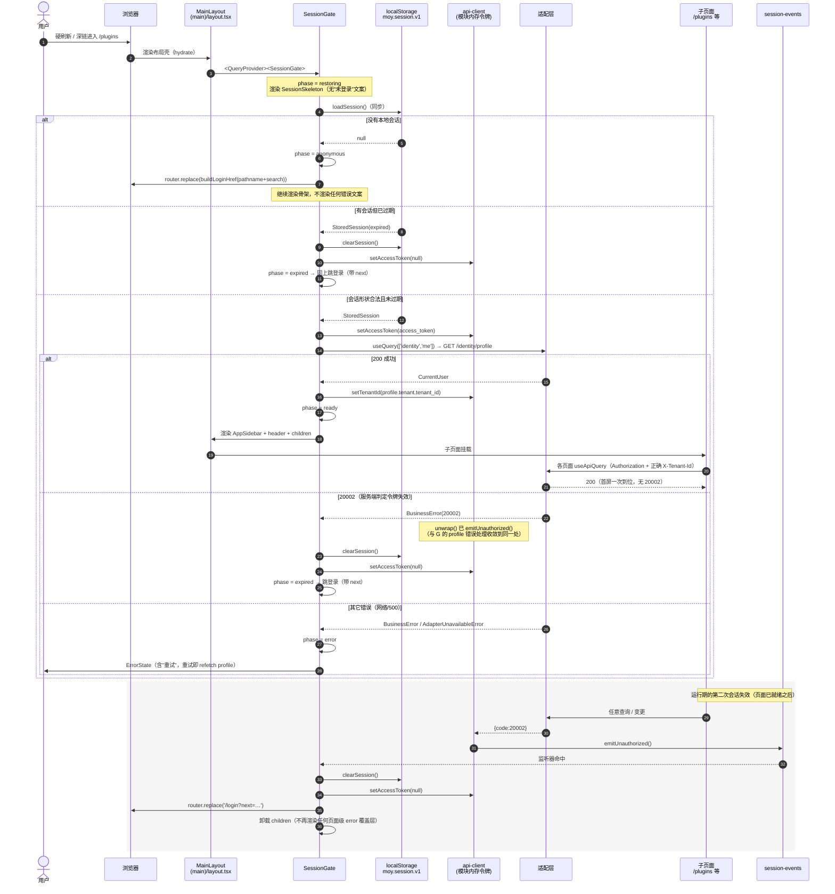
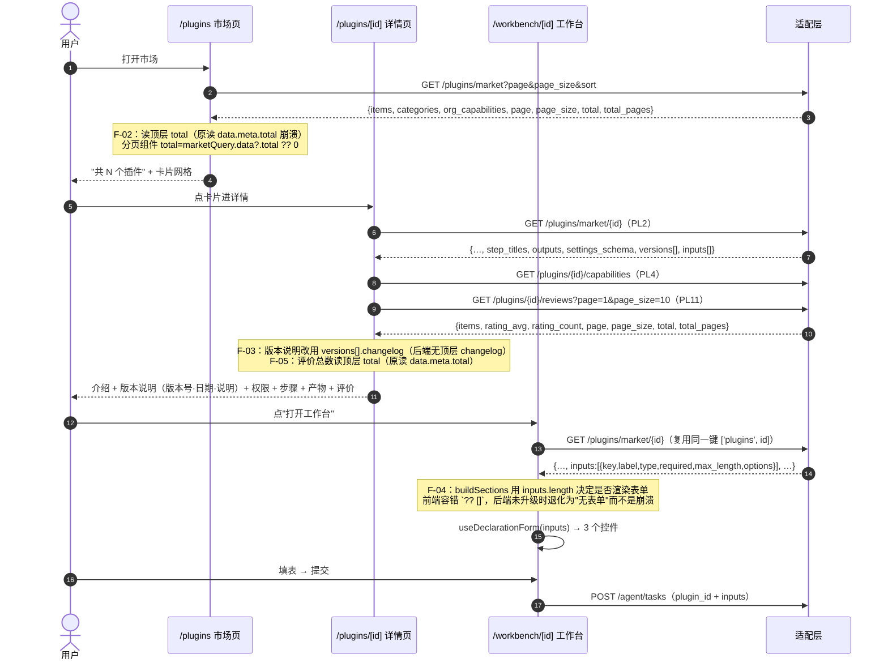

# 麦子 V1.0 · Batch 1 + 低风险快修 技术方案与任务分解

| 项 | 内容 |
| --- | --- |
| 文档编号 | MOY-DESIGN-2026-10-25-R1 |
| 编制人 | 高见远（架构师） |
| 编制时间 | 2026-10-25 |
| 上游输入 | `docs/improvement-plan-2026-10-25.md`（MOY-PLAN-2026-10-25-R1，许清楚）；主理人 2026-10-25 实施范围裁定 |
| 本次范围 | F-01、F-02、F-03、F-04（含后端加性字段）、F-05、F-06、F-07、F-09 |
| 明确不做 | F-08 品牌命名（待 C1）、分页口径全量统一、后端 `PageResult` 重构、移动端信息架构重做、F-10 契约快照改源 |
| 口径声明 | **本文只做设计，不改任何代码。** 所有事实均标注 `文件:行号`；凡未经核实的写「待验证」，不推断 |

---

## 0. 一页速读

- **4 个任务 / 4 个 PR**（T01~T04），任务数低于上限 5；每个任务含 ≥3 个文件，且 T01/T02/T03 可并行。
- **三条关键决策**（详见 §5）：
  1. **会话恢复以「`profile` 返回」为就绪判据**（不是「令牌注入」即就绪）——因为 `X-Tenant-Id` 的正确值只能从 `profile.tenant.tenant_id` 得到（`hooks/use-session.ts:78`），提前挂载子页面会让所有请求带错租户头。代价是硬刷新多一次轻量 RTT。
  2. **子页面在会话就绪前不挂载**（条件渲染），api-client 保持纯传输层、**不**在请求层同步读 `localStorage`。理由见 §5-D2。
  3. **`20002` 统一处置放在 `api-client` 单一 chokepoint + 模块级事件通道**，不在 20 个页面里各写一次（§5-D3）。
- **一个必须先拍板的前置**（🔴 见 §5-D4）：F-02/F-03/F-05 改 `types.ts` 会**必然**让 G-31（`npm run scan:contract`）变红，因为 `contracts/phase3.pl.json` 把这 4 个接口的错形状钉死了。必须连带做 **4 个接口的最小快照更正**（不是 F-10 的「换源 + 双向锁定」）。若不给这条放行，T01 无法合入。
- **工程师最容易做错的三个点**：
  1. 把 `<SessionGate>` 只包住 `children`，忘了 `AppSidebar` 里的 `PluginWorkbenchGroup`（`sidebar.tsx:104`）也会在挂载时发 `pluginsApi.installed()` —— 它必须在门内，否则刷新页面仍有一次无身份请求。
  2. 为了「少一列类型」写成 `interface PluginMarketData extends FlatPageResult<PluginMarketItem>` —— G-31 的解析器只认**两空格缩进的顶层字段行**（`scripts/check-plugin-contract.mjs:80`），`extends` 会把 4 个分页字段判成「缺键」。
  3. F-09 只删掉那一行而不是移进门控 —— 开发态需要它，删了等于用「开发者看不见后端地址」换「生产不暴露」，属于把门禁做成了藏问题。

---

## 1. 实施方针与技术选型

### 1.1 本批的三类难点

| 难点 | 具体表现 | 本批对策 |
| --- | --- | --- |
| **时序难点**：会话恢复与子查询竞态 | 令牌是模块内存（`lib/api-client.ts:208`），唯一回灌点是 `hooks/use-session.ts:74`，而 `useSession()` 全仓只在 `app/(main)/profile/page.tsx:41` 挂载 → 除 `/profile` 外任何整页加载都不带 `Authorization` | 会话恢复上提为布局层「门」：**门未开，子组件不挂载**。挂载即发查询的组件（含 `AppSidebar` 内的插件分组）一律在门内 |
| **契约难点**：前端照手抄快照写，快照与后端已漂移 | `MarketData` / `ReviewListData` 是扁平分页（无 `meta`）；`MarketDetailData` 无 `inputs`、无 `changelog` | 分页/`changelog` 一律**前端对齐后端现状**（后端零改）；只有 `inputs` **后端加性补字段**（用户价值依赖它） |
| **口径难点**：分页二义性被门禁掩盖 | `types.ts` 声明 `meta: PageMeta`，后端扁平；G-31 比对的是快照而非真后端 | 本批只做**局部**更正，且把「快照更正」与「崩溃修复」放在**同一个 PR**（T01），避免出现「类型改绿、门禁变红」的中间态 |

### 1.2 技术选型（全部复用既有基建，零新增依赖）

| 需要的能力 | 选型 | 理由 |
| --- | --- | --- |
| 会话状态跨组件共享 | React Context（`components/layout/session-gate.tsx` 内自建） | 全仓无 zustand store 用于会话（`zustand` 在依赖里但会话相关零引用），引一个 store 只为一处状态属于过度设计；Context + `useState` 足够，且天然跟随布局生命周期 |
| `profile` 取数与缓存 | 既有 `useApiQuery` + 既有键 `QUERY_KEYS.profile()`（`hooks/use-api.ts:69`，当前未被使用） | 键已存在且语义正确（`['identity','me']`），不必新造；`staleTime: Infinity` + `retry: 0` 保证「一次请求、失败不重试」 |
| 移动端「更多」面板 | 既有 `components/ui/drawer.tsx`（右侧滑入，`w-full sm:max-w-*`） | 已有组件、已过 import 白名单、移动端全宽，不需要新建 Sheet |
| 20002 广播 | 新建 20 行的 `lib/session-events.ts`（`Set<() => void>`） | 不改 React Query 内部（`QueryCache.onError` 需要与 Provider 同层，而 Provider 必须在门之上，装配顺序会绕）；模块级通道零依赖、可单测 |
| 后端加性字段 | Pydantic 新模型 + `Field(default_factory=list)` | 加性、默认值让 OpenAPI 不新增 `required`，G4 加性 diff 直接通过 |

**架构模式**：沿用现有「布局壳 + 页面容器 + 声明驱动子组件」（Next App Router client components + React Query）。本批不引入新的分层，只在布局壳里插一层 `SessionGate`。

---

## 2. 文件级改动清单

> 每个文件只写「改什么函数/字段/行为」，不贴代码。

### T01 · 契约对齐（F-02 / F-03 / F-05）

| 文件 | 改什么 |
| --- | --- |
| `apps/web/src/lib/types.ts` | ① `PluginMarketData`（:1136-1147）：删 `meta: PageMeta`，**原地**展开 `page/page_size/total/total_pages: number`（**不得写成 `extends FlatPageResult`**，见 §5-D4）；② `PluginReviewsData`（:1333-1338）：同上；③ `PluginDetail`（:1195-1225）：删 `changelog: PluginChangelog` 一行；④ 删 `export type PluginChangelog = string[]`（:1192，全仓唯一引用即上一条）；⑤ `PluginVersionBrief`（:1186-1189）：补 `changelog: string`（后端 `VersionBriefItem.changelog` 恒有值，缺省空串） |
| `apps/web/contracts/phase3.pl.json` | **仅**这 4 个接口的键集合更正（见 §7.3 的精确 diff 说明）。**不改 `version`/`source`/`note` 语义，不改其他 60+ 接口**。🔴 需主理人放行（§5-D4） |
| `apps/web/src/app/(main)/plugins/page.tsx` | `:143` `marketQuery.data?.meta.total ?? 0` → `marketQuery.data?.total ?? 0`；`Pagination`（`:236-242`）的 `total` 传入值随之正确（`page` 与 `pageSize` 已是本地状态，无需改） |
| `apps/web/src/app/(main)/plugins/[pluginId]/page.tsx` | ① `:259` `reviewsQuery.data?.meta.total ?? 0` → `reviewsQuery.data?.total ?? 0`；② `:403-412` 版本说明块改为消费 `plugin.versions`（见 §8）；③ 删掉对 `PluginChangelog` 的隐式依赖（本文件未 import 该类型，仅行为变化） |

### T02 · 工作台输入（F-04 后端 + 前端容错）

| 文件 | 改什么 |
| --- | --- |
| `apps/adapter/app/schemas/plugin.py` | ① 新增 `class InputBriefItem(BaseModel)`（紧邻 `OutputBriefItem`/`SettingBriefItem`，:123-151 之后）；② `MarketDetailData`（:167-212）增 `inputs: list[InputBriefItem] = Field(default_factory=list, …)`，并补 docstring 的 Attributes 段 |
| `apps/adapter/app/business/plugin_service.py` | `detail()`（:307-367）在 `capabilities=` 与 `step_titles=` 之间插入 `inputs=[…]` 列表推导，从 `manifest.inputs` 映射（`manifest` 为 `None` 时给 `[]`，与既有 `outputs`/`settings_schema` 的写法保持同构） |
| `apps/adapter/tests/unit/test_plugin_lifecycle.py` | 增一条断言：`detail(plg_weekly_report)` 的 `inputs` 长度等于 manifest 声明数（3），且首项字段齐全（`key/label/type/required`）。**不改既有断言** |
| `apps/web/src/app/(main)/workbench/[pluginId]/page.tsx` | ① `buildSections`（:53-59）：先 `const inputs = plugin.inputs ?? []`，再用 `inputs.length`；② `:354` `inputs={plugin.inputs}` → `inputs={formInputs}`（复用 :119 已做兜底的稳定引用）；③ `:119` 的 `?? []` 保留并补注释说明「兜底仅为防崩，字段已由后端下发」 |

> 提交顺序（同一 PR 内两个 commit）：**前端容错先合、后端字段随后合**（对齐计划 §4.1 第 3 步）。这样中途任何一次检出都不会崩。

### T03 · 会话层（F-01）

| 文件 | 改什么 |
| --- | --- |
| `apps/web/src/lib/session-events.ts` | **新建**。`onUnauthorized(listener): () => void` / `emitUnauthorized(): void`；内部 `Set`，派发时遍历副本并逐个 try/catch（一个监听器抛错不得影响其他）。零 import，避免循环依赖 |
| `apps/web/src/lib/redirect.ts` | **新建**。`buildLoginHref(pathname, search?)`（拼 `/login?next=<encode>`）；`resolveNextPath(raw): string`（解码 → 必须 `startsWith('/')` 且不以 `//`、`/\` 开头、不含 `://` → 否则回落 `/chat`）；`LOGIN_PATH`、`DEFAULT_LANDING_PATH` 常量 |
| `apps/web/src/lib/api-client.ts` | ① `unwrap()`（:300-319）：`payload.code === 20002` 时先 `emitUnauthorized()` 再 `throw new BusinessError(...)`（**只加这一条分流，其余 code 行为不动**）；② `request()`（:359-390）：`response.status === 401` 时同样 `emitUnauthorized()` 并抛 `BusinessError(20002, '登录状态已失效，请重新登录')`（401 可能没走统一信封，不能指望 `payload.code`）；③ 顶部 import `emitUnauthorized` |
| `apps/web/src/components/layout/session-gate.tsx` | **新建**。`SessionGate`（Provider + 门）、`useSessionContext()`、`SessionSkeleton`（骨架，**不含任何「未登录」文案**）、`SessionErrorState`（带 `onRetry`）。状态机见 §6 |
| `apps/web/src/hooks/use-session.ts` | 保留导出名与签名不变（`SessionState` / `UseSessionResult` / `useSession`），实现改为消费 Context 的薄壳（§6.6）；`reload` → Context 的 `refreshProfile`，`logout` → Context 的 `logout` |
| `apps/web/src/app/(main)/layout.tsx` | 把 `AppSidebar` + `header` + 离线条 + `main` **整块**放进 `<SessionGate>`（**在 `QueryProvider` 之内**，`:50-74`）；`usePathname` / 离线检测 / `installErrorGuard` 保持在 layout 本体（它们不依赖会话） |
| `apps/web/src/app/(main)/profile/page.tsx` | ① `useSession()` 改为 `useSessionContext()`（或继续用 `useSession()` 薄壳，行为一致）；② 删掉 `:46-67` 的 `session.loading` / `errorMessage` / `!user` 三个分支（门已保证就绪）；③ `logout` 调用与 toast 保留 |
| `apps/web/src/lib/oidc.ts` | `PendingAuthorization` 增可选 `returnTo?: string`（类型层，**校验函数不加严**——`session-store.ts:114-131` 的 `isPendingAuthorization` 只检查 4 个必填字段，额外字段天然通过，因此旧数据仍可读） |
| `apps/web/src/app/(auth)/login/page.tsx` | ① 挂载后从 `window.location.search` 取 `next`（与既有 `useSearchParams` 规避 Suspense 的写法一致，见 `plugins/[pluginId]/page.tsx:53-57` 的注释口径）；② `handleUnifiedLogin` 的 `savePending` 带上 `returnTo: resolveNextPath(next)`；③ `handleEnter` / `handleTokenSubmit` 的 `router.push(DEV_ENTRY_PATH)` → `router.push(resolveNextPath(next))` |
| `apps/web/src/app/(auth)/auth/callback/callback-flow.tsx` | ① 把 `pending: loadPending()`（:104 的行内调用）**提到外面**成 `const pending = loadPending()`；② 成功后 `router.replace(resolveNextPath(pending?.returnTo))` 替代常量 `POST_LOGIN_PATH`（:125）；③ `POST_LOGIN_PATH` 常量改名为 `DEFAULT_LANDING_PATH` 或直接删（由 `redirect.ts` 统一） |

### T04 · 低风险快修（F-06 / F-07 / F-09）

| 文件 | 改什么 |
| --- | --- |
| `apps/web/src/components/layout/sidebar.tsx` | ① `EXTRA_TITLES`（:61-63）补 `{ prefix: '/ops', label: '运营后台' }`；② `MobileNav`（:188-216）整体迁出，本文件**只保留 export 转发**（`export { MobileNav } from './mobile-nav'`）或直接删掉、由布局改 import 路径（推荐后者：删干净，避免双份实现）；③ `NAV_ITEMS` / `resolveNavItem` / `AppSidebar` **一行不动** |
| `apps/web/src/components/layout/mobile-nav.tsx` | **新建**。`MOBILE_PRIMARY_ITEMS`（对话 / 知识库 / 插件与工作台 / 个人中心，从 `NAV_ITEMS` 按 `href` 过滤得到，不复制文案）+ 「更多」按钮 + `Drawer`（其余 5 项全量列出）。**所有可点区域 ≥44×44（`h-11 w-11`）** |
| `apps/web/src/app/(main)/layout.tsx` | `header`（:55-58）：`gap-3`、`min-w-0 flex-1 truncate whitespace-nowrap` 给 `h1`、`shrink-0` 给 `MobileNav`；**`h-16` 不变**；回落串 `'办公 AI 平台'` → `''`（中性，F-08 拍板前不引入任何品牌或品类词） |
| `apps/web/src/app/(auth)/login/page.tsx` | `:246` 的 `<p>服务状态：{getAdapterBaseUrl()}</p>` 移入 `IS_PRODUCTION_BUILD` 门控（写成 `{IS_PRODUCTION_BUILD ? null : (<p>…</p>)}`），`:190-240` 的开发入口区不动 |
| `apps/web/src/components/chat/chat-window.tsx` | `:188` 占位文案 `输入你的问题，Ctrl/⌘ + Enter 发送` → `输入你的问题`；`:208` 输入行下补一行 `<p className="mt-1 hidden text-xs text-muted-foreground md:block">Ctrl/⌘ + Enter 发送</p>`（桌面保留可发现性，移动端不换行） |

---

## 3. 数据结构与接口

```mermaid
classDiagram
    direction TB

    %% ========== 会话层（F-01） ==========
    class SessionPhase {
        <<enumeration>>
        restoring
        ready
        anonymous
        expired
        error
    }

    class SessionContextValue {
        +SessionPhase phase
        +CurrentUser|null user
        +string errorMessage
        +refreshProfile() void
        +logout() void
        +string nextHref
    }

    class SessionGate {
        -useSessionQuery() UseQueryResult~CurrentUser~
        +restore() void
        +handleUnauthorized() void
        +render() JSX
    }

    class SessionEvents {
        +onUnauthorized(fn) () => void
        +emitUnauthorized() void
    }

    class Redirect {
        +LOGIN_PATH string
        +DEFAULT_LANDING_PATH string
        +buildLoginHref(pathname, search) string
        +resolveNextPath(raw) string
    }

    class UseSessionResult {
        +boolean loading
        +CurrentUser|null user
        +string errorMessage
        +reload() Promise~void~
        +logout() void
    }

    %% ========== 契约对齐（F-02/F-03/F-05） ==========
    class FlatPagination {
        +number page
        +number page_size
        +number total
        +number total_pages
    }

    class PluginMarketData {
        +PluginMarketItem[] items
        +PluginCategoryItem[] categories
        +OrgCapabilitySwitch[] org_capabilities
        +number page
        +number page_size
        +number total
        +number total_pages
    }

    class PluginReviewsData {
        +PluginReviewItem[] items
        +number rating_avg
        +number rating_count
        +number page
        +number page_size
        +number total
        +number total_pages
    }

    class PluginDetail {
        +string plugin_id
        +string name
        +PluginCapabilityItem[] capabilities
        +PluginInputSpec[] inputs
        +string[] step_titles
        +PluginOutputSpec[] outputs
        +PluginSettingSpec[] settings_schema
        +PluginVersionBrief[] versions
        +boolean installable
    }

    class PluginVersionBrief {
        +string version
        +string published_at
        +string changelog
    }

    class PluginInputSpec {
        +string key
        +string label
        +string type
        +boolean required
        +number|null max_length
        +string[] options
    }

    %% ========== 后端加性字段（F-04） ==========
    class InputBriefItem {
        +string key
        +string label
        +string type
        +boolean required
        +number|null max_length
        +string[] options
    }

    class MarketDetailData {
        +string plugin_id
        +string name
        +PluginCapabilityItem[] capabilities
        +InputBriefItem[] inputs
        +string[] step_titles
        +OutputBriefItem[] outputs
        +SettingBriefItem[] settings_schema
        +VersionBriefItem[] versions
    }

    class PluginService {
        +detail(plugin_id, auth) MarketDetailData
    }

    class PluginManifest {
        +InputSpec[] inputs
        +OutputSpec[] outputs
        +SettingSpec[] settings_schema
    }

    %% ========== 移动端导航（F-06） ==========
    class NavItem {
        +string href
        +string label
        +Icon icon
    }

    class MobileNav {
        -NavItem[] primary
        -NavItem[] overflow
        +render() JSX
    }

    class AppSidebar {
        +render() JSX
    }

    %% ========== 关系 ==========
    SessionGate ..> SessionPhase : 持有
    SessionGate ..> SessionContextValue : 提供
    SessionGate ..> SessionEvents : 订阅
    SessionGate ..> Redirect : 跳登录用
    SessionEvents ..> Redirect : 无直接依赖
    UseSessionResult ..> SessionContextValue : 薄壳映射
    PluginMarketData ..|> FlatPagination : 字段同形（不得用 extends）
    PluginReviewsData ..|> FlatPagination : 字段同形（不得用 extends）
    PluginDetail *-- PluginInputSpec
    PluginDetail *-- PluginVersionBrief
    PluginDetail *-- PluginOutputSpec
    PluginDetail *-- PluginSettingSpec
    PluginVersionBrief .. PluginDetail : changelog 唯一来源
    MarketDetailData *-- InputBriefItem
    MarketDetailData *-- VersionBriefItem
    PluginService ..> PluginManifest : 读取
    PluginService ..> MarketDetailData : 组装
    PluginManifest *-- InputSpec
    MobileNav ..> NavItem : 引用子集
    AppSidebar ..> NavItem : 引用全量
    MobileNav ..> NavItem : 不复制文案
```



**说明**：`FlatPagination` 只作为**文档表达**存在（`types.ts` 里已有 `FlatPageResult<T>`，:411-417）。`PluginMarketData` / `PluginReviewsData` **不能**写成 `extends FlatPageResult<…>`，原因见 §5-D4（G-31 解析器限制）。

---

## 4. 程序调用流程

### 4.1 会话恢复（F-01 主链路）



### 4.2 插件三页（F-02 / F-03 / F-05）与工作台（F-04）



---

## 5. 关键设计决策（含取舍）

### D1 · 会话「就绪」以 `profile` 返回为判据，而不是「令牌注入」

**事实**：`X-Tenant-Id` 头由模块变量 `currentTenantId` 提供（`api-client.ts:211,268`），其唯一正确来源是 `setTenantId(profile.tenant.tenant_id)`（`use-session.ts:78`）。在 `profile` 返回之前，租户头恒为 `'default'`（`:195`）。

**取舍**：

| 方案 | 令牌注入即就绪 | **以 profile 返回为就绪（采用）** |
| --- | --- | --- |
| 首屏 | 少一次 RTT | 多一次轻量 RTT（`/identity/profile`，私有化同机房；Q-01 首屏 ≤2s 需实测复核） |
| 租户头 | 首批请求可能是错的租户 | 恒正确 |
| 20002 风暴 | 令牌已失效时会连发 N 个失败请求（需靠卸载收敛） | 一次 profile 就收敛，子页面永不发无身份请求 |

**为什么不用「把 tenant_id 存进会话」来换取令牌优先**：`StoredSession`（`session-store.ts:55-58`）已有 `access_token/refresh_token/expires_at` 三字段并被 `check-oidc-auth.mjs` 的 SESSION-STORE 断言逐条锁定（迁移、脏数据、降级），加字段要连带改门禁断言与迁移逻辑，本批不划算。**登记为 V1.1 优化项**（存 `tenant_id` → 令牌优先挂载，可用于 Q-01 首屏压测后如不达标时的减法）。

### D2 · 「子页面在会话就绪前不挂载」而不是「api-client 同步读存储」

**采用**：布局层条件渲染（门）。**否决**：`api-client` 的 `buildHeaders` 里同步 `localStorage.getItem`。

| 维度 | 条件渲染门（采用） | api-client 同步读存储 |
| --- | --- | --- |
| 单一职责 | 传输层保持纯函数式（只认已注入的令牌） | 传输层变成隐式有状态，每次请求碰存储 |
| SSR / hydration | 无影响（门在 client 组件内，读存储发生在 effect） | `fetch` 可能在 SSR 路径被调用，`localStorage` 不存在；要么加 `typeof window` 分支，要么接受抖动 |
| 覆盖完整性 | 门的父级是 `(main)/layout.tsx`，是**全部 20 个鉴权路由的唯一父级**（`/ops/*` 亦在内），结构性覆盖而非约定 | 需要「每个调用点都记得读」的正确性，且仍解决不了租户头问题（D1） |
| 首屏闪烁 | 骨架 → 内容，两态一致，不会闪「未登录」 | 同样有闪烁，且闪烁与请求并发交叉 |

**唯一代价**：门内组件首次挂载被推迟约「一个 profile 往返」。这与 D1 的代价是同一笔账，不重复计。

### D3 · `20002` 统一处置走 `api-client` 单一 chokepoint + 模块事件

**为什么不在页面里各写一次**：20 个页面 × 平均 3 个查询 = 60 处；新增页面必然漏写，且漏写后表现为「页面显示登录状态已失效」这种把内部状态词汇暴露给用户的文案（违反「无技术暴露」）。

**为什么不用 React Query 的 `QueryCache.onError`**：`QueryClient` 实例在 `QueryProvider`（`lib/query-client.tsx:63`）里创建，而 Provider 必须在 `SessionGate` **之上**才能让门内使用 `useQuery`；要让 cache 回调拿到「清会话 + 跳转」的能力，得把回调注入到 Provider 创建之前，形成「门依赖 Provider、Provider 依赖门的回调」的装配倒置。模块事件通道把这层倒置拍平。

**为什么同时处理 HTTP 401**：后端统一信封下 401 通常带 `code`，但网关/代理层的 401 可能没有信封体（`unwrap` 解析失败会退化成 `AdapterUnavailableError`，用户看到「服务暂时不可用」，而真实原因是登录过期——错因误导）。因此 `request()` 在 `unwrap` 之前先看 `response.status === 401`。

### D4 · 🔴 必须连带更正 `contracts/phase3.pl.json` 的 4 个接口（需放行）

**冲突事实**：G-31（`scripts/check-plugin-contract.mjs`）把 `contracts/phase3.pl.json` 与 `types.ts` 逐键比对，「缺键 / 多键 / 可选性翻转」一律判红，并被 `ci-web.yml` 调用。当前快照把错形状钉死：

```
PluginMarketData  required: [items, meta, categories, org_capabilities]
PluginDetail      required: [..., changelog, versions, ...]
PluginReviewsData required: [items, meta, rating_avg, rating_count]
PluginVersionBrief required: [version, published_at]
```

F-02/F-03/F-05 要改的正是这 4 个接口 → **不更正快照，门禁必红**。

**三个选项**：

| 选项 | 做法 | 评价 |
| --- | --- | --- |
| A（推荐） | 随 T01 做 **4 个接口的最小更正**（`meta` → 4 个扁平字段 ×2；`PluginDetail` 去 `changelog`；`PluginVersionBrief` 加 `changelog`） | 门禁保持绿且**说真话**；改动面 4 个键、可逐行 review；不与 F-10 冲突（F-10 是「换快照来源 + 双向锁定」，本项是「把已知错值改对」） |
| B | 不动快照，容忍 `scan:contract` 变红 | 违反「门禁红即不可合并」的基本纪律；且红的理由是「代码对、快照错」，会把下一次真的漂移淹没 |
| C | 把 `types.ts` 写成能同时满足新旧形状（如 `meta?: PageMeta` + 扁平可选并存） | 最坏：类型层面允许了两种形状，崩溃只是从运行时挪到了「字段为空」，属于计划 §6.1 明令禁止的 C 方案 |

**请主理人放行 A。** 若坚持「本批不动快照」，则 T01 必须拆成「先只改页面读取（不碰类型）」——但那样 `types.ts` 仍声明 `meta`，`marketQuery.data.total` 会**类型报错**（`total` 不在 `PluginMarketData` 上），`typecheck:web` 直接红。**结论：选项 A 是唯一自洽解。**

### D5 · 分页形状在页面直读，不在 `api-client` 做归一化

| 维度 | 页面直读（采用） | api-client 归一化（把扁平包成 `meta`） |
| --- | --- | --- |
| 可发现性 | 类型与后端一一对应，错一眼可见 | 归一化层成了「契约二义性的减震器」，**掩盖**漂移（正是计划 §6.1 的核心风险） |
| F-10 兼容 | 快照改由 `app.openapi()` 导出后，差异立即暴露，符合预期 | 归一化层会让导出比对永远「看起来一致」 |
| 改动量 | 4 处读取 | 2 个 adapter 函数 + 2 个类型 |

### D6 · F-03 用 `versions[].changelog` 渲染，不新增组件

信息量比原设计更全（逐版本），且后端零改。渲染位置保持在「插件介绍」卡片内原「版本说明」块，不引入新组件 → `VersionHistory` 不用改（它只吃 `PluginVersionBrief`，新增字段不破坏它）。

### D7 · F-04 后端只加 6 个字段，不加 `max_items`

后端 `InputSpec` 有 `max_items`（`app/plugins/schema.py:254-256`），但前端 `PluginInputSpec`（`types.ts:1159-1168`）没有，`use-declaration-form.ts` 也未使用。若 `InputBriefItem` 带上 `max_items`，前端类型要不要跟？跟则与快照 `PluginInputSpec.optional` 集合不一致（还要再改快照），不跟则后端多了个前端不消费的字段（无害但无收益）。**本批不带**，登记为 V1.1（多值输入数量上限的落地要连表单一起做）。

### D8 · F-06 新建 `mobile-nav.tsx`，不动 `AppSidebar`

同文件改动会让「桌面端零影响」的证明成本从「看 diff」变成「逐断点回归」；独立文件后，桌面端 `AppSidebar`（`sidebar.tsx`）的逻辑一行不动，只把 `MobileNav` 换 import，`md:hidden` 边界天然成立。

---

## 6. F-01 会话层详细设计

### 6.1 状态机

```
                ┌──────────────┐
   挂载 ───────▶ │   restoring  │  渲染骨架（无任何"未登录"文案）
                └──┬───┬───┬───┘
      无本地会话    │   │   │   有会话 + 未过期
                   │   │   └──────────────┐
                   │   └── 过期/形状非法  │
                   ▼          ▼           ▼
             ┌──────────┐ ┌──────────┐ ┌────────────────┐
             │ anonymous│ │ expired  │ │ setAccessToken │
             └────┬─────┘ └────┬─────┘ │ + profile 请求 │
                  │            │       └───┬────────┬───┘
                  │            │        200 │        │ 20002
                  │            │           ▼        ▼
                  │            │      ┌────────┐ ┌────────┐
                  │            │      │ ready  │ │ expired│
                  │            │      └───┬────┘ └───┬────┘
                  │            │          │          │
                  │            │     其它错误        │
                  │            │          ▼          │
                  │            │      ┌───────┐      │
                  │            │      │ error │      │
                  │            │      └───────┘      │
                  ▼            ▼          ▼          ▼
            router.replace('/login?next=…')     卸载 children + 清会话
            （继续渲染骨架，绝不渲染"未登录"页）
```

**状态与渲染映射（这张表就是实现契约）**：

| phase | 渲染 | 副作用 |
| --- | --- | --- |
| `restoring` | `<SessionSkeleton/>` | effect 内 `loadSession()` → 决定下一态 |
| `ready` | `AppSidebar + header + children` | `setTenantId(profile.tenant.tenant_id)`（**在切 ready 之前**） |
| `anonymous` | `<SessionSkeleton/>` | `router.replace(buildLoginHref(pathname, search))`，用 ref 去重只跳一次 |
| `expired` | `<SessionSkeleton/>` | `clearSession()` + `setAccessToken(null)` + `setTenantId('default')` + 跳登录（带 next） |
| `error` | `<SessionErrorState onRetry={refetch}/>` | 不清会话（网络抖动不等于失效） |

### 6.2 Context 形状（对外 API，工程师照此实现）

```ts
export type SessionPhase = 'restoring' | 'ready' | 'anonymous' | 'expired' | 'error';

export interface SessionContextValue {
  phase: SessionPhase;
  /** 就绪后必有值；其余态为 null */
  user: CurrentUser | null;
  /** 仅 error 态有业务语言文案 */
  errorMessage: string;
  /** 重新请求 profile（error 态的重试，也可做「刷新账户信息」） */
  refreshProfile: () => void;
  /** 清会话 + 清查询缓存 + 跳登录 */
  logout: () => void;
}

export function useSessionContext(): SessionContextValue;
```

约束：
- `useSessionContext()` 在 Provider 之外调用必须 `throw new Error('会话状态只能在主界面布局内使用')`（开发期立即暴露误用；该文案为开发者可见，不进用户界面）。
- Provider 的 `value` 必须 `useMemo`，避免每次渲染让消费组件重渲染。

### 6.3 React Query 装配

| 项 | 值 | 理由 |
| --- | --- | --- |
| 查询键 | `QUERY_KEYS.profile()` → `['identity','me']` | 键已存在（`hooks/use-api.ts:69`），全仓唯一会话读点，**与 `/profile` 页消费同一个缓存条目** |
| `staleTime` | `Infinity` | 布局不重挂载 → 每次硬刷新只请求一次；不因 30s 过期在切页时重发 |
| `retry` | `0` | 20002 重试无意义；网络错误由 `error` 态的「重试」按钮承担（用户显式触发） |
| `refetchInterval` / `refetchOnWindowFocus` | `false`（后者已是全局默认，`query-client.tsx:20`） | 会话不轮询 |
| `gcTime` | 默认 5 分钟 | 够 |
| 无会话时 | **不发请求** | 与现 `use-session.ts:60-65` 的「没有本地会话就不发匿名请求」一致 |

`enabled` 控制：`const stored = ...;` 先落一个 `readyToFetch` 标记，`useApiQuery(QUERY_KEYS.profile(), …, { enabled: Boolean(tokenInjected), staleTime: Infinity, retry: 0 })`。

### 6.4 为什么不首屏闪烁、不重复请求（逐条论证）

1. **不闪「未登录」**：`anonymous` / `expired` 两态**继续渲染骨架**，直到 `router.replace` 生效；组件树里不存在任何「未登录 / 请登录」的可见文案（`SessionSkeleton` 只有骨架块）。
2. **不重复请求 profile**：Provider 挂在 `(main)/layout.tsx`，App Router 在 `(main)` 内部换页时**布局不重挂载**，`useQuery` 命中 `['identity','me']` 的缓存（`staleTime: Infinity`）→ 一次硬刷新 = 一次 profile。
3. **不并发错序**：子页面首次挂载发生在 `phase === 'ready'` 的**同一次提交**中，而 `setTenantId` 在切 ready 之前已同步执行完（模块变量，无异步窗口）→ 子页面的第一批请求必然带正确令牌与正确租户。
4. **`/profile` 不再二次请求**：它读同一个 Context（不再自己 `useSession()`），`QUERY_KEYS.myUsage` 的 `enabled: Boolean(session.user)` 在就绪后恒为 true，行为不变。
5. **退出登录清缓存**：`logout()` 里调 `queryClient.clear()`——否则换账号后 DevTools 里会看到上一个租户的插件列表（`invalidateQueries` 不够，它保留旧数据直到新数据回来）。

### 6.5 跳登录与 `next` 参数

| 环节 | 做法 |
| --- | --- |
| 生成 | `buildLoginHref(pathname, search)` → `/login?next=%2Fplugins%3Ftab%3Dinstalled`（`pathname` 来自 `usePathname()`，`search` 来自 `window.location.search`，SSR 期为空则省略） |
| 校验 | `resolveNextPath(raw)`：`decodeURIComponent` → 必须 `startsWith('/')` → `!startsWith('//')` → `!startsWith('/\\')` → `!includes('://')` → 通过则返回，否则返回 `/chat`。**不接受**绝对 URL、协议相对 URL、反斜杠变体（防开放重定向） |
| 落点 | ① 登录页开发入口 / 凭证入口：`router.push(resolveNextPath(next))`；② 统一登录：`next` 存进 `PendingAuthorization.returnTo`，回跳页成功后 `router.replace(resolveNextPath(pending?.returnTo))`；③ 回跳页读不到 pending 时回落 `/chat` |
| 为什么放 `PendingAuthorization` | 它是「跨 OIDC 重定向的一次性本地状态」，本来就承担「这次登录是我发起的」的载体；把 `returnTo` 放这里，比另开一个 sessionStorage 键少一个键、少一处清理责任 |

### 6.6 `useSession` 公共 API 的保留与兼容

```ts
// hooks/use-session.ts —— 导出名、类型名、签名全部不变
export interface SessionState { loading: boolean; user: CurrentUser | null; errorMessage: string }
export interface UseSessionResult extends SessionState { reload: () => Promise<void>; logout: () => void }

/** @deprecated 新代码请用 useSessionContext()；本函数保留为兼容壳 */
export function useSession(): UseSessionResult {
  const ctx = useSessionContext();
  return {
    loading: ctx.phase === 'restoring',
    user: ctx.user,
    errorMessage: ctx.errorMessage,
    reload: async () => { ctx.refreshProfile(); },
    logout: ctx.logout,
  };
}
```

- `reload` 返回 `Promise<void>`（原签名），实现里 `refreshProfile` 是同步触发 refetch，包一层 `async` 即可，**不改变语义**（调用方 `profile/page.tsx:51` 用 `void session.reload()`）。
- 不删 `SESSION_EXPIRED_MESSAGE` 常量：`expired` 态的 `errorMessage` 继续用它（也是 `20002` 的既有文案，`business-errors.ts:23`），保证「同码同文案」。
- 若将来全仓迁完，本文件可整体删除（在此登记一行 TODO，不建 issue）。

---

## 7. F-02 / F-05 详细设计（前端对齐扁平分页）

### 7.1 字段对照（改前 → 改后）

| 位置 | 改前 | 改后 | 后端事实 |
| --- | --- | --- | --- |
| `types.ts` `PluginMarketData` | `meta: PageMeta` | `page/page_size/total/total_pages: number` | `MarketData`（`schemas/plugin.py:100-120`） |
| `types.ts` `PluginReviewsData` | `meta: PageMeta` | 同上 4 字段 | `ReviewListData`（`:525-544`） |
| `plugins/page.tsx:143` | `data?.meta.total ?? 0` | `data?.total ?? 0` | 同上 |
| `plugins/[pluginId]/page.tsx:259` | `data?.meta.total ?? 0` | `data?.total ?? 0` | 同上 |

其余消费点已正确：`marketQuery.data?.items ?? []`（:141）、`categories`（:142）、`reviewsQuery.data?.items ?? []`（:258）、`rating_avg/rating_count`（:560-561）都在顶层，无需改。

### 7.2 是否需要 `Pagination` 改动

不需要。`Pagination` 的入参是 `page/pageSize/total`（`components/ui/pagination.tsx`），页面已经在传本地状态 `page` 与常量 `MARKET_PAGE_SIZE`；只有 `total` 的来源错了。**不改组件**。

### 7.3 契约快照更正（精确说明，供 review 对照）

`apps/web/contracts/phase3.pl.json` 的 `interfaces` 段，只改这 4 条：

| 接口 | 变更 |
| --- | --- |
| `PluginMarketData` | `required` 删除 `meta`，追加 `page`、`page_size`、`total`、`total_pages` |
| `PluginReviewsData` | 同上（`meta` → 4 个扁平字段） |
| `PluginDetail` | `required` 删除 `changelog`（其余 19 项不动） |
| `PluginVersionBrief` | `required` 追加 `changelog` |

并在快照的 `note` 字段追加一句事实说明（**不换源、不动 `version`**）：
> 「2026-10-25：F-02/F-03/F-05 对齐后端实际实现（`app/schemas/plugin.py`），更正 `PluginMarketData`/`PluginReviewsData` 的 `meta` → 扁平四字段、`PluginDetail` 移除 `changelog`、`PluginVersionBrief` 增 `changelog`。快照来源仍为文档，换源见 F-10。」

---

## 8. F-03 详细设计（版本说明改用 `versions[].changelog`）

### 8.1 后端事实

- `MarketDetailData` **无** `changelog`（`schemas/plugin.py:167-212`）。
- `VersionBriefItem` 有 `changelog: str`（`:153-164`），由 `detail()` 从 `record.manifest.get("changelog", "")` 填充（`plugin_service.py:358`）。
- manifest 侧 `changelog` 是**单版本字符串**（`plg_weekly_report.json:11`），不是数组。

### 8.2 渲染结构（「插件介绍」卡片内，替换原 `:403-412`）

结构化口径（不是代码，是要求）：

```
已填写说明的版本 = plugin.versions.filter(v => v.changelog.trim() !== '')
若 已填写说明的版本.length > 0：
  小标题：「版本说明」（沿用原 text-xs font-medium text-muted-foreground）
  无序列表，每条一个版本：
    · <span class="font-medium tabular-nums">v{version}</span>
      <span class="text-xs">（{formatDate(published_at)}）</span>
      {changelog}
否则：不渲染该块（不占位、不显示空态文案——它只是介绍卡的附加信息，
      版本本身已在下方「版本历史」表里完整呈现）
```

要点：
- 用 `filter` 而不是 `some`，避免列表里出现空行；
- `formatDate` 已从 `@/lib/format` 导入（`:28`），无需新增 import；
- `key` 用 `version`（唯一）；
- **不要**把这段挪进 `VersionHistory`（那会把「介绍卡的附注」变成「版本表的列」，改动面变大且影响回退交互）。

### 8.3 删除 `PluginDetail.changelog` 后受影响的组件（全仓检索结论）

| 文件 | 是否受影响 |
| --- | --- |
| `app/(main)/plugins/[pluginId]/page.tsx:403-410` | **是**（唯一消费点，本次重写） |
| `components/plugin/version-history.tsx` | 否（吃 `PluginVersionBrief`，与 `changelog` 无关） |
| `components/plugin/plugin-card.tsx` / `installed-table.tsx` / `grant-drawer.tsx` | 否（吃 `PluginMarketItem` / `InstalledPluginItem`） |
| `lib/types.ts:1192` `PluginChangelog` 类型别名 | 否（删别名，无其他引用） |
| `contracts/phase3.pl.json` | 是（§7.3） |

---

## 9. F-04 详细设计（后端加性字段 + 前端容错）

### 9.1 后端模型（`apps/adapter/app/schemas/plugin.py`）

```
class InputBriefItem(BaseModel):
    """详情页展示的输入声明（PL2，驱动宿主表单）。

    Attributes:
        key: 输入键（与任务 inputs 的键集合一致）。
        label: 输入名称。
        type: 控件类型（text/textarea/select/multi_select/email/file）。
        required: 是否必填。
        max_length: 文本类长度上限。
        options: select / multi_select 候选值。
    """
    key: str = ""
    label: str = ""
    type: str = "text"
    required: bool = False
    max_length: int | None = None
    options: list[str] = Field(default_factory=list, description="候选值")
```

`MarketDetailData` 增：`inputs: list[InputBriefItem] = Field(default_factory=list, description="输入声明")`，位置在 `capabilities` 之后、`step_titles` 之前（与前端表单渲染顺序一致），并同步补类 docstring 的 Attributes 一行。

**全部字段带默认值** → OpenAPI 里 `inputs` **不会**进 `required`，G4 的「required 变长」判据不会被触发。

### 9.2 服务映射（`apps/adapter/app/business/plugin_service.py` `detail()`）

在 `capabilities=…`（:342）与 `step_titles=…`（:343）之间插入列表推导，形态与既有 `outputs=`（:344-347）/`settings_schema=`（:348-353）**完全同构**：

```
inputs=[
    InputBriefItem(
        key=item.key,
        label=item.label,
        type=item.type,
        required=item.required,
        max_length=item.max_length,
        options=list(item.options),
    )
    for item in (manifest.inputs if manifest is not None else [])
],
```

- `manifest` 为空的安全性：既有 `outputs`/`settings_schema` 已用同一模式，`detail()` 在 `_load_market_context` 之后 `manifest` 理论非空，但保持防御写法与同文件一致；
- `options=list(...)` 显式复制，避免把 manifest 内部 list 共享进响应对象（Pydantic 会做校验但不会深拷贝，共享引用在同一请求内无害，显式复制是为了让后续可变操作不串）；
- 数据已在手（`manifest.inputs`），**零新增 IO、零新增依赖**。

### 9.3 OpenAPI / 快照 / 测试影响

| 项 | 影响 | 处置 |
| --- | --- | --- |
| `deploy/validate_openapi.py` G4 | 响应 schema 是 `$ref`（`ApiResponse_MarketDetailData_`），G4 对 `$ref` 节点无 `properties` 可递归 → 实质不检查组件内部；即便递归，新增属性属「加性」允许项 | **无需改快照即可通过**。可选：`--update-snapshot` 刷新，但该文件用 `sort_keys=True` 全量重写，diff 噪声大 → **本批不刷新**，登记在 PR 描述里说明「加性变更，G4 通过，快照留待 F-10 一次性对齐」 |
| `docs/api/openapi.json` | 由门禁脚本每次运行自动重写（**未纳入 git**，已核实 `git ls-files docs/api/` 无此文件） | 无影响 |
| G3 端点数 | 无新增端点 | 无影响 |
| `tests/integration/test_plugin_market.py` | 只断言 `detail(plg_not_exists)` 抛 16002（:182） | 不红 |
| `tests/unit/test_plugin_lifecycle.py` | 需**新增**一条 `inputs` 断言 | 见 §9.5 |
| `mypy app` | 新模型 + 推导式，类型完备 | 应退出 0 |
| 其他 `MarketDetailData(` 构造点 | 需 `grep -rn "MarketDetailData(" apps/adapter` 确认（`detail()` 是唯一构造点，测试若有 fixture 也需同步——**工程师执行这条 grep 并据实处理**） | 待验证项，见 §15 |

### 9.4 前端容错（为什么不能只做前端兜底）

| 只做前端 `?? []` | 前端容错 + 后端补字段（采用） |
| --- | --- |
| 页面不崩，但工作台**没有表单**——用户只能看步骤与产物，「发起任务」的核心动作消失 | 表单按声明渲染 3 个控件（`plg_weekly_report`） |
| 静默退化，无人报警（计划 §6.1 明令禁止的「崩→残」转化） | 数据到位后自动出现，前端兜底只用于「后端未升级的过渡窗口」 |

前端改法（`workbench/[pluginId]/page.tsx`）：
- `buildSections`：`const inputs = plugin.inputs ?? [];` → `if (inputs.length > 0) sections.push('form')`；
- `:354` `inputs={plugin.inputs}` → `inputs={formInputs}`；
- 注释写明：契约已要求 `inputs`，`?? []` 仅为「后端版本未同步时的过渡期不崩」，**不得**据此认为字段可缺。

### 9.5 新增后端断言（`tests/unit/test_plugin_lifecycle.py`）

要求（不贴代码，写断言意图）：
1. `detail(plugin_id="plg_weekly_report", auth=…)` 返回的 `inputs` 长度 == 3；
2. 首项 `key == "period"`、`required is True`、`max_length == 32`、`options == []`；
3. `type` 取值属于 `{"text","textarea","select","multi_select","email","file"}`；
4. 与 `outputs` / `settings_schema` 同时存在（不互相覆盖）。

---

## 10. F-06 移动端详细设计

### 10.1 组件边界

新建 `apps/web/src/components/layout/mobile-nav.tsx`，从 `sidebar.tsx` **迁出** `MobileNav`（:188-216）。`sidebar.tsx` 保留：`NavItem`、`NAV_ITEMS`、`PLUGIN_NAV_HREF`、`EXTRA_TITLES`、`resolveNavItem`、`PluginWorkbenchGroup`、`AppSidebar`（**一行不动**）。

`(main)/layout.tsx` 的 import 改为：`import { AppSidebar, resolveNavItem } from '@/components/layout/sidebar'; import { MobileNav } from '@/components/layout/mobile-nav';`

### 10.2 四个主项 + 「更多」抽屉

| 组 | 内容 |
| --- | --- |
| 主项（4，顶部图标行） | 对话 `/chat`、知识库 `/knowledge`、插件与工作台 `/plugins`、个人中心 `/profile` |
| 来源 | **从 `NAV_ITEMS` 按 `href` 过滤取出**（`MOBILE_PRIMARY_HREFS = ['/chat','/knowledge','/plugins','/profile']`），不复制 label/icon —— 保证「菜单名与页面标题一致」这条既有约定不被破坏 |
| 「更多」 | 第 5 个按钮（`MoreHorizontal` 图标），打开 `Drawer`（`components/ui/drawer.tsx`）：列出 `NAV_ITEMS` 中**不在主项里**的 5 项（工作流 / 团队管理 / 组织架构 / 套餐与账单 / 我的记忆），每项 44px 高行、左侧图标、当前项高亮 |
| 抽屉内不加入口 | **不**加 `/ops/*`：运营后台由 URL 直达且 `(main)/ops/layout.tsx` 自行判权，移动端给入口等于给企业用户一个必然 20003 的按钮 |
| 高亮 | `resolveNavItem(pathname)` 命中的项高亮（与桌面端同源） |
| 关闭时机 | 点击任一条目后 `setOpen(false)`（路由切换后抽屉不得滞留） |
| 无障碍 | 触发按钮 `aria-label="更多功能"` + `aria-expanded`；抽屉用 `Drawer` 的 `DialogTitle`（`sr-only` 可）保证可读屏 |

### 10.3 触达与隔离

| 要求 | 做法 |
| --- | --- |
| 44×44 触达 | 主项与「更多」均为 `inline-flex h-11 w-11 items-center justify-center`（44px），图标 `h-4 w-4`；抽屉行 `min-h-11` |
| 移动端隔离 | 根节点 `flex items-center gap-1 md:hidden`（沿用原 `md:hidden`）；`AppSidebar` 仍是 `hidden … md:flex`（`sidebar.tsx:147`） |
| 桌面零影响 | ① `AppSidebar` 代码未改；② `header` 只改内部排布（`h-16` 不变）；③ 桌面端根本不渲染 `MobileNav`（`md:hidden`） |
| 390px 布局 | `header` 用 `flex items-center gap-3 px-4 md:px-6`；`h1` 用 `min-w-0 flex-1 truncate whitespace-nowrap`；`MobileNav` 用 `shrink-0`。4(+1) 个 44px 按钮 = 220px，远小于 390px 可用宽 → 标题不可能被压成竖排 |
| 输入框占位 | `chat-window.tsx:188` 占位缩短为 `输入你的问题`；快捷键提示改为 `md:block` 的独立一行（§2 T04 行） |

---

## 11. F-07 / F-09 精确改法

### 11.1 F-07（`sidebar.tsx` + `(main)/layout.tsx`）

| 位置 | 现状 | 改后 |
| --- | --- | --- |
| `sidebar.tsx:61-63` `EXTRA_TITLES` | 只有 `/workbench` | 追加 `{ prefix: '/ops', label: '运营后台' }` |
| `sidebar.tsx:74-93` `resolveNavItem` | 逻辑正确（`EXTRA_TITLES` 先匹配，再与 `NAV_ITEMS` 比前缀长度） | **不改**。`/ops/metrics` 会命中最长前缀 `/ops` → 返回「运营后台」；`/ops` 不在 `NAV_ITEMS` 里，不会被更长的菜单项覆盖 |
| `(main)/layout.tsx:56` | `{current?.label ?? '办公 AI 平台'}` | `{current?.label ?? ''}`（中性值，不引入品牌/品类词，F-08 拍板前不动文案体系） |

验收：`/ops/metrics`、`/ops/tenants`、`/ops/orders`、`/ops/settings` 四页顶栏均为「运营后台」；未收录路由顶栏为空（不显示产品名）。

### 11.2 F-09（`login/page.tsx:246`）

```
改前：  <p className="text-center text-xs text-muted-foreground">服务状态：{getAdapterBaseUrl()}</p>
改后：  {IS_PRODUCTION_BUILD ? null : (
          <p className="text-center text-xs text-muted-foreground">服务状态：{getAdapterBaseUrl()}</p>
        )}
```

- `IS_PRODUCTION_BUILD` 定义在 `:36`（`process.env.NODE_ENV === 'production'`，构建期静态替换）→ 生产构建里该分支是死代码，`getAdapterBaseUrl()` 的返回值不会进入客户端 bundle；
- **保留开发态可见**：本地联调必须能一眼看到当前连的是哪个适配层（这是它存在的理由），删掉是另一种错误；
- 顺带确认（不新增改动，只核验）：`:190-240` 的「仅开发环境」提示、「进入工作台」按钮、「开发联调 / 访问凭证 / 统一登录（联调验证用）」三处均在生产门控内 —— 已核实均在 `:191` 的 `else` 分支里。

---

## 12. 任务分解（4 个任务 / 4 个 PR）

> 依赖原则：T01 / T02 / T03 三者互不依赖，可并行；T04 与 T03 有**同文件不同区块**的文本重叠（`(main)/layout.tsx` 与 `login/page.tsx`），按「T03 先合、T04 rebase」串行更省事。

### T01 · 契约对齐：插件市场 / 详情 / 评价（F-02 + F-03 + F-05）

| 项 | 内容 |
| --- | --- |
| **任务 ID** | T01 |
| **优先级** | P0 |
| **源文件** | `apps/web/src/lib/types.ts`、`apps/web/contracts/phase3.pl.json`、`apps/web/src/app/(main)/plugins/page.tsx`、`apps/web/src/app/(main)/plugins/[pluginId]/page.tsx` |
| **依赖** | **🔴 主理人对 §5-D4 选项 A 的放行**（唯一外部前置） |
| **可并行于** | T02、T03 |
| **验收命令** | ① `npm run typecheck:web` → 0；② `npm run lint:web` → 0；③ `npm --workspace apps/web run scan:contract` → 0（**这一条是 T01 的核心**：改类型不更正快照时它必红）；④ `npm --workspace apps/web run scan:pages` → 0；⑤ `grep -c "meta.total" "apps/web/src/app/(main)/plugins/page.tsx"` → `0`；⑥ `grep -c "meta.total" "apps/web/src/app/(main)/plugins/[pluginId]/page.tsx"` → `0`；⑦ `grep -c "plugin.changelog" "apps/web/src/app/(main)/plugins/[pluginId]/page.tsx"` → `0` |
| **人工验收** | 登录后逐个硬刷新 `/plugins`、`/plugins/plg_weekly_report`：零 Next.js 错误覆盖层；市场显示「共 N 个插件」且分页可点；详情页「版本说明」逐版本展示 |
| **回滚** | 独立 commit，`git revert` 即回到当前状态（当前状态＝崩溃，故无「更坏」风险，但会重新白屏） |

### T02 · 工作台输入：后端加性字段 + 前端容错（F-04）

| 项 | 内容 |
| --- | --- |
| **任务 ID** | T02 |
| **优先级** | P0 |
| **源文件** | `apps/adapter/app/schemas/plugin.py`、`apps/adapter/app/business/plugin_service.py`、`apps/adapter/tests/unit/test_plugin_lifecycle.py`、`apps/web/src/app/(main)/workbench/[pluginId]/page.tsx` |
| **依赖** | 无（前端容错部分可先合；后端字段随后合，同一 PR 两个 commit） |
| **可并行于** | T01、T03 |
| **验收命令** | ① `cd apps/adapter && python -m pytest tests/unit/test_plugin_lifecycle.py tests/unit/test_plugin_loader.py tests/integration/test_plugin_market.py -q` → 全绿；② `cd apps/adapter && python -m mypy app` → 0；③ 仓库根 `python deploy/validate_openapi.py` → `[OK] G1-G7 全部通过`；④ `python -c "import sys;sys.path.insert(0,'apps/adapter');from app.schemas.plugin import MarketDetailData;print('inputs' in MarketDetailData.model_fields)"` → `True`；⑤ `npm run typecheck:web` → 0；⑥ `npm --workspace apps/web run scan:workbench` → 0（G-27 不得出现按插件分支） |
| **人工验收** | `curl /api/v1/plugins/plg_weekly_report` 的 `data.inputs` 长度 3；打开 `/workbench/plg_weekly_report` → 表单区 3 个控件（汇报周期 / 本周重点 / 收件人）+ 步骤 + 产物三块齐全，无 `reading 'length'` 覆盖层 |
| **回滚** | 后端字段是加性（旧前端无感）；前端 `?? []` 单独回滚也不会崩。可分别 revert |

### T03 · 会话恢复上提（F-01）

| 项 | 内容 |
| --- | --- |
| **任务 ID** | T03 |
| **优先级** | P0 |
| **源文件** | 新建 `src/lib/session-events.ts`、`src/lib/redirect.ts`、`src/components/layout/session-gate.tsx`；改 `src/lib/api-client.ts`、`src/hooks/use-session.ts`、`src/lib/oidc.ts`、`src/app/(main)/layout.tsx`、`src/app/(main)/profile/page.tsx`、`src/app/(auth)/login/page.tsx`、`src/app/(auth)/auth/callback/callback-flow.tsx` |
| **依赖** | 无（与 T01/T02 无文件重叠） |
| **可并行于** | T01、T02 |
| **验收命令** | ① `npm run typecheck:web` → 0；② `npm run lint:web` → 0；③ `npm --workspace apps/web run scan:oidc` → 0（**必须绿**：它 `import('../src/lib/session-store.ts')` 并在假 `window` 上跑 8 条断言，本任务不得改动 `session-store.ts` 的既有语义）；④ `npm --workspace apps/web run scan:banned` → 0（`SessionSkeleton` 里不得出现技术词/`profile` 等禁词）；⑤ `npm --workspace apps/web run scan:pages` → 0（`/profile` 删掉 session 分支后仍须有 Loading/Error/Empty 三态——由 `usageQuery` 提供）；⑥ `grep -rn "useSession()" apps/web/src` → 只剩 `hooks/use-session.ts` 定义与 `profile/page.tsx` 一处调用 |
| **人工验收（CDP/真实浏览器）** | ① 登录后**硬刷新** `/chat`、`/knowledge`、`/plugins`、`/plugins/plg_weekly_report`、`/workbench/plg_weekly_report` 五页：无「登录状态已失效」提示、不跳登录、Network 中任一 `/api/v1/*` 请求头含 `Authorization: Bearer` 且 `X-Tenant-Id` 等于该用户租户；② 适配层日志 `missing Authorization header` 计数 = 0；③ 无痕窗口直达 `/plugins?tab=installed` → 跳 `/login?next=%2Fplugins%3Ftab%3Dinstalled`，开发态「使用凭证进入」后回到 `/plugins?tab=installed`；④ 手改 `localStorage['moy.session.v1']` 的 `access_token` 为垃圾值后硬刷新 → 一次 profile 失败即跳登录（不出现 5 个错误提示）；⑤ `next=//evil.example` 与 `next=https://evil.example` 均回落 `/chat` |
| **回滚** | 独立 PR，`git revert` 回到「除 `/profile` 外不带身份」的现状；T01/T02 不受影响（页面级修复与门无耦合） |

### T04 · 低风险快修：移动端头部 / 运营标题 / 登录页门控（F-06 + F-07 + F-09）

| 项 | 内容 |
| --- | --- |
| **任务 ID** | T04 |
| **优先级** | F-06 P2、F-07 P2、F-09 P1（同 PR，按此顺序做 commit） |
| **源文件** | 新建 `src/components/layout/mobile-nav.tsx`；改 `src/components/layout/sidebar.tsx`、`src/app/(main)/layout.tsx`、`src/app/(auth)/login/page.tsx`、`src/components/chat/chat-window.tsx` |
| **依赖** | T03（**仅为文本重叠**，非逻辑依赖：`(main)/layout.tsx` 与 `login/page.tsx` 两处。T03 先合，T04 rebase 后重叠区块各自清晰） |
| **可并行于** | T01、T02 |
| **验收命令** | ① `npm run typecheck:web` → 0；② `npm run lint:web` → 0；③ `npm --workspace apps/web run scan:banned` → 0；④ `npm --workspace apps/web run scan:pages` → 0；⑤ `grep -c "'/ops'" apps/web/src/components/layout/sidebar.tsx` ≥ 1；⑥ `grep -c "办公 AI 平台" "apps/web/src/app/(main)/layout.tsx"` → 0；⑦ `npm run build:web` 后 `grep -rc "服务状态" apps/web/.next/static \| grep -v ":0"` → 无输出（生产产物不含该文案） |
| **人工验收** | ① 390×844：`/chat` 顶栏「对话」横排单行、5 个图标单行不换行、输入框占位单行；点「更多」→ 抽屉列出 5 项且可逐项跳转；② 1280px：侧栏与顶栏与改前一致（截图对比 `13/14`）；③ `/ops/metrics` 顶栏显示「运营后台」；④ `npm run dev` 下登录页仍显示「服务状态：http://127.0.0.1:…」 |
| **回滚** | 三条各自独立 commit，可分别 revert；`mobile-nav.tsx` 是新增文件，回滚只需把 `MobileNav` 迁回 `sidebar.tsx` |

---

## 13. 测试策略（本批不新增测试依赖）

**前提**：`docs/improvement-plan` §5-C2 未批（vitest / playwright 未获准）。因此本批**只用现有门禁 + 手工/脚本化冒烟**，并在计划里如实登记「F-02~F-05 的防复发仍缺自动化网（F-10 负责）」。

### 13.1 现有门禁清单（全部必须在 PR 里跑过并贴结果）

| 命令（仓库根 / `apps/web`） | 覆盖 |
| --- | --- |
| `npm run typecheck:web` | 类型/键集合（T01 的主要网） |
| `npm run lint:web` | ESLint（含 `no-console`、`prefer-const`、React 19 规则） |
| `npm --workspace apps/web run scan:contract` | G-31 契约键集合（T01 必跑） |
| `npm --workspace apps/web run scan:workbench` | G-27 单宿主 / 零按插件分支 / import 白名单（T02 必跑） |
| `npm --workspace apps/web run scan:oidc` | 登录闭环 8 条断言（T03 必跑，**不得改 `session-store.ts`**） |
| `npm --workspace apps/web run scan:banned` | 用户可见文案禁词（T03/T04 必跑） |
| `npm --workspace apps/web run scan:pages` | 业务页三态（T03/T04 必跑） |
| `npm --workspace apps/web run scan:capability` | 能力一致性（T02 顺手跑） |
| `cd apps/adapter && python -m pytest tests/unit/test_plugin* tests/integration/test_plugin* -q` | F-04 后端 |
| `cd apps/adapter && python -m mypy app` | F-04 后端类型 |
| `python deploy/validate_openapi.py` | G1-G7（F-04 加性 diff） |

### 13.2 必须覆盖的回归点（人工/脚本清单，逐项签核）

| # | 场景 | 判据 |
| --- | --- | --- |
| R1 | 登录后**硬刷新** `/chat` | 不跳登录、无错误提示、请求带 `Authorization` |
| R2 | 深链 `/knowledge?…`（带 query） | 同上，且 query 保留（`next` 不吞参数） |
| R3 | 深链 `/plugins/plg_weekly_report` | 详情页完整渲染（含版本说明），无 `reading 'length'` |
| R4 | 深链 `/workbench/plg_weekly_report` | 表单 3 控件 + 步骤 + 产物，无 `reading 'length'` |
| R5 | 无痕窗口直达 `/plugins` | 跳 `/login?next=…`，登录后回到 `/plugins` |
| R6 | 伪造 `next`（`//evil.example`、`https://evil.example`、`/\evil.example`） | 一律回落 `/chat` |
| R7 | 令牌失效（手改 localStorage）后硬刷新 | 一次失败即跳登录，不出现多条「登录状态已失效」toast |
| R8 | 运行期令牌失效（页面已就绪，手动清后端会话后点任一查询） | 统一跳登录，页面不残留错误态 |
| R9 | 退出登录 | 跳登录；再登录为另一账号时**看不到**上一账号的插件/知识库缓存 |
| R10 | 插件三页（市场 / 详情 / 评价区） | 分页总数正确、翻页可用 |
| R11 | 390px：`/chat`、`/plugins`、`/plugins/[id]`、`/workbench/[id]` | 顶栏标题单行、图标单行、不横向滚动 |
| R12 | 390px「更多」抽屉 | 5 项齐全、逐项可达、点后抽屉关闭 |
| R13 | 1280px 桌面 | 侧栏/顶栏与改前一致（截图对比） |
| R14 | `/ops/metrics` | 顶栏「运营后台」，不与页内标题重复 |
| R15 | 生产构建登录页 | 无「服务状态：」，开发态有 |

### 13.3 冒烟执行方式（无新增依赖）

- 前端：`npm run dev` + 真实浏览器（主理人走查用的 CDP 通道即可），按 R1-R15 逐项截图；
- 后端：`uvicorn` + `curl`，`Authorization: Bearer $TOKEN`（演示账号），断言 JSON 字段（见各任务验收命令）。

---

## 14. 风险与回滚

| # | 风险 | 触发条件 | 缓解 | 回滚 |
| --- | --- | --- | --- | --- |
| K1 | **会话门导致首屏变慢**（多一次 profile RTT） | `profile` 慢或下游抖动 | ① profile 只 1 次、`staleTime: Infinity`；② `error` 态给显式重试而非自动重试风暴；③ 若 Q-01 实测首屏超标，按 §5-D1 的 V1.1 方案（`tenant_id` 入会话 → 令牌优先挂载） | T03 独立 `revert` |
| K2 | **重复请求**（门 + 页面各请求一次 profile） | 有人在页面里继续调 `useSession()` | `useSession()` 改为消费同一 Context，`/profile` 页不再自建查询；验收命令 ⑥ 用 grep 锁住调用点数量 | 同上 |
| K3 | **深链返回路径丢失 / 开放重定向** | `next` 未带上、或校验过宽 | `resolveNextPath` 白名单式校验（只允许单斜杠开头）+ R6 专项验收 | 同上 |
| K4 | **门把不该挡的东西挡住了** | `phase` 卡在 `restoring`（如存储 API 异常） | `loadSession()` 内部已吞异常返回 null（`session-store.ts:69-78`）→ 只会走 `anonymous` 分支，不会永久骨架；`error` 态另有重试 | 同上 |
| K5 | **快照更正引入新差异** | 手工改 JSON 时误删键 | 只改 4 个接口、改完必跑 `scan:contract` 与 `scan:contract-self-test`（自检负样本必须仍全抓） | T01 单 commit `revert` |
| K6 | **后端加字段影响 OpenAPI 快照/既有测试** | 有人跑了 `--update-snapshot`（全量 `sort_keys` 重写） | 明确不在本批刷新快照；G4 已通过；若确需刷新，单独 PR 并贴 diff | T02 后端 commit 独立 `revert`（加性，回退无数据风险） |
| K7 | **移动端导航入口丢失** | 被收起的 5 项在抽屉里漏项 | 「更多」抽屉以 `NAV_ITEMS` 全量为数据源（差集），不手写列表 → 结构上不可能漏；R12 逐项点一遍 | T04 单 commit `revert` |
| K8 | **桌面端被误改** | 顺手改了 `AppSidebar` | `mobile-nav.tsx` 独立文件 + `AppSidebar` 零改动的 diff 审查；R13 截图对比 | 同上 |
| K9 | **T03 / T04 同文件冲突** | 两个 PR 并行 | 约定 T03 先合、T04 rebase；冲突区块互不重叠（`layout.tsx` 的门包装 vs `header` 内部排布；`login/page.tsx` 的 `next` 逻辑 vs 一行 `<p>`） | — |

**整体回滚**：4 个 PR 都是独立 commit 序列，且相互无逻辑依赖 → 任一可单独 revert，不影响其余三条。

---

## 15. 需要澄清 / 待验证（Anything UNCLEAR）

| # | 事项 | 现状 | 影响 | 处置 |
| --- | --- | --- | --- | --- |
| U1 | **`contracts/phase3.pl.json` 是否允许本批更正？** | 主理人指示「不要改（F-10 另批）」；但 §5-D4 证明不改则 `scan:contract` 必红、且备选方案都使 `typecheck` 或契约更烂 | **阻塞 T01** | 🔴 **需主理人明确放行选项 A**。这是本方案唯一需要「推翻一条既有指示」的地方，理由已写在 §5-D4 |
| U2 | `MarketDetailData(` 的其他构造点 | 已确认 `plugin_service.detail()` 是主要构造点；测试 fixture 未逐个核验 | 可能漏一条测试红 | 工程师执行 `grep -rn "MarketDetailData(" apps/adapter` 后据实同步（任务内一行操作） |
| U3 | 生产构建是否会**另外**裁剪登录页（§5-C7） | 未验证（需 `npm run build:web` 后扫产物） | 若已裁剪，F-09 属「防御性修复」而非「修一票否决违反项」 | T04 验收 ⑦ 实测；实测结果回填本表 |
| U4 | `profile` RTT 对首屏实际影响 | 未测 | 影响 K1 | Q-01 性能验收时一并测；不达标则启用 §5-D1 的 V1.1 方案 |
| U5 | `next` 是否应包含 query | 设计上包含（R2） | 若登录页跳转链路对 query 编码有洁癖，可能被改掉 | 已给 `buildLoginHref` 统一入口，改动只需一处 |
| U6 | 移动端抽屉是否应加运营后台入口 | 设计上**不加**（§10.2） | 若有运营同学在手机端使用的真实需求，会缺入口 | 若需要，另批按「权限探测后再渲染」实现（不能无条件渲染） |
| U7 | `eslint` 是否会报「`?? []` 左侧永不 nullish」 | 现有 `eslint.config.mjs` 未启用 `@typescript-eslint/no-unnecessary-condition`（已核实规则段只有 5 条） | 无 | 若 lint 报错，改为 `const inputs = plugin.inputs as PluginInputSpec[] \| undefined ?? []` 之类不可取——**正确做法是保留 `??` 并在文件内注释说明契约与运行时的差异**，必要时 `// eslint-disable-next-line` 单行豁免并写理由 |

---

## 16. 本次不做（防蔓延，与计划 §9 对齐）

| 不做 | 理由 |
| --- | --- |
| F-08 品牌命名 / 全站文案替换 | 待 C1 拍板；且与 T04 同文件（`sidebar.tsx`/`layout.tsx`），本批刻意只做「去掉产品名回落」，不引入任何新品牌词 |
| 分页口径全量统一（后端改 `PageResult`） | 96 个端点，风险 >> 收益；登记 V1.1 |
| 后端 `PageResult` 重构 / `api-client` 分页归一化层 | 会掩盖契约漂移（§5-D5） |
| F-10 契约快照改源 + 双向锁定 | 需新增导出脚本与门禁改造，另有批次；本批只做「4 个接口的最小更正」 |
| 移动端信息架构重做（底部 Tab / 页面级响应式重排） | 本批只修顶栏拥挤与入口收敛 |
| 令牌改 `httpOnly` Cookie | 引入 CSRF/跨域复杂度；`session-store.ts:18-23` 已记录权衡 |
| 新增任何第三方依赖 | 明确禁止 |

---

## 17. Shared Knowledge（给工程师）

```
1. 全站字段口径是 snake_case，不做驼峰转换；类型改动必须与后端 Pydantic 逐字一致。
2. 前端取数只有 useApiQuery，写入只有 useApiMutation；查询键只能来自 QUERY_KEYS。
3. 前端访问后端的唯一出口是 lib/api-client.ts；任何页面不得直接 fetch。
4. 用户可见文案只能是业务语言：不出现错误码、不出现技术术语、不出现后端地址
   （禁词表见 apps/web/scripts/check-banned-terms.mjs，改动后必跑 scan:banned）。
5. 会话令牌只存在两处：localStorage 'moy.session.v1' 与 api-client 模块内存；
   任何新代码不得自行读写存储或新增令牌副本。
6. 错误展示只走 toBusinessMessage()；20002 的处置已集中在 api-client（不要在各页面重复实现）。
7. 所有业务页必须有 加载 / 空 / 错误（错误必须带 onRetry）三态，scan:pages 会断言。
8. 本批禁止新增依赖；禁止改 contracts/phase3.pl.json 以外的快照与基线文件。
9. 注释写「为什么」（约束、踩过的坑），不写「做了什么」；中文；不打印任何令牌。
10. 4 个 PR 提交顺序建议：T01 → T02 → T03 → T04（T03 先于 T04 以减少 rebase 冲突）。
```
