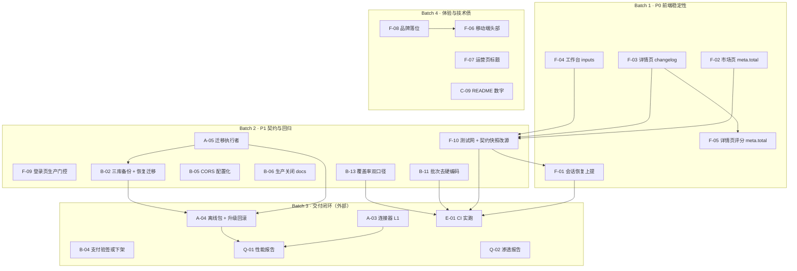

# 麦子 V1.0 阶段四整改计划（Gate 4 未通过后的可执行清单）

| 项 | 内容 |
| --- | --- |
| 文档编号 | MOY-PLAN-2026-10-25-R1 |
| 编制人 | 许清楚（产品经理） |
| 编制时间 | 2026-10-25 |
| 适用阶段 | V1.0 阶段四（商用打磨与交付准备）· Gate 4 整改 |
| 上游输入 | ① 主理人前端真实走查（本地 stub 适配层 + 演示账号，2026-10-25，截图 `.workbuddy/screenshots/`）；② `docs/archive/audit-2026-10-24-full-repo-audit-r2.md`（MOY-AUDIT-2026-10-24-R2）；③ `docs/plan-v1.0.md` §6 |
| 下游消费 | 架构师（分解为技术任务）、工程师（实施）、QA（验证） |
| 口径声明 | 本文只写计划，**不改任何代码**。所有事实均标注文件:行号或截图名；无法核验的标「待验证」，不推断 |

---

## 0. 一页速读

- **修复项 23 条**：P0 **10** / P1 **9** / P2 **3** / P3 **1**。
- **Gate 4 为什么没过**：不是"功能没做"，而是 **10 条 P0 同时踩在两条底线**上——
  - **看不到**：插件市场、插件详情、工作台三个核心页面在真实数据下**必然崩溃**（F-02/F-03/F-04，截图 04/10/11 已复现），且刷新即掉登录态（F-01）。演示路径直接断在第二屏。
  - **交不出**：私有化离线包缺镜像、无升级/回滚脚本、迁移无人执行、5 款连接器全桩、支付验签与微信 APIv3 不兼容、性能与渗透无产物（A-03/A-04/A-05/B-04/Q-01/Q-02）。§6.1/6.3/6.4/6.5 四条一票否决项均无证据。
- **Batch 1 只做 5 条前端 P0**，目标是"演示路径不崩"：`/chat`、`/knowledge`、`/plugins`、`/plugins/{id}`、`/workbench/{id}` 五个页面可直达、可刷新、不白屏。**不涉及后端契约重构**。
- **最大的单点风险不是代码，是口径**：前端崩溃的根因是 `pages` 照着一份**手抄的契约快照**（`apps/web/contracts/phase3.pl.json`）写，而快照与后端 Pydantic 实现早已漂移；现有 G-31 门禁**比对的是快照，不是真后端**，所以全绿（F-10）。这条不修，同类崩溃会持续复发。
- **需用户确认的 Top 3**：① 品牌命名（白标 / 麦子 Moy）；② 是否允许新增 vitest + playwright 依赖；③ 5 款连接器的真实账号与出站白名单（含微信支付资质）。

---

## 1. 目标与判定口径

### 1.1 本次整改服务于 Gate 4 的哪些条款

> 说明：仓库文档中「Gate 4」**没有独立编号定义**（全文检索 `Gate 4` 仅命中 `docs/archive/audit-repo-2026-10-22.md:282` 的无关语境）。本文按阶段四的事实门禁口径执行：**`docs/plan-v1.0.md` §6 最终验收标准（一票否决项）+ `docs/phase4-delivery-manifest.md` 汇总口径（待建项必须为 0）+ 前端可演示性**。

| Gate 4 判定要素 | 原文要求（`plan-v1.0.md` §6） | 现状 | 服务条款 | 本次整改条目 |
| --- | --- | --- | --- | --- |
| §6.1 功能验收 | 3 个标杆插件可独立完成端到端工作流；5 款工具鉴权→调用→回流全链路联调 | 插件市场/详情/工作台**崩溃**，工作流无法演示；5/5 连接器为 `demo` 桩 | 6.1 | F-02、F-03、F-04、F-05、A-03 |
| §6.2 体验验收 | UI 与文案 100% 统一；普通用户无需培训；**无技术暴露** | 刷新掉登录态（实测 3 页复现）；运营页标题重复；全站无品牌；登录页输出后端地址 | 6.2 | F-01、F-06、F-07、F-08、F-09 |
| §6.3 性能验收 | 首屏 ≤2s / 首字 ≤1s / 1,000 并发 / 99.5% 可用 | 无性能报告与压测产物 | 6.3 | Q-01 |
| §6.4 安全合规 | 渗透无高/中危；权限隔离完善 | 无渗透报告；生产 CORS 硬编码空、`/docs` 全环境开放 | 6.4 | Q-02、B-05、B-06 |
| §6.5 交付验收 | SaaS 可注册付费；私有化一键+纯离线；文档齐全 | 支付为桩且验签不兼容 v3；离线镜像缺失；无升级/回滚；迁移无执行者；备份不全 | 6.5 | A-04、A-05、B-02、B-04 |
| **门禁有效性**（Gate 前置条件，非 §6 条款） | 质量结论必须"可复现、可自证" | 前端零自动化测试；CI 批次写死；覆盖率本地不可自证；CI 从未在 GitHub 实跑 | — | F-10、B-11、B-13、E-01 |

### 1.2 优先级定义

| 级别 | 定义（本条为判定依据） | 为什么不是上一级 | 典型后果 |
| --- | --- | --- | --- |
| **P0** | 阻塞 Gate 4 判定：核心页面不可用（崩溃/白屏/无法登录），或 §6 一票否决条款无证据可交 | — | 演示中断、客户现场无法签收、验收无法启动 |
| **P1** | 交付前应修：影响**可信度、安全边界**或**门禁有效性**（门禁绿但抓不到问题） | 不直接让页面崩，但会让"已通过"的结论不成立 | 回归复发、审计复检不过、客户尽调扣分 |
| **P2** | 用户体验与技术债，可在 V1.0 内择机 | 有明确 workaround（可用但难用） | 观感差、移动端不好用、品牌弱 |
| **P3** | 清理类：文案、过期数字、仓库卫生 | 可无限期推迟至下一个版本 | 无功能影响 |

**判定原则（供复核时挑战）**：一条问题之所以是 P0 而不是 P1，必须能回答"它具体挡住了 Gate 4 的哪一条、以什么形式挡住"。本文每条 P0 均给出该答案（见 §2 表 `影响范围` 列）。

### 1.3 证据等级

| 等级 | 含义 | 本文中的样子 |
| --- | --- | --- |
| **已复现** | 本次走查或本次实测可重复得到同一结果 | 截图 04/10/11 的 Next.js 错误覆盖层（含文件名:行号） |
| **代码级确认** | 代码与类型定义互相矛盾，逻辑上必然发生 | `types.ts` 声明 `meta: PageMeta`，后端 `MarketData` 无 `meta` |
| **待验证** | 依赖部署环境或外部条件，本机无法判定 | F-09 生产构建是否另有裁剪；B-04 是否已接真实商户号 |

---

## 2. 问题总表（核心）

> 列说明：`证据` 只写可核验定位（文件:行 / 截图名 / 命令）；`修复方案` 写**改哪一层、改什么**，不写具体代码；`需确认信息` 指向 §5 的编号。

| ID | 问题 | 证据（文件:行 / 截图） | 根本原因 | 修复方案 | 优先级 | 影响范围 | 验证方式 | 依赖 | 需确认信息 |
| --- | --- | --- | --- | --- | --- | --- | --- | --- | --- |
| **F-01** | 硬刷新/深链后丢失登录态：请求不带 `Authorization`，适配层返回 20002「登录状态已失效」；直达 `/chat`、`/knowledge`、`/plugins` 均复现 | `hooks/use-session.ts:74`（唯一令牌回灌点）；`useSession()` 全仓仅 1 处挂载：`app/(main)/profile/page.tsx:41`；`lib/api-client.ts:208` 令牌是模块内存；截图 `02-chat.png`（底部错误提示）、`03-knowledge.png`；适配层日志 `missing Authorization header` | 会话恢复被写成"页面级 hook"，而**令牌注入是应用级职责**。除 `/profile` 外没有任何入口在首次渲染前把 `localStorage` 的 `moy.session.v1` 回灌进 `api-client` 内存 | 把会话恢复上提到 `(main)/layout.tsx`（或客户端 Provider）统一执行一次：读存储 → 校验形状/过期 → `setAccessToken` + `setTenantId`，**在子页面发起任何查询之前完成**；`/profile` 改为消费同一状态；无会话时统一跳登录（保留 `next` 参数） | **P0** | 全部 20 个页面 × 所有需鉴权接口；挡住 §6.2「无需培训即可上手」——第一屏就报错 | 见 §7-A1（浏览器手工 + Network 断言 + 适配层日志零 `missing Authorization`） | F-10（回归测试，建议并行） | — |
| **F-02** | 插件市场页崩溃：`TypeError: Cannot read properties of undefined (reading 'total')` | `app/(main)/plugins/page.tsx:143`（`marketQuery.data?.meta.total`）；后端 `app/schemas/plugin.py:100-120` `MarketData` 为**扁平分页**（`page/page_size/total/total_pages` 顶层，无 `meta`）；截图 `04-plugins.png`（`143:41`） | 前端 `types.ts:1136-1147` 把 `PluginMarketData` 声明为 `meta: PageMeta`，与后端实现不一致；快照 `contracts/phase3.pl.json` 抄自文档而非后端，G-31 无法发现 | 前端对齐后端现状：读顶层 `total/total_pages`，分页参数走 `page/page_size`；同步修正 `types.ts` 的 `PluginMarketData`。**后端本轮不动**（扁平口径已是插件/计费/运营三域事实标准） | **P0** | 插件市场整页不可用 → §6.1 三个标杆插件**无法被找到**，端到端演示链断在第一跳 | 见 §7-A2 | F-10（契约快照改源） | — |
| **F-03** | 插件详情页崩溃：`Cannot read properties of undefined (reading 'length')` | `app/(main)/plugins/[pluginId]/page.tsx:403`（`plugin.changelog.length`）；后端 `MarketDetailData`（`schemas/plugin.py:167-215`）**无 `changelog` 字段**，版本说明在 `versions[].changelog`（`:139-146`）；截图 `10-plugin-detail.png`（`403:29`） | 同 F-02：前端 `types.ts:1218` 声明 `changelog: PluginChangelog`（对象），后端给的是 `versions: VersionBriefItem[]`（数组，元素含 `changelog: str`）。**数据在后端已存在，只是形状不同** | 前端改用 `versions[].changelog` 渲染"版本说明"（零后端改动、零数据缺口）；删除 `types.ts` 的 `changelog` 字段声明 | **P0** | 插件详情页整页不可用 → 安装/授权/评价全部入口失效 | 见 §7-A3 | F-10 | — |
| **F-04** | 工作台页崩溃：`Cannot read properties of undefined (reading 'length')` | `app/(main)/workbench/[pluginId]/page.tsx:55`（`plugin.inputs.length`，在 `buildSections` 内）；后端 `MarketDetailData` **无 `inputs` 字段**（`schemas/plugin.py:167-215`）；截图 `11-workbench.png`（`55:21`） | 契约缺口：前端 `types.ts:1207-1213` 注释已**明确承认**"架构 §5.2 的 PL2 响应表未列 `inputs[]`，已纳入契约快照待后端确认（B24 回传的契约缺口）"——缺口被记录但**没被任何门禁拦截**。数据侧：`app/plugins/manifests/plg_*.json` 均含 `inputs`（实测 `plg_weekly_report.json` 有 3 项，`:331` 的 `detail()` 已在读 `manifest`） | **需后端补字段**（这是唯一能保住用户价值的方案）：`MarketDetailData` 增 `inputs: list[InputBriefItem]`，`plugin_service.detail()` 从 `manifest.inputs` 映射（数据已在手，约 10 行）。前端同步 `buildSections` 容错 `?? []` 防再崩；**不接受**"仅前端删掉表单区"——那等于工作台没有输入能力 | **P0** | 3 个工作台插件全部不可用 → §6.1「标杆插件端到端」直接不成立 | 见 §7-A4 | 后端排期（架构师评估 10 行改动的兼容性） | — |
| **F-05** | 插件详情页评分总数同类风险：`reviewsQuery.data?.meta.total` | `app/(main)/plugins/[pluginId]/page.tsx:259`；后端 `ReviewListData`（`schemas/plugin.py:525-544`）同为**扁平分页**（`total` 顶层，无 `meta`） | 与 F-02 同源：前端误用 `meta` 包裹 | 与 F-03 同批修复（同一文件、同一形状问题）：改读顶层 `total`；`types.ts` 的 `PluginReviewsData` 同步修正 | **P0** | 修完 F-03 后详情页仍会在评价区二次崩溃（当前被 F-03 更早的崩溃遮住，属"雪崩第二层"） | 见 §7-A5 | 与 F-03 同 PR 提交 | — |
| **F-06** | 移动端头部拥挤：390px 下"对话"标题被压成竖排两字，输入框占位文案换行 | `components/layout/sidebar.tsx:188-216`（`MobileNav` 把 9 个 `NAV_ITEMS` 图标塞进一行）；`app/(main)/layout.tsx:55-58`（标题与 `MobileNav` 同行）；截图 `13-mobile-chat.png` | 移动端沿用了桌面端的"全量一级导航"，没有做移动端信息架构（应收敛为 4-5 项 + 更多） | 移动端导航改为底部/抽屉形态：`MobileNav` 只保留 4 个高频项（对话/知识库/插件/我的），其余进"更多"抽屉；顶栏标题与图标分区（标题允许 `truncate`，不参与 icon 行） | P2 | 移动端所有页面顶栏（390px 视口） | 见 §7-B6 | F-08（同一文件改动，建议合并一次改） | — |
| **F-07** | 运营页标题回落：`/ops/metrics` 顶栏显示"办公 AI 平台"，与页内"运营后台"重复 | `components/layout/sidebar.tsx:40-63`（`NAV_ITEMS`/`EXTRA_TITLES` 均未覆盖 `/ops`）；`app/(main)/layout.tsx:56` 回落串；页内标题 `app/(main)/ops/layout.tsx:58`、`:70+`；截图 `09-ops-metrics.png` | 标题解析函数 `resolveNavItem` 的覆盖表漏了 `/ops` 前缀；回落串是产品名，不是页面名 | `EXTRA_TITLES` 增 `{ prefix: '/ops', label: '运营后台' }`；并把回落串从"产品名"改成中性值（或干脆不渲染），避免任何未收录路由再暴露产品名占位 | P2 | 运营后台 4 个子页 | 见 §7-B7 | — | — |
| **F-08** | 品牌缺失：全站顶栏/登录页/页面标题均为"办公 AI 平台"，无「麦子 / Moy」标识 | `app/layout.tsx:11-14`（`metadata.title` 默认"企业级办公 AI 平台"）；`app/(main)/layout.tsx:56`；`components/layout/sidebar.tsx`（logo 区）；`app/(auth)/login/page.tsx`；**实测在 `apps/web/src` 检索「麦子」与「Moy」，命中 0 条** | 品牌层从未落位：产品有正式名（仓库名/文档均称 Moy 麦子），但 UI 层用的是品类词 | 待拍板后统一：若**品牌化**→ 建单一品牌常量模块（名称/副标/图标/favicon/`metadata`），替换 4 处硬编码；若**白标**→ 品牌名走环境变量 + 交付包配置，默认值为「麦子」。**不接受继续用"办公 AI 平台"**（它既是品类词，又与 charter 品牌冲突） | P2 | 全站（含登录页、浏览器标签页、错误页） | 见 §7-B8 | §5-C1（品牌命名） | **C1** |
| **F-09** | 开发态信息暴露：登录页固定输出"服务状态：{后端地址}" | `app/(auth)/login/page.tsx:246`；该行**在生产门控块之外**（门控变量 `IS_PRODUCTION_BUILD` 在 `:36`，仅包住 `:190-240` 的开发入口区）；截图 `01-login.png`（显示 `http://127.0.0.1:8100`） | 渲染位置与门控范围不匹配：开发者以为"整块都是开发专用"，实际只有上半部分在门控内 | 把 `:246` 移入 `IS_PRODUCTION_BUILD` 门控内（1 行）；同时确认生产构建下 `开发联调 / 访问凭证 / 统一登录（联调验证用）` 三处均不渲染 | **P1**（原 P3，上调，理由见 §2.1-④） | 生产构建登录页；§6.2「无技术暴露」一票否决条款 | 见 §7-A6 | — | §5-C7（生产环境是否有独立裁剪） |
| **F-10** | 契约防线缺失：前端零自动化测试，4 个崩溃无一被拦截；G-31 契约检查**比对的是手抄快照而非真后端** | `apps/web/package.json` 全文无 `vitest/playwright/jest`（实测 grep 0 命中）；`apps/web/scripts/check-plugin-contract.mjs:5-8` 自述"把 `contracts/phase3.pl.json`（从架构文档 §5.2/§5.3 抄下来的快照）与 `types.ts` 逐键比对"；`.github/workflows/ci-web.yml:189` 只跑该快照比对 | ① 21k 行前端无测试网；② 契约快照的**真源是文档**，文档本身漏了 `inputs[]`（见 F-04 注释），于是"照着错的抄 → 比对通过"形成闭环假绿灯 | ① 加 vitest：`api-client`（头注入/20002 分支）、`use-session`（有/无/过期三态）、`buildSections`（`inputs` 缺失时不崩）；② 加 1 条 playwright 冒烟：登录→直达 `/chat`→插件市场→详情→工作台；③ **把契约快照改为从 `app.openapi()` 导出**（`python -c "from app.main import app; ..."`）并纳入 `validate_openapi.py`，G-31 改为比对导出产物 | **P1** | 全部前端页面；直接决定 F-02~F-05 是否复发 | 见 §7-A7 | §5-C2（是否允许新增测试依赖）；E-01（要在 CI 生效） | **C2** |
| **A-03** | 5 款连接器全为桩实现（`INTEGRATION_STATUS = "demo"`），不发起任何真实第三方调用；而 §6.1 把"全链路联调"列为一票否决 | `app/tools/base.py:73-79`（默认 `demo` 且注释明确"不产生任何真实第三方调用"）；`app/tools/{email,feishu,github,wechat_mp,wecom}_connector.py` 各自 `_stub_*` 方法（如 `email_connector.py:194,218`） | 缺真实账号与出站网络，只能做桩；桩被如实标注（fail-honest），但**交付物没有"L1 打通"证据** | 逐连接器推进到 L1（真实鉴权 + 一次真实读写 + 回流落库），每个连接器留"一账号一截图一请求日志"记录；**本轮不承诺 L2/L3** | **P0** | §6.1 一票否决；`plan-v1.0.md:376` | 见 §7-A8 | §5-C3（账号/白名单）；§5-C5（网络） | **C3** |
| **A-04** | 私有化交付运维闭环缺失：`install.sh --offline` 要求的 `deploy/offline/images/*.tar` **不存在**（`deploy/offline/` 下只有 `README.md` 与 `plugins`）；**无 `upgrade.sh` / `rollback.sh`** | `deploy/install.sh:71,129,937`（引用 `offline/images`）；实测 `ls deploy/*.sh` = `backup.sh install.sh restore.sh validate_lite_up.sh`（无升级/回滚）；`deploy/offline/` 实测仅 2 项 | 交付脚本只写了"装"，没写"升"和"退"；离线镜像属于发布产物，未纳入任何产出流程 | ① 产出 `deploy/offline/images/*.tar` + `checksums.sha256`（按 `deploy/images.lock` 的 digest 导出）；② 补 `upgrade.sh`（拉新镜像 → 迁移 → 滚动重启 → 健康检查 → 失败自动回滚）与 `rollback.sh`（切回上一 tag + 迁移回退脚本）；③ 在干净机器上完整实跑一次并留命令输出 | **P0** | §6.5 一票否决「一键部署 + 纯离线运行」；客户现场签收 | 见 §7-A9 | §5-C4（目标平台/交付对象）、A-05、B-02 | **C4** |
| **A-05** | 迁移无生产执行者：`db_auto_migrate` 默认 `False`，三套 compose 均未开启；带 `pg_isready` 的 `migrate` 服务只在轻量版存在 | `app/core/config.py:173`；实测 `grep -ln migrate deploy/*.yml` = 仅 `docker-compose.lite.yml` | 迁移被当成"运维手跑步骤"，没有编排层执行者 | 把 `migrate` 服务抽成 compose overlay（`docker-compose.migrate.yml`）供三套编排共用，由 `install.sh`/`upgrade.sh` 显式 `up` 一次并校验退出码；保持"应用不自动迁移"的克制（不在 app 启动时迁移），但**必须有人执行** | **P0** | §6.5；首装/升级后连到空库 → 全站 500 | 见 §7-A10 | A-04（升级脚本调用它）、§5-C4 | — |
| **B-02** | 备份范围不全：`backup.sh` 只 dump 业务库 `officeai`，Keycloak（realm/client/user）与 Dify（应用/密钥）不在备份内；`restore.sh` 无迁移兜底 | `deploy/backup.sh:223-243`（仅一次 `pg_dump -d ${DB_NAME}`）；实测在 `deploy/restore.sh` 中检索 `alembic` 与 `migrate`，均 0 命中 | 备份按"我们的库"设计，未按"恢复后能跑起来"设计 | `backup.sh` 扩到三库（`officeai` / `keycloak` / `dify`）+ 记录各库版本；`restore.sh` 恢复后执行迁移，并对 8 张核心表做行数基线校验（不匹配即 fail） | **P1** | 私有化灾备；恢复演练是 §6.5 交付证据的一部分 | 见 §7-B2 | A-05 | — |
| **B-04** | 支付回调验签与微信 APIv3 结构不兼容：自造 `HMAC-SHA256(api_v3_key, 自定义串)`，而 v3 要求平台证书 RSA 验签 + `AES-256-GCM` 解密 resource；`trade_state` **缺省按 success** 处理，属 fail-open | `app/business/payment_gateway.py:20-23`（自述签名算法）、`:246-254`（`hmac.new(...)`）、`:97`（`trade_state: str = TRADE_STATE_SUCCESS` 默认成功）、`:103`（`== SUCCESS` 判定）、`:256` 起 `verify_and_parse` | 没有商户号/证书，只能自造一套可自测的签名；但**默认成功**不是临时方案的合理代价，而是真实资金风险 | 二选一，**不允许留在中间态**：① 真接 → 平台证书 RSA 验签 + AES-256-GCM 解密 + `trade_state` 白名单（去掉默认 success，未知状态一律拒）；② 不接 → UI 全部标注"演示支付"、下单接口显式返回"未开通"，并删除 fail-open 默认值 | **P1** | §6.5「SaaS 可正常注册、付费」；资金安全 | 见 §7-B4 | §5-C6（商户号/证书）；产品侧先拍板"真接 or 下架" | **C6** |
| **B-05** | 生产 CORS 硬编码为空：`allow_origins = ["*"] if env == "development" else []`，无环境变量可配 | `app/main.py:383` | 安全默认做到了"生产不放开"，但没有给出"合法源站怎么放开"的出口 | 改为 `OA_CORS_ALLOW_ORIGINS`（逗号分隔白名单，默认空），生产必须显式配置；空值启动时告警不阻断 | **P1** | 任何独立前端源站（SaaS 多域名）无法调用；私有化同源部署不受影响 | 见 §7-B5 | — | — |
| **B-06** | 生产暴露 OpenAPI 文档：`/docs` `/redoc` `/openapi.json` 全环境开放 | `app/main.py:365-367` | 文档端点跟随框架默认，没有按环境收敛 | 生产关闭 `docs_url/redoc_url`；`openapi.json` 仅在运维网段或带内部令牌时可读（nginx 层限制亦可）；开发/测试保持开放 | **P1** | §6.4 安全合规；接口结构对公网可见 | 见 §7-B5 | — | — |
| **B-11** | 缺陷到期时钟可自拨：`OA_BATCH` 在 CI 中**硬编码为 `B21`**，批次是"缺陷到期"判据，写死等于让被审对象自己决定何时到期 | `.github/workflows/ci-adapter.yml:88`（`OA_BATCH: B21`）；**注：同处 `--allow-missing-phase2` 已移除（`:527` 注释）** | 批次本应是"当前批次"的投影，却写成了常量 | 改为从仓库文件读取（如 `.github/batch` 或 `docs/phase4-batch-log.md` 头部声明），CI 断言"声明的批次 ≥ 门禁要求的批次"；不允许 workflow 内出现批次字面量 | **P1** | 后端质量门禁的可信度（§1.1 门禁有效性） | 见 §7-B11 | E-01 | — |
| **B-13** | 覆盖率门禁本机不可自证（口径错配）：85% 门禁按 `--run-pg` 口径测量，本机无测试库 → 203 条 PG 用例全 skip，测得 81.69% 与门禁不可比 | `ci-adapter.yml:279-300`（CI 注释记录带库 89.81% / 无库 84.19%）；审计 R2 §4.2 及 §4.5 纠错记录 | 单一口径既当"CI 门禁"又当"本地自检"，两者测的不是同一个东西；另有 17 条 PG 用例靠 fixture 暗跳未打标记 | 拆双口径：本地/无库门槛（按现值定 85%）+ CI/含库门槛（90%），两个数字都写进 `README` 与 `pyproject` 注释；把 `@pytest.mark.pg` 补齐到与 skip 数严格相等，并加一条断言"skip 数 == pg 标记数" | **P1** | 所有"覆盖率达标"结论的可信度 | 见 §7-B13 | E-01（CI 实跑才算数） | — |
| **E-01** | CI 从未在 GitHub Actions 实跑（额度未恢复）；因此所有 CI 门禁结论都是"本地模拟" | 审计 R2 §八「未覆盖」第 4 项；`.github/workflows/` 3 个 workflow 均无远端执行记录 | 外部额度问题，非代码问题 | 恢复额度后跑一次全绿并留 run URL；若长期不可用，降级为"本地脚本等价复跑"并在文档标注"未经远端验证" | **P1** | 全部门禁结论的可信度（Gate 4 判定的前置） | 见 §7-B1 | §5-C8（Actions 额度） | **C8** |
| **Q-01** | 性能验收无任何产物：首屏 ≤2s / 首字 ≤1s / 1,000 并发 / 99.5% 可用均未测 | 审计 R2 §六 6.3 行（"无性能报告与压测产物"）；`scripts/bench/` 存在但无报告 | 性能从未被当作验收项执行 | 在目标部署规格上跑：① 首屏与首字（前端 LCP + SSE 首包时间，取 P50/P95）；② 1,000 并发（k6/locust 打 `/model/chat` 与 `/plugins/market`）；③ 24h 可用率采样。产出 `docs/performance-report-v1.0.md` | **P0** | §6.3 一票否决；无报告即判"不达标" | 见 §7-A11 | 部署环境 + §5-C4（目标规格） | **C4** |
| **Q-02** | 渗透测试无报告：§6.4 要求"无高危、中危漏洞"，当前无第三方或自测渗透记录 | 审计 R2 §六 6.4 行（"无渗透报告"）；`docs/security/` 仅有协议扫描 | 安全验证只做到"合规扫描"，未做攻击面测试 | 至少完成一轮自测渗透（OWASP Top 10 对应项：鉴权绕过、越权、SSRF、注入、上传），产出问题清单与修复记录；有条件再做第三方 | **P0** | §6.4 一票否决 | 见 §7-A12 | 部署环境；可选第三方预算 | — |
| **C-09** | README 质量数字全面过期：端点 84（实际 96）、用例 1,573（实际 2,095）、覆盖率 90.78%（本机 81.69%）、阶段状态"四未启动" | `README.md:15-28,210-235`（审计 R2 §4.3 C-09） | 数字手写、无人校验 | 数字改为"由脚本生成"：`scripts/gen_delivery_manifest.py --check` 已在 CI，扩一段输出端点数/用例数/覆盖率到 README 的标记区块；人工改数字退出码非 0 | P3 | 对外文档可信度（尽调第一眼） | 见 §7-C9 | — | — |

### 2.1 需要额外解释的四条

**① F-04 为什么必须是"后端补字段"而不是"前端删表单"**
`app/plugins/manifests/plg_*.json` 里 `inputs` 真实存在（实测 `plg_weekly_report.json` 有 3 项），`plugin_service.detail()` 已在读同一个 `manifest` 对象并映射了 `outputs` 与 `settings_schema`（`business/plugin_service.py:348-363`）。也就是说**数据在手上，只是没进响应模型**。若前端删掉表单区，工作台就没有输入能力，"标杆插件端到端"变成"点一下看结果"，§6.1 依旧不达标，只是从"崩"变成"残"。

**② F-03 为什么让前端改、F-04 让后端改**
判断标准是"用户价值是否依赖该字段"。`changelog` 只是展示用，`versions[]` 已完整承载同样信息（"版本说明"可逐版本渲染，信息更全）→ 前端改，零后端风险。`inputs[]` 决定表单能否渲染，前端无替代数据源 → 后端补，10 行改动。

**③ F-02/F-05 不动后端的原因（分页口径二义性）**
后端两种分页口径**同时存在**：`schemas/common.py:87-103` 有标准 `PageResult[T]`（`items` + `meta`，会话/记忆在用），而插件/计费/运营四域用的是扁平字段。前端照着 `PageResult` 写，撞上扁平实现。本轮**不做全量统一**（影响 96 个端点、风险远大于收益），改为①前端对齐现状；②契约快照改由 `app.openapi()` 导出并以 G-31 双向锁定（F-10）。口径统一登记为 V1.1 技术债。

**④ F-09 为什么从 P3 上调到 P1**
三点叠加：① 该行在 `login/page.tsx:246`，**位于生产门控之外**（门控只包住 `:190-240`），因此生产构建必然渲染；② 输出的是后端地址，属于 §6.2「用户全程感知不到任何底层组件」的直接违反；③ 它把内部拓扑暴露给任何打开登录页的人。改动成本是移动 1 行，收益是移除一条一票否决条款的可见违反项——按 1.2 的定义应归 P1。若确认生产构建另有裁剪（§5-C7），可降回 P3。

---

## 3. 分批执行计划

> 分批原则：**先让人能看见（Batch 1），再让门禁能抓住（Batch 2），再让客户能签收（Batch 3），最后让人用着舒服（Batch 4）**。批次之间不是纯串行——Batch 3 的外部协调应与 Batch 1 同时启动（见 §4）。

### Batch 1 · 立即执行：P0 前端稳定性（5 条）

| 项 | 内容 |
| --- | --- |
| **目标** | 演示路径五个核心页面**可直达、可刷新、不白屏**；插件市场→详情→工作台链路跑通一次真实数据 |
| **包含条目** | **F-01、F-02、F-03、F-04、F-05** |
| **改哪里** | 前端：`hooks/use-session.ts`、`(main)/layout.tsx`（会话上提）、`plugins/page.tsx:143`、`plugins/[pluginId]/page.tsx:259,403`、`workbench/[pluginId]/page.tsx:55`、`lib/types.ts`（3 个类型）。后端：`schemas/plugin.py` 增 `inputs` + `InputBriefItem`、`business/plugin_service.py:331` 映射（仅 F-04） |
| **Exit Criteria（全部满足）** | ① `npm run typecheck:web` 退出 0；② `npm run lint:web` 退出 0；③ 硬刷新 `/chat`、`/knowledge`、`/plugins`、`/plugins/plg_weekly_report`、`/workbench/plg_weekly_report` 五页**零 error overlay**；④ 五个页面请求头均含 `Authorization: Bearer`，适配层日志零 `missing Authorization header`；⑤ `plugins/market` 响应 `total` 能在页面显示（"共 N 个插件"）；⑥ 工作台渲染出 3 个输入控件（`plg_weekly_report`）；⑦ 后端 `pytest tests/unit/test_plugin*` 与 `mypy app` 退出 0 |
| **依赖** | 无外部依赖，可**今天开始**。F-05 与 F-03 必须同一 PR（同文件同形状） |
| **不做** | 不重构分页口径、不改 `contracts/phase3.pl.json`、不做移动端、不动品牌 |

### Batch 2 · 本周：P1 契约与回归防线（8 条）

| 项 | 内容 |
| --- | --- |
| **目标** | 让"同类崩溃不会复发"、让"门禁抓得住"、让"备份能恢复"。这一批做完，F-02~F-05 才算真正闭环（否则只是止血） |
| **包含条目** | **F-10、F-09、A-05、B-02、B-05、B-06、B-11、B-13** |
| **Exit Criteria** | ① `npx vitest run` 覆盖 `api-client`/`use-session`/`buildSections`，≥12 条用例、全绿，且**故意改坏 `inputs` 读取后测试变红**；② 1 条 playwright 冒烟串完 登录→/chat→/plugins→详情→工作台；③ G-31 改为比对 `app.openapi()` 导出产物，**手工把 `total` 改成 `meta.total` 后门禁变红**；④ 三套 compose 均有 migrate 服务（overlay），`install.sh` 调用后再 `psql -c "\dt"` 表数 ≥44；⑤ `backup.sh` 产出含 3 个 dump + `restore.sh` 恢复后 8 张核心表行数一致；⑥ 生产 profile 下 `/docs` 404、CORS 仅白名单可通；⑦ CI 中 `OA_BATCH` 字面量消失（`grep -c "OA_BATCH: B" .github/workflows/ci-adapter.yml` = 0）；⑧ 本地与 CI 双覆盖率口径写入 README 且 `skip 数 == pg 标记数` |
| **依赖** | §5-C2（允许新增 vitest/playwright）、§5-C8（CI 额度，只影响"在 CI 生效"，本地可先做）、A-05 需要 §5-C4 的部署环境做首装验证 |

### Batch 3 · 阶段四交付闭环：需外部信息（6 条）

| 项 | 内容 |
| --- | --- |
| **目标** | 把 §6.1/6.3/6.4/6.5 的"无证据"变成"有证据" |
| **包含条目** | **A-03、A-04、B-04、Q-01、Q-02、E-01** |
| **退出标准** | ① 5 款连接器各有"L1 打通"记录（真实鉴权 + 一次真实读写 + 回流落库 + 请求日志），`INTEGRATION_STATUS` 从 `demo` 升到 `l1`；② 干净机器 `install.sh --offline` → 登录 → 建任务 → `backup.sh` → `restore.sh` → `upgrade.sh` → `rollback.sh` 全链路一次通过并留命令输出；③ 支付达成产品决策（真接 v3 验签 或 全站标注演示支付 + 移除 fail-open）；④ `docs/performance-report-v1.0.md` 四项指标达标；⑤ 渗透报告无高危/中危；⑥ GitHub Actions 一次全绿并留 run URL |
| **依赖** | §5-C3、C4、C5、C6、C8 —— **这一批的瓶颈全在等待，不在开发，所以必须与 Batch 1 并行启动协调** |

### Batch 4 · 体验与技术债（4 条）

| 项 | 内容 |
| --- | --- |
| **目标** | 移动端可用、标题不重复、品牌落位、文档数字可信 |
| **包含条目** | **F-06、F-07、F-08、C-09**（F-09 已按 §2.1-④ 上调至 Batch 2） |
| **退出标准** | ① 390px 视口：顶栏标题不换行、图标不换行、输入框占位单行；② 任意 `/ops/*` 顶栏显示"运营后台"；③ 全站品牌名为拍板结果，`grep -rn "办公 AI 平台" apps/web/src` = 0；④ README 数字与 `python scripts/gen_delivery_manifest.py --check` 输出一致 |
| **依赖** | §5-C1（品牌命名）—— **此项不确定，本批只能做 F-06/F-07/C-09** |

---

## 4. 执行顺序与依赖关系

### 4.1 有序执行序列

1. **T0（今天）**：同时发出 5 项外部协调（§5 的 C1/C2/C3/C4/C6），不等回复。
2. **T0+0（今天）**：工程师开 **F-02 → F-03+F-05（同 PR）→ F-01**。顺序理由：F-02/F-03/F-05 是纯前端对齐（无契约争议、不需评审），可立刻让两页恢复；F-01 涉及布局层，改动面最大，放在三页恢复之后、单独 PR，便于回滚。
3. **T0+1**：架构师评审 **F-04** 的后端加性契约（`inputs`），工程师同步提交前端 `?? []` 容错。**前端容错先合，后端字段随后合**——这样页面永不崩，字段到位后表单自动出现。
4. **T0+1 起并行**：F-10 的 vitest 骨架（可与 F-01 并行，不同文件）；A-05 的 migrate overlay（后端独立）。
5. **T0+2**：F-09（1 行）+ B-05/B-06（生产暴露面，同一 PR）。
6. **T0+3**：B-02（备份/恢复范围）。**必须在 A-05 之后**（恢复要跑迁移）。
7. **T0+3 起**：B-11、B-13（门禁口径），依赖 E-01 才能真正验证，但代码可先改。
8. **Batch 3 各条按外部信息到位时间插入**，与其余批次并行；其中 **A-04 必须在 A-05 + B-02 之后**（离线包要包含可用的迁移与备份）。
9. **Batch 4** 在 Batch 1/2 全绿后开始；F-06 与 F-08 合并一次改（同文件 `sidebar.tsx` + 布局），避免两次动同一片代码。

### 4.2 依赖图



### 4.3 依赖表与并行度

| 条目 | 前置 | 可并行于 | 串行原因 |
| --- | --- | --- | --- |
| F-02 | 无 | F-03/F-04 | — |
| F-03、F-05 | 无 | F-02/F-04 | 二者必须同 PR（同文件 `[pluginId]/page.tsx`） |
| F-04 | 架构师评审（0.5d） | F-01/F-02 | 后端加字段需评审；前端容错部分可先合 |
| F-01 | 无 | F-02/F-03 | 独立 PR，便于单独回滚 |
| F-10 | F-02~F-05 已定形状 | A-05 | 测试要断言的正是修复后的形状；契约快照导出脚本可先写 |
| F-09、B-05、B-06 | 无 | 任意 | — |
| A-05 | 无 | 任意（后端侧） | — |
| B-02 | A-05 | 任意 | 恢复流程需调用迁移 |
| B-11、B-13 | 无（代码），E-01（验证） | 任意 | — |
| A-04 | A-05、B-02、§5-C4 | 其余全部 | 离线包必须包含可用的迁移与恢复 |
| A-03、B-04、Q-01、Q-02 | 外部信息（§5） | 其余全部 | 瓶颈是等待，不是开发 |
| E-01 | F-01、F-10、B-11、B-13 已合 | 其余全部 | 只有这些合入后实跑一次才有意义 |
| F-06 | F-08 拍板 | 任意 | 同文件改动，合并为一次 |
| C-09 | 无 | 任意 | — |

**可全并行的三条主线**：① 前端稳定性线（Batch 1 → F-10 → Batch 4）；② 后端交付线（A-05 → B-02 → A-04）；③ 外部协调线（A-03 / B-04 / Q-01 / Q-02）。三条线之间只有 E-01 一个汇合点。

---

## 5. 所需确认信息清单

> 格式：**缺什么 → 找谁要 → 拿到后做什么 → 拿不到怎么办（降级方案）**。带 ★ 为阻塞项。

| 编号 | 事项 | 缺什么（具体） | 找谁要 | 拿到后做什么 | 没有时的降级方案 |
| --- | --- | --- | --- | --- | --- |
| **C1** ★ | **品牌命名**（F-08） | ① 定名：对外叫「麦子」/「Moy」/双写；② 形态：品牌化（自有品牌）还是白标（客户可换名）；③ 配套：图标/favicon/主标副标文案 | 产品负责人 / 决策人 | 建品牌常量模块并替换 4 处硬编码；确定白标则品牌名走构建期环境变量 | **降级**：默认用「麦子 Moy」品牌化，白标留接口。**不接受**继续用"办公 AI 平台"（与 charter 品牌冲突，且是品类词） |
| **C2** ★ | **新增前端测试依赖**（F-10） | 是否允许在 `apps/web` 增 `vitest` + `@testing-library/react` + `playwright`（约 +4 个 devDependency，CI 时长 +3~5 分钟） | 技术负责人 / 架构师 | 写单测与 1 条 e2e 冒烟；接入 `ci-web.yml` | **降级**：不引入框架，只扩 `check-*.mjs` 静态扫描 + 一个 Node 脚本模拟契约（**能挡 F-02/F-05 类字段错误，挡不住 F-01 类运行时行为**）——因此这只是"次优"，需明确记录残余风险 |
| **C3** ★ | **连接器真实账号与出站白名单**（A-03） | 5 款工具各一组测试账号与凭据（邮件 SMTP/IMAP、飞书 app_id/secret、GitHub PAT、微信公众号 appid/secret、企业微信 corpid/secret）+ 允许出站的域名与端口 | 客户 IT / 内部运维 | 逐连接器完成 L1：真实鉴权 → 一次真实读写 → 回流落库 → 留请求日志 | **降级**：保持 `demo` 桩，但把 §6.1 判定改为"未达成"并在交付说明中**显式标注连接器成熟度为 L0**（charter D-19 已允许如实标注）。**不得**把桩说成打通 |
| **C4** ★ | **离线包目标平台与交付对象**（A-04、A-05、Q-01） | ① 目标 CPU 架构（x86_64 / arm64）与 OS；② 交付介质（U 盘/内网仓库）与单包体积上限；③ 目标机器规格（核数/内存/磁盘），决定性能基线 | 客户/销售 + 交付总监 | 按 `deploy/images.lock` 导出 `offline/images/*.tar` + checksums；在等价规格机器上跑性能与首装演练 | **降级**：先产出"打包脚本 + 清单 + 说明"，在自有机器上演练；报告中标注"目标平台未确认，指标为同构环境值" |
| **C5** | 模型提供方密钥 | 真实 LLM provider key（或私有化模型端点）+ 配额 | 采购 / 运维 | 联调真实模型（首字延迟、错误率、限流），支撑 Q-01 的首字 ≤1s 指标 | **降级**：用桩模型测通路，性能报告标注"模型层为桩，首字指标不可判" |
| **C6** ★ | **微信支付商户号/证书**（B-04） | 商户号、APIv3 密钥、平台证书（或平台公钥）、可回调的公网地址 | 财务 / 商务 | 实现 RSA 验签 + AES-256-GCM 解密 + `trade_state` 白名单；沙箱跑通下单→支付→回调 | **降级**：**产品侧先拍板「本版不真接」**，则 UI 全站标注"演示支付"，下单接口显式返回"未开通"，并**必须删除 `trade_state` 默认 success**（这是资金风险，不能留） |
| **C7** | 生产构建裁剪策略（F-09） | 生产构建是否有独立的构建期变量裁剪（如 `NEXT_PUBLIC_*` 白名单、"服务状态"是否被允许显示正式域名） | 架构师 / 前端负责人 | 决定 F-09 是"移入门控"还是"改为显示正式服务名" | **降级**：默认按"生产一律不显示后端地址"处理（更安全的一侧） |
| **C8** | GitHub Actions 额度（E-01） | 额度恢复时间，或是否允许改用自建 runner | 运维 / 账号管理员 | 跑一次全绿 CI 并留 run URL；作为 B-11/B-13 的最终验证 | **降级**：本地等价复跑（`bash` 串起 workflow 的 run 步骤）+ 文档标注"未经远端验证，风险已知" |

**Top 3（最紧急，其余可缓 1~2 天）**
1. **C1 品牌命名** —— 阻塞 F-08，且越晚改代价越大（文案已铺满 4 个文件）。
2. **C2 测试依赖许可** —— 阻塞 Batch 2 的退出标准；不批则 F-02~F-05 只有"止血"没有"防复发"。
3. **C3 连接器账号与出站白名单** —— §6.1 一票否决项，且是**外部等待时间最长**的一项（IT 审批周期不可控），必须今天发出。

---

## 6. 风险与回滚

### 6.1 契约改后端 vs 改前端的选择风险

| 方案 | 做法 | 风险 | 缓解 | 本文取舍 |
| --- | --- | --- | --- | --- |
| A（采用） | 前端对齐后端现状（F-02/F-03/F-05）；仅 F-04 后端加字段 | 若将来后端把插件域迁到 `PageResult`，前端要再改一次 | 契约快照改由 `app.openapi()` 导出 + G-31 双向锁定（F-10），迁移时一次性暴露所有差异 | **Batch 1 用 A**：最小改动、最快恢复演示、后端零回归风险 |
| B | 后端把 `MarketData`/`ReviewListData` 改成 `PageResult`（带 `meta`） | 改动落在**响应契约**上，前端有用例、第三方客户端也可能依赖；影响面比 A 大且无法在演示前验证充分 | 需先补齐契约测试与版本兼容 | 不做。登记为 V1.1「分页口径统一」技术债 |
| C | 只在前端加 `?.` 到处兜底 | 页面"不崩但空白"——崩溃变成静默错，比崩更难发现 | — | **禁止**：F-04 若只做 `?? []` 会导致工作台无表单且无人报警 |

**核心风险**：A 方案会**掩盖**契约二义性，让人误以为"契约没问题"。因此 F-10 的"契约快照改源"**不是可选优化，而是 A 方案的前置条件**——两者必须绑定验收。

### 6.2 会话恢复（F-01）引入的副作用

| 副作用 | 场景 | 缓解 |
| --- | --- | --- |
| **首屏闪烁**（先渲染"未登录"再切成已登录） | 会话恢复是异步的（读存储 → 校验 → 可能请求 profile） | 布局层在恢复完成前渲染骨架（`loading` 态），**不渲染任何"未登录"文案**；子页面查询 `enabled: session.loading === false` |
| **重复请求** | 布局层恢复一次 + 页面自身 `useApiQuery` 又发一次 | 会话状态走 React Query 单一缓存键（与 `QUERY_KEYS` 统一），profile 只请求一次；`/profile` 页改为消费缓存而非再 `useSession()` |
| **过期会话被判为已登录** | `expires_at: null`（开发凭证）不判过期 | 保持现状（有意为之），但生产 OIDC 会话必须有 `expires_at`；加一条单测锁定"null 不判过期、过期即清" |
| **深链被登出后的返回路径丢失** | 无会话跳登录，登录后回到 `/chat` 而非原页 | 跳转带 `?next=<pathname>`，登录成功后优先回 `next`（需校验仅允许站内路径，防开放重定向） |
| **令牌仍在 `localStorage`** | 同源 XSS 可读 | 本轮不改变（`session-store.ts:18-23` 已记录权衡）；收紧 CSP、禁止第三方脚本；`refresh_token` 保持"只存不用" |

**回滚方式**：F-01 独立 PR，回滚即 `git revert`，其余四个 P0 不受影响（页面级修复与会话层无耦合）。

### 6.3 移动端改造（F-06）的回归面

| 风险 | 说明 | 缓解 |
| --- | --- | --- |
| 导航入口丢失 | 9 项收敛到 4 项 + "更多"，被收起的 5 项（组织架构/账单/个人中心/我的记忆/工作流）需可达 | "更多"抽屉必须包含全部 9 项 + 运营后台（若有权）；QA 逐项点一遍 |
| 桌面端被误改 | `MobileNav` 与 `AppSidebar` 同文件 | 只改 `md:hidden` 分支内的实现与 `md:` 断点不受影响的部分；桌面端截图对比 |
| 顶栏高度变化影响 20 个页面 | 标题与图标分区会改变 `header` 内部结构 | 保持 `h-16` 不变，只调整内部排布；用现有截图（`13/14`）做前后对比 |
| 触达区域过小 | 图标按钮 <44px | 按钮最小 `44×44`（`p-2.5` 起） |

**回滚**：F-06 与 F-08 合并改同一文件，若品牌方案未定则**先不合并**——F-06 单独一个 PR，通过 `sidebar.tsx` 的独立函数边界隔离。

### 6.4 分批交付的整体风险

| 风险 | 影响 | 缓解 |
| --- | --- | --- |
| Batch 3 全部卡在外部等待，导致 Gate 4 长期挂空 | 交付时间不可控 | 今天发出 C3/C4/C6；同时把"可内部闭合"的项全部前置到 Batch 2，让团队始终有活干；每周固定一次"外部项状态同步" |
| 修 F-04 时后端无人排期 | 工作台仍无表单 | 前端容错先合（页面不崩），字段就绪后表单自动出现；若后端长期无排期，按 §2.1-① 记录为"能力缺口"而非"已修复" |
| 门禁改造（F-10/B-11/B-13）本身引入新红 | 阻塞其他 PR 合并 | 三条门禁各自独立 PR，先"影子运行"（不阻断，只告警）一周，再转为阻断 |
| 覆盖率双口径把门槛定得过高 | CI 长期红 | 门槛按现值下浮 1 个百分点定，先绿再逐步抬；门槛变更必须同 PR 改 README |

---

## 7. 验收清单（可执行命令 / 可观察结果）

> 通用约定：`$ADAPTER` = 本地适配层地址（走查时用 `http://127.0.0.1:8100`）；`$WEB` = 前端地址（默认 `http://localhost:3000`）。命令在仓库根执行。

### 7.1 P0 验收项

| 编号 | 条目 | 可执行命令 / 可观察结果 | 通过判据 |
| --- | --- | --- | --- |
| **A1** | F-01 会话恢复 | ① `grep -rn "useSession()" apps/web/src \| wc -l`；② 浏览器：登录后**硬刷新** `$WEB/chat`、`/knowledge`、`/plugins`；③ DevTools → Network 任一 `/api/v1/*` 请求头 | ① 命中点从 1 个变为"布局层 1 处 + 各页消费"；② 三页均无「登录状态已失效」提示，且不跳登录；③ 请求头含 `Authorization: Bearer …`；④ 适配层日志 `missing Authorization header` 计数为 0 |
| **A2** | F-02 市场页 | `curl -s $ADAPTER/api/v1/plugins/market -H "Authorization: Bearer $TOKEN" \| python -c "import json,sys; d=json.load(sys.stdin)['data']; print(d.get('total'), 'meta' in d)"` + 打开 `$WEB/plugins` | 命令输出 `total=<N> False`（确认后端无 `meta`）；页面渲染出"共 N 个插件"、无 Next.js 错误覆盖层；`grep -c "meta.total" "apps/web/src/app/(main)/plugins/page.tsx"` = 0 |
| **A3** | F-03 详情页 | 打开 `$WEB/plugins/plg_weekly_report` | 页面完整渲染，含"插件介绍"与"版本说明"（数据来自 `versions[].changelog`）；无 `reading 'length'` 覆盖层；`grep -c "changelog" "apps/web/src/app/(main)/plugins/[pluginId]/page.tsx"` 命中处不再有 `.length` |
| **A4** | F-04 工作台 | ① `curl -s $ADAPTER/api/v1/plugins/plg_weekly_report -H "Authorization: Bearer $TOKEN" \| python -c "import json,sys; print(len(json.load(sys.stdin)['data'].get('inputs',[])))"`；② 打开 `$WEB/workbench/plg_weekly_report` | ① 输出 `3`（后端已下发 `inputs`）；② 页面渲染出表单区（3 个控件）+ 步骤 + 产物三块；无 `reading 'length'` 覆盖层 |
| **A5** | F-05 详情页评价 | 打开 `$WEB/plugins/plg_weekly_report` 并滚动到评价区 | 评价区渲染出"N 条评价"；`grep -c "meta.total" "apps/web/src/app/(main)/plugins/[pluginId]/page.tsx"` = 0 |
| **A6** | F-09 生产门控 | `npm run build:web` 后 `grep -rc "服务状态" apps/web/.next/static \| grep -v ":0"` （或 `pnpm` 等价） | 命中为 0（生产产物中不含"服务状态"文案）；开发态仍可见 |
| **A8** | A-03 连接器 | 对每个连接器执行 `curl` 一次真实动作（如发一封邮件到测试邮箱）并查 `apps/adapter` 日志 | 5 个连接器各有 1 条真实第三方请求日志 + 1 条回流记录；`grep -rn 'INTEGRATION_STATUS' apps/adapter/app/tools/*.py` 不再是 `demo` |
| **A9** | A-04 离线交付 | 干净机器执行：`bash deploy/install.sh --offline` → 登录 → 建任务 → `bash deploy/backup.sh` → `bash deploy/restore.sh` → `bash deploy/upgrade.sh` → `bash deploy/rollback.sh` | 六步全部退出 0；`ls deploy/offline/images/*.tar \| wc -l` ≥ `deploy/images.lock` 条目数；`sha256sum -c checksums.sha256` 全 OK |
| **A10** | A-05 迁移执行者 | `grep -l "migrate" deploy/docker-compose*.yml \| wc -l`；首装后 `docker compose exec postgres psql -U $U -d $DB -c "\dt" \| wc -l` | ① 三套编排均含 migrate（输出 `3`）；② 表数 ≥ 44（phase2/3/4 共建表数） |
| **A11** | Q-01 性能 | 运行压测与前端 LCP 采集，产出 `docs/performance-report-v1.0.md` | 首屏 P95 ≤2s、首字 P95 ≤1s、1,000 并发下错误率 <1%、可用率采样 ≥99.5% |
| **A12** | Q-02 渗透 | 产出渗透报告（自测或第三方） | 无高危、无中危；已发现项有修复记录或明确风险接受人 |

### 7.2 P1 关键验收项

| 编号 | 条目 | 命令 / 观察 | 判据 |
| --- | --- | --- | --- |
| **A7** | F-10 测试网 | `npm run test --workspace apps/web`；`npm run test:e2e --workspace apps/web` | 单测 ≥12 条全绿；e2e 1 条通过；**负样本验证**：把 `buildSections` 的 `?? []` 去掉后单测变红 |
| **B1** | E-01 CI 实跑 | GitHub Actions 页面查看最近一次 run | 3 个 workflow 全绿，留 run URL 记录在 `docs/phase4-delivery-manifest.md` 证据列 |
| **B2** | B-02 备份 | `bash deploy/backup.sh` 后 `ls backups/<ts>/` | 含 `db.dump`、`keycloak.dump`、`dify.dump`、`manifest.json`；`restore.sh` 恢复后 8 张表行数与备份前一致 |
| **B4** | B-04 支付 | ① `grep -n "TRADE_STATE_SUCCESS" apps/adapter/app/business/payment_gateway.py`；② 伪造回调无签名 | ① 默认值不再指向 success；② 无签名/错签名回调返回失败（不是 200 成功） |
| **B5** | B-05 / B-06 | 生产 profile：`curl -sI $ADAPTER/docs`；`curl -sI -H "Origin: https://evil.example" $ADAPTER/api/v1/plugins/market` | `/docs` 返回 404；跨域请求无 `access-control-allow-origin` 头；配置白名单源站则正常返回 |
| **B11** | B-11 批次 | `grep -c "OA_BATCH: B" .github/workflows/ci-adapter.yml` | 输出 `0`（无字面量批次） |
| **B13** | B-13 覆盖率 | `pytest tests --cov` 后看报告；`pytest --collect-only -q \| grep -c "pg"` 对比 skip 数 | 无库口径达到本地门槛；`skip 数 == @pytest.mark.pg 标记数` |

### 7.3 P2/P3 验收项

| 编号 | 条目 | 观察 | 判据 |
| --- | --- | --- | --- |
| **B6** | F-06 移动端 | 390×844 视口打开 `$WEB/chat` | 顶栏"对话"两字横排不换行；图标不换行；输入框占位单行不换行 |
| **B7** | F-07 运营标题 | 打开 `$WEB/ops/metrics` | 顶栏显示"运营后台"；不与页内标题重复；`grep -c "'/ops'" apps/web/src/components/layout/sidebar.tsx` ≥ 1 |
| **B8** | F-08 品牌 | `grep -rn "办公 AI 平台" apps/web/src \| wc -l`；`grep -rn "麦子\|Moy" apps/web/src \| wc -l` | 前者 `0`；后者 > 0（或按白标方案由环境变量注入） |
| **C9** | C-09 README | `python scripts/gen_delivery_manifest.py --check`；对比 README 数字 | 退出 0；README 端点数 96、用例数 2,095、覆盖率与本地实测一致 |

---

## 8. 附录

### 8.1 已闭合项登记（不需执行，仅留痕避免重复讨论）

> 审计 R2 之后（或在其审计基线之外）已闭合的事项。均已本次实测复核。

| 项 | 审计原结论 | 本次复核结果 | 复核证据 |
| --- | --- | --- | --- |
| A-01 ① | OIDC 回调页是"诚实占位"，不兑换授权码 | ✅ **已闭合**：回调页已实现 S256 兑换 + state 校验 + 失败收敛 | `app/(auth)/auth/callback/callback-flow.tsx:96-130`；`completeAuthorization` 校验先行；CI 有 `scan:oidc` 门禁（`ci-web.yml:169`） |
| A-01 ② | 令牌只写不读 | ❌ **仍存在**，收敛为 **F-01**（回灌点存在但只在 `/profile` 生效） | `hooks/use-session.ts:74` 唯一回灌；`useSession()` 仅 `profile/page.tsx:41` |
| A-06 ① | 交付清单门禁未接入任何 CI | ✅ **已闭合**：workflow 中 3 处引用 | `grep -rn "gen_delivery_manifest" .github/workflows/ \| wc -l` = 3 |
| A-06 ② | 20+ 权威文档未入库 | ✅ **已闭合**：charter / 决策 0005·0006 / metrics-definition / prd / plan 全部 tracked | `git ls-files --error-unmatch` 逐个验证通过；`git status` 干净（仅 `pytest_run.log` 未跟踪） |
| B-07 | OpenAPI 缺公共层（securitySchemes / servers / X-Tenant-Id 全空） | ✅ **已闭合**：实测 `BearerAuth` + `servers:/` + **99/99 操作声明 `X-Tenant-Id`** | `python -c "from app.main import app; app.openapi()"` 实测；`app/main.py:91,103,166-235` |
| B-11 ② | CI 仍带 `--allow-missing-phase2` | ✅ **已移除**（W2 移除） | `ci-adapter.yml:527` 注释 |
| C-08 | `next.config.js` 仍写 `eslint.ignoreDuringBuilds` | ✅ **已闭合**：已改为注释说明"Next 16 不再支持该键" | `apps/web/next.config.js:12` |

### 8.2 与审计 R2 的偏差说明（为什么本文没有照抄报告）

| 偏差 | 说明 |
| --- | --- |
| 审计 P0 5 项 → 本文 P0 10 项 | 新增 5 条前端崩溃（F-01~F-05）：审计是**静态审计**，未启动前端；本次走查用真实数据把"类型不一致"变成了"页面崩溃"。**代码级确认 → 已复现**，优先级理应上升 |
| 审计 A-01 拆为"已闭合 + F-01" | 审计把两处断裂合并计一条；实测回调已修，只剩回灌范围问题，故拆分，避免用一个 P0 的帽子掩盖两个不同工作量 |
| 审计 B-07 从计划中移除 | 已闭合（见 8.1），若继续列为待修会造成"计划失真" |
| F-09 由 P3 上调至 P1 | 理由见 §2.1-④（该行在生产门控之外） |
| 新增 Q-01/Q-02/E-01 | 审计已指出"无性能报告/无渗透报告/CI 未实跑"，但未给 ID；本文将其**升格为可分配、可验收的条目**，因为它们是 §6.3/6.4 一票否决项的直接证据缺口 |

### 8.3 复现命令速查（本次走查用到的）

```bash
# 1) 确认 useSession 只有一处挂载（F-01）
grep -rn "useSession()" apps/web/src

# 2) 确认后端分页形状（F-02/F-05）
python -c "import sys; sys.path.insert(0,'apps/adapter'); from app.main import app; s=app.openapi(); print(list(s['components']['schemas']['MarketData']['properties']))"

# 3) 确认 OpenAPI 公共层现状（B-07 已闭合的证据）
python -c "import sys; sys.path.insert(0,'apps/adapter'); from app.main import app; s=app.openapi(); print(list(s['components'].get('securitySchemes',{})), s.get('servers'))"

# 4) 确认前端无测试依赖（F-10）
grep -n "vitest\|playwright\|jest" apps/web/package.json package.json

# 5) 确认离线镜像缺失、无升级/回滚脚本（A-04）
ls deploy/*.sh; ls deploy/offline

# 6) 确认备份只备一个库（B-02）
grep -n "pg_dump" deploy/backup.sh

# 7) 确认 CI 批次写死（B-11）
grep -n "OA_BATCH" .github/workflows/ci-adapter.yml
```

---

## 9. 本次不做（防止范围蔓延）

| 不做 | 理由 | 登记去处 |
| --- | --- | --- |
| 分页口径统一（后端全量改 `PageResult`） | 影响 96 个端点，风险远大于收益，本轮无验证窗口 | V1.1 技术债（§6.1 方案 B） |
| 拆 13 个 >1,000 行后端文件、解 4 组循环依赖 | 结构性优化，与 Gate 4 判定无因果关系 | 审计 C-02/C-03，随版本演进 |
| 内存态无界增长（C-01）、插件入站/定时触发（C-05） | 不影响演示与交付签收 | 审计 P2 清单 |
| 把令牌改成 `httpOnly` Cookie | 会引入 CSRF 与跨域复杂度，适配层只认 `Authorization: Bearer` | `session-store.ts:18-23` 已记录权衡，V1.1 评估 |
| 移动端整体重构 | 本轮只修顶栏拥挤，不做信息架构重设计 | 本计划 F-06 |

---

**文档结束**。本计划的事实基线为 2026-10-25 工作区实况；执行前若代码已变更，请先按 §8.3 逐条复跑一次，再据实调整条目状态。
