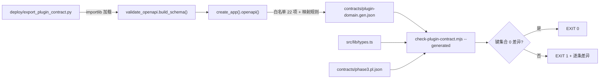

# 麦子 V1.0 阶段四 · Batch 2 技术方案与任务分解

| 项 | 内容 |
| --- | --- |
| 文档编号 | MOY-DESIGN-2026-10-25-B2 |
| 编制人 | 高见远（架构师） |
| 代码基线 | `main @ 8b8fdaa`（本次逐项复跑核对） |
| 上游输入 | `docs/phase4-batch2-plan-2026-10-25.md`（W-01~W-08）；主理人拍板 Q1=A / Q2=A / Q3=A |
| 口径 | 只做设计，不改代码；所有事实带 `文件:行号`，实测数据标「实测」；未核实标「待验证」 |

---

## 1. 方案总览

### 1.1 三条必须先纠正的事实（本次实测，与计划书不一致）

| # | 计划书写法 | 实测事实 | 对方案的影响 |
| --- | --- | --- | --- |
| **C1** | 「`scan:capability` = EXIT 1 → **CI 必红**」（计划 §0、§1.2 G-CAP） | `node scripts/check-capability-consistency.mjs` = **EXIT 1**（正确）；但 CI 跑的是 **`scan:capability-warn`**（`.github/workflows/ci-web.yml:238`，`--warn-only`）→ **CI 今天是绿的** | W-04 若只删 manifest，**门禁仍不拦截**。必须同时把 `ci-web.yml:238` 换成严格 `scan:capability`，否则「存量红已修」无法被守住 |
| **C2** | 支付 fail-open 有 3 处（`payment_gateway.py:97,293,387`） | 还有**第 4 处且在最前面**：`app/schemas/billing.py:481` `trade_state: str = Field(default="SUCCESS")`。回调路由 `api/v1/billing.py:612` `payload = body.model_dump()` 先把它补成 `"SUCCESS"`，再进 gateway | 只改 gateway **无效**（缺字段回调仍然成功）。W-03 必须 4 处一起改 |
| **C3** | 「契约快照仍是手抄文档」 | 属实，而且**已经抄错了 8 处**（附录 A 实测）。另发现 1 处**疑似线上缺陷**：后端 `CapabilityPolicyItem` 返回 `enabled`，前端 `types.ts:1376` 声明 `org_switch_enabled`，`team/page.tsx:614` 直接 `setSaved(data.policies)` | W-01 换源首跑必红；8 处漂移必须在同一提交内收敛，否则任务无法验收 |

### 1.2 工作项总览

| W | 名称 | 改动层 | 文件数 | 风险 | 依赖 |
| --- | --- | --- | --- | --- | --- |
| W-01 | 契约换源（P0） | 后端导出脚本 + 前端门禁 + types + 快照 | 5 新/改 | **高**（8 处漂移需一次性判断谁对） | 无 |
| W-02 | 行为回归网（P0） | 前端测试 | 4 新 | 中（模块级状态隔离） | W-01（断言的契约形状）、W-06/W-07（负样本） |
| W-03 | 支付 fail-open（P0） | 后端业务 + schema | 3 改 | **中高**（资金侧，4 处） | 无 |
| W-04 | `scan:capability` 转绿（P1，执行序第一） | manifest + CI + 文档 | 3 改 | 低 | 无 |
| W-05 | 租户门禁 2 条用例（P1） | 后端测试 | 1 改 | 低 | 无 |
| W-06 | 邮箱原生校验（P1） | 前端表单 | 2 改 | 低 | 无 |
| W-07 | 分页越界 + 413/429（P1） | 前端 ui + api-client | 3 改 | 中（9 处消费点共用一处） | W-02 |
| W-08 | 空候选格式约束（P2） | manifest + 两端 schema + 校验 | 7 改 | 中（契约连带 4 处） | W-06（共用 `validateField`）、W-01（契约要能吸收 `format`） |

---

## 2. 关键设计

### 2.1 W-01 契约换源

**真相源**：`create_app().openapi()`（`deploy/validate_openapi.py:148` 的 `build_schema()`）。生成脚本用 `importlib.util.spec_from_file_location` **加载同一个 `validate_openapi.py` 并调用它的 `build_schema()`**，不复制那三行 `sys.path`——保证契约生成与接口基线门禁永远看同一份文档。

**输出**：`apps/web/contracts/plugin-domain.gen.json`——**只承载键集合**：

```
{ "version": "plugin-domain-v1",
  "generated_from": "create_app().openapi() @ components.schemas",
  "whitelist_version": 1,
  "interfaces": { "<TS 名>": { "keys": [...] } },
  "enums_observed": { "<来源路径>": [...] },
  "backend_schema": { "<TS 名>": "<OpenAPI schema 名>" } }
```

**插件域白名单**（22 项，由 `phase3.pl.json` 的 interfaces 反查 `components.schemas` 得出，实测全部存在）：

```
PluginMarketItem→MarketItem, PluginCategoryItem→CategoryCountItem, PluginMarketData→MarketData,
PluginCapabilityItem→PluginCapabilityItem, PluginCapabilitiesData→CapabilityListData,
PluginOutputSpec→OutputBriefItem, PluginSettingSpec→SettingBriefItem, PluginVersionBrief→VersionBriefItem,
PluginDetail→MarketDetailData, InstalledPluginItem→InstalledItem, PluginInstallResult→InstallData,
PluginStateResult→StateData, PluginUninstallResult→UninstallData, PluginUpgradeResult→VersionData,
PluginRollbackResult→VersionData, PluginSettingsResult→SettingsData, PluginReviewItem→ReviewItem,
PluginReviewsData→ReviewListData, PluginReviewResult→ReviewData, CapabilityPolicyItem→CapabilityPolicyItem,
PluginGrantsUpdateResult→UpdateGrantsData, PluginGrantsUpdateRequest→UpdateGrantsRequest, PluginInputSpec→InputBriefItem
```

**明确排除**（不生成、不比对，各自有独立门禁）：

- 任务域 7 个（`TaskChecklistItem`/`TaskStepFailure`/`TaskArtifact`/`TaskDetail`/`TaskRetry*`/`TaskArtifactUpdate*`）在 `app/schemas/task.py`，属另一模块，本批不动；`OrgCapabilitySwitch` 是**前端投影类型**（后端 `MarketData.org_capabilities` 的元素是 7 键的 `PluginCapabilityItem`），列入 `projection: ["OrgCapabilitySwitch"]`，不比对；96 端点全量契约不生成（计划 §2.3 已排除）。

**映射规则**（生成器实现口径）：

| OpenAPI 形态 | 映射 |
| --- | --- |
| `properties` 的键集合 | 全部进 `keys`（**不区分 required/optional**） |
| `$ref` / `allOf` / `anyOf` | 只取键名，不展开类型 |
| `enum`（顶层 schema） | 本批白名单内无此项（`TaskStatus`/`StepStatus`/`ArtifactType` 在任务域，不在白名单），故 `enums` 不参与判定 |
| `enum`（属性级，如 `MarketItem.installed_status`） | 只记入 `enums_observed` 供人工核对，**不判红**（见 §7-2） |

**可选性口径：采用 A（主理人裁决）——生成契约只负责键集合。** 实测依据：22 个插件域模型**全部字段带默认值**（`= ""` / `= 0` / `Field(default=...)`，`app/schemas/plugin.py:72-641`），Pydantic v2 因此**一个 `required` 数组都不输出**（`MarketData`/`MarketDetailData`/`ReviewListData`/`InputBriefItem` 实测均 `required: None`）。若让生成契约参与可选性判定，`types.ts` 里 175 个字段几乎全必填 → 首跑 170+ 条误报，W-01 直接不可用。故：

- **键集合**：gen 为唯一真相，双向严格（缺键/多键均红）。这正是 Batch 1 五次崩溃的形态（`meta`→扁平四字段、`changelog` 增删、`inputs` 缺失）。
- **可选性**：仍由**手写快照 ↔ `types.ts`** 的既有 `compareInterface()`（`check-plugin-contract.mjs:150-190`）守，本批不改这段逻辑。
- **不改任何代码时 `scan:contract` = 0**（实测确认：32 接口 / 175 字段 / 5 枚举 / 0 差异）；gen 方向首跑在附录 A 的 8 处漂移收敛后为 0。
- 已知代价（接受）：后端把某字段从「有默认值」改成「必填」本批抓不到——那是 B 方案（`model_fields` 派生 + 有注释例外表）的能力，且例外表本身就是手写知识，登记 V1.1，不占本批预算。

**两个比对方向**（`check-plugin-contract.mjs` 一次执行跑完）：

- 方向 A：`gen` ↔ `types.ts`（**只比键集合**；解析口径不变：仅两空格缩进顶层字段、`--self-test` 通过=退出 1）。
- 方向 B：`gen` ↔ `phase3.pl.json`（**只比键集合**：快照的 `required ∪ optional` 必须与 gen 的 `keys` 相等；快照里的接口若不在白名单 → 红）。
- 白名单里声明了、但 `types.ts` 或快照缺该接口 → 红（防「删掉就没人管」）。
- 可选性：既不进方向 A 也不进方向 B，由既有 `compareAll(快照, types.ts)` 继续守（`check-plugin-contract.mjs:199-217`，`main()` 里照旧调用）。

新增 npm script：`"scan:contract:gen": "node scripts/check-plugin-contract.mjs --generated"`、`"scan:contract:gen-self-test": "node scripts/check-plugin-contract.mjs --generated --self-test"`。`--generated` 读 `contracts/plugin-domain.gen.json`；**gen 文件缺失时退出 2 并提示跑生成脚本**（不静默回退到手写快照）。

**`--generated --self-test` 负样本 3 条**（各自只破坏一件事，期望被抓住）：缺键、多键、接口整体缺失。**负样本跑合成样本，不读真文件**（沿用现有 `BASE_SOURCE`/`NEGATIVE` 模式，`check-plugin-contract.mjs:223-348`），因此 CI 里不需要 Python 也能验门禁本身没坏；原有 `--self-test` 的 8 条（含可选性翻转/枚举缺值多值）**一条不减**，继续守手写快照那一侧。

**生成流程（W-01 时序）**



**验收负样本（计划 S1）**：改 `MarketData.total` → `total_count`（`app/schemas/plugin.py:119`）→ `python deploy/export_plugin_contract.py && npm --workspace apps/web run scan:contract:gen` 必须 EXIT 1，改回后 0。**不刷新 `docs/api/openapi.snapshot.json`**（`validate_openapi.py:870-874` 的 `sort_keys=True` 全量重写，55.8 万字节 → 噪声 diff）。

**W-08 的 `format` 如何吸收**：`InputBriefItem` 加 `format` → 重生成后 `PluginInputSpec.keys` 多一项。处理：`types.ts` 加 `format?: PluginInputFormat`（可选）、手写快照 `optional` 加 `format`；A 口径下 gen 只比键集合，故三处必须同一次提交改完（顺序见 §2.8）。

### 2.2 W-02 行为回归网

**隔离手法（`api-client` 是模块级状态，`api-client.ts:225-260` 的 `accessToken`/`currentTenantId`）**：每个用例

```ts
beforeEach(() => { vi.resetModules(); vi.unstubAllGlobals(); });
const load = async () => { const api = await import('@/lib/api-client');
  const events = await import('@/lib/session-events'); return { api, events }; };
```

- **必须 reset 后再动态 import，且 `session-events` 也必须走动态 import**——否则拿到的是被 reset 掉的旧实例，`onUnauthorized` 订阅不到广播。
- `vi.stubGlobal('fetch', vi.fn(async () => new Response(...)))`；`restoreMocks: true` 已在 `vitest.config.mts` 打开。
- **不导出 `request`/`unwrap`**：一律走公共 API（`pluginsApi.installed()`、`identityApi.profile()`、`billingApi.usage()`、`knowledgeApi.uploadDocument()`）。若某分支只能通过私有函数触发，说明该分支在生产路径不可达——那就不是该测的。
- 超时分支（`api-client.ts:307-311`）单独用 `vi.useFakeTimers()` + 永不 resolve 的 fetch。

**测试矩阵（新增 18 条，18 → 36 ≥ 30）**

| # | 文件 | 用例 | 断言 |
| --- | --- | --- | --- |
| 1 | api-client | 信封 `code=0` | 返回 `data`；无 `BusinessError` |
| 2 | api-client | 信封 `code=20002` | `BusinessError.code===20002`；`onUnauthorized` 被调 1 次 |
| 3 | api-client | HTTP 401 + 空体（网关） | `BusinessError(20002,'登录状态已失效，请重新登录')`；广播 1 次；**不是** `AdapterUnavailableError` |
| 4 | api-client | HTTP 402 + 信封 `code=15006` | `BusinessError.code===15006`；文案 = `business-errors.ts:79`；广播 0 次 |
| 5 | api-client | HTTP 413 无信封（W-07） | `BusinessError.code===20008`；文案 = `business-errors.ts:29`「文件超出大小限制（上限 50MB）」；广播 0 次 |
| 6 | api-client | HTTP 429 无信封（W-07） | `BusinessError.code===20006`；文案 = `business-errors.ts:27`「当前使用人数较多，请稍后再试」 |
| 7 | api-client | HTTP 502 + HTML | `AdapterUnavailableError`，文案「服务暂时不可用，请稍后再试」 |
| 8 | api-client | 200 但 body 是 HTML | `AdapterUnavailableError` |
| 9 | api-client | fetch reject `AbortError` | `AdapterUnavailableError('服务响应超时，请重试')` |
| 10 | api-client | 未调 `setTenantId` | `headers` 无 `X-Tenant-Id` |
| 11 | api-client | `setTenantId(null)` 后请求 | 仍无该头（**不得出现字面量 `"null"`**，`api-client.ts:283`） |
| 12 | api-client | `setTenantId('tnt_dev')` | 头 = `tnt_dev` |
| 13 | api-client | POST 两次 | 均带 `Idempotency-Key` 且两值不同 |
| 14 | api-client | `upload` 未设租户 | 无 `X-Tenant-Id`（`api-client.ts:434-439` 是独立实现，必须单独覆盖） |
| 15 | pagination | `clampPage(3,1)` / `(0,3)` / `(5,3)` / `(1,0)` | `1` / `1` / `3` / `1` |
| 16 | pagination | `total 30→10, pageSize 10` | `totalPages=1` → 推出 `page=1` |
| 17 | use-declaration-form | 空候选 `select` 填 `abc`（W-08） | `'请填写有效的目标仓库'`；填 `https://github.com/a/b` → `''` |
| 18 | use-declaration-form | `department` 33 字 / 含换行 / `研发部` | 错 / 错 / 通 |

（第 17、18 条依赖 W-08 落地：若 W-08 裁掉，这两条一并删，总数 34 仍 ≥ 30；矩阵其余 16 条在 W-02 提交内。）

**Playwright 2 → 3**：新增唯一一条**必做**用例（零夹具、确定性最高）：

```ts
test('未登录直达 /chat 会被带回登录页并记住去向', async ({ page }) => {
  await page.goto('/chat');
  await expect(page).toHaveURL(/\/login\?next=%2Fchat/);
});
```

依据：`buildLoginHref`（`src/lib/redirect.ts`，被 `session-gate.tsx:41` 引用）。

**插件市场/工作台链路：不做**（§7-5 裁决）。需适配层真起 + `MarketData` 22 键演示数据 + 端口冲突，稳定性差；当前 3 条已满足 E3，`playwright.config.ts:24-31` 的 `webServer` 保持单对象不动。若日后要做，改数组再起 `uvicorn app.main:app --port 8000`，并用 dev 构建保留的联调入口登录（`e2e/brand.spec.ts:18` 已验证该入口存在）。**不进 CI**（ADR-0008 §4）。

### 2.3 W-03 支付 fail-open

**四处一起改**（顺序即调用顺序）：

| # | 位置 | 现状 | 改法 |
| --- | --- | --- | --- |
| 1 | `app/schemas/billing.py:481` | `trade_state: str = Field(default="SUCCESS")` | 默认改 `""`；**该字段不再进 `model_dump()` 的默认值路径**，改 `Field(default_factory=str)` 亦可，关键是缺省为空串 |
| 2 | `payment_gateway.py:97` | `trade_state: str = TRADE_STATE_SUCCESS` | 改 `TRADE_STATE_UNKNOWN` |
| 3 | `payment_gateway.py:293` | `payload.get("trade_state", TRADE_STATE_SUCCESS) or TRADE_STATE_SUCCESS` | 两处默认都换 `TRADE_STATE_UNKNOWN`，**且删掉 `or ...` 兜底**（空串应保持空串，不能被 `or` 抬成成功） |
| 4 | `payment_gateway.py:387` | 同上（另一渠道解析分支） | 同上 |

**常量与判定**：新增 `TRADE_STATE_UNKNOWN: Final[str] = ""`（放在 `payment_gateway.py:64` 的 `TRADE_STATE_SUCCESS` 旁，并加进 `__all__`，`:447`）。

`is_success`（`:101-103`）改为**白名单**：

```python
PAID_TRADE_STATES: Final[frozenset[str]] = frozenset({TRADE_STATE_SUCCESS})
@property
def is_success(self) -> bool:
    return self.trade_state.strip().upper() in PAID_TRADE_STATES
```

**取证出口**：`order_service.handle_callback` 已有 `if not notification.is_success:` → `_record_rejection(reason="trade_not_success", digest=..., detail=f"trade_state={...}")` → `ErrorCode.PAYMENT_INCOMPLETE`（`order_service.py:568-580`）。缺字段/未知值天然落入该分支，**无需新增出口**；只需把 `detail` 里的 `trade_state=` 保留（空值时打印为 `trade_state=`，便于区分「没传」与「传了别的值」）。

**确认订单状态不被误推**：`is_success` 为假时走 `raise ApiError`，`order` 仍为 `pending`（`_record_rejection` 只写回调流水，不改订单）。用例必须断言 `order.status == "pending"` 且套餐未开通。

**演示支付口径（Q1=A）**：不新增词表外词汇。UI 与文档边界 = ① 对外材料不写「支持在线支付」；② `create_order` 在渠道未配置时返回既有 `30004`（`create_order` 文档字符串已列该码），不新造码；③ `docs/phase4-batch-log.md` 记一行「本版为演示支付，回调已收口，未接入真实渠道」。

**3 类用例**（`tests/unit/test_callback_hardening.py` 扩写，现有 91 行处已有 `trade_state: state` 参数化）：

1. 缺 `trade_state` 键 → 订单仍 `pending`，且回调流水有 1 条 `reason="trade_not_success"` 记录；
2. `trade_state="NOTPAY"` / `"CLOSED"` / `""` → 同上（参数化 3 值）；
3. `trade_state="SUCCESS"` + 金额一致 → 订单变 `paid`，套餐开通（既有用例保持绿）。

### 2.4 W-04 `scan:capability` 转绿（执行序第一）

1. 删 `apps/adapter/app/plugins/manifests/plg_hr_admin.json` 的 `capabilities[2]`（`org.directory.read`，实测位于 `:21-24`），其余 3 项保留。
2. **改 CI**：`.github/workflows/ci-web.yml:238` `scan:capability-warn` → `scan:capability`（严格），并删掉注释里「整改期」表述（`:232-236`）。这一步是 C1 的直接后果，**不做则本项等于没做**。
3. 订正 `docs/plugin-dev-guide.md` 第 ④ 行（`:199`），「什么场景该申请」列当前写着「需要填写所属部门的插件」——HR 插件正是该场景却不再申请，改为「需要按部门自动确定收件人的插件（人工填部门的场景不需要申请）」。
4. 文案核查结论：能力行由后端按 manifest 渲染（`components/plugin/capability-list.tsx:47`、`grant-drawer.tsx:128`），`lib/capability-labels.ts:18` 是 6 项能力全集兜底、**不改**；`tests/unit/test_plugin_assembly.py` 只断言 checklist 4 项 / 6 步，不校验能力条数；`tests/e2e/conftest.py`、`task_helpers.py` 里的 `org.directory.read` 是 org.* 枚举夹具，不动。

**验收**：`npm --workspace apps/web run scan:capability` = 0；`node scripts/check-capability-consistency.mjs` 输出「多余能力 **0 处**」；`grep -rn "org.directory.read" apps/adapter/app/plugins/manifests/` = 0 命中；`pytest tests/unit/test_plugin_assembly.py -q` 绿；`python deploy/validate_plugins.py` = 0。

### 2.5 W-05 租户门禁

`security.py:214-226` 的三支已存在：私有化忽略头（`:214`）→ SaaS 头优先（`:217-219`）→ 两头皆无抛 `ApiError(ErrorCode.PARAM_INVALID)`（`:222-226`，`PARAM_INVALID = 20001`，`core/errors.py:33`）。

**复用现有 fixture**：`tests/security/test_tenant_spoofing.py` 已有 `_settings(deploy_mode=...)`（`:76` 附近）、`saas_client`（`:150`）、`_headers(token, tenant)`（`:128-137`）。新增 2 条：

| 用例 | 构造 | 断言 |
| --- | --- | --- |
| ① SaaS + 无头 + 令牌无 `tenant_id` 声明 | `saas_client.get(PROFILE_PATH)`，令牌 claims 不含 `tenant_id` | `status == 400`；`body["code"] == 20001`；`body["message"] == "请求内容不完整，请检查后重试"`（`errors.py:217`）；`assert "header"/"claim"/"tenant_id" not in message`（不暴露技术词） |
| ② 私有化 + 头 B + 令牌声明 A | `create_app(_settings(deploy_mode="private"))`，`X-Tenant-Id: B`，令牌 `tenant_id=A` | `status == 200`；`body["data"]["tenant_id"] == "default"`（**头与声明都被忽略**，收敛到 default）；且 `monkeypatch` 计数证明未查成员仓储（复用 `:314` 用例的手法） |

**负样本**：临时把 `security.py:222` 的 `raise` 改成 `pass` → 用例 ① 必红（`code` 变 0、`status` 变 200）。写进用例 docstring。

**验收**：`pytest tests/security -q` 全绿且 ≥2 条新增可 `-k` 点名；`pytest --run-pg -k tenant_spoofing -q` 全绿。

### 2.6 W-06 邮箱原生校验

1. `declaration-form.tsx:51` `<form` 加 `noValidate`（一行）；
2. `type="email"`（`:200`）**保留**——`noValidate` 只关掉浏览器拦截，`type=email` 仍影响移动端键盘；
3. 提交路径：`onSubmit` 已经 `event.preventDefault(); onSubmit();`（`:53-56`），父级 `use-declaration-form` 的提交入口须**先对全部 `inputs` 跑一遍 `validateField` 并写 `errors`**，有错则不调 `buildInputs()`/不发请求（当前只在 `onChange`/失焦校验，点提交不补跑 → 这是「点了没反应」的根因链）。规则全部来自声明，邮箱正则在 `use-declaration-form.ts:38-39`，**不新增文案**（「请填写有效的邮箱地址」）。
4. 错误槽位与 `aria-invalid`：`Field` 已收 `error`，`Input` 已收 `invalid={Boolean(errors[spec.key])}`（`:196`、`:203`）→ 无需新增；`type="email"` 的错误文案必须来自应用内（「请填写有效的邮箱地址」），**不得**依赖浏览器气泡。

**验证**：`grep -c "noValidate" apps/web/src/components/workbench/declaration-form.tsx` ≥ 1；vitest 3 条（空/非法/合法邮箱 → 错误文案 + `buildInputs` 是否被调）；e2e 可选并入 W-02。**静态扫描**：`scan:workbench` 只校验动态段与宿主约束，不涉及 `noValidate` → 不冲突。

### 2.7 W-07 分页越界 + 非信封 413/429

**为什么只改 `Pagination` 一处**：9 个消费点（7 个页面：`ops/orders`、`ops/tenants`、`plugins`、`plugins/[pluginId]`、`profile/memories`、`team`、`workflows`；2 个组件：`knowledge/document-table`、`knowledge/grant-panel`）**各自持 `page` state**。在 9 处各写一遍 `useEffect` 必然漏写（`scan:pages` 抓不到语义重复）。`Pagination` 是唯一共同必经点，且它已持有 `page`/`total`/`pageSize` 与 `onPageChange`。

**改动**（`components/ui/pagination.tsx`：抽纯函数 + 组件内约束性 effect）：

```ts
export function clampPage(page: number, totalPages: number): number {
  const max = Math.max(1, Math.trunc(totalPages) || 1);
  return Math.min(Math.max(1, Math.trunc(page) || 1), max);
}

// 组件内：父级 page 越界时回落到 [1, totalPages]，把修正值通知父级
React.useEffect(() => {
  if (currentPage !== page) onPageChange(currentPage);
}, [currentPage, page]);   // 不含 onPageChange，见下
```

**为什么不会循环**：`onPageChange(currentPage)` 把父级 `page` 置成 `currentPage`，下一轮 `currentPage === page` → effect 直接返回。**前提**：父级 `onPageChange` 必须是 `setPage`（9 处均为 `useState` setter，待验证是否存在内联箭头函数导致每次换引用——若存在，effect 依赖去掉 `onPageChange` 或用 `useRef` 固定）。**只改读取侧**：不新增 `refetch`/不强制刷新数据（计划 §5 W-07 定稿）；父级 `page` 变了，`useApiQuery` 的 key 自然带新页码重取。

**`api-client` 413/429 放哪**：放 `request()` 的 **401 判定之后、`unwrap()` 之前**（`api-client.ts:417-422` 之间），新增：

```ts
if (response.status === 413 || response.status === 429) {
  // 复用已注册码：20008 PAYLOAD_TOO_LARGE / 20006 RATE_LIMITED
  throw new BusinessError(response.status === 413 ? 20008 : 20006, '');
}
```

**错误码裁决（§7-3）**：复用已注册码 **20008**（`PAYLOAD_TOO_LARGE`，`core/errors.py:40`）与 **20006**（`RATE_LIMITED`，`:38`），**不新增 30005/30006**。理由：错误码是注册制，前端为网关状态新造码会绕过后端登记；两条既有文案语义正好匹配（`business-errors.ts:27,29`），`business-errors.ts` **本批不用改**。写法上 `throw new BusinessError(code, '')` 让 UI 侧 `toBusinessMessage` 按 code 取既有文案，**不复制字符串**。

顺序不能变：**401 → 413/429 → `unwrap`（code=20002 → BusinessError）**。理由：网关层的 401/413/429 常无信封，`unwrap` 会把它们退化成 `AdapterUnavailableError`（`api-client.ts:321-325`），真实原因丢失。三者互不覆盖：401 分支 `throw` 后即返回，不会走到 413/429。非信封 502 保持兜底（落到 `unwrap` → `AdapterUnavailableError`），因为 502 确实无法解释原因。**已知偏差**：20008 文案写死「上限 50MB」，而网关 body limit 常更小，本批接受，记 `phase4-batch-log.md`（§5 同条）。

**测试**：见 §2.2 矩阵 #5/#6/#7/#15/#16（越界回落、413、429、502 兜底）。

### 2.8 W-08 空候选格式约束（声明驱动，**四处联动**）

**层级缺口（必读）**：manifest 的 `inputs` 由 `app/plugins/schema.py:233-254` 的 **`InputSpec`（`_StrictModel`）** 解析，**不是** `app/schemas/plugin.py`。当前 `InputSpec` 只有 `key/label/type/required/max_length/options/max_items`，`_StrictModel` 会**拒绝未知键** → 直接给 manifest 加 `format` 会在插件加载期报错。所以 W-08 不是「前端 5 行」，是四处：

| # | 层 | 改动 |
| --- | --- | --- |
| ① | `app/plugins/schema.py` `InputSpec`（`:233-254`） | 加 `format: Literal["", "repo", "department"] = Field(default="", ...)`；**合法值校验放本类 `@model_validator(mode="after")`**（manifest 加载期报错），**不放** `app/schemas/plugin.py`（那里只是响应模型） |
| ② | `app/schemas/plugin.py` `InputBriefItem`（`:137-154`） | 加 `format: str = Field(default="", max_length=16)` |
| ③ | `app/business/plugin_service.py:346-355` | 在 `InputBriefItem(...)` 里补 `format=item.format`（当前逐字段显式复制，漏写就等于没下发） |
| ④ | 前端 + manifest + 契约 | `types.ts:1169` `PluginInputSpec` 加 `format?: PluginInputFormat`（`export type PluginInputFormat = 'repo' \| 'department'`）；`validateField` 加 format 分支；`plg_dev_workbench.json:54-58` `repo` 配 `"format": "repo"`；`plg_hr_admin.json:51-55` `department` 配 `"format": "department"` + `"max_length": 32`；`contracts/phase3.pl.json` 的 `PluginInputSpec.optional` 加 `"format"`；重新生成 `plugin-domain.gen.json` |

**顺序（回答「先加字段还是先生成」）**：**先生成框架，后加字段；字段的四个后端改动一次做完再重生成一次**。

1. T02 先落地生成脚本与门禁（此时 gen 里 `PluginInputSpec.keys` = 现有 6 键）；
2. T08 再按 ①②③④ 顺序：**先改后端三处 → 重跑生成 → 再改 `types.ts`/手写快照/`validateField`/manifest**。
   反序会红：先改 `types.ts` 或快照加 `format`，gen 还没这个键 → 方向 A/B 立刻报「多键」。这正是门禁该有的行为，不是 bug。

**格式规则**（两端一致，写在一处注释）：

- `repo`：4 类任一 —— `^https?://` / `^ssh://` / `^git@[^\s:]+:.+` / `^[\w.-]+/[\w.-]+$`（`owner/repo`）；不含空白与换行。
- `department`：1–32 字（按 `Array.from(value).length` 计，避免代理对被算成 2），不含 `\n`/`\r`。
- **未知 format 直接跳过**（返回 `''`），不清空也不报错——保证宿主向后兼容未来新增的 format。

**为什么不用「宿主按 key 判断」**：那会把插件语义（`repo` 是什么）泄漏进宿主，第二个插件换个 key 表示仓库就失效，且违反 `scan:workbench` 的「写死标识」禁令。

**保留 / 裁掉两条路径（主理人可整条裁掉）**

| | 保留（默认） | 裁掉 |
| --- | --- | --- |
| 交付 | 上表 4 层 + T08 | 不做；D-7 以「降级文本框 + hint」现状收尾 |
| 工时 | 后端 3 处 + 前端 3 处 + manifest 2 处 + 契约重生成 1 次 | 0 |
| 对 **E1**（8 个静态扫描全 0） | 无影响（`scan:workbench`/`scan:capability` 都不查 `format`） | 无影响 |
| 对 **E3**（单测 ≥30） | 34 + 2 = 36 | 34（矩阵 #17/#18 一并删，仍 ≥ 30） |
| 对 W-01 契约 | `PluginInputSpec` 多 1 键，需重生成 1 次 | 无 |
| 残留风险 | `repo`/`department` 到执行期才失败（D-7 原状） | 同左，登记 Batch 3 |

---

## 3. 文件级改动清单

| 文件 | 改动（函数/字段/行为） |
| --- | --- |
| `deploy/export_plugin_contract.py` | **新增**。`load_build_schema()`（importlib 加载 `validate_openapi.py`）+ `PLUGIN_DOMAIN_MAP`（22 项）+ `ENUM_FROM_PROPERTY`；`derive(document) -> dict`；`main(write=True)` 写 `apps/web/contracts/plugin-domain.gen.json`（`indent=2, sort_keys=True`），`--check` 只比对不写 |
| `apps/web/contracts/plugin-domain.gen.json` | **新增**（生成物，入库） |
| `apps/web/scripts/check-plugin-contract.mjs` | 加 `--generated`：读 gen；`compareKeys()`（新，**只比键集合**，双向严格）、`compareProjection()`（`OrgCapabilitySwitch` 跳过）；`compareAll()` 增 `mode` 参数（`snapshot` 走原逻辑含可选性/枚举，`generated` 只比键集合）；`--generated --self-test` 增 3 条负样本；`main()` 增 `--generated` 分支与退出码 2（gen 缺失） |
| `apps/web/contracts/phase3.pl.json` | 按附录 A 逐行收敛 8 处；`enums.PluginInstalledStatus` 扩到 5 值（§7-2 连带）；`PluginInputSpec.optional` 加 `format`；`note` 改写为「键集合权威见 gen」 |
| `apps/web/src/lib/types.ts` | 附录 A 逐行：6 处加**可选**字段、删 `vendor`、删 `PluginGrantsUpdateResult.plugin_id`；`PluginInstalledStatus` **扩到 5 值**（`:1073`）；`PluginInputSpec` 加 `format?` |
| `apps/web/src/lib/api-client.ts` | ① `request()` 加 413/429 → `BusinessError(20008/20006)`（`:417` 后）；② `pluginsApi.setCapabilityPolicy` 返回体做 `enabled → org_switch_enabled` 映射（**真缺陷修复**，附录 A-7） |
| `apps/web/src/lib/business-errors.ts` | **不改**（20006/20008 文案已存在，`:27,:29`） |
| `apps/web/src/components/ui/pagination.tsx` | 新增 `export function clampPage()`；加约束性 `useEffect` |
| `apps/web/src/components/workbench/declaration-form.tsx` | `<form noValidate>`（`:51`）；提交按钮保持 `type="submit"` |
| `apps/web/src/hooks/use-declaration-form.ts` | 提交入口补跑全字段 `validateField`；`validateField` 加 `format` 分支（未知 format 跳过）；`PluginInputFormat` 类型使用 |
| `apps/web/src/lib/api-client.test.ts` | **新增**（矩阵 #1–#14） |
| `apps/web/src/components/ui/pagination.test.ts` | **新增**（矩阵 #15–#16） |
| `apps/web/e2e/session-redirect.spec.ts` | **新增**（1 条 `/chat → /login?next=%2Fchat`） |
| `apps/web/package.json` | 加 `scan:contract:gen`、`scan:contract:gen-self-test` |
| `apps/adapter/app/schemas/billing.py` | `PaymentCallbackRequest.trade_state` 默认改空串（`:481`） |
| `apps/adapter/app/business/payment_gateway.py` | `TRADE_STATE_UNKNOWN`（`:64` 旁）、`PAID_TRADE_STATES`、`is_success` 白名单（`:101-103`）、dataclass 默认（`:97`）、两处 `payload.get` 去掉 `or TRADE_STATE_SUCCESS`（`:293`、`:387`）、`__all__`（`:447`） |
| `apps/adapter/app/plugins/schema.py` | `InputSpec` 加 `format: Literal["", "repo", "department"]`（`:233-254`）；合法值校验放本类 `@model_validator(mode="after")` |
| `apps/adapter/app/schemas/plugin.py` | `InputBriefItem.format`（`:137-154`） |
| `apps/adapter/app/business/plugin_service.py` | `InputBriefItem(...)` 里补 `format=item.format`（`:346-355`，漏写等于不下发） |
| `apps/adapter/app/plugins/manifests/plg_hr_admin.json` | 删 `org.directory.read`；`department` 加 `format: "department"`+`max_length: 32` |
| `apps/adapter/app/plugins/manifests/plg_dev_workbench.json` | `repo` 加 `format: "repo"` |
| `apps/adapter/tests/unit/test_callback_hardening.py` | 扩 4 条（缺字段 1 + 未知值 3 + SUCCESS 保持） |
| `apps/adapter/tests/security/test_tenant_spoofing.py` | 增 2 条 |
| `.github/workflows/ci-web.yml` | `:238` `--warn-only` → 严格 `scan:capability`（T01）；`:196` 后**不加** gen 步骤 |
| `.github/workflows/ci-adapter.yml` | 在 `validate_openapi.py --strict` 同 job 后加 `scan:contract:gen`（§7-4 裁决；该 job 已有 Python + 依赖） |
| `docs/plugin-dev-guide.md` | `:199` 能力 ④ 举例订正 |

---

## 4. 任务列表（8 个提交，W-04 第一）

> 说明：8 个提交按**依赖顺序**排列；按「≤5 任务粒度」归为 4 个批次（表中「批次」列）。同一批次内可并行。

| 任务 | W | 批次 | 依赖 | 交付内容 | 验收命令 | 回滚 |
| --- | --- | --- | --- | --- | --- | --- |
| **T01** | W-04 | B1 | 无 | 删 manifest 1 行 + `ci-web.yml:238` 转严格 + `plugin-dev-guide.md:199` 订正 | `cd apps/web && npm run -s scan:capability; echo EXIT=$?`（**改前 1、改后 0**）；`node scripts/check-capability-consistency.mjs --self-test`（期望 **1** = 自检通过）；`cd ../.. && python deploy/validate_plugins.py`（0）；`grep -rn "org.directory.read" apps/adapter/app/plugins/manifests/ \|\| echo none`；`pytest tests/unit/test_plugin_assembly.py -q` | `git revert`（3 文件；CI 行单独 revert 可先解红） |
| **T02** | W-01 | B2 | 无（与 T01 并行起头；CI 严格化属 T01） | 生成脚本 + gen 契约 + `--generated` 门禁 + **附录 A 8 处漂移收敛** + `PluginInstalledStatus` 扩 5 值 + A-7 映射 | `python deploy/export_plugin_contract.py`＋`npm --workspace apps/web run scan:contract:gen`（0）；`python deploy/validate_openapi.py --strict`（0）；`scan:contract`（0）；`scan:contract-self-test`（1）；`scan:contract:gen-self-test`（1）；**负样本**：改 `plugin.py:119` `total`→`total_count` 后重生成 → EXIT 1，改回 0；**未改代码时 `scan:contract` 必须为 0** | revert（gen 可删，手写快照仍在 → 退化为旧门禁） |
| **T03** | W-02 | B2 | T02 | `api-client.test.ts`（14）+ `pagination.test.ts`（2）+ e2e 1 条 | `npm run test --workspace apps/web`（≥30，0 failed）；`npm run test:e2e --workspace apps/web`（≥3） | revert（仅新增测试文件） |
| **T04** | W-03 | B3 | 无（∥T01/T02/T05） | **4 处**默认值 + 白名单 + 4 条用例 | `grep -c 'trade_state: str = Field(default="SUCCESS")' apps/adapter/app/schemas/billing.py` = 0；`grep -c 'payload.get("trade_state", TRADE_STATE_SUCCESS)' apps/adapter/app/business/payment_gateway.py` = 0；`grep -c "trade_state: str = TRADE_STATE_SUCCESS" apps/adapter/app/business/payment_gateway.py` = 0；`pytest tests/unit/test_callback_hardening.py tests/integration/test_billing_and_callback.py -q` | revert（单 commit；恢复 fail-open 仅应急） |
| **T05** | W-05 | B3 | 无（∥T04） | 2 条租户用例 | `pytest tests/security -q`；`pytest tests/security/test_tenant_spoofing.py -q -k "saas_missing_tenant or private_converges"`；**负样本** `:222` raise→pass 必红 | revert（仅测试文件） |
| **T06** | W-06 | B4 | 无（∥T07） | `noValidate` + 提交前统一校验 | `grep -c noValidate apps/web/src/components/workbench/declaration-form.tsx`（≥1）；`npm run test --workspace apps/web`；`scan:banned`/`scan:pages`（0）；**负样本**去掉 `noValidate` → 邮箱用例红 | revert（≤3 行） |
| **T07** | W-07 | B4 | T03 | `clampPage` + effect + 413/429→20008/20006 | `npm run test --workspace apps/web`（#5/#6/#7/#15/#16 全绿）；`scan:pages`（0）；人工：删数据使 `total_pages` 3→1 → 自动回第 1 页 | revert（2 文件） |
| **T08** | W-08 | B4 | T06、T02 | **四处联动**：`InputSpec.format`①→`InputBriefItem.format`②→`plugin_service.detail()` 映射③→前端/manifest/契约④ | `python deploy/validate_plugins.py`（0）；`python deploy/export_plugin_contract.py && npm --workspace apps/web run scan:contract:gen`（0）；`npm --workspace apps/web run scan:contract`（0）；`pytest tests/*plugin* -q`；`npm run test --workspace apps/web`（#17/#18 绿）；**格式负样本**：manifest 写 `"format": "bogus"` → `validate_plugins.py` 退出 ≠ 0 | revert（`format` 可选、默认 `""`，删除不影响既有数据与校验） |

**执行序**：T01 → T02 → T03；T04 ∥ T05 插在任意空闲槽；T06 → T07 → T08。**T02 与 T04 相邻时**：T04 只改默认值、不改 `PaymentCallbackRequest` 字段名（**硬约束**），故不影响插件域白名单。**T08 可整条裁掉**（§2.8 表）：裁掉后 E1 不变、E3 仍 34 ≥ 30，本批 7 项仍闭合，D-7 现状收尾并登记 Batch 3。

---

## 5. 风险与回滚

| 风险 | 触发条件 | 缓解 |
| --- | --- | --- |
| **契约生成误报** | 白名单里某 schema 被重命名/删除 → `KeyError` | 生成器对每个白名单项做存在性检查并列出缺失项（退出 2，不静默跳过）；白名单文件本身受 `--self-test` 覆盖 |
| **`format` 契约漂移** | 只改后端没重生成 gen → `scan:contract:gen` 红 | 期望行为。顺序写死：后端三处 → 重生成 → 前端/快照/manifest |
| **CI 严格化后其他插件冒红** | T01 把 `--warn-only` 换严格后，若 6 份 manifest 还有别的「多要权限」 | 实测仅 1 处（`plg_hr_admin`），T01 原子化可行；若仍红，先 revert CI 那一行，不 revert manifest |
| **20008 文案失准** | 网关 body limit < 50MB 时，413 报「上限 50MB」 | 本批接受（不改注册文案），记 `phase4-batch-log.md` 观察项 |
| **测试隔离（api-client 模块级状态）** | 漏 `vi.resetModules()` → 用例间 `accessToken` 串味，出现「单跑绿、全跑红」 | 每个用例 `beforeEach` reset + 动态 import；`session-events` 同步动态 import；**禁止**在两文件间共享 `load()` 缓存 |
| **支付状态误判（反向）** | 真实渠道回 `SUCCESS` 但大小写/空格不同 → 白名单漏判 → 正常支付被判失败 | 白名单比较用 `.strip().upper()`；用例必须含 `"success"` 小写与 `" SUCCESS "` 带空格两条 |
| **支付状态误判（过度）** | 渠道回 `TRADE_SUCCESS`（微信 v2 用词）→ 白名单不认 | **本批接受**：Q1=A 演示支付，未接真实渠道；`docs/phase4-batch-log.md` 记一行，真接 v3 时再补词表 |
| **分页 effect 循环** | 父级 `onPageChange` 是内联箭头 → 每次新引用 → effect 重跑 → 再调 `onPageChange` | effect 依赖只放 `[currentPage, page]`，`onPageChange` 用 `useRef` 固定；或加 `if (currentPage === page) return;` 作为第一道闸 |
| **`format` 契约漂移** | 只改后端没重生成 gen → `scan:contract:gen` 红 | 这是期望行为（门禁工作正常）。顺序写死：先改 Python → 重生成 → 再改 `types.ts`/快照 |
| **CI 严格化后其他插件冒红** | T01 把 `--warn-only` 换严格后，若 6 份 manifest 还有别的「多要权限」 | 实测当前仅 1 处（`plg_hr_admin`），故 T01 原子化可行；若 CI 仍红，回滚 CI 那一行而非 manifest |

---

## 6. 给工程师的 4 个易错点

1. **`scan:capability` 今天是绿的，别以为改完 manifest 就完事。** CI 跑的是 `scan:capability-warn`（`ci-web.yml:238`）。T01 必须同时把 CI 换成严格模式，否则「删了声明」这件事没有任何门禁守着；而且改完要**本地先跑严格模式确认全绿**，再提交 CI 变更（否则会把 CI 一次性弄红）。
2. **支付 fail-open 有 4 处，最前面的那处在 `schemas/billing.py:481`，不在 gateway 里。** 只改 `payment_gateway.py` 的三处，缺 `trade_state` 的回调依然会被判成功——因为路由 `billing.py:612` 的 `model_dump()` 已经把默认 `"SUCCESS"` 填进去了。验收 grep 必须查**两个文件**。另外 `:293`/`:387` 的 `or TRADE_STATE_SUCCESS` 尾巴也要删（空串会被 `or` 抬回成功）。
3. **契约生成不能用 OpenAPI 的 `required` 判可选性——按 A 口径只比键集合。** 插件域 22 个模型全部字段带默认值 → `required` 全是 `None`（实测）。照字面实现会得到「175 个字段全部可选」、首跑 170+ 条误报。键集合以 gen 为准，可选性仍由 `手写快照 ↔ types.ts` 守；**别顺手把可选性也接进 `--generated`**。
4. **W-08 的 `format` 先加到 `app/plugins/schema.py` 的 `InputSpec`，不是 `app/schemas/plugin.py`。** `InputSpec` 是 `_StrictModel`，manifest 里多一个未知键会在插件加载期直接报错；`app/schemas/plugin.py` 只是响应模型。漏了 ① 和 ③（`plugin_service.py:346-355` 的显式字段复制），症状是「manifest 改了、接口没下发、前端拿不到 format」。

---

## 7. 裁决落点（§7 原 5 项分叉已由主理人裁决，此处只记落点）

| # | 裁决 | 落点 |
| --- | --- | --- |
| 1 | A-7 `CapabilityPolicyItem` 命名不一致 → **本批修**，不改后端字段名 | `api-client.ts` `setCapabilityPolicy` 返回体 `enabled → org_switch_enabled` 映射；gen 用 `rename` 白名单声明（附录 A-7）。T02 |
| 2 | `PluginInstalledStatus` → **扩到 5 值** | `types.ts:1073`；**连带** `phase3.pl.json` 的 `enums.PluginInstalledStatus` 也改 5 值（否则既有 `compareEnum` 报「多值」）。工程师 grep 确认无 exhaustive switch，有则补 `default` 分支。T02 |
| 3 | 413/429 → **复用 20008 / 20006**，不新造码 | `api-client.ts:417` 后两行分支；`business-errors.ts` **不改**。T07 |
| 4 | `scan:contract:gen` → **放 `ci-adapter.yml`** | 与 `validate_openapi.py --strict` 同 job 的下一步；`ci-web.yml` 的 `:196` 后**不加**。T02 |
| 5 | 第 4 条 e2e → **不做** | `playwright.config.ts` 保持单 `webServer`；必做那条改为 `/chat → /login?next=%2Fchat`。T03 |

**阻塞项：无。** 唯一需工程师执行中确认的是第 2 项「无 exhaustive switch」：`grep -rn "installed_status" apps/web/src` 逐个看，有 `switch` 就补 `default`，不写死 3 分支。Q1/Q2/Q3 已拍板不再问；W-01 可选性口径 = **A**（§2.1），不再评估 B。

---

## 附录 A · 契约漂移实测清单（T02 必须逐行收敛）

比对对象：`contracts/phase3.pl.json`（手写）vs `create_app().openapi()['components']['schemas']`（实测生成）。

| # | TS 接口 → 后端 schema | 差异 | 处置 | 依据 |
| --- | --- | --- | --- | --- |
| 1 | `PluginMarketItem` → `MarketItem` | 后端多 `install_block_reason` | `types.ts` 加 `install_block_reason?: string`；快照进 `optional` | 前端 0 消费点（实测 grep 无命中），加可选零风险 |
| 2 | `PluginCapabilitiesData` → `CapabilityListData` | 后端多 `install_block_reason` | 同上 | 同上 |
| 3 | `PluginDetail` → `MarketDetailData` | 快照多 `vendor`；后端多 `install_count`、`install_block_reason` | 删 `vendor?`；加两个可选字段 | `vendor` 前端 0 消费点（实测 grep 无命中） |
| 4 | `InstalledPluginItem` → `InstalledItem` | 后端多 `icon_key` | 加 `icon_key?: string` | 0 消费点；`InstalledItem` 需要它渲染图标，将来会用 |
| 5 | `PluginInstallResult` → `InstallData` | 后端多 `already_installed` | 加 `already_installed?: boolean` | 0 消费点；语义有用（重复添加提示） |
| 6 | `PluginRollbackResult` → `VersionData` | 后端多 `has_update`（回退复用升级的模型） | 加 `has_update?: boolean` | 0 消费点 |
| 7 | `CapabilityPolicyItem` → `CapabilityPolicyItem` | 快照 `org_switch_enabled` vs 后端 `enabled` | **已确认缺陷并决议修复**（§7-1）：gen 记 `rename: {org_switch_enabled: enabled}`；`api-client.setCapabilityPolicy` 做 `enabled → org_switch_enabled` 映射；**不改后端字段名** | `team/page.tsx:614` `setSaved(data.policies)` 直接吃返回值，映射前 `org_switch_enabled` 恒 `undefined` |
| 8 | `PluginGrantsUpdateResult` → `UpdateGrantsData` | 快照多 `plugin_id` | 删 `plugin_id` | 前端改授权结果 0 消费点（实测 `grant-drawer` 只读三项能力数组） |
| 9 | 枚举 `PluginInstalledStatus` | 前端 3 值 vs 后端属性级 `enum` 5 值 | 见 §7-2 | — |

**已核对键集合无差异（16 项）**：`PluginCategoryItem`/`PluginMarketData`/`PluginCapabilityItem`/`PluginOutputSpec`/`PluginSettingSpec`/`PluginVersionBrief`/`PluginStateResult`/`PluginUninstallResult`/`PluginUpgradeResult`/`PluginSettingsResult`/`PluginReviewItem`/`PluginReviewsData`/`PluginReviewResult`/`PluginGrantsUpdateRequest`/`PluginInputSpec`，以及行 8 中 `PluginGrantsUpdateResult` 除 `plugin_id` 外的键。任务域 3 个枚举（`TaskStatus` 7 值/`StepStatus` 5 值/`ArtifactType` 6 值）实测与快照**完全一致**，无需改。**文档结束**——事实基线 `main @ 8b8fdaa`，逐项实测（2026-10-25）。

**文档结束。** 事实基线：`main @ 8b8fdaa`，本次实测（2026-10-25）。