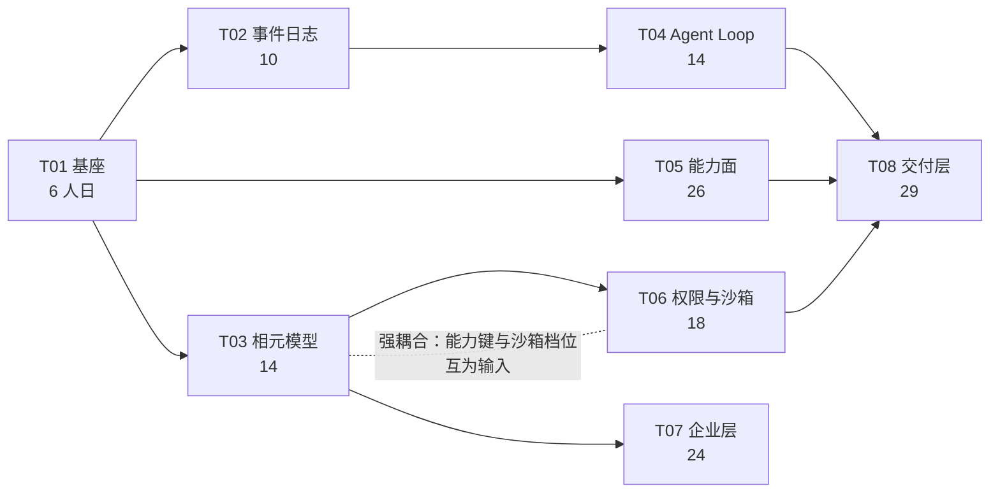

# 底座分阶段推进计划（2026-11-04）

> **口径**：人日与 `docs/design-base-harness-2026-11-04.md` §8.1 **完全一致**（合计 **141**，区间 **126–163**），本文件不重算、不取整。
> 1 人日 = 1 名熟悉本仓代码的全职工程师 1 天，含单测与自测，不含需求评审与 UI 设计。
> **执行依据**：`docs/spec-base-v1.0.md`（规格层）。本计划与规格冲突时以规格为准。

---

## 1. 阶段划分 P0–P4

| 阶段 | 名称 | 范围 | 人日 | 依赖 |
| --- | --- | --- | --- | --- |
| **P0** | 文档冻结与拍板（本阶段） | 规格 §11 + 五条拍板项结论 | 0（文档工作，不计入 141） | — |
| **P1** | 4 周切片：地基 | T01 + T02 + T03 | **30** | P0 的 D3 |
| **P2** | 内核 | T04 + T05 | **40** | P1 |
| **P3** | 管得住 | T06 | **18** | T03（强耦合） |
| **P4** | 卖得掉 | T07 + T08 | **53** | T03 / T04 / T05 / T06 |
| | **合计** | | **141** | |

任务编号与人日（逐一对应设计文档 §8.1，不得改动）：T01 基座 6｜T02 事件日志 10｜T03 相元模型 14｜T04 Agent Loop 14｜T05 能力面 26｜T06 权限与沙箱 18｜T07 企业层补齐 24｜T08 交付层 29。
**迁移归属**：T01 只建 `0013_event_log.sql` / `0014_xiang.sql`（各配 down 脚本）；`0015_license.sql` 随 P4 的 T07 建——P1 建它就是空表放三个月，还让迁移校验多背一张无消费方的表。

### P0 文档冻结与拍板（**已于 2026-11-04 完成**）

- **目标**：把「算不算底座」的争议一次性收口，使 P1 可以只回答工程问题。
- **交付物**：`spec-base-v1.0.md`（**已冻结 v1.0.0**）、`plan-base-2026-11-04.md`（本文件）、`README.md` 层级表；五条拍板项结论已记入 `docs/decisions/0009-base-v1.0-ratification.md`。
- **验收判据**：规格 §0 四条全绿 —— **已成立**（① 已代签 ② 已决 ③ 基线未变 ④ 战略复审已裁定）。
- **kill criteria（已失效，保留供追溯）**：原定「D3 到 11-20 仍无结论 → 不进 P1」；D-50 已裁定为 A（PG 分区表 + 归档），该条件不再适用。

### P1 4 周切片：T01 基座 + T02 事件日志 + T03 相元模型（30 人日）

- **目标**：让「装得上 + 查得到」两件事先成立，因为其余六件事都从事件流长出来（规格 §3.1 E1）。
- **范围**：**两张**迁移 `0013_event_log.sql` / `0014_xiang.sql` + 回滚脚本 + 应用角色授权；`EventStore`（append / read_after / fork / hash 链）+ SSE 迁移（删 `_steps`）；相 schema（24 字段）+ 15 能力键 + 8 步装载器 + 离线验签 + 两份示例装配单。T03 的 resolver 只做「无前置相」退化路径。
- **交付物**：迁移三路径全绿；`GET /agent/tasks/{id}/events` 支持 `Last-Event-ID`；`moy-xiang-verify` 本地命令；销售相可装载、篡改包被拒。
- **验收判据**：设计文档 §8.2 的 A1–A5 五条（篡改拒绝率 100% / 断线续传零丢失零重复 / 回放确定性 / fork 500 事件 <100ms / 零回归），外加规格 §8 的「跑得动」一条初版（在开发机上装成功并跑通 1 条 acceptance）。
- **kill criteria**：4 周结束时 A2/A3/A4 任一**不可测**（不是不通过）→ 改事件存储方案为 D3 的 C（PG 分区 + 对象存储双写），**不延长 P1**。不可测意味着存储形态选错了，加时间也测不出来。

### P2 内核：T04 Agent Loop + T05 能力面（40 人日）

- **目标**：从「确定性流程能跑」走到「开放式任务能跑，且成本可控」。
- **范围**：loop 主循环 + 上下文三段保留 + 三级降级压缩 + 四维预算 + 事件钩子；MCP 客户端（stdio / http_loopback、握手、工具发现、管理员白名单、`mcp.<server>.<tool>`）+ BM25 tool search + 并行与副作用分级 + 渲染扩 xlsx / png / svg。
- **交付物**：销售相与美工相能跑完并产出 artifact；工具数 ≥30 时单轮注入 schema 的 `est_tokens` ≤ 预算 25%；`turn.finished(budget_exceeded)` 可复现。
- **验收判据**：两份示例装配单的 acceptance 全过；同一轨迹回放 3 次 `TaskStateBlock` 与产物键一致；超预算中止率可观测（有指标、有事件）。
- **kill criteria**：`max_turns` 触顶率 >10%（连续两周）→ loop 降级为「半自主模式」（每 3 轮强制人工确认一次），**不改排期**。这是把「自主性」降一档换可控性，不是加时间。

### P3 管得住：T06 权限与沙箱（18 人日）

- **目标**：把授权边界（能力键）与物理边界（沙箱档位）真正重合，否则授权是假的。
- **范围**：沙箱抽象 + Linux bubblewrap 两档 + Windows（WSL2+bubblewrap 或 AppContainer，含两轮真机验证）+ 不支持时的拒装降级 + 二维判定 + 四层呈现 + approval memo（进程内 15 分钟，不落库）+ 负样本测试。
- **交付物**：越界写、越界 egress、并发逃逸三类负样本用例集；装载期 `xiang.install_blocked{sandbox_unsupported}`；业务语言文案（不含技术词）。
- **验收判据**：负样本 100% 拒绝且各有审计记录；Windows 双路径各一轮真机通过；`workspace_write` 不可用的平台**只给 read_only**，无静默降级。
- **kill criteria**：Windows 两条路径在本机均不可用 → 该平台**只交付 read_only**，装载期拒装 `workspace_write` 相，回收约 4 人日进 P4，**不延长 P3**。降级只能往更严的方向，这是规格 §3 的硬规则。

### P4 卖得掉：T07 企业层 + T08 交付层（53 人日）

- **目标**：让「按相按席位卖」与「装进客户机房」同时成立。
- **范围**：许可证（`xiang_set` / `seats` / 有效期 / 席位占用，迁移 `0015_license.sql`）+ 按相归因计费 + 审计导出（CSV / JSONL + 链头）+ 门禁 16→20；离线包构建（构建侧从 0 到 1，含 SBOM 与离线校验）+ App Server 双向 JSON-RPC over WS + BYOK 直连适配器 + 气隙端到端验收。
- **交付物**：三份无效许可证各被拒、一份有效可用；导出文件可客户侧复算；无外网机器 3/3 一次装成；断网零出站请求。
- **验收判据**：规格 §8 的「查得到」与「卖得掉」两条全绿；门禁 20 道全绿。
- **kill criteria**：气隙机 3/3 装成率达不到（<2 次）→ 触发**战略文档 §9 Q1 的 kill criteria**（「私有化交付不成立，转单租户托管，重写 §1」）。此时不是改排期，是改商业模式。

---

## 2. 依赖图

**T03 与 T06 强耦合（且不可并行）**：沙箱的二维判定要用 T03 定义的 15 项能力键与 `permissions.sandbox_mode` 字段；并行的结果是两边同时改 `app/plugins/actions.py`（T03 扩枚举、T06 接线），冲突合并后沙箱会按错的能力集判权——这是「看起来隔离了其实没隔」的同类错误。**T06 必须在 T03 之后串行**，这条不受人力增加而放开。

**T08 依赖 T04 / T05 / T06**：交付层要同时具备「能跑开放式任务」「工具面完整」「物理边界可兑现」三个前提，缺一条的气隙验收都不成立。

---

## 3. 每阶段门禁

阶段门禁 = 既有门禁全绿 + 阶段新增门禁全绿，**红即不许进下一阶段**。「先跳过、下阶段补」不成立；一次破例视为该阶段未完成，阶段小结必须写明。

| 门禁 | 判据 |
| --- | --- |
| 部署门禁 | 16 道全绿（P4 起为 20 道：新增迁移三路径、相包验签、沙箱负样本、导出可复算） |
| 接口契约 | `deploy/validate_openapi.py --strict` EXIT 0；96 端点冻结，新端点只走新前缀 |
| 单测基线 | **2559 passed / 238 skipped**（SHA `38d0cd4`）不回退；新增用例只增不减 |
| 覆盖率 | 后端不低于 **86.13%**；前端不低于 89.78 / 85.06 / 84.93 / 90.98 四项现值 |
| 迁移纪律（P1 起） | `deploy/validate_migrations.py` 三路径全绿：A 空库、B 已初始化库、C 回滚往返（`rollback/*.down.sql` 逐个配对）——只跑一条等于没验 |
| 插件契约（P1 起） | `deploy/validate_plugins.py` G-30 双向校验：要了必须用 / 用了必须被授（能力键 ×10 原语） |

---

## 4. 五个拍板项（已于 2026-11-04 全部裁定）

来源：设计文档 §10。**2026-11-04 由创始人授权主理人代决，结论见 `docs/decisions/0009-base-v1.0-ratification.md`**。下表保留原问题与推荐，供追溯；「裁定」列即生效结论。

| # | 问题 | 推荐 | **裁定** | ADR | 后果 |
| --- | --- | --- | --- | --- | --- |
| **D1** | 相里允许有可执行代码吗 | B | **B**：声明 + 沙箱内脚本（`kind:script` + `requires_sandbox`） | D-48 | T06 沙箱 18 人日**不可砍**；V1.0 仍只允许 `first_party`，社区相推迟 V1.1 |
| **D2** | V1.0 是否做子代理 | B | **B**：不做，只预留 `subagent.spawn` 事件类型 | D-49 | 上下文与预算复杂度不上升；装载器拒绝产生该事件 |
| **D3** | 事件日志存哪 | A | **A**：PG 分区表（HASH(session_id) 16 分区）+ 90 天归档对象存储 | D-50 | 主键 `(session_id, seq)` + `prev_hash` 链；`model.delta` 采样落库 |
| **D4** | 6 原语是扩还是换 | A | **A**：扩到 10，`LoopEngine` 与 `PluginEngine` 并列 | D-51 | 6 份 manifest 与 2559 条单测不作废 |
| **D5** | dsh 是否进仓库/CI | B | **B**：独立分支 + 月度兼容测试；不进交付物、不进主干门禁 | D-52 | 每月约半天维护；Node 运行时只存在于该分支 |

**五条已全部裁定，P1 无待决前置**。D3 之所以原本没有默认值：事件日志一旦按 A 落地（主键、`prev_hash` 链、HASH 分区键），改 B（对象存储 JSONL）要重写表结构、回放、fork、导出四层，返工约 18 人日——现在这条风险随 D-50 一并关闭。

---

## 5. 人力情景

| 情景 | 周数 | 排法 |
| --- | --- | --- |
| **1 人** | **28 周** | 严格串行：T01（1.2 周）→ T02（2）→ T03（2.8）→ T04（2.8）→ T05（5.2）→ T06（3.6）→ T07（4.8）→ T08（5.8）。无缓冲，任一任务超 30% 即整体后移 |
| **2 人** | **15 周** | 容量 150 人日 − 141 = **9 人日缓冲（6%）**。关键路径 = T01→T03→T06→T08 = 67 人日 ≈ 13.4 周；另一条线 T01→T02→T04→T05 = 56 人日 ≈ 11.2 周，两条线在 T08 汇合。P1 两人同做（30 人日 / 4 周），P3 起分工：一人 T04→T05，一人 T06→T07 |

**2 人时不能并行的两个任务：T03 与 T06**（理由见 §2）。除此之外 T04 与 T05 也不建议并行（同为一人可承接的连续工作，且共享 `ToolRuntime` 落点），但这是建议不是硬约束。

**人力判据（写进周会）**：2 人 15 周的前提是「需求冻结 + 门禁不回退」。任一前提破了，15 周不成立，回到设计文档 §8.1.2 的砍范围路径（118 人日），不是延长周数。

---

## 6. 风险登记

| # | 风险 | 可观测信号 | 止损动作 |
| --- | --- | --- | --- |
| R1 | **dsh 上游破坏性变更**（其 README 已明示） | 月度兼容测试红：转换器对最新包失败；上游 schema 版本号跳变 | 冻结对齐版本号并写入 `docs/adr/`；只跟 schema 不跟实现；转换器降级为「尽力而为」，不阻塞交付；dsh 只存在独立分支（D5=B） |
| R2 | **Windows 沙箱双路径验证失败** | WSL2 或 AppContainer 任一路「越界写」负样本未被拒；同机两次探测结果不一致 | 该平台只交付 `read_only`，装载期拒装 `workspace_write` 相，事件记 `xiang.install_blocked`；回收约 4 人日进 P4，不延长 P3 |
| R3 | **事件日志写入放大拖慢任务** | `model.delta` 使事件行数达 turn 数的 20 倍以上；SSE 端到端 P95 超基线 1.5 倍；单租户月增 >500 万行 | delta 采样落库（只存首尾 + 摘要）；按 `session_id` HASH 分区；90 天归档对象存储。**改写入策略，不改表结构** |
| R4 | **相签名根遗失导致存量相无法升级** | `moy-xiang-verify` 对存量包报「key 不在信任链」；新介质 `key_id` 与已装相不一致 | 根私钥离线双份保存（介质 + 保险柜）；`signature.chain` 预留 4 层交叉签；`not_after` ≥2 年；遗失时走「换根 + 存量相重签」，重签必须重跑 acceptance |
| R5 | **141 人日系统性偏低** | 任一任务实际超估算 30% 连续两周；门禁反复红 | 按设计文档 §8.1.2 砍两组（企业可交付性 13 + 扩展接入 10）压到 118；**不砍 T06 与 T07 许可证**——砍任一项底座就不成立 |
| R6 | 门禁红被「下阶段补」 | 出现「临时豁免」「降覆盖率」提议；waiver 文件新增条目 | 阶段不通过，原地修；豁免须架构师 + 创始人双签，全程总量 ≤1 条，且必须进阶段小结 |
| R7 | 相表达力不足（装不出销售相/美工相） | 装配单校验失败率 >20%；出现「先加个字段试试」 | 两份示例装配单做回归夹具；加字段必须走 schema 版本升级（2.0.0 → 2.1.0），禁止就地改 |
| R8 | 气隙装不成 | `install.sh --offline` 在干净机失败；装完出现外联请求 | 触发战略文档 §9 Q1 kill criteria（私有化交付不成立，转单租户托管）；不延长 P4 |

R1 与 R2 由架构师本人持有，不得下放（设计文档 §9）。

---

## 7. 每周节奏

| 时点 | 动作 | 产出物 |
| --- | --- | --- |
| 周一 | 立目标：≤3 条可验收断言，每条挂 T 编号与判据 | 写进本周计划，张贴在任务看板 |
| 周三 | 风险点名：只说「本周可能红」的那一条 | 一句话 + 触发条件 |
| 周五 | 出可验收物：一条可跑的命令 + 产物 + 数字 | 不给「基本完成」，只给能跑的 |
| 阶段末 | 阶段小结 | `docs/phase-base-P{0..4}.md`，**300 字以内**，三段：做到了什么（带数字）/ 没做到什么及原因 / 下一阶段第一件事 |

阶段小结是「记录层」文档：**不改结论，只加日期**（规格 §11 规则 4）。若阶段小结与规格冲突，按规格执行并触发规格复审，不在小结里辩论。
