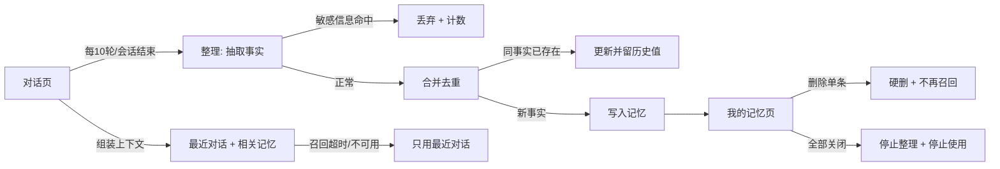

# 第四阶段增量 PRD（第 21-24 周 · 商用打磨与交付准备）

> 继承声明（2026-10-23 追加，不改动本文正文）：本文件为 L2 阶段实现文档，继承《Moy 项目总纲》的产品定位与核心衡量指标口径。
> 文中「企业级/企业客户」指交付对象的技术与合规要求，不构成产品定位或长期边界。
> 定位冲突时以总纲为准；范围冲突时以 `plan-v1.0.md` 为准（ADR-0005 D-24）。

> 文档性质：内部交付文档（供交付总监、架构师、研发、QA 消费）
> 上游输入：`docs/plan-v1.0.md` §四「第四阶段」/§五 强制规范/§六 最终验收标准；`docs/phase3-acceptance-report.md`（基线 `d363909`）；`docs/repo-gap-assessment-2026-10-22.md`（S1-S9 / M1-M16 / L1-L9）；`docs/tech-path-review-2026-10-23.md`；`docs/prd-v1.0.md`（P0-02 / 5.3 / 5.4）；`docs/audit-repo-2026-10-22.md` §八（已闭环项）
> 代码基线：**`main` @ `2bdfa19`**＋**工作区未提交改动**（见 §0.4 声明；复核命令见附录 E）；v1.2 起与 `docs/architecture-phase4.md` v1.0 §0 的 9 条事实纠偏（F-1~F-9）对齐
> 作者：许清楚（产品经理） 日期：2026-10-24 版本：**v1.5** 状态：**待评审（交付总监、QA）**

---

## 修订记录

| 版本 | 日期 | 修订人 | 修订说明 |
| --- | --- | --- | --- |
| v1.0 | 2026-10-23 | 许清楚 | 初稿：§0-§9 + 附录 A-E；P0 20 / P1 10 / P2 5 |
| v1.1 | 2026-10-23（同日修订） | 许清楚 | Q-1~Q-7 拍板落文；C-1 覆盖率门槛纠偏；C-2 依赖断裂纠正（`P3-B22-01` 并入 P4-11、`P3-B22-04` 提为 P4-29）；C-3 口径失真纠正（"已修＝工作区未入库"）；C-4 新增 P4-35。**P0：20 → 22** |
| **v1.2** | **2026-10-23**（同日修订） | 许清楚 | **采纳架构 `docs/architecture-phase4.md` §0 的 F-1~F-9 纠偏**：P4-07 前提重写（上下文**已是**自研组装）、P4-11 判据改为可执行、P4-12 注入点改为单步、**容器口径 4 → 9**（漏算 IdP）、P4-16 补 `digest` 前置、回滚路径与版本表名更正、P4-10 补 Settings 前置、P4-05 拆应用侧/DBA 两段；**并自查修正 v1.1 的覆盖率门槛仍低于实测**（90% < 90.78%）。**P0 仍 22 条（无增减，改为判据重写）** |
| **v1.3** | **2026-10-23**（同日修订） | 许清楚 | **覆盖率门槛改为「基线取实测」**：删除写死的 90.78/90.26/80.89（那组是 `94f87a7`／1573 条口径，最终树 1598 条实测 90.75%，写死会让 CI 当前树必红）→ 改为 **`max(90.0, T4-01.1 收敛提交实测)` / `max(80.0, 实测)`**，实测值由工程师回填 `docs/phase4-batch-log.md`；§7.5 增表注：**引用此类数字必须同时给 SHA + 命令 + 口径，不得把快照当常量**。**P0/P1/P2 条数均未变** |
| **v1.4** | **2026-10-24** | 许清楚 | **按 `docs/lite-container-baseline.md` 实测回填**：容器数 9（已是实测）、**空载内存改为双口径 1.88 GiB（工作集）/ 2.24 GiB（cgroup）**、起栈 **95.7 s**、8G 定为最低承诺配置（余量 ≈5.5 GiB）；新增 §5.2 三条「会出事」结论（**Keycloak 必须 `-Xmx384m`**，否则整机 3.30 GiB / `dify-api` 78-85 s 是固有开销 / `pg_isready` 不足以判 PG 就绪）；P4-35 收敛为 2 项待办；P4-04 白名单落实 **2 条**（W-1/W-2）；P4-16 ① 有了 9 条 digest 实测来源；Q-2/Q-5/Q-6 结论落定；P4-30 增删 `milvus_uri` 死字段。**P0/P1/P2 条数均未变** |
| **v1.5** | **2026-10-24** | 许清楚 | **三条待定全部关闭**：① §4.6.1 新增取数模式 `assemble_from`（默认 `server`，**互斥取数**，三行表 + 三条硬要求），P4-07 增 4 条判据（双份历史消除 / 互斥性 / 两条硬要求 / 监控项）；② Q-1 剩余项关闭（**keycloak 实测 797.6 MiB，原「预期 ~450 MiB」高估 43% 作废**；`nginx:1.29-alpine` digest 已核验）；③ F-2 快照口径澄清（`required` 变短**不是 breaking**，门禁代码不改，只需 `--update-snapshot` + 贴 1 行 diff）。P4-13 增 `model_client_history_ignored_total` 指标。**同日二次修订**：H-1 判据收紧为「`JAVA_OPTS_APPEND:` 赋值行 + 两参数同时出现 + 位于 `keycloak:` 块内」（原 `grep Xmx384m` 可被注释满足 = 假门禁）、H-3 收紧为写死 `to_regclass('public.schema_migration')`、H-2 补「二次启动 100.9 s 更慢」反证、P4-35 改「已交付（Win+Docker Desktop 口径）+ 2 项随交付复测」、§5.2 改「数据唯一来源」、旧版重复内存数字全文清除（仅修订记录留痕）。**第三次修订**：§4.6.1 硬要求 #4 落实为 `seq < current_message.seq`（`current_message_id` 必传，禁 `now()`/「取 N 条再减一」）+ 3 条判据（含**并发两轮互不包含**）；新增 **§4.6.2 `client` 落日条款**（S-1~S-4 + 保底规则）；P4-13 补 `model_history_source_total`；P4-30 `.gitignore` 措辞明确为「只忽略 `out/` 与生成物，bench 源码不忽略、整目录不进交付物」。**P0/P1/P2 条数均未变** |

**v1.3 变更明细（仅 §7.5 一处，可核对）**

| 变更 | 位置 | 内容 |
| --- | --- | --- |
| 门槛改法 | §7.5 | 删除写死百分比 → **基线取 T4-01.1 收敛提交实测**，比较式 `max(90.0, 实测)` / `max(80.0, 实测)`；实测回填 `docs/phase4-batch-log.md` |
| 表注 | §7.5 | 新增「引用必须给 SHA + 命令 + 口径，不得把快照当常量」，并留证 v1.0→v1.3 三次纠错 |
| 连带修正 | §8.1（W1/W4）、§8.2（L9）、P4-02、附录 E | 移除把 90.78/90.26/80.89 当门槛的表述；改为「两套真实口径不可混用」 |

**v1.2 变更明细（逐条对应架构 §0，可核对）**

| 变更 | 来源 | 位置 | 内容 |
| --- | --- | --- | --- |
| F-1 | 架构 §0 | §4.6、P4-07 | 删除"改用无状态生成路径/`/v1/completion-messages`"；真实缺口＝**历史来源从客户端改为 `message` 表 + 加记忆注入** |
| F-2 | 架构 §0 | P4-07、附录 A | `GenerateRequest.conversation_id` **必填 → 可选**（不是新增字段），需同步 openapi 快照 |
| F-3 | 架构 §0 | P4-11 | 删"去掉 `user_id` → 20001"（HTTP 不可达）；改为**计量落库断言 + 硬止损前置** |
| F-4 | 架构 §0 | P4-12 | 注入点由"`_advance_record` 外层（整任务 8 步×600s）"改为**单步 `run_step` 外层** |
| F-5 | 架构 §0/§9.1 | §5.1、§5.2、§7.1、P4-15、P4-35 | 容器 **4 → 9 常驻 + 可选 1 管理台**；说明原假设漏了 IdP（Keycloak 是单机第一内存消费者）。**v1.4 已用 `lite-container-baseline.md` 实测替换全部估算值** |
| F-6 | 架构 §0 | P4-16、§5.3 | `images.lock` **无 `digest` 字段**→ 先增字段并回填，再做 RepoDigest 比对 |
| F-7 | 架构 §0 | P4-14、§5.4、附录 E | 回滚目录 `deploy/migrations/rollback/00NN_*.sql`；版本表名 **`schema_migration`（单数）** |
| F-8 | 架构 §0 | P4-10 | 补 `Settings` 缺的 4 个底座密钥字段（CODE/LONG_CONTEXT/REASONING/FALLBACK），否则契约测试无从断言 |
| F-9 | 架构 §0/§10.4 | P4-05 | 拆"应用侧清理（有权限的表）+ DBA 维护 SQL（`audit_log`）"；`audit_log=skipped(no privilege)` 为**预期行为** |
| 自查 | v1.1 复议 | §7.5 | 门槛 90%/90%/80% **仍低于阶段三实测** → v1.2 曾改为写死 90.78/90.26/80.89；**v1.3 再改为「基线取 T4-01.1 实测」**（写死快照会让 CI 在当前树必红，详见 §7.5 表注三次纠错留证） |

---

## 0. 版本、范围与「不做」清单

### 0.1 本阶段范围

第 21-24 周，四条战线并行，目标是**把"跑得很稳的骨架"变成"能签合同的产品"**：

| 战线 | 一句话 | P0 条目 |
| --- | --- | --- |
| A 硬阻塞清零（安全合规） | 现状下生产部署等于裸奔，且合规材料交不出来 | P4-01 ~ 06 |
| B 产品内核补位 | 记忆与上下文、档位路由、成本护栏——决定"这产品凭什么卖钱" | P4-07 ~ 12 |
| C 可观测与可运维 | 监控栈空转、迁移无退路、交付物类型不正确 | P4-13、14、**29** |
| D 交付准备 | 能把软件装到客户机房并验收 | **P4-35（前置）**、P4-15 ~ 20 |

### 0.2 本阶段四道强制约束（创始人已拍板，不再讨论）

| # | 决策 | 对 PRD 的约束 |
| --- | --- | --- |
| D1 | **Dify 保留为 V1.0 底座**，不做 OpenAI 兼容网关重写 | 档位路由、token 计量**只在 Dify 上**补齐（P4-10、P4-11）；"重写网关"进不做清单 |
| D2 | **记忆与上下文全量落地**（四表 + 落库 + 回拉 + 前端持久化 + 事实抽取 + 管理页） | 第 4 章为产品定义唯一真源；P4-07/08/09 三批交付 |
| D3 | **计费全链路冻结**：订阅/发票/回调 6 端点保留代码不删不改，移出 V1.0 验收范围 | 只保留额度校验、用量计量、硬止损（P4-11/12）；`docs/phase3-acceptance-report.md` §九"微信支付真实商户联调"这项前置**随本决策解除** |
| D4 | **首个付费客户＝中小企业私有化**，轻量版主推（容器口径见 §5.2 / Q-1），全家桶为标准版 | P4-15 优先于标准版任何打磨；标准版问题一律 P1 以下 |

### 0.3 范围硬规则：端点只减不增（例外仅两类）

`docs/tech-path-review-2026-10-23.md` §七 W1 要求"冻结端点（只减不增）"。本阶段执行如下口径：

- **允许新增的仅两类**：① 记忆与会话（第 4 章）；② 租户数据权利（P4-05）。总计 **10 个**，见附录 A。
- **其余所有域（计费 / 运营 / 知识库 / 工具 / 插件 / 任务）零新增**。任何"顺手加个端点"的需求一律 P2。
- **既有端点变更只允许向后兼容**（新增可选字段 / 新增可选查询参数），旧字段不删不改语义。

### 0.4 ⚠ 与 `repo-gap-assessment` 的 6 处口径冲突（以代码事实为准）

> **⚠ 口径声明（C-3，v1.1 新增，必读）**：下表与全文所称**"已修"，一律指「工作区存在改动、尚未入库」**。
> `HEAD`（`2bdfa19`）**不含**这些改动——已实测：`git show HEAD:apps/adapter/app/core/artifact_token.py | grep -c expires_at` → **0**；
> `git status` 显示 `artifact_token.py`、`security.py`、`config.py`、`main.py`、两份 compose、`images.lock`、
> 两个 workflow 均为 `M`（modified），`test_auth_startup.py` / `test_artifact_token.py` 为未跟踪。
> **因此：P4 首日任务＝把这些改动收敛为一次提交并验证；入库前一律按"待交付"计算，不得写进任何验收结论。**
> 本 PRD 不再使用"已修复"这个措辞，统一改为「**工作区已实现（未入库）**」。

`docs/repo-gap-assessment-2026-10-22.md` 基于 `fc3df7b`。当前基线是 `2bdfa19` + 工作区改动。**本 PRD 按下列实况立项，不复述已闭环项**（呼应 `docs/audit-repo-2026-10-22.md` §八"不重复立项"）：

| 编号与 gap 结论（@fc3df7b） | 代码实况（工作区，**未入库**） | 本阶段处置 |
| --- | --- | --- |
| **S6** SaaS 编排用库属主 DSN，RLS 被绕过 | 工作区已实现（未入库）：`docker-compose.saas.yml:370` 与 `docker-compose.yml:473` 均为 `OA_DATABASE_URL: ${OA_DATABASE_URL:?…}`（缺失即启动失败，不再回落库属主） | **不立项**；只留 P1 回归门禁（防回退） |
| **S7** CI 无 PG 服务 | 工作区已实现（未入库）：`.github/workflows/ci-adapter.yml:47-60` 有 `services.postgres`（`postgres:18.6-alpine`）、`:68` `OA_TEST_DATABASE_URL`、`:73` `OA_BATCH=B21` | **降级但保留 P0**：配置就绪 ≠ 跑通过。本阶段要求 **CI 真绿一次并留 URL**（P4-02） |
| **S8** 合规门禁三处同修 | 工作区已实现（未入库）：`:137/:207` 已装 `pyyaml`、`:311` MinIO 死规则已删、`images.lock:138` 已加 `distribution: independent-container` 豁免字段（缺字段默认判黑） | **残留立项 P0**：SBOM（CycloneDX）**零命中**、`.difypkg` 内 36 个精确 pin 无扫描（`validate_offline_pkgs.py` 不存在）、license-scan 从未在 CI 真跑成功（P4-03） |
| **S9** 产物下载无鉴权、令牌永久有效 | 工作区已实现（未入库）：`artifact_token.py` 载荷含 `expires_at`（`artifact_token_ttl_seconds` 默认 900s、封顶 86400s）、`parse_token` 强制校验过期、密钥为空**拒绝签发**、下载链路按"租户 + IP"限流 60/min、校验产物留存期 `_is_expired()` | **降 P1**（P4-24）：残留为"非一次性、不可吊销、可被转发（900 秒内）"，按 P4-24 处理并在交付手册披露 |
| **S1** 生产配置里鉴权等于关闭，且**代码没有任何防呆** | 工作区已实现（未入库）：`security.py` 新增 `validate_auth_startup()`（`staging/production` + `stub` → `30004` 启动失败；同环境 `jwt_secret` 为空同样拦），`main.py:115` 在 `lifespan` 中调用，新增单测 `test_auth_startup.py`（未跟踪） | **P4-01 改判**：从"实现防呆"改为**"收敛提交 + 验证 + 两份 compose 显式声明 `OA_AUTH_MODE` + 密钥轮换执行"**。防呆本身**不重复实现** |
| **M2** 任务超时死配置 | **已实现**（`2c85efb` T4-04.4 落地，`747280c` P1-9 三拆迁入）：`business/task/facade.py:127-130` 缺省取 `plugin_task_timeout_seconds`（**已不再零读取**）；`business/task/runner.py:477-521` 每**步** `asyncio.wait_for(…, timeout=deps.step_timeout_seconds)` → `STEP_FAILED` + 「这一步执行超过 N 秒，已停止等待」，已落库产物不回滚（唯一调用点 `runner.py:434`） | **已结清**（P1-13）：台账 `P3-B22-02` 由 `open` 改为 `status="fixed"`，`due_batch=B30` 仅留审计痕迹（到期判定 ⑯ 只对 `open` 生效）。P4-12 的「单步超时」判据（该步到点即失败、`elapsed` 远小于睡满时长、产物保留）由 `tests/unit/test_task_step_lock.py::TestStepTimeout` 两条用例钉住，可直接复核 |

> **数字来源规则**：本节与全文的"现状"数字分两类——① 代码实测（`2bdfa19`，复核命令见附录 E）；② 引自 `repo-gap-assessment`（`fc3df7b`）或阶段三验收报告（`d363909`，数字回填提交 `94f87a7`）的存量口径，引用时注明出处。两类不得混用，冲突一律以本机命令结果为准。
>
> 另注：`P3-B22-04`（下载 MIME 恒 `text/plain`）**已结清**——`deploy/migrations/0006_plugin_artifact_content_type.sql` 建列、`deploy/init-schema-phase3.sql:266` 直接建 `content_type VARCHAR(128)`、写入与读取三处统一走 `artifact_repo.resolve_content_type()`（`artifact_repo.py:69`），判据见 `tests/integration/test_artifact_content_pg.py`。原文「`grep content_type … ` 零命中」已被该批改动推翻（该 grep **现在恰有命中**）。**v1.1 由 P1 上调 P0（P4-29）**保留为历史决策痕迹（理由见 C-2），不再作为开放项。

### 0.5 不做清单（写进合同边界，不允许留成"未做"）

| # | 不做的事 | 理由 |
| --- | --- | --- |
| N-1 | OpenAI 兼容网关重写 / LiteLLM 替换 Dify | D1 拍板；列入 V1.1 独立决策 |
| N-2 | 用 pgvector 替换**标准版**知识库检索的 Milvus，或重写现有 RAG 链路 | Q-2 已定：轻量版知识库走 pgvector、标准版可留 Milvus，**仅部署配置差异、代码不分叉**；本阶段不做「用 pgvector 重写 RAG」这件事 |
| N-3 | MCP 工具总线 / 第三方工具生态 | 阶段四无产能，且会重新打开"沙箱与审核"这个已关闭的口子 |
| N-4 | 计费 6 端点（订阅 / 发票 / 订单 / 支付回调）的任何改动 | D3 冻结，代码保留不删不改、不进验收 |
| N-5 | 插件生态开放（开发者注册 / 提交 / 审核上架） | 沿用 `prd-phase3-increment.md` B-1/B-2 |
| N-6 | M4 分层重构（api→db / business→api / repo→business 反向依赖） | 收益是"新人上手快"，代价是四周内动 18 个文件；风险 > 收益 |
| N-7 | M5 上帝文件拆分（`billing_repo` 2272 行等 4 个） | 同上；且计费域已冻结，拆了也没人用 |
| N-8 | 前端 i18n / 深色模式 / 移动端适配 | 目标客户是"办公桌面 + 私有化"，无海外与移动诉求 |
| N-9 | 1000 并发的对外承诺 | 见 §7.1：按轻量版单机实测披露，不虚标 |

---

## 1. 阶段目标与成功判据

> 每条判据都必须能被一条命令或一个可观察现象证实。判据里出现"良好""达标"字样的，视为未写判据。

| # | 目标 | 可量化 / 可复现的成功判据 |
| --- | --- | --- |
| **G4-1** | **安全与合规不再是裸奔** | ① `OA_ENV=production OA_AUTH_MODE=stub` 启动进程 → **退出码非 0**且日志含拒绝原因（P4-01 ①）；② 5 类攻击用例（伪造令牌 / 过期令牌 / 超额调用 / 跨租户 / 越权对象）**全部被拒绝**且拒绝路径无堆栈外泄（P4-20）；③ `cyclonedx` SBOM 覆盖 py/npm/镜像/difypkg 四层，文件可被 `jq` 解析（P4-03） |
| **G4-2** | **刷新不丢会话，跨会话能记住人** | ① 关浏览器重开 → 会话列表与全部历史消息**逐字一致**（P4-08 ①）；② 会话 A 里说"我叫赵工，做供应链" → 新开会话 B 问"你还记得我吗" → 回答含"赵工"（P4-09 ①）；③ 记忆管理页删除该条后，再问**不再出现**（P4-09 ④） |
| **G4-3** | **四个档位不再是同一个东西** | 契约测试：`resolve_app_key(general/code/long_context/reasoning)` 解析出 **4 个互不相同**的应用密钥，且 `generate()` 实际按档位取密钥（P4-10） |
| **G4-4** | **超额不再"无限烧钱"**（2026-10-27 裁决后修订） | 三路分流：R3 文档上传 / A1 自动化任务 **0 次上游调用**（挂起，`hold_reason=quota`）；M1/M2 对话**不拦停**——限长 + `code=0`/`notice_code=15006`，上游 **1 次**（裁决的代价，如实断言 1）；文案不含技术词（P4-11 ②） |
| **G4-5** | **运维看得见、退得回** | ① `curl /metrics` 返回 `text/plain` 且含 `http_requests_total`（P4-13）；② `prometheus.yml` 4 个 job 全部 `UP`，故意注入 5xx 后 2 分钟内告警触发（P4-13）；③ `docker compose -f docker-compose.lite.yml up -d` 至 `/readyz` `status=ok` **≤ 3 分钟**（含 PG 与 `OA_BATCH`），**常驻容器数 = 9 且四处数字一致**，且核心链路四项（对话 / 知识库问答 / 插件任务 / 记忆召回）各跑通 1 次（P4-15） |
| **G4-6** | **能装到客户机房、能验收** | ① 断网环境全新服务器一键部署成功，`/readyz` 全绿，完成 1 次对话 + 1 次知识库问答 + 1 次插件任务（P4-16）；② 金标任务集 20 条按评分标准打分，记录总表可复算（P4-20） |

**阶段门一票否决项**：G4-1 / G4-2 / G4-6 任一不成立，本阶段不通过。G4-3 / G4-4 / G4-5 允许"部分维度延期"（见 §8.3 砍单顺序），但不得静默降级。

---

## 2. 用户故事（本阶段新增）

| 编号 | 角色 | 用户故事 |
| --- | --- | --- |
| US4-01 | R1 普通员工 | 我希望换个设备、隔天回来还能看到上次的对话全文，以便不用重新讲一遍背景。 |
| US4-02 | R1 普通员工 | 我希望系统记住我的称呼、所在团队和常用口径，以便新开会话也不用重复交代。 |
| US4-03 | R1 普通员工 | 我希望看到系统到底记住了我什么，并且能只删掉其中一条，以便我掌控自己的信息。 |
| US4-04 | R1 普通员工 | 我希望在"编程助手""长文档助手"之间切换时，得到的确实是不同能力的东西，以便按任务选工具。 |
| US4-05 | R3 企业管理员 | 我希望公司买的额度被一个脚本刷爆之前就先被拦住，以便成本可预测。 |
| US4-06 | R3 企业管理员 | 我希望公司退租或员工离职时，能导出并彻底删除我司数据，以便通过内部合规审查。 |
| US4-07 | R3 企业管理员 | 我希望拿到隐私政策、数据处理协议、安全白皮书，以便采购流程能走完。 |
| US4-08 | R3 企业管理员 | 我希望权限配置出错时系统拒绝访问而不是放行，以便不会因为漏配而泄密。 |
| US4-09 | R4 交付工程师 | 我希望在客户机房用 4 个容器、三分钟把服务起起来，以便一天能跑两家客户。 |
| US4-10 | R4 交付工程师 | 我希望交付一个带校验的离线包，装完能自证完整，以便不用在现场靠猜。 |
| US4-11 | R4 交付工程师 | 我希望升级失败时能退回到上一版本，且数据不丢，以便敢给客户升级。 |
| US4-12 | R5 运维 | 我希望服务挂了、任务积压了、额度烧穿了都能收到告警，以便在客户投诉前处理。 |

---

## 3. 需求池

### 3.0 编号与分级约定

- 编号 `P4-01` ~ `P4-35`，**不与 `P0-xx` / `P2-xx` / `P0-P3-xx` 冲突**。
- **来源列**写 gap 评估编号（S/M/L）或阶段三遗留编号（P3-Bxx-xx），保证"每条需求都有出处、没有凭空发明"。
- P0 = 阶段门必须交付（**22 条**，v1.1 由 20 条上调 2 条）；P1 = 阶段内尽量交付（**9 条**，含 1 条改判说明）；P2 = 顺延 V1.1（5 条）。
- **优先级不按实现难度调整**。P0 只能因创始人决策下移，不能因"来不急"下移（延期请走 §8.3 砍单顺序并留证）。
- **v1.1 提级依据（C-2 依赖断裂）**：`P3-B22-01` 与 `P3-B22-04` 若留 P1，`OA_BATCH=B30` 必报红 → P4-02"到期机制自证"永远无法达成，故两条必须在阶段内关闭。`P3-B22-01` 并入 P4-11（同一判定点），`P3-B22-04` 独立提为 **P4-29**。

### 3.1 P0 清单（22 条）

| 编号 | 战线 | 来源 | 内容（一句话） | 关键验收判据（一句话） |
| --- | --- | --- | --- | --- |
| P4-01 | A | S1 | 生产鉴权防呆**收敛入库** + compose 显式声明 + 密钥轮换 | 工作区改动入库后 `production`+`stub` 启动即失败；两份 compose 显式写 `OA_AUTH_MODE`；6 类密钥轮换完成并验证 |
| P4-02 | A | S7 | CI 真绿一次（含 PG、含租户隔离 15 条） | CI run URL 可打开且 `pytest` 步骤 SUCCESS，summary 含 `passed` 数 ≥ 当前全量口径 |
| P4-03 | A | S8 | 合规可交付：CycloneDX SBOM + difypkg 扫描 + license-scan 真绿 | SBOM 四层齐全可 `jq` 解析；`license-scan` job 在 CI 中 EXIT 0 |
| P4-04 | A | M14 | 权限解析不到角色时 fail-closed | 构造无角色令牌访问写端点 → 403 且审计留痕，**不再静默放行** |
| P4-05 | A | M13（**+F-9**） | 数据保留 + 定时清理（**应用侧表 + DBA 维护 SQL 两段**）+ 租户级导出/删除 | 应用侧清理有日志且 `audit_log=skipped(no privilege)` 为**预期**；DBA SQL 可删过期审计行；导出包可解压、删除后 `count=0` |
| P4-06 | A | M15 | 合规文档三件套（隐私政策 / DPA / 安全白皮书） | 三份文件存在、有版本与生效日期、与产品实际行为逐条对应（抽查 10 条无矛盾） |
| P4-07 | B | S2（**+F-1/F-2**） | 会话与消息落库 + **上下文数据源从客户端改为 `message` 表** + 记忆注入位 | PG 中有真实行；**不传历史只给最后一句时仍能引用前几轮**（证数据源已换）；`conversation_id` 必填→可选 |
| P4-08 | B | S2 | 历史回拉端点 + 前端持久化 | 刷新/换设备后会话与消息完整恢复（逐字比对），游标分页无重无漏 |
| P4-09 | B | S2 | 记忆四表 + 事实抽取 + 召回 + 管理页 | 跨会话记住指定事实；管理页可看/可删/可关；删除后立即不再使用 |
| P4-10 | B | S3（**+F-8**） | 四档位路由接线（**含 `Settings` 补 4 个密钥字段**）+ 契约测试 | `Settings` 有 4 个档位密钥字段；4 档解析出 4 个不同 key 且 `generate` 入参被断言 |
| P4-11 | B | S4 **+ P3-B22-01（提级）+ F-3** | 成本护栏：**计量必落库** + **硬止损前置** + 计量维度 + 超额四类对象处置 | 每次生成**必有 1 条** `usage_event` 且 `user_id` 非空；`remaining_units<=0` → **三路分流**（文档/任务：上游 0 次 + 挂起；对话：限长且上游 1 次）；四项行为逐项有判据（**2026-10-27 裁决后修订**，原「返回业务错误码且 0 次上游调用」已作废） |
| P4-12 | B | S4 / P3-B22-02 / M2 / **F-4** | 租户月度预算 + 任务**单步**超时真正生效 | 预算触顶即拒；构造慢步骤 → **该步**到点即超时（`elapsed < timeout+2s`），后续步骤不执行、产物保留 |
| P4-13 | C | S5 | 标准 `/metrics` + 两个 exporter + 告警规则 | 4 个抓取 job 全 `UP`；注入 5xx 后告警触发；告警规则文件被 Prometheus 加载无报错 |
| P4-14 | C | M8（**+F-7**） | 迁移四坑（`rollback/00NN_*.sql` / `advisory_xact_lock` / auto-migrate 默认 false / 哨兵种子） | `ls deploy/migrations/rollback/*.sql` 命中；三轮数据一致；版本表为 **`schema_migration`** |
| **P4-29** | C | **P3-B22-04（P1→P0）** | 产物类型正确：`plugin_artifact` 增 `content_type` 列并在三处赋值 | PG 后端下载 docx → `Content-Type` 为 docx 类型、可被 Word 直接打开；`content_type` 列存在 |
| P4-15 | D | tech-review §四 / M12 / **F-5** | 轻量版编排（**9 常驻 + 可选 1 管理台**）+ 三分钟起服务 + 资源限制 | 单机 8G、**实测 9 容器**、起服务 ≤3 分钟、核心链路四项可用；有状态服务 100% 有 healthcheck |
| P4-16 | D | plan §3.6 / 6.5 / **F-6** | 离线包 + 一键部署 + 升级/回滚（**含 `images.lock` 增 `digest` 并回填**） | `images.lock` 有 `digest` 且 9 条镜像全回填；断网全新机器一次成功；校验清单可执行 |
| P4-17 | D | plan §6.3 | 性能基线（首屏 / 首字 / 并发口径披露） | 首屏 ≤2s、首字 P95 ≤1s 有原始数据；并发按实测披露且写清机器规格 |
| P4-18 | D | plan §5.4 / §6.4 | 安全自查清单（5 类攻击） | 5 类告警/拒绝用例全部生效，且证明"拒绝发生在业务动作之前" |
| P4-19 | D | plan §6.5 | 交付文档三件套 + About 开源声明 | 部署手册按文档可被第三方复跑成功；About 页清单与 SBOM 一致 |
| P4-20 | D | tech-review §五 | 金标任务集 20 条 + 人工评分标准 | 20 条任务有固定输入与期望产物；评分表两人独立打分，分歧有裁决规则 |
| **P4-35** | D（前置） | **C-4 + F-5** | 轻量版容器集实测报告（**✅ 已交付** `lite-container-baseline.md`：9 容器 / 1.88 GiB / 95.7 s / 8G 够用） | 剩 **① 四处数字一致核对 ② 失效条件与删除代价入册**（其余已由报告完成） |

### 3.2 P0 逐条详述

> 格式：**来源 / 用户价值 / 功能口径 / 验收判据（可机械判定）/ 依赖 / 优先级理由**。验收判据里出现的数字，均可在 §0.4 或附录 E 找到出处。

#### A 战线：硬阻塞清零

**P4-01 生产鉴权防呆入库与密钥卫生（来源 S1，v1.1 改判）**

- **用户价值**：现状下"生产环境 + 不验签"是**默认态**，任何人可自造令牌声明任意租户与 `roles:["*"]`。这一条不改，谈交付等于把客户数据挂公网。
- **v1.1 改判依据（C-3）**：防呆逻辑**已在工作区实现**（`security.py` 的 `validate_auth_startup()`：`staging/production` + `stub` → `30004` 启动失败、同环境 `jwt_secret` 为空亦拦；`main.py` 在 `lifespan` 中调用；`tests/unit/test_auth_startup.py` 未跟踪），但**未入库**（`HEAD` 不含）。故本条**不重复实现**，改为三件事：**收敛提交 → 验证 → 补齐 compose 与密钥轮换**。
- **功能口径**：
  1. **收敛提交**：把工作区里 S1/S6/S8/S9 相关改动（`security.py`/`config.py`/`main.py`/`artifact_token.py`/`artifact_files.py`/两份 compose/`images.lock`/两个 workflow + 两个新单测）整理为可追溯的一次或数次提交，**入库后**才计入交付。提交前必须跑通全量测试（含 PG + `OA_BATCH`）。
  2. **两份 compose 显式声明**：adapter `environment` 在 `OA_ENV=production` 时**显式写** `OA_AUTH_MODE`（不得依赖代码默认值）。
  3. **产出密钥轮换清单**（`docs/key-rotation-checklist.md`）：`OA_JWT_SECRET`、`OA_CREDENTIAL_ENCRYPTION_KEY`、DB 口令、5 处 `CHANGE_ME_*`、底座应用密钥 6 个环境变量——每项写"谁持有 / 怎么换 / 换完怎么验 / 影响哪些已发令牌"。
- **验收判据**：
  ① 改动**已入库**（`git log` 可查到提交且 `git show HEAD:apps/adapter/app/core/security.py | grep -c validate_auth_startup` ≥1）；
  ② `OA_ENV=production OA_AUTH_MODE=stub python -c "from app.core.config import Settings; Settings()"` → **非 0 退出**，输出含拒绝原因；`OA_ENV=development` 同参数**不退出**（防误伤本地演示）；
  ③ `grep -c "OA_AUTH_MODE" deploy/docker-compose.yml deploy/docker-compose.saas.yml` → 各 ≥1；
  ④ 轮换清单 6 类密钥全部有"验证方法"列，且 JWT 轮换后旧令牌**全部失效**（旧令牌请求返回 401，不是 403）；
  ⑤ `deploy/.env` 中 5 处 `CHANGE_ME_*` 归零（按交付检查表核对；该文件不入库）。
- **依赖**：无（W1 首日）。
- **优先级理由**：唯一一条"不改就是裸奔"的需求；且它是 C-3 口径失真的**直接修复对象**——工作区有、HEAD 没有，正是阶段三 §10"文档说交付了、仓库里没有"的同族风险。

**P4-02 CI 真绿一次（来源 S7）**

- **用户价值**：对外写的阶段三数字必须能被客户复跑——注意有**两套真实口径**：**1573 passed / 合并 90.78%**（`d363909` + `--run-pg` + `OA_BATCH=B21` + 635.97s，`94f87a7` 回填）与**1598 passed / 90.75%**（最终树，`docs/audit-repo-2026-10-22.md:271`）。**两者不可混用**（§7.5 表注）；多租户隔离这条最高红线必须在自动化里跑过，而不是只在本机跑过。
- **功能口径**：CI 配置已在工作区就绪（`services.postgres` + `OA_TEST_DATABASE_URL` + `OA_BATCH=B21`，**未入库**，随 P4-01 一并提交），本阶段要的是**真跑通过一次并留证**：① 恢复 Actions 额度（或改用自托管 runner，二者取其一并写进交付文档）；② 把 run URL 贴进阶段四验收报告；③ 报告中的测试数字**必须带口径脚注**（含 PG / `OA_BATCH` 值 / 耗时 / SHA）。
- **验收判据**：
  ① 一次 CI run 的 URL 可被外部打开，`pytest` 步骤结论为 success；
  ② 该 run 日志中 `tests/integration/test_tenant_isolation.py` 出现 **15 个 passed**、`skipped` 计数为 **0**；
  ③ 覆盖率门禁在该 run 中通过，门槛按 v1.1 §7.5（合并 ≥90% / `business+db` ≥90% / 分支 ≥80%），且数字与报告脚注一致；
  ④ **到期机制自证（三段式，缺一不可）**：**入库后、修复前**把 `OA_BATCH` 临时改成 `B30` → CI 因**到期未闭的 `open` 条目**（`fcbe0d8` 起为 **1 条：`P3-B22-01`**；`fcbe0d8` 前为 2 条：`P3-B22-01/02`）**报红**；该条真关闭后同参数 → CI **转绿**；再把它改回 `open` → **再报红**（证明不是把条目挪走）。三次结果都留进验收报告。
- **依赖**：P4-01（改动先入库）、P4-14、**P4-11**（`P3-B22-01`，B30 到期项中**唯一仍未关闭**的一条；其判据含 PRD 5.3 四项行为，属功能缺口而非账务问题）。`P4-12`（`P3-B22-02`）与 `P4-29`（`P3-B22-04`）的 B30 到期项**均已 `status="fixed"`**，不再构成本条的阻塞，仅保留追溯意义。
- **优先级理由**：没有这一条，本阶段所有"已修复"都只是自述。**判定标准是 URL，不是文字。**

**P4-03 合规可交付：SBOM + difypkg 扫描 + 门禁真绿（来源 S8）**

- **用户价值**：私有化客户采购必问"你用了什么开源组件、有没有 GPL"。现有产物是两份 license 清单，**不是 SBOM**，且不覆盖镜像层与 `.difypkg`。
- **功能口径**：
  1. 产出 **CycloneDX SBOM**，覆盖四层：Python 依赖、npm 依赖、镜像（按 `images.lock` 的 digest）、`.difypkg` 内 36 个精确 pin。
  2. 新增 `deploy/validate_offline_pkgs.py`：解包 `.difypkg`，扫协议与已知 CVE（离线库可接受，需写清库版本与更新方式）。
  3. `license-scan` job 在 CI 中真跑至 EXIT 0（三处修复在**工作区**已落地、未入库，随 P4-01 一并提交，缺的是"跑过一次"）。
- **验收判据**：
  ① SBOM 文件存在且 `jq '.components | length'` > 0，四层各自有组件条目（按 `bom-ref` 前缀可区分）；
  ② `python deploy/validate_offline_pkgs.py --self-test` 正样本通过、负样本（塞 1 个 GPL 包）返回非 0；
  ③ CI `license-scan` job 结论 success；
  ④ About 页开源声明条目数 = SBOM 中"运行时依赖"条目数（差集为空）。
- **依赖**：无。
- **优先级理由**：`plan` §6.4 是**一票否决项**（AC-11）；且这是唯一"客户会真的索要"的合规物。

**P4-04 权限解析不到角色时 fail-closed（来源 M14，v1.4 白名单落实为 2 条）**

- **用户价值**：现在"角色没同步上"会**静默放行**，安全性依赖每个端点都做了对象级判权——风险面随端点数线性增长（当前 84 个端点）。
- **功能口径**：`security.py:263-267` 的 `if not roles: return` 改为 **拒绝**并记审计。确需委派的走**显式白名单**（常量表，不得通配）。
- **白名单已定（架构穷举全仓 `require_permission(...)` 仅 9 处 / 5 个权限点，故只需 2 条）**：

  | # | 权限点 | 理由 | 收窄范围 |
  | --- | --- | --- | --- |
  | W-1 | `knowledge:base:read` | 只读；真隔离由 `is_visible()` 承担。令牌缺 roles 属身份侧异常，不应连"看自己被授权的库"都拒 | **仅 GET** |
  | W-2 | `tool:connection:manage` | TL1 只读调用记录，返回集已按 `initiator_id` 收敛到本人 | **仅 TL1** |

  实现口径：`(permission, method)` **双键**判定 + `docs/security/permission-whitelist.lock` 快照；**其余域不走此路径**（ops 走 `require_ops_access`、identity_ext 走服务层 `has_admin_role`、M4/BL5 已 fail-closed）。
- **验收判据**：
  ① 构造"角色 claim 缺失"的令牌访问 3 个写端点（插件安装 / 成员新增 / 任务创建）→ 全部 403，且 `audit_log` 各留 1 条；
  ② `grep -rn "permission_check_deferred" apps/adapter/app` → 0 命中；
  ③ **白名单快照存在且恰好 2 条（W-1/W-2）**，每条带理由与收窄范围；CI 断言 `len <= 5` **且集合未漂移**（对 `permission-whitelist.lock` 做 diff，增一条即红）；
  ④ 白名单外的权限点在"无角色"下**一律 403**（各域至少各 1 条用例：知识库写、工具写、插件写、任务写）；
  ⑤ 全量测试（含 PG）仍 0 failed。
- **依赖**：无（白名单清单已由架构给出，不再是待确认项）。
- **优先级理由**：安全默认值错向（fail-open）比缺失校验更危险，因为它让人以为已经校验过了。

**P4-05 数据保留策略 + 定时清理 + 租户导出/删除（来源 M13，v1.2 按 F-9 拆分）**

- **用户价值**：`prd-v1.0.md` 5.4 承诺了"可查看 / 可删除"，但**既无文档也无接口**；客户退租时数据无退出通道，也无法自证"已删除"。
- **⚠ v1.2 更正（F-9）**：v1.0/v1.1 写的"审计 180 天自动清理"**应用角色做不到**——`deploy/init-app-role.sql:69` 对 `audit_log` 执行 `REVOKE UPDATE, DELETE ON audit_log FROM officeai_app`（这是阶段二"审计只增不改"的**正确设计**）。所以清理必须拆成两段，**不能**把"审计表没清掉"当缺陷。
- **功能口径**：
  1. **分级保留**：审计 180 天、用量 13 个月、任务记录与产物 180 天、会话与消息（**Q-4 已拍板：365 天**）、记忆（默认 永久，用户可删）。全部可配。
  2. **定时清理（两段式，v1.2）**：
     - **段一 · 应用侧**（`retention_cleanup` 后台任务，每日一次）：清它有权限的表（用量、会话/消息软删、过期产物、stale 映射）。输出结构化日志（表名 / 行数 / 耗时 / 失败原因）；对 `audit_log` 必须显式打印 **`audit_log=skipped(no privilege)`**——**这是预期行为，不是失败**。连续 2 次**非权限原因**失败才告警。
     - **段二 · DBA 侧**：交付 `sql/retention-audit.sql`（`DELETE FROM audit_log WHERE created_at < now() - interval '180 days'`），并以库属主（`officeai`）执行；写进部署手册的"季度维护"清单。
  3. **租户导出**：异步任务产出压缩包（JSON Lines + 附件），含 5 类：审计、用量、会话与消息、记忆、产物清单。包内附 `manifest.json`（行数 + sha256）。私有化另有 `sql/tenant-export-manual.sql` 供 DBA 兜底。
  4. **租户删除**：二次确认（输入企业名称）→ 标记 `deleted_at` → 24 小时内硬删**应用侧**5 类数据 → 产出"删除证明"（各表删除行数 + 时间）。**审计行的删除同样走 DBA SQL**，删除证明须分列"应用侧已删"与"待 DBA 执行"两段，不得合并成一个数字。
  5. **私有化口径**：单租户模式下导出/删除改为"全库导出 / 全库清空"，全部给 DBA 可执行 SQL 清单（应用角色不做 DDL/DELETE 审计）。
- **验收判据**：
  ① 保留期配成 1 天并手动跑 `retention_cleanup` → 应用侧目标表过期行 `count=0`，日志含行数，且**明确出现 `audit_log=skipped(no privilege)`**（缺这一行 = 判红，因为说明清理任务没意识到权限边界）；
  ② 以库属主跑 `sql/retention-audit.sql` → 过期审计行 `count=0`，未过期行不受影响；
  ③ 导出包解压后 5 类数据文件均存在，`manifest.json` 行数与文件实际行数一致；
  ④ 删除后应用侧逐表 `count=0`；删除证明分两段呈现（应用侧 / 待 DBA），不合并；
  ⑤ 私有化 SQL 清单在测试库执行成功，回滚 SQL 同步提供。
- **依赖**：P4-07（会话四表先存在，才谈保留期）。
- **优先级理由**：这是**签合同的法律义务**，不是体验优化；且没有它，P4-06 的隐私政策写不出来（写了也是假的）。

**P4-06 合规文档三件套（来源 M15）**

- **用户价值**：采购流程要材料。现在 `docs/` 51 个文件里**零合规文档**。
- **功能口径**：
  1. **隐私政策**：收集什么、为什么、存多久、谁能看、怎么删、跨境与否（V1.0 私有化默认"数据不出境"）。
  2. **DPA 模板**（数据处理协议）：角色定义（客户 = 控制者，我方 = 处理者）、处理目的与范围、子处理者清单（含 Dify / 向量库 / 镜像来源）、安全措施、审计权、删除与返还、违约与通知时限。
  3. **安全白皮书**：架构安全（租户隔离 RLS 双保险、应用角色 `NOBYPASSRLS`）、密钥管理、审计不可篡改、漏洞响应流程、已知限制（引用阶段三 §八未验证项）。
  4. **口径一致**：三份文档里出现的任何数字（保留期、加密算法、隔离方式）必须与代码/配置一致，冲突以代码为准。
- **验收判据**：
  ① 三份文件存在，各含版本号与生效日期；
  ② 抽查 10 个事实性陈述（如"审计保留 180 天""数据库连接使用限制性账号"）逐条对应到配置项或代码行；
  ③ 隐私政策中"用户可删除记忆"这条，与 P4-09 的管理页能力一一对应（不对应即判红）；
  ④ 禁词扫描：三份文档**允许**出现技术名词（对内部/客户 IT），但**面向终端用户的隐私政策摘要**不得出现模型名、向量库、RAG、token。
- **依赖**：P4-05（保留期与删除能力先落地，否则文档是空话）。
- **优先级理由**：AC-11 / 采购门槛；且"文档声称的能力必须真的存在"是阶段三 §10 已经付过学费的教训。

#### B 战线：产品内核补位

**P4-07 会话与消息落库 + 上下文数据源切换（来源 S2，v1.2 按 F-1/F-2 重写）**

- **用户价值**：现在上下文**完全来自客户端传参**，消息内容**从不落自研库**，刷新即失忆；上下文资产沉淀在客户端与底座两侧，换底座/换设备即失忆。这与"自有核心 = 记忆与上下文"的战略相反。
- **⚠ v1.2 前提更正（F-1，必读）**：v1.0/v1.1 说"上下文只以 `conversation_id` 透传给底座、由底座回忆"——**不成立**。`model_service.py:556-581` **已经**把 `request.messages` 拼成单条 `query`（"以下是此前的对话记录：…"），并**硬编码 `conversation_id: None`**（`:578`）。所以：
  - **不需要**改下游调用协议，**不需要**换 `/v1/completion-messages`，"无状态生成路径"这件事不存在；
  - **真实缺口只有两个**：① 历史来源是**客户端**，不是自研 `message` 表；② **没有记忆注入**。
- **功能口径**：
  1. 新增三表（`conversation` / `message` / `user_memory`，第四张 `memory_embedding` 归 P4-09），均含 `tenant_id` 且 `FORCE ROW LEVEL SECURITY`，策略与既有 strict 表一致。
  2. `message` **append-only**：只插入，不更新正文（状态字段可更新）。角色限 `user|assistant|system`，`content` 保留原文（脱敏在读取时做，不在写入时做——否则无法审计）。
  3. **先落库再调模型**：用户消息先入库（状态 `pending`）→ 调底座 → 助手消息入库（状态 `settled` / `failed`）。底座失败时**用户消息仍在库**，助手消息记 `failed` 并带业务化原因。**入库本身失败 → `30003` + 不进上游、不写 `usage_event`**（`seq` 是上下文组装的前提，破了就不能降级继续）。
  4. 流式场景（M2）：先落 `pending`，流结束落 `settled` + token 用量；中断（客户端断开）落 `aborted` 并保留已生成部分（截断标记）。
  5. **上下文数据源切换（v1.2 核心改动）**：新增 `ContextAssembler`，从 `message` 表取最近 N 轮 + （P4-09 落地后）从 `user_memory` 取 top-k，拼成**同一条 `query`**；`conversation_id: None` 保持不变。
  6. **`conversation_id` 必填 → 可选（F-2）**：`GenerateRequest.conversation_id` 当前 `min_length=1` **必填**（`schemas/model.py:100-102`）。改为可选（缺省由服务端生成 `conv_` + ULID 并在响应返回），**这是放宽既有字段，不是新增字段**；须同步 `docs/api/openapi.snapshot.json` 与前端契约快照。兼容性判定：老的必填调用方**无需改动**。
  7. `dify_conversation_id` 作为**附属字段**存 `conversation` 表，可空、可重建（见 §4.6）。
  8. **取数模式 `assemble_from`（v1.5 新增，见 §4.6.1）**：默认 `server`——只读库、**完全忽略入参历史**、只取最后一条 `user`；`client` 为灰度/逃生门，只用入参、不读库。**两模式互斥**，任一模式都不产生两份历史。
- **验收判据**：
  ① 一轮对话后 `select count(*) from message where tenant_id=...` = 2（user + assistant），`content` 与界面显示逐字一致；
  ② mock 底座抛错 → user 行存在（`pending`→`failed` 一致），assistant 行 `status=failed` 且 `error_reason` 为业务化文案（无堆栈、无 4-5 位码）；
  ③ 用应用角色（`NOBYPASSRLS`）未设租户变量查 `message` → **0 行**；
  ④ 请求不带 `conversation_id` → 响应返回 `conv_` 开头新值，库中有该会话行；**带旧的必填风格请求仍成功**（兼容性）；
  ⑤ **数据源已切换（F-1 关键判据，两种等效验证任选其一）**：
     (a) 先落 3 轮历史进库，再发**只含最后一句、`messages` 长度为 1** 的请求 → 助手回答引用前几轮内容；
     (b) **QA 用的一次性验证**：直接清空底座侧 `conversations` / `messages` 表后重放一轮多轮对话 → 回答仍引用上文（证上下文由自研层组装，架构建议此方法）；
  ⑥ `grep -n "conversation_id.*None" apps/adapter/app/services/model_service.py` 仍命中（证明**没有**误改下游协议）；
  ⑦ **双份历史已消除（`assemble_from` 核心判据）**：默认 `server` 模式下，客户端传 **5 条**历史 → 上游 `query` 里**只有 1 条历史前缀**（即只用了最后一条 user），且日志/指标 `ignored_client_history=4`；
  ⑧ **互斥性**：切 `assemble_from=client` → 上游 `query` 按入参全量拼接，且**不产生任何 `message` 表读取**（可用 DB 查询计数或 mock 断言）；两种模式结果**不叠加**；
  ⑨ **两条硬要求**：`server` 模式下最后一条非 `user` → `20001`（不猜意图）；`server` 模式下库为空但客户端传多条 → 仍只用最后一条且 `history_source=server_empty`；
  ⑩ 监控项 `model_client_history_ignored_total` 存在，且第 ⑦ 步执行后计数 +4（证明"双份历史"这个最隐蔽的缺陷有可观测信号）；
  ⑪ **本轮消息不重复计入**：库中已存在本轮 user 行时，上游 `query` 里**这句话出现次数 == 1**（`seq < current_message.seq` 的可见后果）；
  ⑫ **并发两轮互不包含**：两个并发请求各带自己的 `current_message_id` → 各自 `query` 中**不出现对方那句话**（这是"取 N 条再减一"实现法必然挂掉的一条）；
  ⑬ **落库失败不降级**：写入 `message` 失败 → 返回 **`30003`（HTTP 500）**，**不进上游、不写 `usage_event`**（`seq` 前提被破坏时不得继续生成，否则历史链断裂且无从追溯）。
- **依赖**：无（可与 P4-01 并行）。
- **优先级理由**：这是"数据重力"的原料。**没有原料，跨会话记忆、事实抽取、偏好学习全都无从谈起**，且越晚做沉没成本越高。

**P4-08 历史回拉端点 + 前端持久化（来源 S2）**

- **用户价值**：用户的直接体感是"刷新就没了"。这一条是**唯一能让客户当场看出差别的改动**。
- **功能口径**：
  1. 新增 4 个端点（附录 A：MC1-MC4）：会话列表（含归档筛选）、历史消息（游标分页，`before` + `limit`）、删除会话（软删，`deleted_at`）、归档/取消归档。
  2. 前端 `use-conversation-store` 去掉"内存为真源"的做法：列表与消息改为**接口加载 + 本地缓存（`persist`）**；`selectConversation` 不得再清空消息数组（当前实现 `target ? [] : ...` 正是失忆根源）。
  3. 分页口径：首屏只拉最近 N 条（默认 30），向上滚动按游标加载更早，**游标为服务端返回的 opaque 字符串**（不得用 offset，删除会导致重复/漏行）。
  4. 空态 / 加载态 / 错误态三态齐备，错误文案「会话加载失败，请重试」+ 重试按钮。
- **验收判据**：
  ① 发 5 轮消息 → 刷新页面 → 会话列表 1 条、消息 10 条且顺序与内容逐字一致；
  ② 换第二个浏览器登录同一账号 → 同样恢复（证明服务端为真源）；
  ③ 造 100 条消息的会话 → 首屏只请求 30 条；向上滚动 3 次加载完 100 条，**无重复 `message_id`、无缺行**（用集合比对）；
  ④ 删除会话后刷新 → 列表不含该项，直接访问其 id → 「该会话已不存在」；
  ⑤ `grep -n "persist" apps/web/src/hooks/use-conversation-store.ts` 有命中（当前 0 命中）。
- **依赖**：P4-07（表先存在）。
- **优先级理由**：与 P4-07 同一批交付才有意义（只落库不回拉 = 用户仍然看不见）；合起来是 G4-2 的一半。

**P4-09 记忆四表 + 事实抽取 + 召回 + 管理页（来源 S2，D2 全量落地）**

- **用户价值**：跨会话记忆是**少数只有自建才有**的能力（大厂 SaaS 只给会话级上下文），也是迁移成本来源。同时也是合规要求（可看/可删）。
- **功能口径**：完整定义见 **§4（唯一真源）**。此处只列交付物边界：
  1. 第四张表 `memory_embedding`（向量落 **pgvector**，Q-2 已拍板；两档同一实现）。
  2. 抽取：每 N 轮（默认 10）或会话结束触发，抽取"事实"（`user_memory`），schema 固定 6 类（见 §4.2）。
  3. 召回：拼进 system 上下文的是 **top-k 事实 + 最近窗口**，不是全量历史。
  4. 管理页：可看（分页 + 按类筛选）、可删（单条 / 按类 / 全部）、可关（全局开关 + 分类开关）。
  5. 失败降级：见 §4.6（抽取失败不影响对话，召回超时降级为"无记忆"）。
- **验收判据**（最小集，完整判据见 §4.7）：
  ① 会话 A 说"我叫赵工，在供应链部，习惯用表格汇报" → 新开会话 B 问"你了解我吗" → 回答包含至少 2 项上述事实；
  ② 管理页列出该 3 条，每条有类别、来源会话、创建时间；
  ③ 删除其中 1 条 → 新会话不再出现该条，其余仍生效；
  ④ 关闭记忆开关 → 新消息不再产生新记忆，且召回不再注入（用 mock 断言 system 上下文长度下降）；
  ⑤ 抽取服务抛错 → 对话本身**成功返回**（`code=0`），日志有 1 条降级记录。
- **依赖**：P4-07（`message` 是抽取原料）、P4-08（管理页要能跳回来源会话）。
- **优先级理由**：D2 拍板全量落地；且它是 PRD `P0-02`（长上下文记忆）唯一真正的实现路径。

**P4-10 四档位路由真正接线（来源 S3，v1.2 按 F-8 补前置）**

- **用户价值**：M3 目录对外展示 4 个档位（通用 / 编程助手 / 长文档助手 / 深度推理助手），用户切换后**行为完全一致**——对付费用户是功能欺骗。
- **⚠ v1.2 补前置（F-8）**：`Settings` 目前**只声明 2 个**底座密钥（`dify_default_app_key`、`dify_agent_app_key`，`config.py:80/83`），而 `profile_routes.yaml` 引用的 `OA_DIFY_CODE_APP_KEY` / `LONG_CONTEXT` / `REASONING` / `FALLBACK` **四个未声明**，靠 `loader.py:106-113` 直读 `os.environ` 兜着。**不补字段，"4 档 4 个 key"的契约测试无从断言**（测的是 `os.environ`，不是配置面）。故本条必须先把 4 个字段加进 `Settings`（另加 `dify_memory_app_key` 供 P4-09 抽取用），再谈接线。
- **功能口径**：
  1. **先补 `Settings` 5 个字段**：`dify_code_app_key` / `dify_long_context_app_key` / `dify_reasoning_app_key` / `dify_fallback_app_key` / `dify_memory_app_key`（均 `str = ""`），并在 `.env.example` 同步登记。
  2. `model_service.generate()` / `generate_stream()` 内调用 `resolve_app_key(profile)`，把结果以 `api_key=` 传给客户端（`dify_client.py:281-303` 已支持）；**禁止**继续用构造时注入的单一 client。
  2. 降级链按 `profile_routes.yaml` 的 `fallback_app_env` 实现：主密钥缺失/上游 5xx → 依次尝试 fallback；降级发生时要打点（`profile` + `degraded=true`），**不向用户暴露细节**。
  3. 密钥缺失的处理：某档位环境变量为空 → 该档位 `status` 在 M3 目录显示为不可用（用户看到"该助手暂不可用"，不出现原因细节）；但**通用档位必须可用**（否则整个产品不可用）。
  4. 契约测试：断言 4 档解析出的 app key 两两不同；断言 `generate()` 实际传入的 key 与档位映射一致。
- **验收判据**：
  ⓪ **`Settings` 字段存在**：`python -c "from app.core.config import Settings; s=Settings(); assert hasattr(s,'dify_code_app_key') and hasattr(s,'dify_reasoning_app_key') and hasattr(s,'dify_long_context_app_key') and hasattr(s,'dify_fallback_app_key')"` → 通过（当前**不通过**）；
  ① 新增契约测试 `test_profile_routing_contract.py`：4 档 → 4 个不同 key（用 `monkeypatch.setenv` 注入），且 `generate` 传参中被断言（mock client 记录 `api_key`）；
  ② 把 `OA_DIFY_CODE_APP_KEY` 置空 → M3 目录中"编程助手"为不可用，其余 3 档可用；
  ③ 让 code 档主密钥返回 401 → 自动降级到 fallback 应用并成功返回，日志 1 条 `degraded=true`；
  ④ 界面/文案 0 处出现应用名、模型名（沿用阶段三门禁）。
- **依赖**：底座侧需真实存在 4 个应用（交付环境准备项，见 §5.3）。
- **优先级理由**：G4-3；这是"多模型矩阵"这条产品承诺唯一的可见出口。

**P4-11 成本护栏 + 超额四类对象处置（来源 S4 + P3-B22-01 提级，v1.1 重写判据）**

- **用户价值**：现状"用量可绕过、超额只提示不停服"——**一个脚本就能无限刷对话，账单先于告警到来**。对独立开发者是直接现金流风险。
- **⚠ v1.1 口径变更（C-2）**：`P3-B22-01` 原按 `prd-v1.0` 5.3「软限制、不停服」描述四项行为（① 对话限长 ② 文档处理暂停 ③ 自动化任务排队不启动 ④ 通知管理员）。**本轮决策改为"硬止损"**，四项行为的口径**整体重写**，并且**不得把台账条目直接标 `fixed`**——必须按下列新判据逐项实现后关闭（关闭依据写进 `expected_xfail.py` 的 `due_action` 与验收报告）。
- **⚠ v1.2 判据更正（F-3）**：v1.1 的"去掉 `user_id` → `20001`"**HTTP 不可达**——`user_id` 不是请求字段，来自令牌 `sub`（`api/v1/model.py:60/98`；`AuthContext.resolve` 缺 `sub` 直接 `20002`）；`_settle_generation` 里 `if not user_id: return False`（`model_service.py:498-500`）是一条**不可达分支**。**不要为不可达分支写用例**，判据改为"计量必落库 + 硬止损前置"。
- **⚠ v1.3 口径回写（2026-10-27 用户裁决，**推翻 v1.1 的"对话硬止损"**）**：v1.1 把四项行为统一改成"拒绝 + 0 次上游调用"，
  其中**对话那一路已被用户裁决撤销**——≥100% 时对话**继续可用，只把单次回答限长**（"常规模式"），
  `code=0` + `notice_code=15006`，**每次仍会发起 1 次上游调用**（输出限长 ≈ 极低额度占比，但次数无上限，这是裁决
  明知并接受的代价）。**未削弱的部分**：R3 文档上传、A1 自动化任务仍是**不上游**（0 次）+ 落挂起标记，
  恢复后继续。出处：`docs/prd-phase2-increment.md` §5.3「修订留痕」+ `usage_service.py:711-716`「本方法不抛 `15006`」。
  判据落点：`tests/integration/test_quota_hardstop.py`（R3/A1 两路）+ `tests/integration/test_quota_notice.py`（对话限长）。
- **功能口径**：
  1. **计量必落库**：每一次生成（含流式、含失败收尾）**必须**产生 1 条 `usage_event`，`user_id` 非空且等于令牌 `sub`；删除"零计量分支"这条豁免路径（该分支本就不可达，改为**断言其不存在**）。
  2. **超额处置（2026-10-27 裁决后修订，取代 v1.1 的"对话也硬止损"）**：判定点只有一处（`usage_service`），**处置按调用面分流**：R3 文档上传 / A1 自动化任务 = 硬止损（**不调上游**、落挂起标记，恢复后继续）；M1/M2 对话 = **不拦停**，单次输出限长 + `code=0`/`notice_code=15006`，**每次仍发起 1 次上游调用**（裁决的代价，如实登记）。**任何路径都不再把 `15006` 当阻断错误码返回**（它现在只以 `data.notice_code` 的形式出现）。
  3. **超额四类对象处置（原四项行为 → 硬口径重写；① 经 2026-10-27 裁决再次修订）**：

     | 原行为（软口径） | 现行判据（逐项可测） |
     | --- | --- |
     | ① 对话限长 | 超额后 M1/M2 **不拦停**：单次输出限长 + `code=0` / `notice_code=15006`，**上游调用 1 次**（2026-10-27 裁决后修订；原"直接拒绝 + 上游 0 次"**已作废**） |
     | ② 文档处理暂停 | 超额后**收下记录但不处理**：`stage=quota_held`、内容不落库、**上游 0 次**；恢复后需用户重新上传（记录保留） |
     | ③ 自动化任务排队不启动 | 超额后**照建任务但不执行**：`status=queued` / `hold_reason=quota`、**上游 0 次**；恢复后自动拉起（已在跑的步骤允许完成，不打断在途任务） |
     | ④ 通知管理员 | 达 80% 与达 100% 各通知 1 次；**同一租户同月同阈值只通知 1 次**（防轰炸） |

  4. **计量维度**：`usage_event` 增 `profile` / `provider` / `prompt_tokens` / `completion_tokens`（4 列），支持"按功能 / 按租户 / 按档位"三种聚合。
  5. **禁止估算替代实测**：流式中断且上游未回传用量时，仍记 `source=estimated` 但**必须带标记并在看板单列**（不标会让毛利算不准）。
- **验收判据**：
  ① **计量必落库**：连续 3 次生成（1 次成功、1 次上游报错、1 次流式中断）→ `usage_event` 恰好 3 条，`user_id` 均等于令牌 `sub`（当前失败/中断路径可能零计量，这是本条的修复点）；
  ② 租户额度设为 0 → **三路对照**：文档处理端点 `stage=quota_held`、任务创建端点 `status=queued`/`hold_reason=quota`，两者 mock 断言**上游 0 次**；M1/M2 对话 `code=0` + `notice_code=15006` + 单次输出限长，mock 断言**上游 1 次**（2026-10-27 裁决后修订：**不再断言"四路均返回 402"**）；
  ③ 通知：额度从 0 打到 80% 与 100% → 各 1 条通知；重复触发 3 次 → 通知总数仍为 2（④ 行为）；
  ④ 在途任务不被超额打断：超额瞬间已 `running` 的任务可正常收尾（1 条用例）；
  ⑤ 跑 3 次不同档位对话 → `usage_event` 中 `profile` 有 3 个不同值、`prompt_tokens`/`completion_tokens` 非空；
  ⑥ 估算路径（模拟上游不回传）→ 行内 `source=estimated`，看板"估算量"单列 >0；
  ⑦ `expected_xfail.py` 中 `P3-B22-01` 状态为 `fixed` 且 `due_action` 写明"按**三路分流**口径重写并逐项关闭"（**禁止只改 `status` 不改判据**）。注：该处原写"按硬止损口径"，2026-10-27 裁决后对话一路改为限长、不再阻断，措辞按本条现行口径即可，`expected_xfail.py` 里的既有文字不必回改（它记录的是当时的关闭依据）。
- **依赖**：P4-10（`profile` 维度要有真实值）、P4-12（同一额度判定点）。
- **优先级理由**：`plan` §6.5 要"能卖"，最低要求是**不会被一个脚本刷穿**；且 `P3-B22-01` 挂了 `due_batch=B30`，不真关闭则 P4-02 永远红。

**P4-12 租户月度预算 + 任务单步超时生效（来源 S4 / P3-B22-02 / M2）**

- **用户价值**：① 企业管理员需要"这个月最多烧多少"的硬上限；② 现在任务单步超时是**死配置**（`plugin_task_timeout_seconds` 全仓零读取），一次卡住的步骤能占满 HTTP 请求数分钟。
- **功能口径**：
  1. **租户月度预算**：`tenant_quota` 增月度额度；达 80% 通知管理员（站内 + 可选邮件）、达 100% 硬拒绝（与 P4-11 同一判定点）。
  2. **单步超时（v1.2 更正注入点，F-4）**：**不是** `_advance_record` 外层——那是**整任务**循环（最多 8 步 × 600s），包在外面等于「整任务超时」，与「单步超时」是两件事。正确注入点是**每一步**：在 `task_service.py` 的 `outcome = await self._engine.run_step(step_ctx, plan, record.inputs)` 外面加 `asyncio.wait_for(..., timeout=self._settings.plugin_task_timeout_seconds)`（行号随在途改动浮动，以 `grep -n "run_step"` 为准，当前为 `:459`）。超时 → 该步「未完成（超时）」、已产生产物保留、可重试本步。
  3. **分布式锁**：同一 `task_id` 的推进加锁（Valkey 可用时用 Valkey，单机用进程内锁），防多副本重复推进。
  4. **任务移出 HTTP 请求**（Valkey 队列 + worker）为 **P1**（P4-28），本条只要求"超时真的生效 + 不重复推进"。
- **验收判据**：
  ① 把 `plugin_task_timeout_seconds` 配成 5 秒，注入一个 sleep 10 秒的**第 2 步**（共 3 步）→ 第 2 步状态为超时且 `elapsed < 7s`，**第 3 步不执行**，第 1 步产物可取（证明是「单步」而非「整任务」超时）；
  ② 两个进程同时对同一 `task_id` 调推进 → 只有一次推进（步骤序号只 +1）；
  ③ 租户预算配成 100 units，跑到 80 → 管理员收到 1 条通知；跑到 100 → 下一次调用被拒；
  ④ `grep -rn "plugin_task_timeout_seconds" apps/adapter/app` → 除定义外**至少 1 处消费点**（当前 0），且消费点位于 `run_step` 调用处而非 `_advance_record`；
- **依赖**：P4-11（同一额度判定点）。
- **优先级理由**：`expected_xfail.py` 台账已把 `P3-B22-02` 挂到 `due_batch=B30`，**到 B30 自动报红**；不修则 P4-02 的"CI 真绿"不可能达成。

#### C 战线：可观测与可运维

**P4-13 标准 `/metrics` + exporter + 告警规则（来源 S5）**

- **用户价值**：现在监控栈是**空转的**：`prometheus.yml` 4 个 job 里 adapter 抓的是返回 JSON 的 `/healthz`（解析必失败）、两个 exporter 服务在 compose 里**不存在**、Milvus 端口未暴露、无告警规则文件。生产零指标、零告警，故障只能等投诉。
- **功能口径**：
  1. 适配层引入 `prometheus_client`，暴露标准 `/metrics`（免鉴权、仅内网、与 `/healthz` 分离）。必备指标：请求量（按路由与状态码）、延迟直方图、错误码计数、任务队列深度、任务执行时长、用量计数、**`model_client_history_ignored_total`**（双份历史的唯一可观测信号，P4-07 ⑩ 依赖它）、**`model_history_source_total{source}`**（`server`/`client`/`server_empty` 三值，§4.6.2 落日条件 S-1 依赖它）。二者缺一，则 P4-07 ⑩ 与 S-1 都无载体（v1.5 新增）。
  2. compose 补 `postgres-exporter` 与 `valkey-exporter`（官方镜像，进 `images.lock`，唯一事实来源）。
  3. `deploy/alert.rules.yml`：至少 5 条——5xx 率 >5%（2 分钟）、P95 延迟超阈、任务积压 >N、额度使用 >80%、容器重启。
  4. **禁止高基数标签**：`tenant_id` / `user_id` 不得作为 label（会打爆 Prometheus）；按租户的统计走业务表，不走指标。
- **验收判据**：
  ① `curl -s localhost:8000/metrics | head` 返回 `# HELP` 开头的文本，含 `http_requests_total`；
  ② Prometheus `/targets` 4 个 job 全部 `UP`；`/rules` 中 5 条规则状态 `ok`；
  ③ 用 tc/脚本注入 10 次 500 → 2 分钟内 `ALERTS{alertname="..."}` 出现 `firing`；
  ④ `grep -c "exporter" deploy/docker-compose.yml` ≥2（当前 0）。
- **依赖**：P4-15（轻量版编排要一起加，否则两套编排的监控不一致）。
- **优先级理由**：没有它，P4-11 的"用量突增"和 P4-12 的"任务积压"都无法被发现；它也是 AC-10（可用率 99.5%）唯一的测量手段。

**P4-14 迁移四坑（来源 M8，v1.2 按 F-7 更正路径与表名）**

- **用户价值**：私有化升级**无退路**；多副本启动可能并发改表；版本台账不可信会让后续所有迁移判断失效。
- **⚠ v1.2 更正（F-7）**：v1.1 写的 `ls deploy/migrations/*down*` 与 `schema_migrations` **都错**。实际约定（`app/db/migrate.py:5-14` 明文规定 + 实库 `\dt` 确认）：回滚脚本在 **`deploy/migrations/rollback/00NN_*.sql`**（不是文件名含 `down`），版本表实名 **`schema_migration`（单数）**。
- **功能口径**：
  1. 补真实**回滚 SQL**：`0003`/`0004`/`0005`（以及本阶段新增 `0006`~`0011`）各一份，放在 `deploy/migrations/rollback/`，且在测试库上验证「升级→回滚→再升级」三轮数据一致。
  2. `apply_migrations` 加 **`pg_advisory_xact_lock`**（事务级，随事务自动释放），并把 DDL 与台账写入放**同一事务**（台账表 = `schema_migration`）。
  3. `OA_DB_AUTO_MIGRATE`：代码默认已是 `False`（`config.py:124`），但 `.env.example:187` 仍写 `true` → **改回 `false`**；生产改为独立单实例迁移 Job（一次性服务 `migrate`，`profiles: [migrate]`），禁 Web Pod auto-migrate。
  4. `init-schema-phase3.sql` 补 **`0003` 哨兵版本行**（当前建了 9 张插件表却无台账行，导致 `--check` 结论不可信）。
- **验收判据**：
  ① `ls deploy/migrations/rollback/*.sql` 命中 ≥3 个文件；`python deploy/validate_migrations.py --run-pg` 三轮均 EXIT 0；
  ② 两个进程同时 `--apply` → 只有一方执行 DDL，另一方等待后返回成功；`schema_migration` 无重复版本行；
  ③ `grep -n "OA_DB_AUTO_MIGRATE" deploy/.env.example` → `false`；compose 里 adapter **不设**该变量（保持代码默认 `False`）；
  ④ 全新库执行 initdb → `select version from schema_migration where version like '0003%'` 有 1 行，`--check` 输出 pending=0、orphan=0。
- **依赖**：无。
- **优先级理由**：P4-16（离线包升级/回滚）**依赖回滚 SQL 才成立**；这条不做，升级按钮就是定时炸弹。

**P4-29 产物类型正确：`content_type` 列（来源 P3-B22-04，v1.1 由 P1 提为 P0）**

- **用户价值**：现在下载公文得到的字节是对的（PG 后端已落真实 bytes），但 `Content-Type` 恒为 `application/octet-stream`——客户双击后可能被当成未知文件，或某些浏览器按文本渲染。这是客户**第一眼就能看见**的缺陷。
- **提升级依据（C-2）**：`P3-B22-04` 在 `expected_xfail.py` 挂 `due_batch=B30`，留 P1 则 P4-02 的"到期机制自证"永远无法转绿。
- **功能口径**：
  1. `plugin_artifact` 增 `content_type TEXT` 列（迁移 + `init-schema-phase3.sql` 双更新，走 P4-14 的加性变更口径）。
  2. 三处赋值：渲染产出时（按产物格式）、编辑保存重渲染时、写入仓储时。
  3. 下载端点按 `record.content_type` 返回；为空时**按扩展名推断**，仍无法推断才回落 `application/octet-stream`。
- **验收判据**：
  ① `grep -rn "content_type" deploy/init-schema-phase3.sql deploy/migrations/*.sql` → 至少 1 处命中（当前 0）；
  ② PG 后端下载 4 类公文 → `Content-Type` 依次为 docx 对应类型，文件可被 Word 直接打开（magic `PK` + 可解压 `word/document.xml`）；
  ③ 存量老数据（`content_type` 为空）下载 → 按扩展名推断成功，不返回 `octet-stream`；
  ④ `expected_xfail.py` 中 `P3-B22-04` 状态 `fixed` 且 `due_batch=B30` 不再报红。
- **依赖**：P4-14（迁移口径）。
- **优先级理由**：B30 到期项；且这是"客户第一眼能看见"的缺陷，与 G4-6（可交付）直接相关。

#### D 战线：交付准备

**P4-35 轻量版容器集实测报告（来源 C-4，v1.1 新增；v1.2 按 F-5 收敛）**

- **用户价值**：P4-15/16/17 全部以「容器数与内存占用」为输入。**没有实测报告，这三个条目的判据就是拍脑袋定的数字**。
- **✅ 状态：已交付（Windows + Docker Desktop 口径），2 项随交付复测**——`docs/lite-container-baseline.md` v1.0（2026-10-24，五节齐，`docker stats` + `cgroup` 双口径）。核心结论：**9 常驻容器、空载 1.88 GiB（工作集）/ 2.24 GiB（cgroup）、首次起栈 95.7 s、8G 够用（余量 ≈5.5 GiB）**。
  - **口径限制（不是缺陷，随交付复测）**：① **`dify-web` 的 digest 未核验**（本轮只拉了 8 个镜像，`dify-web` 用不上没拉，报告 §5.2 / 附录 G）；② **Linux 裸机口径未复测**（测试在 Windows + Docker Desktop 上做，cgroup/内存统计在裸机应有 ±5% 差异，报告 L-1/L-6）。两条按「随交付复测」处理，不阻塞 P4-15/16/17。
  - 原「4 容器」**作废**——**根因是漏了 IdP**（Keycloak 加 `-Xmx384m` 后仍 797.6 MiB，是单机第一内存消费者）：适配层只验签不签发，令牌必须由 Keycloak 签发。
- **剩余仅两项**：③ 四处数字一致核对；④ 失效条件与代价写进交付手册。另两项已由报告完成——**Keycloak 调参后内存已回填实测（797.6 MiB，并附不设上限的 2166.8 MiB 反例）**、启动顺序与每段耗时已实测（最长尾 `dify-api` 78.1 s）。
- **剩余两项（v1.4 收敛）**：
  1. **四处数字一致核对**（PM 复核项）：`lite-container-baseline.md` = `§5.1 表格` = `P4-15 判据` = `对外口径文档`，**四处一致**才算完成（用脚本比对，不用人眼）。
  2. **失效条件与代价入册**：报告 L-1~L-6（宿主内存 ≠ 15.53 GiB、去掉 JVM 上限、知识库文档量增长、并发未测等）逐条进交付手册「已知限制」；被删 7 项的代价（季度手工清理 / `--profile with-ssrf`）同步写入。
- **验收判据**（① ② 已达成，留作可复现证明；③ ④ 待关闭）：
  ① ✅ Keycloak 调参后内存**有实测值**（797.6 MiB，采样方法见报告 §2.1；不设上限的反例 2166.8 MiB 亦已实测）；
  ② ✅ 9 容器**逐段启动耗时齐备**（合计 95.7 s，最长尾 `dify-api` 78.1 s），可与 PERF-6 的 180 s 对上；
  ③ ⬜ **四处数字一致**（报告 / §5.1 / P4-15 / 对外口径），脚本比对；
  ④ ⬜ **失效条件 L-1~L-6 与删除项代价**逐条进交付手册「已知限制」。
- **依赖**：无（报告已交付，剩两项 W2 内完成）。
- **优先级理由**：它是「把不确定变成可验收」的那一步。**没有它，D 战线三条 P0 的判据全是假设。**

**P4-15 轻量版编排 + 三分钟起服务（来源 tech-review §四 / M12；v1.2 按 F-5 改口径）**

- **用户价值**：目标客户"多数没有 IT 部门，也不会为十几个容器买单"。全家桶 18 容器、0 资源限制、6 个 healthcheck，单机极易 OOM。
- **功能口径**：
  1. `deploy/docker-compose.lite.yml`：**9 个常驻容器**——proxy / adapter / web / postgres（**`pgvector/pgvector:pg18`**）/ valkey / **keycloak** / dify-api / dify-worker / plugin_daemon；**+ 可选 `dify-web`（profile `admin`）**。逐项内存见 §5.2。
  2. **Dify 侧配置**：`VECTOR_STORE=pgvector`（向量库与记忆共用 PG）、`STORAGE_TYPE=local`（去掉 SeaweedFS）；删除 sandbox / worker-beat / ssrf_proxy（默认）。
  3. 单机 **8G** 可跑（容量规划取 **≤2.5 GiB**，余量 ≈5.5 GiB；实测见报告 §4.3）；有状态服务 **100%** 有 healthcheck；`postgres` 1G / `keycloak` 768M / `dify-api` 1G / `adapter` 768M 配 `deploy.resources.limits`。
  4. 一条命令起服务；首启自动建库、建表、注入管理员账号（密码随机生成并打印一次）。
  5. `deploy/validate_lite_up.sh`：起服务 → 轮询 `/readyz` → 校验 3 项（DB 权限、必需表数、外部通道连通性）**+ 容器数与 §5.2 一致** → 输出耗时。
- **验收判据**（数字全部来自 `docs/lite-container-baseline.md`）：
  ① 8G 机器上空环境执行 `bash deploy/validate_lite_up.sh` → `ready in <180s` 且 `status=ok`（**实测基线 95.7 s**，余量 84 s）；
  ② `docker stats --no-stream` 空载 **< 2.5 GiB**（实测 1.88 GiB 工作集 / 2.24 GiB cgroup），且**常驻容器数 = 9**（与报告一致）；
  ③ **`keycloak` 的 JVM 上限（收紧断言，防注释可绕过）**：`grep -cE 'JAVA_OPTS_APPEND:.*(-Xms64m.*-Xmx384m|-Xmx384m.*-Xms64m)' deploy/docker-compose.lite.yml` **≥1**——必须命中 **`JAVA_OPTS_APPEND:` 赋值行且两个参数同时出现**（旧写法 `grep -c "Xmx384m"` 会被一行 `# 记得加 -Xmx384m` 注释满足，门禁变绿但上限并没设）；**且该行位于 `keycloak:` 服务块内**（用 `yq '.services.keycloak.environment.JAVA_OPTS_APPEND'` 或等效脚本断言，不得只对全文 grep）。**反证**：去掉该参数重跑 → 整机 3.30 GiB（报告 §2.5），8G 结论作废；
  ④ `grep -c healthcheck docker-compose.lite.yml` ≥ 6（postgres/valkey/keycloak/dify-api/adapter/proxy），且 **postgres 的 healthcheck 必须含写死的表名断言**：`grep -c "to_regclass('public.schema_migration')" deploy/docker-compose.lite.yml` **≥1**——不能只写 `schema_migration`（有人换个别名也算过），更不能只 `pg_isready`（见 §5.2 H-3）；
  ⑤ 完成 1 次对话 + 1 次知识库问答（走 pgvector）+ 1 次插件任务 + 1 次记忆召回（**四项均成功**）；
  ⑥ 默认 profile **不**起 `dify-web`；`--profile admin` 能起它。
- **依赖**：P4-35（剩两项）、Q-1（9 容器口径）、Q-2（pgvector 镜像与 7 个环境变量）。
- **优先级理由**：D4 拍板"轻量版主推"；它决定**服务半径**（一个交付工程师能同时服务多少客户）。

**P4-16 离线包 + 一键部署 + 升级/回滚（来源 plan §3.6 / AC-15；v1.2 按 F-6 补前置）**

- **用户价值**：私有化客户的交付物是一个**介质**，不是一条 git 命令。
- **⚠ v1.2 补前置（F-6）**：v1.1 的"镜像 `RepoDigest` 与 `images.lock` 逐条比对"**不可执行**——`images.lock` **没有 `digest` 字段**（现有字段只有 `name/tag/license/role/source/note/distribution`）。必须**先给 `images.lock` 增 `digest:` 字段并回填 9 条镜像**，再做比对；否则判据是空话。
- **功能口径**：内容清单见 §5.3（含 `1b` digest 前置、`3b` rollback 目录、`3c` DBA SQL）。升级/回滚路径见 §5.4。
- **验收判据**：
  ① `grep -c "digest:" deploy/images.lock` ≥ 9，且每条与 `docker image inspect --format '{{index .RepoDigests 0}}'` 一致——**9 条实测 RepoDigest 已在 `docs/lite-container-baseline.md` §1.1 列全，工程师可直接回填**（例：pgvector = `sha256:2358fcba…e2bc11`）；
  ② 断网全新机器（无外网、无 DNS）执行 `bash install.sh` 一次成功，`/readyz` 全绿；
  ③ `sha256sum -c checksums.txt` 全通过；缺任一分包时脚本**提前失败**并指出缺哪个（不是装到一半失败）；
  ④ 升级到 N+1 → 回滚到 N（按 `deploy/migrations/rollback/` 脚本）→ 数据行数与业务行为一致（两轮）；
  ⑤ 离线包内 `.difypkg` 通过 P4-03 的扫描器校验；`sql/retention-audit.sql` 在包内且可执行。
- **依赖**：P4-14（rollback 脚本）、P4-03（包扫描）、P4-35（容器集）、P4-15（编排）。
- **优先级理由**：AC-15 是一票否决项；没有离线包就没有私有化收入。

**P4-17 性能基线（首屏 / 首字 / 并发口径披露）（来源 plan §6.3）**

- **用户价值**：`plan` 写的是"单页并发 ≥1000 用户同时在线"。轻量版是单机 8G、容器数按实测（P4-35），**这个数字在轻量版上不成立**。虚标会在客户现场当场穿帮。
- **功能口径**：
  1. 首屏 ≤2s、首字 P95 ≤1s（流式接口计时）——**这两条是硬指标，必须达标**。
  2. 并发：**按轻量版单机实测披露**（测出多少写多少），并与标准版分开写；对外材料不得出现未实测的并发数字。
  3. 必须写清测量口径：机器规格、是否含 PG、`OA_BATCH`、数据规模、是否 mock 上游（模型延迟会主导首字时间——**用真实模型必须披露模型与网络条件，用 mock 必须标注"不含上游延迟"**）。
- **验收判据**：
  ① 压测脚本 + 原始结果（含 100/200/500 并发三档）入库，含机器规格与时间；
  ② 首屏 ≤2s：Lighthouse 或等价工具，取 5 次中位数，主流桌面浏览器，写明网络条件；
  ③ 首字 P95 ≤1s：mock 上游时**必须标注**"不含上游模型延迟"，并另附 1 组真实模型数据；
  ④ 对外口径文档（`docs/perf-disclosure.md`）里的每个数字都能在原始结果里查到。
- **依赖**：P4-35（容器集实测，决定机器规格口径）、P4-15（在轻量版上测）。
- **优先级理由**：`plan` §6.3 是一票否决项；但**一票否决的是"首屏/首字"，不是"1000 并发"**——后者按 D4 的交付形态必须改口径（见 §7.1）。

**P4-18 安全自查清单（5 类攻击）（来源 plan §5.4 / §6.4）**

- **用户价值**：AC-12 要求"渗透测试无高危、中危"。本阶段无第三方渗透预算时，至少要把 5 类**必然会发生**的攻击路径做成自动化用例。
- **功能口径**：伪造 JWT / 过期令牌 / 超额调用 / 跨租户读取 / 越权访问他人对象（任务、产物、会话、记忆），每类至少 2 条用例，**断言"拒绝发生在业务动作之前"**（不是先查再拒，而是拒了就不查）。
- **验收判据**：
  ① 5 类用例全部在 CI 中执行（`pytest -m security`），0 failed；
  ② 每条用例断言"被拒绝 + 无副作用"：跨租户读 → 目标表 `count` 不变；超额调用 → 上游 mock 调用次数 = 0；
  ③ 拒绝响应体：`code` 为业务码、`message` 为业务文案、**无** SQL/堆栈/表名（正则扫描 0 命中）；
  ④ 用例可自证：故意放开一处校验 → 对应用例报红（且只报那一条）。
- **依赖**：P4-01（鉴权防呆）、P4-04（fail-closed）、P4-07（会话表的跨租户场景）。
- **优先级理由**：`plan` §6.4 一票否决；且这是唯一能"用代码证明隔离有效"的方式。

**P4-19 交付文档三件套 + About 开源声明（来源 plan §6.5 / AC-16）**

- **用户价值**：AC-16 要求"文档齐全，可直接交付客户使用"。
- **功能口径**：① 部署手册（含前置检查、端口、备份、恢复、故障排查、常见报错对照）；② 使用手册（面向普通员工，禁技术词，按"我要做什么"组织而非按功能树）；③ About 页 + `NOTICE`/开源声明文件（与 SBOM 一致）。三份文档内的**路径与版本号必须指向交付版本**（阶段三 §10 的教训：文档里写的路径要能 `ls` 到）。
- **验收判据**：
  ① 交付工程师**只按文档**（无口头指导）在干净环境完成部署 → 成功，且记录卡点（卡点即文档缺陷）；
  ② 使用手册中每章开头有"你将完成什么"，全文禁词扫描 0 命中；
  ③ About 页组件数与 SBOM 运行时条目数一致；
  ④ 文档中所有反引号路径在交付版本上 `ls` 到（脚本执行，0 缺失）。
- **依赖**：P4-03、P4-16。
- **优先级理由**：AC-16；且"文档可复跑"是阶段四"能不能交付"最直接的检验。

**P4-20 金标任务集 20 条 + 人工评分标准（来源 tech-review §五）**

- **用户价值**：现有测试集（口径见 §7.5：含 PG + `OA_BATCH` + 耗时）衡量的是"代码是否符合规范"，金标任务集衡量的是**"能不能把事做成"**。这是终验回归基线，也是后续每次改动的对照物。
- **功能口径**：
  1. 20 条任务覆盖三类：对话与知识库（6 条）、三个标杆插件（9 条）、跨生态工具与边界（5 条）。每条固定：输入原文、期望产物、判据（通过/不通过的可观察条件）。
  2. 评分标准：5 维（完整性 / 准确性 / 可直接使用 / 无技术暴露 / 可核查），每维 1-5 分，**加权与合格线固定写死**。
  3. 评分流程：2 人独立打分 → 差异 ≥2 分的条目由第 3 人裁决 → 记录分歧原因。
- **验收判据**：
  ① 20 条任务文件存在，每条有输入与期望产物，**可被第三人独立复跑**；
  ② 评分表模板含 5 维与权重，权重之和 = 100%；
  ③ 阶段四末执行一次全量评分，记录总表（含 2 人分数、裁决记录），平均分与合格线条数可复算；
  ④ 20 条中至少 5 条在阶段四改动前后各跑一次，用于证明"没有回归"。
- **依赖**：P4-07 ~ P4-10（会话与档位先稳定，否则任务基线会漂）。
- **优先级理由**：tech-review 明确"这比 90% 覆盖率有用十倍"；且它是唯一能向客户证明"你的场景我们真跑通了"的材料。

### 3.3 P1 清单（阶段内尽量交付，10 条）

| 编号 | 来源 | 内容 | 说明 / 为何不是 P0 |
| --- | --- | --- | --- |
| P4-21 | M9 | 依赖锁文件（`uv.lock` + 前端 `package-lock.json`，容器改 `--require-hashes`） | V1.0 以镜像为交付单元（`images.lock` 已固定 tag），锁文件影响的是"从源码重建"的可复现与可审计；不阻塞 P4-16。**若架构师认为离线包必须源码重建，本条升 P0** |
| P4-22 | M12 | 标准版容器资源限制与 healthcheck 补齐（18 服务全量） | 轻量版（P4-15）已覆盖主推形态；标准版客户有 IT 部门，可接受口头指导 |
| P4-23 | M1 | 限流 / 幂等后端可配 `redis`（`Settings` 增 `ratelimit_backend`，生产默认 redis） | V1.0 单副本交付（沿用阶段二 U-4）；多副本时才必须 |
| P4-24 | S9 残留 | 产物下载令牌"一次性 / 可吊销"；若不做则必须在交付手册披露"链接 15 分钟内有效、可被转发" | 现令牌已有 `exp`（900s）+ 留存期校验 + 限流；主要风险已被覆盖，剩余为"转发风险" |
| P4-25 | L8 | 工具连接页（独立页：已连接 / 未连接 / 重新授权 / 断开） | 现在工具授权只能在插件内隐式完成，客户问"我在哪看连了哪些工具"答不上；但不阻塞主链路 |
| P4-26 | L6 | `/docs`、`/redoc`、`/openapi.json` 生产关闭或加保护；CORS 白名单禁 `*` + credentials 共存 | 生产暴露接口文档是信息泄露，但利用门槛较高 |
| P4-27 | L5 | 上传 MIME 白名单 + 魔数双校验；连接器出站走统一 SSRF 白名单 | 现状无 MIME 校验与病毒扫描；风险真实但需客户端配合才能利用 |
| P4-28 | M2 | 任务推进移出 HTTP 请求（Valkey 队列 + 独立 worker） | P4-12 已让超时生效；移到队列是"不阻塞请求"的体验优化，V1.0 单副本下可接受 |
| P4-30 | L2 / M16 / L3 / L4 / L9 / L7 **+ Q-2 实证** | 杂项收口：口令不入命令行（L2）、`init-rls.sql` 孤儿处理 + 门禁（M16）、工作区游离物清理 + `.gitignore`（L3）、删 `slowapi`（L4）、覆盖率 `exclude_lines` 的 `"\.\.\."` 改精确匹配（L9）、文档口径统一（L7）、**删除 `core/config.py:105` 的 `milvus_uri` 死字段**（Q-2 实证：声明但零读取）、**`.gitignore` 只忽略 `scripts/bench/lite-probe/out/` 与该目录下的生成物**（原始采样含主机信息，不入库）。**`scripts/bench/` 是架构的测量工件：不进交付物清单、不在交付核对表里列项**；但 `.gitignore` **不得把 bench 源码一起忽略**（否则测量方法无法复现） | 单项影响小，合并一批做；L9/L7 影响"数字可信度"，应在 P4-02 之前做 |

> **v1.1 变动**：原 P4-29（`content_type` 列）**已上调为 P0**（见 §3.1 / §3.2），本表 P1 由 10 条减为 **9 条**（编号不回收，便于追溯）。

### 3.4 P2 清单（顺延 V1.1，5 条）

> **v1.1 编号说明**：新增 P0 占用 **P4-35**，故原「标准版 K8s 编排」顺延为 **P4-36**（编号让位，内容不变）。

| 编号 | 内容 | 顺延理由 |
| --- | --- | --- |
| P4-31 | 审计日志 hash 链（`prev_hash`/`row_hash`）+ 运营后台 CSV 导出（L1） | 现阶段"只增不改"靠 DB 层 `REVOKE UPDATE, DELETE` 已成立并有 PG 实跑测试；hash 链是"防 DBA 改"的加强，客户未提出 |
| P4-32 | 记忆的遗忘曲线 / 冲突仲裁策略（同一事实多次变更如何处理） | V1.0 先做"新值覆盖 + 旧值可查"，复杂仲裁需真实使用数据支撑 |
| P4-33 | 历史会话全文检索（跨会话搜消息内容） | 需要额外索引与分词，属"有了记忆之后再想"的能力 |
| P4-34 | 配额按席位 / 按部门细分（现在按租户） | 需要先有真实客户的计价习惯；V1.0 租户级预算够用 |
| P4-35 | 标准版 K8s 编排（`deploy/k8s/` 现只有 README） | 目标客户是"中小企业私有化 + 单机"，K8s 客户不在 V1.0 画像内 |

---

## 4. 记忆与上下文产品定义（重点章，唯一真源）

> 本章是 P4-07/08/09 的判据真源。凡与本章冲突的其他文档表述，以本章为准。
> **面向用户的文案一律不得出现**：模型名、RAG、Agent、向量库、token、embedding、memory、索引、召回。允许出现的词见 §4.5。

### 4.1 三层"上下文"，三件不同的事

用户不会区分"上下文"和"记忆"，但产品必须区分，否则会出现"我说要删掉，它说它没记"这种信任崩塌。

| 层 | 是什么 | 存在哪 | 用户能看见吗 | 保留期 |
| --- | --- | --- | --- | --- |
| **L1 会话上下文** | 本次会话内的多轮消息 | `message` 表（append-only） | 能，在对话页 | 365 天（Q-4 已拍板，可配） |
| **L2 会话内事实** | 本次会话里提到的人名、口径、约束 | 不单独存，靠 L1 最近窗口 | 不单独展示 | 随 L1 |
| **L3 长期记忆** | 跨会话仍然成立的"关于你的稳定事实" | `user_memory` + `memory_embedding` | **能，在"我的记忆"页** | 永久，用户可删 |

**"记住"的口径（本章最关键的一句）**：只有 L3 才算"记住"。L1 只是"没丢"。用户说"你记住我喜欢用表格"时，指的是 L3。

### 4.2 什么算"记住"：6 类事实 + 3 条硬约束

**6 类可抽取事实**（schema 固定，不做自由文本记忆）：

| # | 类别 | 用户可见名 | 例子 | 抽取线索（举例，不作穷举） |
| --- | --- | --- | --- | --- |
| F1 | 身份 | 称呼 | "我叫赵工" | 自我介绍、签名档 |
| F2 | 组织 | 所在团队 | "我在供应链部" | 部门、岗位、汇报关系 |
| F3 | 偏好 | 工作习惯 | "汇报要表格式" | "我喜欢/我习惯/以后都…" |
| F4 | 口径 | 常用说法 | "我们叫它'交付包'" | "我们内部叫/统一叫" |
| F5 | 约束 | 注意事项 | "金额一律不许写" | "不许/必须/禁止/一定要" |
| F6 | 项目背景 | 正在做的事 | "Q4 要上线供应链系统" | 项目名 + 时间窗 |

**3 条硬约束**：

1. **不抽取敏感信息**：身份证号、银行账号、手机号、密码/密钥、健康与宗教信仰——命中即丢弃（不落库、不记日志原文），并在抽取统计里计 `dropped_sensitive`。
2. **不抽取"一次性的"**："今天下午三点开会"不是记忆（有明确时间窗且不跨会话）。
3. **不抽取助手自己的话**：只从 `role=user` 的消息抽取，助手说的"我记住了"不算事实来源。

### 4.3 抽取时机与去重

| 项 | 口径 |
| --- | --- |
| **触发时机** | ① 每 **10 轮**用户消息（可配，默认 10）触发一次；② 会话结束（用户主动结束或 30 分钟无活动）触发一次；③ 用户在设置里点"立即整理我的记忆"可手动触发 |
| **抽多少** | 单次最多抽 5 条、每条 ≤60 字；超出丢弃，**不排队重试**（避免记忆膨胀） |
| **同一事实重复出现** | **合并**：同 `category` + 语义相似（向量相似度 ≥ 0.9）→ 更新 `updated_at` 与 `confidence`，**不新增行** |
| **事实变更** | **新值覆盖为当前值，旧值写进 `superseded_by` 链**（保留可查，但不参与召回）。例：先说"我在供应链部"，后说"我调到采购部了"→ 当前值 = 采购部，历史值可查 |
| **置信度** | 明确陈述（"我叫赵工"）= 高；推测（"我可能是…"）= 低。低置信度**不注入上下文**，仅在管理页显示为"待确认" |
| **数量上限** | 单用户最多 **200 条**活跃记忆；超出时按 `confidence` 升序、`updated_at` 升序淘汰（淘汰即删除，不留残影） |
| **抽取失败** | 见 §4.6，**绝不影响当次对话** |

### 4.4 可见 / 可删 / 可关

**"我的记忆"页三个动作**（UI 见 §6.1）：

| 动作 | 粒度 | 用户可见后果（文案必须这么写） | 后端行为 |
| --- | --- | --- | --- |
| **看** | 列表 + 按类别筛选 | 「这是我在对话中了解到的关于你的信息」 | 分页返回，每条带类别、内容、来源会话、时间 |
| **删** | 单条 | 「删除后，我不会再用这条信息回答你」 | 硬删（含向量）→ 该条立即不参与召回 |
| **按类删** | 一个类别 | 「删除后，关于[称呼]的信息将不再被使用」 | 批量硬删该类 |
| **全删** | 全部 | 「删除后，我会忘掉关于你的一切。对话记录不会受影响」 | 清空该用户全部记忆（不动 `message`） |
| **关** | 全局开关 + 分类开关 | 「关闭后，我不会再从新对话里记东西。已记住的可以在这里删除」 | 关全局：停止抽取 + 停止召回；关分类：该类不抽取不召回，**已有条目保留** |

**两条不允许的设计**（写进验收）：

1. **不允许"关了就偷偷还用"**：关全局后，system 上下文中**不得注入任何 L3 事实**（用 mock 断言）。
2. **不允许"删了还在数据库里"**：删除是硬删（含 `memory_embedding` 行），不是标记位——否则隐私政策写不实。

### 4.5 用户可见文案（技术黑盒化）

| 内部概念 | 用户可见（唯一允许写法） | 严禁出现 |
| --- | --- | --- |
| `user_memory` / `memory_fact` | 记忆、关于你的信息 | 事实库、知识图谱、profile |
| `memory_embedding` / 向量召回 | （完全不可见，无对应文案） | 向量、embedding、索引、召回、相似度 |
| 抽取 / extract | 整理、了解 | 抽取、解析、LLM 抽取 |
| top-k / 相似度阈值 | （不可见） | top-k、阈值、score |
| `superseded_by` | 历史信息（点开可看"你之前说过…"） | 版本链、supersede |
| 降级 / degrade | 「这次的回答没有用到过往信息」 | 降级、fallback、超时重试 |

### 4.6 与 Dify `conversation_id` 的关系（架构关键，交架构师落地）

**原则：自研库是唯一真源，底座会话 ID 只是"通道凭证"。**

```
用户消息 ──► message(自研, 先落库) ──► 组装上下文 ──► 调底座(带 dify_conversation_id)
                    ▲                                        │
                    └──────── 助手消息落库 ◄──────────────────┘
```

| 场景 | 行为 |
| --- | --- |
| 首次对话 | 自研建 `conversation`（`conv_` + ULID）；底座返回的会话 ID 写入 `dify_conversation_id`（可空） |
| 后续对话 | 用自研 `conversation_id` 定位历史；**上下文由自研层组装**（最近 N 轮 + L3 记忆），不再依赖底座侧上下文 |
| 底座会话丢失（重启/清理/换底座） | `dify_conversation_id` 置空并**重建**；历史消息不受影响（因为真源在自研库）。用户**无感知** |
| 用户删除会话 | 自研软删 `deleted_at`；底座侧会话**尽力删除，失败不阻断**（不向用户报错） |
| 租户迁移 / 底座替换 | 只需重写 `dify_conversation_id`（甚至全置空），`message` 无需改动 |

**⚠ v1.2 事实更正（F-1，架构 §0）**：本节 v1.0/v1.1 写的"`generate()` 只传 `conversation_id` 让底座自己回忆"**与代码不符**。实际 `model_service.py:556-581` **已经**是自研组装——把 `request.messages` 拼成单条 `query`（"以下是此前的对话记录：…"），并**硬编码 `conversation_id: None`**（`:578`，注释写明透传 `conv_xxx` 会被底座直接 400，为 T02 实联调修复 INT-04a）。

> **所以"改用无状态生成路径 / 换 `/v1/completion-messages`"这件事不存在**，从本条删除。**P4-07 的真实缺口只有两个**：
> ① **历史来源是客户端传参**（`request.messages`），不是自研 `message` 表 —— 改数据源；
> ② **没有记忆注入** —— 在拼 `query` 时加入 L3 记忆块。
>
> 落地形态（架构 §2.2/§4.1）：新增 `ContextAssembler`，从 `message` 表取最近 N 轮 + 从 `user_memory` 取 top-k，拼成同一条 `query`；**下游调用协议不变**。
>
> **判据（v1.2 替换原判据）**：清空/断开底座侧会话后，同一自研会话的连续对话**上下文仍完整**（因为上下文本来就来自自研库）；且**不传 `messages` 历史、只给最后一句**时，助手仍能引用前几轮内容——这一条才真正证明"数据源已换成自研库"，而不是靠客户端喂历史。

**4.6.1 取数模式 `assemble_from`（v1.5 定稿，架构 §4.3.1）**

> 这一条解决的是"改了数据源之后，客户端仍传历史怎么办"——两份历史叠加不会报错，只会让回答变啰嗦、成本翻倍，是最难查的那类缺陷。定稿方案：**互斥取数**，任一模式都不会出现两份历史。

| 模式 | 历史来源 | 对 `request.messages` 的处理 | 响应 `data.history_source` |
| --- | --- | --- | --- |
| **`server`（默认）** | 只读 `message` 表（按 `conversation_id` + `history_window`，**仅 `status='settled'`**） | **只取最后一条**且必须 `role=user`；其余入参**全部忽略**，debug 日志记 `ignored_client_history=N` | `server` |
| `client`（灰度 / 逃生门） | 只用 `request.messages` | 全量使用；**不读** `message` 表 | `client` |
| `conversation_id` 缺省（新会话） | 历史为空 | 只取最后一条 `user`；服务端生成 `conv_` 并返回 | `server_empty` |

**三条硬要求（都要进判据，否则现场排障无抓手）**

1. `server` 模式下最后一条**不是 `user`** → `20001`，**不做"猜意图"**（猜错比报错更难查）。
2. `server` 模式下库为空但客户端传了多条 → **仍只用最后一条**，`history_source=server_empty`。
3. `ignored_client_history` 是**双份历史唯一的可观测信号** → 对应监控指标 `model_client_history_ignored_total`；为 0 之外的持续增长即说明有客户端在按老契约传历史。
4. **本轮消息不得重复计入（v1.5 补充；实现口径已定）**：`server` 模式下本轮用户消息已按"先落库"写入（P4-07 口径 3），若组装时把它既当"库里最近一条"又当"入参最后一条"，就会拼成**同一个问题出现两次**——不报错、只表现为回答跑偏与成本翻倍。
   **实现口径（架构已定）**：`ContextAssembler.build` **必传 `current_message_id`**，历史查询条件用 **`seq < current_message.seq`**——**不用 `now()`、不用"取 N 条再减一"**；当前轮消息只从入参取一次。
   **判据（3 条）**：① 库中已有 3 轮 + 本轮 → 上游 `query` 里"本轮的这句话"**只出现 1 次**；② 断言历史查询条件为 **`seq <`** 比较（`grep` 到 `seq <` 且**不出现** `now()` 或 `limit N - 1` 之类的间接法）；③ **并发两轮互不包含**：两个并发请求各带自己的 `current_message_id` → 各自的 `query` 里**不出现对方那句话**。

**4.6.2 `client` 模式的落日条款（v1.5 定稿；以本节为准，不以架构文档的口径为准）**

> `client` **不是长期形态，是逃生门**。不定落日条件，一年后大概率有环境长期跑在 `client` 上——那时"数据重力"等于没落地。
> 本节四条由主理人拍板，若与 `docs/architecture-phase4.md` §4.3.1 表述不一致，**以本节为准**。

**四条条件全部满足、且连续 30 天，才允许在 V1.1 首个迭代移除 `client` 模式**：

| # | 条件 | 判定方式 |
| --- | --- | --- |
| S-1 | 生产租户 `assemble_from=client` 请求占比 **< 0.1%** | `model_history_source_total{source="client"}` ÷ 总量，**按周统计** |
| S-2 | `model_client_history_ignored_total` **周增量为 0** | 说明已无老客户端在传历史 |
| S-3 | 前端与**全部集成方**升级到支持 `server` 的版本 | 网关按 UA / 版本号统计，无 v1 之前客户端在调用 |
| S-4 | 移除前的上一个 minor 版本**已打 `deprecation` 告警并通知集成方 ≥30 天** | 日志与通知记录留证 |

**保底规则**：任一条件不满足 → **保留但不投入维护**（不修不算缺陷、不加新能力），且**每季度复核一次**。**禁止写"视情况移除"这类无判据表述。**

> **关于 `history_source` 的可见性**：它是 `data` 里的排障字段，**不是给终端用户看的文案**，不进 UI（技术黑盒化）；仅在日志与验收证据中使用。

### 4.7 失败降级（四条路径，逐条判据）

| # | 故障 | 用户看到什么 | 系统做什么 | 判据 |
| --- | --- | --- | --- | --- |
| D-1 | 抽取服务失败（上游错/超时） | **什么都看不到**（对话正常返回） | 记 1 条降级日志；该次抽取任务丢弃（不重试，下个周期再来） | 注入抽取失败 → 对话 `code=0`，日志 `memory_extract_degraded` +1 |
| D-2 | 召回超时（>300ms） | 回答照常，**不提示** | 本次不注入 L3，只用 L1 最近窗口 | 注入 500ms 延迟 → 回答成功、`injected_memory_count=0` |
| D-3 | 向量能力不可用（扩展未装/PG 异常） | 回答照常 | 降级为"按类别 + 时间"取记忆（不走向量），记 1 条日志 | 停用向量能力 → 记忆仍能注入（`injected_memory_count>0`），日志有降级标记 |
| D-4 | 记忆写入失败（DB 异常） | 对话正常返回 | 不重试、不阻断；连续 3 次失败告警 | 注入 DB 异常 → 对话成功；第 3 次失败触发告警 |

**统一原则**：记忆是**增强**，不是前置依赖。任何记忆链路的故障都不得让用户对话失败。

### 4.8 数据边界与审计

| 项 | 规则 |
| --- | --- |
| 租户隔离 | `user_memory` / `memory_embedding` 均 `FORCE ROW LEVEL SECURITY`；应用角色 `NOBYPASSRLS`（沿用阶段二基线） |
| 记忆归属 | 记忆属于**个人**，不属于租户共享。同一租户的 A 不能读 B 的记忆（用例进 P4-18） |
| 企业管理员可见范围 | **可读统计**（多少人开了记忆、共多少条、删除量），**不可读正文**（正文只在用户自己的管理页） |
| 审计 | 删除记忆 / 关闭记忆 / 全删 三个动作写操作记录（**只记动作与条数，不记内容**） |
| 导出 | 归入 P4-05 的租户导出包（`memories.jsonl`）；**用户个人单独导出列 V1.1**（Q-4 未要求，不在本阶段） |

---

## 5. 交付形态

### 5.1 两档交付边界

| 维度 | **轻量版（主推）** | **标准版** |
| --- | --- | --- |
| 目标客户 | 中小企业，无 IT 部门 | 中大型，有 IT 部门 |
| 编排 | `docker-compose.lite.yml` | `docker-compose.yml`（现全家桶 18 容器） |
| 容器构成 | **9 个常驻容器 + 可选 1 个管理台**（实测，唯一数字来源 `docs/lite-container-baseline.md` §1.1）：proxy / adapter / web / postgres(**pgvector**) / valkey / **keycloak** / dify-api / dify-worker / plugin_daemon；可选第 10 个 `dify-web`（profile `admin`，不常驻） | 现有全部 |
| 空载内存 | **1927.2 MiB（1.88 GiB，Docker 工作集口径）／2293.5 MiB（2.24 GiB，cgroup 上界）**；链路后增量仅 **+10.0 MiB**。容量规划按 **≤2.5 GiB** 取 | 未测（标准版按 32G 规划） |
| 单机规格 | **8G 为最低承诺配置**（按 2.5 GiB 规划值，余量 ≈5.5 GiB / 69%）；**4G 技术够但不承诺**（余量 ≈1.5 GiB，文档量上来会顶）；**2G 不够** | 32G 起（沿用 `prd-v1.0` Q3 假设） |
| 起服务 | 实测 **95.7 s**（目标 ≤180 s，余量 84 s；P4-15） | 手册化，无人承诺分钟数 |
| 知识库检索 | 走 **pgvector**（Q-2 拍板：轻量版 Dify 向量库配 pgvector） | 可保留 Milvus（**仅部署配置差异，不是代码分叉**） |
| 记忆检索 | **pgvector**（与标准版同一实现） | **pgvector**（同一实现） |
| 可观测 | `/metrics` + 单机 Prometheus（可选起） | + exporter + 告警（P4-13） |
| 多副本 | 不支持（单副本） | 支持（P4-23 为前置） |
| 功能差异 | **核心功能无差异**（对话/知识库/插件/记忆/额度全有） | 同左 |

> **产品红线**：两档**不得出现功能阉割式差异**。差异只允许在"规模与运维形态"（容器数、副本数、向量库选型、监控深度）。理由：客户最反感"买便宜的版本被砍功能"，而我们的成本差异本来就在部署形态，不在功能。
>
> **知识库链路的统一口径（Q-2）**：两档**代码不分叉**。`pgvector` 与 `Milvus` 的差异只体现在"部署时用哪个后端 + 一份配置项"，适配层接口与业务层调用完全一致。若某档位切换后端需要改代码，视为架构缺陷，须在 W1 提出。

### 5.2 轻量版容器口径（v1.4 以 `docs/lite-container-baseline.md` 实测为准；原"4 容器"假设已作废）

> **一句话**：原"4 容器"假设**不成立，原因是漏了身份提供方（IdP）**——适配层只验签不签发（`security.py` 文档串明确"不做登录与签发"），令牌由 **Keycloak** 签发，而 **Keycloak 是单机第一内存消费者**（加 `-Xmx384m` 后仍 797.6 MiB）。漏算它，"4 容器"这个数字从第一天就是错的。
>
> **数据唯一来源：`docs/lite-container-baseline.md` §2**（v1.0，2026-10-24，独立 compose 项目 `oalite`，`docker stats` + `cgroup memory.current` 双口径采样）。本 PRD 不再保留任何第二套内存数字。

**实测内存（空载稳态，`docker stats` 主口径 / cgroup 上界）**

| # | 容器 | 空载（MiB） | cgroup（MiB） | 必需性 |
| --- | --- | --- | --- | --- |
| 1 | `proxy`（`nginx:1.29-alpine`，digest `sha256:56168782…30de`，BSD-2，**已拉取验证**） | 29.4 | 33.4 | 必需（SSE 需 `proxy_buffering off`） |
| 2 | `adapter` | 87.5 | 92.2 | 必需 |
| 3 | `web` | 42.5 | 47.6 | 必需（Next.js standalone，非静态站） |
| 4 | `postgres`（**`pgvector/pgvector:pg18`**） | 96.3 | 191.1 | 必需（**现有 `postgres:18.6-alpine` 无 `vector` 扩展**） |
| 5 | `valkey` | 8.4 | 12.3 | 必需 |
| 6 | **`keycloak`**（`quay.io/keycloak/keycloak:26.8.1`） | **797.6** | 909.1 | **必需（令牌签发方）** |
| 7 | `dify-api` | 420.6 | 490.9 | 必需 |
| 8 | `dify-worker` | 425.3 | 503.1 | 必需（缺它文档永远"处理中"） |
| 9 | `plugin_daemon` | 18.9 | 22.9 | 必需（缺它 provider 列表 500） |
| — | **小计（空载稳态）** | **1927.2（1.88 GiB）** | **2293.5（2.24 GiB）** | — |
| — | 冷启动峰值 | 1969.4 | 2303.6 | 叠加上界 |
| — | 一次完整链路后增量 | **+10.0** | +10.0 | 内存由进程基线决定，**不由请求量决定** |
| 10 | `dify-web` | 未运行 | — | **可选**（profile `admin`，仅配 provider / 导入应用时需要） |

**三条"会出事"的实测结论（必须写进编排与运维手册，否则客户现场 OOM / 起不来）**

| # | 结论 | 证据 | 对 PRD 的约束 |
| --- | --- | --- | --- |
| H-1 | **Keycloak 必须显式设 JVM 上限** `JAVA_OPTS_APPEND=-Xms64m -Xmx384m` | 不设时 Keycloak 空载吃 **2166.8 MiB**（cgroup 2278.8），整机从 1.93 GiB 涨到 **3.30 GiB（+72%）**，8G 机器余量被吃掉 | §5.1 的"8G 够用"**只有在该参数写入编排时才成立**。断言口径见 P4-15 ③：**必须匹配 `JAVA_OPTS_APPEND:` 赋值行且两参数同时出现，并在 `keycloak:` 服务块内**——只 grep `Xmx384m` 会被一行注释满足，那是假门禁 |
| H-2 | **`dify-api` 的 78-85 s 启动是固有开销，不是迁移** | 首次 78.1 s / 二次 84.4 s，无差异 | "先跑迁移再起服务"省不下时间；≤180 s 目标不能靠这条达成。**反证：二次启动整栈 100.9 s，比首次 95.7 s 更慢**——热启动也不会变快，别再试"预跑迁移"这条路 |
| H-3 | **`pg_isready` 不足以判 PG 就绪** | docker-entrypoint 先起临时实例跑 initdb 再停掉，`plugin_daemon` 在窗口内连上又断开 → `panic` 退出 | `postgres` 的 healthcheck 必须写死 `to_regclass('public.schema_migration')` 断言（判定口径见 P4-15 ④）——不能只 `pg_isready`，也不能只写表名：**"健康检查被改回裸 `pg_isready`"时必须报红** |

**另两个"删了会起不来"的坑**（同样进编排注释）：① `CODE_EXECUTION_ENDPOINT` / `SSRF_PROXY_HTTP(S)_URL` **只能整条不设，不能设成空字符串**（会撞 DifyConfig 的 URL 校验，`dify-api` 直接退出）；② `dify-api` 的 `MIGRATION_ENABLED` 必须 `true`。

**口径规则（v1.4）**：

1. **对外统一写"平台 4 个容器 + 内置 AI 能力通道，共 9 个容器"**（+ 可选 1 个管理台）。**禁写"4 容器"、禁写"N 容器（待测）"**。
2. **引内存必须带口径**：工作集 1.88 GiB 与 cgroup 2.24 GiB **两个数都对，混用就错**（沿用阶段三"90.78% 没写含不含 PG"的教训，见 §7.5 表注）。容量规划取 **≤2.5 GiB**。
3. 轻量版**删除** 7 项：Milvus 三件套（改 pgvector）、顶层 etcd、SeaweedFS（改 `STORAGE_TYPE=local`）、`dify-sandbox`、`dify-worker-beat`、`ssrf_proxy`（默认）、`prometheus`（改 profile `observe`）；合计省 ≈1.6 GiB 内存 + ≈3.1 GB 镜像。
4. **删除项的代价必须写进交付手册「已知限制」**：① 无 `worker-beat` → Dify 侧历史清理不自动跑 → **季度手工清理**；② 无 `ssrf_proxy` → 需"抓 URL 的知识库同步"时 `--profile with-ssrf` 起回；③ 镜像磁盘 **≈8.4 GB**（去重后），离线包介质按此规划。
5. **容器数一经实测即冻结**：后续任何增减（加回 `dify-web`、加 exporter）必须同步更新 `lite-container-baseline.md` + §5.1 + P4-15 判据 + 对外口径**四处**。

### 5.3 离线包内容清单

| # | 内容 | 校验方式 |
| --- | --- | --- |
| 1 | 镜像包（`docker save` 的 tar，共 9 个常驻镜像 + 可选管理台） | `sha256sum -c` 全通过 |
| 1b | **`images.lock` 的 `digest` 字段**（v1.2 新增前置） | **字段存在且 9 条镜像全部回填**（当前该文件**无 `digest` 字段**，F-6）；回填后校验"镜像 `RepoDigest` 与 `images.lock` 逐条比对"才可执行 |
| 2 | 编排文件（`docker-compose.lite.yml` + 标准版 `docker-compose.yml`） | 文件存在 + `docker compose config` 无语法错 |
| 3 | 初始化脚本（建库、建表、应用角色、RLS、哨兵版本行） | 空库跑一遍 → `--check` pending=0 / orphan=0（版本表为 **`schema_migration`**，单数） |
| 3b | **迁移目录**：`db/migrations/0002..0011` + **`db/migrations/rollback/00NN_*.sql`** | 回滚脚本按架构约定放在 `rollback/` 子目录（**不是**文件名含 `down`，F-7）；`upgrade.sh`/`rollback.sh` 均引用该目录 |
| 3c | **DBA 维护 SQL**：`sql/retention-audit.sql`、`sql/tenant-export-manual.sql` | 以库属主执行成功；`retention-audit.sql` 能在测试库删掉过期审计行（F-9） |
| 4 | 安装脚本 `install.sh`（前置检查 → 加载镜像 → 起服务 → 轮询 `/readyz` → 打印首次管理员口令） | 断网全新机器一次成功（P4-16 ①） |
| 5 | 升级脚本 `upgrade.sh` / 回滚脚本 `rollback.sh` | 升级→回滚→再升级 三轮数据一致（P4-16 ③） |
| 6 | 校验清单 `checksums.txt` + `manifest.json`（组件、版本、digest、许可证） | `sha256sum -c` 全通过；`manifest.json` 与 SBOM 一致 |
| 7 | 底座应用导出包（`.difypkg` 等，含 4 个档位应用定义） | 由 P4-03 的扫描器校验（协议 + CVE） |
| 8 | 合规材料（隐私政策、DPA 模板、安全白皮书、SBOM、开源声明） | 文件存在 + 版本号与交付版本一致 |
| 9 | 文档（部署手册、使用手册、故障排查、密钥轮换清单） | 文档中反引号路径在交付版本上 `ls` 到（P4-19 ④） |
| 10 | 备份/恢复脚本 | 备份→清空→恢复→数据一致（行数 + 抽查 10 行内容） |

> **不允许出现在离线包里的东西**：`.env` 真实密钥、`deploy/.env.bak*`、`qa_probe/`、`node_modules/`、任何 `CHANGE_ME_*` 未替换的模板（模板本身可以，但必须标"必填"）。

### 5.4 升级与回滚路径

```
N ──upgrade──► N+1 ──rollback──► N ──upgrade──► N+1   （三轮必须数据一致）
```

| 阶段 | 动作 | 硬要求 |
| --- | --- | --- |
| 升级前 | 自动备份（DB dump + 产物目录） | 备份文件可被 `restore.sh` 直接使用；备份失败则**中止升级** |
| 升级中 | 独立单实例迁移任务（禁 Web Pod auto-migrate，见 P4-14 ③） | `pg_advisory_xact_lock` 保护；DDL 与台账（**`schema_migration`**，单数）同事务 |
| 升级后 | 冒烟自检（`/readyz` + 3 项业务探针） | 自检失败 → **自动回滚**并给出原因（不是停在半升级状态） |
| 回滚 | 按版本倒序执行 **`deploy/migrations/rollback/00NN_*.sql`** + 恢复 N 版本镜像 | 回滚脚本目录与文件名遵循 `migrate.py` 约定（F-7）；**不自动执行**，由 `rollback.sh` 显式调用 |
| 回滚后 | 数据一致性校验 | 关键表行数与升级前一致（允许新增会话/消息行，不允许丢失） |

**N-1 兼容的三条硬约束**（架构已在 §10.5 给出静态校验方式，落地前须在 W1 复核）：① 迁移只做**加性**变更（加表/加列/加索引），不删不改列语义；② 新增列必须有默认值或可空；③ 应用层不得依赖"列一定存在"（用 `to_regclass`/信息模式守卫）。

---

## 6. UI 设计（本阶段新增/深化）

### 6.1 「我的记忆」页（新增，`/profile/memories`）

```
┌──────────────────────────────────────────────────────────────┐
│  我的记忆                                    [全部关闭 ▢]    │
│  这是我了解到的关于你的信息，你可以逐条查看和删除。           │
├──────────────────────────────────────────────────────────────┤
│  筛选：[全部] [称呼] [所在团队] [工作习惯] [常用说法] [注意事项] [项目背景] │
├──────────────────────────────────────────────────────────────┤
│  ┌ 称呼 ────────────────────────────────────────────────┐   │
│  │ 别人称呼你为「赵工」                                  │   │
│  │ 来自：9 月 12 日的对话 · 还用过 3 次        [删除]    │   │
│  └──────────────────────────────────────────────────────┘   │
│  ┌ 工作习惯 ────────────────────────────────────────────┐   │
│  │ 汇报时偏好表格形式                          [待确认]  │   │
│  │ 来自：10 月 2 日的对话                      [删除]    │   │
│  └──────────────────────────────────────────────────────┘   │
│  ┌ 所在团队 ────────────────────────────────────────────┐   │
│  │ 你在采购部工作（此前：供应链部）              [历史]  │   │
│  │ 更新于：10 月 20 日                         [删除]    │   │
│  └──────────────────────────────────────────────────────┘   │
│                                                              │
│  已显示 3 / 47 条                              [加载更多]     │
├──────────────────────────────────────────────────────────────┤
│  [删除某一类的全部]              [删除我的全部记忆]（危险操作）│
└──────────────────────────────────────────────────────────────┘
```

| 状态 | 文案 |
| --- | --- |
| 加载中 | 骨架屏 3 条（不写"加载中…"文字） |
| 空态（从未产生） | 「我还不太了解你。多聊几次，我会在这里记下能帮你省事的那些信息。」+「去看对话」 |
| 空态（已全部删除） | 「你的记忆已全部删除。之后我会重新开始了解你。」 |
| 错误态 | 「记忆加载失败，请重试」+ 重试按钮 |
| 关闭态 | 顶部横幅「记忆已关闭：我不会再从新对话里记东西。已记住的仍在这里，你可以删除。」 |
| 删除确认 | 「删除后，我不会再用这条信息回答你。对话记录不受影响。」[取消][删除] |
| 全删确认 | 「我会忘掉关于你的一切，此操作不可撤销。对话记录不会受影响。」+ 输入"删除"确认 |

**布局与规范**：沿用阶段二 §4.1（主色、仅浅色、`components/ui` 组件、"三态齐备"）。左侧导航在"个人中心"下新增"我的记忆"入口。



### 6.2 历史会话恢复（深化对话页，`/chat`）

```
┌─────────────┬────────────────────────────────────────────────┐
│ + 新对话    │  供应链系统上线计划                             │
│             │                                                │
│ 今天        │  ┌ 你 ─────────────────────────── 14:02 ────┐  │
│ ▸ 供应链…  │  │ 帮我梳理下周上线要做的事                    │  │
│ ▸ 周报初稿 │  └────────────────────────────────────────────┘  │
│ 昨天        │  ┌ 助手 ───────────────────────── 14:02 ────┐  │
│ ▸ 合同条款 │  │ 按你习惯的表格形式，分四块：…               │  │
│ 更早        │  └────────────────────────────────────────────┘  │
│ [查看全部]  │  ── 向上滚动加载更早的 12 条 ──                 │
│             │                                                │
│             │  ┌──────────────────────────────────────────┐ │
│             │  │ 输入消息…                          [发送] │ │
└─────────────┴────────────────────────────────────────────────┘
```

| 要求 | 判据 |
| --- | --- |
| 会话列表来自服务端（不是内存） | 换浏览器登录后列表一致（P4-08 ②） |
| 首屏只拉最近 30 条 | 网络面板只 1 次请求、`limit=30`（P4-08 ③） |
| 向上滚动按游标加载 | 加载 3 次后 100 条齐全，无重复无缺（集合比对） |
| 会话操作 | 重命名、归档、删除（软删）；**删除后仍可从回收站恢复 30 天**（Q-4 已拍板，可配） |
| 空态 | 「还没有对话，在下面输入你的第一个问题吧」 |
| 错误态 | 「会话加载失败，请重试」 |
| 断线 | 顶部细条「连接已断开，正在重连…」，恢复后自动补齐（沿用阶段三 A6 口径） |

### 6.3 工具连接页（新增，`/settings/connections`，承接 L8）

```
┌──────────────────────────────────────────────────────────────┐
│  已连接的办公工具                                             │
│  连接后，工作台和对话里就能直接调用这些工具。                  │
├──────────────────────────────────────────────────────────────┤
│  ┌ 代码仓库 ────────────────────────────────────────────┐   │
│  │ ● 已连接：acme-frontend（组织 acme）                  │   │
│  │   上次使用：10 月 20 日    授权到期：2027-01-18       │   │
│  │   [重新授权]  [断开连接]                              │   │
│  └──────────────────────────────────────────────────────┘   │
│  ┌ 企业微信 ────────────────────────────────────────────┐   │
│  │ ○ 未连接                                              │   │
│  │   连接后可用于：面试邀约、通知发送                     │   │
│  │   [连接]                                              │   │
│  └──────────────────────────────────────────────────────┘   │
│  ┌ 邮箱 ────────────────────────────────────────────────┐   │
│  │ ⚠ 授权已过期（10 月 18 日）                           │   │
│  │   [重新连接]                                          │   │
│  └──────────────────────────────────────────────────────┘   │
│  ┌ 内容平台 ────────────────────────────────────────────┐   │
│  │ ○ 未连接  连接后可用于：稿件发布（公众号）             │   │
│  │   [连接]                                              │   │
│  └──────────────────────────────────────────────────────┘   │
└──────────────────────────────────────────────────────────────┘
```

| 状态 | 文案 | 备注 |
| --- | --- | --- |
| 已连接 | 「已连接：{账号名}」+ 到期时间 | 账号名不得显示 token 片段 |
| 未连接 | 「未连接」+ 「连接后可用于：…」 | 说清价值，不说协议 |
| 授权过期 | 「授权已过期（{日期}）」+「重新连接」 | **不显示错误码** |
| 断开确认 | 「断开后，相关功能将不可用。已生成的内容不受影响。」 | 二次确认 |
| 错误态 | 「工具状态加载失败，请重试」 | — |

**权限**：普通成员只能看/改**自己的**连接；管理员额外可看"谁连了什么"（不含凭据）；凭据本身任何人不可见（沿用阶段二 R5 红线）。

---

## 7. 验收基线（每项含测量口径）

### 7.1 性能

**机器规格必须写进每一行**，否则数字不可比。本表默认"轻量版单机 8C/8G，**9 个常驻容器同机**"（见 §5.2）。

| # | 指标 | 目标 | 测量口径（必须照此执行） | 判据出处 |
| --- | --- | --- | --- | --- |
| PERF-1 | 首屏加载 | **≤ 2s** | 主流桌面浏览器（Chrome 最新版）+ 本地网络（无 CDN）→ Lighthouse LCP ≤2s，取 5 次中位数；**冷缓存**（清空 Cache） | plan §6.3 / P4-17 ② |
| PERF-2 | 对话首字 | **P95 ≤ 1s** | 两类分别测：① **mock 上游**（隔离网络与模型，测平台自身链路）② **真实模型**（记录模型与网络条件）。**两类都必须标注**，对外只引用与披露口径一致的数 | plan §6.3 / P4-17 ③ |
| PERF-3 | 并发 | **按实测披露，不设对外承诺值** | 阶梯加压 100 / 200 / 500 并发（每档 5 分钟），记录 RPS、P95 延迟、错误率、内存峰值；**必须含 PG**、`OA_BATCH` 必须设置；写明是否 mock 上游 | P4-17 ① |
| PERF-4 | 会话恢复 | 首屏消息 ≤ 300ms | 30 条消息的会话，接口 `GET .../messages?limit=30` P95 ≤300ms（含 PG） | P4-08 |
| PERF-5 | 记忆召回 | ≤ 300ms（超时即降级） | 200 条记忆 + 向量检索，P95 ≤300ms；超 300ms 走 D4 降级 | §4.7 |
| PERF-6 | 起服务 | **≤ 180s**（实测基线 **95.7 s**，余量 84 s） | 8G 空机器，`bash validate_lite_up.sh` 从 `docker compose up` 到 `/readyz` ok 的墙钟时间；**同时记录常驻容器数 = 9**；**核心链路四项**（对话 / 知识库问答 / 插件任务 / 记忆召回）各跑通 1 次；**`keycloak` 的 JVM 上限按 P4-15 ③ 的收紧断言判定**（`JAVA_OPTS_APPEND:` 赋值行 + 两参数 + 位于 `keycloak:` 块内；否则整机 3.30 GiB，见 §5.2 H-1） | P4-15 |

> **关于"1000 并发"（Q-3 已拍板，不再是待确认）**：`plan` §6.3 写的是"单页并发支持 ≥1000 用户同时在线"。按 D4 的交付形态（单机 8G、容器数按 P4-35 实测），该数字**在轻量版上不成立**，且从未实测过。处理口径**已拍定**：① 不删除该目标，改为**标准版目标**并在标准版环境实测后披露；② 轻量版的对外数字**只用实测值**；③ **任何对外材料出现未实测的并发数字，视为发布事故**。

### 7.2 安全

| # | 项 | 判据 | 测量口径 |
| --- | --- | --- | --- |
| SEC-1 | 生产鉴权防呆 | `production + stub` 拒绝启动 | 启动命令退出码 ≠ 0（P4-01 ①） |
| SEC-2 | 伪造令牌 | 401，且**不产生任何数据变更** | 构造 `alg=none`、错误签名、篡改 `tenant_id` 三类；断言目标表行数不变 |
| SEC-3 | 过期令牌 | 401 | 构造 `exp` 已过 60s 的令牌 |
| SEC-4 | 超额调用 | 文档/任务**上游 0 次**且落挂起标记；对话不拦停但限长（`notice_code=15006`，上游 1 次） | mock 计数器断言（P4-11 ②，**2026-10-27 裁决后修订**：原「业务错误码 + 上游 0 次」对对话已作废） |
| SEC-5 | 跨租户读取 | 0 行（应用角色 + RLS） | 用租户 A 的应用角色查租户 B 的 5 张表（含 `message` / `user_memory`） |
| SEC-6 | 越权对象 | 拒绝 + 「你没有权限查看…」 | 成员 A 访问成员 B 的任务 / 产物 / 会话 / 记忆 |
| SEC-7 | 拒绝信息不外泄 | 响应体无 SQL / 表名 / 堆栈 / 4-5 位码 | 正则扫描 5 类拒绝响应 |
| SEC-8 | 产物链接 | 过期不可下载、伪造不可下载、限流生效 | 3 条用例（S9 已修部分 + P4-24 披露项） |
| SEC-9 | 权限缺角色 | fail-closed（403） | P4-04 ① |

### 7.3 合规

| # | 项 | 判据 | 测量口径 |
| --- | --- | --- | --- |
| COM-1 | 协议黑名单 | 核心代码库 0 个 GPL/AGPL/SSPL；LGPL 仅独立进程 | `license-scan` job EXIT 0 + SBOM 扫描脚本 |
| COM-2 | SBOM 完整性 | 四层齐全、可 `jq` 解析、与 About 页一致 | P4-03 ①②④ |
| COM-3 | 合规三件套 | 存在、有版本、与代码一致 | 抽查 10 条事实陈述（P4-06 ②） |
| COM-4 | 数据权利 | 可看（记忆页）/ 可删（硬删）/ 可导出 / 可清空 | P4-05 ②③ + P4-09 ④ |
| COM-5 | 审计不可改 | 应用角色无 `UPDATE/DELETE` 权限（DB 层） | 沿用阶段二 PG 实跑测试 |
| COM-6 | 技术黑盒化 | 前端源码 + 构建产物 + 文案 0 命中禁词 | 沿用阶段三 6 道前端门禁；**新增记忆域术语进禁词表**（§4.5） |

### 7.4 可用性与交付

| # | 项 | 判据 | 测量口径 |
| --- | --- | --- | --- |
| AV-1 | 会话不丢 | 刷新 / 换设备 / 次日 → 逐字一致 | P4-08 ①② |
| AV-2 | 记忆生效 | 跨会话被记住 + 删了就不再用 | P4-09 ①②③ |
| AV-3 | 档位有效 | 4 档 4 个不同应用 | P4-10 ① |
| AV-4 | 降级不阻断 | 4 条降级路径均不导致对话失败 | §4.7 D-1~D-4 |
| AV-5 | 一键部署 | 断网全新机器一次成功 | P4-16 ① |
| AV-6 | 升级回滚 | 三轮数据一致 | P4-16 ③ |
| AV-7 | 可观测 | 4 job UP + 告警触发 | P4-13 ②③ |
| AV-8 | 文档可复跑 | 交付工程师只按文档成功部署 | P4-19 ① |
| AV-9 | 金标回归 | 20 条任务评分可复算、无回归 | P4-20 ③④ |

### 7.5 测试与覆盖率基线（v1.3：门槛改为「基线取实测」，不写死数字）

| 项 | 口径与门槛 |
| --- | --- |
| 全量测试 | `OA_TEST_DATABASE_URL=… OA_BATCH=<当前批> pytest tests --run-pg --cov=app --cov-branch`，**0 failed / 0 skipped** |
| **门槛基线（v1.3 改法）** | 门槛**不预设具体百分比**，**基线取 T4-01.1 收敛提交后的实测值**（命令即上一行）。要求：**合并 ≥ `max(90.0, 实测)`**、**`business+db` ≥ `max(90.0, 实测)`**、**分支 ≥ `max(80.0, 实测)`**；**新增代码 diff 覆盖 ≥ 90%**。**实测值由工程师回填到 `docs/phase4-batch-log.md`，PRD 只引用、不预设。** |
| **门槛稳定性** | **门槛不得因新增代码下调**：新增代码只能提高分子与分母，不得成为降低分母门槛的理由。若某次实测低于门槛，处理方式是补测试，**不是调门槛**（调门槛须创始人书面批准并记入修订记录） |
| diff 覆盖口径 | 以本次阶段改动的文件行集为分母（`git diff` 行集 ∩ 可执行行），≥90%；统计脚本与排除规则须入库，规则改动同样受「门槛不得下调」约束 |
| 数字引用规则 | 任何测试/覆盖率数字必须与 `SHA + 命令 + 是否含 PG + OA_BATCH + 耗时` 同时出现（阶段三 §5 与审计 P1-3 的强制要求）；**工作区未提交的实测不得作为验收数字** |
| 新增用例归属 | 每条 P0 至少 1 条自动化用例；`-m security` 覆盖 SEC-1~9、`-m memory` 覆盖 §4.7 四条降级 |
| `exclude_lines` 清洁 | 先修 L9（`"\.\.\."` → `"^\s*\.\.\.$"`）再定门槛，否则分母被「省略号」吃掉，门槛可能是假的（这是 P4-30 中 L9 必须排在 P4-02 之前的唯一理由） |

**⚠ 表注（v1.3，必读，这条比上面任何数字都重要）**

> **这类数字的正确写法是「引用时必须同时给 SHA + 命令 + 口径」，而不是把某一时点的快照当常量。**
>
> 本 PRD 在这一条上**连错三次**（两次是"门槛低于实测"，一次是"把快照当常量"），留证如下，供后续避免第四次：
>
> | 版本 | 写法 | 错在哪 |
> | --- | --- | --- |
> | v1.0 | 合并 ≥88% / `business+db` ≥86% / 分支 ≥76.6% | 低于当时实测，等于**授权自己退一步**（团队 C-1 纠偏） |
> | v1.1 | 合并 ≥90% / `business+db` ≥90% / 分支 ≥80% | 看着更严，实际 **90% < 90.78%**，**同一错法犯了第二次** |
> | v1.2 | 合并 ≥90.78% / ≥90.26% / ≥80.89% | **把快照当常量**：90.78% 是 `94f87a7`／**1573 条**／`d363909` 的口径；最终树是 **1598 条**、实测 **90.75%**（`docs/audit-repo-2026-10-22.md:271`）。写死 90.78 会让 **CI 在当前树上必红** |
> | **v1.3** | **基线取 T4-01.1 收敛提交后的实测值**，比较式 `max(90.0, 实测)` / `max(80.0, 实测)` | 数字由实测决定，PRD 不预设；**门槛随基线走，但不许低于 90/80 地板** |
>
> 推论（写给下游）：**任何"引用阶段三数字作为阶段四门槛"的做法都不成立**——阶段三有 1573 与 1598 两套口径（`d363909` 与最终树），差异来自在途整改新增的用例，两者都真实但不可混用。门槛只能由阶段四自己的收敛提交实测产出。

---

## 8. 四周排期与周门禁

> 排期原则：**A/B 战线在前两周并行（A 保命、B 保内核）**，C 在第 1 周起与 A 并行（否则 P4-02 无法验证），D 在第 3 周集中（依赖 A/C 收口）。每周一个可验证 gate，gate 不过不进入下周（允许带 P1 欠账）。

### 8.1 按周分解

| 周 | 战线 | 交付条目 | 周门禁（Gate，可命令 / 可观察） |
| --- | --- | --- | --- |
| **W1** | A + B + C 起步 | **P4-35 剩余两项（四处数字一致 / 失效条件入册）**、P4-01（**工作区改动收敛入库** + compose 显式声明 + 轮换清单）、P4-04（fail-closed，需先出白名单清单）、P4-14（迁移四坑 + `rollback/` 目录）、P4-07（三表 + 落库 + **数据源切换**）、P4-30 中的 L9/L7（数字与口径先修，否则门槛可能是假的） | **G-W1**：① **工作区改动已入库**（`git show HEAD:...security.py` 含 `validate_auth_startup`）且 `production+stub` 启动非 0 退出；② `message` 表有真实行且 RLS 有效（跨租户 0 行）**且不传历史仍能引用前几轮**；③ `validate_migrations.py --run-pg` 三轮 EXIT 0，`rollback/` 目录存在；④ **P4-35 剩两项完成**（四处数字脚本比对通过 + L-1~L-6 入册） |
| **W2** | B 主攻 + A 收口 | P4-08（回拉 + 前端 persist）、P4-09（记忆四表 + 抽取 + 管理页）、P4-10（**先补 Settings 4 字段** + 档位路由）、**P4-11（计量必落库 + 硬止损前置 + 超额四类对象硬口径）**、**P4-29（content_type 列）** | **G-W2**：① 刷新后会话与消息完整恢复；② 跨会话记住指定事实且删除后失效；③ `Settings` 有 4 个档位密钥字段 **且** 4 档解析出 4 个不同 key（契约测试绿）；④ **额度为 0 时三路分流成立**：文档/任务上游 0 次且落挂起标记，对话可用但单次输出限长（`code=0`/`notice_code=15006`、上游 1 次）（**2026-10-27 裁决后修订**，原「M1/M2/文档/任务四路均拒绝（402）且上游 0 次」已作废）；⑤ 3 次生成产生 3 条 `usage_event`；⑥ PG 后端下载 docx 的 `Content-Type` 正确 |
| **W3** | C + D 主攻 | P4-02（CI 真绿）、P4-03（SBOM + difypkg）、P4-12（预算 + 超时）、P4-13（metrics + exporter + 告警）、**P4-35 定稿**、P4-15（轻量版编排）、P4-17（性能基线）、P4-18（安全自查） | **G-W3**：① CI run URL 可打开且 tenant_isolation 15 条 passed，`B30` 三段式自证完成；② SBOM 四层可解析 + license-scan success；③ 轻量版 3 分钟起服务、8G 可跑、**常驻容器数 = 9 且四处数字一致**；④ 4 个抓取 job UP + 告警可触发；⑤ 5 类攻击用例全绿 |
| **W4** | D 收口 + 全量验收 | P4-05（保留 + 导出删除）、P4-06（合规三件套）、P4-16（离线包 + 升级回滚）、P4-19（文档）、P4-20（金标 20 条） | **G-W4**：① 断网全新机器一键部署成功；② 升级→回滚→再升级三轮数据一致；③ 三份合规文档抽查 10 条无矛盾；④ 金标 20 条评分记录可复算；⑤ 阶段四验收报告出具（含所有数字口径脚注 + 覆盖率**基线按 §7.5 由 T4-01.1 实测回填**，并附 SHA/命令/耗时） |

### 8.2 交叉依赖（排期时必须遵守）

| 依赖 | 说明 |
| --- | --- |
| **P4-02 ⇐ P4-01** | CI 配置在工作区、未入库；不先提交，CI 拿到的是老 workflow |
| **P4-02 ⇐ P4-11**（+ P4-12 / P4-29 已结清） | `fcbe0d8` 后 B30 到期项只剩 `P3-B22-01`（⇒ P4-11）；`P3-B22-02`（⇒ P4-12）与 `P3-B22-04`（⇒ P4-29）已 `fixed`。故 `B30` 转绿的前置是**实现 P4-11 的四项行为**，不是改台账（v1.1 C-2 的三条并列口径已过期） |
| **P4-15 / P4-16 / P4-17 ⇐ P4-35** | ✅ 已解除：容器数 9、空载 1.88/2.24 GiB、起栈 95.7 s、9 条 RepoDigest 均已实测（`lite-container-baseline.md`）。剩余影响仅「四处数字漂移」这一风险（P4-35 ①） |
| P4-16 ⇐ P4-14 + P4-03 + P4-15 | 离线包需要 rollback 脚本、包扫描器、编排文件 |
| **P4-16 ⇐ `images.lock` 增 `digest`** | 该字段当前不存在（F-6）；不回填，RepoDigest 比对判据无法执行 |
| **P4-10 ⇐ `Settings` 补 4 字段** | 4 个档位密钥未在配置面声明（F-8），契约测试只能测 `os.environ`，测不到配置 |
| **P4-12 ⇐ 注入点选对（`run_step` 而非 `_advance_record`）** | 注入点错一级，交付的是「整任务超时」（F-4），与 PRD 承诺的「单步超时」不是同一件事 |
| **P4-05 ⇐ DBA SQL 与部署手册同步** | `audit_log` 应用角色无 `DELETE` 权限（F-9），只做应用侧清理会永远清不掉审计表 |
| P4-19 ⇐ P4-16 | 部署手册必须对着真实离线包写 |
| P4-17 ⇐ P4-15 | 性能必须在轻量版上测，否则数字无意义 |
| P4-09 ⇐ P4-07 + P4-08 | 记忆需要消息做原料、需要管理页做入口 |
| P4-18 ⇐ P4-01 + P4-04 + P4-07 | 跨租户用例需要会话表存在 |
| P4-29 ⇐ P4-14 | `content_type` 列走迁移，须按加性变更口径 |
| **L9 ⇐ 先于 P4-02** | 覆盖率排除规则里的 `"\.\.\."` 会吃掉真实行；不先修，**门槛基线本身**可能是假的（分母被省略号吃掉） |

### 8.3 砍单顺序（若产能不足，按此顺序砍，且必须留证）

**先砍 P1，再砍 P0 的"可披露降级项"，永不砍"一票否决项"。**

| 顺序 | 砍什么 | 代价与补偿 |
| --- | --- | --- |
| 1 | P4-30（杂项，但 L9/L7 除外）、P4-25、P4-26、P4-27 | 无客户可见损失，登记进已知限制 |
| 2 | P4-23、P4-28、P4-22、P4-21、P4-24 | 多副本/性能优化/标准版打磨，写入"V1.1 首批" |
| 3 | P4-20（金标集缩到 10 条） | 回归基线变薄，必须在验收报告披露"仅 10 条" |
| 4 | P4-17 的并发维度（保留首屏/首字） | 对外不写并发数字即可，**不得虚构** |
| 5 | P4-06 中的"安全白皮书"（保留隐私政策 + DPA） | 采购可能卡住，需销售侧提前沟通 |
| — | **永不砍**：P4-01、P4-02、P4-03、P4-04、P4-07、P4-08、P4-11、**P4-29**、P4-35、P4-16、P4-18 | G4-1/G4-2/G4-6 的构成要件；P4-29 与 P4-35 虽"小"，但前者是 B30 到期项（不关则 CI 永远红），后者是三个 D 战线 P0 的判据来源——**砍了会让别的判据失效** |

---

## 9. 风险与已拍板问题

### 9.1 风险

| # | 风险 | 影响 | 缓解 |
| --- | --- | --- | --- |
| R-1 | **四周内 22 条 P0 对单工程师产能过载** | 全线条目半成品，验收时集体不达标 | 严格执行 §8.3；W1 末做一次产能复核，若明显落后立即砍第 2 档并从 W2 起改"两条战线串行" |
| R-2 | **CI 额度 / runner 不可用** | P4-02 无解，所有"已修复"失去背书 | W1 内确认额度或搭自托管 runner；兜底方案：本机实跑 + 完整日志入库 + SHA 对齐（**必须披露是"本机实跑"而非 CI**） |
| R-3 | **记忆功能让首字延迟上升** | PERF-2 可能从 0.8s 涨到 1.3s | 召回设 300ms 硬超时（D-2），记忆拼装**异步预取**（在用户输入时就开始召回）；上线前必须有对照数据 |
| R-4 | **down SQL 与存量库不一致** | 回滚把数据改坏——比不能回滚更糟 | down SQL 只在测试库验证通过后才随包发布；**生产环境回滚前强制执行备份 + 只允许在业务停写窗口执行** |
| R-5 | **容器/内存数字在四处漂移**（PRD / 报告 / 编排 / 对外材料） | 客户拿两份材料对不上，直接损伤可信度；且 F-5 已因「4 容器」错过一次 | P4-35 ① 用脚本比对四处（报告=§5.1=P4-15 判据=对外口径）；**任何一处改动必须同改四处**（§5.2 口径规则 5） |
| R-6 | **合规文档写成"自述绿灯"** | 比没有文档更危险（阶段三 §10 教训） | P4-06 ② 的"抽查 10 条对应到代码/配置"是硬判据；找不到出处的陈述**必须删除**而不是模糊化 |
| R-7 | **记忆删除不彻底**（向量行残留） | 隐私政策失实 | 删除走"同一事务内删两表"；用例断言 `memory_embedding` 中该 `memory_id` 行数 = 0 |
| **R-8** | **"文档说修了、HEAD 没有"复发**（C-3 同族） | 验收时发现交付物不存在，返工且失信 | P4-01 ① 的入库判据 + 验收报告每个"已修"条目必须附 `git log`/`git show` 证据；**工作区实测不得作为验收数字**（§7.5） |
| **R-9** | **覆盖率 90% 门槛压线导致"为达标而写测试"** | 测试变形式化，反而不如 88% 真实 | 同时看 **diff 覆盖 ≥90%**（新增代码必须自带测试）+ 金标任务集（P4-20）作为"有效性"对照；不达标就补测试、不调门槛 |

### 9.2 已拍板问题（Q-1 ~ Q-7，v1.1 关闭；Q-1/Q-5 于 v1.2 按实测与代码事实更新）

> v1.0 的 7 个 `[待确认]` 已由创始人/交付总监逐条拍板。**下列结论即约束，不再接受"再确认"**；如需变更，须走修订记录并说明对哪些判据生效。

| # | 原问题 | **拍板结论（即约束）** | 落地位置 |
| --- | --- | --- | --- |
| **Q-1** ✅（v1.2 更新为实测值） | 轻量版容器数 | **不选乙（不做内置直连通道）**；**对外写「9 个容器 + 可选 1 个管理台」**。构成：proxy / adapter / web / postgres(pgvector) / valkey / **keycloak** / dify-api / dify-worker / plugin_daemon。**原「4 容器」作废**，根因是漏算 IdP——Keycloak **加 `-Xmx384m` 后 797.6 MiB、不加则 2166.8 MiB**（实测），是单机第一内存消费者。**禁止对外写「4 容器」或「N 容器（待测）」** | §5.1、§5.2、P4-15、P4-35 |
| **Q-2** ✅（v1.4 已实证） | 向量能力落在哪 | **两档统一 pgvector，且「代码零分叉」已被实证成立**：`grep -rn "milvus\|MILVUS" apps/adapter/app/` 只命中 `core/config.py:105` 一处**声明**（死字段，零读取）→ 适配层不经手向量库，换后端＝Dify 侧环境变量 + 编排差异，**不构成架构缺陷**。落地三条：① 轻量版 `VECTOR_STORE=pgvector`，Dify 1.17.1 镜像**已内置** `dify-vdb-pgvector` 后端（不需装插件），但必须配 **7 个 `PGVECTOR_*` 环境变量**；② 镜像换 **`pgvector/pgvector:pg18`**（实测 PG 18.6 + pgvector 0.8.x，digest `sha256:2358fcba…e2bc11`，641 MB，**PostgreSQL License = BSD 类，符合白名单**）；③ **现有 `postgres:18.6-alpine` 无 `vector` 扩展**（`pg_available_extensions` 无此项），**光改 `VECTOR_STORE` 会在建表时报错**，必须换镜像 | §5.1、P4-09、P4-15、P4-30 |
| **Q-3** ✅ | "并发 ≥1000"如何对外 | 1000 并发**仅作标准版目标**，轻量版**只披露实测值**；**任何对外材料出现未实测并发数字，视为发布事故** | §7.1 脚注、P4-17 |
| **Q-4** ✅ | 保留期与回收站 | 会话/消息 **365 天**；软删**可恢复 30 天**；记忆**永久、可删**；三项**均可配** | §4.1、P4-05、P4-08 |
| **Q-5** ✅（v1.2 更前提，v1.4 判据已成立） | 上下文是否自研组装 | **已经是自研组装**（`model_service.py:556-581` 拼单条 `query`，`:578` `conversation_id: None`）→ 底座侧每次都是全新会话、**从不参与回忆**，故「清空底座会话后上下文仍完整」这条判据**天然成立**。约束：**历史改读自研 `message` 表** + 记忆块注入 `query` 首部；**下游协议不得改动**（换 `/v1/completion-messages` 会丢 `retriever_resources` 引用契约）。**QA 验证法**：清空 Dify 库 `conversations`/`messages` 后重放一轮多轮对话，断言回答仍引用上文 | §4.6、P4-07 |
| **Q-6** ✅（v1.4 清单已定） | fail-closed 白名单 | **恰好 2 条**（穷举全仓 `require_permission` 仅 9 处 / 5 权限点）：**W-1** `knowledge:base:read`（仅 GET，隔离由 `is_visible()` 承担）、**W-2** `tool:connection:manage`（仅 TL1，返回集已按 `initiator_id` 收窄）。实现为 `(permission, method)` **双键** + `permission-whitelist.lock` 快照，CI 断言 `len<=5` **且集合未漂移**；清单外一律 fail-closed | P4-04 |
| **Q-7** ✅ | 金标集归属 | **20 条由产品经理出**；**QA + 交付总监独立评分**；分歧第 3 人裁决；**客户方参与列 V1.1** | P4-20 |

> **Q-1 已全部关闭（v1.5）**：`keycloak` 调参后内存**已实测 797.6 MiB**（工作集）/ 909.1 MiB（cgroup），**原「预期 ~450 MiB」高估了 43%（实测更差），已作废**；`proxy` 镜像 `nginx:1.29-alpine` 已拉取验证（digest `sha256:56168782…30de`，93.5 MB，BSD-2）。整机空载 **1927.2 MiB（1.88 GiB）**，8G 结论不变（余量 ≈5.5 GiB）。**数字一律以 `docs/lite-container-baseline.md` 为准**（架构 §9.1 已回收重复版本，只保留轻量栈一组数）。

---

## 附录 A：端点增量（供架构师，共 10 个）

> 命名沿用阶段二口径：`/api/v1/{domain}/{resource}`、`{code,message,data}`、`snake_case`、ID 前缀 `类型缩写_ + ULID`（新增 `conv_` 会话、`mem_` 记忆）。**鉴权一律 Bearer**；幂等沿用阶段二 §3（写接口统一带 `Idempotency-Key`，本表不逐行标注）。

| # | 编号 | 方法 | 路径 | 所属需求 | 关键请求字段 | 关键响应字段 | 权限 |
| --- | --- | --- | --- | --- | --- | --- | --- |
| 1 | MC1 | GET | `/api/v1/model/conversations` | P4-08 | page, page_size, archived | items[{conversation_id, title, last_message_at, message_count, archived}], meta | 本人 |
| 2 | MC2 | GET | `/api/v1/model/conversations/{conversation_id}/messages` | P4-08 | before（游标）, limit | items[{message_id, role, content, status, created_at}], next_cursor | 本人 |
| 3 | MC3 | DELETE | `/api/v1/model/conversations/{conversation_id}` | P4-08 | — | conversation_id, deleted_at, recoverable_until | 本人 |
| 4 | MC4 | PATCH | `/api/v1/model/conversations/{conversation_id}` | P4-08 | title?, archived? | conversation_id, title, archived | 本人 |
| 5 | MM1 | GET | `/api/v1/model/memories` | P4-09 | category?, page, page_size | items[{memory_id, category, content, confidence, source_conversation_id, updated_at, superseded_by}], meta, enabled | 本人 |
| 6 | MM2 | DELETE | `/api/v1/model/memories/{memory_id}` | P4-09 | — | memory_id, deleted | 本人 |
| 7 | MM3 | DELETE | `/api/v1/model/memories` | P4-09 | category?（缺省=全部） | deleted_count | 本人 |
| 8 | MM4 | PUT | `/api/v1/model/memories/settings` | P4-09 | enabled, category_switches{} | enabled, category_switches, updated_at | 本人 |
| 9 | TD1 | POST | `/api/v1/ops/tenant-data/export` | P4-05 | scope[]（audit/usage/chat/memory/artifact） | export_id, status, estimated_rows | `team:role:manage`（owner/org_admin） |
| 10 | TD2 | DELETE | `/api/v1/ops/tenant-data` | P4-05 | confirm_text（企业名称）, scope[] | deletion_id, deleted_tables[], scheduled_at | owner 专用 + 二次确认 |

> **变更既有端点（向后兼容，2 处，v1.2 按 F-2 更正）**：
> ① M1/M2 **`GenerateRequest.conversation_id` 由「必填」放宽为「可选」**——该字段当前是 `Field(min_length=1)` **必填**（`schemas/model.py:100-102`），**不是新增字段**；缺省时由服务端生成 `conv_` + ULID 并在响应返回。老调用方无需改动（传了照用）。
> **快照门禁口径（架构已核 `deploy/validate_openapi.py:338-365`）**：G4 允许「新增属性 / 新增枚举值 / **`required` 不变或变短**」，只拦**变长**。故`必填→可选`**属允许变更、不是 breaking，门禁代码不需改**；做法是 `--update-snapshot` 并把那 **1 行 `required` diff** 贴进 PR。
> ② M3 档位目录 `status` 字段开始反映真实可用性（`available`/`unavailable`），前端展示「该助手暂不可用」。

## 附录 B：错误码需求（**不指定码值，交架构统一分配**）

> 约束：① 不得与既有 `10001-10005` / `11001-11007` / `12001-12005` / `13001-13006` / `14001-14008` / `15001-15009` / `16001-16xxx` / `20001-20008` / `30001-30004` 冲突；② 同一语义不得出现两个码；③ **优先复用既有码**。

| # | 语义 | 建议 HTTP | 用户可读文案 | 复用还是新增 |
| --- | --- | --- | --- | --- |
| E-1 | 会话不存在 / 已删除 | 404 | 该对话已不存在 | 新增（与任务不存在区分） |
| E-2 | 记忆不存在 | 404 | 这条信息已不存在 | 新增 |
| E-3 | 额度已用尽（**2026-10-27 裁决后为挂起/限长，不再阻断**） | 402（**注册表值**，无 `raise` 调用点） | 本月可用量已用完，请联系管理员调整 | **复用**既有额度码（`15001`/`15006` 语义区）；本码现仅以 `data.notice_code` 出现在成功响应里，**保留码值是对外契约**，不因无调用点而删 |
| E-4 | 租户月度预算触顶（**同上：仅提示/挂起**） | 402（**注册表值**，无 `raise` 调用点） | 本月的使用额度已到上限 | 与 E-3 **同码**（对用户是同一件事，出路也相同） |
| E-5 | 无权限访问他人会话/记忆 | 403 | 你没有权限查看该内容 | **复用** `20003` |
| E-6 | 记忆功能已关闭（写入被拒） | 200（状态表达） | 不提示（静默不写） | **不新增**：关闭是用户自己的选择，不应报错 |
| E-7 | 导出任务进行中 | 200（状态表达） | 正在准备导出，完成后会通知你 | **不新增**：用任务状态表达 |
| E-8 | 删除确认文本不匹配 | 400 | 请输入完整的企业名称以确认 | 新增 |

**给架构师的两条硬要求**：① **E-6 / E-7 走状态不走错误码**（否则关闭记忆后每次对话都弹错误，用户会以为产品坏了）；② **E-3 / E-4 必须同码**（对用户来说都是"这个月不能用了"，出路都是找管理员，分码会让前端文案分叉）。

## 附录 C：术语对照表（增量，与阶段二 §7 + 阶段三 §8 合并使用）

| # | 内部概念 | 用户可见（唯一允许写法） | 严禁出现 |
| --- | --- | --- | --- |
| 31 | conversation / message | 对话、消息 | session、上下文窗口、token |
| 32 | user_memory / memory_fact | 记忆、关于你的信息 | 事实库、画像、profile、知识图谱 |
| 33 | memory_embedding / 向量召回 | （不可见） | 向量、embedding、索引、召回、相似度、score |
| 34 | extract / 抽取 | 整理、了解 | 抽取、解析、LLM、prompt |
| 35 | superseded | 你之前说过 | 版本链、supersede、历史版本号 |
| 36 | degrade / fallback | 这次的回答没有用到过往信息 | 降级、兜底、重试、超时 |
| 37 | quota / remaining_units | 可用量、本月用量 | token、额度池、计量单位、units |
| 38 | tenant export / delete | 导出数据、删除数据 | dump、backup、truncate、purge |

> 扫描方式沿用阶段三（DOM 文案 + `apps/web/src` 全部字符串字面量 + 插件声明 + 后端 `message` 字段）；**本阶段新增记忆域禁词进同一道门禁**（§7.3 COM-6）。

## 附录 D：需求追溯（P0 → 阶段目标 → 上游）

> v1.2：P0 共 **22 条**（P4-01~20 + P4-29 + P4-35），**条数不变**，但其中 **9 条判据被架构 F-1~F-9 重写**（见下表第 2 张）；逐条有归属，无孤儿条目。

| 阶段目标 | 覆盖 P0 | 上游依据 |
| --- | --- | --- |
| G4-1 安全合规 | P4-01、02、03、04、05、06、18 | gap S1/S7/S8/M14/M13/M15；plan §5.4/§6.4；**F-9（P4-05）** |
| G4-2 记忆与上下文 | P4-07、08、09 | gap S2；prd-v1.0 P0-02/Q6/5.4；D2；**F-1/F-2（P4-07）** |
| G4-3 档位有效 | P4-10 | gap S3；tech-review 判断 1（降级处理）；**F-8（P4-10）** |
| G4-4 成本可控 | P4-11（含 P3-B22-01）、12 | gap S4/M2；P3-B22-01/02；prd-v1.0 5.3（超额口径已改硬止损）；**F-3（P4-11）/F-4（P4-12）** |
| G4-5 可运维 | P4-13、14、**29** | gap S5/M8；P3-B22-04（v1.1 提级）；**F-7（P4-14）** |
| G4-6 可交付 | **P4-35（前置）**、15、16、17、19、20 | plan §3.6/§6.3/§6.5；tech-review §四/§五；AC-15/16；C-4；**F-5（P4-15/P4-35）/F-6（P4-16）** |

**架构 F-1~F-9 受影响条目逐个标注（v1.2 新增）**

| 纠偏 | 受影响 P0 | 影响性质 |
| --- | --- | --- |
| F-1 上下文已是自研组装 | **P4-07** | **前提错误** → 功能口径与判据重写（不再改下游协议） |
| F-2 `conversation_id` 必填 | **P4-07** | 变更性质更正（放宽必填 ≠ 新增字段）+ 附录 A 改写 |
| F-3 `user_id` 非请求字段 | **P4-11** | **判据不可执行** → 改为「计量必落库 + 硬止损前置」 |
| F-4 注入点粒度 | **P4-12** | **注入点错一级**（整任务 vs 单步）→ 功能口径与判据重写 |
| F-5 容器 4 → 9 | **P4-15、P4-35**（连带 §5.1/§5.2/§7.1 PERF-6） | **数字错误**（漏算 IdP）→ 全文口径替换 |
| F-6 `images.lock` 无 digest | **P4-16**（连带 §5.3 条目 1/1b） | **判据不可执行** → 补前置项 |
| F-7 回滚目录/版本表名 | **P4-14**（连带 §5.4、附录 E） | **路径与表名错误** → 全部更正 |
| F-8 Settings 缺 4 字段 | **P4-10** | **缺前置** → 补配置面字段，否则契约测试测不到 |
| F-9 `audit_log` 无 DELETE 权限 | **P4-05** | **缺一半** → 拆应用侧 / DBA 两段，并写明预期行为 |

**反向核对（无遗漏）**：gap 评估 S1-S9 → **工作区已实现（未入库）4 项**（S1/S6/S8 三处/S9 大部分）不再重复实现，但 S1 仍需「入库 + 轮换」（P4-01）、S8 残留仍立项（P4-03）、S9 残留降 P1（P4-24）；其余全部落条目：S7→P4-02（真跑绿）、S2→P4-07/08/09、S3→P4-10、S4→P4-11/12、S5→P4-13。M 级 16 项：M1→P4-23、M2→P4-12/28、M8→P4-14、M9→P4-21、M12→P4-15/22、M13→P4-05、M14→P4-04、M15→P4-06、M16→P4-30，**M3/M4/M5/M6/M7/M10/M11 见下**：

| 阶段三到期项（`due_batch=B30`） | 落点 | v1.2 状态 |
| --- | --- | --- |
| `P3-B22-01` 额度四项行为 | **P4-11** | **P1→P0**；按硬止损口径**重写判据**后关闭，不得直接标 `fixed`；判据 ① 已按 F-3 改为「计量必落库」 |
| `P3-B22-02` 任务超时死配置 | **P4-12** | 维持 P0；注入点已按 F-4 改为**单步** `run_step` |
| `P3-B22-04` `content_type` 列 | **P4-29** | **P1→P0**（C-2） |

| 未落条目的 M 项 | 处置 |
| --- | --- |
| M3（协议路径常量散落在 3 个 service） | 不做（N-6 同类）：D1 已定"不做网关"，换底座不在 V1.0，改动无收益 |
| M4（分层交叉依赖） | 不做（N-6） |
| M5（上帝文件） | 不做（N-7） |
| M6（插件能力天花板） | 不做（N-5） |
| M7（工具接入改 3 处） | 不做：5 个连接器已够 V1.0；`pkgutil` 自动发现属 V1.1 |
| M10（前端零自动化测试 / 文档漂移） | 部分落 P4-30（L7 文档口径）；前端测试框架属 V1.1（不在 N 清单，但产能不够，登记为已知限制） |
| M11（计量无观测维度） | **已并入 P4-11**（`usage_event` 增 profile/provider/token 四列即 M11 全部内容） |

## 附录 E：本文"现状"结论的复核命令（可复现）

> 每条都能在 `main @ 2bdfa19` ＋当前工作区上直接跑出结果；跑不出即本文有误，请以命令结果为准。
> **⚠ 必读（C-3）**：下表中凡标注「工作区」的结论，`HEAD` 里**没有**——复核时必须同时跑 `git status` / `git show HEAD:` 对确认。

| 结论 | 命令 |
| --- | --- |
| 无会话/记忆表 | `grep -rl "CREATE TABLE.*conversation\|CREATE TABLE.*user_memory" deploy/` → 无输出 |
| 档位路由未接线 | `grep -rn "resolve_app_key" apps/adapter/app/` → 仅 3 处定义/转发，`generate` 内无调用 |
| 生产鉴权防呆**在工作区**（HEAD 无） | `grep -n "validate_auth_startup" apps/adapter/app/core/security.py apps/adapter/app/main.py` → 有命中；但 `git show HEAD:apps/adapter/app/main.py \| grep -c validate_auth_startup` → **0** |
| 鉴权默认值仍是 `stub` | `grep -n 'auth_mode: AuthMode' apps/adapter/app/core/config.py` → `= "stub"`（`:68`） |
| 无 Prometheus | `grep -rn "prometheus_client" apps/adapter/` → 无输出；`grep -c exporter deploy/docker-compose.yml` → 0 |
| 额度是软提示 | `grep -n "软提示，不停服" apps/adapter/app/business/usage_service.py` → `:154` |
| 任务超时死配置 | `grep -rn "plugin_task_timeout_seconds" apps/adapter/app/` → 仅 `config.py` 定义（工作区行号已移） |
| 无 down SQL | `ls deploy/migrations/` → 仅 0002-0005 四个 up 文件；**`ls deploy/migrations/rollback/` → 目录不存在**（F-7） |
| **版本表名是单数** | `grep -n "schema_migration" apps/adapter/app/db/migrate.py` → `schema_migration(version, checksum, applied_at)`（**单数**，F-7） |
| **回滚目录约定** | `sed -n '5,14p' apps/adapter/app/db/migrate.py` → 「回滚：手写反向 SQL（`deploy/migrations/rollback/00NN_*.sql`），**不自动执行**」 |
| **`images.lock` 无 digest 字段** | `grep -c "digest" deploy/images.lock` → **0**（字段只有 `name/tag/license/role/source/note/distribution`，F-6） |
| **单步超时注入点** | `grep -n "run_step" apps/adapter/app/business/task_service.py` → `:459`（`_advance_record` 在 `:389`，是**整任务**循环，F-4） |
| **`Settings` 只声明 2 个底座密钥** | `grep -n "app_key" apps/adapter/app/core/config.py` → 仅 `dify_default_app_key`（`:80`）/`dify_agent_app_key`（`:83`）（F-8） |
| **`audit_log` 应用角色无 DELETE 权限** | `sed -n '65,70p' deploy/init-app-role.sql` → `REVOKE UPDATE, DELETE ON audit_log FROM officeai_app;`（F-9） |
| **上下文已是自研组装** | `sed -n '556,582p' apps/adapter/app/services/model_service.py` → 拼单条 `query` + `"conversation_id": None`（`:578`）（F-1） |
| **`conversation_id` 必填** | `sed -n '100,102p' apps/adapter/app/schemas/model.py` → `Field(min_length=1, ...)`（必填，F-2） |
| **`user_id` 来自令牌而非请求** | `grep -n "user_id" apps/adapter/app/api/v1/model.py` → 取自 `AuthContext`（`sub`），非 body 字段（F-3） |
| 无锁文件 | `ls apps/adapter/uv.lock apps/adapter/requirements.txt apps/web/package-lock.json` → 三个都不存在 |
| 无资源限制 | `grep -c "resources:\|memory:\|cpus:" deploy/docker-compose.yml` → 0；`grep -c healthcheck` → 6 |
| 迁移默认值不一致 | `grep -n db_auto_migrate apps/adapter/app/core/config.py` → `False`；`grep -n OA_DB_AUTO_MIGRATE deploy/.env.example` → `true` |
| 前端不持久化 | `grep -rn "persist" apps/web/src/hooks/use-conversation-store.ts` → 无输出 |
| 无租户导出/删除 | `grep -rn "delete_tenant\|export_tenant" apps/adapter/app/` → 无输出 |
| S6 **在工作区**（HEAD 无） | `grep -n "OA_DATABASE_URL" deploy/docker-compose.saas.yml` → 带 `:?` 强校验；但 `git diff --stat deploy/docker-compose.saas.yml` 显示为 `M` |
| S7 配置**在工作区**（HEAD 无） | `sed -n '47,73p' .github/workflows/ci-adapter.yml` → `services.postgres` + `OA_TEST_DATABASE_URL` + `OA_BATCH: B21`；同样以 `git status` 确认为未入库 |
| S9 **在工作区**（HEAD 无） | `grep -n "DEFAULT_TTL_SECONDS\|MAX_TTL_SECONDS" apps/adapter/app/core/artifact_token.py` → 900 / 86400；但 `git show HEAD:apps/adapter/app/core/artifact_token.py \| grep -c expires_at` → **0** |
| **哪些改动未入库（C-3 核心证据）** | `git status --short` → `M` 11 个文件（含 `security.py`/`config.py`/`main.py`/`artifact_token.py`/`artifact_files.py`/两份 compose/`images.lock`/两个 workflow/2 个测试）＋ 2 个未跟踪新单测 |
| **现有 PG 镜像无 vector 扩展** | `docker exec oa-postgres psql -U officeai -c "select name from pg_available_extensions where name='vector'"` → **0 行**（只有 `pg_trgm` 等）→ 必须换 `pgvector/pgvector:pg18`（Q-2） |
| **9 条镜像 RepoDigest 实测来源** | `sed -n '23,40p' docs/lite-container-baseline.md` → 9 条 digest 全列（P4-16 ① 回填依据，F-6） |
| **proxy 镜像已核验** | 报告 §1.1 → `nginx:1.29-alpine` digest `sha256:56168782…30de`，93.5 MB，BSD-2（原「tag 待核验」已关闭） |
| **上下文取数模式默认值** | `grep -n "assemble_from" apps/adapter/app/` → 当前**无命中**（新功能，架构 §4.3.1 定为默认 `server`） |
| **`milvus_uri` 是死字段** | `grep -rn "milvus" apps/adapter/app/` → 仅 `core/config.py:105` 声明，零读取（Q-2 代码零分叉实证） |
| **不设 JVM 上限的后果** | `sed -n '149,155p' docs/lite-container-baseline.md` → Keycloak 空载 797.6 → 2166.8 MiB，整机 1.93 → 3.30 GiB |
| 无 content_type 列 | `grep -rn "content_type" deploy/init-schema-phase3.sql deploy/migrations/*.sql` → 无输出 |
| 4 档位定义 | `cat apps/adapter/app/registry/profile_routes.yaml` → 4 档 + 各自 `default_app_env` |
| **覆盖率存在两套口径（不可混用）** | `git log --oneline -1 94f87a7` → 1573 passed / 合并 90.78%（`d363909`）；`sed -n '271p' docs/audit-repo-2026-10-22.md` → 1598 passed / 90.75%（最终树）。**门槛按 §7.5 取 T4-01.1 实测，不引用这两者** |

---

*作者：许清楚（产品经理）· 2026-10-24（v1.5：`assemble_from` 定稿 + Q-1 关闭 + 快照口径澄清）· 待评审：齐活林（交付总监）、严过关（QA）*
*下游消费：`docs/architecture-phase4.md`、`docs/qa-phase4-test-plan.md`、阶段四批次分解*
