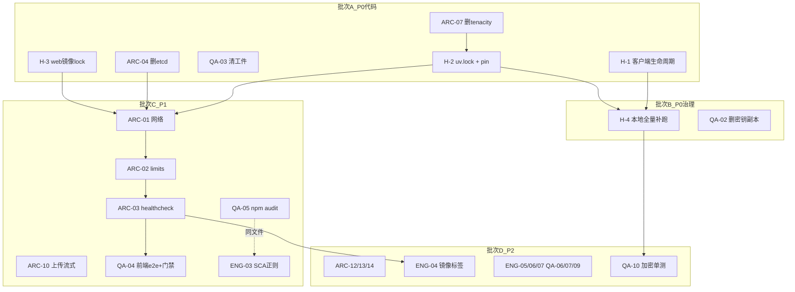

# 麦子（MOY）审计修复方案

- **编制日期**：2026-10-28
- **编制人**：架构师 高见远（Bob）
- **依据**：`docs/audit-2026-10-28-full-repo.md`（29 条：高 4 / 中 11 / 低 14）
- **性质**：仅方案，不含实施。所有证据行号已在 2026-10-28 逐条对源码复核确认（差异见 §0.3）。

---

## 0. 方案总览

### 0.1 修复范围裁定

| 裁定 | 条目 | 说明 |
|---|---|---|
| **本轮实施**（agent 可完成） | H-1、H-2、H-3、ARC-01、ARC-02、ARC-03、ARC-04、ARC-07、ARC-10、ARC-12、ARC-13、ARC-14、ENG-03、ENG-04、ENG-05、ENG-06、ENG-07、QA-03、QA-04、QA-05、QA-06、QA-07、QA-09、QA-10 | 25 条，纯代码 / 配置 / 文档 / 测试改动，分 4 批实施 |
| **部分实施 + 用户人工操作** | H-4、QA-02 | agent 完成代码侧与本地替代验证；真实密钥轮换、CI 恢复属用户操作（清单见 §4） |
| **暂缓** | ARC-06（整站 RSC 改造）、QA-08（localStorage→httpOnly cookie）、ENG-08 的 jose→pyjwt 评估部分 | 理由：ARC-06 是大范围结构性重构，须等 QA-04 的 e2e 防线落地后再动（先有回归防线、再动结构）；QA-08 是 V1.0 已明示接受的权衡，迁移动 CSRF/跨域复杂度，归入下版本；jose 评估需上游活跃度调研，不阻塞本轮 |

### 0.2 批次划分

| 批次 | 内容 | 优先级 | 预计规模 |
|---|---|---|---|
| **批次 A · P0 代码修复** | H-1（Dify 客户端生命周期）、H-2（Python 依赖锁定，含 ARC-07 一并删 tenacity）、H-3（web 镜像 lock 丢失） | 立即 | 小-中 |
| **批次 B · P0 治理与验证** | H-4（本地补跑全量 PG 测试 + CI 恢复待办）、QA-02（删本地密钥副本 + 用户轮换清单） | 立即 | 小（agent 侧） |
| **批次 C · P1 部署与防线** | ARC-01/02/03/04（compose 网络拆分 + 资源限制 + healthcheck + 删孤儿 etcd）、ARC-10（上传流式化）、QA-03（清陈旧工件）、QA-04（前端 e2e + 覆盖率门禁）、QA-05（npm 漏洞扫描）、ENG-03（SCA 正则补 GPL 变体） | 本 Sprint | 中 |
| **批次 D · P2 收口** | ARC-12、ARC-13、ARC-14、ENG-04、ENG-05、ENG-06、ENG-07、QA-06、QA-07、QA-09、QA-10 | 排期 | 小（每条 <20 行为主） |

### 0.3 与审计报告的现场核实差异（2026-10-28 复核）

1. **ARC-12 文件路径修正**：审计写 `billing/postgres.py:276-307`，实际路径为 `apps/adapter/app/db/repositories/billing/postgres.py`，`list_tenants` 方法体一致（无分页、`name ILIKE '%kw%'`）。
2. **H-3 上下文补充**：仓库根 `package-lock.json` 是 **npm workspaces 锁**（根 `package.json` 声明 `workspaces: ["apps/*"]`，`ci-web.yml:43-45` 注释亦确认），不是 web 子目录的独立锁。这决定了 H-3 的修复走法（见该节）。
3. **QA-03 现状确认**：`apps/adapter/coverage.xml`、`pytest_run.log` 均为**未入库的本地工件**（`git ls-files` 不含），直接删除 + 补 `.gitignore` 即可，无 git 历史污染。
4. **ENG-08 现状确认**：`dependency-scan.yml` 已 `upload-artifact` 上传 `python-licenses.md`（:367-371）——"留档"机制已存在，剩余动作只是"对账习惯 + 演进评估"，规模进一步缩小。
5. **tenacity 零引用复核**：`grep -rn tenacity apps/adapter/app apps/adapter/tests` 确认零引用，ARC-07 可安全移除。

---

## 1. 逐条修复方案

> 规模口径：小 <20 行 / 中 <100 行 / 大 ≥100 行（含测试）。
> 每条改动都遵守最小化原则：只改问题对应处，不做顺手重构；不违反「适配层唯一出口 / 错误码注册制 / OA_ 前缀 / 技术黑盒化」等既有约束。

---

### 1.1 【高危】批次 A

---

#### H-1 Dify 客户端生命周期缺陷（原 ARC-08 + ARC-09）

**审计引用**：审计报告 §二 H-1；证据 `app/services/model_service.py:536-559、648、1250`、`app/clients/dify_client.py:88-92、425-452`。已复核：`_dify_for()` 在未注入时每次 `DifyClient.for_app_key()` 新建实例（含新建 `httpx.AsyncClient` 连接池）；`post_stream` 的 `async for ... yield` 无 `try/finally`，GeneratorExit（客户端断开/超时）时跳过 `response.aclose()`。`DifyClient.aclose()` 已存在（dify_client.py:173-176，带 `_owns_client` 守卫）。

**根因分析**：`for_app_key` 被设计成"按密钥造新实例"的工厂而非"取缓存实例"的注册器，调用方（每请求路径）直接拿来用，没有任何一层持有实例生命周期——建与关都没有人管。

**修复步骤**：

1. **`app/clients/dify_client.py` — `post_stream` 加 try/finally（先做，独立可回滚）**：
   将 :450-452 的
   ```python
   async for event in self._iter_sse(response):
       yield event
   await response.aclose()
   ```
   改为
   ```python
   try:
       async for event in self._iter_sse(response):
           yield event
   finally:
       await response.aclose()
   ```
   （`>=400` 分支 :443-448 已正确 aclose，不动。）
2. **`app/services/model_service.py` — 按 app_key 缓存客户端**：
   - `ModelService.__init__`（:338 附近）增加 `self._dify_clients: dict[str, DifyClient] = {}`；
   - `_dify_for()`（:536-559）末尾改为：
     ```python
     client = self._dify_clients.get(key)
     if client is None:
         client = DifyClient.for_app_key(key, self._settings)
         self._dify_clients[key] = client
     return client
     ```
   - 新增方法：
     ```python
     async def aclose(self) -> None:
         """关闭缓存的底座客户端（进程退出与测试清理用）。"""
         for client in self._dify_clients.values():
             await client.aclose()
         self._dify_clients.clear()
     ```
   - 注入路径（`self._dify_injected` 分支）不动——测试注入的客户端 `_owns_client=False`，aclose 本就是 no-op。
3. **`app/main.py` — lifespan 关停时释放**：在 `await dispose_engine()`（:344）**之前**插入 `await get_model_service().aclose()`（先停底座连接、再释放业务库，与现有"先停轮询再释放引擎"的关停顺序纪律一致）。

**并发安全论证（写明，不留模糊）**：
- `_dify_for` 的"查缓存→建实例→写缓存"临界区内**没有任何 `await`**（`resolve_app_key` 是同步方法），单事件循环内不会被打断，dict 读写天然安全，**不需要加锁**；
- 若未来 uvicorn `workers>1`：每进程各自持有缓存并在各自 lifespan 关闭时释放，语义正确，无需跨进程协调；
- 防御性约束（写进 docstring）：缓存 key 是 `resolve_app_key` 的返回值；`.env` 轮换 Dify app key 后**必须重启进程**才会生效（缓存不感知配置热更）——这与现状（进程内 settings 本就启动时固化）一致，不引入新约束。

**影响范围**：
- 文件：`app/clients/dify_client.py`（~6 行）、`app/services/model_service.py`（~20 行）、`app/main.py`（~3 行）、新增 1 个单测文件（~60 行）；
- 不影响任何接口契约 / 数据 / 部署配置；无兼容性风险（`aclose` 已有 `_owns_client` 守卫，注入客户端不受影响）；
- 注意点：缓存上限 = 配置中的 app_key 数量（当前 7 个），内存增量可忽略。

**验证方法**：
1. 新增单测（建议 `tests/unit/test_model_service_client_cache.py`）：
   - 同一 app_key 两次 `_dify_for` 返回**同一实例**（monkeypatch `DifyClient.for_app_key` 计数，断言只构造一次）；
   - 不同 app_key 返回不同实例；
   - `aclose()` 后再次 `_dify_for` 重建（字典已清空）。
2. 流式中断关闭测试：用桩 response 构造 `post_stream`，消费 1 个事件后调用生成器的 `aclose()`（触发 GeneratorExit），断言 `response.aclose` 被调用（修前必红、修后转绿——先在未修复分支跑一次留"可红证明"）。
3. 全量回归：`pytest tests/unit -q`；随后批次 B 的全量带 PG 门禁兜底。
4. （可选实测）起服务发起流式对话并在收到首 token 后断开客户端，`netstat -an | grep 5001` 观察连接数回落，日志无未关闭告警。

**规模**：中（<100 行，含测试）。

---

#### H-2 Python 依赖无锁文件、8 项依赖无上界（原 ENG-01 + ARC-11）

**审计引用**：审计报告 §二 H-2；证据 `apps/adapter/pyproject.toml:22-47`（8 项 `>=` 无上界：uvicorn/redis/asyncpg/tenacity/structlog/slowapi/python-multipart/pyyaml）、无 uv.lock、`ci-adapter.yml:106-109` 现场 `pip install -e .[dev]`。已复核属实；`uv 0.13.1` 在本机**可用**（`uv --version` 实测通过）；pyproject 已有 `[tool.uv]`（:222-223）。

**根因分析**：pyproject 只写了版本约束字符串、CI 每次现场解析，而"精确标签"版本策略没有任何机械载体（锁文件）兜底——约束写在哪里，可复现性就停在哪里。

**修复步骤**（前置：先做 ARC-07 删 tenacity，见 §1.3，避免锁文件生成两次）：

1. **主路径（网络可用，本机已验证 uv 0.13.1 在位）**：
   ```bash
   cd apps/adapter
   # 先按 §1.3 删掉 tenacity 依赖行
   uv lock                     # 生成 uv.lock
   uv sync --frozen --extra dev   # 用锁精确安装，验证 lock 可用
   pytest tests/unit -q        # 快速冒烟
   ```
2. **依赖收敛为 `==` 精确版本**：从 `uv.lock` 读出上述 8 项（及 dev 依赖可选）的实际解析版本，把 pyproject.toml 中的 8 条 `>=` 改为 `==<lock 中的版本>`（其余已有上下界的保持不变，最小化 diff）。改完再跑 `uv lock`，`git diff uv.lock` 应为空——证明 pin 与解析结果一致。
3. **CI 改用锁安装**：`ci-adapter.yml:99-109` 的 `setup-python + pip install -e ".[dev]"` 替换为：
   ```yaml
   - uses: astral-sh/setup-uv@v5
     with:
       enable-cache: true
       cache-dependency-glob: apps/adapter/uv.lock
   - run: uv sync --frozen --extra dev
   ```
   工作流级 `defaults.run.working-directory: apps/adapter`（:42）已就位，后续 pytest/ruff/mypy 步骤无需改目录；`dependency-scan.yml` 中如有 `pip install`/pip-audit 安装步骤同步改为 `uv sync --frozen`（工程师执行时 grep `pip install` 确认全部覆盖）。
4. **Dockerfile 不改**：adapter/Dockerfile 的 `pip install .` 在依赖全部 `==` pin 后解析结果确定，可复现性由 pin 保证——这是最小改动路径。

**降级路径（uv lock 因网络失败时）**：
1. 用当前可用 venv 的 `pip freeze` 人工挑出 8 项依赖的已装版本，直接写 `==` pin（步骤 2 照做）；
2. `uv.lock` 生成推迟到网络恢复，CI 暂保持 pip 安装（pin 后漂移风险已大幅收敛）；
3. 在任务清单标注"H-2 半成品状态：有 pin 无 lock"，网络可用后补步骤 1、3。

**影响范围**：
- 文件：`apps/adapter/pyproject.toml`（~10 行）、新增 `apps/adapter/uv.lock`、`.github/workflows/ci-adapter.yml`（~8 行）、`dependency-scan.yml`（如涉及 ~5 行）；
- 不影响接口契约与数据；部署面：镜像构建结果可能与上次镜像存在依赖小版本差异（pin 收敛后的**预期修正**），首次重建镜像后需跑一次冒烟（compose up + /readyz 200）；
- 兼容性风险：lock 解析出的版本若与现有 dev 环境不同，可能暴露新的测试失败——这正是要发现的问题，用批次 B 的全量门禁兜底。

**验证方法**：
1. `uv lock --check` 退出码 0（lock 与 pyproject 一致）；
2. `grep -A2 'name = "starlette"' apps/adapter/uv.lock` 确认解析版本 ≥1.3.1（PYSEC-2026-1941 防线落进锁文件）；
3. `uv sync --frozen --extra dev` 成功且 `pytest tests/unit -q` 绿；
4. 推分支后看 `dependency-scan.yml`（pip-audit）与 `ci-adapter.yml` 双绿。

**规模**：中（<100 行，主要为 CI 与 lock 文件）。

---

#### H-3 web 镜像构建丢失 package-lock.json（原 ENG-02 + ARC-05）

**审计引用**：审计报告 §二 H-3；证据 `apps/web/Dockerfile:17-19`（`COPY package.json package-lock.json* ./` + `if [ -f package-lock.json ]; then npm ci; else npm install; fi`）、`deploy/docker-compose.yml:516-517`（context `../apps/web`，lock 在仓库根）。已复核属实；补充事实：根 lock 是 **npm workspaces 锁**（根 package.json `workspaces: ["apps/*"]`）。

**根因分析**：lock 文件在 monorepo 根、build context 只圈了 `apps/web`，COPY 通配符匹配不到就静默落进 `npm install` 回退分支——"缺失"没有变成"报错"，而是变成了"降级"。

**修复步骤**（主路径：`additional_contexts`，改动最小且不动 context）：

1. **`deploy/docker-compose.yml` web.build**（:514-517 附近）加一行：
   ```yaml
   build:
     context: ../apps/web
     dockerfile: Dockerfile
     additional_contexts:
       lockroot: ..
   ```
2. **`apps/web/Dockerfile` deps 阶段**（:15-19）改为：
   ```dockerfile
   COPY package.json ./
   COPY --from=lockroot package-lock.json ./
   RUN npm ci --no-audit --no-fund
   ```
   **删除 `npm install` 回退分支**——lock 缺失时 `npm ci` 直接失败（fail loud），不再静默降级。
3. builder 阶段其余（`COPY . .`、standalone 输出路径）不动——context 仍是 `apps/web`，语义不变。

**前置检查**：`docker compose version` 需 ≥ v2.17（`additional_contexts` 支持线）。**降级路径**（Docker 版本过旧）：build context 改为仓库根（`context: ..`、`dockerfile: apps/web/Dockerfile`），并在仓库根新增 `.dockerignore`（排除 `node_modules/`、`apps/adapter/`、`deploy/`、`docs/`、`sql/`、`.git/`、`test-results/`），Dockerfile 相应调整 COPY 路径——改动面大一个量级，仅在主路径不可用时采用。

**影响范围**：
- 文件：`deploy/docker-compose.yml`（+2 行）、`apps/web/Dockerfile`（±3 行）；
- 不影响接口契约与数据；部署面：**镜像内依赖将首次与根 lock 对齐**，若 lock 与 web package.json 长期漂移，`npm ci` 会在构建期报错暴露之——届时以 `npm install` 更新根 lock 后入库为正解（这是修复要的效果，不是回归）；
- `deploy/validate_deploy.py` 如校验 compose 结构，跑一遍确认通过。

**验证方法**：
1. `docker compose -f deploy/docker-compose.yml config` 无报错；
2. `docker compose -f deploy/docker-compose.yml build web`：构建日志必须出现 `npm ci`、不得出现 `npm install`（反例：改前日志是 `npm install` 回退）；
3. 构建产物抽查：`docker run --rm officeai/web:<tag> npm ls next --depth=0` 版本与根 lock 一致；
4. compose up 后 `curl -f http://localhost:3000/` 返回页面。

**规模**：小（<20 行）。

---

### 1.2 【高危】批次 B

---

#### H-4 CI 停摆、207 条 PG 红线用例本地全量 SKIP（QA-01）

**审计引用**：审计报告 §二 H-4；证据 `pytest_run.log` 尾部 `1867 passed, 203 skipped`、`ci-adapter.yml:434-463`（门禁 5 要求 `--run-pg` 且 skipped=0）。已复核 CI 门禁注释明确"带 PG 后实测 2026-10-27 `tests=2325 skipped=0`"——即门禁本身是好的，坏的是**没有 runner 在跑**。

**根因分析**：GitHub Actions 额度耗尽后工作流静默停摆，而本地跑测试又不带 `--run-pg`，于是"最高价值的那部分用例"同时失去了两个执行场地——这不是代码缺陷，是**执行体系单点**。

**agent 可做的替代验证路径（本地补跑全量门禁）**：
1. 起真库（复用 deploy 栈，最小化只起 postgres）：
   ```bash
   cd deploy && docker compose up -d postgres
   # 等待 healthy 后执行 schema 初始化（顺序按 ci-adapter.yml:112-123 注释口径）：
   docker compose exec -T postgres psql -U <OA_POSTGRES_USER> -d <OA_POSTGRES_DB> \
     < init-databases.sql   # 如 CI 同款；其余 init-schema-phase2/3/4.sql、init-app-role.sql 按序
   ```
   （若 `deploy/install.sh` 或既有脚本已封装初始化，优先用脚本。）
2. `deploy/.env` 确认 `OA_DATABASE_URL` 指向应用角色 `officeai_app`（NOSUPERUSER NOBYPASSRLS——夹具会自检，超级用户直接红）。
3. 补跑全量门禁（与 CI 门禁 5 完全同参）：
   ```bash
   cd apps/adapter && uv sync --frozen --extra dev   # 依赖批次 A 的 H-2
   pytest tests -q --run-pg --junitxml=junit.xml \
     --cov=app --cov-report=term-missing --cov-report=xml:coverage.xml \
     --cov-fail-under=85
   ```
4. **产出权威数字**：junit.xml 的 `tests / failures / errors / skipped`（口径：skipped 必须为 0），回填到修复完成报告，作为"当前真实状态"基线；若出现失败，逐条记录（它们就是近期改动破坏隔离的证据），修复或升级后再跑一次取最终数。
5. 耗时预估 ~600s（CI 历史值 593.78s），预留 15 分钟。

**用户操作清单（CI 恢复，留为待办）**：
- [ ] 二选一：① GitHub Actions 付费额度恢复/升级；② 自建 self-hosted runner（一台可访问外网的常驻机，注册到本仓库，`ci-adapter.yml`/`ci-web.yml`/`dependency-scan.yml` 加 `runs-on: [self-hosted, moy]` 标签）；
- [ ] 恢复后首跑确认 `ci-adapter.yml` 门禁 5（`--run-pg` + skipped=0 + cov-fail-under=85）真实转绿；
- [ ] 在仓库 README 或 docs 登记 runner 维护人。

**影响范围**：agent 侧零代码改动（junit.xml/coverage.xml 为本地工件，跑完按 QA-03 处理）；无契约/部署影响。

**验证方法**：第 4 步的 junit.xml 数字即验证本身；`pytest --collect-only -q | tail -1` 应 ~2343 条（收集数与审计一致性自检）。

**规模**：小（无代码）。

---

#### QA-02 本地 .env 含疑似真实凭据明文 + 含旧密钥的备份副本

**审计引用**：审计报告 §三 QA-02；证据 `deploy/.env:91-92,103,184-185`、`.env.lite:74-77,134`、副本 `.env.bak.2255`、`.env.lite.pre-3b2`。已复核：两个副本文件**确实存在**（2026-10-22 / 10-23 时间戳），`.env` 含 DeepSeek key、5 个 Dify app key、`OA_CREDENTIAL_ENCRYPTION_KEY`、Keycloak 口令等全套（键名逐条核实，值不在此复述）；均已确认未入 git。

**根因分析**：联调期"改坏了就先拷一份"的习惯产物（.bak/.pre 副本）叠加 `.env` 本就是明文载体，而轮换动作从未纳入流程——密钥的**生命周期管理**缺位，不只是文件多。

**agent 可做（本轮实施）**：
1. 删除 `deploy/.env.bak.2255`、`deploy/.env.lite.pre-3b2`（删除前 `git check-ignore` 确认两者不在 git 历史中被跟踪过——已核实 `git ls-files` 不含任何 `.env` 实体文件，安全）；
2. 确认 `.gitignore` 覆盖 `deploy/.env*` 且**不含** `.env.example`/`.env.lite.example` 两个模板（防误豁免导致模板也进不了库，或反之实体文件被误提交）。

**用户操作清单（真实密钥轮换，不可由 agent 代做）**——按依赖顺序：
1. **`OA_CREDENTIAL_ENCRYPTION_KEY`（最要紧，注意有数据影响）**：该 key 加密着库内已存凭据；轮换需走"旧 key 解密 → 新 key 重加密"路径，**直接换 key 会使既有加密凭据不可解**。操作：先盘点 credential_service 存量凭据 → 用旧 key 导出明文 → 换新 key 重新写入加密 → 验证知识库凭据链路可用。若存量凭据极少，直接在界面/接口重录一遍更省事。
2. **DeepSeek key（OA_DEEPSEEK_API_KEY）**：到上游平台重置，更新 `.env` 与 `.env.lite`。
3. **Dify 全部 app key（DEFAULT/AGENT/FALLBACK/CODE/LONG_CONTEXT/REASONING 共 6 处）**：在 Dify 控制台逐应用重置，同步两份 .env。
4. **Keycloak：admin 口令 + client secret**：控制台改密、重新生成 secret，同步 .env。
5. **基础设施口令**：`OA_POSTGRES_PASSWORD`、`OA_VALKEY_PASSWORD`、`OA_OBJECT_STORE_ACCESS_KEY/SECRET_KEY`、`OA_JWT_SECRET`、`OA_DIFY_SECRET_KEY`：逐项轮换并同步（注意 `OA_DATABASE_URL` 里内嵌的口令要一并改）。
6. **收尾**：轮换完成后删除本轮产生的任何临时记录；评估迁移 docker secrets / sops（列 P2 待办，本轮不动部署形态）。

**影响范围**：agent 侧只删两个本地文件，零代码影响；用户侧轮换期间服务需短暂重启（compose up -d 重建注入环境变量的容器）。

**验证方法**：`ls deploy/.env*` 只剩 4 个文件（.env、.env.example、.env.lite、.env.lite.example）；轮换后 `docker compose up -d` + adapter `/readyz` 200 + 一次真实对话/检索链路打通（验证新 key 生效、凭据重加密无损坏）。

**规模**：小（agent 侧）；用户侧为操作项。

---

### 1.3 【中危】批次 C

---

#### ARC-01 全量 compose 单一扁平网络 + 内部组件端口映射到宿主机

**审计引用**：§三 ARC-01；证据 `docker-compose.yml:183-185、210-212、588-589、604-606`、`router.py:119-127`。已复核：milvus（19530/9091）、object-store（8333/23646）、prometheus（9090）均直接映射宿主机且未绑 127.0.0.1；全栈单网络 `officeai`。

**根因分析**：compose 从单机演示长出来，网络拓扑与端口面没有随"私有化部署"定位一起收紧——lite 版已经示范了正确形态，全量版没跟上。

**修复步骤**（与 ARC-02/03/04 同一文件，一次 PR 内逐项提交）：
1. 拆双网络：
   ```yaml
   networks:
     officeai-backend: { driver: bridge }   # postgres/valkey/milvus/object-store/dify 全家/keycloak/exporters/prometheus/adapter
     officeai-frontend: { driver: bridge }  # adapter、web
   ```
   仅 `adapter` 同时挂两网；`web` 挂 frontend（web 服务端调用 adapter 走 frontend 网；浏览器侧经宿主机端口直达，不受影响）。
2. 宿主机端口收敛：milvus（:183-185）、object-store（:210-212）、prometheus（:588-589）的 ports 改为 `"127.0.0.1:${...}:..."` 绑回环（保留本机调试能力）或直接删除映射（prometheus 建议绑回环保留）；adapter 8000、web 3000 保持对外。
3. 与 `router.py:119-127` 口径对齐后，跑 `deploy/validate_deploy.py` 确认其网络口径断言同步更新（若有）。

**影响范围**：文件 `deploy/docker-compose.yml`（~30 行 diff）+ 可能 `validate_deploy.py`；不影响接口契约与数据；**部署面风险**：网络拆分后若有组件间隐式依赖漏挂网会起不来——靠验证步骤 3 的全栈冒烟兜底。

**验证方法**：`docker compose config` → `docker compose up -d` → 全部容器 healthy → 链路抽查：web 容器内 `wget -qO- http://adapter:8000/healthz`、adapter 内连 dify-api:5001 与 postgres、宿主机 `curl localhost:8000/readyz`；反例验证：从 web 容器 `wget postgres:5432` 应**不可达**（双网隔离生效的直接证据）。

**规模**：中（<100 行）。

---

#### ARC-02 全量 compose 无资源限制（lite 版有完整 limits）

**审计引用**：§三 ARC-02；证据 `docker-compose.yml` 全文 vs `docker-compose.lite.yml:106-110、133-137`。

**根因分析**：全量版先写、lite 版后按最佳实践补了 limits，但没回流——样板在旁边却没抄。

**修复步骤**：把 lite 版的 `deploy.resources.limits.memory` 口径移植全量版，**至少**覆盖 postgres、valkey、milvus、dify-api、adapter 五个关键容器；dify-worker/beat、plugin_daemon、sandbox 照 lite 口径一并带上（若 lite 有）。数值直接抄 lite，不重新设计。

**影响范围**：仅 `deploy/docker-compose.yml`（~15 行）；无契约/数据影响；风险为限额过紧导致 OOMKill——lite 的数值已在 lite 栈实跑验证过，全量栈组件同款，风险低；首次 up 后观察 30 分钟无 restart 循环即可。

**验证方法**：`docker compose config` 通过；`docker compose up -d` 后 `docker stats --no-stream` 各容器内存 < limit；`docker compose ps` 无 restarting。

**规模**：小（<20 行）。

---

#### ARC-03 全量 compose 大量服务缺 healthcheck；adapter depends_on 不完整

**审计引用**：§三 ARC-03；证据 `docker-compose.yml:231-341、356-374、388-441、503-508`。已复核：postgres/milvus/object-store/valkey/adapter/web 已有 healthcheck，缺的是 dify-api/worker/beat/sandbox/plugin_daemon/ssrf_proxy/keycloak/prometheus，且 adapter 的 depends_on 只有 valkey(healthy) + keycloak(started)，未覆盖 postgres/milvus/object-store。

**根因分析**：同 ARC-02——dify 全家是"拿来即用"的外部栈段，没像自研段那样逐个配探针；adapter 的启动依赖只写了"最会炸的那个"（valkey），数据库侧靠运气。

**修复步骤**：
1. 有标准探针端点的直接加：dify-api（`curl -f http://localhost:5001/health`）、prometheus（`wget -qO- http://127.0.0.1:9090/-/healthy`）、keycloak（`wget -qO- http://127.0.0.1:8080/health` 或 `/realms/master`，注意 keycloak 镜像无 curl 用 wget）、sandbox/plugin_daemon/ssrf_proxy 按其镜像内可用工具配（配不了的下沉到步骤 3 说明）。
2. dify-worker / dify-beat：无 HTTP 端点，**不加 healthcheck**（Dify 官方 compose 亦如此），在其注释里写明理由，避免后人当缺陷再报。
3. adapter.depends_on（:503-508 附近）改为：
   ```yaml
   depends_on:
     postgres:     { condition: service_healthy }
     valkey:       { condition: service_healthy }   # 现有
     milvus:       { condition: service_healthy }
     object-store: { condition: service_healthy }
     keycloak:     { condition: service_started }   # 现有
   ```
**影响范围**：仅 `deploy/docker-compose.yml`（~30 行）；无契约/数据影响；风险为探针配错导致容器恒 unhealthy（项目踩过：SeaweedFS 无 curl——沿用 :141-147 已有的 busybox wget 教训注释口径）。

**验证方法**：`docker compose up -d` 后 `docker compose ps` 目标容器全部 healthy；`docker compose stop postgres && docker compose up -d adapter` 观察 adapter 等待行为；全栈冒烟同 ARC-01。

**规模**：小-中（<100 行）。

---

#### ARC-10 R3 上传整文件读进内存（50MB 上限）

**审计引用**：§三 ARC-10；证据 `app/api/v1/rag.py:163-172`、`config.py:357`。已复核：`payload = await file.read(settings.max_upload_bytes + 1)` 一次性读入。

**根因分析**：为做"+1 字节判超限"图省事整读——超限判定和内容读取被捆在同一个缓冲策略里。

**修复步骤**（最小改法：分块落临时文件，不改契约）：
1. 改 `rag.py` 上传处理：`UploadFile` 用 `file.read(chunk)` 循环（建议 1MB 块）写入 `tempfile`，累计字节超 `max_upload_bytes + 1` 立即删临时文件并抛 `PAYLOAD_TOO_LARGE`（错误码与文案不变）；
2. 后续解析逻辑改为从临时文件读（解析函数若吃 bytes，用 `Path.read_bytes()` 在**校验通过后**读一次——此时大小已受控，内存峰值回到原水平但超限请求不再占内存）；
3. `finally` 中保证临时文件删除；预签名 URL 直传与 pg_trgm 类的大改**不做**（超出最小化）。

**影响范围**：文件 `app/api/v1/rag.py`（~30 行）；接口契约不变（同错误码同文案）；数据无影响；需留意解析层对文件来源的既有单测可能 mock 了 bytes——同步调整测试桩。

**验证方法**：新增单测：构造 50MB+1 的假上传流，断言返回 20008 且内存无全量缓冲（用只实现 `read(chunk)` 的桩文件可判行为）；既有上传用例全绿；实传一个 49MB 文档走通解析。

**规模**：中（<100 行）。

---

#### QA-03 「417 用例 / 91.28%」指标无法对账，陈旧 coverage.xml 误导

**审计引用**：§三 QA-03；证据 `coverage.xml` 头部（86.35%/分支 73.84%，类结构对应已删代码）。已复核：coverage.xml 与 pytest_run.log 均为**未入库本地工件**。

**根因分析**：本地跑测试的副产品（coverage.xml/log）残留在工作目录，而"权威数字"没有唯一载体，任何人翻到旧文件都会当成现状。

**修复步骤**：
1. 删除 `apps/adapter/coverage.xml`、`apps/adapter/pytest_run.log`；
2. `apps/adapter/.gitignore`（无则新建）追加：`coverage.xml`、`junit.xml`、`.coverage*`、`pytest_run.log`、`.pytest_cache/`；
3. 在 `apps/adapter/README.md` 补一行口径说明：「覆盖率/用例数唯一权威来源 = CI junit.xml（门禁 5 产物）；本地工件不入库」。

**影响范围**：零代码影响；QA-10 的覆盖率数字在 CI 恢复前将以 H-4 本地补跑的 junit.xml 为临时权威口径。

**验证方法**：`git status` 干净（删除项均未跟踪，不应产生 diff）；`pytest tests/unit -q` 仍绿（确认删的不是被引用文件）。

**规模**：小（<20 行）。

---

#### QA-04 前端测试薄弱（vitest 55 条纯函数 / e2e 2 条冒烟）

**审计引用**：§三 QA-04；证据 `e2e/` 仅 brand.spec.ts、session-redirect.spec.ts；`ci-web.yml:86-87` vitest 无覆盖率。即遗留 C-3。

**根因分析**：前端测试从"能跑冒烟"止步，核心用户旅程没有浏览器级断言——护栏只围了边角。

**修复步骤**：
1. 新增 `apps/web/e2e/workflow.spec.ts`：覆盖「统一登录 → 兑换会话 → 进入工作台 → 安装一个插件」贯穿旅程（复用 `playwright.config.ts` 既有配置与 session-redirect.spec 的登录桩模式）；
2. 本地起全量栈（依赖批次 C 的 compose 修复成果）跑通该 spec：`npx playwright test e2e/workflow.spec.ts`；
3. ci-web.yml vitest 步骤（:86-87）加覆盖率：`npm run test --workspace apps/web -- --coverage`；先跑一次取当前基线值，门禁阈值设为**基线向下取整**（不许拍脑袋定 80%），在注释里写明"初始阈值=实测基线，只升不降"；
4. e2e 暂不进 CI（现状注释已说明缺浏览器环境），spec 与本地跑法写进 `apps/web/README.md`。

**影响范围**：新增 `e2e/workflow.spec.ts`（~80 行）、`ci-web.yml`（~5 行）、README；无契约/数据影响；playwright 依赖若缺 `@playwright/test` 已在 devDeps（既有 spec 在跑，应已具备）。

**验证方法**：`npm run test --workspace apps/web -- --coverage` 输出报告且阈值生效（人为制造一次低于阈值的反例验证门禁会红）；workflow.spec 本地全绿。

**规模**：中（<100 行）。

---

#### QA-05 npm 侧无漏洞扫描

**审计引用**：§三 QA-05；证据 `dependency-scan.yml` 全文（Python 有 pip-audit，npm 只有协议扫描）。

**根因分析**：SCA 工作流按语言劈了职责，npm 只领到"协议"没领到"漏洞"——清单缺项，不是能力缺陷。

**修复步骤**：`dependency-scan.yml` 新增 job（或并入现有 npm 协议扫描 job）：
```yaml
- name: npm audit（高危及以上即红）
  run: npm audit --audit-level=high
```
在仓库根执行（workspaces 锁在根，`ci-web.yml:43-45` 同款口径）；如 CI 网络限制 registry 访问，改用 `osv-scanner --lockfile=package-lock.json`（二进制随镜像，无 registry 依赖），二选一以实跑通为准。

**影响范围**：仅 `dependency-scan.yml`（~10 行）；无契约/数据影响；风险：现存高危漏洞会让该 job 首跑即红——红了就按漏洞逐个升级修复（那是收益不是回归），若存在短期无法升级的项，走 `npm audit --audit-level=high --omit=dev` 收窄口径并在注释登记豁免理由。

**验证方法**：工作流实跑绿（或按上述口径明确豁免清单）；反例自检：临时在 package.json 引入一个已知漏洞版本（如老 lodash）本地跑确认能红，验完还原。

**规模**：小（<20 行）。

---

#### ENG-03 SCA 协议黑名单正则匹配不到 GPLv2/GPLv3 等写法

**审计引用**：§三 ENG-03；证据 `dependency-scan.yml:239-241`。已复核正则 `\b(GPL|AGPL|SSPL|...)\b`——`\b` 在 `GPLv3` 的 L 与 v 之间不成立（字母接字母），`GPL-2.0-only` 又已被词表枚举遗漏，两路都漏。

**根因分析**：用"精确 token 枚举"去匹配"自由文本许可证字段"，写法的开放性碾压枚举的封闭性。

**修复步骤**：
1. :239-244 两个正则改为前缀锚定式：
   ```python
   BLACKLIST = re.compile(
       r'(?i)(?:\bAGPL|\bSSPL|\bL?GPL|General\s+Public\s+License|EUPL|OSL)\S*',
       re.IGNORECASE,
   )
   ```
   （`GPL` 前缀会同时命中 GPLv2/GPLv3/GPL-2.0-only/…；`General Public License` 兜全称写法；AGPL/SSPL 单列避免语义混淆。）
2. **负样本自检**（加在同一步骤尾部，模式对齐项目既有"可红证明"纪律）：
   ```python
   assert all(BLACKLIST.search(s) for s in
              ["GPLv3", "GPL-2.0-only", "AGPL-3.0-only", "SSPL-1.0", "GNU General Public License v3.0"])
   assert not any(BLACKLIST.search(s) for s in
              ["MIT", "Apache-2.0", "BSD-3-Clause", "MPL-2.0"])
   ```
   断言失败即步骤红——自检与判定同生共死，杜绝再次静默漏检。

**影响范围**：仅 `dependency-scan.yml`（~15 行）；无契约/数据影响；风险为灰名单 `LGPL` 与黑名单 `L?GPL` 语义重叠——黑名单先判，灰名单正则同步加前缀式改写，注释写明"黑名单优先、灰名单兜其余"。

**验证方法**：正例负例自检断言全过（CI 步骤绿即含自检）；用历史 `python-licenses.md` artifact 回放一次确认无新增误报。

**规模**：小（<20 行）。

---

### 1.4 【低危】批次 C 内一并处理（compose 同文件）

#### ARC-04 孤儿 etcd 服务

**审计引用**：§四 ARC-04；证据 `docker-compose.yml:105-120`。已复核：milvus 实际用 `milvus-etcd`（:176 `ETCD_ENDPOINTS: milvus-etcd`），:105-120 的 `etcd` 服务无人依赖，且 `volumes:` 列表含 `etcd-data`。
**根因**：Milvus 部署形态演进（standalone 自带 etcd）后旧服务残留。
**修复步骤**：删除 `etcd` 服务整段（:105-120）与 `volumes:` 中的 `etcd-data`（:577 附近）；`docker compose down` 后 `docker volume rm deploy_etcd-data` 清残留卷（卷名前缀以实际 project 名为准）。
**影响范围**：仅 compose 文件（-18 行）；milvus 不受影响（已核实其 endpoints）；无契约/数据影响（etcd-data 卷内数据无人消费，删除前 `docker compose exec etcd etcdctl get "" --prefix | head` 抽查为空更稳妥，或直接确认 milvus 已运行多日无异常）。
**验证方法**：`docker compose config` 通过；`docker compose up -d` 后 milvus healthy；`docker compose ps` 无 oa-etcd。
**规模**：小。

---

### 1.5 【中危】批次 C 内一并处理（依赖/扫描线）

**ENG-04 应用镜像基础镜像浮动标签**：审计 §三 ENG-04；证据 `apps/adapter/Dockerfile:17`（`python:3.13-slim`）、`apps/web/Dockerfile:12,20`（`node:22-alpine`）vs `deploy/images.lock`。已复核。
**根因**：images.lock 治理建立时只圈了 infra 镜像，自研镜像的 FROM 行成了治理盲区。
**修复步骤**：① 查询 Docker Hub 确定当前 `python:3.13-slim` 与 `node:22-alpine` 的具体 patch 版本，两 Dockerfile 的 FROM 改为精确版本（如 `python:3.13.x-slim`、`node:22.x.y-alpine`）并按 images.lock 既有格式登记 digest；② `deploy/validate_images.py` 扩展校验范围把两个应用 Dockerfile 的 FROM 纳入（工程师按该脚本既有镜像条目格式追加）。
**影响范围**：2 个 Dockerfile（±2 行）、`deploy/images.lock`、`validate_images.py`（~15 行）；重建镜像后跑冒烟；风险：若 3.13.0+ 某 patch 有回归，回滚=还原 FROM 行。
**验证方法**：`python deploy/validate_images.py` 绿；`docker compose build adapter web` 成功且 `docker inspect` 显示精确标签。
**规模**：小-中。

**ENG-05 版本口径漂移（eslint ^10 / mypy py311 / ruff py311）**：审计 §三 ENG-05；证据 `web/package.json:66`、`pyproject.toml:10,85,137`。已复核（eslint `^10.13.0`、ruff `target-version = "py311"`、mypy `python_version = "3.11"`）。
**根因**：基线文档定版早于工具升级（或反之），两处从未对表。
**修复步骤（登记制，不回退工具版本）**：① `web/package.json` 不动，在基线文档（docs 中 ESLint 9 表述处）补注「2026-10 起 devDeps 升至 ESLint 10，属受控偏离，lint 规则集未放宽」；② pyproject :85 与 :137 各加一行注释：「py311 口径 = requires-python 下限（>=3.11）的最低公共分母，运行时 3.13 向下兼容，升档需与 requires-python 联动」。
**影响范围**：纯注释/文档（~6 行）；零运行时影响。
**验证方法**：文档 diff review；`npm run lint:web`、`ruff check app`、`mypy app` 三门禁仍绿（证明只是登记、没动行为）。
**规模**：小。

---

### 1.6 【低危】批次 D（P2 排期，逐条小改）

#### ARC-12 OPS 企业列表无分页 + ILIKE 全表扫

**审计引用**：§四 ARC-12；证据 `app/db/repositories/billing/postgres.py:276-307`（`list_tenants`），正确示范 `list_orders` :251-267。已复核（注意实际路径多了 `repositories/` 一级）。
**根因**：OPS 是内部低频页面，写的时候按"全量拉"最省事，规模感知缺位。
**修复步骤（两档，本轮做①）**：
- ① 最小改（不改契约）：`list_tenants` 查询追加 `LIMIT :limit`（上限 200，超限在 `internal_detail` 记日志提示接分页），SQL 参数化加 `limit`；响应结构不变、OpenAPI 不动。
- ② 完整分页（排期）：`limit/offset + COUNT(*)` 对齐 `list_orders` 模式 + `name` 列上 pg_trgm 索引（需迁移脚本 `CREATE EXTENSION pg_trgm`）——涉及响应契约变更（总数字段），须同步 OpenAPI/契约测试/前端，独立任务再做。
**影响范围**：①仅 `postgres.py`（~8 行）；接口契约不变；②才动契约。
**验证方法**：①单测：造 250 条企业数据，断言返回 ≤200 条且不抛错；`EXPLAIN` 确认 LIMIT 生效。②届时补契约测试。
**规模**：小（①）。

#### ARC-13 幂等/限流后端默认 memory（进程内，多副本即失效）

**审计引用**：§四 ARC-13；证据 `config.py:349`（`idempotency_backend: IdempotencyBackend = "memory"`）、`.env.example:180`。已复核。
**根因**：单机演示期的默认值被带进了部署默认，多副本演进后语义失效但默认没动。
**修复步骤（部署层默认，不动代码默认）**：① `deploy/.env.example:180` 与 `.env.lite.example` 的 `OA_IDEMPOTENCY_BACKEND` 改为 `redis`（栈内 Valkey 已就绪，代码已实现 redis 后端）；② `config.py:349` 不改默认（保离线单测可跑），但**启动时**：`env=production` 且 backend=memory 时打一条 `logger.error` 横幅（模式对齐 QA-07 的降级告警），写清「多副本部署下幂等/限流失效」。
**影响范围**：`config.py`（~10 行）、两份 example（2 行）；无契约影响；已部署环境改 env 后 compose 重建生效。
**验证方法**：单测断言 production+memory 时启动日志含该 error 事件；compose 栈起后 Valkey 中可见幂等键（`valkey-cli keys 'idem:*' | head`）。
**规模**：小。

#### ARC-14 Valkey `allkeys-lru` 业务键与队列键共淘汰策略

**审计引用**：§四 ARC-14；证据 `docker-compose.yml:89-94、253-255、485`。已复核 `--maxmemory-policy allkeys-lru`。
**根因**：Valkey 以"单个 Redis"姿态接入，没人划分 key 域与淘汰域。
**修复步骤（最小改）**：① compose command 追加 `--maxmemory-policy volatile-lru`（只淘汰带 TTL 的 key）；② 确认限流/幂等/Dify 队列各 key 写入处均显式带 TTL（审计已确认 Redis key 均带 TTL，逐处 grep `set(`/`expire` 核实并补漏）；③ 队列 key 迁独立 db 的方案**暂缓**（改动面涉及业务代码与连接配置，收益待多副本阶段再评估），注释登记。
**影响范围**：`docker-compose.yml`（1 行）+ 可能少量补 TTL 代码（~10 行）；无契约影响。
**验证方法**：`valkey-cli config get maxmemory-policy` 返回 volatile-lru；写入一个无 TTL 测试 key + 塞满内存模拟淘汰，断言无 TTL key 存活、有 TTL key 被逐（本地手工验证一次即可）。
**规模**：小。

#### ENG-06 eslint `react-hooks/set-state-in-effect` 整体关闭未闭环

**审计引用**：§四 ENG-06；证据 `eslint.config.mjs:28-31`。已复核（注释已有 TODO(第二阶段 T03) 与"6 处异步 loading 态"说明）。
**根因**：豁免有理由无期限——TODO 没有 owner 与判据，等于无限期。
**修复步骤**：注释升级为带判据的登记：`// 豁免登记：6 处异步加载器同步 loading 态（文件:行见 docs/…豁免清单）；关闭判据 = react-query 迁移完成；到期不迁移则逐处改写重开规则`，并在 docs 建立豁免清单条目（一文件一理由一到期判据）。
**影响范围**：注释 ~4 行 + docs ~10 行；零运行时影响。
**验证方法**：`npm run lint:web` 绿（规则仍 off）；docs 豁免清单存在且含到期判据。
**规模**：小。

#### ENG-07 错误码实际注册范围超出文档分段表

**审计引用**：§四 ENG-07；证据 `core/errors.py:29-167`。已复核（11007、14005-14008、15001-15009、16002-16012、17001-17002、18001-18003 等段）。注意：**代码是准的**（错误码注册制 + G-13 三处一致门禁背书），错的是架构文档 §3.0.3 分段表没跟上。
**根因**：受控扩展走了注册制正门，但文档对账环节没人认领。
**修复步骤**：从 `ErrorCode` 枚举（唯一登记入口）导出全部段位，更新 docs 架构文档 §3.0.3 分段表逐段对齐（建议顺手在文档标注「以 core/errors.py 为唯一事实源，本表为投影」）；不改任何代码。
**影响范围**：仅文档（~30 行）。
**验证方法**：脚本比对（一次性）：`python -c "from app.core.errors import ErrorCode; ..."` 枚举区间 vs 文档表格逐行核对，或人工 diff。
**规模**：小。

#### QA-06 开发环境 CORS `allow_origins=["*"]` + `allow_credentials=True`

**审计引用**：§四 QA-06；证据 `app/main.py:381-387`。已复核。
**根因**：dev 图方便用通配，而 credentials=True 使该组合本身就是浏览器规范明令禁止/告警的形态（浏览器会拒），实际还误导排障。
**修复步骤**：:383 改为 `allow_origins=["http://localhost:3000", "http://127.0.0.1:3000"] if conf.env == "development" else []`；其余参数不动。
**影响范围**：1 行；本地 dev 前端联调不受影响（3000 口已在白名单）；无契约影响。
**验证方法**：单测/手测：dev 下 `Origin: http://localhost:3000` 的预检返回对应 ACAO 头，`Origin: http://evil.example` 不返回；`pytest tests/unit -q` 回归绿。
**规模**：小。

#### QA-07 `tenant_membership_check=off` 仅 warning，无时效与横幅

**审计引用**：§四 QA-07；证据 `security.py:511-533`。已复核（off 档仅 `logger.warning("tenant_membership_check_disabled", ...)`）。
**根因**：紧急止血开关设计时只考虑了"能关"，没考虑"忘了开回来"怎么被看见。
**修复步骤**：① 启动期：`validate_auth_startup`（或 lifespan 启动段）检测 `tenant_membership_check == "off"` 且 `env=production` 时打 error 级横幅日志（含 IDOR 窗口警示文案）；② 时效：新增 `OA_TENANT_MEMBERSHIP_CHECK_DEADLINE`（ISO 时间戳，可空）；off 且 deadline 已过时**启动即失败**（fail loud，属安全配置错误）；两者均在 `security.py`/`config.py` 收口，OA_ 前缀遵守既有规范。
**影响范围**：`config.py`（~5 行）、`security.py`（~15 行）、`.env.example`（~3 行）；无契约影响；不带 deadline 的存量 off 部署行为不变（只多横幅）。
**验证方法**：单测三例：off+无 deadline 启动成功且有 error 日志；off+过期 deadline 启动抛配置错误；off+未到期 deadline 正常。反例：现状代码无任一行为。
**规模**：小-中。

#### QA-09 覆盖率门禁口径文档漂移（注释 80% vs CI 85%）

**审计引用**：§四 QA-09；证据 pyproject:157 注释 vs `ci-adapter.yml:435-463`。已复核（pyproject 注释确为「≥ 80%」，CI 硬门禁 85% 且注释已说明 80% 是阶段一口径、W-01 豁免已到期）。
**根因**：CI 侧升级门禁时没回头改 pyproject 注释——单向同步。
**修复步骤**：pyproject.toml:157 注释改为「覆盖率门禁 ≥ 85%（G-05 硬地板，与 ci-adapter.yml 门禁 5 一致；历史 80% 为阶段一口径已废止）」。
**影响范围**：1 行注释；零运行时影响。
**验证方法**：人工核对两处口径一致即可。
**规模**：小。

#### QA-10 credential_service / artifact_token 覆盖薄弱（加密路径）

**审计引用**：§四 QA-10；证据为陈旧 coverage.xml（0.54/0.72），趋势参考。
**根因**：加密/令牌路径的失败分支（坏密文、过期 token、格式非法）难构造，写用例时被跳过。
**修复步骤**：在 `tests/unit/` 各补分支级单测：credential_service——错误 CREDENTIAL_ENCRYPTION_KEY 解密失败路径、空/截断密文、重加密幂等；artifact_token——过期 token、签名篡改、重复消费。全部走公开接口断言错误码（不探私有成员，遵守 SLF 门禁）。
**影响范围**：新增测试文件 2 个（~120 行，仅测试）；零产品代码改动。
**验证方法**：`pytest tests/unit -q` 绿；如条件允许，H-4 补跑后以新 junit.xml 复核两模块覆盖率不再垫底。
**规模**：中（<100 行）。

#### ARC-06 / QA-08 / ENG-08（评估部分）— 暂缓登记

| 条目 | 暂缓理由 | 重启条件 |
|---|---|---|
| ARC-06 整站 'use client'（25 文件） | 结构性重构，改动面大且无浏览器级回归防线；先做会放大回归风险 | QA-04 的贯穿 e2e 落地并稳定后，按「静态壳优先」渐进改造，每页一个 PR |
| QA-08 会话令牌存 localStorage | V1.0 已明示接受的权衡（session-store.ts 注释自认），迁移牵动 CSRF 与适配层鉴权形态 | 下版本与「短期 token + 刷新」一并设计 |
| ENG-08 之 jose→pyjwt 评估 | 需上游维护活跃度调研与迁移影响面分析，不阻塞本轮任何修复 | P2 排期调研；调研结论落 docs/decisions |
| ENG-08 之 license 对账留档 | 机制已在（python-licenses.md 已 upload-artifact），剩余为流程习惯 | 每次审计时人工对账一次即可，无需代码 |

---

## 2. 实施顺序与依赖图

### 2.1 执行顺序

```
第 1 步（可并行，互不依赖）：
  A-1  H-1 dify_client.py post_stream try/finally + 单测     ← 最核心，先做先验
  A-2  H-3 compose additional_contexts + Dockerfile npm ci
  A-3  QA-03 删陈旧工件 + .gitignore
  A-4  ARC-04 删孤儿 etcd（与 H-3 同文件，同 PR 内先后提交）

第 2 步（串行链）：
  A-5  ARC-07 删 tenacity 依赖行
  A-6  H-2 uv lock → == pin → CI 改 uv sync --frozen          ← 依赖 A-5（锁一次到位）
       （网络失败 → 降级路径：仅 == pin，lock 推迟，登记半成品）

第 3 步（依赖 A-6）：
  B-1  H-4 本地补跑全量 --run-pg 门禁（用锁定环境跑，产出权威数字）
       （CI 恢复为用户操作，待办移交）

第 4 步（B-2 可与第 1 步并行，无代码依赖）：
  B-2  QA-02 agent 删 .env.bak.2255 / .env.lite.pre-3b2；用户轮换清单移交

第 5 步（批次 C，第 1、2 步合入后进行）：
  C-1  ARC-01/02/03 compose 三合一（网络拆分 → limits → healthcheck → depends_on）
  C-2  ARC-10 上传流式化
  C-3  QA-05 npm audit + ENG-03 SCA 正则（同文件，一次改）
  C-4  QA-04 前端 e2e + vitest 覆盖率门禁（e2e 依赖 C-1 的栈能健康起）

第 6 步（批次 D，批次 A-C 全部合入后）：
  D-1  ARC-12① → ARC-13 → ARC-14（性能三连）
  D-2  ENG-04 镜像精确标签（依赖 C-1 后重建镜像验证）
  D-3  ENG-05/06/07、QA-06/07/09（口径与登记类，随时可插队）
  D-4  QA-10 加密路径单测（可与 D-1 并行）
```

### 2.2 依赖图



### 2.3 关键依赖说明

1. **H-2 依赖网络可用性**：`uv lock` 需访问 PyPI。降级路径已内置（§1.1 H-2）：网络不可用时仅做 `==` pin（用本地 venv 的 `pip freeze` 取版本），lock 推迟并登记「半成品」状态，CI 暂保持 pip——pin 本身已消除大部分漂移面。
2. **H-4 依赖 H-2**：补跑全量门禁应在锁定环境下进行，否则跑出来的权威数字本身就不可复现，违背补跑目的。
3. **QA-04 的 e2e 依赖批次 C compose 修复**：贯穿旅程需要全栈 healthy，先修拓扑（ARC-01/02/03）再写 e2e，避免在坏栈上调试测试。
4. **ARC-07 必须先于 H-2**：同一 pyproject 文件，先删依赖再生成锁，避免 lock 做两遍。
5. **QA-03 建议排在 H-4 之前完成 .gitignore**：补跑产生的 junit.xml/coverage.xml 不会污染 git status。

---

## 3. 无法纯代码修复条目处置汇总

| 条目 | agent 侧（本轮做） | 用户侧（待办移交） |
|---|---|---|
| **H-4 CI 停摆** | 本地补跑全量 `--run-pg` 门禁（§1.2 H-4 步骤），以 junit.xml 重建权威数字；把「CI 恢复」登记为 P0 待办 | 额度恢复或自建 self-hosted runner（二选一）；恢复后首跑确认门禁 5 真实转绿；登记 runner 维护人 |
| **QA-02 密钥明文** | 删除 `.env.bak.2255`、`.env.lite.pre-3b2`；核对 .gitignore 覆盖 | 按 §1.2 QA-02 六步清单轮换全部真实密钥（**注意 CREDENTIAL_ENCRYPTION_KEY 需走重加密路径，直接换 key 会废掉存量加密凭据**）；P2 评估 sops/docker secrets |
| **QA-03 权威数字** | 清本地陈旧工件 + gitignore + README 口径说明；临时权威口径 = H-4 本地 junit.xml | CI 恢复后以 CI 产物为唯一权威（依赖 H-4 用户侧待办） |
| **ENG-05 版本口径** | 代码处登记偏离理由（注释/文档） | 若决定「降级 ESLint 至 9 / 升档 py313」属策略拍板，留主理人决策 |
| **ENG-08 jose 评估** | 无（license artifact 机制已在） | P2 排期调研，结论落 docs/decisions |

---

## 4. 风险与回滚

**总原则**：每批次独立分支（`fix/audit-20261028-batch-a` 等），批次内每条一 commit（commit message 引用问题编号），合入前跑该批次验证方法全项。回滚一律 `git revert <批次merge提交>`，禁止 force-push 主干。

| 批次 | 主要风险点 | 回滚方法 | 回滚后残留影响 |
|---|---|---|---|
| **A** | H-1：缓存语义变化（app_key 轮换需重启进程——与现状一致，已在方案中写明）；H-2：lock 解析版本与现有 dev 环境差异暴露隐藏测试失败（**这是预期收益**）；H-3：旧版 Docker 不支持 additional_contexts → 构建失败 | `git revert` 批次 A 分支；H-3 另有降级路径（根 context 方案）可先于回滚尝试 | 无数据影响；H-2 回滚后 CI 回到 pip 现场解析（回到审计前状态） |
| **B** | H-4：补跑暴露真实失败（预期行为，处置而非回滚）；QA-02：删副本不可逆（已核实两副本不在 git 历史，删除即永久）——**删除前 cp 到仓库外目录留 7 天缓冲**更稳妥 | H-4 无需回滚（只读验证）；QA-02 从仓库外缓冲目录恢复副本 | 无 |
| **C** | compose 三合一改动集中，网络拆分可能暴露组件隐式依赖（容器起不来）；资源限额过紧 OOM；SCA 正则误报放红 | 按 commit 粒度 `git revert`（三合一内每条独立 commit）；紧急止血可直接 `git checkout <上一tag> -- deploy/` 还原部署面 | 业务库/对象存储数据在 named volume 中，回滚不触及 |
| **D** | ARC-13 改 env 默认后已部署环境需重建容器；QA-07 新增 deadline 配置误配导致启动失败（fail loud 属设计行为） | `git revert`；env 类改动还原 `.env` 后 `docker compose up -d` 即可 | 无 |

**特别风险登记**：
1. **QA-02 轮换顺序**：CREDENTIAL_ENCRYPTION_KEY 必须走「解密→换 key→重加密」，直接改 key 是本轮唯一可能造成**数据级损失**的操作，已写进用户清单加粗提示。
2. **H-1 是行为变更**：连接复用后，底座侧看到的 TCP 连接模式变化（长连+复用 vs 每请求新建），若底座前置了按连接的限流策略需同步确认——上线后观察 `MODEL_FIRST_TOKEN_SECONDS` 指标应持平或下降。
3. **H-2 首次 `uv lock` 的版本跳变**：8 项依赖可能解析出比当前 dev 环境新的版本，若全量门禁出现新失败，按「逐依赖回退 pin 至 dev 环境版本」处理，而不是放宽测试。

---

## 5. 附：本轮不做但需登记的遗留项

- **C-1（模型提供方密钥）**：与 H-2 同属外部依赖可用性族，本轮范围外，保持既有追踪。
- **SSRF 内网黑名单**：审计确认当前无用户可控 URL 暴露面，但「未来自定义 webhook 上线前必须先建黑名单」——登记为功能前置条件，非本轮修复。
- 下次审计触发条件：P0 全部落地 + CI 恢复实跑后（对齐审计报告 §七建议）。
