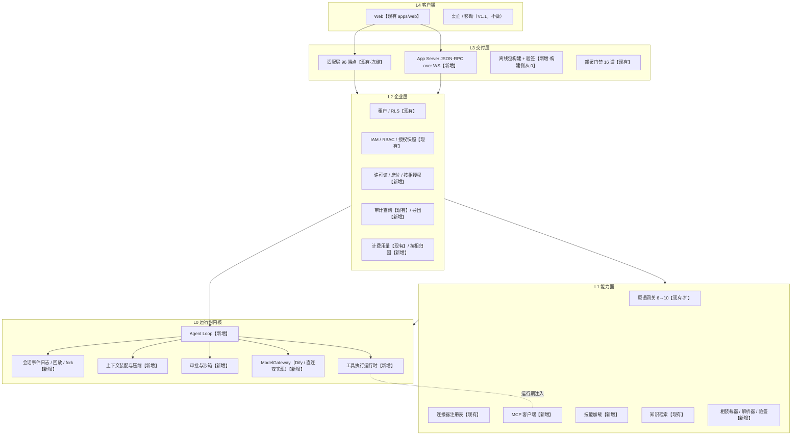

# 底座规格 v1.0（Spec of Record）

## 0. 文档状态与生效条件

| 项 | 内容 |
| --- | --- |
| 版本 | v1.0.0 · **已冻结**（2026-11-04，见 `docs/decisions/0009-base-v1.0-ratification.md`） |
| 层级 | 规格层（唯一真源）。见 `docs/README.md` §六「文档层级与冲突裁决」 |
| 裁决效力 | 任何「这算不算底座的一部分」的争议，只依本文件 §2 / §3 / §9 判定。未被 §2 或 §3 列出、且未在 §9 声明为非目标的，**默认不算底座**，须走 §11 变更流程 |
| 冻结条件（四条全绿） | ① 签 §2 / §8 / §10 —— **已签**（创始人授权主理人代决，ADR-0009 D-54）；② 五条拍板项 —— **已决**（ADR-0009 D-48～D-52）；③ 设计依据基线未变（`a4f6213`，实测 `38d0cd4`）；④ 战略复审 —— **已裁定**（ADR-0009 D-53）。**P1 已解锁** |
| 代码基线 | `a4f6213`（事实核对）；质量实测 `38d0cd4` |
| 设计依据 | `docs/design-base-harness-2026-11-04.md`（下称「设计文档」）。字段级定义、装配单示例、机制表格一律**引用不复述** |
| 取代范围 | 见 §10。本文件生效时，§10 标「被取代」的结论即失效 |

> 本文件只写**可裁决的断言**，不写介绍。凡出现「建议」「可以考虑」，视为本文件的缺陷。

---

## 1. 术语表

术语一旦在此定义，全文（含计划、设计、代码注释、对外文案）不得同义替换。

| # | 术语 | 定义 | 不要与什么混用 |
| --- | --- | --- | --- |
| 1 | **底座**（Harness） | 不含业务能力、但能装载任何相并保证其跑得动/管得住/查得到/卖得掉的空壳 | ≠ 平台：平台 = 底座 + 相 + 企业层商业体系 |
| 2 | **相**（xiang） | 可装载的能力单元，取值 `skill` / `skill_set` / `agent` / `agent_set` / `mcp` / `bundle` | ≠ 插件：插件是可执行代码单元，相是装配单（见 #3） |
| 3 | **装配单** | 描述一个相的全部内容的唯一合法载体（一份 JSON 文档）。相 = 装配单，两者不是两样东西 | ≠ 清单/menu：装配单是可验签、可拒绝的交付物 |
| 4 | **五件套** | Agent Loop、工具系统、上下文管理、权限与沙箱、会话事件日志 | ≠ 五个模块：五件套是**成立条件**，缺一即底座不成立 |
| 5 | **企业层** | 多租户与按相授权、许可证与席位与按相计费、审计导出、私有化交付 | ≠ 增值功能：企业层是「卖得掉」的实现，不是可选附加项 |
| 6 | **动作**（action） | 一次被批准或拒绝的可观测副作用尝试，由共享动作描述（§7）定义 | ≠ 原语：原语是声明式引擎的 6 个执行单元，动作是四处共用的执行记录 |
| 7 | **事件**（event） | 事件流中的一条不可变记录，`(tenant_id, session_id, seq)` 唯一 | ≠ 日志行：事件是状态真源，日志是诊断输出 |
| 8 | **投影**（projection） | 由事件流按序推导出的当前状态 | ≠ 缓存：投影可任意重建，缓存丢了只影响性能 |
| 9 | **沙箱档位**（sandbox_mode） | 由操作系统兑现的物理边界，取值仅 `read_only` / `workspace_write` | ≠ 全局设置：档位是**相的属性**；≠ Job Object（不提供文件系统隔离） |
| 10 | **审批策略**（approval_policy） | 在允许且可及范围内的询问强度，`never` / `on_request` / `always` | ≠ 授权：授权决定「能不能」，审批决定「要不要问人」 |
| 11 | **租户**（tenant） | 数据与授权的隔离单元，`tenant_id` 是全部仓储与事件的必填维度 | ≠ 组织：组织是租户内的结构，不可跨越 |
| 12 | **席位**（seat） | 许可证授权的启用人数单位；一个相消耗 `license_units` 个席位 | ≠ 并发数：席位是授权计量，不是容量限制 |
| 13 | **许可证**（license） | 声明 `xiang_set` / `seats` / 有效期 / 节点绑定的签名文件 | ≠ 授权记录：许可证来自供应商，授权记录来自客户管理员 |
| 14 | **气隙**（air-gap） | 装完不产生任何出站请求，可被客户防火墙证明的部署形态 | ≠ 离线安装：离线安装只约束安装期，气隙约束**运行期** |
| 15 | **BYOK** | 模型 Key 归客户所有并存在客户侧，平台不代持 | ≠ 多模型支持：多模型是能力，BYOK 是**成本与主权归属** |
| 16 | **能力键**（capability key） | 封闭枚举（V1.0 共 15 项）中的一项，是授权与动作的公共词汇 | ≠ 权限点：权限点判「这个接口能不能调」，能力键判「这类数据能不能碰」 |

---

## 2. 底座的定义与分层

**一句话定义**：底座 = **一个能力面完整的空壳**——它不提供任何业务能力，只提供五件套与企业层，使任何相装上去之后**跑得动、管得住、查得到、卖得掉**。

两条铁律（违反即需 §11 变更）：**依赖方向恒为 L4→L3→L2→L1→L0**，反向只经事件总线；**适配层唯一原则不变**——任何层都不得让上层业务直连 Dify 原生 API，MCP 亦须经 `ToolRuntime` 进事件流。

**App Server 的定位是传输层，不是越层通道。** 图中**不存在跨层直连**：AS 先经 L2 建立 `tenant_scope`，再由 L2 带作用域进内核。AS 只做协议转换与流式转发，**不解析业务、不判权限**；loop 的每一次动作都在这一个租户作用域内执行，每一批事件都带同一个 `tenant_id`。**内核不接受无租户作用域的调用——缺 `tenant_id` 直接拒绝，不进 loop。** 若实现中出现「AS 直接读写仓储」「loop 内取不到租户上下文」「事件流有一条缺 `tenant_id`」，按**违反依赖铁律**处理，评审直接拒。

---

## 3. 五件套

| # | 件 | 职责 | 边界（不做什么） | 当前状态 | 完成判据 |
| --- | --- | --- | --- | --- | --- |
| 1 | **Agent Loop** | 在一个 turn 内闭环「装配上下文 → 请求模型 → 派发动作 → 收结果 → 判是否继续」，在四维预算（turn / tool_call / token / 时长）内自主决定步数 | 不承载业务逻辑；不做审批判定（交 #4）；不直接调连接器（经 #2）；不实现子代理（§9） | **无**。只有装配期步数已知的确定性推进 `app/plugins/engine.py:156`（`PluginEngine`），与 loop **并列而非替代** | 装配期步数不可知的任务（设计文档 §4.4/§4.5 两份装配单）能跑完并在预算内中止；同一轨迹回放三次 `TaskStateBlock` 与产物键完全一致 |
| 2 | **工具系统** | 把连接器 / MCP / 内置原语统一为「动作」，提供注册、检索（top-k）、执行、副作用分级、并行边界 | 不定义权限（只声明能力键）；不决定审批；不直接写文件系统（写经沙箱）；不承载第三方生态市场（§9） | **半有**。`ToolConnector` / `ConnectorRegistry` 在 `app/tools/base.py:55-236`，5 个连接器均为 demo 桩（同文件 `:73-79` `INTEGRATION_STATUS="demo"`）；注册表 `app/registry/tool_registry.yaml` 为全量注入式；MCP 全仓 0 命中 | MCP server 经管理员白名单装载、命名空间 `mcp.<server>.<tool>` 生效；工具数 ≥30 时单轮注入 schema 的 `est_tokens` ≤ 预算 25% |
| 3 | **上下文管理** | 每轮装配模型输入；三段保留（固定头 / 任务状态块 / 中段 / 尾段 K=6）；超阈值三级降级压缩；产出显式 `TaskStateBlock` | 不压缩固定头与状态块；不改相的行为；不做长期记忆（现有 memory 域不动） | **无**。任务状态是进程内 `app/services/agent_service.py:173` 的 `self._steps` dict | `used_tokens > 0.8 × model.min_context_window` 触发压缩并落 `context.compressed`；压缩路径与未压缩路径的产物键一致 |
| 4 | **权限与沙箱** | 有效权限 = 授权边界（能力键）× 物理边界（沙箱档位）× 询问边界（审批策略）之交集；每个动作走一遍判定 | 不提供 `danger-full-access`；不在不支持的平台降级放行（只许往更严降）；不做审查者代批（§9） | **半有**。授权在 `app/business/plugin_grant_service.py`（快照缓存 5s，`:36`）+ `app/core/security.py:485-488`；能力键封闭 6 项 `app/plugins/actions.py:57-64`；**物理边界为 0**（`sandbox`/`subprocess` 命中 6 处均非隔离执行） | 越界写 / 越界 egress / 超预算三类负样本 100% 拒绝；不支持 `workspace_write` 的平台装载期拒装并记 `xiang.install_blocked`；Windows 双路径真机各一轮 |
| 5 | **会话事件日志** | 唯一状态真源。append-only、hash 链、按 `(tenant_id, session_id, seq)` 唯一且有序、可回放、可 fork、按租户 RLS 隔离 | 不是运行日志、不是监控指标、不是审计报表；不授 UPDATE/DELETE；不存大对象（产物走 artifact 存储，事件只存键与摘要） | **无持久化**。SSE 直接回放内存 `app/services/agent_service.py:688`：刷新即丢、多副本不可用、断线不续 | 断线带 `Last-Event-ID` 重连零丢失零重复；fork 500 事件会话 <100ms；导出附链头且可复算 |

### 3.1 显式原则 E1：会话事件日志是**状态真源**，不是日志

当前状态 = 事件流的投影。任何「当前状态」字段（任务步骤、产物键、审批结论、压缩摘要、用量）都是投影结果，**不得存在第二个可写副本**。

- **违反判据**：代码里出现「既写事件、又写一份状态表且两者可独立更新」即为设计缺陷，评审直接拒。
- **为什么这一条要写成原则**：底座里六件事全部是这个原则的推论，不是六个机制——
  - 断线续传 = 投影时带 `after_seq`（`seq > Last-Event-ID`）；
  - 回放 = 从 `seq=1` 重放投影；
  - fork = 新会话 `seq=1` 写一条 `session.forked{parent, at_seq}`，回放时递归接父流（O(1)，不复制历史）；
  - 压缩 = 一条 `context.compressed` 事件，压缩后视图可重建，因此结果确定性可复现；
  - 审计导出 = 事件流 + 链头，客户可自行复算；
  - 按相计费 = 从用量事件按 `xiang_id` 归因聚合，而非另记一份计量。

任一时刻若这六件事中的一件需要「另外存点什么」，说明 E1 已被破坏。

---

## 4. 两项补充

### 4.1 模型适配（BYOK）

**事实**：现有链路是 `adapter → Dify 应用 → 模型`，平台侧持有 7 个 Key：`dify_default / agent / code / long_context / reasoning / fallback / memory`（`app/core/config.py:136-163`）。Key 在平台侧，与 BYOK 不相容。

**裁决**：`ModelGateway` 提为 L0 接口，双实现 `DifyModelBackend` / `DirectModelBackend`（OpenAI 兼容协议），按租户配置选择；上层只见 `ModelGateway`。

**边界**：① 不违反适配层唯一原则——该原则约束上层业务不得直连 Dify，不约束「必须经过 Dify」；② `DirectModelBackend` 只做协议转换、重试、流式解析、用量回报，不做模型路由（路由仍由现有 4 档 profile 决定）；③ Key 只存租户侧配置，不落事件 payload、不进日志与导出文件。

**完成判据**：同一相在两种后端下产物键一致；气隙机断网时仅 `Direct` 可用且无网外请求；事件流与导出文件中查不到任何 Key 明文。

### 4.2 持久化会话

**事实**：会话与消息已入库（`app/db/repositories/conversation/`），但**不含执行轨迹**——轨迹在进程内（§3 第 5 行）。

**裁决**：会话与轨迹分离存储，`session_id` 打通。会话行（标题、参与人、消息）继续用现有表；轨迹进 `event_log`。

**完成判据（一条覆盖三件事）**：换一台机器、换一个浏览器打开同一 `session_id`，步骤、产物键、审批状态、压缩摘要全在，且 `seq` 连续无空洞。

**不做**：实时协同编辑（§9）；跨租户迁移。

---

## 5. 企业层四件

| # | 件 | 现状 | 缺口 | 完成判据 |
| --- | --- | --- | --- | --- |
| 1 | **多租户与按相授权** | 租户隔离 `app/core/security.py:485-488` + RLS 覆盖 40/41 表；授权快照 `app/business/plugin_grant_service.py`；能力键封闭 6 项 | 能力键扩到 15 项且每项须有 `ActionGateway` 实现（否则 G-30 双向校验报错）；授权键从「成员×插件」（现有 `plugin_grant` 表的原始语义）改为「成员×相×能力键」；许可证裁剪后的能力子集无落点 | 装载第 5 步（许可证裁剪）产出的能力子集与租户授权交集一致；界面如实显示「部分功能未开通」，无静默降级 |
| 2 | **许可证与席位与按相计费** | 无许可证域；计费与用量已有（`app/business/{billing,usage}*`、`usage_event`），**无按相归因** | `xiang_set` / `seats` / 有效期 / 席位占用四件；`usage_event` 加相维度（归因入库，不做结算单） | 错节点、过期、篡改的许可证拒绝启动；账单能按 `xiang_id` 拆出用量；`license_units × 席位数` 与合同口径一致 |
| 3 | **审计导出** | 查询与动作枚举已有（`app/api/v1/identity.py:236-266`、`app/db/repositories/audit_repo.py:75-123`），**无导出** | CSV / JSON Lines 导出；导出行为自身留痕；附 hash 链头；不含密钥与内部路径 | 客户侧可复算链头一致；导出动作自身产生一条审计记录；同区间两次导出内容一致 |
| 4 | **私有化交付（构建侧）** | 加载侧有（`deploy/install.sh`）；**构建侧为空**（`deploy/offline/` 仅 README 与 plugins） | 预打包 wheel / 镜像 / SBOM + 离线校验 + 介质清单 + `moy-xiang-verify` 离线验签 | 无外网机器 3/3 一次装成、单次 ≤1 人日（战略文档 §8.2 M3 口径）；介质含 SBOM 与第三方许可证；装完零出站请求 |

---

## 6. 相的定义与元模型

**定义（本规格唯一表述）**：相是可装载的能力单元，其全部内容就是**一份装配单**；`kind` 六值决定装载器如何解释其余字段，**不**决定「相是什么」。不需要自研运行时，但**必须验签**。

**字段清单**（完整 JSON Schema 见设计文档 §4.2；销售相 / 美工相示例见 §4.4 / §4.5；15 项能力枚举见 §4.3——本条不复制）

| 字段 | 一句话 | 字段 | 一句话 |
| --- | --- | --- | --- |
| `xiang_id` | 全局唯一标识，`xng_` 前缀 | `permissions` | 沙箱档位、审批策略、可写根、egress、预算 |
| `xiang_version` | 语义化版本 | `artifacts` | 产物键与格式（含 `schema_ref`、`max_bytes`） |
| `schema_version` | 元模型版本，V1.0 固定 `2.0.0` | `acceptance` | 装载期探针，装完至少跑通 1 条，全败则装载失败 |
| `kind` | 六值枚举，决定装载器解释路径 | `model` | 档位、最小上下文窗口、能力要求、`byok_required` |
| `name` / `summary` / `description` | 用户可见名称摘要，长度有上下界 | `system_prompt` | 提示词引用与摘要，限长 8000 字符 |
| `category` | 场景分类，进导航与检索 | `dependencies` | 平台最低版本、前置相、运行时 wheel（须随包携带） |
| `ui` | 布局、导航标签、图标、排序 | `lock` | 版本锁，装载按此解析，不接受浮动版本 |
| `license_units` | 该相消耗几席位 | `provenance` | 来源四档；V1.0 只允许 `first_party` |
| `capabilities` | 能力键 + 是否必需 + 用户可见理由 | `signature` | ed25519 签名、`key_id`、链、`not_after` |
| `tools` | 连接器/MCP/内置工具及其操作与审批 | — | — |
| `mcp_servers` | MCP 启动引用、pinned digest、网络白名单 | — | — |
| `skills` | instruction / template / script 三类，script 须 `requires_sandbox` | — | — |
| `knowledge` | 租户内知识库绑定与作用域 | — | — |

**三条与商业逻辑绑定的硬约束**（在 schema 里，不靠评审自觉）：`permissions.network.egress` 默认 `none` → 气隙不联网；`capabilities` 必填且封闭枚举 + 沙箱档位只有两档 → 最小权限；`knowledge[].binding_ref` 只允许指向租户内知识库 → 数据主权。

**装载与卸载**：8 步全序固定（解包→验签→依赖解析→能力可用性→许可证裁剪→staging→探针断网跑→原子激活），失败回滚分三段，副作用经 `xiang_effects` 逆序回收——见设计文档 §6.1 / §6.2 / §6.3。**卸载后必须能再装一遍且验收样例仍通过**，这是「可逆」的唯一可信判据。

---

## 7. 共享动作描述（action descriptor）

工具系统、沙箱、会话事件日志、审批**四处共用同一份动作描述**。

| 字段 | 类型 | 消费方 | 说明 |
| --- | --- | --- | --- |
| `tool_name` | string | 四处 | `mcp.<server>.<tool>` / `<connector>.<operation>` / `<builtin>.<op>`，全局唯一 |
| `params_schema` | JSON Schema | 工具系统、沙箱 | 模型可见的那份，同时决定注入体积（`est_tokens` 由它估算） |
| `side_effect` | `none` / `write` / `external` | 审批、工具系统、事件 | **唯一**决定并行与审批强度的字段 |
| `capability_key` | 15 项枚举之一 | 权限 | 动作发生前必须被授予 |
| `replayable` | boolean | 沙箱、回放 | 只读且无副作用者方可重放 |
| `timeout_seconds` | integer | 工具系统 | 硬超时，超时按失败计，不重试到超时之后 |
| `idempotency_key` | string（模板） | 工具系统、事件 | 写类与外发类**必填**，重试不产生二次副作用 |

**唯一性声明**：定义处只有一个（`app/kernel/tool_runtime.py`），其余三处**只读不写**。**四处若各自定义动作，视为设计缺陷**，评审直接拒——因为口径一旦漂移，「侧效分级」会同时与「审批强度」（并行发出三封邮件）、「沙箱档位」（只读动作被拒或写动作越界）错位，事件流也无法据此重建「当时是否允许」。

**三条派生规则**：读类（`none`）可并行，并发上限 4；写类（`write`）串行；外发类（`external`）串行且**永远每次问**（`approval_policy=never` 也不能免）。超时默认**拒绝**，不默认放行。

---

## 8. 四条验收（「底座做完了」的唯一标准）

| 条 | 判据 | 可执行测法 | 不通过即视为 |
| --- | --- | --- | --- |
| **跑得动** | 两份示例装配单任一，在**断网**机器上完成装载 8 步并跑通 ≥1 条 acceptance | 装载 → 卸载 → **再装一遍**仍通过（可逆判据）；探针在 `egress=none` 沙箱内执行；前置：篡改包变异 20 次全拒（A1）、零回归（A5） | 底座不成立 |
| **管得住** | 越界写、越界 egress、超预算三类负样本 100% 拒绝；Windows 双路径真机各一轮 | 负样本用例集全绿且每条各有审计记录；无 `workspace_write` 能力的平台装载期拒装；无静默降级 | 卖不进受监管客户 |
| **查得到** | 换机器/重启后状态全在；kill 连接后带 `Last-Event-ID` 重连零丢失零重复；fork 500 事件 <100ms；导出链头可复算 | 设计文档 §8.2 的 A2 / A3 / A4 三条 + 客户侧链头复算脚本；同一区间两次导出内容一致 | 没有审计卖点 |
| **卖得掉** | 许可证错节点 / 过期 / 篡改三种均拒启；用量可按 `xiang_id` 归因；气隙机 3/3 一次装成 | 三份无效许可证 + 一份有效许可证各跑一次；账单按相拆分核对；断网 3 次安装记录 | 商业模式不成立 |

单测全绿、门禁全绿是四条验收的**必要条件，不是充分条件**。四条不全绿即「未完成」，不得对外表述为「底座已就绪」。

---

## 9. 非目标（V1.0 明确不做）

| 不做 | 一句话理由 |
| --- | --- |
| 桌面 / 移动客户端 | 40–60 / 50–80 人日，换不来气隙客户的采购理由；分发不是我们的优势 |
| Office 人机双写 | 60+ 人日，正面对撞 WorkBuddy 的主场能力 |
| 子代理 | 抬高上下文与预算复杂度，V1.0 客户场景不需要；只预留 `subagent.spawn` 事件类型 |
| `auto_review` 审查者代批 | 用 AI 批 AI 且无评估集，V1.1 再做 |
| dsh 包互装 | 只做格式映射，转换器 8 人日已在设计文档 §8.1.1 明确排出 V1.0 |
| 社区相装载 | `provenance.source` 只允许 `first_party`，第三方生态是 V1.1 |
| SCIM | 组织同步用 CSV 导入，省 10–15 人日 |
| 协作 / 分享 / 评论 | 协作发生在 Office 文件里，不在平台内 |

---

## 10. 与现有文档的取代关系

| 文档 | 判定 | 说明 |
| --- | --- | --- |
| `moy-project-charter-v1.0.md` | **部分保留**（宪法层，**原文不动**） | **ADR-0009 D-53 已裁定**：**保留** §6 / §6.1「保持广泛入口」、§12.5、§13 原则二——「底座 + 相」的结构本身就是广泛入口，只是入口由相提供；**作废** §9.1 个人订阅、§9.2 按量付费（无分发能力、BYOK 无计价基础）；**待落笔** §1.2 一句话介绍、§5.1–5.2 用户范围、§15 第 1 条。正式改稿留至 V1.1 文档整理，本规格生效期内以 §2 为准 |
| `strategy-2026-11-04-company.md` | **部分保留（主结论已裁定作废）** | **ADR-0009 D-53 裁定**：§1「不做 AI 工作台」、§4.1「只做一个垂直 W1」、§4.2 末「先做 10 个客户再谈平台」**作废**；**继续有效**：§3.1（1000–2500 万营收量级与推导）、§5（单位经济红线）、§6（获客动作）、§7（组织切分）、§8.4（不拿 10x VC 的钱）。**新口径**：底座横向建、销售窄口打，首批三个相（行政/公文、销售、财务）。细节冲突：其 §4.2「xlsx + Office 预览移出 V1.0」与本规格 §6 的 `artifacts.format`（含 `xlsx`）不一致 → 以规格为准（探针产物可含 xlsx，Office **预览**仍不做） |
| `gap-matrix-2026-11-03.md` | **部分保留** | §2 十四项矩阵、§3.1 的 B1–B7 人日口径、§5 不做清单继续有效并被引用（B3/B4/B5 是 T05/T07/T08 的外部口径）；§4 分阶段路线（阶段一/二/三）被 `plan-base-2026-11-04.md` 取代 |
| `platform-strategy-2026-11-03.md` | **被取代**（整份） | 其 §4.2「第三方生态 / 插件市场 / 开放审核」（原文用语）路线与本规格 §9 冲突，且结论已被战略文档收编；余下价值仅为研究材料 |
| `prd-v1.0.md` | **部分保留**（定位与范围章节被取代） | §1–§3（平台定位、用户范围、交付形态）被本规格 §2 与战略 §2.3 取代；功能需求与验收条目继续有效，但涉及 `xlsx/pptx/双写` 的条目按 §9 降级 |
| `architecture-v1.0.md` | **部分保留** | 96 端点冻结契约、错误码注册制、数据分层继续有效；其运行时/上下文/事件相关章节由本规格 §3 与设计文档 §5 取代（`_steps` 内存状态被替换） |

---

## 11. 变更流程

**谁能改**

| 章节 | 起草 | 签署 |
| --- | --- | --- |
| §2 / §8 / §10 | 架构师 | 架构师 + **创始人** |
| §3 / §5 / §6 / §7 | 架构师 | 架构师 + 技术合伙人（记入 `docs/decisions/`） |
| §1 术语 | 架构师 | 架构师单独提交，触发全文一致性检查（禁用同义替换） |
| §4 / §9 / §11 | 架构师 | 架构师 + 创始人（非目标增删等于收窄或放宽交付边界） |

**冲突裁决（确定性规则，按序适用，命中即止）**

1. 规格 ↔ **总纲**：以总纲为准，并**触发规格复审**（7 日内出结论；结论前按总纲执行）。
2. 规格 ↔ **战略**：以规格为准，并**触发战略复审**。触发条件仅两条：① 冲突涉及交付形态或非目标集合；② 冲突会导致 141 人日总量变化。复审由创始人在 7 日内裁定，裁定前按规格执行。
3. 规格 ↔ **执行层**（`plan-base-*` / `design-*`）：以规格为准；执行层 24 小时内改，改不完则执行层作废重写。
4. 规格 ↔ **记录层**（audit / phase-* / qa-*）：记录层不改结论，只加日期。
5. **同层两份文档冲突**：以文件头「生效日期」较晚者为准；日期相同则视为缺陷，交架构师当日裁定并同步双方。

**版本规则**：术语或验收判据变更 → minor（v1.x）；增删非目标、改冲突裁决规则 → major（v2.0）。任何 major 变更须重跑 §8 四条验收。
